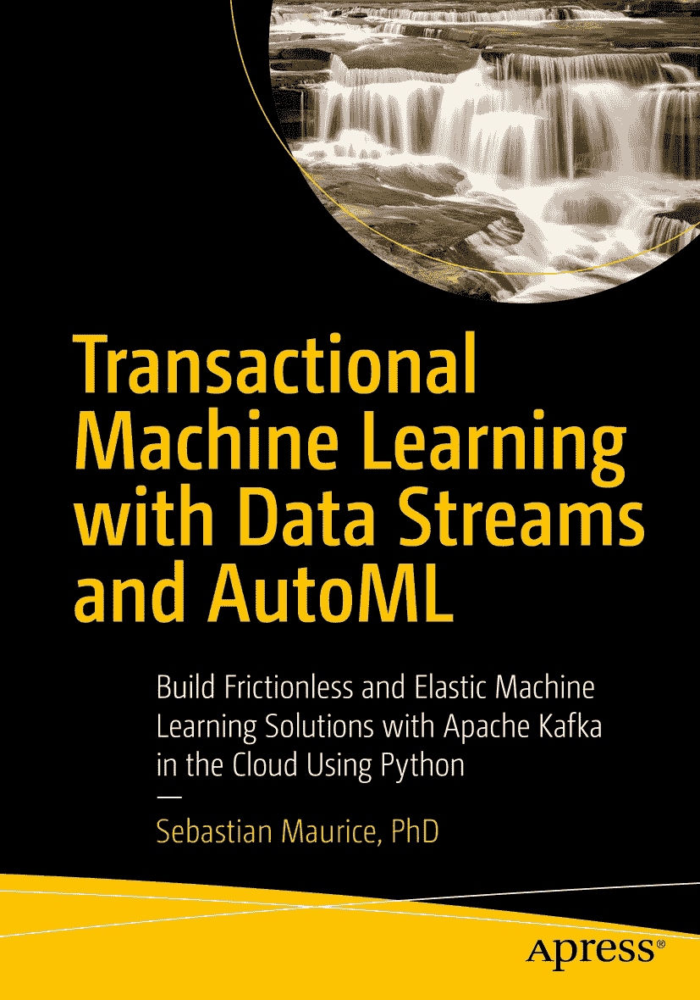

ISBN 978-1-4842-7022-6 电子版 ISBN 978-1-4842-7023-3 [`doi.org/10.1007/978-1-4842-7023-3`](https://doi.org/10.1007/978-1-4842-7023-3) © Sebastian Maurice 2021 Apress 标准版 本出版物中使用的通用描述性名称、注册商标名称、商标、服务标记等，即使未作明确声明，也不意味着这些名称不受相关保护性法律和法规的约束，因此可自由用于一般用途。出版商、作者和编辑可以合理假定，本书中的建议和信息在出版之日是真实准确的。出版商、作者或编辑均不对本书所含材料或可能存在的任何错误或遗漏提供明示或暗示的担保。出版商对已出版地图中的管辖权主张和机构隶属关系保持中立。

本 Apress 印记由注册公司 APress Media, LLC（Springer Nature 的一部分）出版。

注册公司地址为：1 New York Plaza, New York, NY 10004, U.S.A.

*献给我的女儿 Matea、我的妻子 Ellen，以及我的父母 Frank 和 Mary。*

引言

*快速数据需要快速机器学习以实现快速决策。* 了解如何使用 Python 在云端将自动机器学习应用于 Apache Kafka 的数据流，并创建*无摩擦*（需要最少甚至无需人工干预）和*弹性*（通过控制数据流、算法和洞察用户的数量来实现可伸缩的机器学习解决方案）的事务性机器学习（TML）解决方案。本书将加深您对 TML 解决方案内部工作原理的理解，这些解决方案使用与 Apache Kafka 集成的可扩展自动机器学习数据流。您将站在机器学习这一激动人心领域的前沿，该领域专注于数据与算法创建的速度、规模和自动化，这将为几乎所有行业带来商业价值。

通过阅读本书，您将对 TML 的技术和业务方面有扎实的理解。您将了解如何构建包含所有必要细节的 TML 解决方案，所有可免费下载的软件都触手可及。在知识经济时代，数据创建速度不断加快，需要快速、无摩擦且弹性的机器学习解决方案来实现快速决策，从而大规模创造巨大的商业价值，您将站在技术和商业的前沿！

致谢

我要感谢我的妻子 Ellen 和女儿 Matea 在本书写作过程中给予的支持。她们持续的支持是无价的。

我要感谢 Michael Scappaticci 对章节的编辑和审阅，以及对本书中一些概念的讨论。我还要感谢 Phoenix Unnayan Majumder 的贡献，特别是在 Apache Kafka 方面。我还要感谢 Tim Raiswell；他的见解和思考对塑造本书中的一些想法至关重要。

最后，我要感谢我的父母 Frank 和 Mary，他们在我追求人生所有梦想和目标的过程中给予了一贯的支持和鼓励。

关于作者 关于技术审稿人

