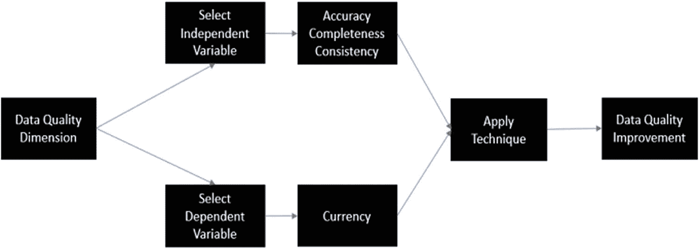

# 1. 引言：大数据、自动机器学习与数据流

数据流是一类持续更新和捕获的数据，其体积不断增长且基本无界 [Aggarwal, 2007; Wrench et al., 2016]。想想我们的日常生活如何为数据流做出贡献。每次我们用信用卡购物时，关于您的姓名、购买金额、购买产品、购买时间和日期、购买地点、数量、产品代码等购买事件信息都会被实时捕获，并存储在能够存储大量数据的数据存储平台中。浏览网页也会导致海量数据通过 IP 网络流动，这些数据正被您的互联网服务提供商（ISP）捕获。甚至我们驾驶的汽车也越来越多地连接到互联网。汽车制造商正在捕获和存储所有的遥测和 GPS 数据。

数据持续渗透到我们生活的方方面面。我们今天使用的日常物品，如冰箱、汽车、洗衣机、电视等，每天都会产生海量数据。据估计，我们每天创造 2.5 万亿字节的数据。而且，世界上大部分数据都是在过去几年中创造的。这在规模上令人印象深刻，并表明数据正以我们 10 年或 15 年前无法想象的方式涌入我们的世界。我们大多数人都熟悉存在于数据库表、平面文件和 DataFrame 中的数据，但一种由数字互联世界驱动的新数据类别——海量、快速移动的数据流——正在为数据工程师、科学家和分析师带来新的挑战。我们都意识到数据的增长及其对组织的价值 [Read et al., 2019; Read et al., 2020; Guzy and Wozniak, 2020; Lang et al., 2020]，但在管理和分析快速移动的数据流，以及管理伴随触发大数据流的不同事件峰值所带来的负载（这可能会影响机器学习模型的性能）方面，我们仍处于早期阶段。数据流，或连续的数据流（将在后文详细讨论），正从人类或机器等多个来源生成，管理这些数据流的技术也在不断发展。有效管理和分析流式数据正成为金融服务、社交技术、零售、媒体、医疗保健和制造业等高交易量行业的必备能力。想想 Facebook、Twitter、LinkedIn、Netflix、物联网设备、金融科技等每秒（或更快）产生的所有数据。这些快速流动、迅速累积，如果允许的话，其规模可以无限增长的数据，可以由数据流科学家使用事务性机器学习（TML）通过以下方式进行分析：

1.  数据流可以回滚并连接，实时形成一个合并数据集，该数据集可用作 TML 的训练数据集。通过实时分析训练数据集的“窗口”，我们无需一次性分析所有数据；相反，我们可以持续地按时间事务分析所有数据。例如，如果您想分析每笔零售交易是否存在信用卡欺诈，将 TML 应用于信用卡交易流将帮助您在购买时点及时做出决策。

2.  数据流可以被命名以帮助形成机器学习模型。具体来说，通过命名数据流，我们可以识别一个因变量流和自变量流，以构建一个可由 TML 估计的模型。

3.  数据流可以被重新利用，以存储由 TML 选择的最优算法的信息。这些算法随后可用于预测分析和优化，其结果可以存储在其他数据流中，并由人类或机器在报告和仪表板中用于决策。

我们将进一步展示 TML 如何实现*无摩擦机器学习*，从而加速那些处理非事务性数据的传统机器学习方法。具体来说，传统的机器学习流程在准备数据、构建包含自变量和因变量的数学模型、估计模型并微调超参数，以及最终将模型部署到实际应用时，都需要人工干预。所有这些环节都会产生摩擦，可能导致机器学习过程延长数天甚至数周 [Yao et al., 2019]。在本书中，我们将展示 TML 如何利用 AutoML 在处理数据流时显著减少这种摩擦。

我们还将展示 TML 解决方案如何具备*弹性*。TML 解决方案具有弹性，因为你可以调整所创建的数据流和机器学习模型的数量，也可以调整数据生产者以及机器学习模型洞察消费者的数量。这一点至关重要，原因如下：

*   使组织能够快速满足快速变化的业务领域的分析需求

*   通过快速停用 TML 解决方案，使组织能够控制不再使用的解决方案的成本

*   使组织能够根据用户需求扩展或缩减解决方案

任何机器学习流程的核心组成部分都是数据。传统上，首席信息官或首席数据官在开始机器学习之前，首要关注的是制定数据策略。但是，数据速度的提升为数据管理和分析增加了另一层复杂性，而这在传统数据策略中很难被纳入。本书将提供应对这一挑战的方法，并展示如何将数据流整合到与组织目标相一致的数据策略中。在讨论之前，我们需要问一个问题：什么是数据？在谷歌上快速搜索“数据”一词，会得到数百万条结果。在本书中，我们假设数据是*数字化*创建的。数据有三种形式：

1.  结构化数据

2.  半结构化数据

3.  非结构化数据

## 结构化数据

结构化数据是整齐地组织在某种数据库中的数据。这种结构使开发者或用户能够以标准化且可重复的方式访问数据，用于各种技术解决方案。结构化数据是一种常见的数据类型，因为它使数据更易于分析和报告。要对数据施加结构，我们需要执行以下操作：

1.  分类——它是数字、文本还是图像？

2.  确定大小——数据有多大？或者它可能变得多大？

3.  命名——我们应该给它取什么名字？假设所有有名字的数据都称为“变量”。

通过对数据进行分类、确定大小和命名，我们不仅是在构建数据结构，还使其他人更容易使用和访问这些数据。这对于在报告和仪表板中分析和可视化数据非常重要。

## 半结构化数据

这类数据具有一定的结构，但并非全部都是结构化的。想象一下那些不能完全放入表格形式，但可以通过键和值进行标记和识别的数据。例如，被称为 JSON<sup>(1)</sup> 或 XML<sup>(2)</sup> 的数据。这些是业界普遍接受的通过键和值标记数据的标准形式，但它们并不适合标准的、结构化的关系型数据库。半结构化数据是一种重要的数据形式，因为它不需要数据库模式来存储。数据的存储可以在应用程序层面以 JSON 或 XML 的形式定义。这使得半结构化数据在不同应用程序之间使用和交换非常灵活，从而更容易在报告和仪表板中消费和可视化。TML 解决方案使用 JSON 数据格式。

## 非结构化数据

这类数据没有结构。它们不容易以表格形式分类，也无法像 JSON 或 XML 那样放入键值格式。非结构化数据可能是最丰富的数据形式，因为它们几乎可以由任何数字设备创建。想想电子邮件、来自网站的数据、视频、图像、传感器读数等等。对非结构化数据施加结构可能是有价值的。例如，假设你有数千封电子邮件，你想按关键词对它们进行结构化处理。为电子邮件分配一个关键词，可以让你对所有带有该关键词的邮件进行分类，并提高搜索邮件的速度。所有这些数据类型之间的共同点是数据量。这些数据类型的巨大增长被称为大数据，将在下一节讨论。

## 大数据速览

“大数据”一词自 20 世纪 90 年代以来一直被用来描述那些规模过大、无法用传统方法分析的数据。具体来说，非大数据可以轻松地在笔记本电脑或家用电脑上进行整理、预处理和分析。该术语的一个常见定义及其起源，很可能归功于约翰·马西 [Mashey, 1999; Lohr, 2013]。他首次在计算机语境中使用“大数据”一词，记录了数据增长及其对磁盘空间、CPU 和基础设施等计算机硬件日益增长的需求，他将这种需求称为“基础设施压力”。

随后，大数据被概括为以下特征 [Sagiroglu, 2013]：

1.  `数据量` – 指数据的规模，以不断增长的 TB、PB 甚至更大单位来衡量。数据量会影响用于存储这些数据的存储硬件选择，以及能够进行的分析类型。

2.  `多样性` – 指可被归类为大数据的各种数据类型。数据类型不仅会影响存储选择，还会影响数据的分析、预处理和整理方式。例如，如果大数据是文本形式，那么使用机器学习技术对这些数据进行分析，就需要将数据转换为数值形式。

3.  `速度` – 指数据产生的速度。数据产生的速度会直接影响数据量。这也会影响数据的处理方式以及如何从中分析获取洞见。

4.  `真实性` – 指数据的质量。数据质量会影响从这些数据中提取的洞见的质量。虽然衡量数据质量很困难，但有统计方法和算法可用于确定数据质量；关于数据质量的更多内容将在后文讨论。

5.  `价值` – 从数据中提取的洞见所具有的价值。数据的价值应在问题或研究领域的背景下进行衡量。例如，如果试图回答“为什么年轻人的汽车保险费高于老年人”这个问题，那么使用捕捉不同人群驾驶模式的数据，可以为回答这个问题（即针对不同年龄组优化保险定价）增加巨大价值。选择*正确*的数据来解决*正确*的问题，可以在许多商业领域带来可观的价值。

上述特征并非完整列表，但它们为我们理解、描述和分类大数据提供了指导。具体而言，数据的量、多样性和速度给确保数据质量以及寻找方法（利用机器学习分析高速数据，为决策提供高质量洞见）带来了挑战。这些与高速数据相关的挑战，正是 TML 所要解决和处理的问题。

数据流可能导致大数据，但大数据并不必然导致数据流 [Jayanthiladevi et al., 2018]。具体来说，持续的数据流会在你的存储平台上累积，形成大数据。然而，大数据不需要持续流动，它可以是静态的并驻留在磁盘上。在数据流（将在后文讨论）的背景下，适用于数据流的大数据特征包括速度、数据量、真实性和多样性。如果执行 TML，还可以进一步应用价值特征：当将数据流与自动机器学习结合使用时，正如我们将在第 2 章中讨论的那样。

# 概述

从 TML 解决方案和基础设施的角度来看，建立一个能让数据增长且不受任何限制的环境至关重要。拥抱无限数据思维的组织将更加强调数据分析，以提取洞见，做出更好的数据驱动决策 [Sagiroglu, 2013]。然而，做出良好的数据驱动决策将依赖于使用高质量的数据。我们将在下一节讨论数据质量。

## 数据质量

从数据中提取的洞见直接取决于数据的质量。数据质量问题在传统的静态数据和持续流动的数据流之间并无不同。然而，如何确定和识别质量问题在这两种数据类型之间确实存在差异，这直接是数据速度的函数。例如，更高的数据速度会导致数据底层结构发生更快的变化。在数据流中检测和提高数据质量带来了进一步的挑战。鉴于数据的持续流动，评估质量需要自动化和实时处理 [Gudivada et al., 2017]。如何在数据流中进行数据插补或检测重复数据？这仍然是一个悬而未决的问题，但正开始获得更多关注 [Gudivada et al., 2017]。TML 可以在这一领域提供一些帮助，如第 2 章所述。具体来说，如果试图识别数据中的离群点或异常值，传统的异常检测机制可能无法捕捉到所有异常值。传统方法的问题在于它们没有考虑随时间变化的交易数据。我们将展示 TML 如何使用无监督学习算法，在随时间快速变化的快速数据流中检测离群点或异常值。

“垃圾进，垃圾出”这句格言是千真万确的。好的数据，而非坏的数据，是获得良好洞见的关键要求。但是，如何确定自己拥有的数据质量是否良好呢？使用国际标准化组织（ISO）对质量的定义 [Heravizadeh et al., 2009]：`实体满足明示和隐含需求的能力之全部特性总和`。这些明示和隐含的需求会根据使用这些数据的环境和背景而变化。这进一步意味着数据质量的阈值会随环境和背景而变化。例如，衡量某人患癌风险所需的数据质量阈值，很可能高于衡量人们更喜欢可口可乐而非百事可乐的可能性所需的质量阈值。

事实上，数据质量的维度也会有所不同。例如，在会计和审计领域，`准确性`、`相关性`和`及时性`是三个重要的数据质量维度 [Sidi et al., 2012]。在信息系统领域，`可靠性`、`精确性`、`相关性`、`可用性`和`独立性`则很重要。表 1-1 展示了数据质量维度的汇总列表 [Sidi et al., 2012, pp. 302]。

表 1-1

数据质量维度

| 维度 | 定义 |
| --- | --- |
| 时效性 | 数据的新旧程度适合待执行任务的程度。具体而言，时效性是指现实世界状态发生变化与信息系统状态随之修改之间的延迟。这会影响数据的年龄和波动性：年龄衡量的是信息相对于记录时刻的新旧程度，而波动性则衡量信息基于实体属性值变化频率的不稳定性。 |
| 现时性 | 尽管存在因时间相关变化导致的当前值差异，数据仍保持最新的程度。现时性描述了信息何时被录入来源或数据库等数据存储技术，以及录入的时间点。 |
| 一致性 | 数据以相同格式呈现并与先前数据兼容的程度。 |
| 准确性 | 数据正确、可靠且经过认证的程度。具体而言，准确性衡量数据值与某个被视为正确的其他值的接近程度。 |
| 完整性 | 数据被视为真实世界系统表征的程度，即数据具有足够的广度、深度和范围以执行任务，并且包含理论上应收集的所有值。 |
| 可访问性 | 数据易于获取且可快速检索的程度。 |
| 重复性 | 在特定字段、记录或数据集内或跨系统中存在数据重复的程度。 |
| 数据规范 | 数据可被视为完整、文档齐全，并包含数据模型、业务规则、元数据及参考数据的程度。 |
| 呈现质量 | 数据可用于可视化并支持恰当使用图表和仪表盘等可视化技术的程度。 |
| 一致表示 | 数据达到可在不同应用和系统中使用的标准格式的程度。 |
| 声誉 | 数据在其来源和内容方面受到高度评价的程度。 |
| 安全性 | 数据在人类、财产、流程和环境方面达到合理且可接受风险水平的程度。 |
| 数据量适中 | 数据量适合待执行任务的程度。 |
| 安全性 | 数据被适当限制以维护其安全性的程度。 |
| 可信度 | 数据被视为真实可信的程度。 |
| 可理解性 | 数据清晰、无歧义且易于理解的程度。 |
| 客观性 | 信息无偏见、无成见且公正的程度。 |
| 相关性 | 信息适用于待执行任务并对其有帮助的程度。 |
| 有效性 | 用户能够在用例背景下准确且完整地实现特定目标的程度。 |
| 可解释性 | 数据能够以不同语言、符号和单位清晰解释的程度。 |
| 易操作性 | 数据易于操作和转换的程度。 |
| 无错误性 | 数据可靠且正确的程度。 |
| 易用性与可维护性 | 数据易于使用，同时也能轻松访问、更新、维护和管理的程度。 |
| 可用性 | 信息清晰且易于使用的程度。 |
| 可靠性 | 信息正确且足够可靠，可用于分析而不对结果性能和质量产生负面影响的程度。 |
| 数据量 | 可用数据量适合分析的程度。 |
| 新鲜度 | 一组质量因素的程度，每个因素代表影响其指标的新鲜度某个方面。 |
| 增值性 | 信息因其使用而提供优势的程度。 |
| 可学习性 | 所捕获的信息可用于学习的程度。 |
| 数据衰减 | 数据发生负面变化的速度 [McGilvray, 2008]。 |
| 简洁性 | 信息不过于冗长，但完整且切中要点的程度。 |
| 一致性与同步性 | 信息在其他数据存储、应用和系统中等价的程度，以及使数据等价的过程。 |
| 数据完整性基础 | 数据的存在性、有效性、结构、内容及其他基本特征的程度。 |
| 导航性 | 数据易于关联的程度。 |
| 有用性 | 数据对执行任务有帮助的程度。 |
| 效率 | 数据能够满足待执行任务信息需求的程度。 |
| 可用性 | 数据完全可访问的程度。 |
| 数据覆盖度 | 数据代表整个数据总体的程度。 |
| 可交易性 | 数据将产生所需业务交易或结果的程度。 |
| 时效性与可用性 | 数据在分析所需的时间范围内保持最新且可供使用的程度。 |

利用数据挖掘和统计技术，并结合寻找维度间的依赖关系，我们可以确定数据质量水平 [Sidi et al., 2012]。然而，评估大数据中的数据质量面临一些挑战，例如处理复杂因素、缺失数据、数据重复以及数据异质性，这些问题都源于数据来自多个来源 [Gudivada et al., 2017] 并由人类和机器等多种类型生成。有几种数据挖掘和统计技术可用于提升数据质量，例如通过数据插补来填充缺失数据，使用回归分析等机器学习算法进行异常值检测，以及利用自然语言处理进行重复数据检测 [Gudivada et al., 2017]。

寻找维度间的依赖关系，然后使用数据挖掘和统计技术来客观衡量质量水平，这颇具前景。我们可以应用一个框架，展示维度如何与数据变量相关联，从而提升数据质量 [McGilvray, 2008]。然而，虽然深入探讨数据质量维度超出了本书的范围，但在进行任何分析之前，意识到潜在的数据质量问题仍然很重要。

最常见的数据质量维度是准确性、时效性、一致性和完整性。在使用数据进行分析时，至少应考虑这四个维度来评估数据的质量水平。图 1-1 [Sidi et al., 2012] 展示了一个基于分析中考虑的自变量和因变量来评估数据质量的通用框架。对于数据流而言，这些维度的重要性有所减弱，从而更加强调用于 TML 的数据的一致性和完整性。



图 1-1

数据质量框架 [Sidi et al., 2012]

如图 1-1 所示，自变量和因变量的分离突显了所考虑的不同类型变量所需的数据质量维度的差异。这也表明，在选择因变量和自变量时需要仔细思考——因为质量维度可能不同。如前所述，应用统计技术来衡量事务性或事件驱动型数据的质量会带来一些挑战，例如获取足够的历史数据进行分析、选择正确的数据子集、比较子集间的数据，以及实时地将统计方法应用于这些子集。

在本书中，我们将探讨如何使用 TML 实时提取可用于机器学习的子集数据，这有助于检测事务性数据中的质量问题。具体来说，我们将在第 6 章展示如何构建和实时估计监督式和无监督式机器学习模型，以解决广泛的业务问题和数据质量问题，例如异常检测。

尽管在评估数据流的数据质量方面存在挑战，但前述维度为我们提供了指导，展示了在处理数据质量问题时应考虑哪些类型的特征。使用 TML 解决数据流中的数据质量问题，有助于减少部分挑战，并提升我们从数据流中获取洞察的质量。下一节将介绍数据流。

## 数据流

数据流为数据分析带来了若干挑战。首先，我们如何确定数据质量？从表 1-1 中可知，最适用于数据流的数据质量维度是可交易性、及时性与可用性、准确性、完整性、新鲜度和一致性。一些作者将准确性和完整性视为数据流最相关的质量维度 [Aggarwal, 2007]。但还有其他维度有助于衡量数据流质量，例如可靠性、可理解性和易操作性。然而，数据流在收集、处理和分析方面存在若干挑战 [Aggarwal, 2007]：

*   随着数据量的增加，通过多次遍历处理数据变得更加困难，从而将分析限制为单次遍历，这可能导致随着数据积累而出现信息丢失。

# 数据流分析的挑战与机遇

随着数据随时间演变，它们表现出`时间局部性`。这意味着任何使用数据挖掘算法的数据分析都必须明确关注时间对变化数据的影响。

数据流本质上是分布式，这意味着存在多个数据流，必须在分析中考虑并纳入这些数据流。这进一步复杂化了在任何分析中使用数据流的过程，也使得衡量多个数据流的质量更加困难。

使用机器学习分析数据流，会因需要实时解决方案以加快决策速度的业务问题（如欺诈检测、产品推荐、自主设备控制等）而变得更加复杂。这些实时解决方案需要对数据流进行实时处理，这可能会给本地系统带来内存、CPU 和吞吐量方面的挑战 [Cormode, 2005; Kollios et al., 2005]。使用基于云的基础设施可以减轻这些复杂性，因为云基础设施在数据增长时具有更强的`弹性`，能够水平扩展，并且在需要更多 CPU 算力时也能垂直扩展。关于如何识别正确业务问题的方法将在第 4 章讨论。

云基础设施的弹性对于管理、分析和存储数据流至关重要。虽然如今数据存储的成本已不再是主要问题，但在数据流上执行机器学习仍面临其他独特挑战，例如构建训练数据集，以便以实时、直观的格式提供分析洞察，用于决策目的。下一节将讨论其中一些挑战。

## 流数据挖掘

从数据流中提取价值，需要机器具备收集正确数据流、将其组合成训练数据集，然后对训练数据集应用算法的能力。鉴于数据流中数据积累的速度，在组合后的数据流上执行需要大量人工参与的传统机器学习是不可能的。我们将人工参与的程度称为`摩擦`：高程度的人工参与会导致高摩擦，而低程度的人工参与则会在机器学习过程中带来低摩擦。近期研究表明，人们对自动机器学习（`AutoML`）如何减少人工参与、加速机器学习成果以供人类和机器使用越来越感兴趣 [He et al., 2020; Yao et al., 2019; Amershi et al., 2014]。

TML 的主要目标之一就是减少这种摩擦，并推动无摩擦的机器学习过程。虽然如本书所提出并在第 6 章中演示的那样，将机器学习应用于数据流仍是一个新现象，但过去的工作已为 TML 中使用的某些概念奠定了基础。其中一些基础领域存在于流数据挖掘中 [Aggarwal, 2007]，例如：

*   `数据流聚类` – 虽然聚类技术广泛应用于传统数据，但由于数据集上的单次遍历约束，将聚类应用于数据流会带来挑战。有些人通过对整个数据集进行聚类，将微聚类技术应用于数据流，但随着数据集的增长，这可能会增加计算和性能的压力。

*   `数据流分类` – 分类技术广泛应用于机器学习建模。具体来说，分类需要根据用于证明分类合理性的特定业务规则或逻辑，对因变量中的值进行分类。通过对数据进行分类，应用于模型的算法可用于预测在模型中给定自变量值的情况下，每个类别发生的概率或可能性。但在数据流中，对因变量进行分类很复杂，因为它需要关于分类的过往知识，而这在实时数据中几乎不可能确定，但在静态数据中则容易得多。我们将在本书中展示，如何利用无监督学习在存在时间局部性的情况下检测异常或欺诈的可能性，这可以帮助您缓解对因变量流进行分类的问题。

*   `频繁模式挖掘` [Agrawal et al., 1993] – 数据流是频繁变化的数据，不同于静态且驻留在磁盘上的`传统`数据。因此，寻找分析频繁变化数据的方法为 TML 带来了挑战和机遇，这将在本书中讨论。

*   `数据流中的变化检测` – 鉴于数据流的性质，很多时候跟踪和分析趋势与模式的变化及其对分析的影响将非常重要。这已被视为分析中的一个挑战，因为数据流的变化也可能影响分析的变化 [Agrawal, 2003; Dasu et al., 2005; Kifer et al., 2004]。例如，如果您正在分析客户数据，检测客户地址何时发生变化在数据流中很复杂，因为您需要分析每个客户的历史地址，然后使用能够检测地址变化的内存逻辑，再执行某些操作。在本书中，您将学习有助于处理此类用例的技术。

*   `数据流中的负载削减` – 由于数据流中的数据来自外部源，因此难以控制传入流的速率；负载削减是一种通过降低未使用流的性能来平衡传入流的方法。在本书中，我们展示了另一种管理流的方法，即跟踪谁在向流生产数据以及谁在从流消费数据；如果没有人在消费该流，我们将展示如何停用此流，从而减少存储、CPU、吞吐量的不必要使用，并降低整体网络负载。

*   `数据流中的滑动窗口计算` [Datar et al., 2002] – 大多数数据流实际上是随时间变化的时间序列数据，这使得历史训练数据集的创建变得复杂。这可以通过使用滑动窗口方法来解决，该方法将数据流切割成小时间增量的窗口，以构建训练数据。然后在此数据窗口切片上执行计算，从而减少计算开销并提高性能。

*   `数据流中的概要构建` – 为了进一步解决分析大量数据的挑战，可以使用技术 [Garofalakis et al., 2002] 来生成整个数据集的概要。对于某些问题，通过构建概要获得问题的近似解可能是可以接受的。在本书中，我们将展示如何使用概要来构建机器学习的训练数据集，从而允许更深入地理解数据，并使您能够实时地对数据流执行预测分析、异常检测和优化。

*   `数据流中的连接处理` – 连接流对于关联流之间的信息至关重要。连接来自不同来源的流为数据增加了额外的维度，使得连接后的数据流对机器学习建模更有效。在本书中，流连接将在事务性机器学习中扮演重要角色，因为连接流允许您构建 TML 将使用的训练数据集。流连接中的一个挑战是保持跨流数据状态的一致性；然而，由于数据流的基本性质（如时间局部性 [Aggarwal, 2007]），维持一致的状态是不可能的。

*   `数据流索引` – 虽然索引在传统数据中很重要，但在数据流中，由于数据量不断增加，对数据进行索引会带来挑战。正确地索引数据可以改进数据的跟踪和分析。在本书中，我们使用键值对在创建时唯一地表示每条数据，以改进云中大型数据集的存储和检索。

*   `数据流中的降维与预测` – 随着时间的推移，流中的数据积累对分析来说已经具有挑战性；当处理多个数据流时，情况会更加复杂，因此需要进行降维 [Sakurai et al., 2005; Yi et al., 2000]。降低数据流的维度对于有效且高效的建模至关重要。理论应指导构成机器学习模型的变量的选择；TML 并未移除这一要求。通过事先了解哪些流重要、哪些流不重要，确保不必要的变量不被包含在机器学习模型中，这一点至关重要。

*   `数据流的分布式挖掘` – 数据流可能源自不同的来源、节点或底层进程，并存储在不同位置。处理数据流的这种分布式特性，对每个节点的存储、CPU、内存和网络吞吐量都提出了挑战。管理分布式数据还会增加网络间的通信开销。这种规模在数据流中并不罕见，尤其是当组织是大型跨国公司时。在本书中，我们将展示如何通过适当的存储和保留策略来有效管理这一点，从而更轻松地管理大量分布式数据流。

上述数据流的各个方面可能会使其看起来难以用于分析。例如，虽然处理单个数据流可能更容易，但处理多个数据流会带来负载管理、数据质量、流连接等方面的挑战。但是，正如我们将在第 5 章中展示的那样，选择正确的技术和架构可以显著改善您管理和分析数据流的方式。通过使用应用程序编程接口（`API`）和基于微服务的架构，您可以水平及垂直地扩展 TML 解决方案，使其成为大规模部署的理想选择。

在下一节中，我们将讨论如何将自动机器学习与数据流集成，使我们能够将先进的机器学习算法应用于机器学习模型，以实时找到最适合数据的最优算法。然后，可以使用这个最优算法进行预测和执行优化。

## 自动机器学习（AutoML）

到目前为止，我们的重点一直放在数据质量、数据流及其一些重要特性上；这对于理解如何构建 TML 解决方案至关重要。现在，我们讨论如何通过 `AutoML` 从数据流中提取价值。

顾名思义，`AutoML` 就是自动化构建机器学习模型的过程，该过程几乎不需要或完全不需要人工干预 [Yao et al., 2019]。Mitchell（1997）说得最好：“自从计算机被发明以来，我们一直在想它们是否能够学习。如果我们能理解如何对它们进行编程使其学习——即通过经验自动改进——那么其影响将是巨大的。”

Xin 等人（2020）在大量研究论文的基础上，对 `AutoML` 进行了很好的总结。由于我们正在自动化机器学习，我们必须问：什么是机器学习？思考机器学习的一个简单方法是使用人类学习的类比。作为人类，我们从父母、老师、朋友、社会群体以及不同环境中我们周围的人给予我们的经验和信息中学习。人脑将这些信息或数据作为学习成果进行处理和存储，我们利用这些学习成果来指导我们在环境中的决策和选择。类似地，机器使用随时间变化的历史数据，这些数据代表了已命名、表示变量的合并数据的组合；这种变量组合以`正确的方式`结构化，形成一个由因变量和自变量组成的模型。我们强调`正确的方式`，因为如前所述，这需要一些人类的信念或理论来指导选择哪些变量是因变量（即响应变量）的影响因素（即自变量）。

用变量构建模型的基本原理是为了回答某个问题或解决某个问题。如果问题是回答“明天的气温是多少？”，作为人类，我们可以通过看向窗外或走到户外，猜测明天的气温可能是多少来回答这个问题。或者，我们可以采取更数据驱动的方法，收集过去一年的数据，并构建一个使用*相关*变量来帮助我们预测明天温度的模型。我们使用因变量（即我们试图解释的变量，如气温）和自变量（即*被认为*会影响因变量的变量）。这种信念将基于我们关于影响气温因素的经验、专家关于影响气温变量的说法、关于气温的理论等等。利用这些信息，我们可以收集这些变量，并构建一个气温（`WT`）模型，以及我们相信会影响 `WT` 的其他自变量，例如云量（`CC`）和一年中的时间（`ToY`）。

接下来，我们可以用估计形式表示该模型，如公式 1 所示：

```
WT = a + b*CC + c*ToY (公式 1)
```

机器可以使用该公式，通过估计参数 `a`、`b` 和 `c`，从数学上确定自变量与因变量的关系。一旦机器估计出 `a`、`b` 和 `c`，我们就可以使用这个估计方程来预测明天天气（`WT`）可能是什么。所以，在一个非常简单的例子中，我们使用变量创建了一个模型，机器可以从中学习：学习成果被捕获在估计系数 `a`、`b` 和 `c` 中。但是，它是如何学习的呢？机器的学习是通过算法完成的，算法是基于逻辑的一组指令，帮助计算机确定自变量（`CC` 和 `ToY`）在数学上如何与因变量（`WT`）相关。这种相关性或学习，表示为每个自变量上的估计系数（`a`、`b`、`c`），如公式 2 所示。举例来说，如果机器使用算法选择了 `a=20`，`b=1.2`，`c=1.5`，那么公式 1 就变成了公式 2。

```
WT = a + b*CC + c*ToY (公式 1)

WT = 20 + (1.2)*CC + (1.5)*ToY (公式 2)
```

现在，如果您想知道明天的 `WT` 是多少，您只需代入 `CC` 和 `ToY` 的值，就可以通过客观的方式进行预测。如果 `CC=2`，`ToY=6`（六月），那么预测温度如公式 3 所示：

```
WT = 20 + (1.2)*(2) + (1.5)*(6) = 31.4 (公式 3)
```

等于 31.4 摄氏度。上述示例的主要挑战在于确保 `a`、`b` 和 `c` 的估计值是自变量与因变量相关性的*最佳*体现。一个解决天气问题的人类数据科学家可能会手动迭代 20 个或更多模型，检查它们的预测，然后才确定最佳模型。这在消耗的时间上以及通常在模型质量上都是昂贵的。`AutoML` 可以在确定最适合问题的一个或多个模型之前，几乎立即试验更多的模型。在 `AutoML` 的背景下，最佳可以通过使用统计指标来确定，这些指标衡量模型预测能力与实际值相比的准确性。这种预测能力衡量预测值与样本外值或实际值的接近程度；在所用数据的背景下，预测值越接近实际值，算法和估计系数就*越好*。衡量这种接近程度的一个流行指标是 `MAPE`^(³)（平均绝对百分比误差）。想象一下，如果有一种方法可以遍历所有算法，微调算法中的超参数，计算 `MAPE`，然后选择*那个*具有最低 `MAPE` 的算法作为最佳算法：这就是 `AutoML` 可以帮助做到的，并且是 `AutoML` 的一个重要方面 [Xin et al., 2020]。自动重新训练和调优对于数据流尤其重要，因为模型在快速数据下可能会迅速退化。通过更频繁地使用数据窗口切片进行重新训练和调优，获得更高质量洞察的可能性更高。此外，`TML` 在技术上是在大数据上执行机器学习，无需额外的软件或硬件。在第 6 章中，我们将演示如何做到这一点。

`AutoML` 是一个快速发展的领域，引起了学术界和组织的浓厚兴趣 [Xin et al., 2020]。特别是随着数据创建的速度和规模持续加快，组织越来越意识到数据的价值以及可从中提取的洞察，它们将继续寻找从数据中更快提取价值的方法。从数据流中快速提取价值是 `TML` 的核心关注点。具体来说，我们将展示，将数据流与 `AutoML` 结合，并采用可扩展的架构，有助于满足组织对更快机器学习的需求 [Gudivada et al., 2017]。随着数据流速度的加快，对更快洞察的需求也随之增长，而如何利用这些洞察进行更快的决策，对于最大化商业价值变得至关重要。在分布式数据流网络中，大型组织不仅需要平衡数据负载，还需要通过保持对数据和算法的强有力监督与治理，确保数据安全并有效管理网络威胁。在第 6 章中，我们将展示如何使用算法与洞察管理系统 (`AiMS`) 技术来实现对算法的治理与监督。下一节将讨论与数据流相关的机器学习模型构建过程。

## 机器学习模型构建过程

传统的机器学习模型构建过程需要人工收集数据和变量，对数据进行分析以提取重要特征，利用这些特征构建模型，估计模型，通过与专家商议验证结果的有效性来测试模型结果，验证模型公式的正确性，然后部署模型供人工或机器使用。这个过程需要时间、精力和金钱，可能会给许多组织带来限制，并且可能不适用于数据流。我们将讨论 `TML` 如何引领一个*无摩擦的机器学习*过程，从而减少在模型构建、估计和部署阶段对人工接触点的需求。这种摩擦的减少在三个方面与数据流挖掘和分析相契合：

1.  **速度** – 从数据流中获取洞察的速度因流式数据的时间局部性而变得复杂，这使得传统的机器学习面临挑战。`TML` 通过 `AutoML` 加速了从数据流中获取洞察的时间。
2.  **规模** – 流式数据快速累积，导致大数据问题。如前所述，处理整个流式数据集并不实际，但以滑动窗口的形式对数据集的事务应用机器学习，可以显著提高从流式数据中获取洞察的程度和深度。
3.  **洞察深度** – 数据挖掘是“对（通常是大型的）观测数据集进行分析，以发现未曾预料到的关系，并以新颖的方式总结数据，使其对数据所有者既易于理解又有用” [Hand et al., 2001]。它也是“在大量数据集中寻找有价值信息的过程” [Weiss and Indurkhya, 1998]。数据挖掘不同于机器学习，机器学习旨在利用历史数据*教会*计算机那些在数学模型中精心构建的变量之间的趋势、模式或相关性——计算机学习是人工智能的一部分。机器学习先驱 Arthur Samuel 将机器学习定义为“一个研究领域，它赋予计算机无需明确编程就能学习的能力” [Samuel, 1959]。正如我们简单的 `WT` 模型所示，机器以 `a`、`b` 和 `c` 参数或系数的数值估计形式捕获这些学习成果。机器学习和数据挖掘的另一个区别在于，前者可以从模型中构建的多维数据变量中学习，而数据挖掘最适合于大型一维数据集。

`TML`（将自动机器学习应用于数据流将在第 2 章中正式定义）是一个新的研究领域，它能够从数据流中提供更深入的洞察。它减少了传统机器学习过程中存在的摩擦，同时增强了机器学习解决方案的弹性，从而能够大规模地加速人类或机器实时获取洞察以进行决策。`TML` 为学术界和组织开辟了激动人心的机遇，它提供了一种方法，通过构建可实时估计的 `TML` 模型，用于预测分析、优化以及数据质量改进，从而学习数据流中更深层次的模式和结构。下一节将以结束语和对后续章节的描述作为总结。

## 结语

来自不同来源的数据量持续增长。我们使用或穿戴的几乎所有物品都会产生某种数字数据，并被人类或其他机器捕获和消费。更快的计算机、更大的数据存储设施、计算和存储成本的下降，以及采用“即服务”商业模式的基于云的基础设施的迅猛发展，使得对大数据流进行高级分析变得触手可及。过去许多组织遥不可及的基础设施，如今每月只需几美元即可获得。事实上，先进云基础设施的发展，使得任何人都能对大型（和小型）数据集执行机器学习等高级分析，而无需承担高昂成本。这正推动机器学习和数据科学的民主化，进而驱动创新并颠覆几乎所有领域和行业。

然而，我们在本书中旨在应对的挑战也在日益增多。首先，在将数据流与 `AutoML` 相结合以构建无摩擦且弹性的机器学习解决方案方面，所做的工作非常少。我们推测原因在于 `AutoML` 本身就是一个尚未被充分开发的新领域 [Xin et al., 2020]，更不用说与数据流结合了。其次，大数据本身也是一个近期现象，因为世界上大部分数据都是在过去几年中产生的，但由于消费者对更多实时数据的需求日益增长，其增长速度正在急剧加快。这导致组织向其客户流式传输更多数据；^(⁴) 因此，利用机器学习对数据流进行更深入分析的需求变得越来越重要，这将增强并创造新的产品和服务，从而改善客户体验并降低成本。第三，随着大数据存储和计算成本的持续下降，分析大型数据集提供了更多发现洞察的机会，这些洞察能让组织更好地了解其客户是谁、他们喜欢或不喜欢什么；这对于定向营销和广告活动可能极具价值，而这正是 Facebook 和 Google 所遵循的商业实践 [Carter, 2013]。洞察通常通过数据挖掘技术来发掘，但通过结合其他数据流使用机器学习来寻找更深层次的洞察，仍未在组织中得到广泛应用 [Xiang et al., 2019; Jayanthi and Sumathi, 2016]；本书将展示如何将自动机器学习应用于数据流，从而快速创造巨大的商业价值。

本章介绍了事务性机器学习的主要领域——大数据、数据流和 `AutoML`——以及将它们结合时出现的独特挑战，例如数据质量问题、洞察获取速度慢、可扩展性和负载削减问题，以及洞察的深度和质量。人们普遍认为，通过分析数据提取洞察对于改善我们个人和职业生活的许多方面至关重要。数据挖掘和机器学习的技术与方法已经非常成熟。当前和未来的趋势都指向更快的数据生成，这需要更快的方法来从这些数据中提取更深入的洞察。

## 第 2 章

第 2 章将更深入地探讨 TML，对其进行定义并阐述 TML 的原则。它将所有要素整合在一起，说明随着技术、基础设施、机器学习和数据流的重要性日益增长，以及组织越来越依赖数据和洞察来实现增长和降低成本，TML 为何将在行业中变得愈发重要。本章将展示 TML 如何通过减少机器学习过程中的人工接触点来实现无摩擦机器学习，以及如何通过快速扩展或缩减 TML 解决方案来实现弹性。它还将讨论 TML 解决方案方法如何通过机器学习算法处理和分析任意数量的数据。同时，本章还将展示如何管理算法以减少不必要的云计算和存储成本。此外，还将讨论治理和安全的作用，以支持机器学习过程近乎闭环的方法。本章以结语收尾。

## 第 3 章

第 3 章将介绍数据流和机器学习领域面临的一些行业挑战——具体来说，为什么不仅将传统机器学习应用于数据，而且应用于流式数据仍然是一个挑战。随着各行业持续利用数据并寻找降低成本的方法，同时试图加强与客户的互动，存在一些人为和技术上的挑战，阻碍了许多组织全面拥抱机器学习来指导其业务的各个领域。这些挑战催生了专门从事数据流和数据科学的第三方技术和咨询供应商的增长，它们帮助组织进行业务数字化转型，拥抱数据和机器学习以保持竞争优势。本章还将讨论应对这些挑战的方法，并为那些在全面拥抱数据流和机器学习方面遇到困难的公司指明前进道路。本章以结语收尾。

## 第 4 章

第 4 章将聚焦于 TML 的商业价值。很少有技术书籍会关注技术如何为企业创造价值。在本章中，我们将聚焦于价值的几个方面：人员、流程、技术和文化。每个价值杠杆都将在 TML 的背景下进行讨论。我们还将讨论 TML 的风险，说明它并非万能灵药，而是可应用于众多行业用例的整体技术工具集的一部分。本章将讨论 TML 如何通过减少一些摩擦点来改变传统的机器学习流程。这些摩擦点将被识别出来，并与使用 TML 和不使用 TML 的情况进行比较。本章以结束语收尾。

## 第 5 章

第 5 章讨论了结合数据流和 AutoML 的 TML 解决方案的技术组件。本章将介绍各项独立技术以及这些技术如何相互集成。它还将讨论将这些技术结合在一起的计算机代码。目的是向您展示 TML 解决方案如何作为一个可运行的解决方案变为现实。我们还将讨论 TML 组件如何推动数据流和 AutoML 领域的发展，从而允许用户将 TML 应用于实际用例。本章还将讨论这些技术组件和架构对组织的利弊。本章将为后续关于 TML 在真实商业用例中应用的章节奠定基础。

## 第 6 章

第 6 章将讨论 TML 的业务应用。本章将开发一个 TML 解决方案模板，你可以将其用于任何涉及数据流的行业问题。该解决方案模板将提供一份分步指南，让你能够轻松地使用真实代码开始构建 TML 解决方案，以云端作为数据主干，并使用可下载的 AutoML 和可视化技术。我们将讨论如何从技术层面架构 TML 解决方案。本章还将进一步探讨 TML 对企业的商业价值。最后，本章以结束语收尾。

## 第 7 章

第 7 章将讨论可视化。本章将讨论并展示如何将来自 TML 模型的流式洞察进行可视化。它将展示如何利用 TML 可视化进行决策。本章将通过沃尔玛和欺诈案例来讨论可视化，帮助你快速有效地使用 TML 解决方案构建自己的可视化。

## 第 8 章

第 8 章将讨论 TML 的未来发展路径。本章的重点是展望 TML 行业在未来 3-5 年的发展方向，以及推动该领域增长的关键领域。其意图是提供一个关于构成 TML 解决方案的数据流和 AutoML 的综合视图。本章还将聚焦于无摩擦、弹性的机器学习，以及行业中哪些领域将受益，哪些领域可能不会受益。它将讨论在理应使用 TML 时却不使用所带来的风险，以及云技术和基础设施即服务商业模式的价值，以及这将如何推动 TML 的采用。本章还将提供一个框架，帮助组织判断哪些用例更适合 TML，哪些不适合。它还将进一步讨论企业如何将 TML 整合到其数字化组织中，以持续减少机器学习流程中的摩擦。本章还将讨论 TML 的财务价值，以及它如何帮助组织降低成本并创造新的收入来源。本章以结束语收尾。

## 第 9 章

第 9 章将提供本书的总结以及各章节讨论的要点。它将阐明数据流与 AutoML 之间的核心联系，两者结合便构成了 TML 解决方案。本章将重点介绍 TML 如何带来无摩擦、弹性的机器学习解决方案，以及这如何快速增加业务价值。它还将讨论如何管理和估算 TML 项目。

本书末尾附有贯穿全文的参考文献列表，以支持我们基于他人研究提出的主张和论断。本书还补充了作者信息，最后以致谢部分作为结尾。

脚注 1   2   3   4