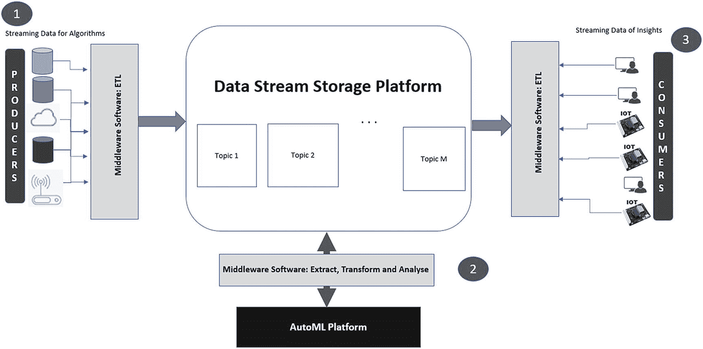
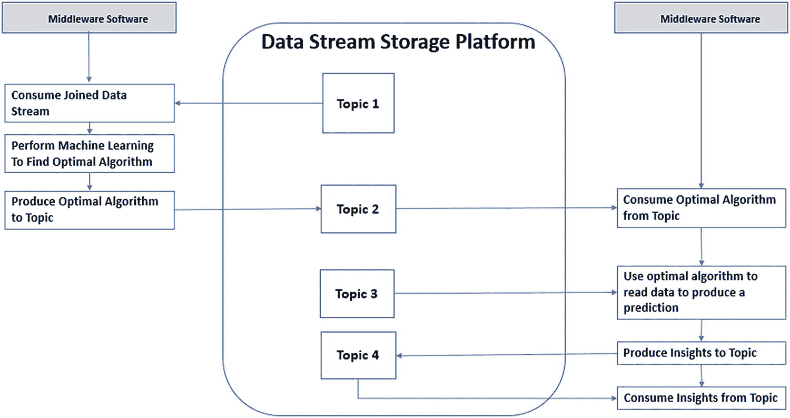
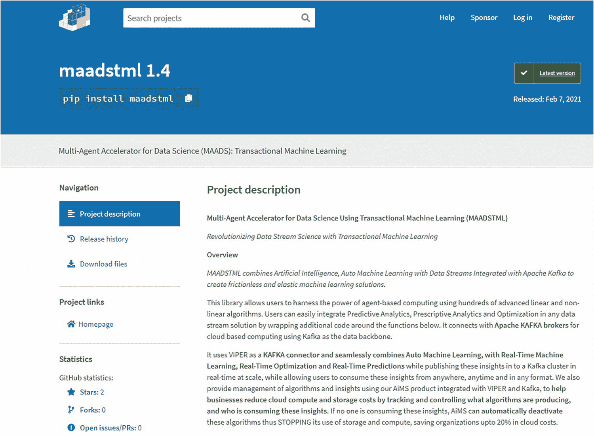
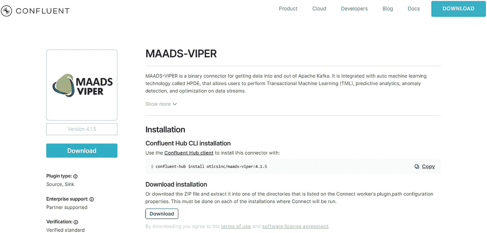
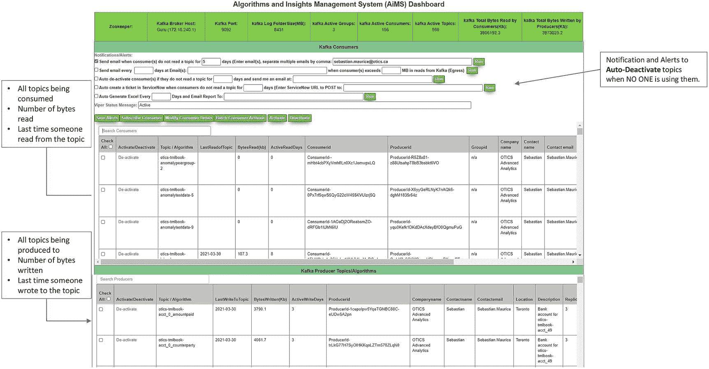
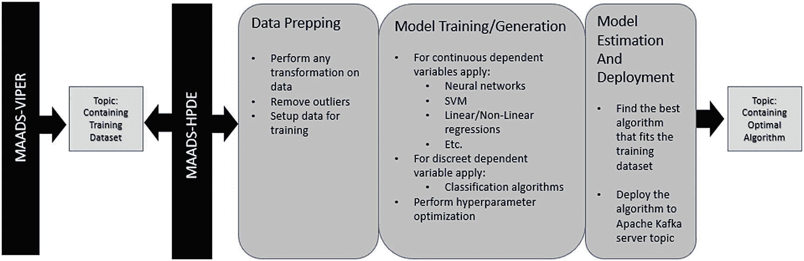
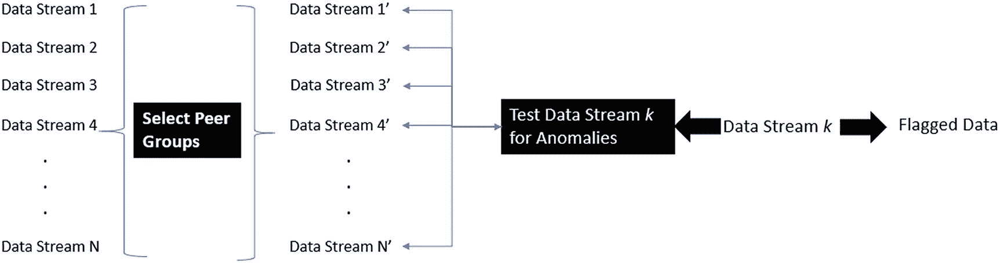
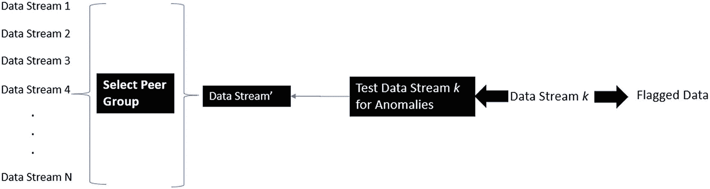

# 2. 事务性机器学习

事务性机器学习（TML）是机器学习中一个激动人心的领域，它专门专注于将自动机器学习（AutoML）应用于数据流，以创建无摩擦且弹性的机器学习解决方案。本章将定义 TML 以及构建 TML 解决方案所需的相关重要技术。它还将讨论用于存储和处理数据流以进行分析和机器学习的（大）数据平台。将机器学习应用于数据流对于颠覆性技术至关重要 [Jayanthiladevi et al., 2018]。我们对 TML 的定义如下。

**TML** **定义** **：** 计算机通过使用自动化机器学习，应用于全部或部分数据流集，从而从数据流中学习的能力，这导致了一个无摩擦且弹性的机器学习过程和解决方案，该过程是连续的且基本不受人类干预。

## 审视 TML

让我们更仔细地审视一下 TML 的含义。事务是指实时产生或创建的数据，或者是在某个事件发生后立即生成和捕获的数据。例如，当你从事某项活动（如购买产品或服务）时，你就会产生事务数据：销售点（POS）机器会捕获并记录你的行为产生的数据，比如你为产品或服务支付了多少钱、购买数量、你的姓名、产品或服务名称、购买地点、支付信息等。这些事务代表了购买产品或服务的最新事件，因此捕获了你当前的行为或行动。随着数据速度的提高，做出更快决策的机会也随之增加。TML 能够实现更快的决策，这对于时间敏感的业务用例（如欺诈检测、产品和服务推荐、物联网设备控制等）至关重要。表 2-1 展示了从数据挖掘和商业智能到 TML 的演变过程。随着数据速度的提高，我们正从关系型数据仓库演进到事件流平台，这将需要对机器学习流程进行更高程度的自动化，从而实现更快的决策。对于某些需要更高程度人工交互来进行 ML 模型构建、测试和部署，并产生更高摩擦的业务用例，其 ML 解决方案将随着更多 ML 流程的自动化而朝着更低摩擦的方向发展。此外，ML 解决方案中更低的摩擦也将带来更高的弹性，使得 ML 解决方案能够根据业务需求，通过快速调整 ML 解决方案的数量和组件来进行扩展或缩减。

表 2-1

向 TML 的演进^(⁵)

|   | 数据挖掘与商业智能 | 批量机器学习 | 事务性机器学习 (TML) |
| --- | --- | --- | --- |
| 数据刷新率 | 天 | 小时，分钟 | 秒，毫秒 |
| 决策速度 | 反应式 – 人在回路决策 | 人机混合回路 | 即时 – AutoML 回路 |
| 数据环境 | • SQL 数据仓库• 数据挖掘中间层• 数据可视化前端 | • 数据湖存储• 集群计算框架• 机器学习基础设施 | • 数据流基础设施• 事件驱动型流式云平台• AutoML 服务• 基于微服务的数据架构 |
| 用例 | 低量决策支持：• 业务绩效诊断• 客户盈利能力分析 | 中量决策制定：• 广告投放• 产品和服务推荐• 动态定价 | 高量决策制定：• 欺诈交易识别与干预• 产品和服务推荐• 物联网设备控制 |
| 机器学习解决方案 | • 高摩擦 ML 解决方案• 低弹性 ML 解决方案 | • 中摩擦 ML 解决方案• 低-中弹性 ML 解决方案 | • 低摩擦 ML 解决方案• 高弹性 ML 解决方案 |

机器也可以通过测量机器电子信号的传感器来创建数据事务。物联网（IoT）连接的设备，如电视、汽车、家电、工业机械和其他类似设备，就是一个很好的例子。在物联网背景下，无需人工交互，机器可以更独立地产生数据。这之所以成为可能，是因为先进的传感器或其他电子电路允许机器产生数据，这些数据由传感器测量；测量结果存储在数据库或文件系统中。例如，一些冰箱可以*感知*到牛奶快用完了，然后提醒人类购买牛奶。或者，冰箱可以自行下单购买牛奶。虽然过去几年中，自主机器已经取得了进步，这主要归功于传感器成本的降低^(⁶)，从而推动了物联网市场的发展，但将传感器数据用于机器学习仍处于起步阶段，不过正在增长。

为机器增加智能在三个领域具有若干优势：

1.  决策优化

2.  风险降低

3.  成本节约

首先是决策优化领域。你试图利用现有信息做出最优决策，这在很大程度上取决于你掌握的信息。甚至你决定今晚吃什么，也取决于你想吃什么、你的位置或附近有哪些餐馆、能否使用应用程序、冰箱里有什么、其他人想吃什么、你有多少钱、你的喜好等等。你也可能会使用机器输出，比如手机上应用程序对餐馆的评分，甚至汽车 GPS 软件推荐的餐馆。

机器决策与优化在物联网行业也成为可能，并且日益重要。机器可以利用数据进行自我健康检查。例如，可以设计预测性资产维护（PAM）用例，让机器能够向人类发出服务呼叫，请求前来维修[Faiz and Edirisinghe, 2009]。机器决策减少了人类监控机器潜在故障的需求。通过允许机器使用自身数据，减少了人为干预带来的摩擦，并能显著降低机器故障对人和企业造成的不利影响。但挑战在于*如何*让机器独立思考，利用数据流做出数据驱动的决策？时序机器学习（TML）提供了一种实现方法，本节将对此进行讨论。

其次是风险降低。如果机器能够在即将发生故障时自行判断，这能帮助预防机器故障吗？当然可以。在事件发生前预测事件的能力，使您能够为潜在的机器故障做好规划。我们称之为潜在或可能性，因为这尚未确定。要让计算机计算出故障的概率或可能性，就需要机器学习数据中的模式以生成概率度量。但学习数据中的模式需要机器使用算法来理解这些模式。回想一下天气温度的例子，我们构建了一个简单的模型，利用云量（CC）和一年中的时间（ToY）来帮助预测明天的天气温度（WT）。我们非常简单地展示了机器如何学习所有变量之间的模式和相关性，以生成估计系数：a、b、c 值。请注意，这是一个三维的多维问题：WT、CC 和 ToY。这正是机器学习实现价值之处：能够构建因变量与自变量之间的多维关系，而数据挖掘或流挖掘无法完全捕捉这种关系。

通过机器学习模型构建复杂关系，可以挖掘出更多关于自变量如何影响因变量的信息。因此，要让机器预测机器故障的可能性，它很可能需要构建一个多维模型，在估计出其系数后，该模型可用于预测故障概率^(⁷)。能够预测事件发生概率的机器学习模型系列是分类模型，例如逻辑回归、决策树和随机森林模型[Faiz and Edirisinghe, 2009]。

第三是成本节约领域。从 TML 中创造财务价值是吸引企业的重要因素。由于在构建大型机器学习解决方案时减少了人工接触点，机器学习的人力成本得以降低。数据管理成本也降低了，因为 TML 不需要数据模式。TML 采用读取时模式，这使得 TML 解决方案灵活，不依赖于任何特定模式以及需要维护的昂贵数据仓库。采用基于云服务的方法，TML 解决方案具有弹性，可以针对不同的业务需求和用户快速定制。这种敏捷性有助于创造一个更可能带来收益而非产生成本的环境。对于组织而言，这种收益应通过增加收入和降低成本，从而提高运营利润。TML 可以在不同行业中用于增加利润的领域有很多，这将是第 4 章的重点。

### TML 的特性

低摩擦和高弹性是 TML 解决方案在运营方面的特点。这些运营特点为组织带来了更低的成本和更高的收益。这些收益是 TML 解决方案特性的直接结果。主要有以下五个关键特性：

1.  数据是流动的——就像水流一样，数据从任何方向（源）流入，并流向任何位置（汇）。

2.  数据流必须可连接——就像 SQL^(⁸)连接一样，连接数据流对于实时构建训练数据集至关重要。

3.  数据流格式是标准化的——数据流标准化为 JSON 格式。如果数据流标准化为 JSON，则更容易在系统和不同技术之间构建可移植的解决方案并进行分析。

4.  数据流与自动机器学习（AutoML）集成——AutoML 无需人工干预，将机器学习应用于训练数据集，以找到最适合数据流的算法。

5.  低代码——TML 解决方案提供编码语言，使得无需编写大量代码即可轻松开发 TML 解决方案。

上述特性对于帮助您识别 TML 可以解决的用例非常重要。这些特性还可以为解决方案架构师在设计 TML 解决方案时提供指导，这些解决方案需要将特定的人员技能、流式技术平台和机器学习流程变更纳入架构中。这些特性不应被视为一个完整的列表；随着时间的推移，随着技术的发展以及业务需求的变化，可能会添加新的特性。我们现在详细讨论上述特性。

#### 数据流动性

如前所述，数据流的特点在于其速度、多样性、真实性和体量。数据流动性仅指这些数据流的来源可以来自任何地方或任何事物：这就是我们所说的“源”。数据流也可以流向任何地方：这就是我们所说的“汇”。**源**和**汇**的概念在开发能够轻松扩展以应对大型业务用例的 TML 解决方案中，将发挥重要作用。

在 TML 解决方案的背景下，我们可以进一步将源和汇分别转化为数据的发布者和数据的订阅者；这可以称为**发布-订阅**模型 [Eugster 等人，2003]。数据流中的数据必须由某人或某物生成，并由某人或某物消费，即人类或机器。对于 TML 解决方案，发布包含两个部分：

1.  将原始数据发布到流中
2.  使用 AutoML 从原始数据中提取洞察，并将其发布到另一个流中

订阅者可以订阅流中的洞察。这种将数据发布或生产到数据流，然后订阅并从另一个流中消费洞察的能力，将是 TML 解决方案的核心部分，也是减少机器学习过程摩擦的基础。关于如何实现这一点的机制，将在第 5 章中讨论。

图 2-1 展示了 TML 解决方案的生产者和消费者过程。流程步骤 1 显示了数据的生产者。这些可以是任何人或任何事物生成的任何数据源。为了处理这些数据，我们需要一个中间件软件来摄取数据，并可能对数据进行转换。

图 2-1

事务性机器学习过程

这个中间件是 TML 解决方案的重要组成部分。其主要功能是摄取数据并将其存储在数据流存储平台（DSSP）中。数据流存储平台必须能够处理非常大量的数据，因为数据流的一个关键特性是*体量*。数据体量可能达到数千 TB 或更多。该平台还需要确保存储的数据易于访问。目前已有可处理海量数据的技术 [Jayanthi, 2016]。除了存储大量数据，DSSP 还需要执行另一个重要功能：它需要具备在数据流中**回滚**并检索历史数据的能力。回滚数据流对于构建机器学习的训练数据集至关重要。具体来说，我们已经知道流中的数据积累得非常快；数据的积累仅仅是数据相互堆叠或**追加**到数据流中。每个字节的数据都会增加存储容量。想象一下，十个数据源每毫秒生成 1 字节数据，并全天 24 小时存储。一天之内，你将需要 864,000,000 字节的存储空间，即 864,000 KB，而这仅仅是针对生成的 1 字节数据。大数据存储技术使用特定算法将数据分解成更小的尺寸，并存储在分布式计算机系统中 [Jayanthi, 2016]。

如果我们没有回滚流的能力，就无法为 TML 构建训练数据集。能够通过回滚，从流中实时提取一个**滑动窗口**数据集，是一项强大的功能。当从连续的数据流中提取这些数据集时，它变得更加强大，因为它为持续学习提供了途径。很少有数据平台允许回滚数据流。Apache Kafka^(⁹) 是一项率先实现数据流中数据回滚能力的技术，也是我们在第 6 章中采用的技术。

一旦我们创建了训练数据集，就可以进入图 2-1 中的步骤 2。使用训练数据集，我们可以执行机器学习，以找到最适合数据的最优算法以及估计的系数，即如天气温度示例中的 a、b、c。估计的参数也由中间件软件存储在 DSSP 中，存储在你选择的特定主题名称下，例如，洞察主题 1。

主题是数据流的名称。随着主题中数据的增长，DSSP 可以使用一种称为*分片*的技术，将数据分布到不同的内存分区和多个计算机服务器上。^(¹⁰)

图 2-1 中的步骤 3 显示了消费者订阅主题，消费主题中的洞察，并将流式结果可视化。^(¹¹) 订阅主题会创建一个到该主题（或数据流）的专用连接，用于消费。消费者可以是人类或机器。洞察的消费可用于报告和仪表板，或发送到下游系统。请注意，在步骤 1-3 中，我们不与任何人类交互，当然，除非消费者是你本人。通过这种方式，我们可以设计一个完全自动化、无摩擦的机器学习过程。

强调将在后续章节中使用的核心术语是有益的，如表 2-2 所示。

表 2-2

TML 过程术语

| 术语 | 描述 |
| --- | --- |
| 生产者 | 生产者是数据生成者，例如人类或机器。物联网设备上的传感器就是生产者的一个典型例子。 |
| 消费者 | 消费者是订阅某个主题并接收数据或洞察的人类或机器，这些数据或洞察可用于报告和仪表板，或发送给其他下游系统。 |
| 主题 | 主题是数据流的名称。用户在 DSSP 中通过为数据流指定一个唯一标识的名称来创建主题。 |
| 订阅 | 如果机器或人类想要消费某个主题的数据或洞察，他们可以订阅该主题。 |
| 消费 | 为了消费主题中的数据，消费者首先使用中间件软件订阅该主题，然后再次使用中间件软件从该主题接收数据。 |
| 生产 | 为了向主题生产数据，生产者首先使用中间件软件在 DSSP 中创建一个主题，然后使用中间件软件将数据发送到 DSSP 中的该主题。 |
| DSSP | DSSP 是一个大数据流存储平台，它支持发布-订阅模型。DSSP 对于 TML 有两个关键功能：1) 分区 2) 偏移量。分区是一个数字，它允许 DSSP 通过分片将数据拆分，并存储在计算机网络中不同机器的不同分区中，从而在分布式网络中高效管理大数据存储。分区从零开始。用户可以指定他们想要的 DSSP 计算机服务器中的分区数量。大量的分区可以提高消费者的访问性能。例如，如果有 1000 个消费者想要消费同一个主题，设置 1000 个分区可以让这 1000 个消费者中的每一个都能并行访问该主题，而不会影响其他消费者。偏移量是一个从零开始的数字，用于跟踪数据流中的每条数据。偏移量从零开始，表示数据流中的第一个数据点，并随着数据流中数据的增长而顺序递增。偏移量由 DSSP 确定和维护。偏移量很重要，因为它允许我们“回滚”数据流中的数据以引用过去的数据。通过回滚数据流中的数据，我们可以实时构建训练数据集。数据流中的一个数据值由分区、偏移量和键在主题中唯一标识。 |
| 中间件软件 (MWS) | 一种允许生产者和消费者向 DSSP 发送数据以及从 DSSP 接收数据的软件。MWS 可以被称为 DSSP 的连接器，它执行微服务。它还与 AutoML 软件集成。如图 2-1 所示的 MWS 将**生产者-AutoML-消费者**连接在一起，允许开发者创建 TML 解决方案。MWS 将在后面详细描述。 |
| 键 | 键是一个唯一的值，用于标识主题中的每个数据值。键的作用是帮助 DSSP 在分布式网络中跨分区高效管理数据，同时允许消费者快速检索信息。 |
| 训练数据集 | 训练数据集是通过从特定的偏移量值开始连接数据流而创建的，该数据集包含一个因变量主题和一个或多个自变量主题。合并后的数据集称为训练数据集，将用于 TML。 |

接下来，我们讨论连接数据流的过程。

#### 连接数据流

连接数据流的重要性对于为 TML 创建训练数据集至关重要。如表 2-2 所述，每个数据流都被命名为一个主题；您可以使用这些主题名称来标识要使用 MWS 连接的数据流。每个流都通过具有相同的数据格式而标准化：我们对每个流使用 JSON^(¹²)格式。JSON 是一种流行且广泛使用的格式，采用键值表示法。例如，这是一个简单的 JSON：{“Name”: “Sebastian Maurice”, “Phone Number”: 555-555-5555}，其中“Name”和“Phone Number”是键，“Sebastian Maurice”和 555-555-5555 分别是值。

要使用 MWS 连接流，请遵循以下步骤：

1.  使用主题名称标识要连接的流。

2.  使用 MWS 连接这些流。

3.  创建另一个主题来存储连接的流或训练数据集。

4.  将数据生产到训练数据流中。

连接流时存在一些挑战。首先，各个流可能在不同的时间生成。这意味着根据数据的创建日期和时间来连接流可能具有挑战性。但是，通过连接多个流来创建滑动训练数据集，可以从每个流中几乎同时抓取数据，这降低了（如果不是消除了）这一挑战。然而，这假设每个流都在生产数据而不是空闲。例如，使用 offset=-1 告诉 MWS 从所有流的末尾获取数据，然后可以通过用户指定的偏移量回滚这些数据以创建训练数据集——这在第 6 章中会更清楚。通过使用 MWS，您可以指定任何您希望的回滚偏移量来控制训练数据集的大小。

其次，流的长度可能不同。为了对合并后的数据流执行机器学习，这些流的长度必须相等。为了创建相等的长度，TML 采用了一种修剪算法，如下所示：

1.  使用回滚偏移量从每个流的所有分区中抓取数据。

2.  由于每个流中有多个分区，数据的大小会有所不同。例如，如果一个流在所有分区中共有 1500 个数据点，而另一个流在所有分区中共有 500 个数据点，那么长度显然不同。为了对齐长度，我们必须修剪其中一个流，以使所有流的长度相同；在这种情况下，我们将具有 1500 个数据点的较长流修剪为 500 个。

3.  一旦所有流的长度相等，将它们连接起来并创建一个训练数据集。

上述过程几乎实时发生，并且是在执行 TML 之前的关键步骤。

第三，为了合并流以创建训练数据集，我们必须确保一个流是因变量，其他流是自变量；这将是我们进行 TML 的模型。接下来，我们讨论数据标准化如何简化连接过程。

#### 数据流标准化

我们对每个流数据使用 JSON 格式。当 MWS 将数据生产到 DSSP 中的流主题时，它会自动处理格式化为 JSON。JSON 格式遵循普遍接受的约定，允许其他应用程序和系统以相同的方式读取 JSON 数据，从而更容易分析即使来自不同来源的数据。除了易于访问之外，它还有助于提高读取数据的性能。JSON 键充当索引，可用于快速访问数据，这使得在报告、分析和创建训练数据集时更容易引用 JSON 对象的每个组件。这引出了下一节，即如何与 AutoML 集成。

#### 数据流与 AutoML 的集成

TML 的一个关键功能是利用来自数据流的训练数据集进行机器学习。因此，创建训练数据集是 TML 的一项重要需求。我们使用 MWS 连接到 AutoML 技术，该技术再连接到 DSSP，使得 AutoML 技术能够消费训练数据集并应用机器学习来寻找最优算法：MWS 与 AutoML 之间没有训练数据的移动。然后，AutoML 技术将此最优算法生成到 DSSP 中的一个主题（topic）中，如图 2-1 所示。因此，AutoML 技术既是 DSSP 中训练数据集的消费者，也是向 DSSP 提供最优算法的生产者。完整的 AutoML 过程如图 2-2 所示。该图展示了通用流程。假设我们想用此流程检测信用卡欺诈，并且主题 1 包含 MWS 在连接相关数据流以创建训练数据集后的信用卡交易训练数据集，那么：

图 2-2

AutoML 流程

1.  MWS 消费包含信用卡训练数据集的主题 1。
2.  MWS 连接到 AutoML 技术，该技术执行机器学习以找到最适合信用卡交易数据的最优机器学习算法，从而得到最佳训练模型。
3.  AutoML 将最优训练模型生成到另一个主题 2：信用卡欺诈训练模型。
4.  MWS 从主题 2 消费最优训练模型。
5.  MWS 从主题 3 读取新的信用卡交易数据，并使用新交易数据生成潜在欺诈的洞察。新数据是用于预测因变量（欺诈）的自变量值。例如，在气温示例中，主题 3 将包含云层覆盖率和一年中的时间值。预测结果随后被存储回另一个主题，即主题 4：欺诈预测。
6.  需要这些洞察的消费者会订阅主题 4 并消费这些洞察。具体来说，客户可以通过电子邮件或短信自动收到潜在欺诈交易的警报。

上述步骤可针对任意数量的数据流重复执行，并且可以轻松扩展到任意数量的算法以及由任意数量的消费者消费洞察。关于如何架构这一点，将在第 5 章关于架构的部分进行解释。具体来说，MWS 和 AutoML 技术可以作为**微服务**使用，这些微服务可以实例化为任意数量，易于部署，并用于将 TML 解决方案扩展到几乎任意数量的数据流、算法、消费者和生产者。将 AutoML 轻松集成到这个可扩展的架构中，是本书提出的 TML 解决方案的独特之处之一。这引出了低代码的最后一个特性，该特性讨论了如何使用 MAADS Python 库或 REST API 连接到 MWS，从而使 MWS 与语言无关。

#### 低代码

与 DSSP、MWS 和 AutoML 集成的 TML 解决方案需要编程代码，以便更好地控制执行和调试。然而，所需的代码量不应过多，应尽可能少。^(¹³) 与无代码相比，低代码牺牲了可视性和定制化，换取了敏捷性、可扩展性和洞察获取速度。虽然低代码可以通过图形用户界面实现，但这并非必需，因为预构建的函数可以提供同等的价值。例如，提供 API（应用程序编程接口）的库可以减少从头编写代码的工作量，从而降低开发 TML 解决方案所需的工作量。在本书中，我们使用一个名为 MAADSTML Python 库^(¹⁴) 来开发 TML 解决方案，如图 2-3 所示。该库使用 Python 编程语言^(¹⁵) 开发，可以通过执行“pip install maadstml”轻松安装在任何环境中。

图 2-3

MAADSTML Python 库

该库包含提供 API 的函数，用于帮助生成数据、使用 AutoML 处理数据以及消费数据。该库的核心函数如表 2-3 所示。

表 2-3

MAADSTML Python 库函数

| MAADSTML Python 函数 | 描述 |
| --- | --- |
| vipercreatetopic | 在 Kafka 代理中创建主题。 |
| vipersubscribeconsumer | 将消费者订阅到主题。消费者将立即从主题接收洞察。这也让 TML 解决方案的管理员能够更好地控制谁在消费洞察，并确保在算法出现问题时能够快速解决任何问题。 |
| viperhpdetraining | 用户可以对 Kafka 主题中的数据执行 TML。这对于使用我们的 HPDE^(¹⁶) 技术进行即时“事务性学习”非常强大且有用。HPDE 将在几分钟内为数据找到最优算法。 |
| viperhpdepredict | 使用最优算法，用户可以对来自流数据并进入 Kafka 主题的数据进行实时预测。 |
| viperhpdeoptimize | 用户甚至可以进行优化，以**最小化**或**最大化**最优算法，从而找到能够最小化或最大化目标函数的自变量的**最佳**值。 |
| Viperproducetotopic | 用户可以通过从任何数据源摄取数据来向任何主题生成数据。 |
| viperconsumefromtopic | 用户可以从任何主题消费数据并将其用于可视化。 |
| viperconsumefromstreamtopic | 用户可以一次性从多个主题流中消费数据。 |
| vipercreateconsumergroup | TML 管理员可以创建一个由任意数量消费者组成的消费者组。您可以在 Kafka 代理中为该组添加任意数量的分区，并指定复制因子，以确保高可用性，并且不会中断从主题消费洞察的用户。 |
| viperconsumergroupconsumefromtopic | 属于消费者组的用户可以同时从主题的多个分区消费数据。 |
| viperproducetotopicstream | 整合来自流的数据并生成到主题。 |
| Vipercreatejointopicstreams | 用户可以连接多个主题流，并将合并后的结果生成到另一个主题。 |
| vipercreatetrainingdata | 用户可以从主题流中创建用于 TML 的训练数据集。 |
| viperanomalytrain | 对数据流执行无监督学习以进行异常检测。 |
| viperanomalypredict | 使用通过 viperanomalytrain 函数找到的对等组，预测数据流中可能出现的异常。 |

通过使用前述函数，您可以大幅减少开发 TML 解决方案所需的代码量，我们将在第 6 章中展示这一点。具体来说，实现图 2-2 中功能所需的 MAADSTML 函数如下：

1.  **vipercreatetopic** – 该函数用于创建主题 1 至 4。
2.  **vipercreatejointopicstreams** – 该函数用于创建训练数据集的元数据结构，并启动训练数据集构建过程。
3.  **viperproducetotopicstream** – 该函数利用元数据结构，从数据流中实际抓取数据。
4.  **vipercreatetrainingdata** – 该函数使用前一个函数提供的数据创建训练数据集，并将其生成到主题 1：信用卡训练数据集。
5.  **viperconsumefromtopic** – 该函数从主题 1 消费训练数据集。
6.  **viperanomalytrain** – 该函数使用训练数据执行 AutoML，并将最优训练模型（本例中为对等组）生成到主题 2：信用卡欺诈训练模型。
7.  **viperanomalypredict** – 该函数从主题 2 消费最优训练模型（对等组），并使用主题 3：新交易数据的数据进行欺诈预测。
8.  **viperproducetotopic** – 该函数将欺诈预测结果生成到主题 4。
9.  **vipersubscribeconsumer** – 消费者订阅主题 4。
10. **viperconsumefromtopic** – 该函数从主题 4 消费洞察结果。

第 6 章将重点介绍 TML 在业务解决方案模板中的应用。至此，我们已经讨论了将数据流与 AutoML 集成以创建 TML 解决方案的过程。接下来，我们将更详细地讨论 DSSP、AutoML 和 MWS 技术。

### 数据流存储平台 (DSSP)

我们已经讨论了 DSSP（一种事件流平台）如何管理我们用于 TML 的数据流。在本书中，我们将使用 Apache Kafka。^(¹⁷) Apache Kafka（或简称 Kafka）是一种分布式开源技术，被 80% 的《财富》100 强公司所采用。^(¹⁸) 它由 LinkedIn^(¹⁹) 的一组开发人员开发，并捐赠给了 Apache 软件基金会。^(²⁰) Kafka 的开发人员随后成立了一家名为 Confluent^(²¹) 的公司，以提供 Kafka 托管服务；截至 2019 年，该公司估值 25 亿美元。^(²²) Kafka 受欢迎的主要原因，除了开源之外，还在于它是唯一的发布者-订阅者事件流平台 [Jayanthi, 2016]，这使得它非常适合 TML，具体体现在以下几个方面：

1.  Kafka 能够处理海量数据，并在主题或数据流的多个分区中有效管理这些数据。
2.  Kafka 是一个针对可扩展性优化的事件流平台，这与其他大数据平台（如针对大型静态数据集优化以进行大规模批处理的 Hadoop）不同。
3.  Kafka 在流中存储数据时使用偏移量，这允许我们“回滚”数据流中的数据以创建训练数据集。正如 Kafka 文档^(²³) 中所解释的，“偏移量充当该分区内记录的唯一标识符，同时也表示消费者在该分区中的位置。”
4.  Kafka 允许我们将数据流命名为主题。
5.  Kafka 允许我们连接数据流。
6.  Kafka 可以在任何云平台上运行。
7.  Kafka 允许消费者组从一个主题消费数据，从而实现向每个消费者并行传递信息。

Kafka 最初是为大型消息系统开发的，这些系统受益于发布者-订阅者类型的框架。然而，鉴于 Kafka 使用了**偏移量**，它使我们能够将 Kafka 的功能扩展到机器学习，利用数据流创建 TML 解决方案。这种将 Kafka 扩展到事务性机器学习的做法目前尚属首创。我们将使用 MAADS-VIPER 作为我们的 MWS 连接器连接到 Kafka：MAADS-VIPER 是目前唯一经过 Confluent^(²⁴) 验证和测试的 TML Kafka 连接器。接下来将讨论 MAADS-VIPER。

### MAADS-VIPER

图 2-4 中显示了一个官方的 Kafka 连接器，它已经过 Confluent 的验证和测试。MAADS-VIPER（或简称 VIPER）是我们的 MWS，它促进了消费者与生产者、AutoML 和 DSSP 之间的通信。VIPER 是 TML 的核心。有两种方式可以与 VIPER 通信以构建 TML 解决方案：

图 2-4

MAADS-VIPER Kafka 连接器

1.  使用表 2-3 中描述的函数的 MAADSTML Python 库。
2.  表述性状态转移 (REST) API 是一种具有定义约束的软件架构类型，允许创建 Web 服务。例如，浏览网站使用超文本传输协议 (HTTP)；使用相同的 HTTP 协议，用户可以连接到 VIPER。这确保了无论开发人员使用何种编程语言，都可以访问 VIPER。

VIPER 适用于微服务架构，因为它：

*   易于部署到任何操作系统，即 Windows、MacOS、Linux
*   通过 HTTP 通信，与编程语言无关
*   对进出 DSSP 的数据使用 SSL/TLS 加密
*   执行专注于 TML 解决方案特定能力的任务
*   与 DSSP 和 AutoML 解耦
*   可以从中央源下载

特殊的功能以及易于访问的函数，使 VIPER 成为一个有效的 Kafka 连接器，并已由 Confluent 的 Apache Kafka 创建者进行了广泛测试和验证。

VIPER 有多个方面使其成为有效的 TML 赋能技术：

1.  VIPER 是跨平台的；它可以在 Windows、MacOS 和 Linux 上运行。
2.  VIPER 与云平台无关。对于大数据解决方案，云平台至关重要。VIPER 可以连接到任何运行 Apache Kafka 的主流云平台，例如 Microsoft Azure、Amazon AWS、Google Cloud Platform 或 Confluent Cloud。
3.  VIPER 支持 SSL/TLS。如今安全性至关重要，组织希望确保所有数据都经过加密。Kafka 可以设置为 SSL/TLS 加密；这意味着 VIPER 需要处理 SSL/TLS 流量才能与 Kafka 通信。
4.  VIPER 可以使用消费者组同时从主题的多个分区读取数据。随着流中数据的增加以及消费者数量的增长，Kafka 会将主题中的数据分布到多个分区。这意味着从应用程序的角度来看，从跨多个分区的主题消费数据变得更加具有挑战性。VIPER 内置了从多个分区消费数据的过程，因此数据始终能够正确且并发地被消费。
5.  VIPER 可以从任何偏移量读取数据。如前所述，指定偏移量是创建训练数据集的基础。然而，鉴于数据流的性质，偏移量在控制流中的数据量以构建不会过大的训练数据集方面可以发挥重要作用。如果训练数据集过大，会显著增加机器学习所需的时间，并影响 TML 解决方案的性能。
6.  VIPER 可以多次实例化。对于拥有数千或数百万个数据流以及数千种算法的超大型 TML 解决方案，可能需要多个 VIPER 实例来进行负载分担，这符合微服务架构。正如将在第 5 章中讨论的，将 VIPER 作为微服务使用是大型 TML 解决方案的一个重要架构考量。

下一节将讨论如何使用算法与洞察管理系统 (AiMS) 仪表板来管理算法。

## 算法与洞察管理系统 (AiMS) 仪表盘

VIPER 可通过图 2-5 所示的算法与洞察管理系统 (AiMS) 仪表盘管理大量算法。TML 的一个成果是能够通过 AutoML 相对轻松地创建算法。这将导致构成 TML 解决方案的众多算法在流通中产生。因此，必须对这些解决方案进行监控和追踪以供使用，因为它们会对存储、计算和网络访问产生成本影响。AiMS 提供了一种非常便捷的方式来追踪、监控和控制 TML 解决方案的执行。

图 2-5

AiMS 仪表盘

VIPER 每个实例中的信息都使用 JSON 格式保存在嵌入式数据库中；AiMS 利用这些信息来填充其仪表盘。这意味着 VIPER 不需要外部数据库存储。嵌入式数据库的优势在于它使 VIPER 具有可移植性和自包含性。这确保了无论 VIPER 安装在哪个系统中，捕获到的信息都可用于管理 TML 解决方案。表 2-4 显示了 VIPER 为每个消费者、生产者和消费者组捕获的信息。请注意，这不是 DSSP；而是 VIPER 存储在其本地嵌入式数据库实例中供 AiMS 使用的元数据。

表 2-4

AiMS 仪表盘字段名称

| 字段名称 | 描述 |
| --- | --- |
| 激活/停用 | VIPER 的管理员可以手动激活或停用一个主题，或者他们可以指示 VIPER 使用警报和通知自动停用算法。 |
| 活跃读取天数 | 该主题被读取的天数。 |
| 活跃写入天数 | 该主题被写入的天数。 |
| 读取字节数 (Kb) | 记录消费者读取的字节数（以千字节为单位）。这是出站流量量。出站流量是云消费定价的重要指标。 |
| 写入字节数 (Kb) | 生产者写入的字节数（以千字节为单位）。这是入站流量量。入站流量是云消费定价的重要指标。 |
| 公司名称 | 消费者所属公司的名称。 |
| 消费者 ID | 消费者 ID 唯一标识从该主题消费的消费者。 |
| 联系邮箱 | 消费者的电子邮件地址。 |
| 联系人姓名 | 消费者的姓名。 |
| 创建时间 | 主题创建的日期和时间。 |
| 因变量 | 如果此主题是存储训练数据集的连接主题，则这是训练数据集中因变量的名称。 |
| 描述 | 对主题的描述。 |
| 组 ID | 组 ID 是该消费者可能所属组的 ID。管理员可以创建组并将消费者分配到该组。这对于将单个主题的信息并行传递给多个消费者可能很有用。 |
| 组名称 | 组的名称。 |
| 自变量 | 如果此主题是存储训练数据集的连接主题，则这是训练数据集中自变量的名称。 |
| 是否激活 | 指示主题是激活 (1) 还是未激活 (0)。 |
| 连接主题 | 这将列出被连接在一起的主题名称。 |
| 最后偏移量 | 当消费者从主题读取时，此字段记录消费者在该主题中的最后偏移量。 |
| 主题最后读取时间 | 消费者读取该主题的最后日期和时间。 |
| 主题最后写入时间 | 生产者写入该主题的最后日期和时间。 |
| 位置 | 消费者所在的位置。 |
| MAADS 算法密钥 | 唯一标识最优算法的密钥名称。 |
| MAADS-HPDE 算法服务器 | AutoML 服务器的物理 IP 地址或网络名称。 |
| MAADS-HPDE 微服务 | 如果使用反向代理，这是代理的网络名称。使用微服务对于大规模 TML 解决方案部署非常有益。 |
| MAADS-HPDE 端口 | MAADS 服务器监听的网络端口。 |
| MAADSTML 令牌 | 访问 MAADS-HPDE 所需的安全令牌。 |
| 消费者数量 | 组中的消费者数量。 |
| 分区数 | 主题中的分区数量。 |
| 生产者 ID | 生产者 ID 是写入此主题的生产者的 ID。 |
| 复制因子 | 复制因子是 Apache Kafka 的一个特性，表示用于冗余的物理计算机服务器数量。 |
| 主题/算法 | DSSP 中的主题名称。这也可以是算法的名称，由用户选择。 |
| 更新时间 | 生产者写入该主题的最后日期和时间。 |

管理员的其他功能包括：

*   将消费者订阅到主题
*   保存警报
*   修改消费者详细信息
*   批量激活/停用消费者
*   激活一组主题
*   停用一组主题
*   创建主题
*   批量激活主题
*   创建组
*   批量激活/停用组

管理算法对组织而言至关重要，原因有三：

1.  **成本** – 算法会消耗网络计算和存储资源，这将产生费用，尤其是在使用云平台时。通过追踪算法的生产者和消费者，VIPER 可以轻松确定谁在消费洞察，谁没有。如果没有人消费洞察，那么该算法就没有提供任何价值，但仍然消耗着产生费用的计算和存储资源；在这些没有消费者的情况下，VIPER 可以通知 TML 解决方案的管理员，并自动停用未使用的算法，从而可能为组织节省成本。

2.  **安全性** – 通过追踪算法，组织可以确切了解算法在做什么、谁在消费它、以及读取和写入的字节数。这使他们能够控制对信息的访问，只允许用户访问他们需要的信息。

3.  **服务管理** – 在消费者因解决方案出现问题而停止接收洞察时，维持良好的服务水平是 VIPER 的另一个重要方面。如果消费者投诉算法不再产生洞察，解决方案的管理员可以立即在 AiMS 仪表盘中查找该算法主题，确定是谁开发的，并联系该人员解决问题或创建服务管理事件。

AiMS 为组织提供了对其环境中运行的所有算法的全局视图。他们可以创建警报和通知（如图 2-6 所示），以控制访问并使他们能够充分利用资源来减少不必要的成本。

图 2-6

AiMS 通知

AiMS 中有五种类型的警报和通知：

1.  当消费者或生产者在 X 天内未读取或写入主题时，发送电子邮件。
2.  出站流量 – 当消费者从主题读取 X 兆字节时，发送电子邮件。
3.  入站流量 – 当生产者向主题写入 X 兆字节时，发送电子邮件。
4.  当消费者或生产者在 X 天内未读取或写入主题时，自动停用该主题。
5.  当消费者或生产者分别未读取或写入主题时，在服务管理软件中自动创建工单。
6.  生成并通过电子邮件发送一份列出所有消费者、生产者和组的 Excel 报告。

接下来，我们将讨论 TML 解决方案用于执行实时机器学习的 AutoML 技术。

### 自动机器学习技术

TML 解决方案所使用的自动机器学习技术称为 MAADS-HPDE。^(²⁵) 这是一项跨平台技术，可在 Windows 或 Linux 中运行。它与 MAADS-VIPER、AiMS 和 Apache Kafka 集成，专为快速机器学习而设计。任何自动机器学习技术都有几个关键方面，例如 [He et al., 2020] 所述：

1.  数据准备
2.  模型生成
3.  超参数优化
4.  模型评估
5.  模型报告
6.  模型部署

MAADS-HPDE 执行上述六项功能。具体来说：

*   **数据准备** – HPDE 可以从逗号分隔值（CSV）文件中读取数据，也可以直接连接到像 Apache Kafka 这样的事件流平台，并直接从某个主题中消费训练数据集。
*   **模型生成** – MAADS-HPDE 将多种算法应用于训练数据集。这些算法包括：
    *   神经网络
    *   支持向量机/随机森林
    *   因变量为离散值的分类模型
    *   梯度下降算法
    *   线性和非线性回归
    *   用于数据流异常检测的无监督学习
*   **超参数优化** – HPDE 采用随机网格搜索过程，为算法寻找最佳参数。对于连续型因变量，使用 MAPE（平均绝对百分比误差）；对于离散型因变量，使用 ROC/AUC 指标。具体来说，HPDE 会应用多种算法，计算每种算法的 MAPE 或 ROC/AUC，然后选择 MAPE 最低或 ROC/AUC 最高的算法作为**最优算法**。
*   **模型评估** – 它执行模型评估，以找到最符合数据特征的估计系数。这可以通过表 2-3 中讨论的 **viperhpdetraining** 函数来实现。
*   **模型部署** – 它可以将最优算法部署到任何服务器，或将结果写入某个主题。

HPDE 在众多自动机器学习技术中脱颖而出的几个关键领域如下：

*   HPDE 与 Apache Kafka、AiMS 和 MAADS-VIPER 等事件流平台集成，用于实时建模。HPDE 可以将训练好的最优模型（算法）部署到 Apache Kafka 中的一个主题。这使得其他能够访问该主题的应用程序可以轻松检索到训练好的最优模型并进行预测。
*   **持续学习** – 自动机器学习技术的一个重要方面应该是其通过记住旧数据并从新数据中学习来执行持续学习的能力 [He et al., 2020]。利用滑动窗口技术，TML 解决方案通过持续学习快速流动数据中的新模式，实现了零模型过时，且无需人工干预。
*   HPDE 还进行数学优化。回顾一下，优化是寻找自变量的最佳值以最小化或最大化某个目标函数的过程，例如通过选择零售网站上的最优价格和产品组合来最大化总实现利润。这可以通过表 2-3 中讨论的 **viperhpdeoptimize** 函数来实现。
*   HPDE 对数据流执行实时无监督学习（稍后讨论），并且**不需要**像传统机器学习过程预测欺诈或异常那样预先对因变量进行分类。VIPER 使用 **viperanomalytrain** 和 **viperanomalypredict** 进行异常检测。
*   HPDE 已启用 SSL/TLS，并对写入和读取 Apache Kafka 的所有数据进行加密。
*   HPDE 可以实例化为任意数量的实例，使其对于分布在网络中的大规模 TML 解决方案非常有效。

自动机器学习过程如图 2-7 所示。该过程展示了 MAADS-VIPER 和 MAADS-HPDE 之间的集成。具体来说：

*   MAADS-VIPER 在 Apache Kafka 中创建训练数据集主题。
*   MAADS-HPDE 读取训练数据集主题。
*   MAADS-HPDE 执行所有数据预处理和转换。
*   MAADS-HPDE 将机器学习算法应用于训练数据集。
*   MAADS-HPDE 选择最符合数据特征的算法：我们称之为训练好的最优模型。
*   MAADS-HPDE 随后通过将算法位置写入 Kafka 中的另一个主题来部署该算法。

这个过程可以无限次重复，使用无限数量的数据流和训练数据集。唯一的限制在于硬件方面。理论上，只要有无限的存储空间，自动机器学习过程就可以用无限量的数据运行。

图 2-7
自动机器学习过程

使用 TML 构建的许多模型将采用监督学习；然而，在许多其他情况下，无监督学习对于数据流中的异常检测将非常重要。下一节将讨论 TML 如何处理欺诈或异常检测用例。

### 无监督学习：检测异常

在许多需要检测数据异常的情况下，无监督学习都很有用。例如，欺诈检测的用例通常需要检测异常行为。要确定“异常”行为，我们必须将其与“正常”或“常规”行为进行比较。当使用**监督学习**时，这种比较很直接：它需要事先了解由人工进行物理分类的“异常”和“正常”行为；然后，利用这些分类构建一个机器学习模型，机器学习异常和正常行为的模式。然而，对于数据流而言，几乎不可能事先知道什么是“异常”和“正常”行为。快速流动的数据使得构建一个监督学习模型来让机器学习行为差异变得困难。缺乏对实时异常的先前了解以及数据流的速度，使得监督学习的应用即使不是不可能，也变得困难重重；因此，我们必须对数据流使用**无监督**学习。

HPDE 使用 [Bolton & Hand, 1999] 开发的一种技术变体来执行无监督学习，该技术采用了同行群体分析（PGA）和断点分析（BPA）。该技术相当简单，步骤如下：

1.  从数据中，找到一个与待评估欺诈或异常的交易类型相似的同行群体。
2.  创建该同行群体的汇总统计量，用于衡量“正常”和“异常”行为之间的差异。
3.  将新交易与该同行群体进行比较，并确定这些交易相对于同行群体汇总统计量的“异常”程度。将那些与汇总统计量差异很大的交易标记为可疑。

当数据是流式传输时，上述步骤可能会迅速变得复杂。但是，通过 VIPER 和 HPDE 与 Kafka 的结合，这种复杂性被大大简化了。具体来说，如图 2-8 所示，无监督学习过程包含两个要素：

图 2-8

方法 1：无监督学习流程

1.  选择同行群体
2.  异常检测，以标记与同行群体不同的行为

从数据流中选择同行群体涉及以下步骤：

1.  对于每个数据流，只需使用偏移量参数回滚数据，从数据中选择数据窗口。
2.  对于每个数据流窗口，使用 K-means 聚类算法计算该群体的质心。
3.  对于窗口中的每个数据点，将其与群体的质心进行比较，以确定每个点与质心之间的**距离**。
4.  将距离存储在一个数组中。
5.  将数组按距离值从高到低排序。
6.  移除距离数组中的第一个和最后一个成员——我们移除首尾成员是为了标准化数值，以消除极端行为的影响，并构建同行群体数据流：数据流 1'、数据流 2'、数据流 3'、数据流 4'……数据流 N'。
7.  现在将新数据与同行群体进行比较，对于每个新数据点，计算一个称为 T 的标准化方差度量。我们可以将 T 解释为一个**分数**——分数越高，数据越可疑。可以设置一个阈值，将 T 与该阈值进行比较；任何高于阈值的 T 值都会被标记为可疑。你可能会问，如何选择一个好的阈值？新数据的 T 分数（T^d）与质心值的 T 分数（T^c）进行比较；绝对百分比与阈值（T^t）进行比较：
    1.  如果 (| T^d - T^c|/ T^d) ≥ T^t，则数据可疑。
    2.  对阈值（T^t）进行实验。如果业务用例对偏离正常行为（T^c）很敏感，那么 T^t 应该是一个较低的百分比，大约 30%；如果不敏感，则将其设置得更高。
8.  构建标记数据流，并评估欺诈或异常。

图 2-9

方法 2：无监督学习

断点分析（BPA）方法与同行群体分析（PGA）方法类似，区别在于 BPA 创建了一个由所有其他群体的质心组成的**单一群体**。该方法从所有同行群体中挑选出正常行为，并创建一个仅包含这些行为的群体。PGA 和 BPA 的另一个区别是，前者在不同行为的同行之间比较新行为，因为在一个同行群体中正常的行为在另一个群体中可能并不正常：它考虑了正常性的可变性。同时使用 PGA 和 BPA 可以更稳健地检测异常行为或并非异常的行为。接下来，我们将展示 TML 如何实现一个无缝的机器学习过程。

### 无摩擦机器学习

传统机器学习流程与 TML 流程的区别在于，前者力求减少人工接触点。过多的人工接触点会导致特定用例的摩擦增加。这在传统机器学习流程中显而易见，因为人类与机器在数据准备、模型生成和模型部署过程中的交互十分频繁。这并非说人机交互不好；事实上，对于某些高度复杂的案例，人机交互在确定最优训练模型（算法）方面可能非常有效 [Amershi et al., 2014]。然而，在处理数据流时，由于之前讨论的原因，传统方法并不理想。具体来说，数据流并非静态的磁盘驻留数据，而是持续流动的数据。这使得传统机器学习流程难以由人类应用。

我们可以将机器学习流程中摩擦的成因分为五个方面：

1.  **数据准备** – 减少数据准备中的人工接触点可以显著降低摩擦。

2.  **模型生成** – 自动化选择应用于数据的算法可以减少人类决定选择哪个模型所需的时间。同样，设置模型也可能非常耗时。

3.  **超参数优化** – 选择超参数可能是最耗时的过程。通过自动化此过程，我们可以减少摩擦。

4.  **模型报告** – 记录模型选择方式的细节也可能非常耗时。自动化算法结果的模型报告不仅简化了这一过程，还提高了模型的透明度。

5.  **模型部署** – 部署模型或算法需要遵循特定流程，但这些流程可以自动化。例如，如果要求先将模型部署到测试环境，经过几天测试后再部署到生产环境，这个过程可以自动化。

需要注意的是，**并非**所有业务用例都适合 TML 流程。例如，对于高度复杂且数据量低的用例，传统机器学习方法可能需要人类专家在将其部署到生产环境之前，通过多次迭代和测试场景来制定机器学习模型。方法的选择将取决于多种因素。然而，当存在数据流并且可以连接数据流以创建训练数据集时，则应考虑使用 TML 流程。

此外，TML 流程仍然需要人类选择正确的数据流进行连接（这将由业务用例驱动），并在实际环境中使用之前测试模型的结果或输出。虽然我们意识到 TML 无法完全消除传统机器学习流程中存在的摩擦，但如果应用于正确的用例，它可以通过减少人工接触点来显著降低摩擦。此外，TML 对于拥有众多消费者的大型分布式用例更为有效。对于小型用例，使用 TML 可能有些大材小用；这将在关于 TML 商业价值的第 4 章中讨论。现在我们进行总结。

## 总结

本章对 TML 进行了深入解释，并给出了正式定义。TML 最重要的方面是它对数据流和 AutoML 技术的集成：DSSP 和 MAADS-HPDE。它使用 MAADS-VIPER 作为中间件软件（MWS）来管理（训练）数据集创建的整个过程，包括生成主题、消费主题，以及控制整个算法开发、创建和部署过程，同时通过 AiMS 维护访问控制。TML 技术广泛覆盖端到端的 TML 流程，以减少机器学习流程中的摩擦。

使用像 MAADSTML Python 库这样的低代码技术创建 TML 解决方案的能力，在某种意义上使 TML 流程大众化，并允许开发经验最少的用户构建强大的解决方案。使用表 2-3 中所示的 MAADSTML 函数，组织可以将 TML 解决方案的输出集成到下游系统。例如，函数*viperhpdepredict*、*viperanomalypredict*和*viperhpdeoptimize*可以将预测和最优结果输出到其他主题，供其他应用程序读取。这些应用程序可以在仪表板或报告中使用这些结果，供人类或机器消费。

传统机器学习流程的问题之一在于数据准备、模型选择、超参数优化、模型报告和模型部署中通常存在的摩擦程度。这些方面可能会给机器学习解决方案增加数周或数月的时间。传统流程对于持续流动的数据流也是不可持续的。传统的机器学习解决方案也不是弹性的解决方案，无法在不再需要时快速扩展或缩减或关闭。在这些情况下，对于不断变化的数据，TML 可能是更好的选择。将数据流与 AutoML 集成，使我们能够通过自动化许多传统机器学习流程来减少摩擦，从而显著缩短创建和部署机器学习解决方案所需的天数。虽然并非每个业务用例都适合 TML 流程，但那些拥有可以连接以创建训练数据集且规模较大的数据流的用例，可能更适合采用 TML。下一章将讨论数据流和机器学习面临的行业挑战。

脚注 1   2   3   4   5   6   7   8   9   10   11   12   13   14   15   16   17   18   19   20   21

