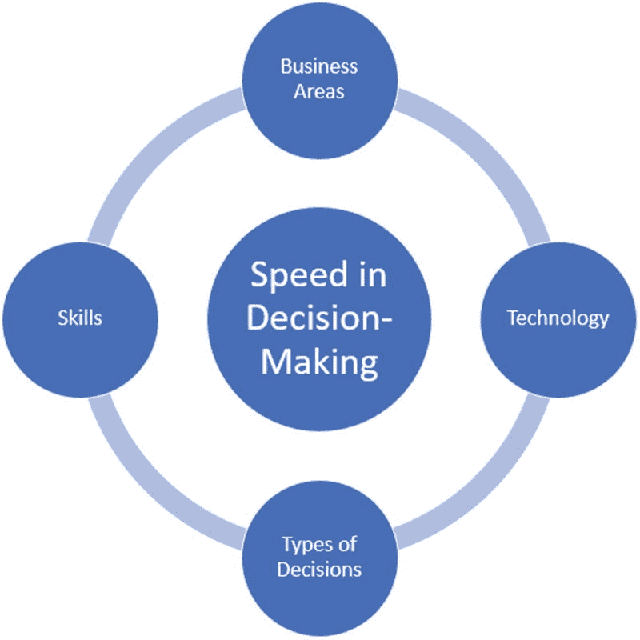

# 3. 克服机器学习应用中的挑战

组织面临着诸多数据和机器学习方面的挑战。通过制定坚实的数据战略来克服数据挑战，并创建数据文化，是在组织中应用和推广机器学习的重要一步。如果机器学习能够解决有助于组织发展的问题，它就能在组织内扎根。虽然改变组织文化绝非易事，也无法一蹴而就，但展示与成本降低或收入增长相关的、切实可见的机器学习价值，将推动机器学习的更广泛应用。

随着数据的演变，机器学习也会随之发展。数据已经从少量数据演变为大数据，从结构化数据演变为非结构化数据，从静态数据演变为数据流中的持续流动数据。尽管这些演变的程度存在差异，但它们正在发生，并将持续加速。面对成本压力、市场压力以及日益复杂的客户需求，组织找到自动化流程、提供更快更高质量信息的方法将变得至关重要。在本章中，我们将探讨如何构建一个更强大、更以数据为驱动的组织，使其能够拥抱机器学习，从而获得更深入的洞察，专注于解决关键业务问题。通过利用数据和机器学习做出数据驱动的业务决策，组织可以更主动地应对潜在的业务挑战，例如：针对不同的客户群体投放产品和服务、减少欺诈、以更具竞争力的价格定价产品和服务、减少供应链中的低效环节等。通过机器学习从数据中获取洞察，并据此主动做出决策，将使您能够快速适应客户需求和偏好的变化，从而更好地管理业务。下一节将概述组织当前和未来在数据和机器学习方面面临的挑战。

## 挑战概述

在最近的一篇文章中，^(²⁶) 组织在采用人工智能和机器学习等先进技术方面仍处于早期阶段。美国人口普查局 2018 年对全美 583,000 家公司进行的一项调查数据（由美国国家经济研究局整理 [Zolas et al., 2020]）显示，只有 2.8%的公司（即 16,324 家公司）在使用机器学习。

先进技术的使用在很大程度上偏向于拥有 250 名或以上员工的大型公司，其使用率是拥有 10 名或以下员工的小型公司的三倍多。由于许多小企业贡献了最多的总就业人数，如果小企业倒闭，可能会对就业和新思想的产生造成巨大的连锁反应。

机器学习在小企业中的应用将主要集中在金融服务领域，即金融科技中的欺诈检测、数字或社交媒体领域（在这些领域，分析社交媒体数据对于情感分析或产品推荐至关重要）。制造业中也有应用，例如利用传感器数据进行预测性资产维护。零售领域则利用社交媒体数据为不同客户群体（例如，男性与女性、不同地理位置）确定产品或服务价格。大型企业也有类似的用例，但规模要大得多。机器学习将扩展到更多的数据流、更多的算法，并向不同的消费者提供更快速的信息传递。数据集中化对于维护至关重要，但这也是组织面临的另一个挑战，将在后文讨论。接下来，我们来看看采用先进技术的根本原因。

## 理解采用先进技术挑战的根本原因

我们讨论了几项可能导致先进技术采用缓慢的关键挑战。本节试图探究这些挑战的根本原因，以便能够有效地解决它们。有五个领域可能会阻碍先进技术（如数据流和机器学习等）的采用：

1.  数据分散化

2.  缺乏促进先进技术的企业战略

3.  成本，包括：
    1.  高级人才技能的成本
    2.  先进技术的成本

4.  缺乏令人信服的机器学习用例

5.  个人和企业向数字化世界变革的意愿

以下将对每个领域进行讨论。

## 数据分散化

许多组织仍然拥有存在于众多数据库、平面文件和其他来源中的信息孤岛。分散化的信息会带来若干挑战：

1.  不同信息来源和应用程序之间缺乏互操作性，导致信息创建和使用的重叠。我们很多人都曾多次从同一家公司收到相同的信息——这就是糟糕的数据管理。Gartner 的一份报告^(²⁷) 发现，避免主数据管理（MDM）的组织面临潜在收入减少 25%的风险。

2.  由于缺乏互操作性，从数据中获取洞察的速度降低，从而减缓了决策过程。

3.  能从所有数据中生成的洞察数量减少，降低了可做出决策的多样性。

4.  由于缺乏集中的记录系统而导致数据重复，可能会浪费管理和维护数据的时间和精力。

5.  由于未使用正确的数据进行决策而导致决策质量下降，可能会阻碍业务增长。

数据孤岛对业务不利。^(²⁸) 缺乏集中化、严格的访问级别和低质量的数据可能导致创新速度放缓，使公司失去竞争优势。缺乏与公司目标和宗旨相一致的良好数据战略的公司，有可能将商业机会拱手让给竞争对手。要理解数据孤岛最初存在的原因，您需要提出以下问题：

1.  我们为什么要生成数据？

2.  是谁或什么在生成这些数据？

3.  数据在哪里被使用？被谁使用？用于什么目的？

4.  我们如何才能更好地利用我们的数据？

5.  我们主要的数据生成流程是什么？（提示：财务和运营通常是主要的数据来源）

6.  我们如何管理业务层面和公司职能层面的技术采购及持续使用？

7.  公司是否有采购和管理数据生成系统的 IT 标准？

8.  我们是否有任何数据治理实践或政策来为数据创建、存储和访问设定标准？

9.  谁负责监督公司的数据？

10.  是否有激励措施鼓励人们分享他们的数据或分析？

对上述问题的回答将为理解您最初为何拥有业务数据奠定基础。要理解为何存在数据孤岛，只需问：

*   整合我业务中的不同数据是否有价值？

如果答案是否定的，那么你还没有充分审视通过整合不同数据所能创造的潜在价值领域，或者可能确实没有价值——但这种可能性非常低。^(²⁹) 例如，整合新员工的数据可以帮助人力资源部门免去填写不必要的入职表格。简化薪资流程是另一个例子，将人力资源数据与员工和承包商的薪资数据整合。整合后的数据还能简化跨业务部门和司法管辖区的访问控制和用户身份管理。仅仅提出“如何为业务中陷入困境的领域创造商业价值”这个问题，就能引发关于数据去中心化的讨论，以及将所有数据集中在一个地方而不抑制创新是否有意义 [Maurice et al., 2006]。创建数据文化对于创建创新文化至关重要。创建数据文化有一些公认的步骤，^(³⁰) 并且要从业务领导者开始。然而，让不习惯使用数据进行决策的员工转变思维，开始使用数据，将是一项艰巨的挑战 [Waller, 2020]。通过使数据更易于获取、消除不必要的访问障碍，并让管理层要求提供数据驱动的报告和分析，来激励员工使用数据进行决策，这将有所帮助。向数据文化的转变不会一蹴而就，也无法强制推行；它必须与业务共同发展。只有当数据和机器学习通过更好的决策结果、有效的报告和提高员工生产力来证明其价值时，这种转变才会变得更容易。

数据去中心化不仅可能损害企业的利润，还可能对企业的信誉和声誉产生负面影响。这种损害可能不会立即显现，但随着时间的推移，组织可能会看到吸引顶尖人才的能力下降、员工流失率增加、销售额减少、社交媒体负面帖子增多等等。对于某些公司来说，这些*迹象*会被发现，并制定新的防御策略来止血。然而，许多其他公司意识到损害时为时已晚。能够及早发现负面迹象的公司可以采取主动措施来弥补不足。看到早期迹象的公司很可能正在利用数据和洞察来指导决策，以便迅速转向并领先于可能对其业务造成的毁灭性后果。这引出了我们接下来要讨论的缺乏企业战略的问题。

## 缺乏企业战略

拥有企业战略对于实现企业目标和宗旨至关重要。对于那些实时决策至关重要的组织来说，TML 应成为该战略的一部分。TML 很可能成为创新战略、数据战略、技能战略以及技术和基础设施战略的一部分。许多组织已经开始了其业务数字化的旅程。对于某些组织来说，*数字化* 是他们的基因：Facebook、亚马逊、谷歌、IBM、微软和苹果是其中的佼佼者。这些企业的发展壮大，并非通过有机增长，而是通过收购。如表 3-1 所示，在过去 10 年（2010-2019 年）中，谷歌进行了 37 次收购，苹果进行了 25 次收购，IBM 进行了 21 次收购，亚马逊进行了 19 次收购，微软进行了 16 次收购 [Soni et al., 2020]。

表 3-1

各公司收购情况

| 公司 | 收购数量 |
| --- | --- |
| 谷歌 | 37 |
| 苹果 | 25 |
| IBM | 21 |
| 亚马逊 | 19 |
| 微软 | 16 |

然而，仅仅通过购买人工智能和机器学习公司来借助 AI 和 ML 市场创新实现跨越式发展是行不通的。这是因为，无论你购买多少家公司，如果你没有制定如何利用数字技术改善业务核心方面的战略，你将会浪费大量时间和金钱，并很快意识到自己并没有取得任何进展。有几个广为人知的失败收购案例：^(³¹)

1.  谷歌收购 Nest 耗资 32 亿美元。为了进入智能家居市场，谷歌收购了 Nest，该公司的两位创始人也随之加入谷歌。但收购后，产品创新放缓，由于内部政治斗争加剧，Nest 的两位创始人辞职。

2.  微软收购诺基亚耗资 79 亿美元。为了加速进入手机市场，微软收购了诺基亚。但微软未能打动手机应用开发者，也未能建立起与苹果和安卓手机竞争所需的基础设施。收购失败，微软被迫在诺基亚和微软裁员数千人，并减记了 76 亿美元。

3.  时代华纳收购美国在线（AOL）耗资 1640 亿美元。其意图是将传统媒体与新兴互联网媒体合并。但两家公司文化不合、互联网泡沫破裂以及拨号上网的消亡等问题，导致 2003 年减记 450 亿美元，每年亏损 1000 亿美元，直到 AOL 被剥离为独立实体。

拥有一个好的战略将使你能够理解你期望从 TML 中为你的组织、客户和其他利益相关者实现的价值。它将帮助你满足项目交付的时间表，并允许你规划组织中与 ML 解决方案使用相一致的变革。这引出了另一个挑战：先进技术的成本。

## 先进技术成本

先进的数据和机器学习技术及技能并不便宜。这些技能需求旺盛，并且短期内看不到缓解的迹象。这给组织在争夺顶尖人才时带来了挑战。高昂的人力成本加上先进技术的成本，使得组织很难证明使用 ML（或 AI^(³²)）的创新解决方案的成本是合理的，尤其是在投资回报率（ROI）不明确的情况下。这是 ML 项目的主要挑战之一：ML 项目可能需要数月或数年才能实现回报。这增加了许多组织需要在 ML 项目中承担的投资风险水平，而在困难时期，许多组织不愿意承担这种风险。因此，组织愿意承担的风险水平应结合有关 ML 用例及其解决问题的正确信息来确定。选择正确的 ML 用例，并附有明确定义的问题陈述和价值主张，将有助于平衡风险与潜在价值。这引出了下一个挑战。

## 选择 ML 用例

选择正确的人工智能用例对于实现价值至关重要。近 50% 的 ML（AI）项目会失败 [McCormick, 2020]。这种失败在很大程度上是由于选择了错误的用例，而没有明确定义该解决方案将如何随着时间的推移为组织增加价值。拥有一个选择 ML 用例的框架将有助于确定哪些用例能够随着时间的推移为组织提供最大价值。此外，缺乏适当的高管支持，以及业务或技术期望的误导或不切实际，也可能导致失败。将 AI 解决方案集成到企业系统（包括新系统和遗留系统）的复杂性过于简化，可能会阻碍用户采用并侵蚀对解决方案的信任。因此，组织应投入前期努力，仔细定义 AI 解决方案旨在解决或应对的目标和问题陈述。

## 机器学习变革接受度

放弃人类的决策过程和冲动，将部分决策任务托付给机器，并非易事。没有什么比人类变革的意愿更重要。对许多人或企业而言，机器学习并非寻常之物，难以使用或接受。对机器、数据的不信任，不愿将控制权交给机器，或是上述所有因素，都会削弱人类对这些技术及其助益能力的信心。对许多企业来说，这归根结底是优先级问题。我们目睹了几乎所有行业中基于人工智能的技术对主要市场带来的前所未有的颠覆。这些颠覆性技术的核心并非数据或人工智能；它们利用的是人类在变革能带来某种益处时接受变革的意愿，这在一定程度上使得人工智能的采用变得更容易。看看爱彼迎（Airbnb），任何来自各行各业的人都可以出租自己的房间或公寓来创收。有了优步（Uber），任何拥有车辆和驾照的人都可以提供车辆和驾驶服务来创收。有了 DoorDash，任何拥有自行车或车辆的人都可以提供自己的配送服务来创收。所有这些公司都拥有出色的技术——但如果它们不能提供惠及人们、并利用人们为追求更好而变革的意愿的东西，它们今天很可能就不值数十亿美元。这与组织类似：如果组织不能为其员工或客户提供能从变革中受益的东西，那么无论你多么强行推动变革，他们接受变革的意愿都将接近于零。有许多例子展示了人工智能通过客户认知参与所带来的内部商业价值，例如提供全天候客户支持以处理各种查询的聊天机器人、用于回答员工问题的内部网站、面向零售商的商品和服务推荐、以及健康治疗推荐引擎等等。^(³³)

下一节将简要讨论技术障碍——具体来说，技术如何成为变革的障碍。

## 技术障碍

### 采用机器学习的技术技能差距

人工智能和机器学习领域的高度竞争正在推动创新，这些创新创造了新产品和服务，并被嵌入到汽车、家电、电视以及其他日常使用的设备和软件产品等传统产品和解决方案中。创新是经济增长的重要因素，能带来更好的产品和服务，降低消费者成本，并创造就业机会。但是，虽然创新推动增长，它也需要具备适当技能的人类来维持其增长。在没有适当技能、战略和流程的情况下使用技术，无助于维持产品和服务领域的持续创新。事实上，这些障碍可能导致人们对本应提供帮助的技术产生抵触情绪。这在旨在提高我们生活效率的人工智能技术中表现得尤为明显，然而，对基于人工智能的技术可能导致失业和其他不确定性的担忧，导致人们对这些技术的抵触情绪日益增长。^(³⁴)

### 采用机器学习的战略差距

技术创新的速度催生了数据创建的速度。更快的数据创建速度为更快的机器学习开辟了机遇。事务性机器学习（TML）是您可以利用这种快速数据，同时提供快速机器学习以实现快速决策的方法之一。但是，如果没有一个连贯的创新战略来整合数据流并认识到机器学习的价值，组织将难以最大化 TML 解决方案的价值。没有创新战略，组织的不同部门可能会追求相互冲突的优先级 [Pisano, 2015]。这些相互冲突的优先级会削弱技术的整体目标及其预期用途。虽然多元化的视角对增长至关重要，但如果没有一个战略将这些视角整合成一个被广泛接受的总体战略，就会导致结果钝化，适得其反 [Pisano, 2015]。TML 解决方案只是整体创新战略的一部分。成功 TML 解决方案的组成部分将由它解决的问题类型以及该解决方案如何以尽可能小的摩擦为整体业务价值做出贡献来决定。

### 采用机器学习的沟通差距

技术的目的和目标必须被清晰地定义和传达，以便受其影响的人能够清楚地理解。这与医生告诉病人即将扎的针会有点刺痛没什么不同。这能让病人在身体和情感上为扎针做好准备，从而避免意外。在许多情况下，组织未能就员工将在其组织中使用的技术的益处和影响与员工进行有效沟通。一个好的创新战略，能够阐明目的、目标和优先级，并将其整合到一个被充分理解和接受的总体战略中，是实现技术在整个组织范围内被采纳的关键一步。

### 应对挑战的方法

TML 解决方案需要具备对决策速度的认知和渴望。速度是 TML 的核心，也是自动化机器学习的动因。具体而言，快速的数据创建将导致数据中的模式和趋势快速变化。这些底层模式和趋势的变化会影响学习结果。随着模式和趋势的变化与演进，捕捉这些变化趋势的学习结果也会随之变化。这种速度使得人类难以快速（即在几秒钟内）构建和评估机器学习模型。为了快速捕捉不断变化的趋势和模式，就需要自动化机器学习。这还需要对洞察结果进行实时可视化，以便人类或机器能够更快地做出决策。

识别组织中能够从更快决策中受益的领域，将有助于构建包含 TML 的创新战略。图 3-1 展示了将 TML 融入整体创新战略所需的组件。

图 3-1

将 TML 融入创新战略

在图 3-1 中，需要考虑五个组成部分：

1.  将 TML 纳入创新战略的核心，是认识到并接受：数据分析和决策的速度是创造商业价值的必要条件。分析实时银行或信用卡交易以检测欺诈，需要快速的分析和决策能力。物联网设备需要具备自主决策能力，用于部件故障的自我诊断或健康检查。社交媒体需要快速决策以实现精准营销。如果对更快的数据分析和决策没有要求，那么对 TML 的需求就很小。

2.  处理数据流所需的技能与处理静态数据所需的技能不同。原因如下：
    1.  数据工程 – 数据流与列式数据框不同；对它们进行工程化处理需要理解数据和时间中的事件。

2.  特征工程 – 数据流底层数据结构的快速变化，使得传统的特征工程方法（如递归特征消除 RFE）难以应用。能够结合时间成分来隔离特征的方法将变得重要。例如，Z-score 特征可以实时应用于检测欺诈交易。

3.  数据（流）科学 – 对流式数据进行机器学习在采样、时间序列建模和实时模型性能管理方面提出了独特的挑战，而这些在批处理机器学习中是不存在的。像 Amazon Kinesis、Apache Kafka、Apache Flink、Apache Spark、Snowflake、MongoDB 和 Databricks 这样的事件流平台，都需要掌握事件流语言和流程的知识。数据科学家更关注静态数据，而数据流科学家则更关注数据流。具体来说，在 Kafka 中，主题（topic）、分区（partitions）和偏移量（offsets）这些术语是数据流特有的，对于构建 TML 解决方案至关重要。其他需要了解的知识领域包括：

    流连接（Stream joining），用于即时构建机器学习训练数据集。

    了解机器学习以构建由因变量流和自变量流组成的训练数据集，对于监督学习至关重要。了解无监督学习则有助于异常检测。

    需要掌握 Python 编程或某种编程语言的知识，以编写低代码的 TML 解决方案。

    需要具备可视化技能，以构建能够展示 TML 模型流式处理结果的大数据流式仪表板。

4.  MLOps – 传统的机器学习模型运维需要在变更管理、部署脚本、数据变更等多个环节进行人工干预。这类流程对于数据流来说并不理想。对于 TML 解决方案，模型是即时构建和部署的。它们可以先部署到测试环境进行进一步验证，然后快速部署到生产环境。

5.  模型管理与治理 – 传统的机器学习模型管理是分散的，缺乏适当的治理。组织中运行着孤立的、服务于特定目的的机器学习解决方案，这种情况并不少见。对于数据流，TML 解决方案是集中管理的。它们也是弹性解决方案，可以通过控制个人消费的数据流、算法和洞察结果的数量来进行扩展或缩减。TML 解决方案也可以即时激活或停用。

3.  需要识别那些需要快速决策的业务领域。快速决策可以由人类或机器做出。选择以交易为核心的领域。例如，如果你正在管理在线交易，那么欺诈检测可能非常有用。如果你正试图减少网络安全威胁，那么分析用户的交易日志以预测威胁的可能性将非常重要。如果你正试图提高产品质量，那么通过预测缺陷的可能性来减少每个产品的缺陷，对于质量控制至关重要。

4.  技术选择是 TML 解决方案成功的重要因素。虽然有多种事件流平台，但 Apache Kafka 的独特特性具有若干优势：^(³⁵)
    1.  偏移量 – Kafka 的偏移量参数对于回滚流式数据集，以利用流中的历史数据构建训练数据集至关重要。

2.  主题 – Kafka 将数据流命名为主题。TML 利用这些主题来连接数据流，以实时构建机器学习模型，然后对这些模型执行机器学习。

3.  分区 – Kafka 通过将数据存储在分区（在主题内）中，高效地管理海量数据。这提高了并行处理的性能，同时有助于构建可扩展的 TML 解决方案。

4.  复制因子 – Kafka 在不同的 Kafka 代理之间复制数据，以在其中一个代理发生故障时保持冗余。

5.  发布/订阅 – Kafka 采用发布者和订阅者模型。这使得它在管理 TML 解决方案和算法方面非常有效。

5.  你做出的决策类型是决定 TML 解决方案成功与否的重要因素。将在第 4 章中开发一个 TML 价值框架（TVF），以帮助你选择 TML 用例。选择 TML 用例在很大程度上取决于时间和价值。决策的时机以及这些决策结果对业务的价值，将有助于提高 TML 解决方案的采用率。选择正确的决策，并带来正确的业务成果，将有助于建立对这些解决方案的信任和信誉，从而带来更高的采用率和更多的 TML 解决方案。

通过考虑所有列出的组成部分来构建一个恰当的创新战略，将有助于确保 TML 解决方案完全融入整体业务战略。鉴于人工智能和机器学习的高度演进特性，创新战略也必须随之演进并保持灵活性。虽然所列出的组成部分会发生变化和演进，但技术领导者应始终愿意根据需要重新审视战略并做出调整。下一节将总结讨论内容并概述前进方向。

## 讨论与前进方向

数据流与自动机器学习面临的挑战，不仅在于提升人们对“数据分析速度更快、决策更迅速对业务有利”这一认知，还在于人们是否愿意改变并接受“数据和机器学习是业务核心组成部分”这一事实。机器学习在数据与特征工程、数据科学、MLOps 以及模型管理与治理等方面，面临着与数据流不同的挑战。TML 不仅高度依赖数据流，还依赖人类在理解问题领域方面的专业知识，以及将业务问题转化为机器可理解形式所需的数据流科学技能。此外，还需要机器学习架构师技能，来设计具备可扩展性、安全性和可采纳性的 TML 解决方案。数据创建速度的加快和对更快决策的渴望，使这些挑战变得更加复杂。此外，还存在系统互操作性和数据类型碎片化方面的挑战。尽管这些挑战看似难以克服，但并非无法解决。成功应对这些挑战的一个重要方面，是制定一项良好的创新战略，该战略需识别出对更快数据分析和决策的需求，并得到业务各部门的广泛认可。清晰定义并沟通“利用 TML 实现快速数据分析以支持快速决策”的价值，对于避免误解至关重要。

所有创新技术和解决方案都源于改进某些产品或服务的需求或愿望，这些改进能使某人或某事受益。颠覆性技术利用了我们对变革的接受意愿——只要这种变革能给我们带来净收益。这种收益能改善我们的生活和业务。如果没有收益，创新就不会被广泛采用。TML 解决方案提供了一种分析快速数据以支持快速决策的方法。它是机器学习中一个专注于速度、价值和可扩展性的领域，其优势在于能让你利用快速数据更快地做出决策。

TML 还有助于创建无摩擦且具有弹性的解决方案。通过减少机器学习过程中的人工接触点，企业可以降低成本，同时加快获取洞察的速度。然而，减少摩擦并不意味着可以省去精心规划 TML 解决方案的步骤——你需要先确定要解决的问题，然后识别解决这些问题所需的数据流。这既需要业务领域的知识，也需要数据科学技能。这些应用型数据（流）科学技能，与业务领域技能相结合，将有助于创建直接解决问题的 TML 解决方案。

TML 解决方案的弹性特性允许开发人员和管理员根据业务需求的变化，快速扩展或缩减 TML 解决方案。具体来说，TML 解决方案的弹性体现在三个组成部分：

*   使用的数据流数量
*   创建的算法数量
*   通过激活和停用数据流来控制 TML 解决方案

借助 TML，你可以通过连接数据流并控制其输出来增加或减少 TML 解决方案中的数据流数量。创建一个包含 5 个或 500 个数据流的 TML 模型所需的工作量是相同的，因为你只需将数据流的数量传递给一个`MAADSTML` Python 函数来连接这些流即可。连接后的数据流用于机器学习。具体实现方式将在第 6 章中解释。需要认识到的重要一点是，构建小型或大型 TML 解决方案所需的工作量是相同的，但云存储、网络吞吐量和计算成本会有所不同。弹性的另一个方面是创建的算法数量。当你想要为机器学习创建训练数据集时，就需要连接数据流。AutoML（MAADS-HPDE）将使用训练数据集并找到最优算法。你将使用这个最优算法进行预测性和规范性分析。你可以在极短的时间内创建数千个算法。但这可能会引发模型管理问题，导致资源使用效率低下，并可能浪费云计算和存储资源。不过，对此有一个解决方案。如果某些 TML 解决方案不再使用，开发人员可以立即自动停用它们。或者，如果有更多用户想要使用 TML 解决方案产生的洞察，开发人员只需为 TML 解决方案订阅更多消费者，他们就能立即访问 TML 解决方案算法产生的结果。弹性是 TML 解决方案区别于大多数传统机器学习解决方案的独特特性。AutoML 被设计得比传统解决方案更具弹性，但借助 TML，你可以通过一个简单的用户界面来扩展或缩减数据量，而机器学习组件几乎无需或完全无需人工干预即可适应变化。

因此，尽管数据流和机器学习存在挑战，但 TML 提供了一条前进的道路，使组织能够满足利用快速数据进行快速决策的需求。虽然并非每个业务问题都需要 TML，但组织可以将其纳入创新战略，并在时机成熟时加以运用。该战略将提升人们对“利用快速数据进行快速决策”的认知，从而为未来在人员技能、资源和技术方面需要做出的选择奠定基础，并鼓励一种直面日益数字化世界所需的心态。

脚注 1   2   3   4   5   6   7   8   9   10

