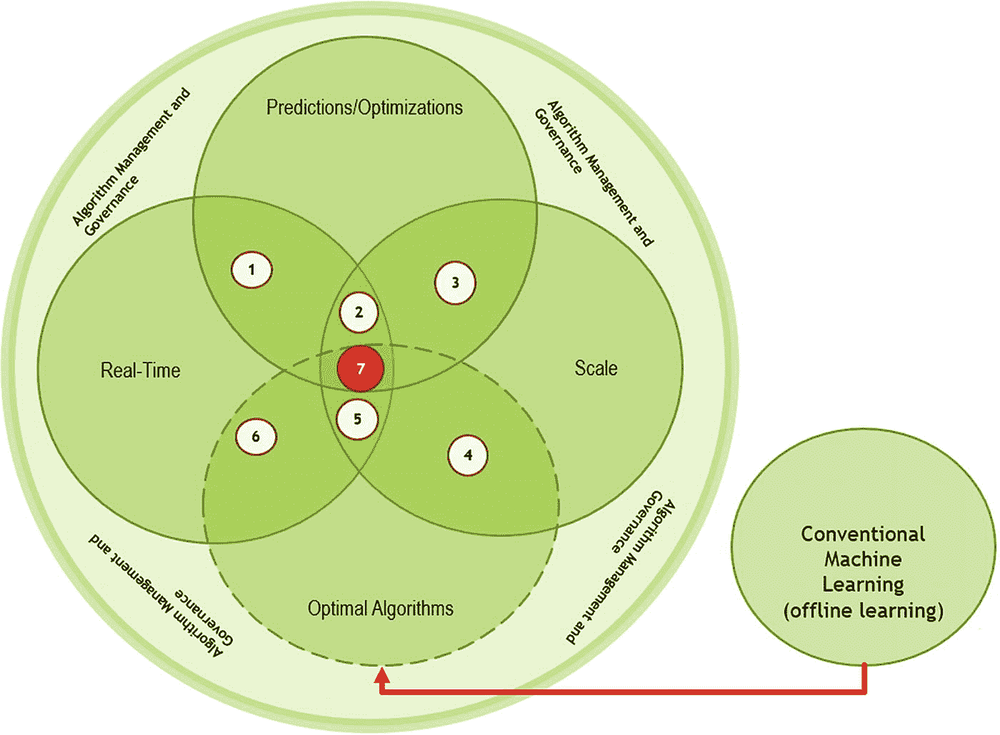
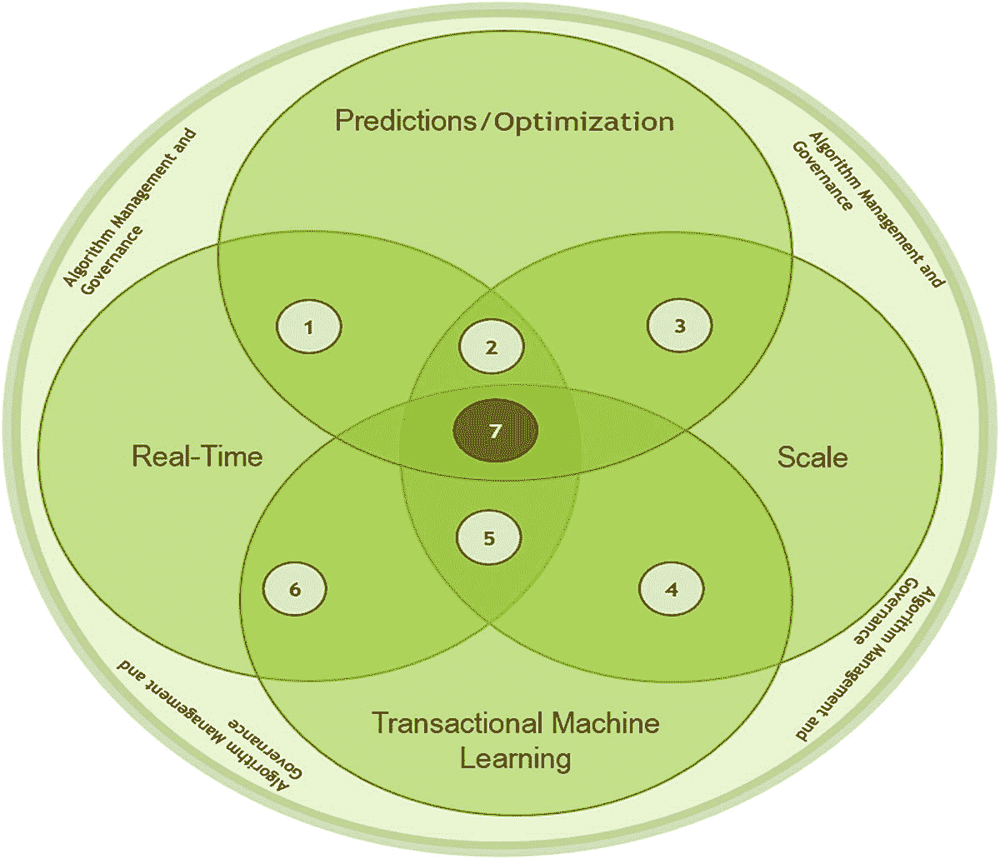

# 4. 事务性机器学习的商业价值

快速数据需要快速机器学习以实现快速决策。这是支撑 TML 的核心主题，也是机遇所在。具体而言，快速学习带来快速决策，进而更快地实现这些决策的潜在收益。对于企业而言，在与其他企业争夺市场份额和客户的商业市场中，快速决策可以成为竞争优势的来源 [Davenport, 2006]。通过将数据流与 AutoML 相结合来实现学习速度的提升，是对传统机器学习（CML）的根本性突破。由于集成了用于在线学习和预测的 AutoML，摩擦减少，为解决方案的快速扩展提供了机会。这不仅创造了一个无摩擦的机器学习流程，还提供了一种弹性的机器学习解决方案，可以根据（业务）需求的变化进行扩展或收缩。

随着企业面临后疫情时代，成本压力将推动对提高运营效率和更广泛采用人工智能的需求。^(³⁶) 例如，新冠疫情迫使组织每周多次更新或重新创建需求和销售预测。为什么？因为新数据以及由此产生的模型在数小时内就会过时。想象一个始终在线的模型和流程，它只需要新数据就能自我重新配置，并立即开始提供更新后的信息：这就是 TML 的商业价值。拥有观察预测变化的能力是始终在线模型的一大优势，因为你可以看到自己对业务决策的信心程度。

当前正发生一场结构性转变，朝着更自动化和机器智能解决方案的方向发展，这推动了以云存储和计算为核心的数字技术的更广泛采用。分析洞察的速度将成为一种竞争优势，推动业务成果的实现。数据的增长和数据创建速度的提升，将要求更快速地从数据中学习。拥有更快学习的能力将带来更快的决策，进而带来更好的业务成果。^(³⁷)

做出更快的决策具有一些关键优势。它允许人类和机器调整其流程或行为，从而产生更快的行动。做出信息充分、数据驱动的决策所带来的好处会随着时间的推移而累积，进一步改善流程或行为 [Davenport, 2006]。利用数据做出正确决策是改进这些流程和行为的基础 [Davenport, 2006]。

对于企业领导者而言，数据驱动的决策对于改善业务成果至关重要 [Davenport, 2006]。正如我们在前几章中讨论的那样，TML 提供了从快速流动的数据中学习的机会，这是传统机器学习无法完全提供的。具体来说，通过减少机器学习流程中的人工接触点（从而减少摩擦），组织可以利用速度优势获得洞察，从而将这些洞察整合到每个业务流程中 [Mohammadi et al., 2018]。拥有数据驱动的洞察来为每个业务决策提供信息，其价值在于创造：

1.  一个数字化成熟的组织，使其在快速变化的环境中更加敏捷
2.  一个透明的组织，从而在客户和利益相关者中建立更多信任
3.  一个无摩擦的组织，减少数据、服务器和网络管理所需的 IT 全职员工，以及减少数据科学家所需的全职员工

这三个领域——成熟度、透明度和无摩擦——可以为企业释放价值，开辟新的收入来源，从而推动增长。数字化成熟度对于成功至关重要。^(³⁸) 利用技术降低成本固然重要，但公司现在正寻求利用技术来促进增长。此外，透明度与业务流程中更少的摩擦相结合，具有增强员工和客户信任的双重效果。一项研究发现，94% 的消费者会忠于一个透明的品牌。^(³⁹) 接下来的章节将更详细地探讨如何通过 TML 实现这一点。但首先，我们将讨论传统的机器学习流程。

## 传统机器学习（CML）

在本节中，我们将探讨传统机器学习如何专注于静态的、驻留在磁盘上的数据。这将有助于我们将其与专注于非静态数据流的 TML 进行对比。如今，机器学习是一个涉及多个人工接触点的过程，包括数据准备、特征选择、模型构建、模型估计、超参数微调和模型部署 [Amershi et al., 2014; Mitchell 1997]。人工参与机器学习过程会产生摩擦，从而降低模型构建、模型估计、超参数微调和模型部署的速度；通过自动化这些任务，我们可以减少传统机器学习过程中的摩擦。大多数数据科学家花费 80% 的时间来清理和准备数据，只有 20% 的时间用于数据分析。^(⁴⁰) 通过 TML，数据分析得以自动化，从而立即节省 20% 或更多的时间。使用 TML 进行数据准备涉及识别和连接数据流，以便使用 MAADSTML Python 库或 REST API 即时构建机器学习模型；这将额外减少 30% 或更多的数据准备时间。我们将在第 6 章中演示这些任务。

我们并非暗示 CML 没有价值；CML 有许多用途，可以从静态的、驻留在磁盘上的数据中运行和学习。其中一些用途侧重于不需要实时做出的决策。或者，用于分析那些随时间变化不频繁的数据。图 4-1 展示了在实时数据和规模背景下，CML 流程如何使用最优算法进行预测和优化。该图显示了 CML 流程如何在大多数情况下离线工作，以分析数据并确定最适合该数据的算法。通常，通过更改每个算法中的参数或变量来选择和应用多个模型迭代，或者应用不同类型的算法，从而找到最佳算法。

图 4-1

CML 流程

选择最佳算法既是一门科学，也是一门艺术。使用统计指标来衡量特定算法的优良程度，同时避免过拟合，即避免将算法训练得过于完美，以至于它在训练数据上表现良好，但在*未*训练的数据上表现不佳。一旦选择了算法和参数，它们就会被用于预测性和规范性分析。

以下是对图 4-1 中六个圆圈的解释：

*   **实时** – 这表示数据是实时或批量生成的。这些数据并非用于训练模型；而是用于使用预训练模型进行评分或预测。

*   **规模** – 这表示在大型分布式或本地网络中，存在海量的静态数据和高数据量。在 CML 环境中，规模在很大程度上取决于人员、流程和技术。此外，扩展机器学习模型涉及多个组件，例如服务器基础设施、存储、计算和网络吞吐量。所有这些将使成千上万的消费者能够从您的机器学习模型中获取洞察。扩展少数机器学习模型可能并不困难，但如果您有数百个机器学习模型被分布式网络中的成千上万用户使用呢？那么，当模型需要更改、重新训练和重新部署时，这些模型的模型管理、数据和洞察的安全性以及治理又该如何处理？使用 CML 并不容易做到。模型管理、治理以及数据和洞察的安全控制方面的挑战使得快速扩展变得更加困难。

*   **预测与优化** – 这表示使用预训练的机器学习模型，通过对数据进行评分来做出预测，并找到自变量的最优值。例如，在我们天气温度的示例中，这将是 CC 和 ToY 的值。具体来说，在模型训练完成后，估计的参数（即 a、b 和 c）捕获了从训练数据集中学到的知识。这些机器学习本质上是对生成数据的分布的估计。回想一下，训练数据集是某个总体数据的一个样本，但在大多数情况下我们并没有总体数据，因此我们使用样本数据来估计总体数据。需要注意的是，这些是预训练模型。这些预训练模型是使用跨越数月或数年的静态历史数据开发的。这是与 TML 的一个关键区别，在 TML 中，模型是使用几秒或几分钟前生成的数据进行实时训练的。

*   **最优算法/传统机器学习** – 这个最优算法是最适合数据的算法，具有最佳调整的超参数。这正是 CML 中的数据科学家所寻找的，也是为什么他们可能需要数天或数周才能找到它的原因。这也是与 TML 的一个关键区别，在 TML 中，无需人工干预，即可在几秒或几分钟内找到具有调整后超参数的最优算法。红色箭头表示离线机器学习过程的输出，即最适合训练数据集的最优算法。然后，可以使用这个最优算法进行预测和/或找到输入变量的最优值。

*   **算法管理与治理** – 训练模型的管理和治理是 CML 中日益严峻的挑战。这有三个原因：
    *   组织内部创建的训练模型数量不断增加，但缺乏标准流程和对数据访问、机器学习平台的控制，开源技术的使用增加，以及模型部署后的维护和支持极少。

*   组织和客户都要求从数据中获得更快的洞察，以某种方式改进他们的日常任务。这推动了对更多机器学习模型的需求，从而使模型重新训练、版本控制以及洞察和可视化的质量变得更加复杂。

*   随着云中结合开源技术的数据和机器学习平台使得在分布式网络上构建和部署模型变得更加容易，维护和支持机器学习模型的成本将会增加。这将使得在努力控制云计算和存储成本时，更难管理哪些模型正在被使用，哪些没有被使用。在世界银行最近为金融科技行业发布的一份报告中，许多金融科技公司报告了数据存储费用的增加。^(⁴¹)

TML 在三个方面与 CML 不同：

*   TML 在实时的、事件驱动的训练数据集上进行**在线机器学习**。在这里，在线指的是即时创建用于机器学习的训练数据集。随着新数据的到来，这些训练数据集被持续创建。

*   TML **使用事件流数据**作为在线机器学习的输入数据，以及预测性、规范性分析和优化的输入数据。数据流中实时填充了事件，这需要机器学习解决方案更快地响应，以捕获信息、处理信息并将其发送出去，供人类或机器快速决策。

*   TML 解决方案部署、扩展和重新训练的速度更快：它们是**无摩擦的**且**弹性的**，这是与 CML 解决方案的关键区别。CML 解决方案也可以扩展，但其成本函数是线性的。TML 的成本函数会迅速趋于平缓，因为可以在相同的基础设施中以低成本添加多个数据流。弹性的 TML 解决方案将 TML 解决方案的特性和设计与解决方案的管理和治理相结合。

下一节将探讨 TML 为将机器学习应用于实时、事件驱动型数据所带来的机遇。

## TML 的机遇

组织收集的数据量持续增长，但大部分仍未得到充分利用。在最近一项 2019 年的调查^(⁴²)中，对来自美国运通、福特汽车、通用电气、通用汽车和强生等超大型企业的 64 位 C 级高管进行了调研，结果发现：

*   72% 的受访者尚未建立数据文化。
*   69% 的受访者尚未创建数据驱动型组织。
*   53% 的受访者尚未将数据视为业务资产。
*   52% 的受访者承认未能在数据和数据分析方面展开竞争。

显然，上述调查表明，在数据和数据分析的利用方面仍有改进空间。当然，从另一方面看，48% 的公司正在数据和数据分析领域展开竞争。虽然将数据视为资产的做法日益普及，但这需要组织领导者将数据和洞察力视为竞争优势并予以优先考虑。此外，从数据中提取的洞察力还需要直接展示其如何有助于增加收入和降低成本。如果不能直接关联到组织损益表的底线 [Maurice et al., 2006]，就很难获得高管的支持，将数据和机器学习用作竞争武器。我们稍后将展示组织如何将 TML 用例与企业优先事项对齐，以确保开发出正确的 TML 用例，并直接为这些优先事项做出贡献，同时为整个组织增加价值。

图 4-2 展示了一个与 CML 类似的图表，但此处加入了实时数据、规模、预测/优化的 TML，这可以带来更快的决策。我们将讨论组织如何向 TML 演进，并为其组织增加额外价值。

图 4-2

TML 维恩图

以下是对图 4-2 中五个圆的解释：

*   **实时** – 这表示数据是实时生成且事件驱动的；我们将实时视为数据的持续流动，例如数据流。这些数据流是无界的，意味着它们在技术上可以增长到无限量。这是 TML 的一个关键价值领域：它能够快速对大数据执行机器学习。
*   **规模** – 这表示在大型分布式网络中，存在海量的数据流和高容量的数据。随着来自不同来源的不同类型数据的巨大增长，以及组织向云端迁移，将越来越需要能够快速构建、部署、管理和使用的基于云的机器学习解决方案；这里的管理意味着，除其他事项外，能够在不使用时自动停用解决方案。
*   **预测与优化** – 这表示使用机器学习算法进行预测并找到自变量的最优值。TML 使用最新训练的机器学习模型进行预测或评分。与 CML 的关键区别在于，TML 解决方案使用的数据始终是最新的数据，可能只有几秒或几分钟的历史，而不是像大多数 CML 用例那样是几个月或几年前的数据。
*   **事务性机器学习** – 参见前述定义。
*   **算法管理与治理** – 通过自动停用不使用的解决方案，实时管理 TML 解决方案以控制云计算和存储成本。

将上述五个领域结合起来，开始揭示另外七个值得关注的能力：

1.  将预测/优化与实时数据相结合，就变成了实时分析。这正是当今一些公司用来预测消费者行为、推荐产品或服务等的方法。
    1.  将机器智能嵌入其产品和服务中的企业，其客户参与度更高。
2.  优化以确定在特定价格下销售或购买的最佳数量，可确保收入最大化和成本最小化。
2.  大规模实时分析使组织能够预测消费者行为，并向数百万人（而非数百人）推荐产品或服务。想想使用 Facebook 的数十亿用户；利用大规模实时分析，Facebook 可以向个人用户精准投放广告。目前只有少数公司能做好这一点。
3.  在不考虑实时性的情况下，将规模与预测/优化相结合，等同于将离线机器学习应用于静态数据。这方面的例子很多，例如在医疗保健领域预测服用某些药物后的免疫反应。其他例子包括预测产品推荐、零售价格、健康与安全事件、资产故障等。许多公司都能做到这一点。然而，更新、重新训练和微调机器学习模型的超参数颇具挑战性；TML 是一种“一次构建”的方法。它使组织能够减少对 TML 模型和流程输入的关注，而更多地关注 TML 产生的结果，并利用它做出更好的业务决策，从而快速推动业务发展。这在竞争激烈的市场中至关重要。

组织采用较少（如果有的话）的领域是：

4.  将 TML 与规模相结合 – 当今很少有公司（如果有的话）能做到这一点。
5.  将 TML 与规模和实时相结合，例如对流式数据执行数据挖掘 – 当今很少有公司（如果有的话）正在这样做。
6.  将 TML 与实时相结合 – 当今很少有公司（如果有的话）正在这样做。

这引出了 TML 尚未被开发的核心里程碑 [Mohammadi et al., 2018]：

7.  将 TML 与大规模实时相结合以进行预测/优化 – 这只有将数据流与 AutoML 结合起来才有可能实现。正如我们讨论过的，CML 流程不够快，无法将机器学习应用于数据流。具体来说，随着数据的变化，数据的底层结构也会发生变化，这将改变从这些数据中学习到的知识。想想主要由人类行为驱动的金融数据的快速变化。使用 CML 从几个月或几年前的历史金融数据中学习，可能会错过由市场状况变化、环境变化、疫情等引起的人类行为变化。如果错过了这些变化，将会影响机器学习模型预测的结果，进而影响人类做出的决策。拥有从最新数据中快速、轻松、无缝学习的能力，更有可能捕捉到底层数据结构的微小或重大变化，从而自然带来更好或更准确的模型结果和决策。

图的外围区域显示了**算法治理与管理**的重要性。^(⁴³) 结合价值领域 1-6，组织可以通过专注于那些能够逐步实现更快数据创建、更快机器学习应用、更快优化和预测决策（并辅以适当治理）的领域，向领域 7 演进。

但是，是什么让领域 7 如此特别？仅仅因为很少有公司（如果有的话）达到领域 7，并不意味着它令人向往，难道不是吗？如前所述，领域 1-3 是当今许多组织正在做的事情；这已经确立了对大规模实时预测和优化的采用。随着越来越多的公司开始采用领域 1-3，这将迫使已经处于领域 1-3 的领先公司开始差异化、创新并演进到其他领域，以获取市场份额并保持竞争力 [Davenport, 2006; Mohammadi et al., 2018]。

为了快速做出决策，需要利用流式数据进行快速机器学习（以及深度学习）。^(⁴⁴) 但学习数据流面临着若干挑战，其中之一便是依赖历史数据来训练算法 [Mohammadi et al., 2018]。**流式机器学习（TML）** 提供了一种从数据流中提取历史数据的方法，以促进快速机器学习。这使得组织能够向区域 4、5、6 演进，并最终进入区域 7，从而帮助其保持竞争优势。

向区域 4、5、6 和 7 演进，要求组织采用一种不同的思维模式和文化，充分利用以往在分析领域的创新。Davenport (2006) 提供了多个例子，说明企业如何利用人员、流程、技术和文化在分析领域展开竞争。许多成功运用分析的组织都构建了一个能让分析蓬勃发展的生态系统。例如，Davenport (2006) 解释了沃尔玛如何强制要求其供应商使用其零售链接系统，按门店监控产品流动、规划促销活动，并利用数据更好地管理产品库存。宝洁公司则与供应商和零售客户共享其数据和分析结果，以帮助提高响应能力并降低成本 [Davenport, 2006]。构建一个分析能提供真正价值、并在拥有共同目标的分布式用户网络中成为价值来源的生态系统，不仅有助于加速数据和分析的采用，还能催生解决新业务问题的新思路和解决方案。TML 通过利用云基础设施作为通用存储和交付平台，合并或连接合作伙伴的数据流，从而简化了合作伙伴之间的数据共享。

深入探究组织如何向分析领域演进，可以发现，数据与业务需求相结合才是驱动力 [Davenport, 2006]。随着数据从低速向高速、从低容量向高容量、从低多样性向高多样性演进，分析这些数据的方法也将随之演进。我们只需回顾一下计算机的演进历程：从阿塔纳索夫-贝瑞计算机（ABC）、巨像计算机、ENIAC、曼彻斯特小规模实验机、EDSAC、IAS 等等。随着计算机内存和存储容量的增加、强大（开源）编程语言的出现以及电子电路的进步，我们可以看到事物变化之快，以及我们如何加速迈向计算领域，从而开辟了许多新的应用和创新领域 [Williams, 2000]。如果没有艾伦·M·图灵和约翰·冯·诺依曼解决那些推动创新需求的战略性和复杂性计算问题，计算和运算就不可能实现。

因此，不难接受的是，领先的组织将加速向区域 4、5、6 和 7 演进，这主要是由业务需求、竞争压力、技术进步和人员技能驱动的自然进程。下一节将讨论 TML 的核心价值领域。

## TML 的核心价值领域

集成了 AutoML 的数据流能够解决大规模问题，并为数百万人提供更快的洞察，这类技术将持续获得关注。上一节展示了由业务需求、竞争压力、技术进步和人员驱动的计算与运算演进，如何自然地走向更快、更好、更便宜的方式；这对于数据和机器学习同样适用。因此，TML 的商业价值将通过以下领域得以实现：

*   **更快的决策制定** – 通过减少 CML 中存在的摩擦，TML 以更少的人工干预和更具弹性的解决方案，加快了获取洞察的速度。

*   **更快的规模化** – 结合 Kafka，TML 解决方案可以利用 API 和微服务架构快速扩展，为几乎所有行业的组织开辟新的机遇。

*   **更快的（深度）洞察** – 动态连接数据流以创建训练数据集，然后应用机器学习寻找最优算法，并微调超参数，从而创建一个无摩擦的机器学习过程，能够在极短的时间内（而非数天或数周）提供更深入的洞察。

上述领域指出了企业若想从快速流动的数据中获取最大价值，实现更高速度的路径。许多研究人员 [Davenport, 2006; Aggarwal, 2007; Amershi et al., 2014; He et al., 2020; Jayanthi et al., 2016; Read et al., 2020; Yao et al., 2019] 已经证明了分析、大数据、数据流和 AutoML 对决策制定的价值。近年来，流媒体技术（如 Netflix、Apple Music、Disney+、Amazon Prime Video、Facebook 直播、金融科技公司、谷歌等）以及物联网设备和技术的增长表明，消费者的行为正趋向于一种基于流的文化。这些技术正促使流式数据呈指数级增长，这将进一步推动对更快分析这些数据以做出更快决策的需求。下一节将更详细地讨论这些价值领域（杠杆）。

## TML 价值领域（杠杆）

目前，关于识别影响人工智能在大数据上应用的成功因素的研究尚显不足 [Duan et al., 2019]。而针对人工智能和机器学习在数据流上应用的成功因素研究则更为稀少。本节将进一步讨论前一节中提到的价值领域（杠杆）。具体而言，我们在此提出一个 TML 价值框架（TVF），以帮助识别与公司优先事项和目标相一致的 TML 用例。TML 的主要目标是持续将自动机器学习应用于数据流，以快速提取洞察：以最小阻力快速获得洞察，是成功 TML 解决方案的关键。在商业背景下，几乎没有研究表明 AutoML 在应用于数据流时如何产生商业价值：即增加收入和/或降低成本。表 4-1 展示了 TVF，作为一种帮助组织随时间评估 TML 用例商业价值的方法。

表 4-1

TML 价值框架

| TML 领域 | 业务领域 | 决策领域 | 产生的价值 | 实现价值的时间 |
| --- | --- | --- | --- | --- |
| 更快的决策 | 识别您业务中需要更快决策的领域。这些可能包括：• 财务• 人力资源• 市场营销• 信息技术• 制造• 风险• 运营 | 识别决策领域。这些可能包括：• 提高客户满意度• 减少产品故障• 减少欺诈• 提高客户留存率• 降低员工流失率• 改善客户互动 | 识别您希望为每个业务领域和决策领域实现的预期价值^(⁴⁵)。 | 确定您希望何时实现此价值。请具体说明。例如，*我希望在一周内实现客户留存率的提升*。或者，我希望在一个月内实现客户满意度的提升。 |
| 更快的规模化 | 识别您希望扩展的业务领域。^(⁴⁶) | 您希望扩展哪个决策领域？ | 规模化实现了什么价值？例如，如果您希望改善 1000 万客户的互动，那么您可以向这 1000 万客户提供什么洞察或服务，让他们感觉与您的产品或服务互动更紧密？ | 您希望多快实现这一价值？如果您正在向 1000 万客户提供产品推荐洞察，您是按需提供、事件驱动提供，还是每分钟、每小时等频率提供？ |
| 更快（深度）洞察 | 识别需要从机器学习中获得更深层次洞察的业务领域：对某事物的预测或某事物的最优值。您目前在生成环境中是批量使用模型还是手动更新模型？您是否发现模型会随着时间的推移失去相关性，例如，其通过准确率或错误率评估的性能，或盈利能力会随时间恶化？您的数据团队是否花费时间更新或改进现有模型？如果您对以上任何问题的回答为“是”，那么您可能有机会使用 TML 来减少数据科学流程中的阻力。 | 识别您正在预测或优化的内容。例如，我想预测下个月的客户满意度。或者，我想知道客户下周想要多少产品。或者，我想检测每笔银行交易中的欺诈行为。 | 识别从更深层次洞察中获得的价值。例如，如果您正在预测 100 万笔交易中的欺诈行为，那么请指明您希望将欺诈率降低多少个百分点。 | 确定您希望多快提供这些更深层次的洞察。例如，我想每秒分析 100 万笔交易以发现潜在欺诈，并在一个月内将欺诈率降低 10%。在静态数据上运行的 CML 流程无法足够快地发现潜在欺诈，可能会使您的组织面临收入流失的风险。 |

表 4-1 展示了一个框架，帮助组织通过快速提取洞察来选择能够实现其公司目标的用例和业务问题。我们可以展示如何将此框架应用于一个虚构公司的欺诈用例。对于这家公司，我们确定了以下内容：

*   **业务领域** – 一家销售奢侈品的在线零售商的运营风险管理。
*   **决策领域** – 给定交易是否具有欺诈性，以及是否应允许该交易继续进行？交易应被允许进入结账流程的风险等级是多少？
*   **价值领域** – 您的公司每周因欺诈交易损失 70 万美元。将此损失减少 50% 可防止每周 35 万美元的收入从您的组织中流失。现在，这些节省与竞争性用例相比如何？
*   **实现价值的时间** – 财务部门希望每周将欺诈率降低 50%，并在 6 个月内实现 840 万美元的节省。

在目标上做到具体、清晰和专注，将使设计满足您目标的 TML 解决方案变得更加容易。下一节将更深入地探讨如何衡量 TML 解决方案的价值。

## 衡量 TML 解决方案的价值

上一节讨论了价值领域。在本节中，我们将转化并量化 TML 解决方案所产生的价值。衡量 TML 解决方案的价值，使组织能够根据价值从高到低，对要开发的 TML 解决方案进行优先级排序和规划。虽然关于价值的哲学讨论超出了本书的范围，但区分价值与估值这两个概念非常重要 [Hartman, 1969; Hartman, 1972]。某事物的价值在很大程度上是主观的，取决于它在多大程度上实现了其概念设计所要达成的意图。Hartman (1972, p. 250) 将价值定义为：“一个事物在满足其概念意图的程度上有价值。”估值是一种人类活动，用于衡量价值事物的属性——或者如 Hartman (1969, p. 215) 所述，“事物属性的组合排列”。虽然价值与估值之间的区别可能看似微妙且微不足道，但它们在处理价值计算时的重要性却绝非小事，特别是当你考虑到开发可能影响数百万人的大规模机器学习解决方案所涉及的成本时。如果这些解决方案产生的价值不等于或大于其成本，那么这就是一个亏损的解决方案。

扩展价值和估值的概念，我们可以从两个方面来看待 TML 解决方案的价值：

1.  **内在价值** – 这是 TML 解决方案本身所具有的价值；这可能与解决方案的独特性有关，特别是所做决策的独特性、解决方案的规模、使用了多少数据流，以及随时间推移生成了多少算法。例如，在持续流动的数据交易上进行实时欺诈检测，能够大规模进行，同时降低人力和技术成本，并减少收入损失的可能性，这将是一种直接影响组织利润的价值。

2.  **外在价值** – 这是非内在的价值。具体来说，TML 解决方案对组织及外部环境的外部影响是什么？TML 解决方案如何直接促进收入增长和/或成本降低？TML 解决方案的投资回收期是多长？

理解 TML 解决方案的内在价值和外在价值，不仅可以帮助组织为规划和开发目的对解决方案进行优先级排序，还有助于让更广泛的技术和业务利益相关者群体了解这些解决方案；这可以加速获得利益相关者的支持。

使用诸如平衡计分卡 (BSC) [Kaplan and Norton, 1996, 2001] 等广泛接受的方法来捕获内在价值和外在价值，有助于提供所有 TML 解决方案的跨企业视图。并且，可以判断是否存在将 TML 解决方案与其他非 TML 解决方案整合的机会。例如，表 4-2 展示了 TML 解决方案的 BSC [Kaplan and Norton, 1996, 2001; Looy et al., 2016]。

**表 4-2**

**TML 与平衡计分卡**

| BSC 领域 | 观察视角 | 绩效指标 | TML 解决方案增加项 |
| --- | --- | --- | --- |
| 财务绩效 | 股东和高层管理人员的财务绩效 | 战略财务数据 | • 业务领域：否• 决策领域：否• 价值：是• 时间：否 |
| 客户相关绩效 | • 客户绩效• 供应商绩效• 社会绩效 | • 客户调查结果• 外部协作与流程依赖关系• 社交媒体互动数据，例如对产品和服务的点赞/点踩、负面/正面评论 | • 业务领域：是• 决策领域：否• 价值：否• 时间：否 |
| 内部业务流程绩效 | • 通用流程绩效• 时间相关流程绩效• 成本相关流程绩效• 与内部质量相关的流程绩效• 灵活性相关流程绩效 | • 流程工作的描述性数据• 流程工作的时间相关数据• 运营财务数据• 满足最终用户需求的能力• 流程工作中变更或变体的数据 | • 业务领域：是• 决策领域：否• 价值：否• 时间：否 |
| 学习与成长相关绩效 | • 数字创新绩效• 员工绩效 | • 流程和项目的创新• 员工对流程工作及个人发展的贡献 | • 业务领域：是• 决策领域：否• 价值：否• 时间：否 |

表 4-2 中名为“TML 增加项”的最后一列应指示 TML 领域的“是/否”——我们填写了“是”和“否”作为示例。这应该为每个 TML 解决方案执行，并将有助于将 TML 解决方案与整个组织的 BSC 联系起来。这对于促进跨业务领域的非孤岛方法也可能很重要，并可能使 TML 解决方案更显眼，以增加支持度。然而，当 TML 解决方案的某些领域增加了 BSC 领域，而其他领域没有时，困难就出现了。以表 4-2 中财务绩效的以下示例为例：

*   业务领域：否
*   决策领域：否
*   价值：是
*   时间：否

在这种情况下，价值：是意味着 TML 解决方案增加了财务绩效，但其他 TML 领域，如决策领域和时间，则没有。例如，你可能会问：是否某些决策领域对财务绩效不重要？时间上的“否”是否意味着更长期的绩效而非短期绩效？TML 将如何、何时以及以多大程度减少欺诈？能够免费创建敏捷概念验证^(⁴⁷) 可以是一种快速且无风险的评估潜在 TML 解决方案的方法。我们将在下一节提出一种解决此困难的方法。具体来说，下一节将展示一种估值方法，用于量化 TML 解决方案的价值，以帮助选择 TML 用例。TML 解决方案提供的业务价值将是其成功的一个重要方面。

## 选择合适的 TML 用例

在某些情况下，组织会仓促投入解决方案的开发，却没有意识到其广泛的影响成本。^(⁴⁸) 审慎评估 TML 解决方案的收益与成本，有助于降低在那些对组织价值甚微的解决方案上过度投入的风险；如果某个解决方案的成本超过了其创造的价值，那么它绝对不值得开发。

在本节中，我们构建了一个 TML 价值指数（TVI），用于量化 TML 解决方案的内在价值和外在价值。该指数的组成部分如下（在 TML 解决方案的背景下）：

1.  业务领域重要性
    1.  1 = 非常重要
    2.  2 = 重要
    3.  3 = 略微重要
    4.  4 = 一般
    5.  5 = 不重要

2.  对于每项正在做出的决策，请选择该决策的
    1.  1 = 非常重要
    2.  2 = 重要
    3.  3 = 略微重要
    4.  4 = 一般
    5.  5 = 不重要

3.  对于每项决策所产生的价值，请选择该价值的
    1.  1 = 非常重要
    2.  2 = 重要
    3.  3 = 略微重要
    4.  4 = 一般
    5.  5 = 不重要

4.  对于待决策事项的时间因素，请指明该时间的
    1.  1 = 非常重要
    2.  2 = 重要
    3.  3 = 略微重要
    4.  4 = 一般
    5.  5 = 不重要

你可能会问：“难道每个业务领域和每项决策不都是非常重要的吗？” 并非如此。业务优先级会随时间变化。这些优先级会使某个领域比其他领域更重要：业务并非一成不变。例如，如果你是一家在疫情期间生产疫苗的制药公司，那么该公司会将研发（R&D）置于比其 IT 部门更优先的位置。因此，在疫情背景下，针对研发领域的 TML 解决方案将会（也应当）比针对 IT 领域的 TML 解决方案更重要。一旦疫情结束，这家公司很可能会重新调整其重点领域的优先级。

回顾一下在平衡计分卡（BSC）方法中协调 TML 领域的困难：我们现在可以解决这个难题了。具体来说，当 TML 领域对 BSC 领域的价值贡献不一致时，通过使用 TVI，我们可以根据其 TVI 值对 TML 用例进行量化和排序。表 4-3 展示了如何计算 TML 用例的 TVI。

表 4-3

TVI 计算

| TML 用例 | 业务领域 | 决策领域 | 价值领域 | 时间 | TVI |
| --- | --- | --- | --- | --- | --- |
| “财务部门希望在一个月内将 100 万笔交易中的欺诈行为减少 10%” | 2 | 1 | 1 | 3 | 1.75 |
| “市场部门希望花费 100 万美元，在三个月内将 1000 种产品的销售额提高 10%，并增加 400 万美元的收入” | 3 | 2 | 1 | 2 | 2 |

这个用例的 TVI 是多少？通过使用从“非常重要”到“不重要”的评分标准，组织可以从每个业务领域选取人员作为受访者，以小组形式回答这个问题。^(⁴⁹) TVI 的取值范围为 1 到 4：它是每个 TML 领域数值的平均值。需要注意三个要点：

1.  重要性的选择必须基于当时的业务优先级背景。
2.  选择不能孤立进行，而应尽可能让多样化的业务利益相关者参与其中。
3.  要在 TML 用例中进行选择，请将 TVI 列按从低到高排序；数值最低的 TVI 对应的用例最重要。在表 4-3 的最后一列中，TVI 值为 1.75 的用例比 TVI 值为 2 的用例更受青睐。

虽然上述方法在评估单个用例时效果良好，但在考察用例之间的相对重要性时则表现不佳。^(⁵⁰) 这是因为我们通过为重要性分配数值，将序数排序转换为了基数排序，这引发了关于重要性数值选择客观性的担忧。因此，在相关用例之间以小组形式进行这项为 TML 领域选择数值的练习至关重要。当多个不同个体共同做出选择时，选择偏差的程度应会降低 [Kugler 等人，2012]。然后，应使用小组的整体结果进行 TVI 计算。下一节将探讨 TML 解决方案的收益与成本，以及如何计算这些内容。

## 收益与成本

到目前为止，我们重点关注了可通过 TML 解决方案实现的价值领域，但对收益与成本的比较涉及不多。组织应密切关注 TML 解决方案产生的收益以及构建和支持这些方案所付出的成本，以避免浪费财务资源，这种情况正变得越来越普遍。^(⁵¹) 具体而言，净收益（即收益减去成本）应为正值，才能证明 TML 解决方案的合理性。但这种净收益不应是一次性计算；相反，净收益应在 TML 解决方案的整个生命周期内持续计算。

TML 解决方案有几个重要的成本方面，其中一些可能并不显而易见。为了说明这一点，我们给出以下示例。我们重点关注一个大型 TML 解决方案在使用磁盘存储、内存、计算能力和吞吐量等云技术时的成本。这些组件中的每一个都是支持 TML 解决方案运行的基础设施。^(⁵²) TML 解决方案的其他成本方面则与 Kafka 相关，如表 4-4 所示。

表 4-4

TML 成本构成^(⁵³)

| 成本类型 | 金额（美元） | 最大限制 |
| --- | --- | --- |
| 读取 | $0.11/GB | 每秒 100 MB |
| 写入 | $0.11/GB | 每秒 100 MB |
| 存储 | $0.00013889/GB-小时 | 5000 GB |
| 分区^(⁵⁴) | $0.004/分区-小时 | 2048 |

现在，对于一个大型 TML 解决方案，假设：

1.  网络读取量为每小时 1000 GB。
2.  网络写入量为每小时 1000 GB。
3.  每小时使用 10,000 GB 的存储空间。
4.  创建 10,000 个主题/算法，每个主题/算法有 10 个分区，使用 100 GB 存储空间。
5.  TML 解决方案运行时间为 1 年（即 8760 小时）。

表 4-5 显示了 TML 解决方案的成本。

表 4-5

TML 解决方案成本^(⁵⁵)

| 成本类型 | 金额（美元） | 每小时吞吐量 | 年度成本（美元） |
| --- | --- | --- | --- |
| 读取 | $0.11/GB | 1000 | 963,000 |
| 写入 | $0.11/GB | 1000 | 963,000 |
| 存储 | $0.00013889/GB-小时 | 10,000 | 12,167 |
| 分区 | $0.004/分区-小时 | 100,000 | 3,504,000 |
| **年度总成本** |   |   | $5,442,167 |

如表 4-5 所示，对于一个大型 TML 解决方案，预估的运营成本（按 8760 小时计算）为 5,442,167 美元。这还不包括人力成本以及开发应用程序的初始成本。年度总成本的主要组成部分（约占 65%）是 Kafka 分区的成本。因此，在设计 TML 解决方案架构时，为每个主题选择*正确*数量的 Kafka 分区应是一个重要的考量因素。

虽然 550 万美元对于跨国组织来说可能不算多，但加上维护和支持的人力成本以及创建其他 TML 解决方案的额外成本，这个数字可能会进一步增加。因此，通过跟踪 TML 解决方案来控制持续成本，将成为确保解决方案在整个生命周期内净收益保持为正的关键组成部分。具体来说，如果该解决方案未能为组织提供达到或超过 550 万美元的价值或收益，那么组织应该反问自己：“我们能否通过缩减解决方案规模或改进其应用来提高投资回报率？”如果答案是否定的，那么再问：“我们真的负担得起这个解决方案吗？”

使用 AiMS 仪表盘是控制成本的一种方法。回想一下，AiMS 显示的是 TML 解决方案的元数据。有四个关键字段对于跟踪 TML 解决方案的使用情况非常重要，具体如下：

*   写入字节数 (Kb)
*   读取字节数 (Kb)
*   主题的最后读取时间
*   主题的最后写入时间

TML 解决方案在不运行时不会产生（云）成本。但是，当 TML 解决方案正在运行却无人消费时，您就是在浪费资源，并且表 4-4 中所示的云服务费用仍将产生。为避免这种情况，TML 解决方案管理员应设置警报，以停用无人使用的 TML 解决方案。这些通知可以配置为跟踪消费者最后一次读取主题的时间。如果某个主题（作为 TML 解决方案的一部分）在例如 30 天内无人读取，则该主题应自动停用，以停止消耗宝贵的云资源，从而为您的组织节省资金。因此，跟踪和监控 TML 解决方案的业务使用或非使用情况，并对非使用情况立即采取行动，可能是一项重要的成本控制措施。下一节将讨论 TML 解决方案的风险和陷阱。

## 风险与陷阱

TML 解决方案在帮助从大规模数据流中提取机器学习洞察方面非常强大。这种强大功能的副作用可能是，如果管理不当，会导致高昂的拥有成本。虽然云成本持续下降，但组织仍必须密切关注 TML 解决方案随时间推移所带来的净收益。

组织应了解 TML 解决方案的主要风险：

1.  **净收益随时间推移而减少** – 这可能是由于 TML 解决方案持续运行，消耗宝贵资源，但无人使用该解决方案所致。如果无人使用，则该解决方案对组织毫无价值。因此，虽然 TML 解决方案可能提供初始价值，但随着时间的推移，这种价值可能会下降。

    缓解措施：
    1.  组织可以通过使用 AiMS 密切监控 TML 解决方案的使用情况来缓解此风险。

2.  **在开发解决方案之前，清晰了解该解决方案对组织的长期价值**。这应通过使用前面讨论过的方法来完成，例如将业务领域、决策领域、价值领域以及时间映射到平衡计分卡（BSC）中的业务优先级。计算每个 TML 用例的 TVI，然后选择 TVI 值最低的用例，将有助于优先处理价值最高的解决方案。此外，通过在产品部署中展示解决方案的用户数量、数据读写量、每周报告中解决方案活跃的天数来检查产品。您还可以确定这些数字是否与原始业务案例中所述解决方案的预期价值相符，以及它是否正在交付 BSC 中为其赋予的价值。利用这些信息，您可以决定是保持解决方案运行还是将其停用。

3.  **将 TML 解决方案的访问权限授予需要其成果进行业务决策的用户**。仔细控制解决方案的访问权限，通过优化主题所需的分区数量，也有助于降低成本。

2.  **创建的算法数量增加** – AutoML 有助于减少机器学习的摩擦，但也会增加组织中的算法数量。这可能会给以下方面带来挑战：
    1.  模型管理
    2.  模型治理
    3.  安全性

    缓解措施：
    1.  对 TML 解决方案进行更好的规划至关重要。具体来说，要了解解决方案需要多少算法、将在 Kafka 中创建多少个主题、主题之间如何相互关联、将从主题读取多少数据以及写入主题多少数据、以及每个主题需要多少个分区。
    2.  使用 AiMS 停用不再使用的主题。

3.  **利益相关者对 TML 解决方案不满** – TML 解决方案必须经过深思熟虑。这将涉及选择合适的 TML 用例、要创建的主题数量、主题之间如何相互关联以及每个主题的分区数量。
    缓解措施：
    1.  选择 TVI 分数低且与 BSC 一致的 TML 用例。
    2.  确定谁需要解决方案的成果来开展业务，并仅向有需要的用户授予访问权限。
    3.  确定谁将向主题生产数据。生产者可以是人类或机器。这有助于在出现问题时支持和维护 TML 解决方案。
    4.  确定并计算解决方案的收益和成本。确保收益*随着时间的推移*超过成本。

4.  **成本超支** – 未正确使用 AiMS 中的警报/通知可能会增加 TML 解决方案因无人使用且对组织无价值的主题/算法而产生“失控”成本的风险。

    缓解措施：
    1.  使用 AiMS 仔细跟踪所有主题。
    2.  使用警报/通知来及时了解主题的最后读写时间，以确保它们仍在使用中。
    3.  如果主题未被使用，则将其停用。主题随时可以重新激活。

5.  **TML 失败** – 在分布式网络中为 TML 解决方案设计负载削减架构可以显著提高性能和使用率。否则，解决方案将运行缓慢，阻碍使用。

    缓解措施：
    1.  了解将有多少人使用该解决方案，并据此进行设计。
    2.  如果解决方案将在分布式网络中运行，则确保其设计为能够进行负载削减，这将有助于提高性能并增加使用率。这可能包括多个 VIPER 和 HPDE 实例，以及多个 Kafka 代理或服务器。^(⁵⁶)
    3.  如果一个主题将被多个消费者访问，则创建一个消费者组以并行向消费者分发信息。
    4.  如果多个消费者将使用一个主题，请为该主题选择合适数量的分区。分区数量应等于并行处理的消费者数量。
    5.  通过在 Kafka 中使用复制因子，确保系统内置冗余，以防止服务器或网络宕机时出现停机。

大型 TML 解决方案可能会很快变得复杂；然而，采取一种与组织优先级相一致的审慎方法将确保解决方案获得更广泛的接受。通过遵循缓解策略来避免上述风险，也将有助于在解决方案的整个生命周期内保持低成本和高收益。下一节将提供一些总结性评论。

## 结语

本章讨论了 TML 解决方案的关键价值驱动因素，例如：

1.  选择正确的*业务领域*
2.  选择正确的*决策领域*
3.  选择正确的*价值领域*
4.  选择正确的*交付时机*以提供解决方案洞察

本章讨论了如何将这些驱动因素与公司目标对齐，以及如何衡量 TML 解决方案的价值。任何大型技术解决方案的潜在风险不仅存在于人员和流程中，也存在于技术本身。从技术解决方案中获得的价值必须与其整个生命周期内的成本进行权衡。

对于依赖存储和计算等云资源的 TML 解决方案，必须持续监控其拥有成本，并不断与解决方案提供的价值进行权衡。在大型组织中，技术和解决方案的成本很容易快速增长，而组织却未能获得同等的价值回报来证明解决方案持续运营的合理性。监控 TML 解决方案以确定其是否被使用，对于决定是否应停用该解决方案及其组件以节省成本至关重要。从模型管理和治理的角度来看，这是非常审慎的做法。

使用算法与洞察管理系统（AiMS）是监控和追踪 TML 解决方案的一种方式。具体来说，TML 管理员可以追踪（包括但不限于）：

*   写入的字节数（Kb）
*   读取的字节数（Kb）
*   主题的最后读取时间
*   主题的最后写入时间

AiMS 字段可用于确定构成 TML 解决方案的主题的最后读取和写入时间。利用最后读取和写入的日期和时间信息，管理员可以判断是否有人或应用程序正在读取数据或向主题写入数据。管理员可以设置警报以持续检查读取和写入操作，并可以手动或自动停用无人使用的主题。或者，如果没有内容写入主题，这也表明 TML 解决方案存在问题，开发该解决方案的人员可以迅速纠正。

对于可能不需要云资源的小型 TML 解决方案，其风险和成本是可控的。大型、基于云的 TML 解决方案存在成本失控的最高风险。如果 TML 解决方案没有得到有效的追踪和持续监控，它们可能会产生过高的成本，而无法为组织带来相应的价值回报。

到目前为止，我们主要从理论角度讨论了 TML，并确立了它对于希望从快速数据中做出快速决策的企业的重要性。我们描述了数据流与 AutoML 之间的关系，以及它们如何构成一个 TML 解决方案。接下来的章节将从更技术的角度审视 TML。具体来说，我们将讨论其架构和组件，并展示如何应用这些组件以低代码方式构建 TML 解决方案。

脚注 1   2   3   4   5   6   7   8   9   10   11   12   13   14   15   16   17   18   19   20   21

