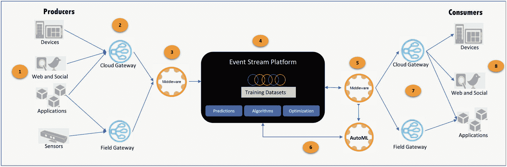
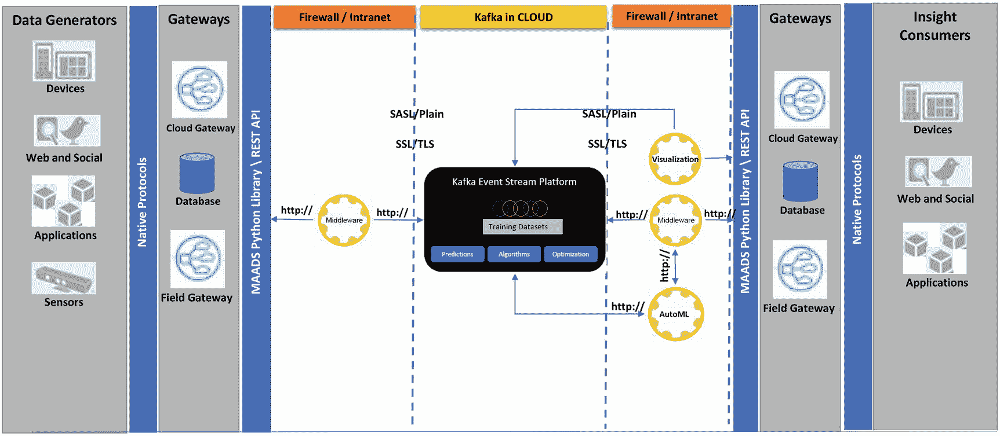
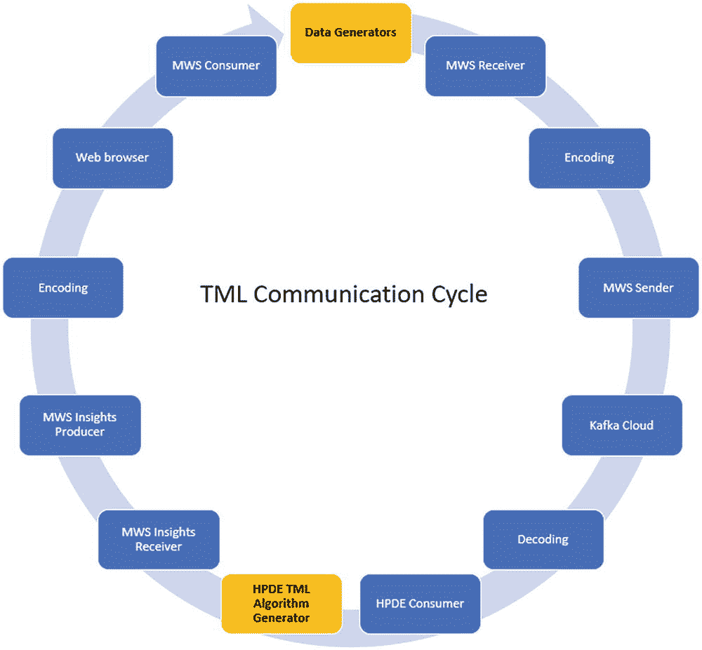
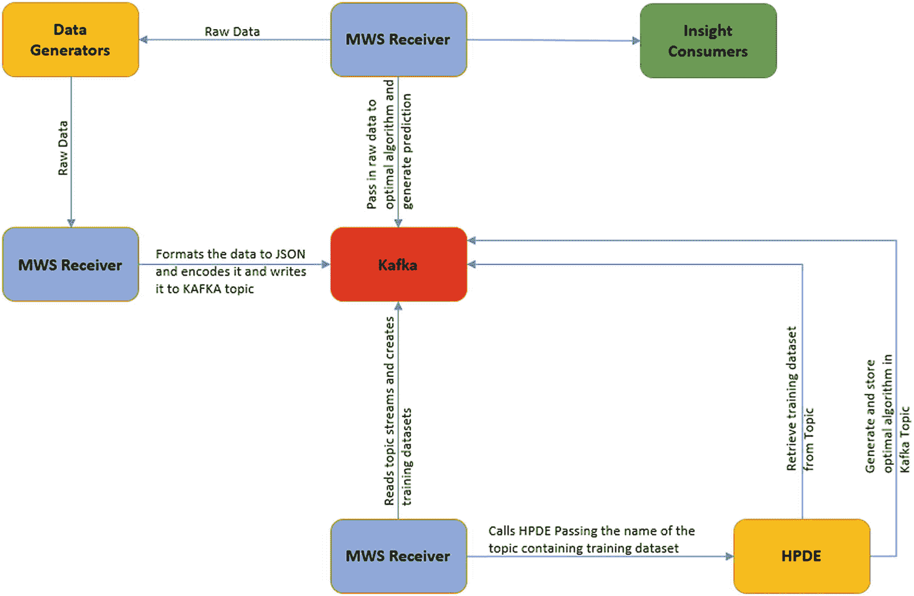
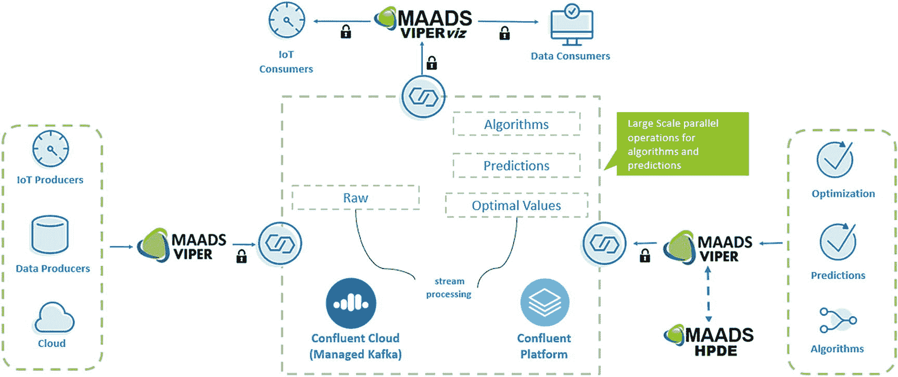

# 5. 事务性机器学习解决方案的技术组件与架构

本章将把讨论从理论转向实践，向您展示如何将 TML 解决方案变为现实，介绍典型 TML 解决方案的架构，使您能够判断 TML 解决方案是否适合您试图解决的问题，并展示 TML 如何与其他技术集成，特别是 TML 解决方案的输出如何用作其他下游系统的输入。我们将讨论 TML 组件之间的数据流，以及这些数据在每个组件中是如何处理的。下一节将概述 TML 解决方案。

## TML 解决方案概述

构建 TML 解决方案的第一步是确定 TML 是否为正确的解决方案方法。如前一章所述，在决定 TML 用例时，需要考虑四个方面：

*   业务领域对快速决策的需求

*   需要做出的快速决策

*   帮助您的业务所需的价值

*   从决策中实现价值的速度

判断 TML 是否为正确解决方案方法的一个快速经验法则是：*如果你拥有快速数据，那么你就需要快速（事务性）机器学习。快速数据包含三个要素：(1) 数据积累的速度，(2) 数据在源和目的地之间流动的速度，(3) 数据种类（文本或数值）变化的速度*。然而，尽管这是一个经验法则，但还应进一步考虑这些数据流是否可以合并以创建用于机器学习的训练数据集。应用机器学习来寻找用于预测、寻找最优值和异常检测的最优算法时，将需要训练数据集。^(⁵⁷) 对于快速数据或数据流，寻找最优算法是通过自动机器学习完成的。每个 TML 解决方案都将包含以下组件：

*   数据流生产者

*   作为数据直通通道的云网关或现场网关

*   用于在 `DSSP` 中接收/发送数据以进行进一步处理的中间件软件

*   用于在训练数据集上执行机器学习的 `AutoML`

*   用于为消费者生成预测、优化结果和异常信息的 `AutoML`

*   流式结果的实时可视化

*   算法和洞察的管理

具体来说，数据生产者持续不断地生成数据。数据生产者可以是人，也可以是机器。原始数据由中间件软件 (`MWS`) 接收，并在 `DSSP` 中生成。`MWS` 将数据格式化为 `JSON`。`MWS` 还从 `DSSP` 消费数据以进行处理。处理过程通过连接数据流，将原始数据（在数据流中存储为 `JSON`）转换为训练数据集。`AutoML` 技术消费训练数据集^(⁵⁸)并应用机器学习来寻找最适合数据的最优算法。最优算法存储在 `DSSP` 中。`AutoML` 技术还消费最优算法来生成预测、最优值和异常信息，这些结果随后被可视化并被消费者消费。数据存储在运行 `Apache Kafka` 的 `AWS`、`Google` 或 `Microsoft` 服务器云上。

消费者实时可视化流式结果。具体来说，结果通过 `HTTPS` 上的安全 `WebSocket` 推送到您的 Web 浏览器，表格和图表由可视化技术动态生成。`WebSocket` 的优势在于您无需向 `MWS` 请求结果；一旦结果在 `DSSP` 中可用，`MWS` 会自动将结果推送给您。TML 解决方案的管理员管理算法和洞察。他们可以使用 `AiMS` 控制 TML 解决方案所有组件的操作。例如，如果您发现某个异常解决方案（主题）有大量数据读取，但消费者对该主题的最后一次读取是在几天前，那么您需要调查为什么该消费者没有消费最新的结果。如果消费者不再使用这些结果，或者已离开公司，则该解决方案应被视为停用候选对象。您还可以通过在 `AiMS` 中配置通知来自动处理这些情况，`AiMS` 将自动监控 TML 主题的最后使用时间并通过电子邮件将结果发送给您。下一节将详细讨论这些步骤/组件。

## TML 解决方案的参考架构

TML 解决方案的典型参考架构如图 5-1 所示。关键组件是数据生产者和消费者。这是 `Apache Kafka` 使用的发布-订阅模型。数据流入 `DSSP` 和从 `DSSP` 流出均由 `MWS` 管理，`MWS` 负责从 `DSSP` 生产和消费数据。

图 5-1

TML 参考架构

表 5-1 描述了图 5-1 中的每个步骤。

表 5-1

TML 处理步骤

| 步骤 | 描述 |
| --- | --- |
| 1 | 这些是生成数据的数据生成器。生产者可以是：• 物联网传感器• 软件应用程序• 网络和社交媒体• 硬件设备：手机、手表、汽车、电视、冰箱等。 |
| 2 | 数据通过云网关或现场网关。云网关是路由器、交换机等。现场网关可以是 `MQTT`、`Modbus` 和 `REST`。这些网关具有特定的通信协议，可以将电信号转换为处理所需的数字信号。通过 `REST API` 访问的 `HTTP` 等互联网协议可以处理云流量。 |
| 3 | 中间件软件 (`MWS`) 是一种专门设计的软件，它连接到 `DSSP` 以执行读取、写入、数据转换、调用 `AutoML` 等操作，所有这些都无需人工干预。它充当源端。 |
| 4 | `DSSP` 存储和管理所有流数据、算法、预测、最优值、异常信息和训练数据集。它是所有信息的中央存储库。它还提供故障转移的冗余性，并随着数据流的增长进行扩展。 |
| 5 | 中间件软件（与步骤 3 相同），它从 `DSSP` 读取训练数据集并调用 `AutoML` 以启动处理。它充当目标端。 |
| 6 | `AutoML` 一旦由 `MWS` 启动，就会连接到 `DSSP` 以读取训练数据集进行处理。`MWS` 将训练数据集在 `DSSP` 中的位置传递给 `AutoML` 技术；`MWS` 和 `AutoML` 之间不交换训练数据集。一旦 `AutoML` 确定了最优算法，它会生成一个唯一键来标识该算法，并将此键存储在 `DSSP` 的另一个主题中供将来使用。 |
| 7 | `MWS` 读取最优算法的唯一键，并使用它来提供预测和最优值，这些值存储在一个主题中。消费者订阅此主题，并通过流式可视化消费这些洞察。 |
| 8 | 预测、异常信息和最优值可以传递给设备和应用程序，这些设备和应用程序可以调整传感器读数、写入网络和社交媒体渠道，或供其他下游应用程序使用。 |

步骤 4、5 和 6 涉及随着新数据流的流入，持续不断地向 `DSSP` 读写数据。具体来说，请记住数据流是连续的数据流，因此任何机器学习过程也必须是连续的，原因如下：

*   较新的数据可能包含需要重新学习的新信息、趋势和模式。

*   通过重新学习，最优算法将捕获不同的信息，并可能提供不同的预测、最优值和异常值，或不同的同行群体。

*   较新的预测和/或最优值或异常值将影响决策制定。

上述原因也解释了 TML 与 CML 的不同之处：从流式数据中快速学习能够识别数据中新兴的模式，而使用较慢的 CML 流程则无法实现这一点。从数据流中学习的速度是 TML 相对于 CML 的根本优势。虽然 CML 可以基于新数据进行重新训练或学习，但它需要先提取历史数据，将其组合成训练数据集，执行各种转换，对训练数据集应用机器学习算法，微调超参数，确定最优算法，然后部署该最优算法，最后才能开始将其用于预测、优化或异常检测。所有这些过程都需要大量时间：几天甚至几周。在部署新重新训练模型所需的几天或几周内，数据中的底层结构可能已经发生变化，从而降低了 CML 解决方案的实用性和有效性。但是，尽管 CML 是一个更长的过程，但它可用于优化 TML 模型。例如，在异常检测中，你可以设置参数值来确定什么是异常；你可以将这些参数调整为非常敏感或不太敏感。CML 模型可用于确定参数值，从而在 TML 模型中提供所需的敏感度。

TML 流程还有其他好处，如表 5-1 所述。具体来说：

*   **模型管理** – 当 `AutoML` 基于更新的数据进行重新训练时，旧的算法可能不再是“最佳”算法，而另一种算法会`更好`。这种不同的算法会与旧算法一起存储在 `DSSP` 中。这简化了模型管理，因为访问新模型的方式与访问旧模型完全相同。旧模型仍然可以被引用，并用于与新模型的结果进行比较和对比。

*   **审计追踪** – 当基于新数据的重新训练发现新的算法或超参数时，它们会被追加到同一主题或另一个主题中；这确保了旧模型不会被覆盖或丢弃。这使组织能够维护一个审计追踪，记录所有在源自相同数据流的训练数据集上发现的算法。如果使用该算法的 TML 解决方案做出了错误决策，导致财务损失或其他事件，这一点可能非常重要。能够追溯到失败的根本原因，将有助于修复、改进和重新校准 TML 解决方案，以获得更好的未来决策结果。

*   **比较模型结果** – 将算法存储在 `DSSP` 中的另一个好处是便于模型比较。算法的易访问性使用户能够看到不同模型在处理相似数据时的表现。这也可用于测试其他人使用 `AutoML` 技术输出构建的模型的输出结果。

*   **组合模型输出** – 将不同模型的输出组合成一个统一的模型，可以让用户了解整个系统的表现。具体来说，可以构建 TML 解决方案来解决较小的问题，当这些解决方案组合起来时，就形成了一个更大的系统。这种基于 TML 的系统之系统方法，在将非常大的机器学习问题分解为子组件以进行更高效分析方面可能非常有效。例如，对于一个大型欺诈活动，多个 TML 解决方案可以分析每个司法管辖区（国家或城市）的分布式交易，以预测异常风险评分，这些评分存储在其各自的数据流中，例如加拿大数据流、美国数据流、英国数据流、印度数据流等。然后，这些数据流可以由另一个 TML 解决方案组合起来，以表示全局（整体）风险评分。

*   **构建训练数据集** – 一个 TML 解决方案的输出可以作为另一个 TML 解决方案的输入。通过这种方式，可以通过将系统分解为子模型来组合解决方案的结果，从而构建特定的训练数据集。来自这些子模型的信息级别可以为整体模型或系统贡献重要的信息。例如，如果我要预测明天的电价，我可以构建 TML 解决方案来预测天气温度和电力需求，然后将它们的输出作为输入，输入到我的第三个 TML 解决方案中，以预测明天的电价。

下一节将讨论 TML 解决方案的技术组件。

## 技术组件描述

构建 TML 解决方案需要多个组件。本节将详细描述每个组件，并给出技术名称。每个 TML 解决方案的共同点是：

*   使用更多的数据流、算法和同行组来扩展并重复上述过程。

*   **无监督学习**

    1.  AutoML 技术应用机器学习来寻找用于异常检测的同行组。

    2.  AutoML 通过将新数据与同行组进行实时比较，来确定新数据中异常的可能性。

*   数据流被连接起来以构建训练数据集。

*   使用偏移量来回滚数据流以获取历史数据。回想一下，偏移量只是指示数据（消费者）在数据流中位置的数字，例如，数据点（消费者）的 `offset=0` 意味着它是数据流中的第一个数据点。偏移量在数据流的每个分区中顺序递增。

*   **监督学习**

    1.  AutoML 技术在训练数据集上应用机器学习，以产生最优算法。

    2.  AutoML 使用最优算法进行预测或寻找最优值。

表 5-2 描述了每个技术组件、其先决条件和核心功能。

表 5-2 技术组件详情

| 技术组件 | 描述 | 前提条件 | 功能 | 协议 |
| --- | --- | --- | --- | --- |
| `DSSP` | Apache Kafka（本地部署或云端） | **本地部署：** • 运行 Windows 或 Linux 操作系统的计算机服务器 • 无需互联网连接 **云端：** • 运行 Apache Kafka 的 Confluent Cloud • 运行 Kafka 的 Amazon AWS • 运行 Kafka 的 Microsoft Azure • 运行 Kafka 的 Google Cloud • 云端需互联网连接 | • 管理偏移量 • 管理分区 • 管理数据复制以实现故障转移 • 存储所有数据流 • 存储所有训练数据集 • 存储所有算法 • 存储所有预测结果 • 存储所有最优值 | • TCP/IP • SSL/TLS（可选） |
| `MAADS-VIPER` | Apache Kafka 连接器：源端和汇端 | **本地部署：** • 运行 Windows、MacOS 或 Linux 操作系统的计算机服务器 **云端：** • 运行 Windows、MacOS 或 Linux 操作系统的计算机 • Apache Kafka | • 在 `DSSP` 中创建主题 • 从 `DSSP` 读取数据 • 向 `DSSP` 写入数据 • 创建训练数据集 • 订阅消费者到主题 • 创建生产者 • 创建消费者组 • 启动 AutoML • 执行预测 • 执行优化 • 与 `AiMS` 集成 • 执行 `AiMS` 功能：激活或停用主题 • 告警与通知 | • TCP/IP • HTTP • SSL/TLS（可选） |
| `MAADS-HPDE` | 用于 TML 的 AutoML，执行监督学习和无监督学习 | **本地部署：** • 运行 Windows、MacOS 或 Linux 操作系统的计算机服务器 **云端：** • 运行 Windows、MacOS 或 Linux 操作系统的计算机 • `MAADS-VIPER` | • 连接 `DSSP` 以读取训练数据集 • 对训练数据集执行 AutoML • 寻找最适合数据的最优算法 • 将最优算法写入 `DSSP` • 将最优算法存储到磁盘 • 从磁盘读取最优算法 • 执行预测 • 执行优化 • 执行异常检测 | • TCP/IP • HTTP • SSL/TLS（可选） |
| `AiMS` | 管理存储在 `DSSP` 中的算法 | • `MAADS-VIPERviz` • Windows、MacOS 或 Linux 操作系统 | • 管理由 `HPDE` 生成的算法 • 激活或停用算法 • 执行告警与通知 • 在服务管理平台中创建事件 • 管理 Kafka 消费者、生产者和组 | • HTTP • HTTPS • TCP/IP |
| `MAADS-VIPERviz` | 提供监督和无监督 TML 解决方案的流式可视化 | • Windows、MacOS 或 Linux 操作系统 • Apache Kafka • `MAADS-VIPER` | • 提供来自 `HPDE` 的所有可视化 • 使用 WebSockets 将新结果推送到客户端网页浏览器 | • HTTP • HTTPS • TCP/IP |
| `MAADS Python 库` | 用于 TML 解决方案的 API | • 运行 Python 编程语言的计算机（Windows、MacOS 或 Linux 解释器） • Jupyter Notebook（可选） • `MAADS-VIPER` | • 用于 `VIPER` 的 TML 函数 | • HTTP • TCP/IP（可选） |
| `REST` | REST API | • 任何运行 Windows、MacOS 或 Linux 的计算机 • 任何支持 REST（即 HTTP 请求）的编程语言 • `MAADS-VIPER` | • TML 函数 • REST 端点指向运行在 HOST 和 PORT 上的 VIPER 服务器 | • TCP/IP • HTTP |

表 5-2 中讨论的组件可以按需实例化以实现扩展。具体来说，对于大型 TML 解决方案，可能需要通过部署多个 `DSSP`、`VIPER`、`VIPERviz` 和 `HPDE` 实例来进行负载削减。这些应用程序中的每一个都可以扩展到任意数量的实例，仅受硬件限制。下一节将展示这些组件如何在云实例中协同工作。

## TML 解决方案的技术架构

上一节讨论了构成 TML 解决方案的技术组件。在本节中，我们将展示这些组件如何在图 5-2 所示的技术架构中协同工作。在图 5-2 中，首先需要注意的是泳道图。

图 5-2 TML 技术架构

*   **数据生成** – 这些包括所有应用程序、传统设备、移动设备、传感器以及 Web 和社交媒体。

*   **网关** – 所有数据流经云网关或某些现场网关。这些网关将核心网络连接到边缘网络，并提供访问控制，允许数据通过网络传输到最终用户。它们还可以连接不同位置的不同云/数据中心。或者，它们可以将数据存储在 TML 解决方案可访问的数据库中。TML 将实时执行以下数据转换：(1) 合并多个数据流，(2) 将每个数据流修剪为等长以形成训练数据集，(3) 将数据流中的 JSON 对象转换为用于机器学习的数组，(4) 使用 Z 分数和同行组分析构建同行组以进行异常检测，(5) 整合并格式化新的数据流以用于预测、优化和异常检测。

*   **防火墙** – 确保进出数据中心（或网络基础设施）的数据具有适当的授权，并通过软件和硬件防火墙进行调节和控制。希望保护其环境的组织将建立一个防火墙边界，以控制数据的进出。

*   **云端 Kafka** – 云端 Kafka 是我们的 `DSSP`，它将存储来自 TML 解决方案的所有数据、洞察和算法，供最终用户使用。Kafka 云是安全的，访问它需要使用 SASL/PLAIN 身份验证的云用户名和密码。此外，TML 解决方案与 Kafka 之间的所有流量都将使用传输层安全^(⁵⁹) (TLS) 加密进行加密。

*   **洞察消费者** – 这些是消费 TML 解决方案洞察的消费者。它们可以是应用程序、设备、Web 或社交媒体用户。您可以是最终用户，也可以是获取信息用于决策的机器。

防火墙内的 `MAADS-VIPER` 接收来自数据生成器的数据。原始数据格式必须为文本格式。然后，`MAADS-VIPER` 将：

1.  使用 `MAADSTML` Python 库函数 `vipercreatetopic` 来：

    1.  使用云用户名/密码登录 Kafka 云

    2.  在 Kafka 中创建一个主题

2.  使用 `MAADS` Python 库函数 `viperproducetotopic` 来：

    1.  使用云用户名/密码登录 Kafka 云

    2.  将数据转换为 JSON

    3.  使用 TLS 加密数据

    4.  将 JSON 数据写入已创建的 Kafka 主题

为了处理数据，在 Kafka 主题中，对于监督学习，`MAADS-VIPER` 将按照类似的登录过程读取 Kafka 中的主题，并：

3.  使用 `MAADS` Python 库函数：

    1.  `Vipercreatejointopicstreams` – 合并多个数据流，并为合并后的流创建一个主题

    2.  `Viperproducetotopicstream`

        *   整合流数据

        *   根据用户选择的偏移量回滚每个流以形成历史数据

## 监督学习

1.  **vipercreatejointopicstreams** – 用于连接多个数据流，并为连接后的流创建一个主题。
2.  **viperproducetotopicstream**
    1.  整合流数据
    2.  根据用户选择的偏移量回滚每个流，以形成历史数据
    3.  将所有流的数据生成到合并后的主题流中
3.  **vipercreatetrainingdata** – 创建训练数据集并将其生成到另一个主题中
4.  一旦训练数据集构建完成并保存在另一个主题中，就可以通过调用 HPDE 进行处理。具体来说，使用函数 `viperhpdetraining`：
    1.  登录 Kafka 云以检索训练数据集（训练数据集不会从 VIPER 移动到 HPDE），并将机器学习算法应用于该数据集。
    2.  它将生成一个最优算法，并将该算法物理写入磁盘，同时将所有关于该算法的元数据存储到另一个 Kafka 主题中。
    3.  它会将该 Kafka 主题的名称传回给 VIPER，VIPER 可使用该主题进行预测和优化。
5.  使用最优算法进行预测是通过 `viperhpdepredict` 完成的：
    1.  此函数将接受输入数据，即自变量的值或另一个数据流，将输入数据传递给最优算法，并返回一个预测结果。
    2.  此函数可置于循环中，以持续将输入数据传递给最优算法来生成预测。或者，用户可以将输入数据指向一个数据流，当新数据进入该输入数据流时，持续生成预测。
6.  如果用户需要找到自变量的最佳或最差值，他们使用 `viperhpdeoptimize` 执行数学优化，以找到自变量的最优值。
    1.  最优值存储在另一个 Kafka 主题中，并由应用程序检索使用；这些值（及方法）非常适合构建闭环解决方案，在该方案中，机器无需人工干预即可做出所有决策。
7.  消费者通过 MAADS-VIPER，使用 `viperconsumefromtopic` 消费预测结果和最优值。
    1.  此函数登录到 Kafka Cloud，并使用 OFFSET 参数从指定的偏移量开始读取数据。用户可以从主题的开头（OFFSET = 0）、末尾（OFFSET = -1）或两者之间的任意位置读取数据。
    2.  数据采用 JSON 格式，几乎任何编程语言或应用程序都可以读取。
    3.  预测值或最优值可以轻松地从 JSON 数据中提取出来。
8.  当有大量消费者想要访问*同一个*主题时，可以使用 `viperconsumergroupconsumefromtopic`。
    1.  此函数可用于对主题中的数据进行并行处理。当数据写入主题时，此函数会*同时*将数据分发给每个消费者。
    2.  为了优化主题以进行并行处理，主题的分区数应与消费者数量相同。这使得 Kafka 能够将数据分发到主题中的每个分区，以便每个消费者可以同时访问并消费数据。管理员可以创建一个具有初始分区数的主题，如果需要更多分区来容纳更多消费者，可以使用 MAADSTML Python 库增加分区数。
    3.  此函数对于提升大型分布式 TML 解决方案的性能非常有用。

## 无监督学习

要使用无监督学习处理数据进行异常检测，您需要使用两个函数：`viperanomalytrain` 和 `viperanomalypredict`。该过程与监督学习类似，但此处我们不创建训练数据集。相反，我们使用 `viperanomalytrain` 从我们想要分析异常的数据流中找出对等组。具体来说，从数据流生成对等组的步骤如下：

1.  `vipercreatejointopicstreams` – 用于连接多个数据流，并为连接后的流创建一个主题。
2.  `viperproducetotopicstream`
    1.  整合流数据
    2.  根据用户选择的偏移量回滚每个流，以形成历史数据
    3.  将所有流的数据生成到连接后的主题流中
3.  `viperanomalytrain` – 创建所有流的对等组。该对等组是一组代表“正常”行为的事务。
4.  `viperanomalypredict` – 通过将每个新数据与对等组进行实时比较，生成该数据被检测为异常的概率分数。

我们将在下一章展示上述过程如何实现。在此之前，下一节将讨论 TML 组件之间的通信过程。

## 组件间的通信过程

TML 组件之间的有效通信对于成功的 TML 解决方案至关重要。确保有效通信有三个重要组成部分：

*   安全性
*   并发性
*   算法管理

Kafka、VIPER、VIPERviz 和 HPDE 之间的所有通信均经过 SSL/TLS 加密。对于在分布式网络中传输的敏感信息，这种安全性至关重要。并发性也是确保 TML 解决方案能够同时处理多个想要从 Kafka 写入和读取信息的生产者和消费者的重要方面。虽然可以启动多个 VIPER、HPDE 和 VIPERviz 实例，但每个应用程序都内置了并发处理能力，以同时处理多个请求。这不仅提高了性能，还允许减少每个应用程序的实例数量，从而降低解决方案的开销和成本。图 5-3 展示了 TML 解决方案的通信周期。

图 5-3 TML 通信周期

图 5-3 展示了 TML 通信周期中的 12 个步骤。具体描述如下：

*   **数据生成器** 通过向 Kafka 生成数据来启动通信周期。
*   **MWS 接收器** 从数据生成器接收数据。
*   **编码** MWS 使用 SSL/TLS 加密对数据进行编码，并将其发送到 Kafka 主题。
*   **MWS 发送器** 将数据发送到 Kafka 主题。
*   **Kafka Cloud** 存储数据。
*   **解码** MWS 解码 Kafka 中训练数据集的位置，并将其发送给 HPDE。注意：MWS 不会将训练数据集发送给 HPDE，仅发送其在 Kafka 中的位置。
*   **HPDE 消费者** 消费 Kafka 中的数据，并对训练数据集执行机器学习。
*   **HPDE TML 算法生成器** 生成最优算法，微调超参数，并将其写入 Kafka 主题。
*   **MWS 洞察接收器** 接收 Kafka 中的预测结果、优化值和异常信息。
*   **MWS 洞察生成器** 生成预测结果、优化值和异常信息的实时图表和表格，并通过 WebSockets 推送到用户的浏览器。
*   **编码** MWS 使用 WebSockets 与客户端的 Web 浏览器通信，通过 HTTPS 推送洞察信息，以便在客户端浏览器中进行可视化。
*   **Web 浏览器** 显示预测结果、优化值、异常信息和 AiMS 的实时可视化。
*   **MWS 消费者** 从其 Web 浏览器消费预测结果、优化值、异常信息和 AiMS 的可视化内容。

该周期可以扩展到任意数量的数据流（数据生成器）、算法、生产者和洞察消费者。Kafka Cloud 平台支持水平扩展，使得 TML 在处理需要快速学习的大量快速数据时非常高效。

下一节将讨论 TML 解决方案组件之间的数据流。它将展示数据是如何被生产和消费的，以及生产/消费的数据类型。它还将展示消费者需要生产和消费哪些类型的数据，以便用于可视化和决策。

## 数据流

TML 组件之间的数据流采用 JSON 格式进行标准化。JSON 格式是一种广泛使用且被接受的数据标准，用于存储、展示和分析信息。Kafka 也符合 JSON 标准。JSON 数据的另一个优势是跨平台和跨应用的兼容性，这意味着如果 TML 解决方案的结果需要被其他系统使用，在大多数情况下，这些系统应该能够读取 JSON 格式的数据。JSON 的另一个重要方面是性能。解析 JSON 格式的数据比解析非 JSON 数据要高效得多。此外，HPDE 创建的每个算法的元数据信息都以 JSON 格式存储在嵌入式数据库中，并由 VIPER 读取。这使得 VIPER 和 HPDE 的数据在不同操作系统之间的可移植性更加无缝和高效。

图 5-4 展示了核心 TML 组件之间的数据流动，具体如下：

图 5-4 数据如何在 TML 组件之间流动

1.  数据生成器发送由 MWS (MAADS-VIPER) 接收的原始数据。
2.  MWS 将数据格式化为 JSON，并以键值对的形式记录日期、时间、位置、数值和其他信息，对数据进行编码，并将其生成到 Kafka 主题中。请注意，可能有多个主题流（可能同时）被写入 Kafka。
3.  MWS 接收器消费这些主题流，并使用前面描述的 MAADS 函数创建训练数据集。
4.  MWS 调用正在主机和端口上监听连接的 HPDE。MWS 将包含训练数据集的 Kafka 主题名称传递给 HPDE。
5.  HPDE 检索训练数据集，对数据执行机器学习，找到最优算法，微调超参数，并将算法写入磁盘。然后，它将主题名称以及算法在磁盘上的物理位置返回给调用的 MWS 程序。
6.  MWS 将算法元信息写入一个 Kafka 主题，并返回该主题的名称。

## 示例架构

图 5-5 展示了一个使用 `Confluent Cloud`^(⁶¹) 的示例架构。`Confluent Cloud` 是一个平台，在 `Amazon AWS`、`Microsoft Azure` 和 `Google Cloud` 上以托管服务的形式提供 `Kafka`。

图 5-5

TML 示例架构^(⁶²)

关于上述架构的一些显著特点：

*   训练数据集存储在运行于 `Confluent Cloud` 中的 `Kafka` 中，该云使用 `Amazon`、`Microsoft` 或 `Google` 的基础设施。
*   `MAADS-VIPER (MWS)`、`VIPERviz` 或 `HPDE` 在 `Windows`、`Linux` 或 `MacOS` 环境中运行。
*   `MAADS-VIPERviz` 是一种用于可视化 `Kafka` 中流式传输结果的可视化技术。
*   所有最优算法、预测值、异常值和最优值都存储在 `Kafka` 中。
*   使用 `SSL/TLS` 加密来保护进出 `Confluent Cloud` 的数据安全。
*   可以使用多个 `VIPER`、`VIPERviz` 和 `HPDE` 实例来连接分布式网络中的多个 `Confluent Cloud` 实例。
*   通过创建具有多个分区的主题，实现对访问同一主题的多个消费者的并行处理。

这种架构的通用性，跨越任何提供托管 `Kafka` 服务的云供应商，使得 TML 解决方案与云无关，同时确保不同托管 `Kafka` 服务之间的标准通信和数据格式。这扩展了 TML 解决方案的可行性和实用性。它也使得 `Kafka` 成为生产者、`VIPER`、`HPDE` 和 `VIPERviz` 生成的所有信息的中心源和汇。下一节将描述 TML 的成本构成。

## TML 成本管理

我们在上一章讨论了 TML 的成本构成；本章将对此进行展开。对于基于云的解决方案，管理 TML 组件的成本将取决于以下几个组成部分：

*   `人员` – 由于 TML 自动化了许多传统数据科学家的任务，您应为设计、构建、测试、部署和维护 TML 解决方案规划以下资源。人员数量将取决于您计划开发的 TML 解决方案的规模和数量。角色如下：
    *   `数据流工程师` – 负责为 TML 解决方案获取数据，并使用 `MAADS-VIPER` 和 `MAADSTML Python` 库将数据生成到 `Kafka` 的人员。此人应具备 `Apache Kafka` 和 `Python` 的知识。
    *   `TML 解决方案架构师` – 这是一个关键角色，因为此人将负责架构 TML 解决方案如何使用数据流，特别是源流和汇流是什么，以及它们如何被连接以产生用于可视化、扩展和决策的结果。
    *   `数据流科学家` – 负责制定 TML 解决方案的方法、方法论和模型公式，并使用 `MAADSTML Python` 库进行开发以用于部署的人员。
    *   `数据流可视化专家` – 负责维护或增强开箱即用可视化功能的人员。`MAADS-VIPERviz` 提供了四种预构建的可视化，用于预测、优化、异常和通用可视化，使您能够可视化组合的数据流。
    *   `TML 管理员` – 使用 `AiMS` 仪表板管理 TML 解决方案的运营人员。
    *   `云基础设施专家` – 负责为 TML 解决方案构建和管理云基础设施，并定义安全性和访问控制列表的人员。
*   `流程与变更管理`
    *   `变更管理专家` – 负责向（业务）用户传达 TML 解决方案的目的和价值，并定义 TML 解决方案所需的任何流程变更的人员。
*   `技术`
    *   `Kafka 分区` – 最重要的成本组成部分是您每个主题使用的分区数量。成本按每个分区每小时计算。例如，1000 个分区，用于 1 个主题，持续 1 小时，将花费您 4 美元。虽然这看起来很低，但如果您的 TML 解决方案使用 1000 个分区连续运行 6 个月，那么仅 1 个主题在 6 个月内就会产生 17,280 美元的账单。因此，请谨慎使用分区。
    *   `网络读写` – 这将取决于您读取数据和写入数据到 `Kafka` 的速度。速度越高，成本越高。
    *   `存储` – 虽然存储是成本最低的组成部分，但也应进行相应管理。

上述组成部分是在组织中开发、部署和维护 TML 解决方案的核心组件。可能还有其他组件，但上述组件代表了成功部署 TML 所需考虑的大部分因素。下一节将总结本章。

## 总结

本章详细介绍了 TML 参考架构和技术架构，重点说明了 TML 组件之间的通信和数据流。它还展示了一个 TML 架构的示例。讨论的一些主要关注领域包括：

*   TML 组件（如数据生成器、`VIPER`、`VIPERviz`、`HPDE`、`Kafka` 和洞察消费者）之间的通信周期。这可能是一个持续的过程，具体取决于如何使用 `MAADSTML Python` 库函数（或 `REST API`）开发 TML 解决方案。这些函数使开发人员能够访问 `VIPER` 并控制其功能：生成数据到 `Kafka`、从 `Kafka` 消费数据以及调用 `HPDE`。使用这些库函数可以开发出强大的 TML 解决方案。可以创建并连接多个 TML 解决方案。具体来说，通过使用 `Kafka` 中的主题，其他 TML 解决方案可以使用相同的最优算法和洞察，并在不同的应用程序、设备、网络和社交媒体之间共享信息。
*   TML 组件之间流动的数据采用 `JSON` 格式。`JSON` 格式使得跨不同应用程序共享洞察变得容易，并简化了从 `JSON` 对象中检索信息的过程。数据的标准化也使得操作 `JSON` 对象（例如组合和分析不同对象）变得容易。它还消除了为 TML 解决方案维护物理数据库模式的需求，因为元数据信息存储在 `VIPER` 和 `HPDE` 的嵌入式数据库中，这使得 TML 解决方案在不同环境之间具有高度的可移植性。

TML 解决方案可以构建为闭环或开环解决方案。对于闭环解决方案，这使得 TML 解决方案可以完全无摩擦且自动化，无需任何人工干预。生成的洞察可用于自动调整下游系统。开环解决方案在决策过程中需要一些人工干预，但与 CML 流程相比，这种干预是最小的。

当架构师设计 TML 解决方案时，他们应注意以下几点：

*   如果多个消费者访问同一个主题，应考虑并行处理。这将要求每个主题有多个分区以匹配消费者的数量。然而，分区越多，TML 解决方案的成本就越高。
*   创建的算法数量可能会增加，使模型管理复杂化，并可能产生安全问题。TML 管理员应使用 `AiMS` 来跟踪和管理算法，并在算法未被使用时将其停用。
*   TML 解决方案的成本主要取决于：
    1.  人员 – 例如数据流工程师、TML 解决方案架构师、数据流科学家、数据流可视化专家、TML 管理员、云基础设施专家以及流程与变更管理专家
    2.  `Kafka` 分区 – 分区越多，成本越高
    3.  存储量
    4.  主题数量
    5.  网络数据吞吐量

TML 解决方案与云无关、与编程语言无关、与数据库无关、与操作系统无关。它们兼容 `Amazon AWS`、`Microsoft Azure` 和 `Google Cloud` 上的任何托管 `Kafka` 服务。使用 `MAADSTML Python` 库，开发人员可以创建强大的 TML 解决方案，代码量少，并且能够随着无限量的数据流、消费者和生产者快速扩展。`JSON` 数据格式的灵活性使得不同的应用程序和设备能够轻松地消费信息，用于机器或人类的决策和可视化。它还使得通过组合不同对象和分析这些对象以进一步提取信息，从而进一步操作 `JSON` 对象变得容易。

通过使用 Kafka、VIPER、VIPERviz 和 HPDE 的多个实例来扩展 TML 解决方案，可以构建大规模的 TML 解决方案。即使业务需求随时间演变，TML 解决方案也可以增长（或缩减）：这就是 TML 解决方案的弹性本质。可以添加更多的数据流，创建更多的训练数据集，并生成更多的算法。虽然这种增长可能会增加组织内部的成本和复杂性，但可以使用 AiMS 来控制、跟踪和管理这些复杂性和成本。TML 解决方案的可能性几乎是无限的，但结合 AiMS，它们可以以经济高效且负责任的方式构建。

脚注 1   2   3   4   5   6