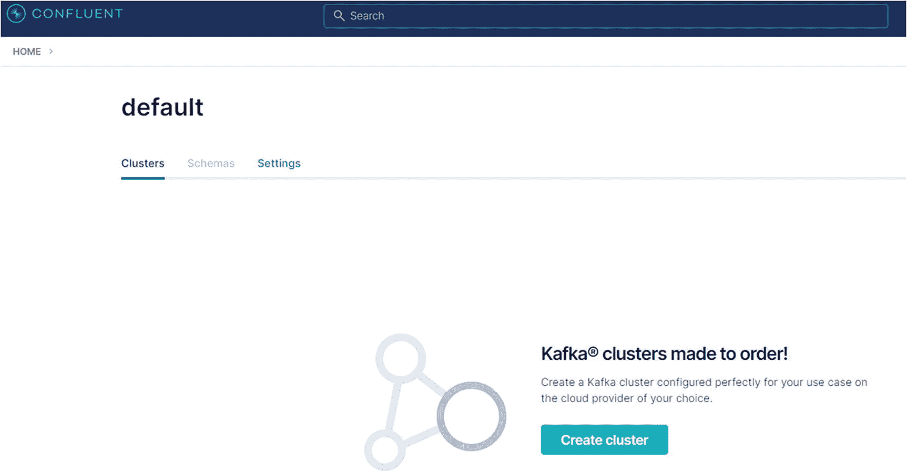
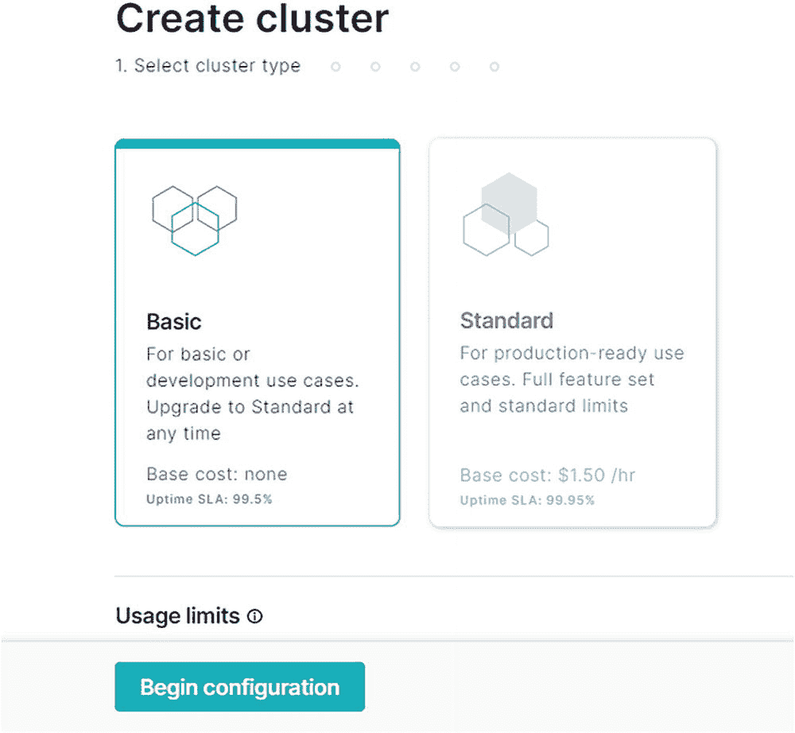
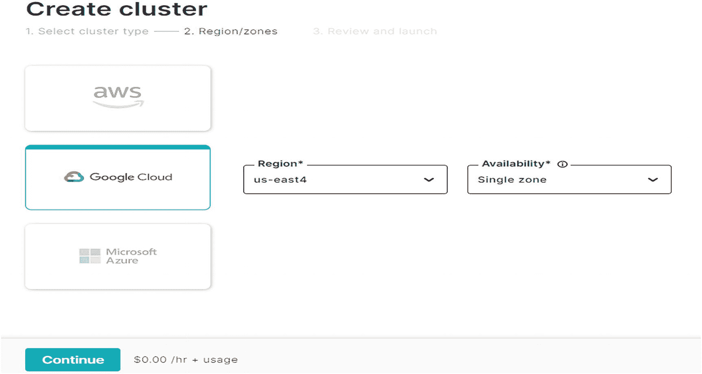
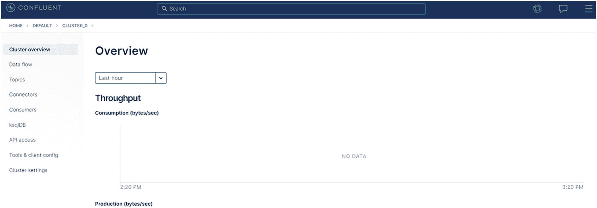
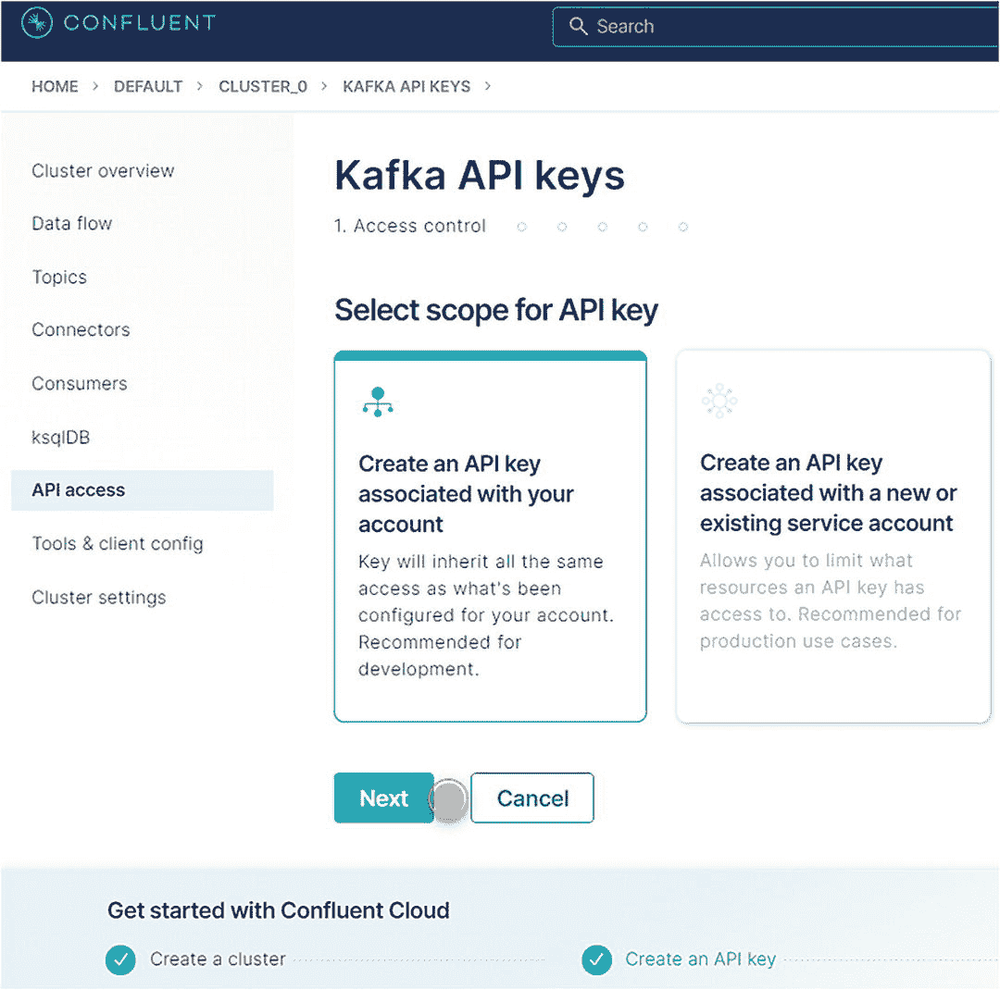
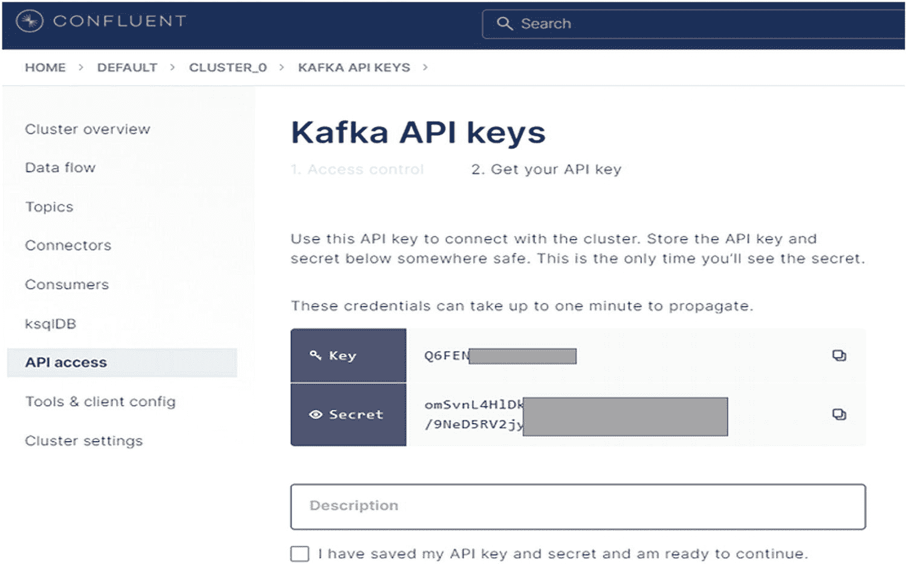
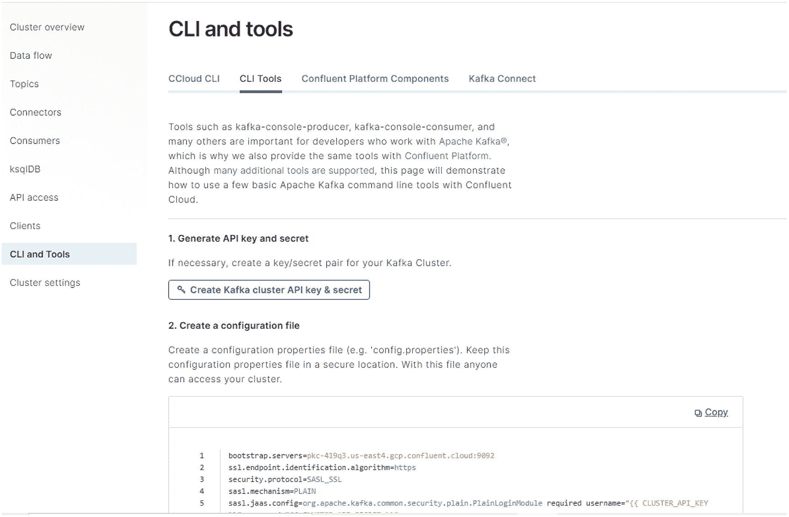
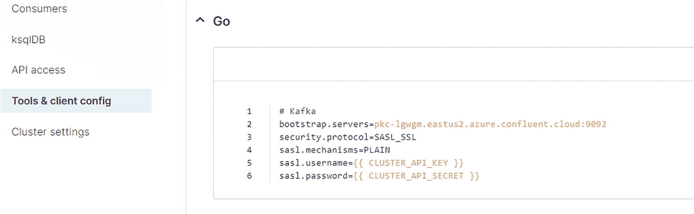
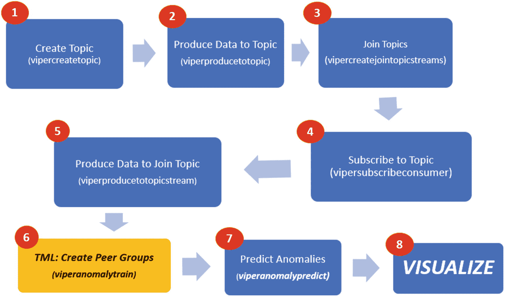

# 6. 事务性机器学习解决方案模板与流式可视化

本章将详细讨论构建事务性机器学习（TML）解决方案所需的技术，并附有示例代码，涵盖以下内容：

*   预测并优化沃尔玛 11,000 家门店的客流量
*   对 10,000 笔银行交易中的 50 个银行账户进行异常预测

本章旨在为您提供实践指导，演示如何使用运行在 Google Cloud Platform 上的 Confluent Cloud，构建集成 Apache Kafka 数据流与 AutoML 的 TML 解决方案。您将理解核心库函数，以及如何通过连接 VIPER 和 Kafka Cloud 的 MAADSTML Python 库^(⁶³)调用这些函数，以执行非常先进的自动机器学习，用于预测性和规范性分析，以及使用无监督机器学习进行异常检测。

您将熟悉构建和优化 TML 解决方案的常见步骤。该解决方案模板是一种简单而强大的方式，可帮助您快速构建 TML 解决方案，并能根据自身需求进行定制。您无需成为编程专家；即使是初学者也能发现使用此模板构建 TML 解决方案非常容易。我们将使用 Python 作为编程语言来访问 VIPER，但由于 VIPER 可以通过 REST 调用进行访问，您可以使用任何支持 REST 的编程语言（目前大多数编程语言都支持）。在本章结束时，您将使用领先的云平台和领先的 Kafka 技术，对（大）数据流执行先进的自动机器学习，同时使用先进的流式可视化技术获取洞察。所有示例和技术都可以在 GitHub 上找到。^(⁶⁴) 下一节将概述 TML 解决方案模板及其配套技术。

## TML 解决方案模板概述

此模板可用于构建任何类型的 TML 解决方案，这些解决方案具有可扩展性、无摩擦性和弹性。如前所述，以下描述的所有组件（Kafka Cloud 除外）都可以从 GitHub 下载。主要模板组件如下：

*   `Kafka Cloud` – 需要使用 Confluent Cloud 在 Amazon、Microsoft 或 Google 基础设施上创建具有 SSL/TLS 安全性的 Kafka 集群（代理）。
*   `MAADS-VIPER`（简称 `VIPER`） – 在 Linux 上运行的官方 Kafka 源连接器和接收器连接器（也提供 Windows 和 MacOS 版本）；它将执行 TML 解决方案所需的所有功能。此 Kafka 连接器已通过 Confluent 的验证和测试。
*   环境文件 – `VIPER` 环境文件，包含所有必要的凭证，包括令牌文件 (`admin.tok`) 和示例 SSL/TLS 安全证书：`client.cer.pem`、`client.key.pem`、`server.cer.pem`。
*   `MAADS-HPDE`（简称 `HPDE`） – 在 Linux 上运行并执行 TML 的 AutoML 技术（也提供 Windows 和 MacOS 版本）。
*   `MAADS-VIPERviz`（简称 `VIPERviz`） – 可视化技术，用于可视化：`HPDE` 产生的异常检测、预测和优化结果。`AiMS` 也需要 `VIPERviz`。
*   `AiMS` – 算法与洞察管理系统仪表板，用于管理 TML 解决方案。
*   `MAADSTML Python` 库、`Python`^(⁶⁵) `IDE` 和 `Jupyter Notebook`。

如前所述，在构建 TML 解决方案时，应仔细考虑 TML 解决方案的规模及其随时间的使用方式。规模将取决于：

*   数据流（主题）的数量
*   每个数据流（主题）中的分区数量
*   用于监督学习的训练数据集数量或用于无监督学习的对等组数量
*   生成的算法、对等组、预测、最优值和异常的数量
*   将从主题消费的消费者数量
*   将向主题生产的生产者数量
*   `Kafka` 代理、`VIPER`、`VIPERviz` 和 `HPDE` 的实例数量
*   `Kafka` 集群的大小

下一节将详细讨论每个模板组件。

### 模板组件详情

本节将详细介绍每个模板组件及其使用方法。它将为您提供运行构建 TML 解决方案所需技术的一切必要设置说明。每个组件都提供了专为快速数据和快速机器学习而构建的高级功能。这对许多读者来说可能是新知识，但本章将尽力确保您理解每个组件及其用途。在您理解这些组件之后，构建 TML 解决方案依赖于少数几个函数，如果使用得当，您将能够相对轻松地在极短时间内构建出非常庞大的解决方案。让我们开始吧。

### 通过 Confluent Cloud 使用 Kafka 云服务

`Kafka` 是一个日益流行且功能强大的流处理软件平台。^(⁶⁶) 许多主流云供应商，如亚马逊、微软和谷歌，都在其基础设施中提供 `Kafka` 应用服务。这使得构建**云平台无关**的 TML 解决方案变得非常容易。`VIPER` 兼容在亚马逊 `AWS`、微软 `Azure`、谷歌云平台 (`GCP`) 或 Confluent Cloud 上运行的 `Kafka`。

一个非常流行的选择是使用 Confluent 提供的 `Kafka` 托管服务，称为 Confluent Cloud (`CC`)。`CC` 允许 TML 开发人员选择在其偏好的云供应商上运行 `Kafka` 实例。开发人员可以选择使用亚马逊、微软或谷歌云基础设施创建 `Kafka` 集群。使用 `CC` 在您选择的云供应商上运行 `Kafka` 的优势有三点：

*   已经使用亚马逊、微软或谷歌的组织可以继续使用它们，而不会对其业务造成任何中断；同时，也无需学习新技术。
*   对于 `Kafka` 的企业级设置，您将继续从亚马逊、微软或谷歌收到一份云账单——Confluent 作为您账单中的一个明细项。具体来说，每个云提供商都会有 Confluent Cloud 的市场连接器，您可以使用它将您的基础设施计费与作为服务提供商的 `CC` 集成。更多详情可在 Confluent 网站上找到。^(⁶⁷)
*   无需特殊的 `Kafka` 设置——`CC` 负责所有设置细节，使开发人员能够快速专注于构建他们的 TML 解决方案。

要开始构建您的 TML 解决方案，首先需要创建一个 `Kafka` 集群。为此，请遵循以下步骤：


图 6-1 Kafka 集群

1.  前往 Confluent 登录页面 ^(⁶⁸) – 如果您没有账户，请创建一个。如果您已有账户，请直接登录。
2.  Confluent 会为您提供免费的云积分。这将允许您构建和测试一个规模适中的 TML 解决方案，并熟悉 Confluent Cloud。
3.  登录后，创建一个 `Kafka` 集群，如图 6-1 所示。

然后，选择基本集群设置，如图 6-2 所示。


图 6-2 Kafka 基本集群

点击“开始配置”后，您将看到如图 6-3 所示的界面。在这里，您可以在亚马逊、谷歌或微软之间进行选择。您可以选择任意一家；但是，如果您的组织偏爱某个特定的云供应商，那么您应该选择该供应商。


图 6-3 基础设施选择

选择好特定的云供应商后，点击“继续”。集群创建成功后，您将看到图 6-4。


图 6-4 集群概览

集群创建后，还有几个额外的步骤。为了从 `VIPER` 和 `HPDE` 访问该集群，我们需要创建一个 `API` 密钥。为此，请点击**创建与您的账户关联的 API 密钥**，如图 6-5 所示。


图 6-5 API 密钥

点击**下一步**后，您将生成两个密钥，如图 6-6 所示：


图 6-6 密钥和密码

*   密钥
*   密码

请务必记录好此密钥和密码。这些将是您的云凭证——出于安全原因，我已将我的密钥模糊处理。

最后一步是前往**工具和客户端配置**，如图 6-7 所示。


图 6-7

# 工具和客户端配置

在图 6-8 中，向下滚动到 `Go` 并复制 `bootstrap.servers` 地址。



图 6-8

Bootstrap 服务器

恭喜，您已成功在云中配置了 Kafka 集群。接下来，我们需要设置 MAADS-VIPER 环境信息。

## VIPER 环境文件

为了使用 VIPER，需要将 Kafka 云的相关信息保存在一个名为 `VIPER.ENV` 的文件中。该文件包含连接到 Kafka 云所需的所有必要信息。此文件的详细信息如表 6-1 所示。其中包含多个可配置参数。这些配置是为 VIPER、VIPERviz 和 HPDE 的每个实例设置的。所有敏感信息（如密码）在文件被 VIPER 保存和访问后将被隐藏。如果您用新信息更新此文件，则必须重启 VIPER、VIPERviz 和 HPDE，新信息才能生效。在构建 TML 解决方案时，我们将回头参考此表。此文件在 VIPER、HPDE 和 VIPERviz 之间共享。

### VIPER.ENV 配置详情

表 6-1

| 配置参数 | 描述 |
| --- | --- |
| `KAFKA_ADVERTISED_HOST_NAME` | Kafka 服务器属性中的广播主机名。此为可选参数。 |
| `KAFKA_ZOOKEEPER_CONNECT` | Zookeeper 主机名和端口。此为可选参数。 |
| `KAFKA_CONNECT_BOOTSTRAP_SERVERS` | Kafka 引导服务器——多个服务器之间用逗号分隔。此为必填参数。 |
| `KAFKA_ROOT` | Kafka 根文件夹。如果使用 Kafka Cloud，只需输入“kafka”。此为可选参数。 |
| `HPDE_SERVER` | **自动机器学习**需要 HPDE（边缘设备超预测）。指定安装 HPDE 的主机。此为可选参数。 |
| `HPDE_PORT` | HPDE 监听端口。此为可选参数。 |
| `SSL_CLIENT_CERT_FILE` | 如果 Kafka 启用了 SSL/TLS，则需要 SSL 证书文件。此为必填参数。 |
| `SSL_CLIENT_KEY_FILE` | 如果 Kafka 启用了 SSL/TLS，则需要 SSL 证书密钥存储文件。此为必填参数。 |
| `SSL_SERVER_CERT_FILE` | 如果 Kafka 启用了 SSL/TLS，则需要 SSL 证书服务器密钥文件。此为必填参数。 |
| `CLOUD_USERNAME` | 用于连接 Confluent Cloud 的 SASL_PLAIN 用户名。此为必填参数。 |
| `CLOUD_PASSWORD` | 用于连接 Confluent Cloud 的 SASL_PLAIN 密码。此为必填参数。 |
| `MAILSERVER` | 用于发送电子邮件的 SMTP 邮件服务器主机名。如果使用 **AiMS Dashboard** 监控 Kafka 中的算法，则需要此参数。此为可选参数。 |
| `MAILPORT` | 用于发送电子邮件的 SMTP 邮件服务器端口。如果使用 **AiMS Dashboard** 监控 Kafka 中的算法，则需要此参数。此为可选参数。 |
| `FROMADDR` | 电子邮件中显示的发送地址。如果使用 **AiMS Dashboard** 监控 Kafka 中的算法，则需要此参数。此为可选参数。 |
| `SMTP_USERNAME` | SMTP 用户名。如果使用 **AiMS Dashboard** 监控 Kafka 中的算法，则需要此参数。此为可选参数。 |
| `SMTP_PASSWORD` | SMTP 密码。如果使用 **AiMS Dashboard** 监控 Kafka 中的算法并开启了告警，则需要此参数。此为可选参数。 |
| `SMTP_SSLTLS` | 邮件服务器是否启用 SSL/TLS：true 或 false。如果使用 **AiMS Dashboard** 监控 Kafka 中的算法并开启了告警，则需要此参数。此为可选参数。 |
| `SERVICE_USERNAME` | 如果使用 ServiceNow，请指定 ServiceNow 网页登录用户名。如果使用 **AiMS Dashboard** 监控 Kafka 中的算法并开启了告警，则需要此参数。此为可选参数。 |
| `SERVICE_PASSWORD` | 如果使用 ServiceNow，请指定 ServiceNow 网页登录密码。如果使用 **AiMS Dashboard** 监控 Kafka 中的算法并开启了告警，则需要此参数。此为可选参数。 |
| `SERVICE_ASSIGNEE` | 如果使用 ServiceNow，请指定 ServiceNow 名称，用于分配 ServiceNow 工单。如果使用 **AiMS Dashboard** 并开启了告警，则需要此参数。此为可选参数。 |
| `SERVICE_FORM_FIELDS` | `{"key1":"Assignedto","key2":"LastReadofTopic","key3":"Consumerid", "key4":"Brokerhost","key5":"Brokerport","key6":"Companyname", "key7":"Contactemail","key8":"Contactname","key9":"Description", "key10":"Location","key11":"Topic","key12":"Priority","key13":"Producerid","key14":"LastWritetoTopic"}` 用户应将“Key”值替换为 ServiceNow 表单中的字段名称。VIPER 在向 ServiceNow 提交事件时会更新这些键值。如果使用 **AiMS Dashboard** 并开启了告警，则需要此参数。此为可选参数。 |
| `SERVICE_CONTENTTYPE=application/json` | ServiceNow 网页内容类型。此参数可以更改，但 `application/json` 应该没问题。如果使用 **AiMS Dashboard** 并开启了告警，则需要此参数。此为可选参数。 |
| `POLLING_ALERTS` | 轮询告警的间隔（分钟）。如果使用 **AiMS Dashboard** 并开启了告警，则需要此参数。VIPER 将轮询告警，并等待指定分钟数后进行下一次轮询。此为可选参数。 |
| `COMPANYNAME` | 指定公司名称。从 AiMS Dashboard 发送电子邮件时使用此参数。此为可选参数。 |

对于本书中的示例，请在您的 `VIPER.ENV` 文件中进行以下更新（您的信息当然会与这里显示的不同；我已放入我的 Kafka 集群地址）：

*   `CLOUD_PASSWORD=[Secret]`
    1.  将 `[Secret]` 替换为图 6-6 中复制的 Secret。
*   `KAFKA_CONNECT_BOOTSTRAP_SERVERS=pkc-419q3.us-east4.gcp.confluent.cloud:9092`^(⁶⁹)
*   `CLOUD_USERNAME=[Key]`
    1.  将 `[Key]` 替换为图 6-6 中复制的 Key。

由于我们要加密进出 Kafka Cloud 的流量，因此需要使用 SSL/TLS 设置双向加密。为此，我们需要将三个文件转换为 PEM 格式。^(⁷⁰)（请注意，GitHub 上的 VIPER、VIPERviz 和 HPDE 分发文件中提供了示例 `.PEM` 文件，但这些文件仅用于测试；应将其替换为您的官方文件证书。）

*   客户端证书文件
*   客户端密钥文件
*   服务器证书文件

请注意，您可能需要事先准备好以下文件^(⁷¹)：

*   `kafka.server.truststore.jks`
*   `kafka.server.keystore.jks`

以下是执行此操作的常见步骤：

*   `$keytool` -importkeystore -srckeystore `kafka.server.keystore.jks` -destkeystore `client.p12` -deststoretype PKCS12
*   `$openssl` pkcs12 -in `client.p12` -nokeys -out `client.cer.pem`
*   `$openssl` pkcs12 -in `client.p12` -nodes -nocerts -out `client.key.pem`
    *   **输出：** `client.cer.pem`
    *   **输出：** `client.key.pem`

1.  接下来，转换客户端密钥库：


*   `$keytool` -importkeystore -srckeystore kafka.server.truststore.jks ​-destkeystore server.p12 -deststoretype PKCS12

*   `$openssl` pkcs12 -in server.p12 -nokeys -out server.cer.pem

    *   **输出：** server.cer.pem

1.  首先，使用 keytools 和 openssl 提取证书颁发机构 (CA)：

然后，您将使用 PEM 文件的完整路径更新 VIPER.ENV 文件，如下所示：^(⁷²)

*   `SSL_CLIENT_CERT_FILE=c:/viper/client.cer.pem`

*   `SSL_CLIENT_KEY_FILE=c:/viper/client.key.pem`

*   `SSL_SERVER_CERT_FILE=c:/viper/server.cer.pem`

如果一切操作正确，VIPER、HPDE 和 VIPERviz 将能够使用 SSL/TLS 加密与 Kafka 进行安全通信。下一节将讨论如何设置这些技术。

## VIPER、VIPERviz 和 HPDE 设置

VIPER、VIPERviz 和 HPDE 可安装在 Windows、Linux 或 MacOS 操作系统上^(⁷³)，无需额外的软件组件或数据库。这些技术各自监听主机 IP 地址和端口号上的连接，这意味着你可以通过 REST API 结合 TML Python 库^(⁷⁴)（本章将使用该库）连接到它们。解决方案架构师和开发人员也会发现，将这些技术像*微服务*一样使用非常便捷，它们可以支持特定的 TML 解决方案，从而更容易通过负载削减来构建超大型 TML 解决方案。所有这些技术都与作为数据骨干的 Apache Kafka 紧密集成，这使得开发人员能够构建 TML 解决方案，无论其消耗的数据流、算法和洞察有多少。此外，这些技术不需要互联网连接，因为 Kafka 也可以在本地运行（我们将在云端使用 Confluent Cloud 上的 Kafka，该云平台基于 Google Cloud Platform）。然而，在开发可用于生产的 TML 解决方案时，首选 Kafka Cloud。

VIPER 已通过 Confluent 与 Apache Kafka 的验证和测试，可从其网站^(⁷⁵)或 GitHub^(⁷⁶)下载。只需解压缩文件，并按照软件包中提供的安装说明进行操作即可。所有最新版本的技术均可从 GitHub 网站下载。启动 VIPER、VIPERviz 或 HPDE 时，用户可以在命令行输入“Help”，帮助屏幕将详细列出所有必要信息。具体来说，对于希望通过 REST API 连接的用户，该屏幕将提供所有 REST 命令。在我们的示例中，我们只需要连接到 VIPER，VIPER 将管理到 HPDE 的连接。

如果使用 MAADSTML Python 库，用户可以在 Jupyter Notebook 中编写 Python 代码，或通过下载 Python^(⁷⁷) 来编写。Python 和 Jupyter 都非常流行，并且有许多资源可供你学习这些技术。其他问题应通过发送电子邮件至 info@otics.ca 联系 OTICS。或者，你也可以在 LinkedIn 上加入事务性机器学习小组^(⁷⁸)。下一节将讨论如何创建主题和连接数据流。

### Kafka 主题和数据流

Kafka 和 TML 解决方案的一个基本组成部分是主题和数据流。我们已经在之前的章节中讨论过主题和数据流。本节将讨论如何创建和使用主题（或数据流）来创建训练数据集。首先，确保你已经下载并安装了 Python 编程语言。然后，打开 Python IDE，或者如果你使用 Jupyter Notebook，则在 Windows、Linux 或 MacOS 中通过调用 `jupyter notebook` 来启动 Jupyter。我们的示例将使用 Windows 操作系统。接着，通过在命令提示符中调用 `pip install maadstml` 来安装 MAADSTML Python 库。这样就完成了。然后，要在 Kafka 中创建主题，你将使用函数 `vipercreatetopic`。这个 Python 函数需要以下输入参数：^(⁷⁹)

```
vipercreatetopic(vipertoken,host,port,topic,companyname,contactname,contactemail,location, description,enabletls=1, brokerhost='',brokerport=-999, numpartitions=2, replication=3, microserviceid='')
```

其中

*   `vipertoken` – 此令牌包含在 VIPER 分发文件中。

*   `host` – 这是 VIPER 的主机地址。

*   `port` – 这是 VIPER 监听连接的端口。

*   `topic` – 这是你想要创建的主题。多个主题可用逗号分隔。

*   `companyname` – 这是你公司的名称。

*   `contactname` – 创建主题的联系人姓名。

*   `contactemail` – 创建主题的联系人电子邮件。

*   `location` – 创建主题的联系人所在地。

*   `description` – 主题的描述。

*   `enabletls` – 如果 Kafka 中启用了 SSL/TLS，则将此参数设置为 1；默认情况下，Kafka Cloud 中已启用此功能。

*   `brokerhost` – 指定 Kafka 代理主机。此为可选参数；如果留空，则 VIPER 将使用 `KAFKA_CONNECT_BOOTSTRAP_SERVERS` 中的值。

*   `brokerport` – 指定 Kafka 代理端口。此为可选参数；如果留空，则 VIPER 将使用 `KAFKA_CONNECT_BOOTSTRAP_SERVERS` 中的端口值。

*   `numpartitions` – 指定要在主题中创建的分区数。虽然默认设置为 2，但如果要从该主题消费的人数增加，你可能需要随着时间的推移增加此数量，以确保信息传递的并行处理。例如，如果有 10 个人想要从该主题消费，请考虑将分区设置为 10。

*   `replication` – 这是复制因子，告诉 Kafka 为了故障转移需要将主题复制多少次。Kafka 的服务端最小值为 3。

*   `microserviceid` – 如果使用反向代理进行负载削减，则可以在此处指定代理的名称。

有些人可能会问为什么需要 `companyname`、`contactname` 等信息。这些信息在 AiMS 中管理主题时会很有用。如果你创建了数千个主题，能够识别谁创建了主题以及它们的用途将有助于改进主题（即 TML 解决方案）的管理，尤其是在 TML 解决方案出现问题时。你可能会发现，将业务/产品名称放在 `companyname` 中，有助于企业 IT 部门更好地跟踪 TML 解决方案。主题创建成功后，该函数将返回一个 `producerid`。向主题生产数据时需要此 `producerid`。每个主题都有一个唯一的 `producerid`。

要向主题生产数据，我们将使用函数 `viperproducetotopic`。这个 Python 函数需要以下输入参数：

```
viperproducetotopic(vipertoken,host,port,topic,producerid,enabletls=1,delay=100,inputdata='',maadsalgokey='',maadstoken='',getoptimal=0,externalprediction='',brokerhost='',brokerport=-999,microserviceid='')
```

其中

*   `vipertoken` – 此令牌包含在 VIPER 分发文件中。

*   `host` – 这是 VIPER 的主机地址。

*   `port` – 这是 VIPER 监听连接的端口。

*   `topic` – 这是您要写入的主题。您可以用逗号分隔多个主题。如果使用多个主题，则必须具有相同数量的生产者 ID（以逗号分隔）和相同数量的外部预测（以逗号分隔）。一次性写入多个主题便于同步机器学习流的时序，并加速大量主题的创建。

*   `producerid` – 这是从 `vipercreatetopic` 返回的生产者 ID。

*   `enabletls` – 如果在 Kafka 中启用了 SSL/TLS，则将此参数设置为 1；默认情况下，Kafka Cloud 中已启用此功能。

*   `delay` – 此延迟参数是 VIPER 等待 Kafka 响应消息已写入 Kafka 主题的确认所花费的毫秒数。

*   `inputdata` – 对于 TML，此参数可忽略。

*   `maadsalgokey`^(⁸⁰) – 对于 TML，此参数可忽略。


## 参数说明

*   `maadstoken` – 对于 TML，此参数可忽略。
*   `getoptimal` – 对于 TML，此参数可忽略。
*   `externalprediction` – 在此参数中输入一个值以写入主题。
*   `brokerhost` – 指定 Kafka 代理主机。此为可选参数；如果留空，则 VIPER 将使用 `KAFKA_CONNECT_BOOTSTRAP_SERVERS` 中的值。
*   `brokerport` – 指定 Kafka 代理端口。此为可选参数；如果留空，则 VIPER 将使用 `KAFKA_CONNECT_BOOTSTRAP_SERVERS` 中的端口值。
*   `microserviceid` – 如果使用反向代理进行负载削减。

您可以在循环中使用上述函数，持续将数据写入 Kafka 主题。您可以并行写入多个主题，这仅取决于您如何设计解决方案以及正在运行的 VIPER 实例数量。此函数将返回一个 JSON 对象，其中包含有关写入值、该值在 Kafka 中的键的详细信息，包括写入的分区、偏移量和时间戳。每个数据点可以通过以下内容在 Kafka 中唯一标识：

*   `Topic`（主题）
*   `Partition`（分区）
*   `Offset`（偏移量）

## Kafka 主题管理

Kafka 使用唯一键来优化数据存储。对于非常大的数据集，这对于快速从主题中引用和消费数据至关重要。主题名称应谨慎选择，因为它们将标识构建训练数据集时所需的因变量和自变量流。一个简单的约定是使用 `[公司 ID]-[项目 ID]-[解决方案名称或 ID]-[输入或输出流]`。例如，`otics-iot-iotfailureprediction-sensorreadings-input` 和 `otics-iot-iotfailureprediction-sensorreadings-predictions-output` 分别表示 TML 解决方案 `iotfailureprediction` 的输入和输出流。这样，用户需要订阅哪些主题进行消费和可视化就一目了然了。无论您使用何种约定，都应保持一致。

虽然 Kafka 在使用分区存储大数据方面非常巧妙，但这也会使数据检索变得复杂。具体来说，Kafka 会选择它想要写入的分区以优化存储。检索数据时的挑战在于，您需要进行额外的处理来确定哪些数据是***最新***的数据。例如，如果一个主题有三十 (30) 个分区，Kafka 会将您的数据写入其中任何一个分区。在消费这些数据时，您将不知道哪个分区包含***最新***的数据。幸运的是，您可以告诉 VIPER 使用值为 `-1` 的 `partition` 关键字来搜索每个分区以获取最新数据。由于 Kafka 中存储的每个值都有日期和时间值（人类可读的日期/时间以及 Unix 时间），因此您可以检查每个值的日期和时间戳，以确定哪个是***最新***的值。虽然在许多情况下这不是问题，但在某些情况下，您可能希望知道主题中存储的最新值。

## 核心函数

为了**即时**构建训练数据集，我们将使用以下三个函数：

*   `vipercreatejointopicstreams`
*   `viperproducetotopicstream`
*   `vipercreatetrainingdata`

### `vipercreatejointopicstreams`

首先，`vipercreatejointopicstreams` 定义如下：

```
vipercreatejointopicstreams(vipertoken,host,port,topic,topicstojoin,companyname,contactname,contactemail, description,location,enabletls=0,brokerhost='',brokerport=-999, replication=1, numpartitions=1, microserviceid='')
```

其中：

*   `vipertoken` – 此令牌包含在 VIPER 发行版文件中。
*   `host` – 这是 VIPER 的主机地址。
*   `port` – 这是 VIPER 监听连接的端口。
*   `topic` – 这是将为连接流创建的主题。
*   `topicstojoin` – 这是您要连接的数据流列表（即因变量和自变量流）。这些数据流应已存在。多个流之间用逗号分隔。
*   为此主题指定 `companyname`、`contactname`、`contactemail`、`description`、`location`、`enabletls`、`brokerhost`、`brokerport`、`replication`、`numpartitions` 和 `microserviceid`，如前所述。请注意，某些字段是可选的。

此函数将返回写入此主题所需的 `producerid`。此函数充当指向将要连接的主题的指针。此指针将用于下一个函数，该函数将向此流生成数据。具体来说，一旦创建了连接的主题流，我们就可以向此流生成数据。为此，我们使用函数 `viperproducetotopicstream`。

### `viperproducetotopicstream`

*   `vipertoken` – 此令牌包含在 VIPER 发行版文件中。
*   `host` – 这是 VIPER 的主机地址。
*   `port` – 这是 VIPER 监听连接的端口。
*   `topic` – 这是将包含来自连接流的所有数据的主题。
*   `producerid` – 这是从 `vipercreatejointopicstreams` 返回的生产者 ID。
*   `offset` – 这是从每个数据流开始读取数据的位置。具体来说，如果 `offset=0`，则此函数将从其连接的每个流的开头开始。如果 `offset=-1`，它将从最新值开始。此参数有助于避免检索大量数据，这可能会影响 TML 解决方案的性能。
*   `maxrows` – 这是要***回滚***流的偏移量数量。对于监督学习模型，每个流中必须至少有 30 个数据点。
*   `enabletls`、`delay`、`brokerhost`、`brokerport` 和 `microserviceid` 的定义如前所述。

```
viperproducetotopicstream(vipertoken,host,port,topic,producerid,offset,maxrows,enabletls,delay, brokerhost='', brokerport=-999, microserviceid='')
```

此函数***同时***从所有数据流消费数据，并将其写入连接的主题流。回想一下，要连接的数据流位于参数 `topicstojoin` 中。读者可以利用这个强大的函数持续从多个数据流读取数据并实时连接它们。`maxrows` 是用于回滚流的偏移量。具体来说，当 VIPER 同时从每个流检索数据时，它使用 `maxrows` 偏移量回滚每个流，然后将所有数据流合并到流主题中。此函数将执行以下步骤：

1.  使用 `maxrows` 确保每个流具有相同数量的值。例如，被连接的流可能具有不同数量的数据点；对于机器学习，每个流中的数据量必须相同。
2.  修剪流，以确保它们都具有相同数量的数据。例如，如果您连接三个流（流 1 = 100 个数据点，流 2 = 150 个数据点，流 3 = 50 个数据点），则此函数将采用数据点最少的流（流 3），并将流 1 和流 2 修剪为 50 个数据点。这确保了所有流最多有 50 个数据点。
3.  将新的、修剪后的数据流生成到一个新主题，以构建训练数据集。

如果 `offset=-1`，VIPER 将回退流，这意味着当 `offset=-1` 时，你是在告诉 VIPER 定位到每个流的***最后一个偏移量***（技术上即流的末尾），然后根据 `rollback=lastoffset-maxrows` 确定的偏移量回退该流。这个包含合并数据的流将用于构建训练数据集。

### `vipersubscribeconsumer`

在创建训练数据集之前，我们需要订阅刚刚创建的主题。为此，请调用函数 `vipersubscribeconsumer`：

```
vipersubscribeconsumer(vipertoken,host,port,topic,companyname,contactname,contactemail, location,description, brokerhost='', brokerport=-999,groupid='',microserviceid='')
```

其中

*   `vipertoken` – 此令牌包含在 VIPER 发行文件中。
*   `host` – 这是 VIPER 的主机地址。
*   `port` – 这是 VIPER 监听连接的端口。
*   `topic` – 要订阅的主题名称。
*   所有其他参数与之前类似。

该函数将返回一个消费者 ID：`consumerid`。每个主题的消费者都会使用一个唯一的消费者 ID。消费者 ID 允许 AiMS 跟踪和控制每个消费者，并记录读取的字节数。我们也可以通过调用函数 `vipercreatetopic` 为我们的训练数据集创建一个主题，该函数将返回 `producerid`。我们需要 `producerid` 和 `consumerid` 来创建训练数据集。

现在，我们终于可以通过调用 `vipercreatetrainingdata` 来创建训练数据集了：

*   `vipertoken` – 此令牌包含在 VIPER 发行文件中。
*   `host` – 这是 VIPER 的主机地址。
*   `port` – 这是 VIPER 监听连接的端口。
*   `consumefrom` – 这是我们创建并使用函数 `viperproducetotopicstream` 生成合并流数据的主题。我们还通过调用 `vipersubscribeconsumer` 订阅了此主题，并将使用返回的 `consumerid`。
*   `produceto` – 这是我们将生成训练数据集的目标主题，即我们使用函数 `vipercreatetopic` 创建的主题。
*   `dependentvariable` – 因变量流的名称。这应与 `vipercreatejointopicstreams` 中的因变量匹配。
*   `independentvariables` – 自变量流的名称。这应与 `vipercreatejointopicstreams` 中的自变量匹配。
*   `consumerid` – 这是 `consumefrom` 主题的消费者 ID。
*   `producerid` – 这是 `produceto` 主题的生产者 ID。
*   `offset` – 这是 `consumefrom` 主题中开始读取的偏移量或位置。
*   `companyname` – 训练数据集所有者的公司名称。
*   `partition` – 这是由 `viperproducetotopicstream` 生成的数据的分区位置。确保使用正确的数据来创建训练数据集非常重要。
*   `enabletls` 和 `delay` 如前所述。
*   `brokerhost`、`brokerport` 和 `microserviceid` 与之前相同。

```
vipercreatetrainingdata(vipertoken,host,port,consumefrom,produceto,dependentvariable, independentvariables, consumerid, producerid,companyname,partition=-1, enabletls=0,delay=100, brokerhost='',brokerport=-999,microserviceid='')
```

训练数据集将存储在 Kafka 中，具体位于 `Produceto` 参数指定的主题内。我们终于可以调用 HPDE 对训练数据集执行 TML 以进行监督学习了。为此，我们需要调用 `viperhpdetraining`：

```
viperhpdetraining(vipertoken,host,port,consumefrom,produceto,companyname,consumerid,producerid, hpdehost, viperconfigfile, enabletls=1,partition=-1,deploy=0, modelruns=50, modelsearchtuner=80, hpdeport=-999,offset=-1, islogistic=0, brokerhost='', brokerport=-999,timeout=120,microserviceid='')
```

其中

*   `vipertoken`、`host` 和 `port` 是 VIPER 的连接详细信息，与之前相同。
*   `consumefrom` – 这是我们在函数 `vipercreatetrainingdata` 的 `Produceto` 参数中生成训练数据集所用的 Kafka 主题名称。您应该已经订阅了此主题并保存了 `consumerid`。
*   `produceto` – 这是 HPDE 将存储最优算法详细信息的主题名称。您应该已经创建了此主题并保存了 `producerid`。
*   `Companyname` – 指定您的公司名称。
*   `Consumerid` – `consumefrom` 参数中主题的消费者 ID。
*   `Producerid` – `produceto` 主题中主题的生产者 ID。
*   `Hpdehost` – HPDE 的主机地址。
*   `Hpdeport` – HPDE 监听的端口。
*   `Viperconfile` – 磁盘上 VIPER.ENV 文件的完整路径。
*   `Enabletls` – 如果 Kafka 中启用了 SSL/TLS，则设置为 1；否则设置为 0。
*   `Partition` – 这是由 `vipercreatetrainingdata` 返回的训练数据集的分区号。此分区确保您使用的是正确的训练数据集。
*   `Deploy` – 如果为 1，则 HPDE 会将算法保存在 `deploy` 文件夹中。如果为 0，则仅将其保存到 Models 文件夹。如果您想测试算法而尚未在生产中使用它，这将非常有用。
*   `Modelruns` – HPDE 将运行以找到最佳算法的模型数量。该数字越大，HPDE 找到最优算法所需的时间就越长。
*   `Modelsearchtuner` – 一个介于 0 和 100 之间的整数。此变量将尝试微调模型搜索空间。接近 0 的数字意味着您将拥有大量模型，但其质量可能较低；接近 100（默认值=80）的数字意味着您将拥有较少的模型，但其质量会更高。
*   `Offset` – 训练数据集的偏移量数字位置。通常设置为 -1 以选择最后一个偏移量中的最新训练数据集。
*   `Islogistic` – 如果因变量是二元变量，则将此参数设置为 1，否则对于连续因变量设置为 0。
*   `Brokerhost`、`brokerport` 和 `microserviceid` 与之前相同。
*   `Timeout` – 这是 VIPER 等待 HPDE 响应的秒数。

如果 HPDE 成功响应，那么恭喜您，您刚刚使用了核心的 TML 函数。我们将把这些函数应用于一个实际示例，以便您更好地了解这些函数可以应用于哪些用例。训练函数将返回使用 `viperhpdepredict` 和 `viperhpdeoptimize` 函数进行预测或优化所需的所有信息。一个 TML 输出示例如清单 6-1 所示。

# 清单 6-1 TML 输出示例

```json
{
"Algokey": "ConsumerId-TYq4wDnyS5pVqzImGQIwVQzGD1LrZ0_json",
"Algo": "ConsumerId-TYq4wDnyS5pVqzImGQIwVQzGD1LrZ0_jsonrdg",
"DependentVariable": "viperdependentvariable",
"Forecastaccuracy": .80,
"Filename": "./hpdedata/ConsumerId-TYq4wDnyS5pVqzImGQIwVQzGD1LrZ0.csv",
"Fieldnames": "Date,viperindependentvariable1,viperindependentvariable2",
"TestResultsFile": "./models/ConsumerId-TYq4wDnyS5pVqzImGQIwVQzGD1LrZ0_json_predictions.csv",
"Deployed": 1,
"DeployedTo": "Local Machine Deploy Folder",
"Created": "2021-01-14T21:15:58.3153622-05:00",
"ConsumeridFrom": "ConsumerId-TYq4wDnyS5pVqzImGQIwVQzGD1LrZ0",
"Producerid": "ProducerId-fuj1ygdy-E5noyO2CtKjDN0S6UeaB4",
"ConsumingFrom": "trainingdata2",
"ProduceTo": "trainined-params",
"Companyname": "OTICS",
"BrokerhostPort": "pkc-419q3.us-east4.gcp.confluent.cloud:9092",
"Islogistic": 0,
"HPDEHOST": "192.168.0.13:8001",
"HPDEMACHINENAME": "Guru",
"Modelruns": 10,
"Modelsearchtuner": 80,
"TrainingData_Partition": 0,
"BytesWritten": 944,
"kafkakey": "EkFXhJJ3fvTpquCyXEgUq3HZ-CsNnT",
"Partition": 0,
"Offset": 4
}
```

示例输出是 JSON 格式的数据。它显示了您进行预测和优化所需的所有重要信息的键和值。此 JSON 输出在表 6-2 中进行了描述。

# 表 6-2 JSON 输出键的描述

| 键名 | 描述 |
| --- | --- |
| `Algokey` | 由 HPDE 生成的用于标识算法的唯一键。 |
| `Algo` | 最适合该数据的算法名称。 |
| `DependentVariable` | 您为 TML 模型选择的因变量数据流。 |
| `Forecastaccuracy` | 模型的预测准确率（百分比）。预测准确率由 MAPE（平均绝对百分比误差）衡量，通过将模型预测与测试数据集进行比较得出。 |
| `Filename` | 训练数据集的物理文件。如果您需要审计用于确定最佳算法的（训练）数据，此信息非常有用。 |
| `Fieldnames` | TML 模型中使用的自变量数据流。一个日期变量作为占位符被添加，但在估算中会被忽略。 |
| `TestResultsFile` | MAPE 计算结果的物理文件。 |
| `Deployed` | 如果值为 1，则该算法被部署到 `/deploy` 文件夹。 |
| `DeployedTo` | 算法存储的位置。 |
| `Created` | 模型估算的日期和时间。 |
| `ConsumeridFrom` | 您在 Kafka 中消费的主题的消费者 ID。 |
| `Producerid` | 您在 Kafka 中生产消息的主题的生产者 ID。 |
| `ConsumingFrom` | 包含 HPDE 机器学习训练数据集的 Kafka 主题。 |
| `ProduceTo` | 算法被生产到的 Kafka 主题。 |
| `Companyname` | 您的公司名称。 |
| `BrokerhostPort` | Kafka 代理主机和端口——您可以使用 Amazon AWS、Microsoft、Google Cloud Platform 或 Confluent Cloud 上的 Kafka。在本例中，我们使用了 Confluent Cloud 上的 Google Cloud Platform。 |
| `Islogistic` | 如果值为 1，模型是逻辑回归模型（具有分类因变量）；否则，因变量是连续的。 |
| `HPDEHOST` | HPDE 主机和端口。 |
| `HPDEMACHINENAME` | 运行 HPDE 的机器。 |
| `Modelruns` | HPDE 将迭代的模型数量。此数字越大，HPDE 搜索最适合数据的最佳算法或模型的强度就越大。 |
| `Modelsearchtuner` | 模型搜索调优器的值。 |
| `TrainingData_Partition` | 用于训练数据集的数据分区（由 `vipercreatetrainingdata` 生成）。这对于审计训练数据集非常有用。 |
| `BytesWritten` | 写入 `produceto` 键中 Kafka 主题的字节数。 |
| `Kafkakey` | 与 `produceto` 主题关联的 Kafka 键。 |
| `Partition` | Kafka 选择用于在 `produceto` 主题中存储数据的分区号。这对于预测/优化非常重要，以确保您拥有算法在 Kafka 分区中的最新位置。 |
| `Offset` | Kafka 选择用于在 `produceto` 主题中存储数据的偏移量。 |

如果不用于预测性或规范性分析，此算法将毫无用处。要将其用于预测性分析，我们需要调用函数 `viperhpdepredict`：

## 调用函数 `viperhpdepredict`

```
viperhpdepredict(vipertoken,host,port,consumefrom,produceto,companyname,consumerid,producerid, hpdehost,inputdata, algokey='',partition=-1,offset=-1,enabletls=1, delay=1000, hpdeport=-999,brokerhost='', brokerport=-999, timeout=120, usedeploy=0,microserviceid='')
```

其中

*   `vipertoken`、`host` 和 `port` – 是 VIPER 连接详情。
*   `consumefrom` – 是函数 `viperhpdetraining` 中 `produceto` 参数的主题名称。您应该已经订阅了此主题并保存了 `consumerid`。
*   `produceto` – 是您想要写入预测值的主题名称。您应该已经创建了此主题并保存了 `producerid`。
*   `Companyname` – 您的公司名称。
*   `Consumerid` – `consumefrom` 参数中主题的 `consumerid`。
*   `Producerid` – `produceto` 参数中主题的 `producerid`。
*   `Hpdehost` – HPDE 的主机地址。
*   `Hpdeport` – HPDE 的端口地址。
*   `Inputdata` – 这是自变量的新原始数据。具体来说，这些是算法进行预测所需的每个自变量的值。值的顺序必须与最优算法信息中自变量的顺序一致。或者，您可以附加您在 `viperproducetotopicstream` 中生成的数据流；VIPER 将持续读取此流并生成预测。
*   `Algokey` – 这是标识最优算法的键，将由 `viperhpdetraining` 在 JSON 对象中返回。
*   `Partition` – 这是包含最新训练算法的 Kafka 分区；通常，您可以将其设置为 -1，因为旧算法会被覆盖。
*   `Offset` – 这是最优算法信息的偏移位置。
*   `Enabletls`、`delay`、`brokerhost`、`brokerport`、`timeout` 和 `microserviceid` – 前面已描述。
*   `Usedeploy` – 如果希望使用 `deploy` 文件夹中的算法（算法必须存在），则设置为 1；否则，如果为 0，则使用 `Models` 文件夹中的算法。

如果此函数执行成功，则您已使用新的流数据从 TML 算法进行了预测。可以重复调用此函数以生成预测。示例输出如清单 6-2 所示。

## 预测 JSON 输出

清单 6-2 展示了预测的 JSON 输出示例。

```json
{
"Hyperprediction": 2.935,
"Algokey": "ConsumerId-n1NiZUObhCOpIEhAn3q1df3orJpcqy_json",
"Algo": "ConsumerId-n1NiZUObhCOpIEhAn3q1df3orJpcqy_jsonrdg",
"Usedeploy": 1,
"Created": "2021-01-15T16:01:06.9048943-05:00",
"Unixtime": 1610744466906892800,
"ConsumeridHPDE": "ConsumerId-c2hTW0ANA7DPR-Y6hN6ot2AggzuPfv",
"Producerid": "ProducerId-HWWwbtbXSykcitWtfN3vY3epHv5OLD",
"HPDEHOST": "http://192.168.0.13",
"HPDEPORT": 8001,
"Consumefrom": "trainined-params",
"Produceto": "hyper-predictions",
"Brokerhost": "pkc-419q3.us-east4.gcp.confluent.cloud",
"Brokerport": 9092,
"kafkakey": "4sW8XUFJcGajzBMT3vlxqU0NkwqzQC",
"Inputdata": "146,268",
"Fieldnames": "Date,viperindependentvariable1,viperindependentvariable2",
"DependentVariable": "viperdependentvariable",
"Partition": 2,
"Offset": 11
}
```

## TML 预测 JSON 键描述

表 6-3 描述了清单 6-2 中的每个键。

| 键名 | 描述 |
| --- | --- |
| `Hyperprediction` | 使用流输入数据从 TML 算法得出的预测。 |
| `Algokey` | 用于进行预测的算法的键。 |
| `Algo` | 用于进行预测的算法。该算法物理存储在磁盘上并已加密。 |
| `Usedeploy` | 如果值为 1，HPDE 使用了 `/deploy` 文件夹中的算法；否则，使用了 Test 文件夹（即 `/Models` 文件夹）中的算法。 |
| `Created` | 算法创建的日期和时间。 |
| `Unixtime` | Unix 时间。 |
| `ConsumeridHPDE` | HPDE 读取以检索算法的主题的消费者 ID。 |
| `Producerid` | HPDE 写入结果的主题的生产者 ID。 |
| `HPDEHOST` | HPDE 主机 IP 地址。 |
| `HPDEPORT` | HPDE 端口。 |
| `Consumefrom` | 包含用于超预测的算法的 Kafka 主题。 |
| `Produceto` | 用于生成超预测的 Kafka 主题。 |
| `Brokerhost` | Kafka 代理主机。 |
| `Brokerport` | Kafka 代理端口。 |
| `Kafkakey` | 与预测关联的 Kafka 键。 |
| `Inputdata` | 自变量的值——按照 `Fieldnames` 中显示的正确顺序（不包括 Date）。 |
| `Fieldnames` | TML 模型中的字段名称。 |
| `DependentVariable` | TML 模型的因变量。 |
| `Partition` | 包含超预测的 Kafka 分区。 |
| `Offset` | Kafka 偏移量——指定超预测的偏移量。 |

## 算法优化

我们甚至可以更进一步，通过对最优算法执行优化，通过最大化或最小化目标函数，来找到自变量的最优值。例如，为此，我们调用 `viperhpdeoptimize`：

```
viperhpdeoptimize(vipertoken,host,port,consumefrom,produceto,companyname,consumerid,producerid, hpdehost,partition=-1,offset=-1,enabletls=0, delay=100,hpdeport=-999,usedeploy=0, ismin=1,constraints='best', stretchbounds=20, constrainttype=1,epsilon=10,brokerhost='',brokerport=-999, timeout=120,microserviceid='')
```

其中

*   `vipertoken`、`host` 和 `port` – 是 VIPER 连接详情。
*   `consumefrom` – 是函数 `viperhpdetraining` 中 `produceto` 参数的主题名称。
*   `produceto` – 是您希望将最优值保存到的主题名称。
*   `companyname` – 是您公司的名称。
*   `consumerid` – 是 `consumefrom` 中主题的 `consumerid`。
*   `producerid` – 是 `produceto` 中主题的 `producerid`。
*   `hpdehost`、`hpdeport` – 是 HPDE 连接详情。
*   `partition`、`offset` – 是最优算法信息的位置。
*   `enabletls`、`delay`、`brokerhost`、`brokerport`、`timeout`、`microserviceid` – 如前所述。
*   `ismin` – 如果您想最小化因变量，则设置为 1；如果想最大化，则设置为 0。
*   `constraints` – 您可以将其保留为“best”，让 VIPER 自行决定；或者，也可以使用以下格式为每个自变量设置：`varname1:min:max,varname2:min:max,...`
*   `stretchbounds` – 这是一个百分比，用于扩展自变量约束的边界。例如，如果 `stretchbounds=20`，且 `a` 和 `b` 是变量 `var` 的边界，即 `a < var < b`，那么 HPDE 会将 `a` 减小为 `a-a*0.2`，并将 `b` 增加为 `b+b*0.2`，即扩展 20%。
*   `constrainttype` – 如果为 1，则 HPDE 使用每个变量的最小值/最大值作为边界；如果为 2，HPDE 将根据其标准差调整最小值/最大值；如果为 3，则 HPDE 使用 `stretchbounds` 来调整每个变量的最小值/最大值。
*   `epsilon` – 这是一个百分比。如果 `epsilon` 为 10，那么一旦 HPDE 找到一个良好的局部最小值/最大值，它就会使用此 `epsilon` 值将自变量的输入值扰动 10%，以找到全局最小值/最大值，从而确保您获得能够最小化或最大化因变量的最佳自变量值。

如果此函数成功执行，则您已对该算法执行了优化，并将为能够最小化或最大化因变量的自变量生成最优值。输出如代码清单 6-3 所示。

# 代码清单 6-3 TML 优化输出

```json
{
"UserDetails": {
"CreatedOn": "Fri, 15 Jan 2021 16:01:16 EST",
"Unixtime": 1610744476871555800,
"HPDEHOST": "192.168.0.13:8001",
"ConstraintType": "USE min/max for bounds",
"Epsilon": 20,
"StretchBounds": 10,
"Usedeploy": 0
},
"OptimizedValues": {
"Objective": "Maximization",
"ObjectiveFunctionValue": 9.999,
"OptimalValues": [{
"viperindependentvariable1": 630.350
}, {
"viperindependentvariable2": 780.078
}]
},
"Constraints": [{
"Max": 854.744,
"Min": 569.83,
"Variable": "viperindependentvariable1"
}, {
"Max": 837.678,
"Min": 558.452,
"Variable": "viperindependentvariable2"
}],
"DescriptiveStats": [{
"Max": 984,
"Mean": 505.203,
"Min": 0,
"STD": 269.828,
"Variable": "viperindependentvariable1"
}, {
"Max": 994,
"Mean": 488.21,
"Min": 1,
"STD": 290.087,
"Variable": "viperindependentvariable2"
}],
"AdditionDetails": {
"Consumerid": "ConsumerId-c2hTW0ANA7DPR-Y6hN6ot2AggzuPfv",
"Producerid": "ProducerId-xTo2TFMGy3-HPaVEkBFE581tbwkxU1",
"Consumefrom": "trainined-params",
"Produceto": "hpde-optimal-parameters",
"Brokerhost": "pkc-419q3.us-east4.gcp.confluent.cloud",
"Brokerport": 9092,
"BytesWritten": 1007,
"kafkakey": "uQH9JI99rr28igMUdvFCV4KrPNgrMP",
"Partition": 0,
"Offset": 4
}
}
```

# 表 6-4 优化输出键的描述

| 键 | 描述 |
| --- | --- |
| `UserDetails` | 用户优化详情。 |
| `CreatedOn` | 生成优化的日期和时间。 |
| `Unixtime` | 生成优化结果时的 Unix 时间。 |
| `HPDEHOST` | HPDE 主机。 |
| `ConstraintType` | 使用的约束类型。共有三种约束类型。如果 `ConstraintType=1`，则自变量将受其最小值和最大值的约束。例如，对于 `independentvariable1`，约束为 `min <=independentvariable1<= max`。如果 `ConstraintType=2`，则自变量将受其最小值减去其标准差的约束。例如，对于 `independentvariable1`，约束为 `min-std <= independentvariable1<= max-std`。如果 `ConstraintType=3`，则自变量将受其最小值减去 `stretchbounds` 值的约束。例如，对于 `independentvariable1`，约束为 `min-min*stretchbounds<= independentvariable1<= max-max*stretchbounds`。 |
| `Epsilon` | 一旦 HPDE 找到一个良好的局部最小值/最大值，它就会使用此 epsilon 值来寻找全局最小值/最大值，以确保您获得能够最小化或最大化因变量的最佳自变量值。 |
| `StretchBounds` | 一个百分比数字，范围从 0 到 100。此值将用于约束中以扩展边界，如前所示。 |
| `Usedeploy` | 如果为 1，则使用已部署的算法（在 `/deploy` 文件夹中）；否则，使用测试算法（在 `/models` 文件夹中）。 |
| `OptimizedValues` | 这些是优化后目标函数和自变量的优化值。 |
| `Objective` | 这将指示您选择的是最大化还是最小化。 |
| `ObjectiveFunctionValue` | 这是目标函数的优化值。 |
| `OptimalValues` | 这些是优化后自变量的优化值。 |
| `Constraints` | 这将指示自变量的约束边界。 |
| `DescriptiveStats` | 这将显示自变量的描述性统计信息：最小值、最大值、平均值、标准差。 |
| `AdditionDetails` | 这些是优化的附加详情。 |
| `Consumer ID` | 您在 Kafka 中消费的主题的消费者 ID。 |
| `Producer ID` | 您在 Kafka 中生产的主题的生产者 ID。 |
| `Consumefrom` | 您在 Kafka 中消费的主题。 |
| `Produceto` | 您在 Kafka 中生产的主题。 |
| `Brokerhost` | Kafka 代理主机。 |
| `Brokerport` | Kafka 代理端口。 |
| `BytesWritten` | 写入 Kafka 的字节数。 |
| `Kafkakey` | 与存储在 Kafka `produceto` 主题中的数据关联的 Kafka 键。 |
| `Partition` | Kafka 将数据写入 `produceto` 主题的分区。 |
| `Offset` | Kafka 为 `produceto` 主题中的数据生成的偏移量。 |

`viperhpdetraining` 和 `viperhpdeoptimize` 的组合可以强大地生成 TML 模型的结果，这些结果可用于更好、更快的决策。前述函数将对任何数据流执行 TML。通过使用最优算法来预测和优化自变量的值，用户可以以无摩擦的方式提供高级机器学习见解。图 6-9 展示了一个典型的 TML 处理流程，通常说明了何时使用这些函数，以便于参考。


图 6-9 监督学习的 TML 流程图

我们将展示此过程如何应用于本书提供的示例代码。接下来的章节将讨论示例代码以及它们如何融入上述过程。

## TML 示例代码

作为本书的一部分，我们为您提供了 TML 示例代码。这些代码可在 GitHub 上找到。^(⁸²) 代码分为两组：

**代码集 1：** 这组程序将演示一个预测和优化约 11,000 家沃尔玛门店客流量的示例。要运行此示例，请遵循以下步骤：

*   步骤 1 – 复制此 Python 程序：将沃尔玛数据生成到 Kafka 集群，让其运行约 5 分钟，然后运行接下来的机器学习代码。
*   步骤 2 – 复制此 Python 程序：沃尔玛客流量 TML，让其运行约 5 分钟，然后运行接下来的预测/优化代码。
*   步骤 3 – 复制此 Python 程序：执行沃尔玛客流量预测和优化，并生成预测结果。
*   步骤 4 – 要可视化步骤 3 的结果，您需要运行 `MAADS` 可视化工具 (`MAADSViz`)，然后输入第 7 章中讨论的相应 URL。

**上述步骤假设**

1.  您已在 Confluent Cloud（或 AWS、Microsoft 或 Google Cloud）中创建了一个 Kafka 集群。
2.  您已让 `MAADSViz` 在 IP 地址 `127.0.0.1` 上运行，并监听端口 `8003`。
3.  您已下载 `views` 压缩包并将其内容解压到 `viperviz/views` 文件夹中。

**代码集 2：** 这组程序将对 50 个银行账户及每笔交易的 5 个字段执行银行欺诈检测。它将通过以下步骤实时检测欺诈行为：

*   步骤 1 – 复制此 Python 程序：将银行账户数据生成到 Kafka 集群，让其运行约 5 分钟，然后运行接下来的异常检测代码。
*   步骤 2 – 复制此 Python 程序：对流式数据执行交易银行欺诈检测，让其运行以生成异常结果。

# 步骤 3 – 可视化异常（在第 7 章中讨论）。

**上述步骤假设**

1.  您已在 Confluent Cloud（或 AWS、Microsoft 或 Google Cloud）中创建了一个 Kafka 集群。
2.  您已让 MAADSViz 在 IP 地址 `127.0.0.1` 上运行，并监听端口 `8003`。
3.  您已下载 `views` 压缩包并将其内容解压到 `viperviz/views` 文件夹中。

需要注意的是，在运行上述程序期间及之后，您应监控您的云计费/付款情况。具体来说：
*   完成后请**删除您的集群**。
*   如果不使用，**请不要让您的集群继续运行**。
*   上述程序会非常快速地自动创建所有数据。因此您可以**立即删除您的集群**。
*   Confluent 将为您提供 200 美元的免费云信用额度。^(⁸³) 上述程序只会消耗此免费额度的一小部分。

下一节将讨论代码集 1：沃尔玛客流量预测。

## 使用 TML 进行沃尔玛客流量预测与优化

熟悉 TML 的最佳方式是观察其实际运行。使用图 6-9 的简单沃尔玛示例就能达到此目的。流程中的每一步都是核心步骤，但您可以轻松更改 Python 代码以满足您的需求。了解这三个程序如何与可视化工具连接，以解决预测全球沃尔玛门店客流量的特定用例，对您将非常有用。^(⁸⁴) 沃尔玛示例中包含三个程序文件：

1.  为 Kafka 集群生成模拟数据流，用于：
    *   因变量 – 客流量
    *   自变量 – 小时（一天中的）、月份（一年中的）、沃尔玛门店编号（共 11,000 家门店）
2.  对四个数据流执行 TML：客流量、小时、月份、沃尔玛门店位置。^(⁸⁶)
3.  生成洞察：^(⁸⁷)
    *   根据小时、月份和门店编号预测所有 11,000 家门店的客流量。
    *   通过找到小时、月份和门店位置的最优值来优化（最大化）客流量。这将使您能够规划每家门店的雇佣人数、库存量、在特定门店推广产品的最佳时间等。
4.  可视化预测和优化的洞察结果。可视化将在第 7 章中详细讨论。目前，您应该知道，只需使用 VIPER 可视化工具，并将浏览器指向提供的 HTML 文件，即可可视化流式洞察结果：
    *   预测 – 使用文件 `prediction.html`。
    *   优化 – 使用文件 `optimization.html`。

图 6-9 中的流程步骤结合 TML Python 函数解释如下：^(⁸⁸)

1.  在 Kafka 集群中创建主题以存储您的数据流。您可以使用 `vipercreatetopic` Python 函数创建主题。主题将按照您选择的分区数创建。在示例中，主题创建时使用一个分区。您应注意，分区的定价高于数据，因此需要谨慎分配分区。主题也可以并发创建，如果您有数千个主题并希望快速创建它们，这将非常有用。
    *   代码示例：^(⁸⁹)
        ```
        streams=["otics-tmlbook-walmartretail-foottraffic-prediction-foottrafficamount-input","otics-tmlbook-walmartretail-foottraffic-prediction-hourofday-input","otics-tmlbook-walmartretail-foottraffic-prediction-monthofyear-input","otics-tmlbook-walmartretail-foottraffic-prediction-walmartlocationnumber-input"]
        topicnames=','.join(streams)
        description="TML Book example prediction and optimization modeling"
        result=maadstml.vipercreatetopic(VIPERTOKEN,VIPERHOST,VIPERPORT,topicnames,companyname,myname,myemail,mylocation,description,enabletls,brokerhost,brokerport,numpartitions,replication,microserviceid)
        ```
        *   `topicnames` 是 `streams` 数组中我们将要创建的主题列表。

2.  将您的数据生成到主题中。在示例中，我们模拟了数据。使用 `viperproducetotopic` 函数可以非常快速地将数据生成到每个主题。您应该在不同的端口上专门运行一个 VIPER 实例来处理数据生成，以实现最佳性能。数据也可以同时并发生成到所有主题。该示例将数据并发生成到四个数据流中。
    *   代码示例：
        ```
        topicbuf=','.join(topiclist)
        produceridbuf=','.join(producerids)
        delay=7000
        result=maadstml.viperproducetotopic(VIPERTOKEN,VIPERHOST,VIPERPORT,topicbuf,produceridbuf,1,delay,'','', '',0,inputbuf)
        ```
        其中：
        *   `topicbuf` – 是主题列表
        *   `produceridbuf` – 是每个主题的生产者 ID 列表
        *   `inputbuf` – 是您要存储在每个主题中的值
        *   `delay` – 若 Kafka 无响应，则等待 7000 毫秒，即 VIPER 最多等待 7 秒后退出。

3.  连接主题会为所连接的主题创建一个模板主题：人流量、一天中的小时、一年中的月份以及门店位置编号。此模板通过函数 `vipercreatejointopicstreams` 创建。使用此函数，您可以轻松连接任意数量的主题。这使得 TML 解决方案具有弹性，因为您可以通过一个函数创建非常大或非常小的解决方案。
    *   代码示例：^(⁹⁰)
        ```
        streamstojoin=["otics-tmlbook-walmartretail-foottraffic-prediction-foottrafficamount-input","otics-tmlbook-walmartretail-foottraffic-prediction-hourofday-input","otics-tmlbook-walmartretail-foottraffic-prediction-monthofyear-input","otics-tmlbook-walmartretail-foottraffic-prediction-walmartlocationnumber-input"]
        streamstojoin=','.join(streamstojoin)
        result=maadstml.vipercreatejointopicstreams(VIPERTOKEN,VIPERHOST,VIPERPORT,joinedtopic, streamstojoin, companyname, myname, myemail, description, mylocation, enabletls, brokerhost, brokerport, replication, numpartitions, microserviceid)
        ```
        *   `joinedtopic` – `otics-tmlbook-walmartretail-foottraffic-prediction-joinedtopics-input` – 此为模板主题
        *   `streamstojoin` – 要连接的主题组

4.  订阅主题以消费来自已连接主题流的数据。订阅通过函数 `vipersubscribeconsumer` 自动处理。订阅主题仅执行一次，有助于跟踪所有主题。在示例中，您订阅一个主题以消费其数据。
    *   代码示例：
        ```
        result=maadstml.vipersubscribeconsumer(VIPERTOKEN,VIPERHOST,VIPERPORT, joinedtopic, companyname, myname, myemail, mylocation, description, brokerhost,brokerport,groupid,microserviceid)
        ```
        *   `joinedtopic` – 此为要订阅的主题。

5.  一旦连接模板创建完成，即可生成数据到连接主题。您使用函数 `viperproducetotopicstream`。这是一个强大的函数。在此，您回滚数据流以创建用于事务性机器学习的历史数据集。具体来说，此函数将读取您想要连接的主题，然后连接到每个数据流，回滚每个流，并同时将合并后的数据生成到连接主题。此过程非常快速，是 TML 解决方案的关键部分。

### 6. 为 TML 创建训练数据集
您使用函数 `vipercreatetrainingdata` 创建训练数据集。此函数将读取合并后的数据并通过确保所有流具有相同行数来转换数据，然后将 JSON 转换为机器学习所需的数组。它还会将因变量与自变量分开。在示例中，我们使用人流量流作为因变量，并使用一天中的小时、一年中的月份和门店位置编号作为自变量流。

代码示例：
```
result=maadstml.vipercreatetrainingdata(VIPERTOKEN,VIPERHOST,VIPERPORT, consumefrom, producetotopic, dependentvariable, independentvariables, consumerid, producerid, companyname, partition, enabletls, delay, brokerhost, brokerport, microserviceid)
```

*   `consumefrom` – 已连接的主题流
*   `producetotopic` – 将训练数据集生成到一个主题
*   `dependentvariable` – `"otics-tmlbook-walmartretail-foottraffic-prediction-foottrafficamount-input"`
*   `independentvariables` – `["otics-tmlbook-walmartretail-foottraffic-prediction-hourofday-input", "otics-tmlbook-walmartretail-foottraffic-prediction-monthofyear-input", "otics-tmlbook-walmartretail-foottraffic-prediction-walmartlocationnumber-input"]`

### 7. TML 寻找最佳算法
通过使用函数 `viperhpdetraining`，您连接到 HPDE，HPDE 将连接到 Kafka 中的训练数据集并执行 TML。它将迭代七组算法：

*   神经网络
*   岭回归
*   梯度提升
*   遗传算法
*   线性梯度
*   多元线性回归
*   逻辑回归（如果因变量是分类变量）

这些算法中的每一个都将在每个模型上执行超参数调优。模型数量由 `modelruns` 字段指定。在示例中，我们将其设置为 20。您可以增加或减少此数字，但数字越大，找到最优算法所需的时间就越长。函数中另一个值得关注的参数是 `modelsearchtuner` 字段：此字段的取值范围为 0 到 100。接近零的值会生成大量模型，但它们的质量可能较低；接近 100 的值会生成较少的模型，但它们的质量会更高。在示例中，我们将此值设置为 85。要查看最终的算法集，您可以转到 `/models` 文件夹，它会显示一个 CSV 文件、一个信息文件、一个参数文件和所选算法。最有趣的是 CSV 文件，它显示了在保留数据集上使用算法的结果。它显示了实际 Y（因变量）与预测 Y（因变量），并允许您查看算法在预测保留数据集方面的表现。参数文件将记录算法中产生最佳模型的最后一组参数。在您下次重新训练时，HPDE 会使用这些参数并尝试寻找更好的模型（如果存在）。如果未找到更好的模型，它将保留旧参数。HPDE 使用 MAPE（平均绝对百分比误差）来确定哪个模型或算法优于竞争模型。信息文件包含最佳模型的详细信息，并且每次找到新的（更好的）模型时，此文件都会更新。借助 HPDE，您可以轻松地在新流数据上自动重新训练模型，从而实现无摩擦的机器学习过程。

代码示例：
```
consumefrom="otics-tmlbook-walmartretail-foottraffic-prediction-trainingdata-input"
producetotopic="otics-tmlbook-walmartretail-foottraffic-prediction-trained-params-input"
deploy=1
modelruns=20
offset=-1
islogistic=0
networktimeout=600
modelsearchtuner=85
result=maadstml.viperhpdetraining(VIPERTOKEN,VIPERHOST,VIPERPORT, consumefrom, producetotopic, companyname, consumeridtrainingdata2, producerid, hpdehost, viperconfigfile, enabletls, partition_training, deploy, modelruns, modelsearchtuner, hpdeport,offset,islogistic, brokerhost, brokerport, networktimeout, microserviceid)
```

*   `consumefrom` – 从训练数据集主题消费。
*   `producetotopic` – 将训练后的模型生成到此主题。
*   `deploy` – 如果 `deploy=1`，模型将部署到 `/deploy` 文件夹；否则，它位于 `/models` 文件夹。这对于在生产中使用模型之前进行测试非常有用。
*   `modelruns` – 模型迭代次数。您可以增加此数字以找到更好的模型，但这将花费更长时间。
*   `offset` – `offset=-1` 表示到达消费流的末尾以获取训练数据。
*   `islogistic` – 如果 `islogistic=0`，则模型不是逻辑模型；如果 `islogistic=1`，则是。
*   `networktimeout` – 这是 VIPER 等待 HPDE 完成的最大秒数，超时后退出。
*   `modelsearchtuner` – 此数值将对模型搜索空间进行微调。若该值接近 0，您将获得更多可供选择的模型，但质量可能较低；若该值接近 100，则可供选择的模型数量会减少，但质量会更高。请注意，在所有竞争模型中，仅根据最高的 MAPE 值选出一个最优模型。
*   `partition_training` – 这是包含训练数据的分区。这是一个重要参数，可确保您使用正确的数据集。

### 8. 使用训练好的模型预测数值
HPDE 利用信息文件中的详细信息来确定使用哪种算法来预测因变量的值。通过使用 `viperhpdepredict` 函数，您可以非常快速地预测因变量的值。以我们的客流量示例来说，我们将预测沃尔玛门店在特定小时、月份和门店位置产生的客流量。

代码示例：
```
producetotopic="otics-tmlbook-walmartretail-foottraffic-prediction-results-output"
inputdata=joinedtopic
consumefrom="otics-tmlbook-walmartretail-foottraffic-prediction-trained-params-input"
mainalgokey=""
offset=-1
delay=60000
usedeploy=1
networktimeout=120
```

# VIPER 预测与优化函数

`maadstml.viperhpdepredict (VIPERTOKEN,VIPERHOST,VIPERPORT, consumefrom, producetotopic, companyname, consumeridtraininedparams, produceridhyperprediction, hpdehost, inputdata, mainalgokey, -1, offset, enabletls, delay, hpdeport, brokerhost, brokerport, networktimeout, usedeploy, microserviceid)`

*   `producetotopic` – 预测结果将被生成到此主题。*这是您将用于可视化的主题*。您可以订阅此主题并生成一个可用于可视化的消费者 ID。
*   `inputdata` – 指向一个输入数据流。这是与 `viperproducetotopicstream` 中使用的相同主题，包含模型用于预测因变量的新输入数据。
*   `consumefrom` – 包含已训练参数（算法）的主题。
*   `mainalgokey` – 如果此项为空，则使用存储在 `consumefrom` 主题中的算法。这纯粹是为了性能：如果您在此处指定了算法名称，则预测函数无需在 Kafka 主题中查找该算法。您可以在 `/models` 文件夹中后缀为 `".info"` 的文件的 `"Algokey"` 字段中找到算法名称；该文件的前缀是 `consumerid` 的名称。
*   `offset` – 训练参数的偏移量。注意：`".info"` 文件是训练模型详细信息的元数据。当您重新训练模型时，此元文件中的“Algo”字段可能会指向一个新的（更好的）算法，但“_.info”文件将 *不会* 更改。
*   `delay` – 这是 VIPER 在退出前等待 Kafka 返回成功响应的最大延迟时间（以毫秒为单位）。
*   `usedeploy` – 当 `usedeploy=1` 时，指示 HPDE 使用 `/deploy` 文件夹中的模型；当 `usedeploy=0` 时，则使用 `/models` 文件夹中的模型。
*   `networktimeout` – 这是 VIPER 在退出前等待 HPDE 完成任务的最大秒数。

## 优化因变量

9.  通过寻找自变量的最优值来优化因变量。通过使用 `viperhpdeoptimize` 函数，您可以快速找到最优值。在客流量示例中，您将找到使沃尔玛客流量最大化的自变量的最佳值。

    *   代码示例：^(⁹³)
        *   `consumefrom`="otics-tmlbook-walmartretail-foottraffic-prediction-trained-params-input"
        *   `delay`=10000
        *   `offset`=-1
        *   `ismin`=0
        *   `constraints`='best'
        *   `stretchbounds`=20
        *   `constrainttype`=1
        *   `epsilon`=20
        *   `timeout`=120

        ```
        maadstml.viperhpdeoptimize(VIPERTOKEN,VIPERHOST,VIPERPORT,consumefrom,producetotopic, companyname,consumeridtraininedparams,
        producerid,hpdehost,-1, offset, enabletls, delay, hpdeport, usedeploy, ismin, constraints, stretchbounds, constrainttype, epsilon, brokerhost, brokerport, timeout, microserviceid)
        ```

    *   `consumefrom` – 要消费的主题。此主题包含已训练的参数。我们将预测我们想要优化的因变量的值。
    *   `delay` – VIPER 在退出前等待 Kafka 响应的延迟时间（以毫秒为单位）。
    *   `offset` – 如果 `offset=-1`，则 HPDE 会查找 `consumefrom` 数据流的末尾以获取算法。
    *   `ismin` – 如果 `ismin=1`，则表示您想要最小化目标函数（即训练模型时确定的因变量方程）。
    *   `constraints` – 您可以指定“best”让 HPDE 自行确定约束条件，也可以指定自定义约束条件。自定义约束条件必须采用以下格式：`varname1:min:max,varname2:min:max,...`
    *   `stretchbounds` – 这是一个介于 0 到 100 之间的值，指定拉伸约束条件上下限的百分比。
    *   `constrainttype` – 如果为 1，则 HPDE 使用每个变量的最小值/最大值作为边界；如果为 2，HPDE 将根据其标准差调整最小值/最大值；如果为 3，则 HPDE 使用 `stretchbounds` 来调整每个变量的最小值/最大值。
    *   `epsilon` – 一旦 HPDE 找到一个良好的局部最小值/最大值，它就会使用这个介于 0 到 100 之间的 epsilon 值来寻找全局最小值/最大值，以确保您获得能够最小化或最大化因变量的自变量的最佳值。

## 可视化结果

10. 可视化预测和优化结果。可视化是 TML 解决方案的一个重要方面。当洞察结果写入 Kafka 时，您可以立即将预测和优化的结果可视化。VIPER 可视化通过提供的 HTML 文件使用 WebSocket 将洞察结果推送到您的浏览器。我们将在第 7 章详细讨论可视化。

下一个示例程序（代码集 2）展示了如何对银行交易执行异常检测。在应用异常检测之前，让我们更深入地了解 TML 如何为异常检测执行无监督学习。

## 无监督学习在异常检测中的应用

当无法创建训练数据集时，无监督学习便显得尤为有用。例如，在实时欺诈检测中，当你无法轻松标记因变量时，你*并不*拥有或知晓如何对因变量进行分类。与监督学习不同，机器会学习因变量与自变量之间的关系。随后，机器将这些学习成果捕捉到估计参数中，即我们天气温度示例中的 a、b 和 c。然而，对于需要在数据流中进行异常或离群点检测的用例，使用监督学习并不实际。这是因为监督学习需要一个包含数据中*过去*异常或离群点*分类*的因变量。要了解数据流中的过去异常，并据此构建带有分类的因变量，在实时场景下是不可能实现的 [Bolton & Hand, 1999]。因此，采用*无需*了解过去异常且*无需*因变量的无监督学习才是正确的方法 [Bolton & Hand, 1999]。

借助 TML 无监督学习，你现在可以执行异常检测，并预测交易是正常还是异常：即预测异常发生的概率。有许多用例可以利用这种无监督学习技术来预测数据流中的异常概率，例如：

1.  金融交易中的欺诈预测
2.  IoT 设备的产品或设备故障预测
3.  在线产品的产品推荐预测
4.  等等

在前两个案例中，快速识别异常数据可降低重大财务损失的风险。在第三个示例中，TML 揭示了潜在的机会，以最大化收入。

如前所述，构建用于异常预测的 TML 模型与监督学习的过程类似，但存在一些差异：

1.  你不需要创建训练数据集；相反，你现在需要创建一个“同行组”，用于从数据流的滑动窗口中捕获“正常”行为。
2.  你将使用该同行组作为比较组，以检测新数据（交易）中的“异常”行为。
3.  你将生成一个介于 0 到 1（含）之间的风险评分，该评分将指示新交易是“正常”还是“异常”。

TML 能够利用无监督学习在数据流中实时执行异常检测，这是一种非常强大的技术，可以快速扩展到数百万或数十亿笔交易。

用于异常检测的 TML 模型使用两个 MAADSTML Python 函数：

1.  `viperanomalytrain`
    1.  从连接的交易流中创建一个数据集，并**回滚**这些流。
    2.  通过检测“正常”交易行为，从数据集中找到**交易同行组**（训练数据集）。
    3.  将同行组（训练数据集）存储到另一个 Kafka 主题中。
    4.  你可以选择参数来调整选择“正常”行为的算法灵敏度。

2.  `Viperanomalypredict`
    1.  针对“正常”行为的同行组测试新交易。
    2.  使用 **HPDE 中的高级算法**对潜在异常进行字段级测试。
    3.  实时预测每笔交易可能的异常情况。
    4.  你可以选择参数来调整选择异常行为的算法灵敏度。

鉴于这些功能的全面性，我们将对其进行详细讨论。首先，表 6-5 描述了 `viperanomalytrain`：

表 6-5

# Viperanomalytrain 描述

| 变量 | 描述 |
| --- | --- |
| `vipertoken` | 启动 VIPER 所需的 VIPER 令牌。 |
| `host` | VIPER 监听连接的主机地址。 |
| `port` | VIPER 监听连接的端口地址。 |
| `consumefrom` | 要消费的主题。这是 `viperproducetotopicstream` 生成数据的主题。 |
| `produceto` | 该主题将包含用于异常训练的格式化数据。可将其视为中间数据存储。 |
| `producepeergroupsto` | 用于生成对等组的主题。 |
| `produceridpeergroup` | 对等组主题的生产者 ID。从 `vipercreatetopic` 函数获取此值。 |
| `consumeridproduceto` | `produceto` 主题的消费者 ID。从 `vipersubscribeconsumer` 函数获取此值。 |
| `streamstoanalyse` | 数据流的名称。多个流之间用逗号分隔。这表示您正在分析哪些流以发现异常。 |
| `companyname` | 您的公司名称。 |
| `consumerid` | `consumefrom` 主题的消费者 ID。 |
| `producerid` | `produceto` 主题的生产者 ID。 |
| `flags` | 这是一个用于控制如何选择对等组的重要变量。具体来说，要选择一个良好的“正常”行为对等组，您需要移除任何“异常”值，因为这些正是您想要检测的值。但每个数据流都不同，因此每个对等组也会不同。在定义“正常”行为时，您既不能过于严格，也不能过于宽松，因为如果您错误地将一笔交易指控为欺诈，而实际上并非如此，这可能会给您的客户带来问题。因此，目标是通过在对等组中选择最合理的正常行为表示，来最小化结果中误报和漏报的发生。`flags` 变量允许您尝试不同的值，直到您对所选的对等组能够合理代表数据的正常行为感到满意为止。您必须为 `streamstoanalyse` 中指定的每个数据流设置 `flags`。多个流之间使用符号 `~` 分隔。对于**数值型流**，`flags` 必须采用以下格式：[`topic name`],[`topictype`= numeric], [`threshnumber`=此数字用于判断数值或字符串值是否正常。通常，低于 0.2200 的数字是正常的，但您可以尝试调整此值],[`lag`=此参数用于在执行正态性检验前平滑函数；值设为 5 通常没问题], [`zthresh`=数据与数据流中心点的标准差；通常设为 2.5 个标准差即可],[`influence`=对数据的正常影响接近 1，但取决于数据本身；通常设为 0.5 即可]。 |
| | 对于**文本型流**，`flags` 必须采用以下格式：[`topic name`], [`topictype`=string], [`threshnumber`=这是一个用于检测文本数据相似度的阈值。例如，文本值 “dog” 和 “dogged” 将使用文本分析来测试相似性。阈值设为 0.810 可能没问题，但您需要尝试调整这些值]。让我们以五个数据流为例，它们是数值型和文本型流的组合：1. `viperdependentvariable` 2. `viperindependentvariable1` 3. `viperindependentvariable2` 4. `textdata1` 5. `textdata2` 根据这些数据流，`flags` 可以设置如下；这些值可能会因不同的数据流而改变：`topic`=viperdependentvariable, `topictype`=numeric, `threshnumber`=300.15, `lag`=5, `zthresh`=2.5, `influence`=0.5~`topic`=viperindependentvariable1, `topictype`=numeric, `threshnumber`=0.15300, `lag`=5, `zthresh`=2.5, `influence`=0.5~`topic`=viperindependentvariable2, `topictype`=numeric, `threshnumber`=0.18300, `lag`=5, `zthresh`=2.5, `influence`=0.9~`topic`=textdata1, `topictype`=string, `threshnumber`=100.85~`topic`=textdata2, `topictype`=string, `threshnumber`=0.80 |
| `hpdehost` | HPDE 的主机 IP 地址。 |
| `Viperconfigfile` | VIPER 配置文件的完整路径地址。 |
| `Enabletls` | 如果为 1，则 Kafka 启用了 SSL/TLS，VIPER/HPDE 将自动切换到 SSL/TLS 加密，否则不使用 SSL/TLS。 |
| `Partition` | 这是函数 `viperproducetotopicstream` 存储连接后数据流的分区。具体来说，由于 Kafka 将其选择的分区中存储数据，通过此变量，您可以告诉 Kafka 读取该分区中的最后一条数据条目。这确保了您使用的是正确的数据来构建对等组。 |
| `Hpdeport` | HPDE 的端口号。 |
| `Brokerhost`, `brokerport`, `delay`, `timeout`, `microserviceid` | 描述与之前相同。 |

```python
viperanomalytrain(vipertoken, host, port, consumefrom, produceto, producepeergroupto, produceridpeergroup, consumeridproduceto, streamstoanalyse, companyname, consumerid, producerid, flags, hpdehost, viperconfigfile, enabletls=1, partition=-1, hpdeport=-999, brokerhost='', brokerport=9092, delay=1000, timeout=120, microserviceid='')
```

所有这些都可以通过一行代码实现。你可能会觉得使用 TML 进行异常检测很复杂，但实际上它非常简单。你只需编写一行代码，就能检测任意数量组合数据流中的异常。例如，在我们的银行欺诈示例中，假设你在沃尔玛购物，在交易发生时，销售点系统（POS）很可能会记录：

1.  你的姓名（YN）
2.  你的购买日期/时间（DT）
3.  你的位置（L）
4.  你购买的商品（PP）
5.  你支付的金额（Pr）
6.  支付方式（MP）
7.  商店位置（S）

可能还会记录更多信息，但为了举例，我们将使用这七个字段类型，并称其为 `F`（=7）。此外，我为每个项目对应的变量命名为 `N`、`DT`、`L`、`PP`、`Pr`、`S` 和 `M`。每笔交易将由这些记录类型组成：`T[i] = {YN[i], DT[i], L[i], PP[i], Pr[i], MP[i], S[i]}` 是交易 `i=1,…N`，其中 `N` 是一个很大的数字。现在，如果我在银行工作，要求你检查每个账户持有人 `j=1…M` 的每笔交易是否存在欺诈，那么我需要分析你的交易，以及所有其他账户持有人 `j` 的交易。这将使交易集变为 `T[ji] = {YN[ji], DT[ji], L[ji], PP[ji], Pr[ji], MP[ji], S[ji]}`，其中 `i=1,…N[j]`：账户持有人 `j` 的交易编号 `i`。我们如何用 TML 对此建模？一种建模方法是为每个字段类型 `F` 和账户持有人 (`j`) 创建单独的数据流。对于 `T[ji]`，我们可以为每种记录类型创建七个数据流，即 `{YN, DT, L, PP, Pr, MP, S}`，每个数据流包含 `N[j]` 个数据，并且每种类型有 `M` 个数据流。假设 `N=100` 且 `M=1000`，那么你将拥有 7000（=`F x M`）个数据流。对于每种数据流类型 `{YN, DT, L, PP, Pr, MP, S}`，针对每个账户持有人，我使用 `viperanomalytrain` 来找到 7000 个正常或常规条目的对等组 (`P[j]`)，例如，`P[j] = {YN[jp], DT[jp], L[jp], PP[jp], Pr[jp], MP[jp], S[jp]}`，其中 `p=1…Z`，`Z` 是一个很大的数字，代表每种记录类型 `R` 的不同对等组。现在，当我从账户持有人 (`j`) 那里获得新交易时，我可以将每个交易记录类型与其对等组 `{YN[jp], DT[jp], L[jp], PP[jp], Pr[jp], MP[jp], S[jp]}` 进行比较，并预测这个新交易值是否“异常”。为了进行异常预测，我将使用第二个函数 `viperanomalypredict`：

```
viperanomalypredict(vipertoken,host,port,consumefrom, produceto,consumeinputstream,produceinputstreamtest,produceridinputstreamtest, streamstoanalyse, consumeridinputstream, companyname, consumerid,producerid,flags, hpdehost, viperconfigfile, enabletls=1,partition=-1,hpdeport=-999,brokerhost='', brokerport=9092,delay=1000, timeout=120, microserviceid='')
```

上述函数在表 6-6 中进行了描述。

### 表 6-6：`viperanomalypredict` 描述

| 变量 | 描述 |
| --- | --- |
| `vipertoken` | VIPER 令牌。 |
| `host` | VIPER 监听的主机 IP 地址。 |
| `port` | VIPER 监听的端口号。 |
| `consumefrom` | 包含对等组的 Kafka 主题。 |
| `produceto` | 用于生成异常预测结果的 Kafka 主题。 |
| `consumeinputstream` | 新交易输入流的连接主题。从 `viperproducetotopicstream` 获取。 |
| `produceinputstreamtest` | 用于测试异常情况的格式化输入流的主题名称。 |
| `produceridinputstreamtest` | 测试输入流的生产者 ID。 |
| `streamstoanalyse` | 要分析的数据流——与 `viperanomalytrain` 中的相同。 |
| `consumeridinputstream` | 输入流的消费者 ID。 |
| `companyname` | 公司名称。 |
| `consumerid` | `consumefrom` 主题的消费者 ID。 |
| `producerid` | `produceto` 主题的生产者 ID。 |
| `flags` | 你可以为 `streamstoanalyse` 变量中指定的每个变量定义标志。对于**数值型**数据流，标志必须采用以下格式：[`riskscore`=这是分数的阈值，必须在 0 到 1 之间。任何等于或高于此数字的计算值都被视为异常]~[`complete`=(and, or, p[0-100] – 如果 `complete=and`，则所有计算的风险分数都必须超过阈值风险分数；如果 `complete=or`，则至少有一个数据流的风险分数超过阈值，交易才会被标记为异常；如果 `complete=p50`，则至少 50% 的字段必须包含异常)]~[`type`=(and,or),(topic name),(topic type),(v1=你想要标记为可疑的某个值 – 可选),(sc=将交易标记为可疑的标准分数阈值 – 这是一个介于 0 和 1 之间的数字；高值表示可疑)]。 |
| | 对于文本型数据流，标志为 [`type`=(or,and),(topic name), (topictype=string), (stringcontains=1 或 0；如果为 1，则标记包含 v2 中字符串的新交易；否则，它将字符串与 v2 进行等同比较),(v2=你想要标记为可疑的字符串值；你可以使用 valueany 或一个字符串值。你也可以使用 ^ (与) 和 &#124; (或) 来分隔多个字符串),(sc=该数据流的分数阈值，通常在 0 到 1 之间)] |
| `hpdehost` | HPDE 主机 IP 地址。 |
| `viperconfigfile` | VIPER.ENV 文件的完整路径。 |
| `enabletls` | 如果为 1，则为 Kafka 启用 SSL/TLS 加密，否则不启用。 |
| `partition` | 包含要测试的对等组的分区号。此分区号从 `viperanomalytrain` 返回。 |
| `hpdeport` | HPDE 端口号。 |
| `brokerhost`, `brokerport`, `delay`, `timeout`, `microserviceid` | 描述与之前相同。 |

关于标志如何确定风险分数的更多细节如下。给定每个账户持有人 `j` 的对等组 `P[j] = {YN[jp], DT[jp], L[jp], PP[jp], Pr[jp], MP[jp], S[jp]}`，以及给定新交易 `k`：`NT[jk] = {YN[jk], DT[jk], L[jk], PP[jk], Pr[jk], MP[jk], S[jk]}`，会进行分析，将每个字段 `k` 与其对等组 `p` 进行比较，针对每个账户持有人 `j`。为了确定计算出的风险分数，如果 `complete=and`，则交易 `k` 的每个字段都需要被标记为异常。^(⁹⁴) 如果 `complete=or`，则至少有一个字段需要被标记为异常；如果 `complete=p50`，则至少 50% 的字段需要被标记为异常。例如，如果对等组具有以下值：

1.  `YN`={Sushma, Sushma, Sushma, Sushma, Sushma, Sushma,}
2.  `DT`={2020-01-30-13:00, 2020-02-03-12:12, 2020-02-10-15:30,2020-03-10-10:12,2020-03-13-09:10,2020-04-13-17:10}
3.  `L`={Toronto, Toronto, Toronto, Toronto, Toronto, Toronto}
4.  `PP`={USB stick, Hard Drive, Computer Memory, Laptop, Monitor, Book}
5.  `Pr`={50,60,90, 50, 650,900}
6.  `MP`={Credit Card, Credit Card, Credit Card, Credit Card, Credit Card, Credit Card, Credit Card}
7.  `S`={Walmart, Walmart, Walmart, Walmart, Walmart, BestBuy}

# TML 银行交易异常检测

此时，一条新交易 `k` 进入系统：

1.  `YN`=Sushma
2.  `DT`=2020-06-30-20:00
3.  `L`=Mexico
4.  `PP`=Diamond Ring
5.  `Pr`=25000
6.  `MP`=Credit Card
7.  `S`=Cartier

算法很可能会标记此交易，因为 25000 的价格与同行群体价格（`Pr`）差异巨大。同时，地点（`L`）墨西哥也与常驻地多伦多不同。商店（`S`）也与沃尔玛大相径庭。这可能是一起 Sushma 的信用卡被盗，有人正在用她的卡进行大额消费的案件。虽然这只是一个简单的例子，但当面对众多字段、交易和账户持有人时，你会发现问题的规模会迅速膨胀。假设有 50 个字段，每个账户持有人每年有 150,000 笔交易，共有 1,000,000 个账户持有人，那么就有 5000 万个数据流，每个账户中有 150,000 条流式交易。传统的机器学习流程无法处理如此规模和速度的数据，但 TML 仅需两个函数就能相对轻松地管理这一切：`viperanomalytrain` 和 `viperanomalypredict`。具体来说，我们使用 `viperanomalytrain`，通过为每个账户实时滑动交易窗口来创建同行群体。然后，`viperanomalypredict` 利用这个同行群体来预测每个账户的新交易是否为异常。这些结果会实时可视化，让你能够看到哪些交易需要调查是否存在欺诈。下一节将讨论银行欺诈的示例。

## 使用 TML 进行银行交易异常检测

本书还提供了示例代码（代码集 2），用于检测模拟银行交易中的异常。^(⁹⁵) 这是通过无监督学习实现的，因为如前所述，实时对因变量（欺诈或非欺诈）进行分类是不可能的，因为需要事先了解欺诈信息才能对因变量进行分类：而对于实时数据，事先信息是无法轻易获取的。TML 拥有独特且强大的异常检测流程，也可用于许多其他异常场景，例如预测物联网设备中的资产故障、预测产品推荐，以及其他需要以概率形式进行风险预测的场景。该流程如图 6-10 所示。



图 6-10 TML 无监督学习流程图

用于异常检测的 TML 遵循与监督学习类似的流程，但根据图 6-10 所示做了细微调整。通览此示例的整个流程会很有帮助；我们将重点介绍银行欺诈检测程序中的核心代码片段。^(⁹⁶)

1.  **创建主题（Create Topics）**：为 50 个模拟银行账户创建主题，每个账户包含 7 个字段。这将在 Kafka 中产生 350 个数据流，每个流有 1 个分区。在示例中，每个账户编号为 0 到 50，字段如下：
    *   `transactiondatetime` – 交易的日期和时间
    *   `currency` – 购买产品或服务所使用的货币
    *   `productpurchased` – 购买的产品
    *   `amountpaid` – 为产品或服务支付的金额
    *   `location` – 购买地点
    *   `transactionid` – 交易 ID
    *   `counterparty` – 购买产品的公司

    对于此异常检测示例，我们将分析以下数据流：
    *   `currency`
    *   `productpurchased`
    *   `amountpaid`
    *   `location`
    *   `counterparty`

    其思路是检查每笔交易和每个字段是否存在任何非正常（异常）的活动，然后将其可视化以供进一步调查。

2.  **生成数据到主题（Produce to Topics）**：生成模拟数据。我们将利用 Python 的并行处理能力，同时向每个数据流生成数据。^(⁹⁷)

3.  **订阅主题（Subscribe to Topics）**：以处理数据。

4.  **连接主题（Join the Topics）**：为连接后的主题（数据流）创建一个模板主题：`currency`、`productpurchased`、`amountpaid`、`location`、`counterparty`。

5.  **生成数据到连接主题（Produce Data to Join Topics）**：在创建连接模板后执行。它将回滚数据流以创建历史数据。

6.  **创建训练数据集并执行 TML 进行异常检测**：你使用函数 `viperanomalytrain` 创建训练数据集并执行 TML。此函数将读取合并后的数据，并将 JSON 转换为数组以进行同行群体分析。同行群体分析是一种独特的无监督学习算法，它会分析所有数据流并生成一组正常值。新交易将与这些正常值的同行群体进行比较，如果新值偏离正常值，则被视为非正常或异常。你可以指定标志来控制 HPDE 在构建同行群体时的敏感度。有关如何使用标志的详细信息，请参阅 TML Python 页面。^(⁹⁸)

    *   代码示例：
        ```
        result = maadstml.viperanomalytrain(VIPERTOKEN, VIPERHOST, VIPERPORT, consumefrom, produceto, producepeergroupto, produceridpeergroup, consumeridproduceto, streamstoanalyse, companyname, consumerid, producerid, flagstraining, hpdehost, viperconfigfile, enabletls, partition, hpdeport)
        ```
    *   `consumefrom` – 包含已连接数据的主题。
    *   `produceto` – 这是一个中间主题，用于准备数据进行同行群体分析。
    *   `producepeergroupto` – 这是将存储同行群体的主题。
    *   `streamstoanalyse` – 这些是要分析的数据流。你可以连接任意数量的数据流，它们都将被分析。
    *   `flagstraining` – 你可以设置的标志，用于控制选择同行群体的敏感度。
    *   `partition` – 这是包含用于同行群体分析的数据的分区。
    *   `result` – 这将指示包含同行群体的分区。

7.  **使用同行群体预测异常（Predict Anomalies）**：使用函数 `viperanomalypredict` 获取新交易，并将每笔新交易与其同行群体进行比较。你可以指定标志来控制 HPDE 在预测异常时的敏感度。有关如何使用标志的详细信息，请参阅 TML Python 页面。^(⁹⁹)

    *   代码示例：
        ```
        result = maadstml.viperanomalypredict(VIPERTOKEN, VIPERHOST, VIPERPORT, consumefrom, produceto, consumeinputstream, produceinputstreamtest, produceridinputstreamtest, streamstoanalyse, consumeridinputstream, companyname, consumeridmainpredict, producerid, flagsprediction, hpdehost, viperconfigfile, enabletls, peergroup_partition, hpdeport)
        ```
    *   `consumefrom` – 这是包含同行群体的主题。这与 `producepeergroupto` 中的主题相同。
    *   `peergroup_partition` – 这是包含同行群体的分区。
    *   `produceto` – 这是将包含异常预测结果的主题。你将在可视化中使用此主题。
    *   `consumeinputstream` – 这是一个用于异常预测的新交易输入流。
    *   `produceinputstreamtest` – 这是新交易的格式化数据。
    *   `flagsprediction` – 你可以指定标志来控制预测的敏感度。

8.  **可视化异常结果**，并决定是否需要进一步调查某笔交易。

下一节将总结本章内容。

## 总结

本章讨论并展示了如何利用一个可复用于其他解决方案的模板来构建 TML 解决方案。一个 TML 解决方案包含四个关键组件：

1.  **Apache Kafka**
    *   我们使用了 Confluent Cloud 来创建一个 Kafka 集群。
    *   我们获取了 Kafka 引导服务器地址，并更新了 MAADS-VIPER 环境文件：`VIPER.ENV`。
    *   我们获取了 Kafka 云密钥和密钥作为云用户名和密码，并更新了 `VIPER.ENV` 文件。
    *   我们启用了 SSL/TLS 加密。

# 5. 我们将密钥库文件转换为 PEM 格式。

## 2. MAADS-VIPER

1.  我们下载了 `MAADS-VIPER`，并为其分配了主机和端口。
2.  我们获取了运行 `VIPER` 所需的有效 `Vipertoken`。
3.  我们使用了 Windows 版本的 `VIPER`。

## 3. MAADS-HPDE

1.  我们下载了 `HPDE`，并为其分配了主机和端口。
2.  我们获取了运行 `HPDE` 所需的有效 `HPDE token`。
3.  我们将 `HPDE` 安装在 `VIPER` 所在的同一网络上。
4.  `VIPER` 通过 `TCP/IP` 网络与 `HPDE` 通信。

## 4. MAADS-VIPERviz（将在下一章讨论）

1.  我们将使用 `VIPERviz` 实时可视化预测、异常和优化结果。

## 5. MAADSTML Python 库

1.  我们使用以下命令安装了 `MAADSTML` Python 库：
    ```
    pip install maadstml
    ```
2.  我们使用 `MAADSTML` Python 库中的 `VIPER` Python 函数进行 `TML`。
3.  我们使用这个库来构建 `TML` 解决方案模板。

该模板展示了仅使用 11 个核心函数构建 `TML` 解决方案的基本方法：

1.  `vipercreatetopic`
2.  `viperproducetotopic`
3.  `vipersubscribeconsumer`
4.  `vipercreatejointopicstreams`
5.  `viperproducetotopicstream`
6.  `vipercreatetrainingdata`
7.  `viperhpdetraining`
8.  `viperhpdepredict`
9.  `viperhpdeoptimize`
10. `viperanomalytrain`
11. `viperanomalypredict`

我们在不到一小时内，使用 `HPDE` 对数据流进行了高级自动机器学习。通过组合使用上述不同的函数，你可以利用 `Apache Kafka`，在 `Google Cloud Platform`（或任何其他云供应商，如 `Amazon` 或 `Microsoft`）上运行的 `Confluent Cloud`，创建强大、无摩擦且弹性的、处理云端大数据的 `TML` 解决方案。这种方法也使得从初学者到高级开发者的广大开发者群体，能够轻松地使用 `Python` 从数据流开始创建 `TML` 解决方案。可以创建的解决方案类型几乎是无限的。

我们讨论了 `TML` 解决方案流程图。每个 `TML` 解决方案都会使用上述函数的某种组合。订阅主题以获取 `consumerid` 是从主题消费数据的必要条件。多个消费者可以使用 `VIPERviz` 从同一个主题消费洞察。`VIPER` 可以在 `Kafka` 中创建消费者组。消费者组允许多个消费者并行地从同一个主题消费数据：这就是我们在 `Kafka` 中进行并行处理的方式。创建消费者组时，务必确保该组将要消费的主题的分区数等于消费者数量。因此，如果有 100 人（消费者）将从该主题消费数据，那么该主题应该有 100 个分区。在我们创建的主题中，我们使用了一个分区；你可以轻松地增加这个数字。

训练、异常检测、预测、优化和可视化是 `TML` 解决方案的核心组件。`HPDE` 用于执行：

*   模型训练
*   异常检测
*   预测
*   优化

`VIPER` 可视化用于可视化异常、预测和优化结果。训练过程依赖于存储在 `Kafka` 主题中的训练数据集。需要注意一点：训练数据集不应过大，因为 `Kafka` 不会在主题中存储大型数据集以维护数据完整性；通常，100 条数据长度是可行的，但你需要对此进行试验。开发者在向主题流生产数据时，需要试验回滚功能（即 `viperproducetotopicstream` 中的 `maxrows` 功能），以确保 `Kafka` 能够接受该数据量。`TML` 旨在处理事务性数据，并从事务性数据中频繁学习。这意味着对大型训练数据集的需求很小，因为学习更频繁，这与 `CML` 形成对比，`CML` 的学习频率不高，因此需要更大的数据集。优化也是规范性分析的重要组成部分。`VIPER` 有一种独特的方法，可以从训练好的最优算法中找到全局最大值或最小值。这允许用户快速找到使因变量最小化或最大化的自变量值。

预测是 `TML` 解决方案的另一个重要组成部分。除了优化，预测正是我们首先进行监督式机器学习的原因。这与需要无监督机器学习的异常检测形成对比。`TML` 技术足够灵活，可以处理监督式和无监督式学习解决方案。

构建 `TML` 解决方案时，有几个需要关注的领域：

1.  云成本
2.  模型管理 – 算法数量
3.  安全性

应密切跟踪云成本，尤其是在你创建了许多主题且每个主题有多个分区的情况下。`TML` 解决方案越大，就越需要密切跟踪成本。`AiMS` 提供了多种方法来更好地了解 `TML` 解决方案的出站和入站流量，并允许管理员通过快速激活或停用主题来控制 `TML` 解决方案的执行，从而实现弹性的 `TML` 解决方案。

虽然 `AutoML` 在构建无摩擦的 `TML` 解决方案方面迈出了一大步，但这也会增加创建的算法数量。这在三个方面使模型管理变得复杂：

1.  活跃模型的数量
2.  对模型的访问权限
3.  模型停止工作时的维护服务

如果没有适当的可见性，上述三个方面会迅速使大型、多 `TML` 解决方案的管理变得更加困难。同样，`AiMS` 通过为主题使用自动警报和通知，使管理员的工作更轻松。维护由多个不同主题组成的 `TML` 解决方案可能会很快变得复杂。但可以通过为每个主题指明以下信息来最小化这种复杂性：

1.  公司名称
2.  联系人姓名
3.  联系人电子邮件
4.  位置
5.  主题描述

创建主题时，需要为主题输入上述信息。如果 `TML` 解决方案出现问题，管理员可以参考上述详细信息，并通知相关人员问题所在，以便问题能够迅速得到解决。

`TML` 解决方案的低摩擦和高弹性使其成为那些希望构建高度先进的机器学习解决方案、并能随着业务需求变化快速调整的组织的理想选择。减少人工接触点有几个优点：

1.  更快地开发和部署机器学习解决方案
2.  更快地从解决方案中获取洞察
3.  更快的决策，从而更快地实现业务价值

提高 `TML` 解决方案的弹性具有以下优点：

1.  更好地控制 `TML` 解决方案的成本，例如云计算、存储、主题分区和吞吐量
2.  通过控制、激活或停用不再使用或不需要的主题或解决方案，更好地利用业务资源
3.  根据对解决方案洞察的需求，向上或向下扩展 `TML` 解决方案

前述特性是 `TML` 解决方案所独有的，使其与 `CML` 解决方案区分开来。然而，尽管 `TML` 有许多应用场景，`CML` 同样也有大量用例。选择 `TML` 还是 `CML` 方法，取决于具体用例是否涉及快速数据并需要快速决策。正如我们所主张的，快速数据需要快速机器学习。快速机器学习的目的应与业务需求以及从快速学习中得出的业务决策保持一致。如果无需从快速数据中做出快速决策，则不应采用 `TML` 解决方案。

本章讨论了一个 `TML` 解决方案模板，该模板通过示例代码应用于两个用例：预测沃尔玛客流量和银行欺诈检测。`TML` 解决方案可使用 `MAADSTML` Python 库构建。该库包含所有连接 `VIPER` 和 `HPDE` 的函数，用于对数据流执行监督学习和无监督学习的机器学习。该模板仅需具备 `Python` 基础知识，只需少量函数即可构建强大的 `TML` 解决方案。这符合 `TML` 低代码的原则。

该模板也可作为将 `TML` 与 `CML` 解决方案集成的更大解决方案的一部分。例如，使用 `CML` 构建的算法输出可与 `TML` 解决方案的输出结合使用。在检测数据欺诈时，结合 `TML` 与 `CML` 进行欺诈检测，有助于通过两种方法验证欺诈行为，从而降低误报和漏报的概率。

在 `Kafka` 代理的分布式网络上扩展 `TML` 解决方案，使其非常适合需要个性化定制机器学习模型的用例。例如，使用 `TML` 可以为每个账户持有人检查每笔银行交易是否存在欺诈，并采用独立的无监督机器学习模型。为每辆汽车构建独立的机器学习模型是可行的。为每个物联网设备构建机器学习模型同样可以通过 `TML` 实现，等等。`TML` 的极限不仅在于硬件限制，更在于我们创造性想象力和解决方案架构的局限。下一章将讨论 `TML` 解决方案洞察的可视化。

脚注 1   2   3   4   5   6   7   8   9   10   11   12   13   14   15   16   17   18   19   20   21   22   23   24   25   26   27   28   29   30   31   32   33   34   35   36   37