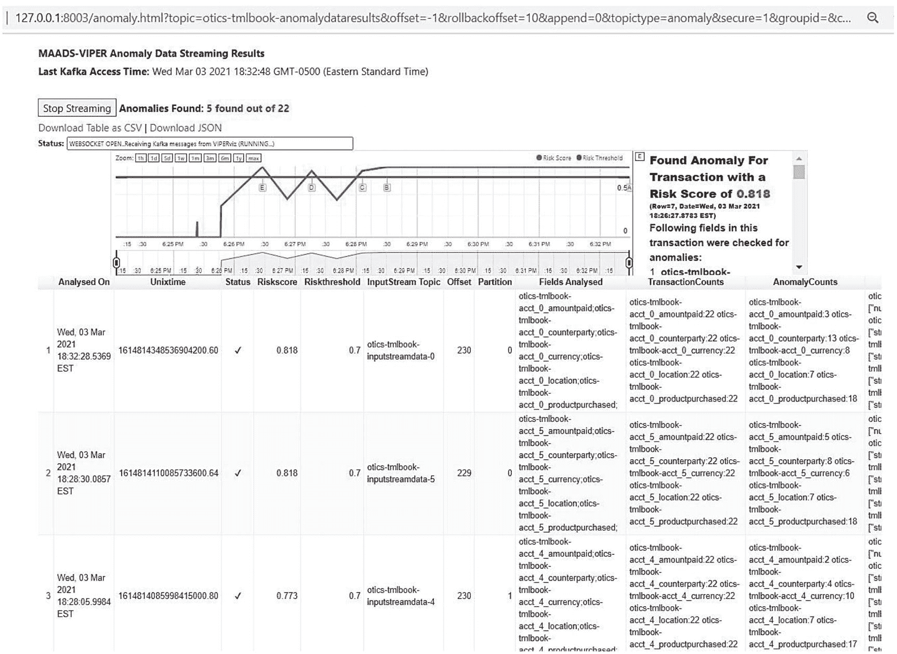
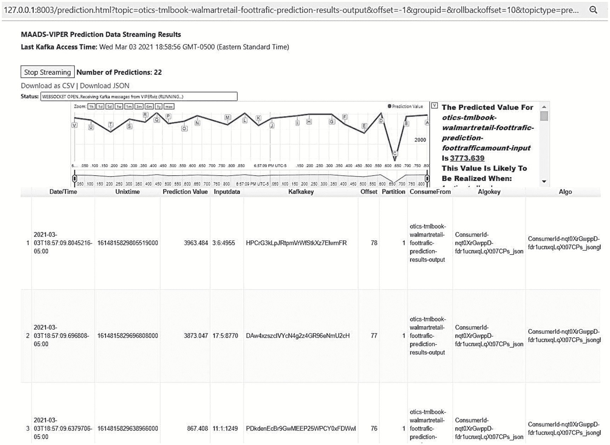
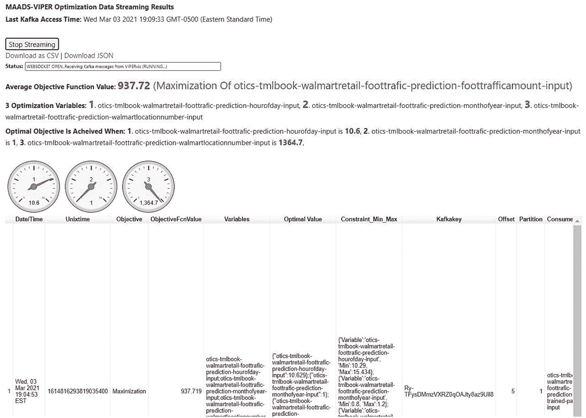
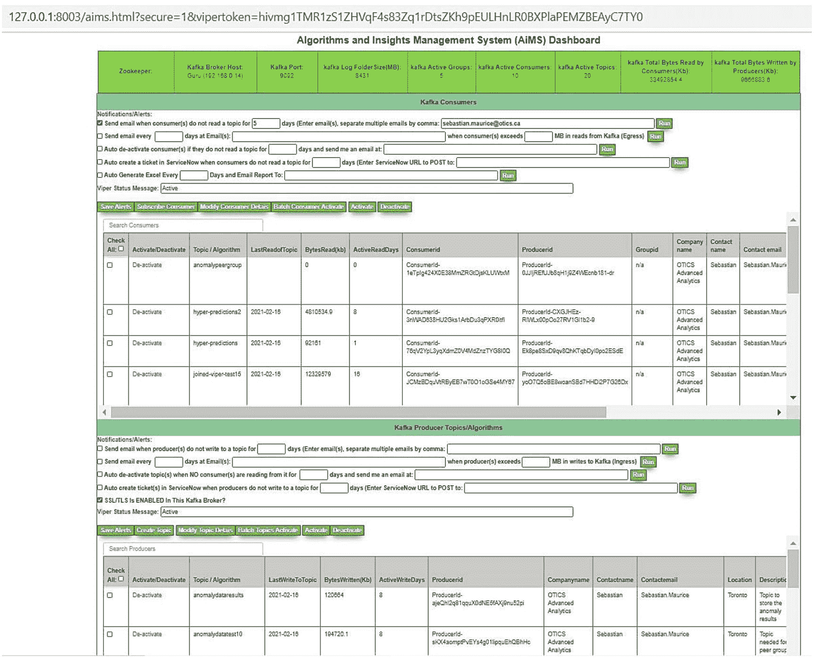
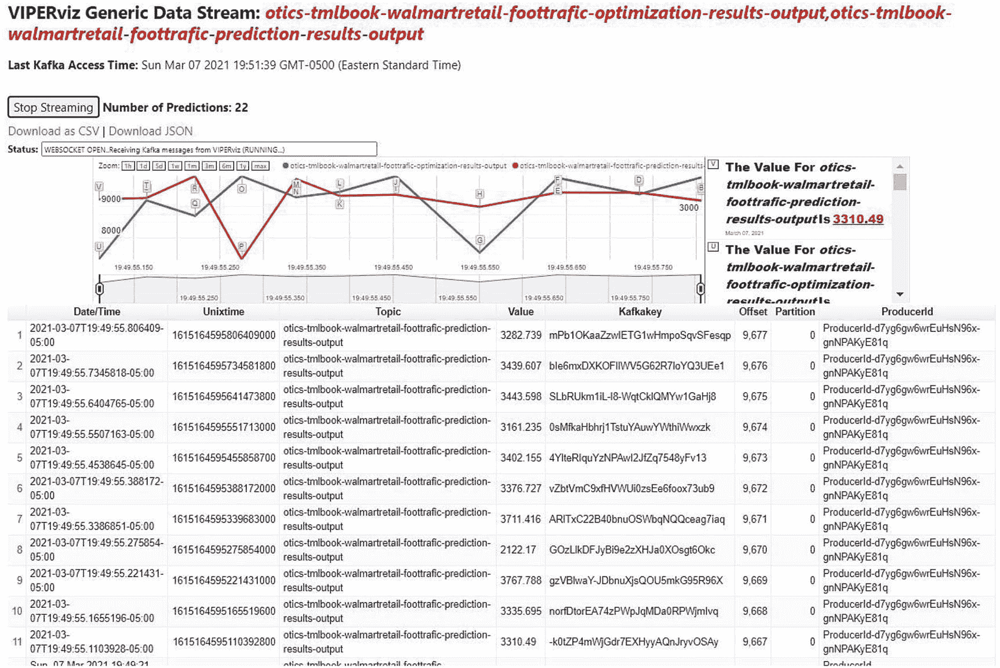

# 7. 可视化您的 TML 模型洞察：优化、预测与异常

流式洞察的可视化是决策过程中的关键环节。为了理解 TML 解决方案正在做什么，您需要将其输出可视化。此外，鉴于数据流的特性，这些可视化需要是实时的，并通过安全的 HTTPS 连接推送到您的浏览器。^(¹⁰⁰) 对于提供的两个示例，您将需要可视化以下内容：

1.  沃尔玛客流量预测输出
    1.  每个沃尔玛门店、每个小时、每个月预测的客流量是多少？
        1.  您可以做出的决策 – 预测招聘变化、库存数量、产品促销等。
2.  一天中的哪个时段、哪个月份以及哪个门店位置能产生最高的客流量？
        1.  您可以做出的决策 – 安排更多或更少员工工作的最佳或最差时间、何时进行门店维护、何时上架商品等。

2.  银行欺诈预测输出
    1.  哪笔银行交易是欺诈性的？
        1.  您可以做出的决策 – 调查哪笔银行交易、立即冻结哪个账户等。

为了执行流式可视化，您将使用 VIPERviz 技术来可视化流式洞察。具体来说，HPDE 将对流式数据应用机器学习，用于：

1.  预测分析
    1.  您可以通过浏览器访问 `Prediction.HTML`，使用 VIPERviz 可视化这些结果。

2.  规范分析或优化
    1.  您可以通过浏览器访问 `Optimization.HTML`，使用 VIPERviz 可视化这些结果。

3.  使用无监督学习的异常检测
    1.  您可以通过浏览器访问 `Anomaly.HTML`，使用 VIPERviz 可视化这些结果。

4.  通用可视化
    1.  您可以组合由预测、优化、异常和原始数据流生成的主题，并通过浏览器访问 `Generictopics.HTML`，使用 VIPERviz 进行可视化。

5.  用于算法管理的 AiMS 仪表盘，可通过浏览器访问 `Aims.html` 进行可视化。

这些 HTML 文件可供您下载。^(¹⁰¹) 它们应被复制到您安装 VIPER 的同一位置的 `/viperviz/views` 文件夹中。

VIPERviz 使用 WebSockets 通过安全的 HTTPS 连接连接到 Web 浏览器。^(¹⁰²) 用户使用标准浏览器访问 VIPERviz 进行可视化。每种类型的 URL 格式必须如下所示：

1.  沃尔玛示例的预测结果
    1.  ```
        https://127.0.0.1:8003/prediction.html?topic=otics-tmlbook-walmartretail-foottraffic-prediction-results-output&offset=-1&groupid=&rollbackoffset=10&topictype=prediction&append=0&secure=1&consumerid=[输入主题为 otic-tmlbook-walmartretail-foottraffic-prediction-results-output 的消费者 ID]&vipertoken=hivmg1TMR1zS1ZHVqF4s83Zq1rDtsZKh9pEULHnLR0BXPlaPEMZBEAyC7TY0
        ```

2.  URL 字段
    1.  `https://127.0.0.1:8003/` – 这假设您在端口 8002 (HTTP) 上启动了 VIPERviz；端口 8003 将自动为您创建，并用于提供 HTTPS 连接。
    2.  `prediction.html` – 使用此文件。
    3.  `topic`=`otics-tmlbook-walmartretail-foottraffic-prediction-results-output`
        1.  对于沃尔玛示例，输出主题是 `otics-tmlbook-walmartretail-foottraffic-prediction-results-output`；预测结果存储在此主题中。
    4.  `offset`=-1 – 表示转到流中的最新预测结果。
    5.  `groupid`= – 如果您创建了消费者组，可以在此处输入名称。消费者组可以使用 MAADSTML Python 库或在 AiMS 中创建。
    6.  `rollbackoffset`=10 – 表示将流回滚 10 个偏移量，并显示最新的 10 个预测结果。
    7.  `topictype`=prediction
    8.  `append`=0 – 表示*不*将数据追加到浏览器。如果 `append`=1，则数据将在您的浏览器中累积。这可能会带来问题，因为您将累积数 MB 的数据，这很可能会导致浏览器崩溃。
    9.  `secure`=1 – 表示使用 HTTPS (端口: 8003)；如果 `secure`=0，则将使用 HTTP (端口: 8002)。
    10. `consumerid`=[输入主题为 `otic-tmlbook-walmartretail-foottraffic-prediction-results-output` 的消费者 ID] – 此消费者 ID 将从沃尔玛客流量程序文件中输出。
    11. `vipertoken`=hivmg1TMR1zS1ZHVqF4s83Zq1rDtsZKh9pEULHnLR0BXPlaPEMZBEAyC7TY0

2.  沃尔玛示例的优化结果
    1.  ```
        https://127.0.0.1:8003/optimization.html?topic=otics-tmlbook-walmartretail-foottraffic-optimization-results-output&offset=-1&groupid=&rollbackoffset=10&topictype=optimization&secure=1&append=0&consumerid=[输入主题为 otic-tmlbook-walmartretail-foottraffic-prediction-results-output 的消费者 ID]&vipertoken=hivmg1TMR1zS1ZHVqF4s83Zq1rDtsZKh9pEULHnLR0BXPlaPEMZBEAyC7TY0
        ```

2.  URL 字段
    1.  所有字段与预测 URL 类似，但有以下更改：
        1.  `optimization.html`
        2.  `topic`=`otics-tmlbook-walmartretail-foottraffic-optimization-results-output`
        3.  `topictype`=optimization
        4.  `consumerid`=[输入主题为 `otic-tmlbook-walmartretail-foottraffic-prediction-results-output` 的消费者 ID] – 这将在沃尔玛预测和优化程序中为您输出。

3.  银行欺诈异常检测
    1.  ```
        https://127.0.0.1:8003/anomaly.html?topic=otics-tmlbook-anomalydataresults&offset=-1&rollbackoffset=10&append=0&topictype=anomaly&secure=1&groupid=&consumerid=[输入您的消费者 ID]&vipertoken=hivmg1TMR1zS1ZHVqF4s83Zq1rDtsZKh9pEULHnLR0BXPlaPEMZBEAyC7TY0
        ```
        1.  URL 字段
            1.  所有字段与预测 URL 类似，但有以下更改：
                1.  `anomaly.html`
                2.  `topic`=`otics-tmlbook-anomalydataresults`
                3.  `topictype`=anomaly
                4.  `consumerid`=[输入您针对 `otic-tmlbook-anomalydataresults` 的消费者 ID] – 这将在银行欺诈程序中输出。

4.  通用可视化
    1.  您可以组合数据流并进行可视化。

2. 对于沃尔玛用例，您可以使用以下 URL：`https://127.0.0.1:8003/generictopics.html?topic=otics-tmlbook-walmartretail-foottraffic-prediction-results-output,otics-tmlbook-walmartretail-foottraffic-optimization-results-output&offset=-1&groupid=&rollbackoffset=1&topictype=generic&append=0&secure=1&consumerid=&vipertoken=hivmg1TMR1zS1ZHVqF4s83Zq1rDtsZKh9pEULHnLR0BXPlaPEMZBEAyC7TY0`

    1. URL 字段
        1. `generictopics.html`

2. `topic=otics-tmlbook-walmartretail-foottraffic-prediction-results-output,otics-tmlbook-walmartretail-foottraffic-optimization-results-output` – 组合多个主题，并用逗号分隔。

5. AiMS 仪表盘
    1. `https://127.0.0.1:8003/aims.html?secure=1&vipertoken=hivmg1TMR1zS1ZHVqF4s83Zq1rDtsZKh9pEULHnLR0BXPlaPEMZBEAyC7TY0`

2. 使用 `Aims.html`

以下各节将描述每个可视化文件。

## 流式异常检测可视化

异常检测已在第 6 章中详细讨论。成功开发异常检测模型的一部分工作是为对等组和预测选择合适的标志。由于数据流多种多样，应仔细选择标志中的参数，以恰当地代表一个合理的对等组，从而最大限度地减少误报和漏报。VIPERviz 提供了强大的流式可视化功能，并与 Kafka 集成，可将异常推送到您的 Web 浏览器。您可以使用此可视化来帮助微调用于异常训练和预测的标志。VIPERviz 将通过文件 `anomaly.html` 连接并开始流式传输异常检测结果，该文件会生成一个带注释的时间线图表，如图 7-1 所示。



图 7-1 VIPERviz 异常结果

对于上述异常可视化表格，显示以下字段：

* **分析时间** – 异常分析的日期/时间。
* **状态** – 如果显示 X，则表示非异常；如果显示对勾，则应更仔细地查看此交易。
* **风险评分** – 计算风险评分。
* **风险阈值** – 用户选择的风险阈值。
* **输入流主题** – 新交易的输入流。
* **偏移量** – 风险评分的偏移量。
* **分区** – 风险评分的分区。
* **分析字段** – 已分析的数据流字段。
* **交易计数** – 为检测欺诈而分析的交易数量。
* **异常计数** – 发现的异常数量。
* **标志** – 用于发现异常的标志。
* **Kafka 键** – 风险评分的 Kafka 键。
* **异常数据** – 每个流的异常数据；这些是针对每个字段 *F* 的单个交易 ***i***。
* **对等数据** – 每个字段 *F* 的对等组。

带注释的图表将显示触发异常的交易信息，以及交易的日期和时间、行号以及发现异常的交易字段。这将有助于您判断该交易是否值得进一步调查。

此外，您可以将表格下载为 CSV 文件以进行进一步分析。您还可以将提供表格和可视化数据的完整 JSON 对象下载到 CSV 文件中。此可视化也有助于测试目的以及微调异常模型标志中的参数。同时，它还能提高对存储欺诈结果到 Kafka 的数据流的可见性。用户可以停止或开始流式传输；这不会对可视化造成任何中断。VIPERviz 始终从 Kafka 的任何偏移量检索数据，以确保您始终拥有完整的结果集。下一节将讨论预测可视化。

## 流式预测可视化

在开发监督学习解决方案时，可视化流式预测是 TML 的另一个关键部分。

类似的预测结果将如图 7-2 所示。图表将在 Y 轴上绘制预测值，在 X 轴上绘制日期/时间。流式结果可以停止和开始。预测结果会实时绘制成图表和表格，并推送到您的浏览器。可视化主要用于帮助您做出决策，如前文在沃尔玛和银行欺诈用例中所述。它们还将帮助您观察数据流及其行为方式，这在测试期间可能有助于优化您的 TML 模型。自动生成的注释文本提供了额外的信息来支持您的决策。您还可以将表格中的结果下载到 CSV 文件。推送到浏览器的数据是 JSON 格式；JSON 数据也可以下载。



图 7-2 流式预测结果

图 7-2 将显示以下字段：

* **日期/时间** – 预测生成的时间。
* **Unix 时间** – 预测的 Unix 时间。
* **预测值** – 预测值。
* **输入数据** – 用于生成预测的输入数据（自变量的值）。
* **Kafka 键** – 预测的 Kafka 键。
* **偏移量** – 预测的偏移量。
* **分区** – 预测的分区。
* **消费来源** – 用于生成预测的训练算法所在的主题。
* **算法键** – 由 HPDE 生成的算法的唯一键。
* **算法** – 算法的名称。
* **使用部署** – 如果为 1，则使用 `/deploy` 文件夹中的算法；否则，使用 `/models` 文件夹中的算法。

下一节将讨论流式优化可视化。

## 流式优化可视化

VIPERviz 也可以绘制优化结果图表，如图 7-3 所示。优化可视化将清晰地显示被优化的变量及其优化值；它还将显示优化了因变量的自变量的值。优化 JSON 数据可以下载。表格中的流式数据也可以下载。图 7-3 显示了沃尔玛用例的结果。这些仪表盘显示了自变量的最优值：一天中的小时、月份和门店编号，这些值导致了最大的人流量。



图 7-3 流式优化结果

图 7-3 显示了以下内容：

* **平均目标函数值** – 这是来自其他优化模型运行的所有目标函数的平均值。
* **优化变量** – 这些是被优化的变量的名称。
* **仪表盘**显示自变量的最优值。
* **日期/时间** – 这是优化执行的日期/时间。
* **Unix 时间** – 这是优化执行的 Unix 时间。
* **目标函数值** – 优化后的目标函数的值。
* **变量** – 被优化的变量的名称。
* **最优值** – 自变量的最优值。
* **约束最小值/最大值** – 用于约束的最小值和最大值。
* **Kafka 键** – 优化的 Kafka 键。
* **偏移量** – 优化的偏移量。
* **分区** – 优化的分区。
* **消费来源** – 存储来自训练的训练参数的主题。
* **使用部署** – 如果为 1，则使用 `/deploy` 文件夹中的算法；否则，使用 `/models` 文件夹中的算法。

下一节将讨论 AiMS 仪表盘。

## AiMS 仪表盘

AiMS 是一个用于管理由 VIPER 和 HPDE 生成的算法的仪表盘。AiMS 由 VIPERviz 提供服务。

连接后，用户可以控制由 TML 解决方案为消费者、生产者和组创建的每个主题或组的生产和消费。AiMS 仪表盘如图 7-4 所示。AiMS 已在第 2 章中详细讨论过。需要注意的是，AiMS 与 VIPER 协同工作。如果你运行了多个 VIPER 实例，只需使用相应的 `Vipervizhost` 和 `port`，即可为每个 VIPER 实例使用 AiMS 来控制 TML 解决方案。这使得开发人员能够构建大型 TML 解决方案，同时让管理员能够轻松地从 AiMS 仪表盘控制每个解决方案，无论其规模大小。这种模块化特性还使得可以将 AiMS 与 VIPER 和 HPDE 一起构建到微服务架构中，并通过算法和模型管理将 Kafka 和 AutoML 处理解耦。通过此仪表盘，TML 解决方案管理员可以设置警报和通知，以确定主题是否正在被使用。如果未被使用，则可以将其停用。立即停用 TML 解决方案的能力可以对 TML 解决方案的成本产生直接的积极影响，这对于大型基于云的解决方案尤其重要。



图 7-4

AiMS 仪表盘

下一节将讨论如何在同一个图表中可视化多个数据流。

## 通用主题的可视化

在某些情况下，您希望将原始数据流一起可视化。例如，在沃尔玛的示例中，您可能希望将自变量数据流一起可视化。或者，您可能希望将预测结果和优化结果一起可视化；这可以通过通用图表实现，如图 7-5 所示。



图 7-5

通用主题图表

此图表与预测图表类似，不同之处在于可以同时可视化多个数据流。结果也会被注释，以显示各个数据流的值。您还可以组合文本和数值数据流。

下一节将讨论 WebSockets。

## 使用 WebSockets 进行可视化

对于数据流而言，使用 WebSockets 有几个关键优势：

1.  传统浏览器需要向 Web 服务器发出请求才能接收响应：

    1.  VIPERviz 不需要 Web 服务器，因为它内置了一个。

    2.  VIPERviz 不等待浏览器的请求；它可以*推送*结果到 Web 浏览器，这确保用户始终拥有最新结果。

    3.  VIPERviz 附带标准的 HTML 文件，您可以根据自己的需求进行自定义。VIPERviz 将持续向您推送数据。

2.  VIPERviz 速度很快。当 HPDE 生成结果并写入 Kafka 时，VIPERviz 可以立即检索新结果并将其流式传输到您的浏览器。

3.  VIPERviz 可以实例化无限数量，并且可以同时处理来自 Web 浏览器的多个连接。这使得 TML 解决方案能够在不影响性能的情况下进行扩展。

4.  VIPERviz 在前端使用简单的 HTML，允许用户为其受众自定义 HTML。具体来说，VIPERviz 有一个内置的 Web 服务器，可以为传统 Web 浏览器提供 HTML/JavaScript 服务。

5.  VIPERviz 是安全的。它可以使用带有 TLS 加密的 HTTPS 连接进行连接。

通过安全、可扩展且可移植的 WebSockets 进行流式可视化，并与 VIPER/HPDE 和 Kafka 集成，使 TML 解决方案达到企业级就绪状态。TML 解决方案的无摩擦和弹性特性带来的额外好处，使组织能够通过使用低延迟的流式可视化，在允许大规模消费结果的同时，最大化数据流的价值。下一节将总结本章。

## 总结

TML 解决方案通过 VIPERviz 与流式可视化紧密集成。这使您能够构建可扩展的端到端 TML 解决方案，全面了解 TML 解决方案正在做什么，并轻松使用其输出进行决策。每个可视化都设计为使用由 VIPERviz 推送到您浏览器的 JSON 数据，VIPERviz 会持续监控 Kafka 主题以获取更新。更新会立即推送给您，因此无需请求。这使得 TML 可视化对于数据流解决方案特别有效。

您可以使用以下参数控制从 Kafka 检索的数据：

*   `topic`

*   `consumerid`

*   `offset`

*   `rollbackoffset`

*   `append`

*   `secure`

*   `groupid`

您可以在 `topic` 关键字中选择 TML 解决方案的输出主题。您可以通过 MAADSTML 或 AiMS 订阅任何主题来检索该主题的消费者 ID。设置 `offset=-1` 和 `rollbackoffset` 的值，将为您提供该主题的最新数据量。例如，如果 `offset=-1` 且 `rollbackoffset=20`，则会将最后 20 个数据点发送到您的浏览器。此外，由于数据流可能累积得非常快，您可以使用 `append` 字段来控制附加到浏览器的数据量。例如，`append=0` 将不会向浏览器附加数据，即使 Kafka 中的数据变得非常大，您也始终拥有最新数据。但是，如果您确实想累积数据，只需设置 `append=1`。安全性也可以通过 `secure` 关键字来控制。设置 `secure=1` 将导致 VIPERviz 通过 HTTPS 连接发送数据；`secure=0` 将导致 VIPERviz 切换到 HTTP 连接。请注意，如果您在端口 8002 上启动 VIPERviz，则 HTTPS 端口会自动设置为下一个端口：8003。

您还可以通过在 `groupid` 字段中输入组 ID 来可视化来自 Kafka 消费者组的数据。Kafka 消费者组是一种非常方便的方式，可以以并行方式扩展您的可视化，同时保持每个消费者的数据吞吐量达到最佳性能。您可以使用 MAADSTML 或 AiMS 以编程方式创建消费者组。

AiMS 仪表盘将为您提供已创建的主题和组的完整视图，并控制它们的执行。具体来说，您可以轻松地激活或停用消费者主题、生产者主题和组主题。您还可以设置通知和警报，以跟踪哪些主题正在被使用，哪些没有被使用。

最后，您需要五个可自定义的 HTML 文件用于可视化：

1.  要可视化预测，请使用 `prediction.html`。

2.  要可视化异常，请使用 `anomaly.html`。

3.  要可视化优化，请使用 `optimization.html`。

4.  要可视化通用主题，请使用 `generictopics.html`。

5.  要可视化 aims，请使用 `aims.html`。

所有可视化数据都可以 CSV 和 JSON 格式下载。下一章将讨论 TML 的未来。

脚注 1   2   3