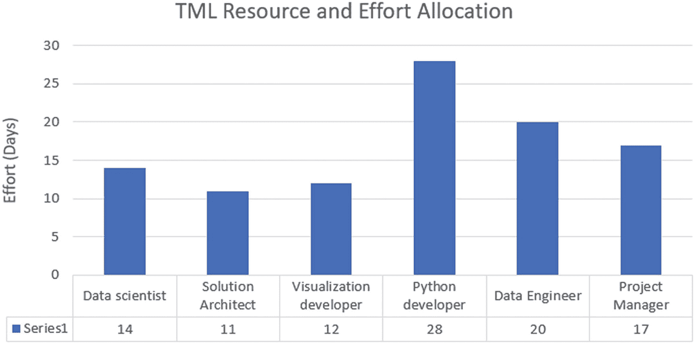

# 9. TML 项目规划方法与总结思考

本书介绍了 `TML` 的各个方面，`TML` 将 `AutoML` 应用于与 `Apache Kafka` 集成的数据流，使开发者能够构建在云中具有可扩展性、无摩擦性和弹性的 `TML` 解决方案。无摩擦性和弹性的重要性是 `TML` 解决方案的独特特征，也是其与传统机器学习（`CML`）的区别因素。我们还正式定义了 `TML`，以及 `TML` 解决方案的五个特征，例如数据流动性、数据流连接、数据流标准化为 `JSON`、数据流与 `AutoML` 的集成，以及使用低代码创建 `TML` 解决方案的能力。`TML` 基于这样一个信念：快速数据需要快速机器学习以实现快速决策。这并不意味着所有快速数据都需要 `TML`，因为如果不需要快速决策，那么 `TML` 就意义不大。

`CML` 不适合数据流，原因如下：

*   `CML` 流程主要操作于静态的、驻留在磁盘上的数据。
*   `CML` 流程在数据准备、模型构建、模型估计、超参数调优和报告方面需要大量人工介入，这增加了 `CML` 解决方案的摩擦。
*   由于第 2 点，`CML` 解决方案从新数据中重新学习的速度很慢。
*   当业务需求或用户消费模式发生变化时，`CML` 解决方案不易快速扩展或缩减。
*   在许多情况下，`CML` 解决方案的模型管理、模型部署和解决方案支持都很困难。

`TML` 与 `CML` 在以下方面有所不同：

*   `TML` 将机器学习应用于持续流动的、实时的或事件驱动的数据流。
*   `TML` 通过动态组合或连接数据流来自动构建训练数据集；然后对这些训练数据集应用自动机器学习，以找到最适合训练数据集的算法——只需最少的人工干预，从而实现无摩擦的解决方案。
*   `TML` 可以立即部署解决方案供人类或机器消费。
*   `TML` 可以持续、自动地构建训练数据集，以从更新的数据流中重新学习，并立即使洞察可供消费。
*   `TML` 解决方案可以通过以下方式轻松扩展或缩减：
    1.  增加或减少消费 `TML` 解决方案洞察的消费者
    2.  增加或减少数据流的生产者
    3.  快速连接更多流以构建更大（或减少数据流以构建更小）的解决方案，使用更多（或更少）的机器学习算法
    4.  使用 `AiMS` 仪表板或 `TML` `Python` 函数自动激活或停用 `TML` 解决方案组件（生产者和消费者主题）

虽然 `TML` 有优势，但我并非暗示它可以替代 `CML`。恰恰相反，对于没有快速数据、也不需要快速数据的组织来说，`CML` 有其价值。在数据科学领域，`CML` 流程已经成熟且被广泛使用。有许多 `CML` 用例不需要 `TML`。`TML` 的优势在于数据是实时或事件驱动地快速、持续生成时。但是，即使数据流动很快，如果不需要更快的决策，也可能不足以证明使用 `TML` 的合理性。`CML` 和 `TML` 都有各自的应用领域和问题类别，旨在为组织创造价值，但它们必须在正确的业务背景下使用。

数据是 `CML` 和 `TML` 之间的共同主线。两种方法都需要良好的数据质量。糟糕的数据会导致糟糕的机器学习洞察（解决方案）。我们讨论了与数据流相关的几个数据质量领域，例如速度、多样性、真实性和数据量。数据流是大数据现象的一部分，但并非所有大数据都是流式数据。数据流是实时流动的，但它们也是由事件创建的。事件引发数据创建，从而触发某些操作。例如，如果你在亚马逊上购买了一件商品，支付完成事件将触发产品发货操作。不难想象，这些场景在某些方面让我们的生活变得简单得多，而在其他方面则变得复杂。事件流和数据流或多或少是同义词。`TML` 仍然需要干净的数据来提供可信且可操作的洞察。此外，其成功仍然依赖于有效的数据工程和架构实践，这些实践能够带来可扩展、安全且具有可用于有效决策的高质量洞察的 `TML` 解决方案。虽然机器会从好数据和坏数据中学习，但学习结果将反映所用数据的质量。下一节将讨论 `TML` 技术栈。

## TML 技术栈

除了设计和构建 `TML` 解决方案之外，构建功能性解决方案所需的技术取决于：

*   **能够处理大量数据的数据流存储平台** – 在 `GCP`、`AWS` 或微软云基础设施中运行的云原生 `Apache Kafka` 是理想选择。
*   **能够从源系统或设备摄取数据并将其写入 `Kafka` 的源连接器和汇连接器** – `MAADS-VIPER`
*   **使用深度学习算法分析流式数据以获取洞察** – `MAADS-HPDE`
*   **实时可视化 `TML` 模型的结果** – `MAADS-VIPERviz`

洞察的存储、分析和可视化使 `TML` 解决方案具有可扩展性、安全性、无摩擦性、弹性，并且非常适合人类或机器进行实时决策。

在第 6 章和第 7 章中，我们讨论了 `TML` 解决方案模板以及用于构建和可视化 `TML` 解决方案洞察的相关技术，例如：

*   **云原生 `Apache Kafka`** 可以在 `Amazon Cloud Kafka`、`Microsoft Cloud Kafka`、`Google Cloud Kafka` 或 `Confluent Cloud Kafka` 上运行，是我们 `TML` 的单一数据源。
*   `MAADS-VIPER` 是官方的 `Kafka` 源连接器和汇连接器，用于从设备摄取数据，并向 `Kafka` 生产数据以及从 `Kafka` 消费数据。
*   `MAADS-HPDE` 是与 `VIPER` 和 `Kafka` 集成的 `AutoML` 技术，执行所有监督和无监督的机器学习功能：
    1.  应用机器学习算法并为训练数据集找到最佳算法
    2.  使用该算法进行：
        1.  预测分析
        2.  数学优化（规范分析）
        3.  异常检测
    3.  将所有结果生成到 `Apache Kafka`
*   `MAADS-VIPERviz` 通过 `HTTPS` 或 `HTTP` 连接将流式洞察或结果推送到客户端浏览器，实现可视化，包括：
    1.  预测分析 – 推送来自预测性 `TML` 解决方案的预测结果
    2.  优化 – 推送来自优化型 `TML` 解决方案的优化结果
    3.  异常检测 – 推送来自异常检测 `TML` 解决方案的欺诈检测结果
    4.  `AiMS` 仪表板 – 推送关于 `TML` 解决方案的所有信息，用于算法和洞察管理
*   `MAADSTML Python 库`^(¹¹²) 允许用户仅用几行代码，通过 `TML` `Python` 库函数创建强大的 `TML` 应用程序。

上述技术简化了与 `Apache Kafka` 和机器学习的集成，以便对数据流进行高级分析。它们还简化了复杂任务，例如：

*   从设备和源系统摄取数据，并向运行在 `GCP`、`AWS` 和 `Azure` 上的 `Kafka` 生产数据以及从中消费数据。
*   创建和管理 `Kafka` 主题，同时跟踪每个数据的分区和偏移量。通过仔细管理分区和偏移量，`VIPER` 可以使用偏移量回滚数据流以获取数据历史的滑动窗口，然后连接多个滑动窗口（来自每个数据流）来构建用于机器学习的训练数据集。
*   分析过程很复杂，尤其是在处理多个数据流和具有数百万个偏移量的多个分区时，所有数据都在快速流动。`TML` 技术通过以下方式简化分析过程：(1) 自动将高级机器学习应用于连接后的数据流并找到最佳算法；(2) 使用最新的训练模型自动对新数据进行预测、优化和异常检测；(3) 立即将来自任何 `TML` 解决方案的新洞察推送到客户端浏览器。
*   通过结合数据流，实时构建监督式和无监督式机器学习模型。
    1.  对于监督式机器学习，我们将数据流用作因变量流和自变量流。通过指定哪些流是因变量和自变量，我们可以实时构建一个机器学习模型，并将其发送给 `HPDE` 进行训练。使用连接后的数据流进行训练是 `TML with Kafka` 的一个非常强大的功能。具体来说，我们使用偏移量参数自动回滚每个流，以获取一个历史数据集（滑动窗口），该数据集代表我们的训练数据集。`VIPER` 告诉 `Kafka` 将训练数据集存储在一个主题中。`Kafka` 将训练数据集存储在指定主题的一个分区中；它将分区编号返回给 `VIPER` 以备将来使用。接下来，`VIPER` 调用 `HPDE`，并将包含训练数据集的*主题*和分区编号传递给它。这之所以强大，原因如下：
        1.  由于 `Kafka` 会选择分区来优化大数据存储，它会告知调用函数^(¹¹³)它选择了哪个分区；然后你在调用 `HPDE` 时使用这个分区，这能保证使用正确的训练数据集进行机器学习。这个过程使我们能够相对轻松地、持续地、实时地使用先进的自动机器学习技术，对非常大的数据集^(¹¹⁴)进行机器学习。我们不需要使用任何特殊的编程语言来对大型数据集进行机器学习，例如 `Scala`。
        2.  使用偏移量参数，我们可以告诉 `Kafka` 训练数据集在分区中的确切偏移量位置。这使我们能够保留训练数据集的审计跟踪，以防有人想要审计 `TML` 模型。我们可以根据需要创建任意数量的训练数据集，持续将它们添加到主题中，并精确地引导 `HPDE` 到 `Kafka` 主题中我们想要使用的训练数据集所在的分区和偏移量位置。
    2.  对于无监督学习，我们的流程略有不同。我们不是构建训练数据集，而是构建对等组。这些对等组代表了数据流中的“正常”行为。对于异常检测，`TML` 将执行以下操作：

1.  连接感兴趣的数据流（字段），在每个流（字段）中找到对等组，并将其存储在 Kafka 主题中，然后返回分区和偏移量。

2.  调用 `HPDE`，并将对等组的主题名称、分区和偏移量发送给它。

3.  对于每个新事务以及事务中的每个字段，将其与相应的对等组进行比较，并计算风险评分。

4.  实时可视化结果。

简化从设备和源系统摄取数据、向 Kafka 生产和消费数据、分析数据并将其可视化以辅助决策这些复杂任务，正是 TML 及其技术在快速数据和快速机器学习领域取得突破的原因，这些技术能够实现实时和大规模的快速决策。下一节将讨论 TML 项目规划方法。

## TML 项目规划方法

处理数据流中的监督式和无监督学习以及 AutoML 的能力，使 TML 不仅区别于 CML 解决方案，也区别于那些更侧重于基于规则和基于 SQL 的方法进行预测、规范分析和异常检测的流处理技术。用于数据流异常检测的 TML 在银行和金融、物联网和资产绩效、制造业、供应链等领域提供了众多用例。监督式和无监督式 TML 解决方案背后的驱动力，分别是利用 Kafka 在实时回滚数据流时使用分区来管理大数据环境规模的能力，来创建训练数据集和对等组。

上述过程可能会迅速变得复杂且难以管理，尤其是对于拥有数千个数据流、算法和洞察的大型 TML 解决方案而言。许多行业在管理机器学习解决方案方面仍然面临困难，无论解决方案规模大小，主要原因在于：

*   解决方案与公司需求、战略和目标缺乏一致性

*   模型管理和运维困难，例如，机器学习解决方案崩溃或无法提供良好结果，导致人们停止使用它

*   缺乏对解决方案的支持

*   设计目标不明确，导致人们不信任驱动模型和结果的数据

*   解决方案性能不佳，例如，解决方案生成决策洞察的速度太慢，导致人们停止使用该解决方案

可以通过关注以下几点来克服上述困难：

1.  使 TML 解决方案与公司目标保持一致：使用平衡计分卡方法会有所帮助。

2.  选择合适的人员和技能来成功构建 TML 解决方案。这些将包括：

    1.  精通 CML 但理解流分析的数据科学家——我们引入了数据流科学家这个术语，指能够通过组合特定数据流来解决基于流的问题，从而构建 TML 模型的人。

    2.  解决方案架构师，深入了解事件流平台（例如 `Apache Kafka`）如何与机器学习技术协同工作，以构建可扩展的 TML 解决方案，这些解决方案在微服务架构中与云上的 `Apache Kafka` 实现无摩擦和弹性扩展。

    3.  理解数据流细微差别的数据工程师——具有时间局部性（随时间演变）的事件驱动和实时数据。

    4.  Python 开发者，能够使用 TML Python 库从设备和源系统摄取数据并将其流式传输到 Kafka，以及使用 TML Python 库函数构建 TML 解决方案。

    5.  可视化开发者，深入了解：

        1.  JavaScript

        2.  JSON 数据格式

        3.  可视化 API，例如 Google Charts

    6.  技术项目经理，接触过：

        1.  Python

        2.  机器学习技术

        3.  Kafka

        4.  云技术：AWS、GCP、Confluent、Azure

        5.  数据流

TML 团队的规模将取决于以下因素：

1.  TML 解决方案中使用的数据流数量

2.  将在 TML 解决方案中使用的源系统或设备

3.  以下组件的实例数量：

    1.  Kafka 代理

    2.  `VIPER`/`HPDE`/`VIPERviz`

4.  可视化图表数量

5.  可视化内容的消费者数量

例如，我们以一个典型的 TML 解决方案为例，该方案包含：

1.  1000 个数据流

2.  100 个设备和源系统

3.  以下实例：

    1.  1 个 Kafka 代理

    2.  10 个 `VIPER` 实例

    3.  5 个 `HPDE` 实例

    4.  5 个 `VIPERviz` 实例

4.  10 个可视化图表

5.  50 个消费者

6.  1 个 TML 用例

表 9-1 显示了资源和人天数的细分。^(¹¹⁵)

表 9-1

TML 工作量与资源细分

| 资源 | 工作量（天） |
| --- | --- |
| 数据（流）科学家 | 14 |
| 解决方案架构师 | 11 |
| 可视化开发人员 | 12 |
| Python 开发人员 | 28 |
| 数据工程师 | 20 |
| 技术项目经理 | 17 |
| 总工作量天数 | 102 |
| 含 20% 应急储备 | 122 |

表 9-1 中的“工作量（天）”列计算方式如下：

*   数据科学家 – 我们为每个用例分配了 4 天（0.8 FTE），并为每个源系统和设备分配了 0.02 FTE^(¹¹⁶)，总计 14 天工作量。理由是数据科学家将专注于解决用例问题，而非机器学习任务，因为 TML 使用了 AutoML。他们的主要职责是通过识别构成机器学习训练模型的因变量和自变量数据流，来制定训练数据集。

*   解决方案架构师 – 我们为每个源系统分配了 0.02 FTE，并为 `VIPER`、`HPDE` 和 `VIPERviz` 实例分配了 0.02 FTE，总计 11 天。理由是解决方案架构师需要专注于源系统如何与整体 TML 解决方案集成。如果源系统复杂，具有不同的数据格式、通信协议以及其他硬件或软件复杂性，此工作量可能会发生变化。解决方案架构师的主要职责是设计可扩展且稳健的 TML 架构，使其与数据流和源系统相协调，并与 TML 解决方案的弹性特性保持一致。

*   可视化开发人员将负责（开发或配置）预测、优化和异常检测的可视化。我们为可视化数量（20 个）和消费者数量（50 个）分配了 0.04 FTE，总计 12 天。需要注意的是，`VIPERviz` 提供了开箱即用的可视化功能，因此无需从头开发。这可以节省大量时间和成本。

*   Python 开发人员将使用 `MAADSTML` Python 库来开发 TML 解决方案。我们为每个源系统分配了 0.04 FTE，为所有 `VIPER`/`HPDE`/`VIPERviz` 实例分配了 0.02 FTE，并为每个用例分配了 7 天（1.4 FTE），总计 28 天。由于 TML Python 库具有预构建函数，因此工作量大大减少。

*   数据工程师将与开发人员紧密合作，确保数据可访问并能流式传输到 Kafka。可能需要进行数据清理和准备工作。我们为每个源系统分配了 0.04 FTE，总计 20 天。

*   技术项目经理是确保 TML 项目顺利推进的重要角色。为了计算工作量，我们取所有资源工作量总和的 20%，得出 17 天。

上述工作量估算是否合理？根据我们的经验，答案是肯定的。如果我们增加 20% 的应急储备，TML 项目大约需要 122 个工作日才能完成。由于许多任务可以并行进行，该项目可以在不到一个月的时间内完成。图 9-1 以图形方式展示了资源与工作量的关系。请注意，可能还有其他用于 TML 解决方案支持和维护的运营或项目角色，例如文档、培训、变更管理和控制以及安全。但是，我们选择不添加这些角色，而是专注于开发 TML 解决方案所需的关键角色，以保持示例的简洁性。

图 9-1

TML 资源与工作量分配

下一节将讨论 TML 价值创造。

## TML 价值创造

创造价值对每个企业都至关重要。我们在第 4 章中还介绍了一个 TML 价值框架（TVF），它将帮助您选择那些经过优先级排序且与公司目标和战略紧密一致的 TML 用例。将机器学习解决方案与公司目标和战略保持一致，可确保这些解决方案产生正的利润率：即解决方案的开发成本低于其在生命周期内产生的价值。很多时候，企业在意识到为时已晚之前，都会忽视先进技术解决方案的成本。TML 与 AiMS 相结合，为管理员提供了密切跟踪和监控解决方案（供消费者）使用情况的能力。由于 TML 技术与使用发布-订阅框架的 `Apache Kafka` 集成，因此可以跟踪消费者和生产者。当没有人消费 TML 解决方案的洞察时，设置警报和通知对于在超过非使用期限时触发解决方案停用非常重要。特别是对于消耗云计算、存储和网络资源的大型解决方案，能够停用无人使用的解决方案可以为组织节省大量成本。这些节省下来的成本可以用于构建更高价值的 TML 解决方案。TML 解决方案的价值体现在以下几个方面：

*   更快的决策 – 通过减少 CML 中存在的摩擦，TML 以较少的人工干预加快了洞察生成的速度。例如，一个 TML IoT 解决方案可以持续对 IoT 数据进行自我训练，并预测设备故障风险，从而向可能决定采取预防性维护措施的人员发出警报。

*   更快的扩展 – 与 Kafka 结合，TML 解决方案具有弹性，可以使用 API 和微服务架构快速扩展，为几乎所有行业的组织开辟了新的机遇。例如，在 IoT 环境中，可以快速将数百个新设备添加到 TML 平台，而数据和数据科学团队只需付出很少的增量工作。

# TML 的优势与应用

更快（更深入）的洞察 – 欺诈检测或产品推荐不仅可以即时提供，而且与 CML 解决方案不同，TML 能够利用新数据不断进行自我优化和自我学习，以较少的人工干预融入新的欺诈手段或产品购买趋势，同时将最新的洞察以可视化形式呈现到客户浏览器中，以便更好、更轻松地做出决策。

通过更好、更快的决策来创造价值，需要具备将 TML 解决方案的结果可视化的能力。由于数据生成和洞察创建的速度，可视化对于数据流至关重要。数据创建速度的提高导致数据积累更快，随着时间的推移，数据中会出现更多样化的趋势和模式。数据流的时间局部性赋予了时间重要性，这将影响所捕获的学习成果和洞察。

在监督学习中，机器将捕获估计参数中的学习成果。重新训练或重新学习的能力是 TML 解决方案最重要的方面之一。通过持续重新学习，我们可以自动更新估计参数，并确保我们从最新数据中获得最新的学习成果。这对于由静态、驻留磁盘数据驱动的 CML 来说是无法快速实现的。拥有最新的估计参数意味着机器已经学习了数据中的任何新趋势和模式。使用最新的参数，我们更有可能做出更好的预测，并为自变量找到更好的最优值。这在模型退化可能迅速发生、损害业务绩效并降低客户满意度的行业中非常重要。

对于数据流的无监督学习，机器会向合并后的数据流应用算法，以寻找“正常”行为。它定义“正常”的方式是计算每个数据流的平均值或质心值。任何显著偏离平均值或质心的值都被视为“异常”，不会纳入对等组。如何选择正常性是通过计算每个数据点与其质心的标准差来确定的。HPDE 能非常快速地完成这一过程。

您还可以定义标志，用于控制如何为每个数据流选择对等组。同样，这是一种为每个数据流定义不同正常行为的非常强大的方法。无论您有 100 个、100,000 个还是更多数据流，流程都不会改变。通过查找每个数据流中的异常，然后将结果合并以形成风险评分，您可以非常快速地判断行为是正常还是异常，然后将其可视化并进一步调查该交易。下一节将提供一些总结性思考。

## 总结性思考

如前所述，如果 TML 解决方案不用于人类或机器做出能为您的业务增加价值的决策，那么它们就几乎没有用处。在某些情况下，组织会成为 AI 和 ML 供应商的受害者，这些供应商在纸面上承诺其解决方案如何能为业务增值，但在实践中却未能真正兑现承诺。对于 TML 而言，纸上谈兵与实际操作之间的距离很小，因为在概念验证中证明 TML 解决方案价值的速度可能只需数小时。这有助于在 TML 解决方案与切实的业务价值之间建立可见的联系。如果机器学习解决方案不能为您的业务带来直接或间接的价值，那么它们就是在浪费宝贵的业务资源。使用 AiMS 正确监控和跟踪 TML 解决方案的价值生成，对于确保解决方案被使用并随着时间的推移为组织增加价值至关重要。

TML 的未来看起来一片光明，部分原因是几乎所有行业都在以前所未有的速度和数量生成数据。随着云基础设施以及计算、存储和网络吞吐量的成本下降，以及电信网络升级到 5G，对更快机器学习的需求将会上升。我们已经看到云技术采用率的增长，以及对 AI 和机器学习技能需求的增加，这得益于对使用算法进行更高级数据分析的需求。许多组织在数字化转型之旅中走得更远，将数据和 AI 技术作为增长基础的一部分。许多组织的关注领域将转向数据流和 AutoML，因为像 Apache Kafka（80% 的财富 100 强公司都在使用它）^(¹¹⁷) 这样的技术继续为 TML 提供增长机会。有助于改善全球生活质量的智能设备也需要更快的机器学习来实现更快的决策。

在后疫情时代，企业将寻求降低成本的方法，而 AI 和机器学习将成为运营效率的重要组成部分，从而以更好、更便宜的方式提供更贴近消费者需求的产品和服务。但是，TML 并非万能解决方案；它应成为整体创新战略的一部分，该战略强调利用快速数据实现快速决策的快速机器学习。只有通过这种战略认识，组织才会优先考虑 TML 解决方案，以解决正确的业务问题，从而做出正确的决策，快速创造业务价值。

当您开始使用本书中强调的技术，更深入地研究涉及数据流和 AutoML 的 TML 时，您将开始意识到有一大类用例属于 TML 的范畴。这不仅会为您的业务创造机会，也会为您个人创造机会，因为您将学习应用先进的自动、监督和无监督机器学习于快速流动数据流的最新方法，而这些是传统机器学习方法无法完全胜任的。

# 索引

## A
- 算法与洞察管理系统 (`AiMS`)
- 告警/通知
- 嵌入式数据库
- 字段名
- 函数
- 管理算法
- 模块化
- 通知
- `TML` 解决方案
- 主题/组
- 告警类型
- `VIPER`
- 异常检测
- 带注释的图表
- `CSV` 文件
- 字段
- `JSON`
- `Kafka`
- 同行组
- `VIPERviz`
- 可视化
- `Apache Kafka`
- 应用程序编程接口 (`API`)
- 阿塔纳索夫-贝瑞计算机 (`ABC`)
- 自动机器学习 (`AutoML`)
- 数据流
- 数据科学家
- 数据流
- 定义
- 因变量/自变量
- 估计形式
- 形成模型
- 增长
- 学习
- `MAPE`
- 机器学习
- 预测值
- 预测能力
- 相关变量
- 正确方式
- 表示变量
- 技术
- `HPDE`
- 集成
- 关键方面
- 局限性
- `MAADS-HPDE`
- `MAADS-VIPER`
- 过程
- `TML` `AutoML` 技术
- 银行业务
- 任务
- 更广泛的采用
- 领域
- 数据质量
- 设备
- 能源行业
- 金融与银行业
- 金融科技企业
- `GameStop`
- 医疗保健
- 数据流
- 增长成本
- `IT` 专业人员
- 关键风险
- 物联网 (`IoT`)
- `Kinesis`
- 流式处理解决方案
- 流处理
- `TML` 应用
- `TML` 解决方案
- 交易
- 交易银行业务
- 用例
- 农业
- 能源
- 金融与银行业
- 医疗保健
- 制造业
- 零售

## B
- 平衡计分卡 (`BSC`)
- 大数据
- 挑战
- 特征
- 成本
- 数据流
- 定义
- 实时数据
- `TML` 解决方案
- 断点分析 (`BPA`)
- 商业价值，`TML` 始终在线模型
- 收益与成本
- `AiMS` 仪表盘
- 方面
- 组件
- `Kafka` 分区
- 跨国组织
- 组织
- `TML` 解决方案
- 收益/成本
- 业务决策
- `CML` 参见传统机器学习 (`CML`)
- 核心领域
- 新冠疫情
- 跨企业视图
- 数据驱动决策
- 数字化成熟度
- 快速决策
- 摩擦
- 目标
- 衡量价值
- 机会
- 分析
- 应用/创新
- 领域，较少采用
- 能力
- 核心领域
- 企业
- 数据与分析
- 数据共享
- 驱动力
- 生态系统
- 计算机演进
- 快速决策
- 历史数据
- 洞察
- 预测/优化
- 宝洁
- 调查
- 用例
- 沃尔玛
- 风险与陷阱
- 结构性转变
- 透明度
- `TVI`
- 用例
- `BSC` 方法
- 业务优先级
- 选择价值
- 转换
- 疫情
- `TVI`
- 价值领域
- 业务背景
- 欺诈用例
- `TVF`
- 维恩图
- 算法管理/治理
- 预测/优化
- 实时
- 规模

## C
- 云覆盖 (`CC`)
- 传统数据策略
- 传统机器学习 (`CML`)
- 算法
- 数据
- 数据分析
- 数据创建
- 数据准备
- 数据流
- 事件/数据流
- 人工干预
- 过程
- 算法管理/治理
- 最优算法
- 预测/优化
- 实时
- 规模
- 过程
- 统计指标
- 用途
- `` `对比` `` `TML`
- `D, E, F`
- 数据流
- 增长
- 准备
- 半结构化数据
- 结构化数据
- 非结构化数据
- 数据质量
- 大数据
- 数据挖掘
- 数据流
- 因变量/自变量
- 检测/改进
- 维度
- 框架
- 衡量
- 信息系统
- 问题
- 水平
- 统计技术
- 阈值
- `TML` 数据流集成
- `AutoML` 技术
- `DSSP`
- 微服务
- `MWS`
- 最优算法
- 训练数据集
- 数据流
- 分析
- `AutoML`
- 自动重新训练/调优
- 浏览
- 挑战
- 云基础设施
- 数据质量
- 定义
- 维度
- 提取价值
- 摩擦
- 实时解决方案
- `TML` 数据流存储平台 (`DSSP`)
- 定义
- `Kafka`
- 关键功能
- 决策
- 闭环
- 数据驱动
- 高速
- 主观性/缓慢
- 脑深部刺激 (`DBS`)

## G
- 通用主题图表
- `Google Cloud Platform (GCP)`
- 温室气体排放

## H
- 超参数优化
- 超文本传输协议 (`HTTP`)

## I, J
- 物联网 (`IoT`)
- 互联网服务提供商 (`ISP`)

## K, L
- `Kafka`/数据流
- `viperhpdetraining` 函数
- `JSON`
- 输出键
- 最新值
- 最优算法
- 优化
- 输出参数
- 预测性或规范性分析
- `Python` 函数
- 监督学习
- `TML` 输出
- 训练数据集
- `viperhpdetraining`
- `Kinesis`

## M, N
- `MAADS-HPDE`
- `MAADSTML` `Python` 库
- `MAADS-VIPER`
- 通信方式
- 特性
- `Kafka` 连接器
- 微服务架构
- 机器学习 (`ML`)
- 自动化
- 数据
- 无摩擦
- 人工参与
- 模型构建过程
- 平均绝对百分比误差 (`MAPE`)
- 中间件软件 (`MWS`)
- 机器学习采用
- 先进技术
- 成本
- `AutoML`
- 挑战
- 变革接受度
- 企业战略
- 数据去中心化
- 业务价值
- 挑战
- 损害
- 数据文化
- 数据孤岛
- 决策
- 整合数据
- 迹象
- 简化薪资流程
- 数据驱动业务决策
- 数据流
- 快速决策
- 创新战略
- 业务领域
- 核心技能
- 技术选择
- 决策类型
- 创新技术/解决方案
- 洞察
- 连接流
- 最优算法
- 根本原因
- 系统互操作性/数据类型碎片化
- 技术壁垒
- `TML` 解决方案
- 架构师
- 数据流
- 弹性
- 摩擦
- 用例

## O
- 最优算法

## P, Q
- 帕金森病 (`PD`)
- 同行组分析 (`PGA`)
- 销售点 (`POS`)
- 预测性资产维护 (`PAM`)
- 项目规划方法
- 异常检测
- 计算
- 机器学习
- 资源分解
- 资源/工作量天数
- 基于规则/基于 `SQL`
- 团队规模
- `TML` 解决方案
- 训练数据集/同行组

## R
- 表述性状态转移 (`REST`)
- 研究与开发 (`R&D`)
- 投资回报率 (`ROI`)

## S
- 半结构化数据
- 流挖掘
- `API`
- 变化检测
- 数据流分类
- 数据流聚类
- 降维/预测
- 分布
- 频繁模式挖掘
- 索引数据流
- 连接流
- 负载削减
- 基于微服务的架构
- 滑动窗口计算
- 概要构建
- 系统之系统 (`SoS`)

## T
- 技术栈
- `Apache Kafka`
- 构建功能解决方案
- 复杂任务
- `MAADS-HPDE`
- `MAADSTML` `Python` 库
- `MAADS-VIPER`
- 模板
- 优势
- 算法
- 组件
- 组件
- 无摩擦 `HPDE`
- 无摩擦机器学习过程
- `Kafka`
- `Kafka` 云 via confluent cloud
- `Kafka`/数据流
- 规模
- `TML` 示例代码
- `TML` 解决方案
- `VIPER`
- `VIPER`/`VIPERviz`/`HPDE`
- 沃尔玛
- 数据流
- 示例
- `TML` `Python` 函数
- 沃尔玛
- 脚
- 一年中的时间 (`ToY`)
- `TML` 解决方案
- 企业
- 决策
- 弹性
- 特性
- 无摩擦/弹性
- 未来
- 监控/跟踪
- 堆叠/链接
- `TML` 价值框架 (`TVF`)
- `TML` 价值指数 (`TVI`)
- 计算
- 组件
- 范围
- 事务性机器学习 (`TML`)
- 优势
- 业务应用
- 商业价值
- 组件
- 消费者
- 订阅
- 数据流动性
- 定义
- 维度
- 弹性
- 演进
- 未来
- 目标
- 治理/安全
- 行业挑战
- 物联网设备
- 连接数据流
- 合并
- 创建日期/时间
- 重要性
- `JSON`
- 长度
- `MWS`
- 关键特性
- 低代码
- 图形用户界面
- `MAADSTML` `Python` 库
- 函数
- `` `对比` ``
- 无代码
- `MAADSTML` `Python` 库
- 机器学习解决方案
- 数据生产者
- 传感器数据
- 术语
- 时间敏感业务
- 训练数据集
- 交易
- 独特挑战
- 事务性机器学习 (`TML`) 解决方案
- 架构师
- 设计
- 收益
- 通信
- 组件
- 成本管理
- 数据流
- 示例架构
- `MWS` 参考架构
- 技术架构
- 技术组件
- 无监督学习
- 用例

## U
- 非结构化数据
- 无监督学习
- `BPA` 方法
- 快速流动数据
- `HPDE` `PGA` 方法
- 用途
- 正常/异常行为
- 无监督学习，异常检测
- 银行交易
- 数据流
- 定义
- `POS`
- `TML` 模型
- 值
- `Viperanomalypredict`
- `Viperanomalytrain`

## V
- 价值创造
- 告警/通知
- `Apache Kafka`
- 数据创建
- 数据流
- 标志
- 大型解决方案
- 利润率
- 监督学习
- `TML` 解决方案
- 无监督学习
- 可视化
- `vipercreatetopic` 函数
- `viperhpdepredict` 函数
- `viperproducetotopic`
- `viperproducetotopicstream`
- `vipersubscribeconsumer`
- 可视化
- `AiMS` 仪表盘
- 银行欺诈异常检测
- 银行欺诈预测
- 通用可视化
- `HTML` 文件
- `Kafka`
- `MAADSTML`
- 机器学习优化
- 流式预测
- `VIPERviz`
- 沃尔玛
- 客流量优化结果
- 预测结果
- `WebSockets`

## W, X, Y, Z
- 天气温度 (`WT`)
- `Websockets`