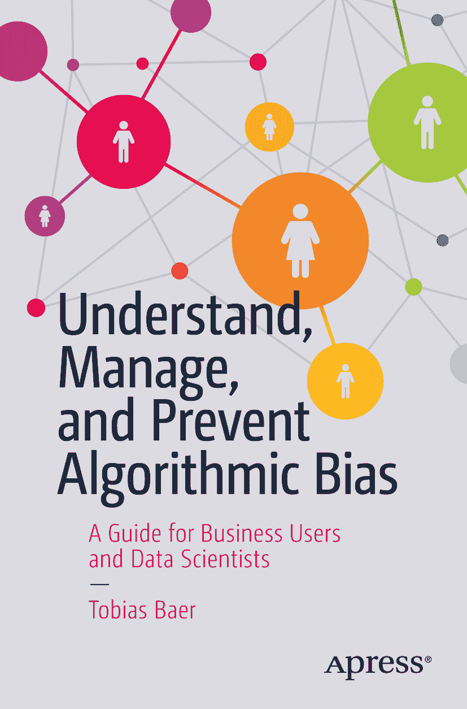

ISBN 978-1-4842-4884-3e-ISBN 978-1-4842-4885-0 [`doi.org/10.1007/978-1-4842-4885-0`](https://doi.org/10.1007/978-1-4842-4885-0) © Tobias Baer 2019 本作品受版权保护。出版商保留所有权利，涉及材料的全部或部分内容，特别是翻译、重印、重用插图、朗诵、广播、以缩微胶片或任何其他物理方式复制，以及传输或信息存储与检索、电子改编、计算机软件，或现在已知或以后开发的类似或不同方法。本书中可能出现商标名称、标识和图像。我们并非在每次出现商标名称、标识或图像时都使用商标符号，而是仅以编辑方式使用这些名称、标识和图像，以维护商标所有者的利益，且无意侵犯商标。本出版物中使用的商品名称、商标、服务标志和类似术语，即使未标明为商标，也不应被视为对其是否受专有权利保护的看法。尽管本书中的建议和信息在出版时被认为是真实准确的，但作者、编辑和出版商均不对可能存在的任何错误或遗漏承担法律责任。出版商对本书所含内容不作任何明示或暗示的保证。本书通过 Springer Science+Business Media New York 在全球图书贸易中发行，地址：233 Spring Street, 6th Floor, New York, NY 10013。电话：1-800-SPRINGER，传真：(201) 348-4505，电子邮件：orders-ny@springer-sbm.com，或访问 www.springeronline.com。Apress Media, LLC 是加利福尼亚州的有限责任公司，其唯一成员（所有者）是 Springer Science + Business Media Finance Inc (SSBM Finance Inc)。SSBM Finance Inc 是特拉华州的一家公司。

*致我伴侣脑海中的爱情算法——我至今仍未弄清楚是什么偏见导致他选择了我，但我认为这是他一生中犯下的最美丽的错误！*

前言

我为何要写这本书？关于算法偏见的文章已经很多了；令人不安的算法偏见例子比比皆是。然而，关于算法偏见实际成因的论述却少得多，而对于如何解决这个问题，要么完全预防算法偏见，要么以某种方式管理它们以防止危害，人们似乎知之甚少。这正是本书要探讨的内容。

本书注重实用性。它提供的解决方案，你明天就可以开始实施。有些行动可能需要一些时间才能完成或取得成果——但本书并非关于空泛的理论。书中有分步指南和检查清单，以及无数真实案例来阐明我的观点。但最重要的是，本书通过建议提出哪些具体问题，来鼓励批判性思维。

在我自己的建模和咨询工作中，对算法偏见的了解越多，我就越意识到这远不止是一个技术问题。是的，统计学既是算法偏见的部分根源，也提供了部分解决方案。然而，这个问题深深植根于人类心理学，如果我们不理解人类偏见，以及用户、数据科学家和整个社会的偏见如何产生并扩散决策偏见，我们就无法解决算法偏见。

因此，我不会直接跳入技术解决方案，而是会花时间解释算法偏见从何而来——以及这对对抗它们意味着什么。

而算法的（非技术）用户——例如企业经理和公务员——在对抗和预防算法偏见方面，拥有比他们可能认为的更大的力量。本书旨在赋能每个人，让大家能更好地应对算法偏见，并携手预防它。

## 本书读者对象

我们生活在一个所有人都受算法影响的世界，我们中的许多人都在使用算法，甚至可能没有意识到算法的存在。因此，我为所有人写了这本书。

数据科学家是开发算法的稀缺专家，因此在处理和预防算法偏见方面扮演着重要角色。因此，我希望许多、甚至所有数据科学家都能阅读本书——而本书最后、最技术性的部分甚至是专门为他们写的。

然而，大多数人并非数据科学家，许多人甚至厌恶统计学。因此，本书的写作考虑到了非专业人士。它使用非技术性语言、生动的类比，并试图通过大量运用幽默来保持趣味性。警告：你最终甚至可能会喜欢上统计学，至少是本书所投射出的那个带有偏见的形象……

随着算法偏见问题日益突出，合规官员和监管机构自然也开始探索它，并寻找防止其造成危害的方法。因此，本书不仅面向算法的实际开发者和用户——以及决定在何处以及如何使用算法的企业经理和公务员——也面向负责监督决策过程的合规官员和监管机构。

而且，正如我将要论证的，许多算法偏见是根深蒂固的社会偏见的镜像。因此，算法偏见问题是一个更宏大的问题，我也为政治家、记者和哲学家写了这本书，他们需要知道，算法既可以成为对抗社会偏见的解决方案，也可能成为问题——如果它们延续并放大了这些偏见的话。

最后但同样重要的是，这本书也是为火星人和齐塔网状星系人写的。你很快就会明白为什么！

## 本书非关何事

本书不是统计学教科书。它会为读者中的数据科学家（以及感兴趣的门外汉）提及无数统计技术——但不会解释它们。数据科学家大多已经了解这些技术，或者至少知道去哪里查阅。

本书也不是法律教科书。它确实在哲学层面探讨了法律和伦理问题——包括《欧洲通用数据保护条例》如何既认识到又忽略了一些关于算法的核心见解——但它的目的并非罗列所有与处理算法偏见相关的法律，或就如何遵守特定法律要求提供指导。这需要律师——理想情况下是那些也读过本书的律师。

最后，本书并非万能灵药。对抗偏见是困难的。从某种意义上说，偏见是一种从众——顺从于“事情本来的样子”，顺从于老板说的，顺从于数据说的，顺从于你懒惰的大脑说的（因为你一直这样做）。如果你不改变自己正在做的某些事情，那么阅读本书将不会给你带来任何好处。我邀请你持续思考本书的见解对你意味着什么，以及基于所学，你可以做出哪些不同的改变。事实上，我很乐意听到你的想法——为什么不在我的博客 [`www.linkedin.com/in/tobiasbaer/`](http://www.linkedin.com/in/tobiasbaer/) 上留言呢？如果你希望在读完本书、在书架上为它找到一个能积满过敏原灰尘的好位置后，防止所有好主意溜走并回到老路上，也许你现在就想在日历上设置一个提醒！

## 本书的组织结构

本书共分为四个部分。第一部分是引言，涵盖了人类偏见的心理学原理，以及算法是如何被使用和开发的。本部分的章节将解释我在本书其余部分会反复提及的术语和框架。

第二部分介绍了算法的六个不同来源。理解这些来源是管理和预防算法偏见的基础，因此本书其余部分将反复引用这部分内容。

第三部分讨论了算法的用户（广义上指任何非数据科学家的人）如何应对算法偏见，以及他们拥有哪些强大的可能性来预防偏见。

第四部分也是最后一部分，为数据科学家提供了全面且实用的指导，通过具体的开发和实施技术来预防算法偏见。因此，本书的这一部分技术性最强——但我仍然以这样一种方式撰写，使得从本科生到经验丰富的分析主管都能跟上并找到一些有价值的见解。

## 致谢

首先，我要感谢我的出版商希瓦·拉马钱德兰，提出撰写本书这个绝妙主意的功劳完全归功于他；还要感谢我的编辑丽塔·费尔南多，她不仅通过不懈的鼓励激发了我写作的潜能，还让我那些古怪的幽默得以保留。一切都怪她——我原本期待有更多成年人来把关！

我还要感谢宾夕法尼亚大学沃顿商学院统计系的保罗·沙曼教授（现已退休）。1999 年，我有幸作为访问学者与他共度了宝贵的两个月。他让我明白了运行脚本估算模型与理解数据之间的区别——我对数据所持的批判态度，很大程度上源于他的教诲。

最后，我要感谢克莱门斯·巴德尔，他慷慨地审阅了手稿，并且一直是我想法的绝佳共鸣板。

### 关于作者

