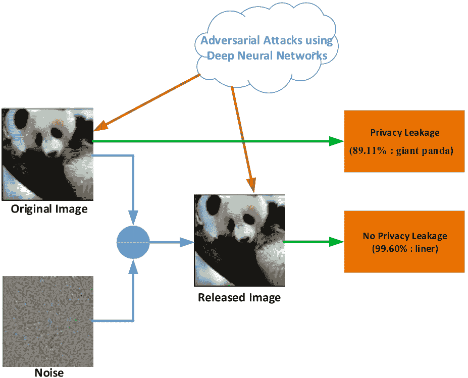
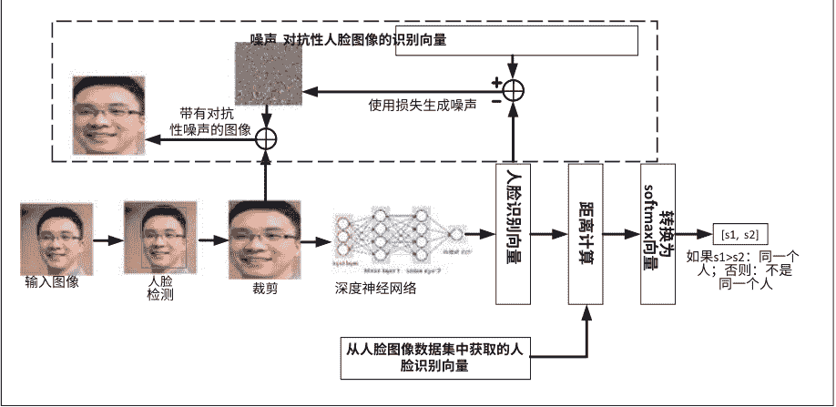

# 对抗性机器学习

## 攻击面、防御机制、人工智能中的学习理论

Aneesh Sreevallabh Chivukula · Xinghao Yang · Bo Liu · Wei Liu · Wanlei Zhou

Springer

### 攻击面、防御机制、人工智能中的学习理论

Aneesh Sreevallabh Chivukula · Xinghao Yang · Bo Liu · Wei Liu · Wanlei Zhou

Aneesh Sreevallabh Chivukula

BITS Pilani Hyderabad Campus

Department of Computer Science & Information Systems

Secunderabad, Hyderabad, Telangana, India

Xinghao Yang

计算机科学，悉尼科技大学

悉尼，新南威尔士州，澳大利亚

Bo Liu

计算机科学，悉尼科技大学

悉尼，新南威尔士州，澳大利亚

Wei Liu

计算机科学，悉尼科技大学

悉尼，新南威尔士州，澳大利亚

Wanlei Zhou

悉尼科技大学计算机科学

悉尼，新南威尔士州，澳大利亚

ISBN 978-3-030-99771-7

ISBN 978-3-030-99772-4 (电子书)

https://doi.org/10.1007/978-3-030-99772-4

© 编辑（如适用）和作者，独家许可给 Springer Nature Switzerland AG 2023

本作品受版权保护。出版商独家授权所有权，无论是整体还是部分材料，特别是翻译、重印、重用插图、朗诵、广播、微缩胶片复制或以任何其他物理方式复制，以及传输或信息存储和检索、电子适应、计算机软件或类似或不同的已知或今后开发的方法。

本出版物中使用的一般描述性名称、注册名称、商标、服务标志等并不意味着即使在没有特定声明的情况下，这些名称免于相关保护法律和法规的约束，因此可以自由使用。

出版商、作者和编辑可以安全地假设本书中的建议和信息在出版日期时是真实准确的。出版商、作者或编辑对本书中所含材料的任何错误或遗漏不提供明示或暗示的保证。出版商在发表的地图和机构归属方面保持中立。

这个 Springer 印记是由注册公司 Springer Nature Switzerland AG 出版的，注册公司地址是：瑞士 Cham 市 Gewerbestrasse 11 号。

## 前言

尽管深度学习取得了近期的进展，但机器智能与人类感知之间存在着显著的鲁棒性差距。深度学习不能被证明是安全的。深度学习面临的一个关键挑战是对恶意对手的安全攻击的脆弱性。即使对训练数据进行微小的扰动，也可以用来操纵深度网络的行为，产生意想不到的结果。例如，无人驾驶车辆等无人自主系统中的自主 AI 代理可以与学习算法进行多阶段的网络欺骗游戏。对抗性深度学习算法专门设计用于利用深度网络中的这些漏洞。通过在各种攻击场景下训练学习算法来模拟这些漏洞。攻击场景被假定为由智能对手制定。最优的攻击策略被制定为解决优化问题。这些攻击场景导致了在计算机视觉、自然语言处理、多维、文本和图像数据、序列数据和空间数据的对抗性攻击技术的发展。

在判别式学习模型中，通过深度神经网络计算训练数据特征和对抗数据特征之间的统计分歧度量来制定对抗学习问题。深度网络还可以搜索高维训练数据上的潜在空间，以构建对抗性示例。根据对手的目标、知识和能力，可以通过对深度学习中的损失函数进行先验知识、观察和实验来制作对抗性示例。已知对抗性示例可以在深度学习模型的数据特定流形之间传递。因此，在受到攻击的情况下，深度学习模型的预测性能是一个有趣的研究领域。

随机对抗算法可以通过在博弈论优化中进行效率、复杂度、可靠性、可学习性等权衡来扩展对歧视的对抗。可以使用自适应动态规划来研究博弈论最优解的收敛性质，从而为对抗性深度学习提供数值计算方法。现有的对抗性学习算法在设计假设、对手的知识、攻击策略、攻击影响和安全违规方面存在差异。

在本书中，我们进行文献综述，以提供对抗性学习与网络攻击之间关系的新见解。我们对比了机器学习模型中的对抗威胁和深度学习模型中的攻击向量的学习假设。我们还试图调查和总结对抗性深度学习网络中的非平稳数据表示和概念类别，以及每个应用领域中的敏感性景观和损失函数。对抗性深度学习网络的鲁棒性已经进行了调查，以产生对学习系统的防御的对抗性例子的分类，其中使用了博弈论的对抗性学习算法。

博弈论学习模型分析学习系统在动态优化中对抗性鲁棒性及其解决方案的稳定性，涉及对手的目标、假设、模型等。

然后我们回顾了在保护对抗性深度学习公式中使用博弈论、凸优化和随机优化的方法，通过提供算法比较总结了博弈论对抗性深度学习的理论和应用。另一个有趣的研究是针对部署在真实环境中的深度学习模型的防御机制。我们提出了针对数据分析模型在网络安全、深度学习和人工智能领域的对抗性学习应用的未来研究方向。它们可以实现对抗性深度学习与复杂系统的实际验证、数值近似和形式规范的集成。还总结了与对抗性损失设计相关的多任务学习和多目标优化等计算智能技术。因此，我们建议在博弈论模型中，通过形式和经验验证来限制攻击者在最优策略下的收益，以扩展到学习系统设计技术。

从数据隐私的角度来看，我们审查了隐私保护和物理世界攻击中的网络安全风险、威胁和漏洞。针对特定的深度学习算法、攻击和威胁，提供了检测和响应选项，以及复杂学习系统、对抗性深度学习、鲁棒优化和智能控制中的威胁。这些研究主题适用于具有隐私保护数据挖掘的弹性系统设计，以分析威胁数据、元数据和攻击模式。它还可以用于对抗性数据挖掘中共享信息的数据质量和来源的研究，以生成具有防御能力的物联网系统，该系统将安全算法与隐私系统相结合，以生成网络安全能力。然后，安全编排可以为可靠访问实际机器学习系统的互联网提供网络安全解决方案。

此外，我们将现有文献与最近的对抗性深度学习研究进行对比。我们研究了对抗性攻击对游戏理论学习模型的影响，包括进化对手、随机对手和变分对手，这些对手针对深度神经网络和卷积神经网络的误分类性能。我们的对抗性深度学习在网络空间安全分类问题中具有应用价值。

在训练阶段和测试阶段，这些学习问题研究特征操作、错误分类成本和对抗学习应用中的分布鲁棒性。最近的研究中的对抗损失函数和训练过程适用于深度学习在部署中的可信度研究。它们可以模拟计算算法设计和统计推断分析问题中的网络安全保障、风险和挑战。

本书适用于对抗性机器学习从业者和对抗性人工智能研究人员，他们在机器学习、深度学习、数据挖掘和知识发现算法设计中应用对抗性深度学习理论。特别强调对抗性深度学习在数据科学、大数据分析和网络安全解决方案开发中的实际应用领域。对抗性深度学习理论总结了计算算法在模式识别、博弈论、计算数学和数值分析方面的能力。由于博弈论机器学习的角度，结果分析算法、深度神经网络和对抗损失函数回顾了对抗算法的最新实现、攻击面、概念和方法。本书探讨了对抗性操作中的随机化与对抗性深度学习的黑盒优化中的泛化性之间的系统理论依赖。它有助于未来对对抗性深度学习算法在网络空间安全数据挖掘问题中的研究、设计、开发和创新。

该书还作为现有文献的参考，研究人员可以将其作为基准模型来实证比较相关的攻击场景和对抗深度学习的防御机制。回顾了已知的侵入技术及其对策，以开发未来的网络安全能力。机器/深度学习解决方案中的安全问题和漏洞主要存在于学习方法的深层数学公式和机制中。该书中对抗学习的博弈论公式利用深度学习和大数据来解决对学习判别基线进行数据操纵的对抗样本。必须构建多个这样的学习基线来生成对手的攻击假设，并提供用于调整判别学习决策边界的防御机制。因此，该书涵盖的研究问题可以为对抗性深度学习能力在网络对手的工具、战术、技术和程序（TTPs）中提供的策略和期望奠定基础。它们可以评估、优先考虑并选择针对安全检测/预防层的深度学习模型的高风险用例场景。

深度学习方法在学习和推理阶段的复杂性是普及的一个重要障碍，这使得理解和测试潜在的漏洞以及适当的缓解措施变得困难。在网络空间领域，从数据中学习进行决策仍然是一个当前而重要的挑战。

这个挑战还与针对机器/深度学习模型操纵结果的对抗性攻击的复杂性交织在一起。机器学习模型的弹性是可信赖的系统在网络安全和人工智能中的关键组成部分，但这一部分在主流安全研究和行业社区中的理解和研究还很有限。本书通过对对抗性学习的安全评估调查了机器学习算法的设计，以补充机器学习的性能设计范式。安全评估对于在动态学习环境中运行的对抗性学习模型算法根据定义的安全属性来减轻机器学习系统中的预测偏差是有用的。在攻击面周围形式化对抗性学习的假设，然后参考信号处理特性构建对抗性深度学习设计，以提高机器学习系统的鲁棒性属性。

本书从第1章开始回顾对抗性机器学习，并比较新方法与现有方法在博弈论对抗性机器学习方面的差异。第2章我们将我们的研究成果与相关文献进行对比，包括（i）对抗性安全机制和生成对抗网络，（ii）用于误导深度分类器和博弈论对抗性深度学习模型的对抗性示例，以及（iii）用于网络安全的迁移学习和领域适应的对抗性示例。

第3章介绍了对抗性深度学习中安全性和隐私权衡的攻击面。他们总结了学习系统中相互依赖、相互连接和相互作用的安全关键环境中的网络、物理、主动和被动攻击面。这些攻击面在互联网、社交网络、智能手机和物联网设备上的类型和功能上都在垂直方向上不断增加。自我保护和自愈威胁缓解策略中的自主安全性必须考虑到网络领域的这些攻击面，以识别威胁并选择适当的机器学习和数据挖掘方法进行对抗性学习。

第4章描述了博弈论对抗深度学习。我们的研究中的计算算法与博弈论文献中的随机优化技术进行了对比。通过示例展示了几种游戏形式，以构建用于对抗性数据挖掘的成本敏感对手。

在这项研究的决策问题中，对假设集进行适当的量化将引导我们进入各种功能问题、神谕问题、采样任务和博弈论对抗学习中的优化问题。然后，我们可以在可靠保证的对抗模型中发展样本复杂性理论、形式验证和模糊自动机。由此产生的采样动态适用于网络安全攻击场景和防御机制中的软匹配模式和特征嵌入的对抗信号处理。

从信息论的机器学习效率角度来看，这是对抗学习游戏中函数类的样本复杂性的研究，以将每个攻击场景设计为`黑盒攻击`，其中对手对深度学习训练过程及其最佳响应策略没有先验知识。

第5章介绍了对抗性深度学习的理论和算法。这些算法还可以用于检查学习系统的规范一致性和适用性，将攻击数据与规范合并，并将其硬化为具有脆弱性评估指标、协议和对策融合的新的对抗性学习模型。我们研究中提出的基于博弈论的对抗性深度学习的对抗攻击的示例应用在第6章中介绍。我们的工作涉及统计垃圾邮件和自主系统应用于图像和视频。但是我们在几个真实世界领域的网络安全分析应用中发现了对抗性深度学习的文献。例如，它适用于密码分析、隐写分析、物联网恶意软件、合成数据生成器、网络安全、生物特征识别、目标检测、虚拟助手、网络物理控制系统、钓鱼检测、计算红队、自然语言生成等。但是，对抗性数据挖掘的数据分析结果并不总是以博弈论建模和优化的方式表达，尽管博弈论为对抗性深度学习中的生成-判别建模提供了出色的抽象，但在机器学习的浅层架构中是难以处理的。

第7章讨论了在隐私增强技术中利用对抗性学习的应用。通过为每个威胁代理定义信任、弹性和敏捷本体，隐私保护数据挖掘技术可以扩展我们在博弈论对抗性深度学习方面的研究，以符合合同、法定和监管要求，关于在机器学习中使用计算和互联网技术的隐私设计范式。我们可以生成安全性和可靠性度量本体，以反映对抗性系统在隐私功能、性能、可靠性以及安全成本和复杂性、透明度和公平性、可解释性和可解释性方面的质量，以建模多向量、多阶段和混合杀杀链策略中的对抗性人工智能代理。

在博弈论中解决计算困难以测量效用和相关信息损失，以提供满足轻量级、异构、早期攻击检测、高可用性、高准确性、高可靠性、容错性、弹性、鲁棒性、可扩展性和能源效率的安全服务提供。这样的对抗性人工智能代理可以发现新的攻击并学习如何更好地应对网络安全威胁，就像智能扫描仪、防火墙、反恶意软件、智能间谍工具和自主武器一样。

Aneesh Sreevallabh Chivukula，印度泰伦加纳邦海得拉巴 Secunderabad
杨兴豪，中国山东青岛
刘波，澳大利亚新南威尔士州悉尼
刘伟，澳大利亚新南威尔士州悉尼
周万雷，澳大利亚新南威尔士州悉尼

## 目录

1 对抗性机器学习
    - 1.1 对抗性学习框架
        - 1.1.1 对抗性算法比较
    - 1.2 对抗性安全机制
        - 1.2.1 对抗性示例分类
    - 1.3 对抗性深度学习中的随机博弈示例
2 对抗性深度学习
    - 2.1 监督机器学习的学习曲线分析
    - 2.2 用于判别学习的对抗性损失函数
    - 2.3 深度网络中的对抗性示例
    - 2.4 用于误导分类器的对抗性示例
    - 2.5 `生成对抗网络`
    - 2.6 用于对抗性学习的`生成对抗网络`
        - 2.6.1 因果特征学习和对抗性机器学习
        - 2.6.2 可解释的人工智能和对抗性机器学习
        - 2.6.3 对抗中的斯塔克伯格博弈示例深度学习
    - 2.7 用于领域适应的迁移学习
        - 2.7.1 迁移学习中的对抗性示例
        - 2.7.2 领域适应中的对抗性示例
        - 2.7.3 网络安全领域中的对抗性示例
3 对抗性攻击面
    - 3.1 对抗性学习中的安全与隐私
        - 3.1.1 线性分类器攻击
    - 3.2 特征加权攻击
    - 3.3 毒化支持向量机
    - 3.4 鲁棒分类器集成
    - 3.5 鲁棒聚类模型
    - 3.6 鲁棒特征选择模型
    - 3.7 鲁棒异常检测模型
    - 3.8 鲁棒任务关系模型
    - 3.9 鲁棒回归模型
    - 3.10 网络安全中的对抗性机器学习
        - 3.10.1 对抗性深度学习的敏感性分析
4 博弈论对抗性深度学习
    - 4.1 博弈论学习模型
        - 4.1.1 博弈论基础
        - 4.1.2 博弈论数据挖掘
        - 4.1.3 成本敏感的对手
        - 4.1.4 对抗性训练策略
    - 4.2 博弈论对抗性学习
        - 4.2.1 游戏中的多级和多阶段优化：理论上的对抗学习
    - 4.3 博弈论对抗深度学习
        - 4.3.1 学习模型的整体结构：变分博弈
        - 4.3.2 我们方法与 `GAN` 的区别
        - 4.3.3 博弈论对抗的比较：深度学习模型
        - 4.3.4 单次游戏攻击与多次游戏攻击的比较：针对自定义损失函数的多次游戏攻击
        - 4.3.5 降低游戏中的并行机器
    - 4.4 预测建模中的随机游戏
        - 4.4.1 计算学习理论框架用于分析博弈学习算法：特征袋训练一个概率模型，作为几个基本模型的算术或几何平均值
        - 4.4.2 博弈论对抗深度学习：信息战应用中的算法

# 4 博弈论对抗深度学习：网络安全应用中的算法 132

## 4.5 对抗性学习游戏中的鲁棒博弈理论 137

### 4.5.1 博弈论的存在性和唯一性：均衡解 140

### 4.5.2 最优控制理论和鲁棒博弈论 144

## 5 针对监督学习的对抗性防御机制 151

### 5.1 保护分类器免受特征攻击 152

### 5.2 带有正则化器的对抗性分类任务 154

### 5.3 对抗性强化学习 157

#### 5.3.1 对抗性强化学习的博弈论方法 164

### 5.4 计算优化算法在游戏中的应用：理论上的对抗学习 167

#### 5.4.1 博弈论学习 168

#### 5.4.2 生成式学习 179

### 5.5 对抗性机器学习中的防御机制 216

#### 5.5.1 对抗性深度学习中的防御机制 221

#### 5.5.2 对抗性可解释人工智能深度学习 229

## 6 图像和文本的物理世界对抗性攻击 239

### 6.1 图像的对抗性攻击 239

#### 6.1.1 基于梯度的攻击 241

#### 6.1.2 基于分数的攻击 242

#### 6.1.3 基于决策的攻击 243

#### 6.1.4 基于转换的攻击 244

### 6.2 文本的对抗性攻击 245

#### 6.2.1 字符级攻击 247

#### 6.2.2 句子级攻击 248

#### 6.2.3 词级攻击 249

#### 6.2.4 多层级攻击 251

### 6.3 垃圾邮件过滤 252

#### 6.3.1 文本垃圾邮件 252

#### 6.3.2 图像垃圾邮件 253

#### 6.3.3 生物特征垃圾邮件 254

## 7 用于隐私保护的对抗性扰动 255

### 7.1 用于隐私保护的对抗性扰动 255

#### 7.1.1 视觉数据隐私模型 256

#### 7.1.2 使用隐私保护机制：对抗性扰动 257

#### 7.1.3 讨论和未来工作 263

# 参考文献 265

## 图表列表

- 图1.1 对手和反应性和积极性的竞争学习者 12
- 图1.2 展示了一个博弈论学习者的好处流程图。这个双人游戏由一个对手和一个学习者进行。游戏产生一个最终的深度学习网络 CNN，它比初始的深度学习网络更适合处理对抗性操作。学习网络 CNN 的原始版本 13
- 图2.1 对抗性损失函数的训练过程 17
- 图2.2 自定义损失函数的学习曲线 18
- 图2.3 展示了基于对抗性自编码器的流程图：Stackelberg 博弈理论建模 37
- 图4.1 展示了变分 Stackelberg 博弈的流程图：理论上的对抗性学习 103
- 图6.1 展示了从 [589] 中成功的对抗性示例，以误导 AlexNet [332]。这些扰动对人类视觉系统几乎是不可察觉的，但 AlexNet 将对抗性示例预测为“鸵鸟，鸵鸟，骆驼”。 240
- 图7.1 基于 AP 的系统架构示例：文件级隐私保护 257
- 图7.2 文件级隐私保护结果示例（噪声颜色通过归一化放大，否则它们将很难看到） 259
- 图7.3 基于 AP 的对象级隐私保护算法框架 259
- 图7.4 典型人脸识别系统及生成对抗性图像扰动的过程 262

## 表格列表

- 表格1.1 对抗算法比较1 6
- 表1.2 对抗算法比较2 8
- 表2.1 生成对抗网络比较1 28
- 表2.2 生成对抗网络比较2 30
- 表2.3 生成对抗网络比较3 32
- 表2.4 生成对抗网络比较4 34
- 表6.1 不同攻击方法的属性总结。属性为：T 有目标攻击，U 无目标攻击，W 白盒攻击，B 黑盒攻击和 G 灰盒攻击。 245
- 表6.2 通过字符级攻击、句子级攻击和单词级攻击策略生成的三个成功的对抗性文本示例 246
- 表6.3 不同文本攻击方法的属性总结。这些属性包括：T 目标攻击，U 非目标攻击，W 白盒攻击和 B 黑盒攻击 252

## 第1章 对抗性机器学习

本章将通过博弈论对机器学习中的机器智能和人类感知之间的鲁棒性差距进行研究。在本章中，我们将进行文献综述，以提供对对抗性学习与网络安全之间关系的新见解。我们将调查和总结机器学习模型学习到的非平稳数据表示。将调查建模的鲁棒性，以产生对对抗性示例和对抗性算法的总结。

我们还将调查凸优化、随机优化和进化计算在对抗性深度学习公式中的应用。另一个有趣的研究是在实际环境中部署的深度学习模型的防御机制。

数据挖掘是从数据库中自动学习数学模式的研究。它是一个知识发现的过程，需要开发计算算法 [182] 来预处理、建模和后处理给定数据库系统的数据。然而，这些算法的设计必须基于机器学习范式。机器学习范式是基于一些潜在统计假设的计算学习模式，例如训练数据中的人类监督水平或数据的潜在分布。示例范式包括监督学习、无监督学习、半监督学习、强化学习、元学习和深度学习。

一个标准的统计假设，称为平稳性假设，是模型用于学习数学模式的训练数据和用于评估其识别这些模式能力的测试数据是从相同的概率分布中独立同分布 (i.i.d) 的随机变量中采样的。然而，在大多数实际应用中，平稳性假设并不成立；训练和测试数据很少完全共享相同的分布，并且往往不是独立同分布的。因此，对于非平稳数据分析的鲁棒学习范式已成为对抗学习中的一个目标。

对抗性学习在垃圾邮件过滤、病毒检测、入侵检测、欺诈检测、生物特征认证、网络协议验证、计算广告、推荐系统、社交媒体网络挖掘、复杂系统性能建模等领域有应用 [31, 56]。

对抗性学习算法专门设计用于利用给定机器学习算法中的漏洞。这些漏洞通过在各种攻击场景和策略下训练学习算法来模拟。攻击场景被假定由一个智能对手 [285] 制定，最优的攻击策略是能够解决一个或多个攻击场景上的一个或多个优化问题。需要注意的是，不同的对抗性学习算法在对手的知识、安全违规、攻击策略和攻击影响方面的统计假设可能不同 [63]。

因此，一个被设计用来抵消攻击的学习算法变得对该攻击具有鲁棒性；它的漏洞不再容易受到攻击。因此，对抗性学习的目标可以被看作是在搜索和优化算法中寻找解决方案，以防御攻击场景中的目标函数。一旦找到这些解决方案，它们可以被纳入许多机器学习算法的设计中，作为防御机制来防范攻击。

深度学习是指一类特定的神经网络算法。这些算法在分层架构中进行多个阶段的非线性信息处理，用于模式分类和特征学习 [156]。深度学习研究旨在发现多个数据抽象层次上的机器学习算法。

发现高维数据的深度学习易受到对抗性攻击的影响。这些攻击是通过对深度学习模型中的损失函数进行先前知识、观察和实验来制作的 [226]。对深度学习损失函数的设计进行系统研究，以抵御对手是一个新颖且实用的研究领域。此外，对数据驱动的损失函数进行统计误差分析时，必须考虑模型受到攻击时的优化目标之间的冲突，例如准确性、可扩展性、运行时间和基础数据分布的多样性。

在深度学习的多个机器学习范式的背景下，损失函数已经被定义。在监督学习中，损失函数被定义为类别概率估计的拟合准则 [92]。在统计学习中，损失函数被定义为训练数据中经验风险的最小化者 [524]。在计算学习中，损失函数被认为通过计算分类错误的期望概率来最小化贝叶斯决策规则的预测器 [415]。

基于能量的学习模型 [349, 350] 是一种统计推断 and 计算学习的理论框架，其特征是损失函数。

在判别学习损失函数中的对抗学习问题通常是使用训练数据特征和对抗数据特征之间的统计分歧度度量来定义的。高维训练数据上的潜在空间也可以通过深度网络进行搜索以构建对抗性示例。根据对手的目标、知识和能力，对抗性示例也可以通过对深度学习中的损失函数进行先验知识、观察和实验来制作。

因此，现有的对抗性学习算法在设计假设、对手的知识、攻击策略、攻击影响和安全违规方面存在差异。此外，已知对抗性示例可以在机器学习模型的特定数据流形之间转移。因此，深度学习模型在受到攻击时的预测性能是一个有趣的研究领域。

对抗攻击技术存在于计算机视觉、自然语言处理、多维、文本和图像数据、序列数据和空间数据的网络安全中。这些问题研究了深度学习模型中的特征操作、错误分类成本和分布鲁棒性的错误规范。由此产生的机器学习算法在网络安全、恶意软件分析、反欺骗技术、稀有模式挖掘、不平衡分类、超出分布范例检测、概念漂移和模式挖掘中具有应用。相关的对抗性损失函数和训练过程适用于评估深度学习部署的可信度。它们可以模拟计算优化和统计推断问题，作为网络安全保障、风险和挑战的计算问题。生成和解释对抗性数据操作可以研究深度学习算法偏见的影响。此外，它可以成为围绕对抗性机器学习发展的鲁棒优化理论的媒介。

在图像处理和计算机视觉中，数据溯源在战略情报中检测篡改图像方面具有应用。

对于可疑图像的起源问题在互联网上的深伪造增加后变得更加突出。深伪造是能够在互联网上生成假新闻和假证据的深度学习网络。它们在在线社交媒体和搜索引擎领域引起了公众关注。由于虚假数据造成的错误信息威胁可能会针对信息链中的最薄弱环节进行篡改。它们可以在选举期间用于操纵公众舆论，抹黑和敲诈人们。必须提供识别合成媒体的新方法，以供浏览器扩展和分析工具集使用。进一步对图像中的对象进行扰乱的对抗性攻击可能会干扰计算机视觉结果，增加错误分类率并传播虚假信息。深伪造在创意艺术、广告、电影制作和视频游戏领域中具有应用。

它们可以影响涉及音视频操纵的证据政治在证人证词中。它可以在互联网上重新上下文化、重新解释和广播。Nguyen等人[460]对创建深度伪造内容的深度学习模型进行了调查。Carlini等人[103]提出了一种构建神经网络鲁棒性边界的方法，这些网络必须应对旨在误导图像分类采取不必要行动的对抗性示例。

将数据溯源整合到机器学习中，将为知识发现创建稳健、可扩展和可推广的方法，可以支持对数字媒体的真实性进行认证，以在对抗性训练中获得准确可靠的结果。可解释的人工智能是推进数字媒体取证和预测技术的机器学习研究领域。在机器学习中，用于数据驱动决策的鲁棒模型假设存在不完美的信息可用于学习系统参数和优化概率在不确定数据和错误估计上的分布。在鲁棒优化中，机器学习特征的随机变量被建模为属于凸不确定性集合的不确定参数，并且决策者在该集合中保护机器学习系统免受最坏情况的影响。数据驱动的优化目标使用随机变量的观测值作为数学规划问题的训练输入。鲁棒决策制定涉及随机规划和在概率约束下的优化。

鲁棒优化问题也可以作为具有对抗鲁棒性的特征工程的风险规避问题进行研究。

对抗性数据操作的深度生成建模研究生成建模和潜在变量中的因果归因之间的依赖关系。它在计算机视觉任务中应用作为物理系统中的控制流水线，其中生成鲁棒的物理扰动的主要挑战是环境的变异性。

## 1.1 对抗性学习框架

传统的机器学习模型假设训练数据样本、测试数据样本和验证数据样本遵循相同、独立和相同分布的数据分布。这种假设在面对具有恶意意图的智能对手的攻击时，会给机器学习模型带来安全漏洞。在给定训练数据样本的情况下，这些对手设计对抗性示例来增加模型错误。保护学习系统免受此类对抗性示例的影响是人工智能、安全诊断、生成学习、深度学习、信息安全、自主系统、智能系统和数据分析领域的研究热点。

只要对手的攻击在学习模型完成训练之后计划好，并且无法对新样本做出反应，对抗性示例就可以误导学习模型。基于这一观察，对抗性算法将对手纳入学习模型的训练过程中。因此，对抗性算法将对抗性机器学习建模为两个代理之间的交互——学习模型和一个或多个智能对手。

博弈论提供了一个框架，用于研究学习模型（或简称为学习者）和智能对手（或简称为对手）之间的交互，这是学习者和对手的演化策略之间的交互。博弈论交互最初在生命科学中被制定为非线性微分方程，用于研究生物系统群体之间的相互作用。

在机器学习中，损失函数量化了信息不确定性对分析预测分布的影响。对抗性算法为训练过程制定了机器学习损失函数，以防止模型在存在理性、适应性对手模拟对学习环境的不断变化时过度拟合训练数据。

在博弈论的对抗性学习中，通过在对手的策略空间中设计机器学习算法来生成对抗性示例。对抗性操纵的最佳攻击策略被建模为解决（通常是非线性和非凸）优化问题的解。

对抗性示例很难检测，因为在有限数据上训练的机器学习模型需要对每个可能的输入产生预期的输出。强化学习代理也可以被对抗性示例操纵，导致在微妙到人类无法察觉的扰动下性能下降。

在下面的文献综述中，我们提供了现有对抗性机器学习算法的概述，每种算法在攻击场景和防御机制上都有所不同，用于部署可靠的数据分析系统和强大的模式识别系统。我们还总结了游戏理论对对抗性学习和对抗性强化学习在软件推理和决策制定方面的最新技术。

### 1.1.1 对抗性算法比较

本节介绍了对抗性学习算法的文献综述和攻击分类。对抗性算法在算法设计和算法应用方面总结在表1.1和1.2中。这些算法主要通过对抗成本函数（或简称成本函数）进行比较。成本函数是在存在对手的情况下学习算法的预期性能度量。对于不同的对抗性学习算法，成本函数的表达方式不同。

表格的列列出了用于比较对抗性学习算法的各种特征。我们的算法被称为“博弈论：深度学习”。表格的行列列出了进行比较的各种算法。在行方向上，我们列出了在特征提取、深度学习、支持向量机和分类器集成方面容易受到对抗数据攻击的计算模型，其中用于模拟对抗攻击的输入数据为文本垃圾邮件、图像垃圾邮件和生物特征垃圾邮件。这些算法在成本函数、搜索算法、收敛条件、攻击策略、攻击影响、安全违规、对手的知识、算法移动和学习游戏等方面进行比较。“成本函数”是解决对抗数据的目标函数。“搜索算法”是用于寻找最优解的算法。“收敛条件”是创建对抗数据的搜索准则。“攻击策略”是对手操作下的攻击场景。攻击策略的“攻击影响”确定对手对训练数据和测试数据输入到学习算法的访问权限。

“安全违规”是对手攻击的目的。“对手的知识”是对手的语义信息。“算法移动”是学习算法为了适应对抗性数据操纵而采取的行动。从表中可以看出，大部分现有的研究工作在成本函数中没有添加博弈论的公式。因此，大部分现有的学习算法无法适应连续的对抗性数据操作。如图“学习游戏”所示，它是唯一一个在深度学习模型中输入基于博弈论的训练和测试数据分布的对抗性学习算法。

## 表1.1 对抗性算法比较1

| 对抗性算法 | 成本函数 | 搜索算法 | 收敛条件 | 攻击策略 | 攻击影响 | 安全违规 | 对手的知识 | 算法移动 | 学习游戏 |
| :--- | :--- | :--- | :--- | :--- | :--- | :--- | :--- | :--- | :--- |
| 分类器集成 [59] | $E = 2 - \frac{2}{n} \sum_{k=1}^n F(k), F(k) = \frac{\sum_{i=1}^k \|w_i\|}{\sum_{j=1}^n \|w_j\|}$. (1.1) | 随机抽样 | 集成大小，特征子集大小 | 按重要性重新排序特征以进行判别函数 | 因果关系 | 有针对性的，可用性 | 训练特征 | 平均判别函数 | 无 |
| 特征加权 [321] | $\frac{\gamma}{2} w^T w + \frac{1}{m} \sum_{i=1}^m l(w^T(S^{-1} x), y),$ <br> $l(f, y) = \max(0, 1 - yf).$ (1.2) | 特征抽样 | 基本模型数量 | 添加/删除二进制特征 | 因果关系 | 不区分的，可用性 | 训练特征 | 平均估计权重 | 无 |
| 支持向量机：输入 [65] | $\max_{x_c} L(x_c) = \sum_{k=1}^m (1 - y_k f_{x_c}(x_k))$ <br> $\frac{\partial L}{\partial u} = \sum_{k=1}^m M_k \frac{\partial Q_{sc}}{\partial u} + \frac{\partial Q_{kc}}{\partial u} \alpha$ . (1.3) | 梯度上升 | 测试误差的变化 | 训练噪声注入 | 因果关系 | 有针对性的，完整性 | 损失的梯度 | 增量学习支持向量机 | 无 |
| 支持向量机：标签 [664] | $L(D_{tr}) = \text{argmin}_{f \in F} [\Omega(f) + C \cdot \hat{R}(f, D_{tr})],$ <br> $\hat{R}(f, D_{tr}) = \frac{1}{n} \sum^n$ (1.4) <br> $V_L(D_{tr}, D_{vd}) = f_{D_{tr}}^2 + C \cdot \hat{R}(f_{D_{tr}}, D_{vd}),$ <br> $f_{D_{tr}} = L(D_{tr}), V_L(z, y) = V_L((x_i, z_i), (x_i, y_i)).$ | 梯度上升 | SVM边界支持向量通过LP和QP | 标签噪声注入 | 因果关系 | 有针对性的，完整性 | 训练标签 | 更新SVM权重和超平面 | 无 |
| 深度学习 [227] | $J(\theta, x, y) = \alpha J(\theta, x, y) + (1-\alpha) J((\theta, x + \epsilon \operatorname{sign}(\nabla_x J(\theta, x, y))))$. (1.7) | 使用L-BFGS的反向传播 | 在对抗验证集上的早停止错误 | 对进行线性扰动 | 因果关系 | 有针对性的、完整性 | 训练和测试数据 | 更新决策函数参数 | 无 |
| 对抗性网络：DNN [480] | $S_{p+1} = x + \lambda_{p+1} \operatorname{sgn}(J_F[\hat{O}(x)]) U S_p,$ <br> $\hat{O}(x) = \operatorname{argmax}_{j=0 \dots N-1} O_j(x),$ <br> $\delta_x = \epsilon \operatorname{sgn}(x_c(F, x, y)),$ (1.6) <br> $c(F, x, y) = p(y = 1\|x) = \exp((x-\mu)^T \beta(x-\mu)),$ <br> $F(x) = f_n(\theta_n, f_{n-1}(\theta_{n-1}, \dots f_2(\theta_2, f_1(\theta_1, x))))$. | 基于雅可比矩阵的数据集增强 | 在对抗验证集上的早停止错误 | 观察由对手选择的输入时的 DNN 输出 | 探索性 | 有针对性的、完整性 | 测试数据 | 基于雅可比矩阵的正则化和蒸馏 | 无 |

## 表1.2 对抗算法比较2

| 对抗性算法 | 成本函数 | 搜索算法 | 收敛条件 | 攻击策略 | 攻击影响 | 安全违规 | 对手的知识 | 算法移动 | 学习游戏 |
| :--- | :--- | :--- | :--- | :--- | :--- | :--- | :--- | :--- | :--- |
| 对抗网络: `DAE` [238] | ``` $J_{DCN}(\theta) = \sum_{i=1}^m (L(t^i, y^i) + \sum_{j=1}^{H+1} \lambda_j \|\frac{\partial h_j^i}{\partial h_{j-1}^i}\|_2)$ (1.7) ``` | 将`DAE`堆叠成前馈神经网络 | 训练误差 | 高斯加性噪声 | 探索性 | 不区分的, 可用性 | 测试数据 | 惩罚函数平滑对抗数据 | 无 |
| 博弈论: 正则化损失[385] | ``` $\min_{r,c} |r|_2 + L(x + r, l)$. (1.8)<br>$\max_\alpha \min_w -\lambda \alpha^T \alpha + \lambda w^T w + C \sum_{i=1}^n Loss(y_i, w^T(x_i + \alpha))$. ``` | 信任区域 | 对手的收益不增加或达到最大迭代次数 | 将正样本移向负样本 | 因果关系 | 有针对性的, 可用性 | 训练和测试数据 | 通过正则化损失函数重建分类器 | 零和游戏 |
| 博弈论: 稀疏攻击 [628] | ``` $\min_{w \in R^d} |y - Xw|_2 + \sum_{i=1}^d \lambda_i |w_i|_1$. (1.9) ``` | 最小预算 | 累积成本超过最小预算 | 选择影响估计权重的特征 | 因果关系 | 不区分的, 隐私 | 估计权重 | 鲁棒正则化 | 非零和游戏 |
| 博弈论: 支持向量机 [220] | ``` $\frac{1}{2}|w|^2 + C \sum_i [1 - y_i w^T x_i + t_i]$ (1.10)<br>$t_i \ge Kz_i + \sum_j v_{ij}$<br>$t_i \ge Kz_i + \sum_j v_{ij}$<br>$v_i \ge 0$<br>$z_i + v_i \ge (y_i x_i w)$. ``` | 二次规划 | 训练误差受正则化项限制 | 从不同数据点中删除不同的特征 | 因果关系 | 有针对性的, 完整性 | 训练特征 | 参数正则化 | 非零和游戏 |
| 博弈论: 深度学习 (我们的方法) | ``` $Maxmin : (\alpha^*, w^*) = \text{argmax}_{\alpha \in A} J_L(\alpha, \text{argmin}_{w \in W} J_L(\alpha, w))$. (1.11) ``` | 进化算法 | 纳什均衡 | 将正样本移向负样本 | 因果关系 | 有针对性的, 完整性 | 训练数据 | 更新估计的权重以进行对抗性操作 | 常数和游戏 |

### 1.2 对抗性安全机制

除了表1.1和1.2之外，现有的对抗性学习算法和它们的应用领域还可以通过学习者的防御机制和相应的对手的攻击场景进行分类[33, 59, 63, 531]。通过设计安全学习算法[63]、多分类器系统[59]、隐私保护机器学习[531]以及使用随机化或虚假信息来误导对手[33]，提出了学习者的防御机制。

Biggio等人[63]讨论了学习者的防御机制，这些机制在Duda等人[166]的模式分类的模型选择和性能评估步骤的基础上进行了扩展的经验框架。该框架建议通过“安全设计”而不是“安全混淆”来训练学习者。该框架建议在攻击下验证所提出的防御机制时，采取以下额外步骤，包括生成学习模型和判别学习模型：

- 通过模拟潜在的攻击场景，积极预测最相关的对抗性攻击。
- 根据对手的目标、知识和能力来定义攻击场景。
- 提出一个基于条件概率的生成数据分布模型，可以正式考虑大量潜在的攻击和训练数据和测试数据的交叉验证样本。

关于学习算法的安全性做出以下假设。然后，根据Biggio等人[63]提出的框架，模型性能在模拟的最优攻击策略下进行评估：

- 对手的目标被定义为优化目标函数。目标函数是根据所需的安全违规（即完整性、可用性或隐私）和攻击特异性（从有针对性到无差别）设计的。
- 对手的知识被定义为对分类器组件的了解，即训练数据、特征集、学习算法、决策函数及其参数、可用性和反馈。
- 对手的能力被定义为对训练数据和测试数据的控制，考虑到应用程序特定的约束，如攻击影响（无论是因果还是探索性）、对类别先验的影响、样本的比例以及对手操纵的特征。

根据对手的目标、知识和能力，这些假设也可以根据攻击影响、安全违规和攻击特异性进行分类：

- 攻击的影响可以是因果关系或探索性的。因果攻击影响训练和测试数据。探索性攻击只影响测试数据。
- 安全违规可以针对学习者的完整性、可用性或隐私。一个完整性受损的机器学习算法无法检测到对手的恶意行为。一个有很多假阴性的算法的完整性会受到损害。一个可用性受损的机器学习算法对合法用户的性能严重下降。一个有很多假阳性的算法的可用性会受到损害。一个详细反馈被公开的算法的隐私也会受到损害。
- 攻击的特异性可以是针对预测或算法行为的有针对性或无差别的。在有针对性的攻击中，攻击只针对少数训练或测试数据实例。在无差别攻击中，攻击针对整个类别的实例或对象。

我们的对抗算法具有因果攻击影响、完整性安全违规和有针对性的攻击特异性。

典型的对手攻击场景包括（i）向特征/标签添加噪声，（ii）添加/删除特征/标签，（iii）对数据分布进行轻微更改或操纵或扰动，以及（iv）对决策边界进行轻微更改。

相应的优化问题使用搜索算法和采样梯度方法来解决。采样方法包括增量采样、装袋采样、堆叠采样和随机采样。梯度方法包括线性方法、二次方法、凸方法和随机方法。这些优化问题的解决方案是通过收敛条件来确定的，这些条件包括（i）特征数量，（ii）正则化项数量和（iii）在训练/测试数据上估计误差的变化。

我们的对抗算法会对由随机优化和随机采样方法模拟的数据分布进行轻微更改。我们的优化问题会收敛到在`Stackelberg`博弈中计算得到的纳什均衡解。从对手的角度来看，在最坏情况下的攻击场景中，均衡解是局部最优解，在最好情况下的攻击场景中，均衡解是全局最优解。我们的攻击场景的强度和相关性取决于深度学习模型在受到攻击时的性能。

#### 1.2.1 对抗性示例分类

Papernot等人[482]提供了一个威胁模型，总结了对抗性学习算法中的各种攻击场景。然后，对抗分类器的防御机制应该改善模型对验证数据样本的鲁棒性。在这里，验证数据样本被部署到训练模型的运行时数据分布中，与训练模型的测试数据样本在分布上不一致。

Papernot等人[482]用机器学习威胁模型的步骤来表达，在机器学习训练过程中和机器学习推理过程中发现对抗性操作。在机器学习训练过程中，对手应该操纵在线数据收集过程或离线数据收集过程。这种对抗性操作要么注入对抗性示例，要么修改训练数据，以修改学习模型的决策边界。在机器学习推理过程中，对手应该对学习模型的参数进行黑盒攻击或白盒攻击。这种攻击设置导致训练和运行时数据分布之间的分布漂移。

Papernot等人[482]也通过机器学习安全的保密性、完整性和可用性模型来看待机器学习安全问题，其中对手分别针对分类器的参数、标签和特征。与机器学习安全相比，机器学习隐私是以模型性能来探讨的，当(i)训练和运行时数据分布不同，(ii)学习模型暴露的数据量受到差分隐私预算的限制，以及(iii)学习模型防御措施提供公平性、可解释性和透明性的学习输出。

对抗性学习的无偏差定理将对抗环境对模型复杂性、模型准确性和模型弹性的影响进行了规定。Papernot等人[482]还在机器学习推理中提出了概率近似正确(`PAC`)学习框架下的博弈论对抗学习的动机。

Biggio等人[68]对模式分类器的对抗性机器学习进行了调查。模式分类器的对抗性示例被认为是在训练时间或测试时间创建的。还讨论了在计算机视觉和网络安全中针对深度网络应用的对抗性示例的最新研究。在训练时间的攻击场景被称为污染攻击，而在测试时间的攻击场景被称为逃避攻击。为了与深度学习术语相结合，污染攻击也被称为对抗性训练攻击，而逃避攻击也被称为对抗性测试攻击。然后讨论了在受到攻击的模式分类器的安全评估和防御机制。在这里，还提出了一种积极的安全设计学习模型，将对手设计纳入学习过程中。

Biggio等人[68]将对手设计分为优化问题求解，以攻击场景中对手目标、对目标学习系统的了解以及对输入数据的操纵能力定义最佳攻击策略。在这种对手设计进行各种假设的情况下，最优攻击策略不仅适用于监督学习算法，还适用于无监督学习算法，如聚类算法和特征选择算法。对手的目标进一步分为(i)违反学习系统的完整性、可用性和隐私的安全违规和(ii)攻击特异性和错误特异性，导致错误分类。

图1.1 对手和学习者之间的反应性和积极性的竞争

对于特定样本集和特定类别集的攻击分别进行了分类。在这里，对目标学习系统的了解进一步分为以下几类：

- 具有完全了解学习参数的完全知识白盒攻击。在这种情况下，安全评估提供了攻击场景中性能下降的上限。

## 灰盒攻击与黑盒攻击

- 具有关于特征表示和学习算法的先前知识但没有训练数据和学习参数的有限知识灰盒攻击。在这里，安全评估是在一个可用于训练数据的类似数据源上学习的替代分类器上进行的。然后，对替代分类器的对抗性示例进行测试，以评估攻击场景在学习算法之间的可转移性。

- 没有任何关于学习算法的知识，但具有特征表示和训练数据分布的部分知识的零知识黑盒攻击。在这里，安全评估检查最优攻击策略是否在最优训练的替代模型和目标分类器模型之间转移。可以使用对分类器决策的强化反馈来改进替代模型。

Biggio等人[68]还通过应用特定的数据操作约束对输入数据分布、特征和类别进行了对手知识的分类。

还提供了对手最佳攻击策略和分类器安全评估曲线的高级公式。这样的安全评估考虑了神经网络和决策树等可微分和不可微分的学习算法。这里对深度网络的敏感性分析是将最小扰动训练样本的现象定义为敏感性分析，而将模式分类器的更一般的安全评估定义为对目标类别的分类器决策边界进行攻击的强度和置信度的研究。在这些攻击设置中，概括了主动防御技术包括：(i)随机化训练数据和分类器输出，(ii)领域专家纠正分类器决策，(iii)使用鲁棒统计进行数据清洗，(iv)自动漂移检测，(v)合理组合分类器集合，(vi)迭代对抗训练启发式算法，(vii)博弈论对抗学习，以及(viii)在正则化学习中进行鲁棒优化，有效地解决大数据集和非线性分类器的维度灾难。提出了数据驱动的对抗性机器学习安全评估的未来研究，位于软件测试、形式验证、鲁棒人工智能和可解释机器学习的交叉点上。

### 1.3 对抗深度学习中的随机博弈示例

图1.2展示了我们研究中游戏形式的学习过程，作为一个流程图。`CNN`原始模型在训练数据`$X_{train}$`上进行训练，并在测试数据`$X_{test}$`上进行评估，以在实验中获得“学习者性能”。

图1.2展示了博弈论学习者的好处的流程图。这个双人游戏由一个对手和一个学习者进行。该游戏生成一个最终的深度学习网络`$CNN_{secure}$`，它比初始的深度学习网络`$CNN_{original}$`更适应对抗性操作。

图示了一个双人游戏。在每次互动中，游戏由对手和学习者执行的动作组成。在这些动作中，对手通过进化算子产生的对抗样本来针对学习者。然后，学习者通过在新的交叉验证样本上重新训练`CNN`来适应对抗性数据。

一组 $L$ 到 $M$ 的对手 $L = \{L_1, L_2, L_3, \dots, L_M\}$ 通过参与卷积神经网络进行多个两人顺序游戏来针对这种性能。在每个两人游戏中，卷积神经网络在原始数据样本和生成的数据样本上进行训练和测试，并在对抗性数据上进行测试，分别为 `$CNN_{\text{操纵-}cnn}$` 和 `$CNN_{\text{操纵-}gan}$`。所有这些卷积神经网络都被统称为“操纵学习者性能”。我们发现 `$CNN_{\text{操纵-}cnn}$` 以及 `$CNN_{\text{操纵-}gan}$` 的性能明显较原始的 `$CNN_{original}$` 训练的原始训练和测试数据 `$(X_{train}, X_{test})$` 差。因此，我们得出结论，对抗性操纵成功地攻击了学习者。然后，在 `$(X_{train} + \mathbb{A}^*_S, X_{test} + \mathbb{A}^*_S)$` 上重新训练一个新的卷积神经网络 `$CNN_{secure}$`，以适应对抗性操纵。它被称为“安全学习者性能”。`$CNN_{secure}$` 是我们提出的模型。发现它比操纵的卷积神经网络更好。

`$CNN_{\text{被操纵}-CNN}$` 和 `$CNN_{\text{被操纵}-GAN}$`。

因此，我们得出结论，新的 `$CNN$` 安全性已成功适应由多个对手生成的对抗性数据，而给定的 `$CNN$` 原始版本对每个对手生成的每个对抗性操作 $\alpha_i^*$ 都是脆弱的，这些对手 $L_i$ 在给定的训练/测试数据分布上进行游戏 $i$。我们的算法能够找到影响`CNN`性能的数据样本。能够从我们的对抗性攻击中恢复的`CNN`更能应对底层数据分布中的意外变化。对手和学习者之间的游戏使我们能够为在底层数据分布上训练的`CNN`生成对抗性数据操纵。

## 第2章 对抗性深度学习

深度学习不能被证明是安全的。深度神经网络容易受到来自恶意对手的安全攻击，这是深度学习研究人员面临的持续而关键的挑战。本章研究对抗性深度学习算法，以利用深度神经网络的漏洞。核心重点是一系列基于博弈论的对抗性深度学习算法，以提高网络的鲁棒性，特别是在零知识黑盒攻击场景下。尽管有许多最近的研究探讨了网络的脆弱性，但很少有针对零知识黑盒攻击的提出，甚至更少的是基于博弈论的方法。即使是训练数据中的微小扰动也可能以意想不到的方式改变深度网络的行为。这意味着当使用模型进行监督深度学习时，与训练数据微小且无法测量的偏差可能导致完全不同的标签分类。本章提出的算法细节已在我们的研究中用于具有进化对手、随机对手、随机化对手和变分对手的博弈论对抗性深度学习。在设计攻击场景时，对抗性目标是对测试数据进行微小且不可检测的更改。对手通过操纵输入数据中的表示参数来误导深度神经网络的学习过程，从而成功地将原始类别标签误分类为目标类别标签。

邓[156]对深度学习在表示学习和特征学习方面的现有文献进行了调查，其中从低级特征或概念定义了一个高级特征或概念的层次结构。深度学习模型、架构和算法被分为三类——生成模型、判别模型和混合模型：

- 生成模型表征观测数据及其相关类别的联合概率分布，具有观测变量和隐藏变量之间的高阶相关性属性。

- 判别模型通过表征观测数据条件下类别的后验分布来区分模式。

- 混合模型是判别模型在优化或/和正则化判别性准则以从数据中学习参数方面得到显著改进的情况下，通过生成模型以显著方式辅助判别模型。

深度学习也被邓 [156] 理解为对浅层架构的扩展，解决了一些限制的问题，如广义线性模型、多层感知器、支持向量机、最大熵模型、条件随机场、高斯混合模型和隐马尔可夫模型的研究工作。对于深层架构所涉及的典型问题，这些浅层架构及其统计方法往往会产生难以处理的计算算法来进行类别推断。

常用的深度学习模型，如深度置信网络、变分自编码器和卷积神经网络，通过避免全局优化的困难来提取输入特征中的结构和规律。参数优化是通过设计一种贪婪的逐层训练算法来进行的，这有助于缓解许多浅层架构在训练数百万个参数时出现的过拟合问题。因此，深度学习模型对于嵌入领域知识和解释不确定性的端到端学习智能系统非常有用。

### 2.1 监督机器学习的学习曲线分析

无免费午餐（NFL）定理适用于监督学习和优化[649-651]，它指出，在表示数据样本中的所有学习理论情况的平均情况下，倾向于简单而不是复杂训练的机器学习模型失败的次数与成功的次数相同。这意味着生成训练数据分布的随机过程可能并不总是与控制测试数据分布的随机过程相同。有许多可供考虑的替代模型来分析混合噪声数据。无法保证所选择的统计模型是正确的，或者能够充分捕捉到所有数据样本中的模式。平滑和正则化技术是一种简单的方法，用最少的预设和假设来发现训练数据中的模式，并在测试数据中进行验证。一般来说，我们必须考虑所选择的分析算法的模型选择标准。

在使用监督机器学习算法构建的预测分析模型中，模型选择标准对训练数据和测试数据样本的拟合程度进行优化。这被称为交叉验证，它假设统计模型的好坏取决于其预测能力。这种模型评估方案无法估计当世界发生变化时的反事实预测。因此，图2.1展示了额外的验证数据样本，用于比较预测的类别与实际类别相比。在对抗性学习中，这样的比较是通过对抗性成本函数进行的，该函数考虑了类别和成本分布信息，用于生成监督学习算法的预测结果。因此，对抗性数据可以被视为模型选择中的验证数据样本的一部分。

对抗性训练过程在用户提供的训练数据样本和对手创建的验证数据样本上训练机器学习模型。此外，验证数据样本用于微调训练机器学习模型的超参数。在对抗性机器学习的实验评估中，我们可以运行统计测试来找到训练数据中的反事实情景。因果推断也可以用于估计反事实情景的影响。对于机器学习中的系统模型选择，反事实建模的重点是估计在训练数据中可能发生或可能不发生的变化事件。这样的对抗性机器学习模型可能会在当前环境中牺牲预测性能，以便机器学习在不断变化的验证环境中发现新的反事实特征。由此产生的反事实策略将训练数据与验证数据进行比较，可以用于定义对抗性学习中的新敏感性分析、异常检测和概念漂移应用。成本敏感的评估指标考虑了误报与漏报欺诈案例之间的严重性差异。

图2.2展示了深度学习中的学习曲线。特征排序技术可以指导欺诈预测和特征操作的上下文信号。它们考虑到分类算法对训练数据样本中虚假特征的不同敏感程度。

在对抗验证存在的情况下，深度学习表现出较慢的收敛速度和对噪声的敏感性。因此，我们应该像图2.2中的深度学习一样创建学习曲线，以发现彩色分类基准上在 y 轴上的性能对应于 x 轴上的参数范围的反事实特征。根据机器学习中的偏差-方差权衡，倾向于过度拟合噪声数据的复杂模型具有高方差，而缺乏逼近复杂过程灵活性的简单模型具有高偏差。

# 对抗性机器学习概述

我们希望得到一个既不具有高偏差也不具有高方差的模型选择拟合准则，以适应训练数据样本。实际上，我们希望选择图2.2中表现出低误差的区域，适用于所有的训练、验证和测试数据样本。过拟合发生在训练误差低而测试误差高的情况下。欠拟合发生在测试误差低而训练误差高的情况下。在分析预测误差时，偏差-方差分解将机器学习模型评估中的偏差和方差分开进行分析。通过从交叉验证实验中给定的数据中进行自助采样，我们创建训练、验证和测试数据样本来估计机器学习算法的模型。装袋（Bagging）、提升（Boosting）和堆叠（Stacking）是常用的数据采样方法，用于创建交叉验证数据集。偏差-方差分解适用于分类和回归中由损失函数导致的泛化误差[160]。

学习曲线代表学习算法产生的模型的泛化性能。基于类别成员的概率估计，学习曲线比较不同的分类算法，探索训练数据集大小与学习/归纳算法之间的关系。它们使我们能够看到在不同数据集中共同的模式。如果不对学习曲线进行分析，我们无法对一个算法是否在特定应用领域中比另一个算法更好得出结论。

在特定应用领域中，一个算法是否比另一个算法更好，需要进行比较。Perlich等人[491]给出了学习曲线分析的总结。通过性能指标对由于错误分类而导致的成本不平衡进行分析，可以进行鲁棒性理论证据的分析建模比较。通过准确率和接收者操作特征曲线下面积（`AUC`）可以分析模型区分对抗数据和训练数据的预测性能。此外，可以使用反映类别标签不平衡的性能指标来计算分类错误。它们包括敏感性、`F1`分数和`F2`分数。

在使用交叉验证或保留测试来选择“最准确”的算法分析给定数据集时，将这些数据保护措施纳入构建的分析价值链中非常重要。对于在敏感数据集上训练的机器学习模型的信息泄漏，进行网络风险分析已经变得必要。学习曲线可以考虑对抗性损失函数中的偏差-方差分解，以推导出在监督机器学习的学习目标中使用这些正则化方法。在模型验证实验中，可以计算验证数据样本与训练数据样本之间的信息差异，该差异是从对抗性深度学习中的采样方案得到的离散化数据分布。

在博弈论对抗学习中，建模参数和训练数据上的噪声对采样方案中数据分布的整体质量有何益处，取决于具体的对抗性噪声过程和生成目标分布的性质。我们的提议研究了对抗成本函数和分类错误函数之间的相互作用，以设计出在对抗数据上比常规分类器更慢恶化的博弈论分类器。通过对对手的最佳响应策略进行深度生成建模，我们构建了从成本敏感对手的测量研究中得到的数据重采样动态，用于判别学习。我们模拟将产生的决策边界编码为数据挖掘中的存储-检索问题。

### 2.2 用于判别学习的对抗性损失函数

对抗性示例可以通过对深度学习中的损失函数进行实验来制作。这些实验导致了对对抗性损失函数和相应的判别式学习训练过程的经验数据分析。然后，这项研究可以应用于对深度学习在实际部署的网络物理系统中的可信度的研究。

我们可以通过优化算法解决对抗性学习目标函数的对抗性损失函数的制定和定制。然后，对抗性学习算法可以设计训练数据的操纵，以欺骗深度神经网络。在展示了深度学习的脆弱性之后，我们可以提出防御机制来构建强大的神经网络。

针对监督学习应用，损失函数评估预测分析的统计误差。通常，损失函数减少预测分类模型中的偏差和预测回归模型中的方差。在这里，对抗性损失函数减少了预测模型对模型噪声的敏感性。

我们的提议是在博弈论对抗深度学习范式中分析这种类型的噪声。它涉及设计对抗性收益函数，通过优化对抗成本函数为不同类型的对手生成对抗性数据操作。这些对手包括进化、随机、随机化、变分和生成对手。

我们对对抗性损失函数的直觉来源于博弈论中的行动和移动的概念。在学习过程中，攻击场景被建模为学习算法的移动和智能对手的反移动。我们的博弈论研究研究了独立自利的代理人或玩家之间的互动，他们共同努力实现一个目标。每个玩家都有一组关联的策略/移动/行动，以优化实现目标的收益函数或效用函数。游戏最终收敛到一个平衡状态，从中没有任何玩家有动机偏离。

通过优化所提出的对抗性学习，我们可以经验性地分析深度学习中的判别损失函数，生成被错误分类的数据点，从而对训练数据进行对抗性操作。此外，与传统的深度学习方法相比，我们提出的对抗性收益函数在对抗性操作的搜索空间上是不可微分和不连续的。在监督学习和博弈论的经验风险最小化框架中，我们研究了用于判别学习的对抗性损失函数，涉及分类和回归。

通过对各种数据分析应用场景进行建模，可以从我们的算法中构建丰富的数据科学问题和机器学习特征。例如，我们提出了对抗性损失函数来学习回归建模中时间相关数据分布的矩和累积量。所提出的损失函数可以扩展到非线性算法导向的鲁棒回归。我们的损失函数的敏感性可以通过构建模式进行定制，以改善应用相关的模型选择。在这里，深度生成模型对于特征工程和在特定应用领域中的泛化学习非常有帮助。

我们的对抗性回报函数可以对分类建模中的类标签和决策边界进行建模。所提出的回报函数通过参数设置在原始像素数据空间和表示像素分布的潜在数据空间上优化数据操作的搜索。然后，通过模拟退火、变分学习和生成学习算法来优化回报函数的参数设置。在纳什均衡时，通过对深度神经网络的误分类性能进行测量，可以得到关于召回率、真正例率和目标类标签的`$F_1$`分数的`$t$`统计量假设。

我们通过改变斯塔克伯格博弈的公式，对随机策略空间进行对抗性回报函数的实验。在这里，攻击场景决定了斯塔克伯格博弈在多标签数据集上的收敛准则。在纳什均衡中，游戏收敛于对两个标签的测试性能产生影响的对抗性操纵，无论是在两标签还是多标签分类模型中。结果导致我们提出了一个对抗性攻击免疫的安全学习器的建议，并且经验分析证实，这种分类模型在受到对手攻击时比传统深度神经网络更加稳健。

### 2.3 深度网络中的对抗性示例

`Papernot`等人[480]展示了对抗性样本在深度学习模型之间的传递的实际演示。这些对抗性示例被构建用于控制目标深度神经网络（`DNN`）的完整性，而无需访问目标`DNN`的架构、参数和训练数据。然后，训练一个替代`DNN`来近似目标`DNN`的学习模型。替代`DNN`也不知道编码目标`DNN`在训练输入和类别之间关系的概率向量。攻击被定义为假设对手可以观察到对手选择的输入时目标`DNN`的输出。对手模型可以访问与目标模型相同的训练数据分布。

通过基于雅可比矩阵的数据集增强技术来训练替代`DNN`。算法中的这一步骤被称为替代模型训练。这种数据集增强技术允许对手选择在输入域中代表目标`DNN`行为的数据点。通过限制对目标`DNN`的查询次数，使对抗攻击变得可行。查询是通过对输入数据域进行高效搜索启发式算法来制定的。

在找到对抗样本后，算法对对抗样本中的扰动进行微调，以最大化对抗样本的可转移性。微调基于这样的观察结果：替代`DNN`和目标`DNN`的成本梯度符号矩阵是相关的。算法中的这一步骤被称为对抗样本生成。总的来说，对抗算法经历了初始收集、架构选择、标记、训练和增强的阶段。对抗算法生成了一个代表目标模型决策边界的替代训练集。

有两种算法用于搜索对抗样本。这两种搜索算法评估目标模型对替代模型输入的敏感性，以便在目标模型的输入中引入微小扰动，从而实现对抗性误分类目标。这两种搜索算法在生成对抗性样本的计算效率上有所不同。针对此类攻击提出的防御方法包括使用对抗样本训练、基于雅可比矩阵的正则化和蒸馏，以及对查询分布进行仔细分析。

`Gu`等人[238]通过研究预处理和训练策略来研究`DNN`的鲁棒性，这些策略考虑了对抗性样本的结构以及目标模型的网络拓扑结构。预处理是使用去噪自编码器（`DAEs`）完成的。之所以选择自编码器作为深度学习模型，是因为它通过将原始训练数据映射回自身来保持原始非对抗性数据分布。`Gu`等人[238]的实验证明`DAEs`能够消除`DNN`训练策略中的对抗性噪声。此外，还提出了一种端到端的训练过程，其中通过将`DAEs`堆叠成一个前馈神经网络（称为收缩自编码器）来平滑对抗性数据的惩罚函数。`CAE`中的额外惩罚项最小化了输入数据的隐藏表示的雅可比矩阵的平方范数。

深度级联的非线性单元使得深度神经网络能够在数据特定流形上进行非局部泛化，从而实现高性能。深度神经网络能够自动从数据中学习非局部泛化先验，这既是对抗学习在现实环境中的优势，也是其弱点。顾等人[238]认为，`DNN`中的对抗性示例归因于以下原因：

- 在高维数据中，基于核方法的平滑性假设并不适用于确定性前馈神经网络架构。
- 在流形空间中应用核方法并不能保证在输入空间中的局部泛化。
- 由于对抗性示例具有跨模型和跨数据集的泛化特性，攻击者可以从独立模型中生成对抗性示例。
- 随着深度神经网络层数的增加，数据中捕获的自由度较少。

因此，根据顾等人[238]的观点，`DNN`的设计挑战在于训练一个既能在抽象流形空间中进行良好的泛化以实现良好的识别准确性，又能在输入空间中保持局部泛化的深度网络。在浅层模型和深层模型中，根据这个定义，对抗性示例也是普遍存在且不可避免的。因此，对抗性数据鲁棒的深度学习架构必须经过训练，以考虑到对抗性数据对最终网络输出的输入不变性。

### 2.4 误导分类器的对抗性示例

尽管神经网络通过以大规模并行的非线性步骤来表达任意计算而实现了高性能，但`Szegedy`等人[590]观察到神经网络层不能将基础分布与语义信息分离。`Szegedy`等人[590]发现深度网络学习了不连续的输入输出映射，因此即使在不同数据子集上训练，微不可见的扰动也会增加深度网络的预测误差。这种微不可见的扰动被称为对抗性示例。学习对抗性示例与深度网络结构和输入密切相关。

### 2.4 对抗性示例

数据分布。在`Szegedy`等人[590]的实验中，发现深度网络对大量对抗性示例进行了错误分类。这些对抗性示例是通过改变深度网络的超参数设置，如层数、权重初始化和权重正则化来创建的。

因此，`Szegedy`等人[590]得出结论，对抗性示例不是特定深度学习模型过拟合的结果。

在高维输入信号到简单线性模型中，`Goodfellow`等人[227]观察到对抗性示例对输入的微小变化会导致深度学习输出的巨大变化。`Goodfellow`等人[227]假设深度网络分类器在高维空间中表现出这种线性行为。然后，对抗性示例被分析为高维点积的属性。底层模型权重的稳定性被认为会导致对抗性示例的稳定性。为了获得对抗性扰动，围绕当前参数值线性化训练深度网络的成本函数。

生成对抗性示例这种方法被称为快速梯度符号法 (`FGSM`)。在`FGSM`中，对抗性扰动的方向被假设比数据空间中的位置更重要。然后，提出对深度学习模型进行对抗性训练，作为一种非线性正则化方法，通过最小化其在`FGSM`的对抗性示例上的最坏情况误差来保护深度网络。

对抗性训练也被视为主动学习，其中学习模型从启发式标记器获取对抗性示例的新标签，复制附近点的标签。`Papernot`等人[481]引入了一种黑盒攻击策略，可以在不了解目标深度神经网络内部知识的情况下生成对抗性示例。

`Nguyen`等人[458]使用进化算法生成对抗性示例，并将其称为“愚弄图像”。愚弄图像对人眼来说是无法识别的，但是深度神经网络 (`DNN`) 却以高置信度将其分类为可识别的对象。通过设计名为多维精英表现档案 (`MAP-Elites`) 的进化算法，演化出一群愚弄图像。`MAP-Elites`为每个目标保留迄今为止找到的最佳个体。然后，它会对种群中的一个随机选择的个体进行突变，并在新个体在任何目标上具有更高适应度时替换当前冠军。`DNN`的预测分数被视为`MAP-Elites`中的适应度函数。对于已经见过的任何类别，生成的具有更高预测分数的愚弄图像将成为该类别的冠军。`MNIST`数据集的图像像素和由组合模式生成网络 (`CPPN`) 生成的图像像素表示`MAP-Elites`中的基因组。`CPPN`的各种激活函数为愚弄图像提供了不同的几何规律。`MAP-Elites`的进化算子确定种群中每个`CPPN`网络的拓扑结构、权重和激活单元。对于关于训练数据集和`DNN`架构之间关系的各种假设，预测分数和`Mann-Whitney U`检验验证了`MAP-Elites`输出的愚弄图像分布。

`Carlini`等人[102]设计了白盒和黑盒攻击场景用于作为分类器的前馈神经网络。在多个检测机制中，提出了新的对抗性损失函数来愚弄神经网络分类器。然后提出了实验来探索目标对抗性示例的数据空间和可转移性属性。为了制定攻击策略，定义了零知识对手、完全知识对手和有限知识对手三种威胁模型。零知识对手对检测器的存在没有任何了解，同时针对分类器的类别预测。因此，零知识对手作为针对任何提出的检测器的基准。相比之下，完全知识对手完全了解分类器参数和检测器的检测方案。完全知识对手因此执行白盒攻击。为了执行黑盒攻击，`Carlini`等人[102]假设有限知识对手知道检测器的检测方案，但无法访问训练过的分类器、训练过的检测器或它们的训练数据。

`Carlini`等人研究的检测方案包括：(i) 第二个神经网络用于将图像分类为自然图像或对抗图像， (ii) 主成分分析 (`PCA`) 用于检测图像或网络参数的统计特性， (iii) 统计假设检验（如最大均值差异检验和高斯混合模型）用于比较对抗数据分布与原始数据分布， (iv) 输入归一化与随机化和模糊化。假设对抗样本与训练样本之间的距离是衡量检测机制防御鲁棒性的对抗损失函数。在迭代梯度下降攻击中，对抗损失函数还有一个额外的正则化项，用于比较深度网络预测目标类别的对数似然与次可能类别的对数似然。然后，根据排名后的对数似然，用户定义的阈值将生成的对抗样本分为高置信度和低置信度。建议根据以下评估标准对对抗样本的属性进行评估：

- 通过不直接操作像素的防御机制，在多个数据集（如`MNIST`和`CIFAR`）上评估对抗性示例
- 评估攻击强度的新方案，展示了当对提出的防御方法有所了解时，对手可以生成攻击以逃避检测
- 在性能评估中报告假阳性率和真阳性率

在这里，如果神经网络在绕过其检测器时很难找到对抗性示例，则称其为鲁棒的。

`Baluja`等人提出了一种针对性的攻击，其中称为对抗转换网络（`ATNs`）的前馈神经网络被训练用于生成对抗性示例。`ATNs`生成最小程度修改分类器输出的对抗性示例，给定原始输入。相比之下，`Moosavi`等人构建了一种非针对性的攻击技术，即`DeepFool`，其通过对对抗性示例和正常示例之间的距离度量进行优化。

在我们的研究中[124, 125]，我们生成对抗性示例来对分类训练数据进行污染攻击。对抗性示例是通过我们在博弈论中学到的对抗性操作生成的。对学习者的训练过程进行攻击。在我们的黑盒攻击场景中，生成测试数据分布，不假设对学习模型有先验知识。我们的对手既不知道学习模型的训练过程，也并不知道`Stackelberg`博弈中学习模型的最佳反应策略。我们的对手进行有针对性的攻击，将多个正标签操纵为一个负标签。我们对抗操作的攻击强度是通过`ALS`和`SA`中的搜索随机化参数来定义的。`SA`中的标量最优解用于生成`ALS`中的向量最优解。`ALS`中的局部最优解收敛到解决`Stackelberg`博弈的非凸随机最优解，从而产生最优的对抗性操作输出。最优的对抗性操作能够通过多标签数据集中的高斯混合模型的多变量统计参数来编码对抗性数据。

### 2.5 生成对抗网络

`Goodfellow`等人[226]指出，深度学习网络对对抗性示例的脆弱性的主要原因是它们在高维搜索空间中的线性特性。此外，深度学习网络在测试数据示例上表现不佳，这些示例在训练数据分布中的概率不高。因此，可以通过对训练数据应用最坏情况的扰动来生成对抗性示例。扰动的输入导致错误的输出预测，并具有高置信度。因此，`Goodfellow`等人[226]主张需要进行对抗性训练过程，其目标是在训练数据被对手扰动时最小化最坏情况的错误。`Goodfellow`等人[226]随后将对抗性训练形式化为两个深度神经网络之间的极小极大博弈。生成的深度生成模型被称为生成对抗网络（`GANs`）。

有多种深度生成方法可用于创建训练和测试数据分布之间的扰动[485]。`Radford`等人[500]提出了一种稳定的`GAN`，称为`DCGAN`。`Gulrajani`等人[400]设计了`IWGAN`，对生成学习过程进行了理论分析。`Berthelot`等人[46]提出了一种新的损失函数`BEGAN`来进行训练算法。`Chen`等人[119]提出了`InfoGAN`，它使用生成学习模型进行无监督表示学习。

就学习者的防御机制而言，我们的游戏形式与`GAN`游戏形式相似。然而，我们研究的目标是在对手的成本方面模拟真实的对抗攻击场景，针对两类别和多标签分类模型。我们希望在数据分布受到恶意意图改变时提高分类性能。相比之下，`GAN`的目标是生成与原始数据无法区分的合成数据。我们的目标函数通过定义对抗数据生成设置中的攻击场景的成本和错误项。相比之下，`GAN`中的目标函数是根据深度神经网络学习给定训练和测试数据分布的损失函数来定义的。

在极小-极大博弈形式中，我们试图在判别学习模型和监督学习问题中创建用于攻击场景的数据集，而`GAN`则解决生成学习模型和无监督学习问题。

此外，在`GAN`的极小极大博弈中，生成器是游戏的领导者，而在我们的极小极大博弈中，智能对手领导游戏。在寻找极小极大博弈的纳什均衡时，`GAN`使用基于梯度的优化算法解决凸优化问题，而我们使用进化学习算法解决非凸随机优化问题。因此，我们能够估计对手在进行对抗攻击时的最佳成本。

生成对抗网络（`GAN`）[226]使用生成器网络`G`和判别器网络`D`之间的双人博弈框架来估计数据的可能性。`IWGAN` [241]通过不引入生成样本之间的相关性来改进`GAN`的估计。

我们使用变分自编码器的游戏形式的目标不是通过增加原始数据训练自编码器来提高分类准确性。重要的是，我们注意到我们的变分自编码器研究与生成网络的目标之间的根本区别是欺骗分类器而不是模仿原始数据[241, 500]。我们使用变分对手解决有监督学习问题，而深度生成模型通常使用生成对手解决无监督学习或半监督学习问题。

### 2.6 生成对抗网络用于对抗性学习

对抗性示例已经被定义为深度生成模型[325]。对抗性操纵的分布在白盒攻击和黑盒攻击中已经被`AdvGAN` [659]建模。关于对抗性自编码器的研究线索[606]对编码器网络学习训练数据的输出施加了先验分布，其中自编码器判别性地预测样本是来自其潜在空间还是来自用户确定的先验分布。相比之下，我们的博弈论优化问题与特定的训练数据分布和分类模型无关。

`Larsen`等人[346]在变分自编码器的重构损失中提出了生成对抗学习。`Tran`等人[605]在自编码器的潜在空间中提出了距离函数的约束，以训练生成对抗网络。`Gregor`等人[233]在基于注意机制的自编码器中提出了学习顺序变分自编码器框架中的潜在空间。`Ha`等人[246]提出了一种用于图像生成的循环神经网络。

`Makhzani`等人[405]提出了一种概率自编码器的对抗性训练机制。

`Gilmer`等人[219]和`Biggio`等人[68]提供了深度学习中对抗性攻击场景的分类。我们的`Stackelberg`博弈攻击场景提出了新的对抗性收益函数。我们在模拟退火算法中用对抗成本函数、随机算子和博弈策略来表示对抗性操纵的特征空间。

Wang等人[629]对生成对抗网络的理论和实现进行了调查。对于博弈论对抗性学习算法相关的现有生成对抗网络形式的分类总结在表2.1、2.2、2.3和2.4中。在表的行中，通过对生成器网络的攻击场景、损失函数、策略空间和目标函数进行比较。大多数深度生成模型不会通过对目标函数的博弈论优化来分析数据分布。相比之下，我们的方法提出了用于优化的对抗性收益函数和用于正则化的对抗成本函数。

## 2.6.1 因果特征学习和对抗机器学习

因果性方法已经应用于深度学习问题，如半-监督学习和迁移学习。在这些问题中，从其他网络中获取的知情先验被用来调整混合深度学习网络中的权重。然后，这些网络被用来构建关于实际数据中的模式、结构、上下文和内容的统计假设[431]。

通过训练概率图模型，改进了深度网络的反向传播学习算法。这种训练本质上是贝叶斯的，其中先验分布用于指导和约束预测后验分布的分析模型[567]。改进的深度学习算法产生了一个由因果推断所指导的预测输出。在贝叶斯框架下，因果性方法还增强了在不确定环境中运行的深度网络的可解释性[314]。

我们对潜在变量模型在博弈论对抗 learning 中的攻击场景感兴趣。Kumari等人[336]研究了在对抗训练的图像分类模型的潜在层面上的白盒攻击。

通过对潜在层进行`FGSM`的迭代变体的对抗性训练，实现了特征层的更高鲁棒性。相比之下，我们的研究创建了深度生成模型，用于对抗性操作，为目标分类器的损失函数提供了博弈论的正则化器。

Chattopadhyay等人[112]提出了一个结构因果模型，用于描述输入特征对神经网络输出的因果影响。这种对预测函数输出的因果影响被称为神经网络归因。它们被认为是深度网络因果关系的更可解释的产物，而不仅仅是主要映射输入和输出之间的相关性的回归特征。

### 表 2.1 生成对抗网络比较 1

| 对抗网络 | 攻击场景 | 判别器损失函数 | 生成器损失函数 | 信息差异函数 | 游戏类型 | 收益函数 | 成本函数 | 优化约束 |
| :--- | :--- | :--- | :--- | :--- | :--- | :--- | :--- | :--- |
| `Defense-GAN` [535] | 在白盒攻击和黑盒攻击中对未受干扰图像的分布进行建模 | 与`WGAN`相同 | 与`WGAN`相同 | 均方误差, $L_2$范数 | 极小极大博弈 | 改革者网络, 潜在编码 | 对抗性训练增加了训练数据 | 代表性GAN用于重构对抗性示例 |
| `GANGs` [474] | 在合成数据上的资源有限最佳响应 | 分类器得分是实际数据和虚假数据的函数 | 生成器的回报仅作为虚假数据的函数 | 确定性和非确定性的资源有限纳什均衡 | 零和战略形式博弈 | 在混合策略配置下的玩家回报, 定义 2 | 在定义6和定理10中的测量函数 | 有限`GANGs`在离散数据上 |
| `AdvGAN` [659] | 具有目标类和基本事实的半白盒对抗扰动 | 静态和动态蒸馏模型训练与替代最小化方法 | 给定方程4的有针对性攻击损失 | 集成对抗学习 | 极小极大博弈 | 与`Goodfellow GAN`相同 | 铰链损失 | 交叉熵损失 |
| `DeLIGAN` [245] | 有限的训练数据来捕捉图像值间的多样性 | 与`DCGAN`相同 | 与`DCGAN`相同 | `m-IS`是测量类内样本多样性和样本质量的`KL散度` | 极小极大博弈 | 在先验分布中对潜在空间进行重新参数化 | $L_2$正则化器以防止生成器中的局部最大值 | 梯度下降中的均匀混合权重 |
| `EBGAN` [702] | 在监督、弱监督和无监督设置中的对手工制作和正则化对比样本生成 | 自编码器中的重构损失和能量函数 | 与`Goodfellow GAN`相同 | `Inception分数` | 极小极大博弈 | 对抗训练 | 重构误差 | 在架构选择和超参数上进行网络搜索 |
| `Fisher GAN` [445] | 两样本假设检验和半监督学习中的标准差异 | 真实和伪造分布的特征均值嵌入的马氏距离 | 均值嵌入距离 | 由生成神经网络参数化的积分概率度量(`IPM`)和`Inception分数` | 极小极大博弈 | 与`DCGAN`相同 | 与`DCGAN`相同 | 区分两个分布的评论者的二阶矩，半监督学习中的交叉熵正则化项 |
| 改进的 `f-GAN` [496] | 生成器分歧按照寻找最多模式到最少模式覆盖的顺序 | 从当前的判别器中估计模型密度与数据密度的比率 | 与`Goodfellow GAN`相同 | `f-分歧` | 极小极大博弈 | 期望最大化 | 真假数据学习难以处理的似然函数 | 图像质量/多样性度量因素而丢失模式 |

### 表 2.2 生成对抗网络比较 2

| 对抗网络 | 攻击场景 | 判别器损失函数 | 生成器损失函数 | 信息差异函数 | 游戏类型 | 收益函数 | 成本函数 | 优化约束 |
| :--- | :--- | :--- | :--- | :--- | :--- | :--- | :--- | :--- |
| `CausalGAN` [319] | 真实/可行的因果图基于数据标签同时对观测和干预分布图像和标签 | 条件GAN损失与标签损失混合 | 与带有标签梯度的`DCGAN`相同 | 总变差距(`TVD`) | 与`WGAN`、`DCGAN`相同 | 与`WGAN`、`DCGAN`相同 | 在多个标签和二进制标签条件下的图像分布上进行两个阶段过程 | 随机梯度下降中的边际系数元组 |
| `AM-GAN` [714] | 预定义的图像生成、图像质量和图像多样性的标签和动态标签 | 多类别分类的交叉熵 | 与`DCGAN`相同 | `Inception得分`，`AM得分` | 极小极大博弈 | 无 | 无 | 类别感知梯度 |
| `MBGAN` [140] | 无 | 方程9和方程10中的非线性度量 | 与`DCGAN`相同 | `Inception得分` | 极小极大博弈 | 无 | 无 | 权重剪裁，中心惩罚 |
| `Triangle-GAN` [208] | 半监督图像分类、图像到图像转换和基于属性的图像生成 | 条件GAN和双向GAN损失 | 两个条件GAN生成器对应于两个鉴别器 | `Jensen-Shannon散度`加上`Kullback-Leibler散度` | 极小极大博弈 | 无 | 无 | 无 |
| `f-CLSWGAN` [657] | 在多模态嵌入中，某些类别没有标记的示例 | 用于零样本学习 (`ZSL`) 和广义零样本学习 (`GZSL`) 的 Softmax 分类 | 与`WGAN`相同 | 多模态嵌入模型，具有已知类别的标记示例和基于类别级语义信息的深度CNN特征 | 极小极大博弈 | 无 | 生成的数据比用于区分的高质量图像低得多 | 类别嵌入，用于建模类别之间的语义关系 |
| `LSGAN` [410] | 根据样本到决策边界的距离对样本进行惩罚 | 方程式2 | 使用方程式2生成样本，朝向决策边界和真实数据的流形 | `f-分布`、`Pearson卡方分布` | 极小极大博弈 | 无 | 无 | 对于独热编码和降维，伪造数据、真实数据和生成数据之间的确定性方程式 |
| `D2GAN` [459] | 图像生成 | `Kullback-Leibler (KL)` 和反向 `KL 散度` | 任意多模式密度函数 | `Inception 分数` 和 `MODE 分数` | 极小极大博弈 | 无 | 无 | 最小包围球、替代目标、多个玩家等在生成器的密度函数中 |

### 表 2.3 生成对抗网络比较 3

| 对抗网络 | 攻击场景 | 判别器损失函数 | 生成器损失函数 | 信息差异函数 | 游戏类型 | 收益函数 | 成本函数 | 优化约束 |
| :--- | :--- | :--- | :--- | :--- | :--- | :--- | :--- | :--- |
| `GAN` [226] | 用于似然估计的对抗框架，通过鉴别器的导数反向传播生成过程 | Maxout 激活网络 | Rectifier 线性激活和 sigmoid 激活网络 | `Kullback-Leibler 散度`、`Jensen-Shannon 散度` | 极小极大博弈 | 无 | 无 | 给定足够的容量和训练时间，D 没有过拟合；G 不能在没有更新 D 的情况下过多地训练 |
| `IWGAN` [241] | 更好的 `GAN` 训练算法 | `WGAN` 中的评论家损失 | `WGAN` 中的对手损失 | `地球移动距离` | 极小极大博弈 | 无 | 无 | 对梯度范数的惩罚，不引入示例之间的相关的归一化方案 |
| `InfoGAN` [119] | 从无标签数据中解释性地提取表示 | 与`DCGAN`相同 | 在不可压缩噪声和结构化语义特征上进行信息正则化生成器 | `互信息`和`差分熵` | 极小极大博弈 | 无 | 无 | 具有变分正则化的睡眠-唤醒算法 |
| `ss-InfoGAN` [569] | 提取和可控的数据表示，其中潜在变量对应于标签类别，并学习连续和分类代码 | 与`DCGAN`相同 | 代码向量与真实标记样本和合成未标记样本之间的互信息，对于分类潜在代码的交叉熵，对于连续潜在代码的均方误差 | `互信息`和`差分熵` | 极小极大博弈 | 无 | 无 | 在监督和半监督设置中，与标签不对应的因素将不会被发现，真实和合成数据分布是独立的，并且标签遵循固定分布并且具有固定熵 |

### 表 2.4 生成对抗网络比较

| 对抗网络 | 攻击场景 | 判别器损失函数 | 生成器损失函数 | 信息散度函数 | 游戏类型 | 收益函数 | 成本函数 | 优化约束 |
| :--- | :--- | :--- | :--- | :--- | :--- | :--- | :--- | :--- |
| McGan [446] | 均值和协方差特征统计 | 与 WGAN 相同，还包括对标记数据的交叉熵损失 | 均值 $L$ 范数，$q$ 范数，$Ky$-$Fan$ 协方差函数的核范数（截断协方差差异的核范数），特征匹配积分概率度量 (IPM)；IPM 是在由参数特征映射引起的非线性特征空间中定义的有界线性函数 | 在多模态设置中，协方差和概率测度之间的测地距离 | 极小极大博弈 | 无 | 无 | 有界的真实和虚假分布的特征嵌入模式，足够的来自“真实”和“虚假”数据的样本，用于训练“生成器”和“评论家”特征空间 |
| DCGAN [500] | 从大型无标签数据集中重复使用的特征表示，中间表示的分层聚类 | Leaky ReLU 激活 | 在网络中对每个卷积滤波器的最大激活进行反卷积和滤波 | 在训练、测试和验证数据上的百分比准确度 | 极小极大博弈 | 无 | 无 | 批量归一化 |
| BEGAN [46] | 匹配错误的分布而不是样本的分布，动态加权正则化项或其他异构目标 | 在闭环反馈控制中，判别器有两个竞争目标：自动编码真实图像和区分真实图像和生成图像 | 判别器损失的负值 | 利用比例控制理论中的边界平衡概念，全局收敛度的度量 | 极小极大博弈 | 无 | 无 | 正确选择超参数以保持生成器和判别器损失之间的平衡 |
| BGAN [274] | 与 DCGAN 相同 | 与 DCGAN 相同 | 边界寻找的 REINFORCE 目标，使用策略梯度训练，其中奖励是归一化的重要性权重 | 使用重要性权重的 f-散度和 Jensen-Shannon 散度，用于生成样本 | 极小极大博弈 | 无 | 无 | 通过使用蒙特卡洛采样来近似归一化重要性权重中的期望 |
| AnoGAN [540] | 与疾病进展和治疗监测相关的成像标记 | 判别损失强制生成的图像位于学习的流形上 | 残差损失强制生成的图像与查询图像之间的视觉相似性 | 异常/新颖性检测分数来自特征匹配、分类函数在潜在空间中 | 与 DCGAN 相同 | 无 | 无 | 适当的特征表示在鉴别器中 |

神经网络。在具有这样一个结构性因果模型的序列预测任务中，假设不同输入神经元之间的因果依赖关系是由潜在的混淆因子共同引起的，例如应用于时间序列模型的数据生成机制。

Yang 等人 [677] 研究了像素级特征在像素级因果推理和对抗扰动中的应用。Ancona 等人 [15] 和 Lundberg 等人 [400] 讨论了合作博弈理论中的 Shapley 值的归因方法。

我们的研究调查是在创建这种博弈论对抗操纵的可解释性工件。为此，我们创建了格兰杰-因果特征的回归预测。在未来的工作中，我们将在神经网络归因中创建数据生成机制的潜在变量模型中的预测基线。我们期望这样的基线能够发现应用特定规则的反事实特征分类器。

### 2.6.2 可解释的人工智能和对抗性机器学习

我们对可解释的深度生成模型在黑盒攻击中的博弈对抗学习感兴趣。

Lou 等人 [393] 将广义可加模型 (GAMs) 引入作为广义线性模型 (GLMs) 的可解释扩展。Guidotti 等人 [240] 对黑盒模型的可解释性进行了调查。Rudin [533] 将 XAI 模型与固有可解释模型进行了比较。Wang 等人 [631] 提出了将可解释模型与黑盒模型集成的混合规则集。Frosst 等人 [205] 创建了一棵泛化神经网络学习的决策树。Ribeiro 等人 [516] 为图像分类 and 视觉问答提供了文本锚点解释。Ignatiev 等人 [290] 提出了一个约束推理系统来解释预测。

Strumbelj 等人 [573] 用联盟博弈理论解释预测。Bulo 等人 [528] 定义了一个随机预测游戏，这是一个非合作博弈理论的形式，在手写数字识别、垃圾邮件检测和恶意软件检测中，分类器和攻击者根据某个概率分布在各自的策略集上进行随机策略选择。Peake 等人 [488] 从潜在因子推荐系统训练一个矩阵分解黑盒模型中创建可解释的关联规则结构。Lakkaraju 等人 [343] 使用决策集学习设计的基于规则的模型来解释子模函数优化。Baehrens 等人 [23] 提出了任何分类方法决策的解释方法。Ribeiro 等人 [514] 将任何分类器的预测解释为一个子模函数优化问题。Shrikumar 等人 [556] 计算神经网络中神经元激活的重要得分数，显示出与基于梯度的方法相比的显著优势。Koh 等人 [320] 使用鲁棒统计学中的影响函数来解释预测。

Bastani 等人 [35] 提出了评估深度神经网络鲁棒性的度量标准。Narodytska 等人 [453] 创建了深度神经网络的布尔表示以验证其属性。Tomsett 等人 [599] 调查了可解释性和对抗性攻击之间的联系。Liu 等人 [381] 通过利用机器学习模型的解释来开发对抗性检测框架。Tao 等人 [593] 提出了一种基于可解释性的人脸识别模型的对抗样本检测技术。Fidel 等人 [194] 提出了一种利用 DNN 内部层的 SHapley Additive exPLanations (SHAP) 值计算来检测对抗性示例的方法。Ilyas 等人 [294] 将对抗性示例归因于非鲁棒特征的存在。Ignatiev 等人 [291] 证明了机器学习 (ML) 模型预测和对抗性示例 (AEs) 的解释之间存在着一个称为命中集对偶的一阶逻辑 (FOL) 框架的关系。

### 2.6.3 Stackelberg 博弈在对抗性深度学习中的说明

图 2.3 是我们基于对抗性自编码器的 Stackelberg 博弈模型的流程图。一个多标签分类器 `$CNN_{原始}$`（以下简称 `$CNN$`）通过权重 `$w^* \in W$` 在标记的训练数据 `$X_{train}$` 上进行训练，并在来自图像数据库的标记测试数据 `$X_{test}$` 上进行评估。`$CNN$` 参与与我们的博弈对手的双人游戏。对手通过生成最优攻击 `$\alpha^* \in A$` 在纳什均衡下对 `$CNN$` 进行针对性正标签 `$target = pos$` 的攻击，其中每个负标签 `$tneg \in Neg$` 都被操纵。在这项研究中，`$pos$` 和 `$Neg$` 是类别标签，其中 `$overall = pos \cup Neg$`，而 `$A = Enc(X_{train})$` 由自编码器函数 `$Enc$` 在 `$X_{train}$` 上进行训练确定。

在每次游戏迭代中，通过模拟退火算法生成对抗性操纵 `$\alpha$` 最佳值。对于训练数据 `$X_{train}$`，每个 `$\alpha$` 最佳值生成对对抗性数据 `$Enc(X_{train}) + \alpha$` 在编码空间中的最佳值。然后解码为 `$Dec(Enc(X_{train}) + \alpha_{best})$` 以便与 `$CNN_{原始}$` 进行评估。

在收敛后，博弈输出每对 `$pos$` 和 `$Neg$` 的最优 `$\alpha^*$`。然后将所有 `$\alpha^*$` 的值组合起来，对 `$CNN_{原始}$` 进行多标签对抗攻击，输出操纵的分类器 `$CNN_{manipulated}$`（以下简称 `$CNN_m$`）。

最后，将 `$CNN_m$` 重新训练为安全分类器 `$CNN_{secure}$`（以下简称 `$CNN_s$`），以抵御多标签对抗攻击。

### 2.7 领域适应的迁移学习

在机器学习中，迁移学习将从一个数据分析问题中获得的可学习知识应用到另一个问题上。存储、重用和传输来自先前数据集和任务的信息和知识有潜力提高新的机器学习问题的样本效率，例如涉及强化学习代理的问题。在监督学习之后，迁移学习是商业机器学习和可扩展深度学习成功的重要驱动因素。

作为一种多任务学习的形式，迁移学习可以在监督学习中用于改善对抗性机器学习应用中的多标签分类，例如垃圾邮件过滤和多标准分类器。

领域自适应是迁移学习的一个领域，适用于垃圾邮件过滤。在领域自适应中，使用源分布来学习与源分布相关但不同的目标分布的性能良好的模型。源分布可以是源用户收到的垃圾邮件，领域自适应试图为不同的目标用户建模垃圾邮件。因此，领域自适应中的源数据分布和目标数据分布具有相同的特征空间，但不同的数据分布。与领域自适应不同，迁移学习的源数据特征空间可以与目标数据相同或不同。

域适应可以用于对可用于训练和机器学习算法的数据的分布偏移进行建模，并验证对抗学习算法的相应分布鲁棒性。因此，现代机器学习社区在人工智能的实际应用中有几种获得域适应的策略，用于训练数据集和验证数据集之间的适应。这些策略使我们能够使用有条件的、半监督的、弱监督的、多模态的和多结构的监督学习算法的变体。它们是监督学习的较弱形式，在类别标签中没有手工标记的训练数据，并且可能存在错误和噪声 [680]。它们导致对抗性机器学习范式，例如增量学习、效用学习、强化学习和具有传递特征表示的在线学习，以及由于异常检测、新颖性检测和分布偏移的变化点检测而产生的对抗性示例。在这里，我们可以使用函数将领域专业知识注入到新生成的训练数据中 [693]。

#### 2.7.1 迁移学习中的对抗性示例

Tramer 等人 [604] 提出了一种方法，可以找到可以在深度学习模型之间传递的对抗性示例的维度。具有大量维度的对抗子空间更有可能在深度学习模型之间实现可传递性。使用监督学习的决策边界分析来研究数据分布之间的可传递性限制。计算机视觉中的深度学习模型用于创建人类可以识别但计算机误分类的对抗性示例。提出了在博弈论数据环境中操作的强化学习代理，以使计算机对对抗性示例进行误分类。发现对抗性示例在与传递学习相关的特征子空间的连续区域中出现在被错误分类的点之间。使用`MNIST`数据集中的线性和二次模型以及`DREBIN`数据集中的恶意软件检测问题，找到了这些子空间。通过在输入特征空间中的标记类均值之间的差异方向上移动训练数据点来获得与模型无关的对抗性扰动。还获得了用于测量对抗性子空间维度的多个独立方向的对抗性数据操作。它们是使用快速梯度符号方法的变体生成的，该方法使用分类损失函数的 `$l_p$` 范数约束对抗性扰动。研究了在未防御模型和对抗训练模型之间的决策边界之间提出的距离的对抗性示例在深度学习模型之间的可传递性。

Ma 等人 [667] 通过对对抗样本及其邻居之间的距离分布进行评估，评估对抗样本的维度。发现对抗子空间的决策边界取决于合法数据点与对抗方向的接近程度。这种可转移性随着这些子空间中独立正交对抗方向的数量增加而增加。Wang 等人 [627] 在图像识别应用中创建了用于迁移学习模型的对抗样本，例如人脸识别、虹膜识别、花卉识别和交通标志识别。对抗性数据操作在迁移学习后模仿目标图像的内部表示。

Papernot 等人 [479] 训练替代学习模型，以在多个深度学习和机器学习模型之间创建可转移的对抗样本。目标分类器被指定为使用蓄水池抽样对训练数据集进行标记的预测器，并且通过增加增强数据集的效率来训练替代模型。增强迭代在用于训练替代模型的数据集增强和预测器提供的标记之间交替进行，以微调增强。蓄水池抽样通过限制从替代模型向预测器生成的随机标记查询数量来影响替代模型的质量。这种抽样方法适用于现实环境中，对手受到防御者检测配额的限制。研究了对抗样本在不同模型之间的可转移性：深度神经网络、逻辑回归、支持向量机、决策树、最近邻和分类器集成。甚至`Amazon`和`Google`托管的商业机器学习分类器也被视为实验评估的对象。替代方案是为黑盒攻击设计的，攻击者针对远程分类器，没有关于模型架构、参数和训练数据集的知识。实验表明，许多机器学习模型之间存在知识传递，以模仿原始分类器的决策边界。

为了研究带有目标标签的迁移学习，刘等人 [388] 区分了非目标和有目标的对抗性示例。对抗性示例是为了将其转移到由深度学习模型错误分类的特定目标标签上而生成的。Chin 等人 [122] 提出了一种新的迁移学习方法，用于通过正则化深度学习中的预训练模型来微调转移的神经网络的鲁棒性。攻击者可以访问预训练模型的权重和架构，但无法访问特定任务的转移模型和查询。

Baluja 等人 [26] 训练了一个名为对抗性转换网络 (`ATN`) 的神经网络，用于制作有针对性的对抗性攻击。`ATN` 不是通过解决每个样本的优化问题来创建对抗性数据，而是为每个输入训练图像创建最小修改的对抗性示例。`ATN` 适用于各种威胁模型，例如在目标神经网络的输出中针对黑盒和白盒目标进行有针对性和无针对性的攻击场景。此外，`ATN` 可以被训练成从残差网络的变体生成对抗性扰动，或者是通过对抗性噪声信号重构输入的对抗性自编码。

Wu 等人 [654] 通过监督深度学习中的跳跃连接发现了可转移的对抗性示例。他们提出使用跳跃连接的梯度来制作对抗性示例。这些对抗性示例可以转移到包括`ResNets`、`DenseNets`、`Inceptions`、`Inception-ResNet` 和`Squeeze-and-Excitation Networks` 在内的最先进的深度神经网络中。此外，这些对抗性示例可以与现有的黑盒技术结合使用，以改进最先进的可转移性方法。这些对抗性示例在深度神经网络在人脸识别、自动驾驶、视频分析和医学诊断等应用中引发了安全问题。

#### 2.7.2 域自适应中的对抗性示例

Su 等人提出了带有主动学习的对抗性域自适应。重要性采样结合对抗性训练用于解决域之间的分布偏移。它在目标域没有与源域一样多的标记示例时，作为主动学习的样本选择方案。在重要性采样中，通过对抗性损失生成多样性样本。这种半监督域自适应改进了通过领域对抗学习在目标分类和检测任务中，提高分类性能并降低标注成本。

Zhang 等人 [700] 通过对抗学习扩展了无监督领域自适应在语义分割中的应用。在源域中，使用像素级注释样本对目标域中的无标签样本进行分割。在对抗学习中，构建了一个鉴别器来区分源领域和目标域。分割模型然后通过深度学习来欺骗领域鉴别器。语义分割的任务是为图像中的所有像素分配类别标签。语义分割是计算机视觉系统（如在城市环境中操作的自动驾驶车辆）的基础。Vu 等人 [624] 在语义分割中解决了无监督领域自适应的任务，使用基于像素预测的熵最小化的损失函数。对抗训练分析语义分割的残差网络，构建源领域中与目标领域相似的特征图。语义分割的神经网络是在生成的图像上学习的，其中源领域的内容和目标领域的风格，源分割图作为真实标签。几种半监督学习范式的领域自适应可以从这种对抗性损失的设计中受益。

Yang 等人 [678] 研究了语义分割中的领域自适应。对抗学习用于匹配跨领域的特征表示的边际分布。攻击目标是在中间特征图上提出的，学习领域不变的任务-区分表示。它们由源领域中的语义分割进行监督。通过提高监督学习的鲁棒性，可传递的对抗性示例填补了领域之间在分类决策边界上的适应差距。这种对抗学习也可以理解为主动学习或困难示例挖掘的一种形式，其中模型在特征受到对手扰动时最小化最坏情况错误。对抗特征是通过累积语义分割分类器中攻击目标的梯度图生成的。对抗特征的预测图进一步通过熵最小化技术进行优化，以提供额外的训练目标，旨在混淆分割分类器。

Kim 等人 [315] 重新构建了域适应中的映射函数，将图像从一个视觉域转换到另一个视觉域，作为生成对抗网络 (`GANs`) 中的条件图像生成问题。提出的`DiscoGAN` 不需要对生成的图像进行明确的标签。提出了一种图像重构损失，以促进多模态图像域之间的映射。给出了一种新的`GAN` 架构，用于定义改变特定属性（如发色、性别和方向）的跨域关系。因此，基于指定的图像特征、风格和观点，`GAN` 可以生成域适应中的对象图像。编码的图像描述可以用作生成图像的条件信息。预训练的人脸识别模块也可以作为`GAN` 的条件输入。

Sankaranarayanan 等人 [539] 为无监督域适应提供了一种学习嵌入。它对源域和目标域之间的分布转移具有鲁棒性。从目标分布中采样的无监督数据用于指导从源分布中采样的有监督学习过程。对抗性图像生成方法通过分类损失和图像生成过程来学习特征嵌入。提出的方法比基于去噪自编码器和领域分类器的特征嵌入产生更好的结果。因此，对抗性损失可以进行领域适应。

Mancini 等人 [407] 发现了用于领域适应的潜在领域。它们被嵌入到`CNN` 架构中以学习稳健的目标分类器。领域成员信息将`CNN` 特征表示的分布与参考分布对齐。这样的分类器跨越多个领域分布，无需标记的训练数据。这样的潜在领域代表源域图像中的流形，并学习有关其语义类别的信息。Tzeng 等人 [613] 将判别建模与`GAN` 损失相结合，以处理`GAN` 单独无法处理的更大的分布偏移。这样的对抗适应方法通过对领域鉴别器的对抗目标来最小化近似领域差异距离。这项关于领域适应的对抗性损失的工作包含了深度学习中先前的设计选择。允许学习特定领域的特征提取，而不共享源域和目标域之间的神经网络权重。目标域分类器经过对抗训练，直到其预测与源域分类器相匹配。应用程序在跨模态适应任务上进行演示。

Shen 等人 [554] 使用 Wasserstein 距离引导的表示学习 (`WDGRL`) 学习域不变表示。通过为域分类器提供对抗目标，设计了一个最小最大博弈来进行域适应，使源域和目标域的特征表示不可区分。域分类器区分源域和目标域的表示，其中 Wasserstein 距离作为对抗损失的域差异度量。`WDGRL` 通过迭代对抗训练策略进行优化，以最小化源域和目标域特征表示之间的估计 Wasserstein 距离。因此，深度学习作为一个强大的框架，用于学习域适应的特征表示。具体而言，Wasserstein 距离能够关联源域和目标域的误差。

Wang 等人 [635] 提出了一个对抗目标损失函数，通过在可转移区域学习域不变的深度表示来桥接源域和目标域。这种迁移学习能够产生一个降低训练和测试分布之间数据集偏移的判别模型。得到的域不变表示可以嵌入到深度神经网络架构中，通过对抗学习来最小化源域和目标域特征分布之间的差异。深度学习中的注意机制强调从不同域获得的图像的不同区域提取细粒度特征。提出了一个可转移的局部注意机制来生成多个区域级域判别器，并提出了一个互补的可转移的全局注意机制来生成一个单一的图像级域判别器，以突出可转移的图像。

此外，对抗模型训练可以扩展到多个鉴别器，以增强分布匹配，其中鉴别器的设计可以从强大的对手到宽容的教师。在这里，提出了一个最小最大博弈，其中鉴别器和生成器之间存在，领域鉴别器区分源数据和目标数据，而生成器是一个通过对抗训练来欺骗领域鉴别器的特征提取器。这些在深度领域适应中的设计是统计学中在概率度量空间中定义统计距离的经典思想的延伸。然后通过学习源数据和目标数据的表示来最小化这样的距离，从而能够弥合不同领域之间的分布差异。基于对抗损失的可转移注意力模型可以在源域和目标域之间转移注意力，适用于图像字幕生成、图像分割和图像分类等应用。由此产生的深度网络分类器可以在标记的源数据域上进行训练，并且能够很好地地推广到未标记的目标数据域。它们可以通过最小化类条件分布的熵在目标域上进行正则化，进一步改进分类器的适应性。局部注意力生成机制为每个图像的熵损失创建了一个注意熵值，以增强源域和目标域之间相似图像的匹配。

注意熵损失与领域适应目标以及对抗分类目标相结合，得到了一个统一的优化问题，用于对抗训练。然后，通过反向传播过程中的错误计算，得到了创建特征表示的最优解，这些错误可以在可微损失上计算。这样的特征表示可以扩展到涉及鲁棒机器学习中的对抗特征选择的多模态优化问题。

#### 2.7.3 网络安全领域中的对抗性示例

对抗性示例最初是在图像分类中创建的。由于深度学习分类器（如 `CNN`）中的架构深度，这些模型中数百万个学习参数的可解释性是有限的。它们已经扩展到更复杂的机制，用于攻击人脸识别、视频动作识别和对道路标志的物理世界对抗性攻击。魏等人 [640] 生成了可转移的图像和视频目标检测的对抗性示例。通过操纵对象检测器的多个层的低级特征图，增强了对抗性示例的可转移性。将注意力加权机制集成到特征损失中，以操纵特征子区域。使用高级类别损失来训练生成器。对抗性示例生成被形式化为图像到图像的转换问题。这样的对抗性示例可以针对目标检测的两种常见模型类型进行创建，即基于提案的模型和基于回归的模型。

通过改变图像的像素级数值，可以制作对抗性示例用于图像分类。也可以通过应用变化的补丁来创建对抗性示例。

例如，在目标检测中使用的图像中，Thys等人[598]在人体检测器中制作对抗性补丁。在这里，目标类别包含了很多不同的类内变化，与停车标志的数据集不同。这种对抗性攻击可以用作伪装设备，绕过监视系统，使入侵者可以在监视摄像头前面举着一个小纸板，指向监视摄像头，而不被发现。它们可以增加人工标注的图像，以确定人体检测模型的性能。这样的测试集考虑了旨在引导模型错误的对抗性示例，并进一步针对欺骗模型的目标。安全监控摄像头的人体检测模型中的这些漏洞可以被突出显示为对检测系统的攻击风险。对抗性补丁的边界框是根据对抗性损失中的对象分数和类别分数组件进行预测的。然后，在各种变换之后，对抗性补丁被应用于图像中，以进一步欺骗检测器。这允许根据镜头环境中特定场景的数据生成有针对性的攻击。影响对抗性补丁生成的一些因素包括光照变化、视角差异、补丁旋转、补丁大小。它们可以随着人的大小而改变，摄像头可以添加噪音或模糊补丁。它们优化图像，以最小化与检测器输出中出现人的外观相关的不同概率。在实验中，将生成的补丁的效果与随机补丁的效果进行比较，以确定最有效的补丁，从而最小化对象损失。优化不同检测器架构的对抗性损失确保了对抗性补丁的可转移性。

Elsayed等人[172]创建了从计算机视觉模型转移到时间有限的人类观察者的对抗性示例。与神经科学研究的认知偏见和视觉错觉相比，研究了对抗性示例在机器学习中的影响。因此，可以制作具有人类可理解特征的对抗性示例。它们可以被设计成不仅在视觉对象识别中引起错误，而且在人类感知中也引起错误。

Elsayed等人[172]设计了心理物理实验，以比较人类的错误模式与神经网络分类器的错误验证模式。

Brown等人[87]创建了有针对性的对抗性图像补丁，可以攻击物理世界中的任何场景，使图像分类器输出任何目标类别，在各种数学变换下都有效。不需要对照光照明条件、摄像机角度和目标分类器类型的先验知识，就可以创建这种物理世界的攻击。在图像分类任务中，分类器必须检测图像中最显著的特征以确定其类别标签。对抗性补丁利用这个特征来产生比物理世界中的物体更显著的对抗性特征。因此，大的局部扰动，即使不是不可察觉的，也可以误导没有人类验证的机器学习分类器。因此，可以通过对从机器人通过摄像头、传感器和手机感知世界的图像、声音和视频数据表示进行物理变换建模的对抗性示例来制作针对物理世界的对抗性示例。

Athalye等人[19]合成了3D对抗性物体，这些物体对于选择的变换分布具有对抗性，例如视角变化、相机噪声和仿射变换。在白盒攻击场景中，设计了一种基于变换的期望算法，攻击者可以访问分类器、其梯度、可能的类别和有效输入空间。在创建对抗性示例的优化过程中，对抗性扰动是相对于选择的变换函数分布定义的期望模型。与选择单个示例的对数似然作为优化目标不同，最小化对抗性和原始输入之间的有效距离。这是分类器所感知到的期望距离。通过对每个采样变换进行微分计算梯度，通过期望值的随机梯度下降算法获得导致对抗性数据的最优解。这种对抗性攻击场景将网络世界视为一个将转化为物理世界的域。变换的分布作为扰动预算，用于生成成功的对抗性示例。

机器学习系统在非稳态对抗环境中，尤其是在网络安全领域中容易受到对抗性攻击的影响。除了图像识别领域，如深度伪造检测系统，在网络安全领域中的对抗性学习应用还包括恶意软件识别、垃圾邮件检测、风险评分、`SQL`注入、勒索软件开发、生物识别系统、交通标志检测、自动驾驶、异常检测、实体分类、字典学习、网络物理系统和工业控制系统。在网络安全领域中，修改 `API` 调用或可执行文件的内容字节可能导致修改后的可执行文件执行不同的功能。因此，在网络安全领域中的对抗者必须实施方法来修改可执行文件的特征，以避免由于扰动数据样本中的特征向量中的URL字符、垃圾邮件、网络数据包、钓鱼检测器、传感器信号、物理过程等而破坏其功能。网络安全领域中神经网络的一些针对性的攻击包括专用 `APT` 攻击、木马攻击、后门攻击和分布式拒绝服务（`DDoS`）攻击。在网络物理系统中，对抗性学习应用在优化关键基础设施，如电力网络、交通网络、供水网络和核电厂方面起到作用。在生物识别系统中，对抗性学习应用于手写签名验证、指纹分类、人脸识别、情感分析、说话人识别、网络取证和虹膜编码生成。与计算机视觉相比，[656]和[616]提供了关于网络安全中对抗性攻击的调查。它可以用于构建敏感实时应用程序的威胁知识数据库，用于人工智能和软计算。

## 第三章 对抗性攻击面

在本章中，我们探讨了对抗性攻击面。我们研究了它们如何利用机器学习中的漏洞，以及如何使学习算法对学习系统的安全性和隐私性攻击具有鲁棒性。为了探索这些漏洞，我们可以在监督和无监督的设置下模拟各种攻击场景中的模型训练过程。每种攻击策略都假设由一个智能对手制定，该对手能够进行特征操作、标签操作或两者兼而有之。对手的最优攻击策略是通过解决优化问题来确定对抗数据的输出。然后，我们可以应用所学知识来改进和加强学习过程，以更好地抵御攻击。本章总结的敏感性分析可用于开发对抗性学习算法中的优化目标和统计推断的计算算法，以提高其随机化、区分度、可靠性和可学习性。它为机器学习模型的鲁棒性、公平性、可解释性和透明性开辟了研究路径。

### 3.1 对抗学习中的安全性和隐私

#### 规避攻击

Biggio等人[54]讨论了在部署的分类器系统的测试阶段的对抗安全性。然后在恶意软件检测中，以非线性分类器性能的不同风险水平进行安全评估。通过在可微分的判别函数上使用梯度下降方法提出了一种安全的分类器。对手的目标是通过跨越决策边界的正对抗样本来最小化分类器的损失函数。该模型还可以在对抗攻击场景的定义中融入特定于应用的对抗知识。这种对抗性知识包括先前的知识关于训练数据、特征表示、学习算法类型及其决策函数、分类权重和来分自类器的反馈。

#### 中毒攻击

在安全敏感的环境中，机器学习算法不能假设训练数据来自自然且行为良好的分布。通过将对抗性示例注入到训练数据中，使得测试误差增加，Biggio等人[66]研究了针对支持向量机（`SVM`）的中毒攻击，包括线性核、多项式核和`RBF`核。使用梯度上升过程计算对抗性示例，作为`SVM`非凸误差曲面的局部极大值。在梯度上升迭代中，每次更新攻击示例后，从增量`SVM`的解中计算最优决策边界。搜索过程采用许多微小的梯度步骤。当攻击示例与训练数据偏离太多时，停止迭代。恶意输入导致`SVM`决策边界的变化在垃圾邮件、蠕虫、入侵和欺诈检测等应用领域中被证明是重要的。

Xiao等人[664]提出对抗性标签噪声，通过在训练数据中翻转标签来最大化`SVM`的最坏情况分类错误。创建对抗性标签噪声的攻击策略受结构风险最小化框架的启发。在这个框架中，`SVM`学习通过最小化正则化风险和经验风险的总和。在这里，正则化器惩罚过度的假设复杂性，以避免在凸优化二次规划问题中过拟合。然后，对手在恶意数据上优化经验风险，使`SVM`被误导，使决策边界远离原始数据分布。经验风险优化进一步分解为两个通过二次规划和线性规划求解的迭代子问题。进一步，不同类别样本的标签以相关方式翻转，以尽可能多地使形成决策边界的超平面旋转。假设对手对训练数据中的特征集有完全了解，并为每个标签翻转分配相等的成本。

#### 推理攻击

## 3.1 对抗性攻击

Shokri等人[555]研究了商业分类模型在互联网应用中泄露其训练数据的隐私问题。对手通过将目标模型作为黑盒来查询，以获取给定输入的模型输出。这些输入是通过训练模仿目标模型行为的影子模型生成的。与黑盒目标模型相比，影子模型知道推断记录的真实标签。黑盒模型是亚马逊ML和Google Prediction API上的神经网络模型，它们是在图像数据集上训练的。黑盒模型的详细信息对其数据所有者是隐藏的。这些数据集来自零售购买、位置轨迹和医院住院记录。在这里，如果对手可以使用模型的输出来推断模型输入中敏感属性的值，则发生隐私泄露。Shokri等人[555]根据给定数据记录在模型的训练数据集中的类成员推断定义了属性推断。

所提出的类成员推断的成功是以攻击精确度和攻击召回率来衡量目标模型的。阴影模型是经过训练的使用爬山算法在合成数据集上生成候选记录，并且这些记录被目标模型高度自信地分类。在爬山的每次迭代中，通过随机改变最新接受的记录的特征来提出一个候选记录。在爬山算法中，只有当候选记录增加了被目标模型正确分类的概率时，才会被接受。针对类成员查询提出了几种防御策略。

这些策略包括将预测向量限制为前几个类别，舍入分类概率，增加预测向量的熵以使输出几乎均匀且与输入无关，并在训练过程中对分类损失函数进行正则化以惩罚大的参数。

### 3.1.1 线性分类器攻击

Dalvi等人[142]通过将分类视为适应对手寻求使分类器产生假阴性的游戏来分析分类器的性能。在这里，成本敏感的对手与成本敏感的分类器进行对比，在对抗分类中，数据生成过程不仅允许随时间变化，而且允许这种变化是分类器参数的函数。因此，对抗分类是以两个玩家之间的游戏来定义的——对手和分类器——其中分类器通过其期望收益来最大化其支付函数，该支付函数由对手的成本参数来描述。

Dalvi等人[142]提出，对手的目标是找到一种分类特征变化策略，以最大化对手的预期收益。对抗示例是通过标准特征选择算法生成的，使用朴素贝叶斯分类器的支付函数作为评估函数。对抗分类中可计算可行纳什均衡策略的理论被留作一个开放问题，分析双人非零和博弈。

Lowd等人[394]引入了针对线性分类器的对抗学习算法攻击。对抗学习的目标是通过学习特征权重来学习和攻击部分分类器的决策边界，而不需要（i）构建领域特定的特征表示和（ii）假设训练数据分布的随机过程。

Lowd等人[394]假设对手可以向分类器发送成员查询，以区分恶意示例和非恶意示例。可能的成员查询的计算复杂度受到每个特征维度上的线性搜索数量的多项式限制。对抗性学习算法然后在非恶意实例空间上最小化线性对抗成本函数来学习。最优对抗成本函数产生与对手可访问的基本对抗示例最相似的非恶意示例。

Lowd等人[394]还对线性分类器（如朴素贝叶斯模型、支持向量机和最大熵模型）进行了对抗性训练实验。用于垃圾邮件过滤的最大熵模型学习布尔特征。提出的学习框架（称为`ACRE`）对于研究攻击者和防御者或分类器都很有用。它可以用来确定对手是否可以通过最小化对抗成本函数来有效地了解如何击败分类器。

## 3.2 特征加权攻击

传统上，机器学习算法假设算法训练可以在受控且高质量的数据上进行。在现实世界中，机器学习是在嘈杂和不确定的数据上进行的。在这里，一个强大的分类器只有在训练时假设存在嘈杂特征的情况下，才能在测试时预测嘈杂特征。此外，强大的分类器必须是密集的分类器，尽可能地训练使用尽可能多的信息或重要特征。这些考虑是对对抗环境中的特征加权技术的关注点。在这里，由智能对手创建的对抗性数据与自然界中的随机噪声不同。

由于传统的分类器无法持续适应对抗环境的变化，Kolcz等人尝试设计能够在测试数据分布与原始训练数据分布发散时逐渐降低性能的分类器。这是通过特征选择过程对较不重要的特征进行重新加权来实现的。特征加权通过使模型对数据中的概念漂移具有鲁棒性来提高模型性能，但会增加模型的计算成本。这种方法的直觉是，学习算法对特征的权重分布反映了特征在无监督和监督学习中的重要性。

Kolcz等人[321]设想了一种鲁棒分类器训练的两阶段方法，在第一阶段中，分类器用于为特征分配权重，然后通过特征加权将其转换为第二阶段中的最终模型。最终模型满足一个待优化的目标函数。由于文献中没有提供适用于监督学习和无监督学习的单一最佳加权方案，Kolcz等人[321]尝试了几种特征加权的选择。Kolcz等人[321]对特征加权的目标函数进行了形式化分析，将其作为带有二次形式正则化器和凸损失函数的正则化风险最小化的特殊情况。

Kolcz等人[321]在实验中使用的特征加权方法包括特征装袋、分区逻辑回归、置信加权学习、特征噪声注入和样本选择偏差校正。以下是这些细节的描述：

- 每个基本模型都是在可能重叠的原始特征子集上训练的。`Bagging`模型的性能应该对于任何基础模型来说更健壮，因为在训练过程中，不重要特征的权重会被重要特征的权重所压倒。

- 分区逻辑回归是特征装袋的一种特殊情况，其中特征子集和类标签是不重叠的。

- 为了防止欠拟合，`Confidence-weighted`学习通过在数据中维护线性分类器的权重向量的正态分布，积极更新稀有特征的权重。特征权重的更新使得训练数据分布与测试数据分布之间的`Kullback-Leibler`散度最小化，同时不降低模型性能。

- 通过在模型训练过程中引入人工特征噪声，特征噪声注入缓解了模型对训练数据过拟合的问题。

- 样本选择偏差校正通过分配特征权重，使重新加权的训练数据类似于可用的测试数据。正确的权重是通过推断而来的，而无需明确的密度估计。然而，样本选择偏差校正假设测试数据在输入域的训练过程中也是可用的。

Liu等人[378]设计了一种对抗性毒化攻击安全的监督学习算法，该算法不对特征分布进行独立性假设。假设毒化攻击同时发生在降维和预测回归步骤中。高维特征被投影到具有高数据密度的低维子空间中。然后，线性回归模型最好地描述了数据的特征。在训练数据被噪声和对抗性示例污染的情况下，提出了一种矩阵分解算法来恢复低维子空间。主成分回归使用修剪优化来估计低维子空间中的回归参数。

在Liu等人[378]提出的对抗性攻击场景中，回归模型可以在对抗操纵之前选择其训练过程和防御策略，而无需访问训练数据。对手对训练算法和参数有充分的了解。对抗性攻击场景被模拟为一个零和斯塔克尔伯格博弈（`Stackelberg` game），其中对手的收益函数最小化一定预算的毒化训练数据，而回归器的收益函数是回归准确性。

学习过程在模型函数中被正式描述，该函数将对抗性输入和预测输出相关联。回归中还分析了二次损失函数和限制损失函数的阈值函数。

替代最大化方法解决了在`HTTP`日志上提出的优化问题。对抗性数据是通过将训练数据样本沿着一个方向移动来操纵回归器，直到它无法正确预测为止。结果与`OLS`线性回归和`岭回归`在存在噪声的情况下的鲁棒回归模型进行了基准测试。

## 3.3 毒化支持向量机

根据先前讨论的对抗性安全机制，毒化攻击是一种因果攻击，其中注入了特制的攻击点到训练数据中。在毒化攻击中，攻击者无法访问训练数据库，但可以提供新的训练数据。毒化攻击危及大规模学习系统的安全性，该系统通过对大型复杂数据集中的隐藏模式进行推断，以支持基于行为统计的决策。先前的毒化攻击已经通过异常检测方法进行了研究。

在可能近似正确（`PAC`）模型中，通过凸二次规划问题研究了`SVM`学习的结构风险最小化。在`PAC`学习模型下，对随机和对抗性标签噪声对支持向量机（`SVM`）分类错误的影响进行了理论分析。通过将数据清洗视为异常检测、多分类器系统、增量学习和鲁棒统计的形式，解决了`SVM`中的污染攻击问题。通过将对抗性数据操纵的知识显式地嵌入学习算法中，使用（i）用于分类的博弈论模型，（ii）在攻击下数据分布漂移的概率模型，以及（iii）多分类器系统，解决了`SVM`中的规避攻击问题。

Biggio等人[65]证明了一个智能对手可以预测由于对抗性输入而导致`SVM`决策函数的变化。针对`SVM`的污染攻击是将对抗性示例注入训练数据以增加`SVM`的测试错误。Biggio等人提出的攻击方法[65]采用了增量学习技术和梯度上升策略。梯度是基于`SVM`最优解的属性计算得出的。由于攻击依赖于梯度（输入空间中点之间的点积），因此攻击也可以通过在输入空间中使用线性和非线性核进行核化。为了增加测试误差，梯度上升过程会收敛到非凸验证误差曲面的局部最大值。提出的梯度上升策略假设对手知道学习算法使用的训练数据。在真实的攻击场景中，可以使用替代的训练数据集来代替原始的训练数据集。提出的梯度上升策略的收敛性取决于`SVM`参数的平滑性和数据点在二次规划问题的解中找到的流形几何。提出的攻击策略还可以扩展到攻击联盟，其中选择最佳的数据点子集进行攻击是一个子集选择问题。

Huang等人[664]提出了一种对抗性学习算法，用于攻击SVM，通过在训练数据中翻转标签来最大化分类错误。所提出的污染攻击是一种毒化攻击，因为它针对SVM的测试错误（在PAC模型中也称为经验风险），通过污染训练数据标签来实现。所提出的对抗性数据库操作称为标签噪声注入。提出了两种攻击算法来应对对抗性数据操作。这两种算法都假设对手可以访问训练数据的特征集。假设对手进行的每次标签翻转都具有相等的影响，成本与样本中特征值无关。第一个算法通过连续放松标签值的梯度上升过程，贪婪地最大化SVM的测试错误。第二个算法通过广度优先搜索，贪婪地构建与SVM测试错误相关的候选标签翻转集合。这两个算法可以理解为在原始数据和受污染数据上训练的分类器的经验风险之间寻找实现最大差异的标签的搜索。这些算法还可以用来模拟攻击者和分类器之间的常和博弈，其目标分别是在未受污染的测试数据集上最大化和最小化测试错误。

如果玩家使用非对抗性目标函数，可以模拟不同的游戏形式。通过研究标签扰动下的增量支持向量机，可以改进算法。标签噪声注入问题与半监督学习、主动学习和结构化预测中的支持向量机分类问题相关。

### 3.4 鲁棒分类器集成

Biggio等人提出，线性分类器的集合不仅可以提高准确性，还可以提高监督学习的鲁棒性。这是因为需要规避或污染多个分类器才能破坏整个分类器集合。训练策略将特征权重均匀分配给判别性和非判别性特征。破坏分类器中的判别性权重可以破坏分类器的准确性。鲁棒分类器集合的目标是找到鲁棒性和准确性之间的正确权衡。在这里，对手被迫修改大量特征值来操纵分类器。

Biggio等人[59]设计了增强和随机子空间方法（RSM），以在对抗算法中分配权重。对抗行为被建模为两种情景——最坏情况下，对手完全了解分类器；平均情况下，对手只有对分类器的近似了解。然后，通过对原始特征集的不同随机选择子集进行训练，得到集成判别函数。

Biggio等人[59]的平均方法用于找到集成性能，是使用线性分类器的平均性能的扩展，以防止不平衡数据中的过拟合或欠拟合。通过减少分类或估计误差的方差成分，算法中使用的随机抽样减少了决策或估计函数的不稳定性。这样一个稳定的决策函数不应该在输入数据的小扰动下发生大的输出变化，无论是由于对抗数据还是随机噪声。

在Biggio等人的研究中[59]，实验评估有两个目标。第一个目标是了解在随机抽样条件下的情况在一个分类器集合中产生均匀分布的权重分布。第二个目标是评估均匀分布的权重是否改善了分类器集合的鲁棒性，与单个基础分类器相比。因此，基于随机化抽样技术在对抗环境中的模式识别系统设计中被证明是有用的。

Biggio等人[60]将线性分类器中的对抗环境扩展到基于随机化的多分类器系统（MCS）中。MCS通过装袋和随机子空间采样将线性基分类器组合起来。为了提高分类准确性和鲁棒性，研究了MCS的权重分布，使其比单个分类器的权重更均匀分布。在最坏情况下的攻击中，假设对手完全了解特征集、分类器参数和决策函数。在非最坏情况下的攻击中，假设对手对分类器的决策函数有不完全的了解。然后，通过攻击强度来评估分类器的鲁棒性，表示对手可以修改的最大特征数量。在非最坏情况下的攻击中，对手通过高估或低估最具判别性能的特征的重要性来近似特征权重。在最坏情况下的攻击中，对手被假设修改特征以最小化决策函数并最大化分类器性能的下降。

Biggio等人[58]正式测量了针对模式分类系统和集成分类器架构的对抗性规避的困难程度。规避的困难程度考虑了特征选择和分类器架构的选择。它被定义为对抗者试图规避分类器所需修改的特征数量的期望值。它是在假设特征权重在多个具有相同决策函数的分类器之间均匀分布的判别（类条件独立同分布）特征的不相交子集上计算的。分类器参数被选择为最小化以假阳性和假阴性错误为代价的分类成本。

### 3.5 鲁棒聚类模型

对抗性聚类问题不能通过解决数据集中的随机噪声而不是有针对性的对抗性操作来解决。

Biggio等人[67]为单链接层次聚类设计了污染和混淆攻击。在这种污染攻击中，对手的目标是在聚类质量度量中注入对抗性示例。在混淆攻击中，对手的目标是通过操纵特征值来隐藏现有聚类中的数据样本。在这些攻击中，一个聚类不仅被定义为分区聚类算法中的硬分区（和软分区），还被定义为链接类型聚类算法中的主导集合（和参数化子集的层次结构）。

Biggio等人[67]对攻击场景施加了额外的约束，使用非操纵训练数据和操纵对抗数据之间的距离度量。

对手的知识程度由攻击样本中概率分布的熵编码。概率分布定义在对手的知识空间上，提供关于数据集和聚类算法参数化的信息。假设这样一个对抗性知识，对手的目标是以（i）评估污染攻击样本的聚类之间的实值距离度量和（ii）攻击样本与目标样本之间的非负实数差异度量为术语的目标函数。在这里，贪婪启发式树状图切割准则将单链接层次聚类输出表示为将样本分配给聚类的概率的二进制矩阵。

### 3.6 鲁棒特征选择模型

Xiao等人[663]提供了一个对抗性框架来研究对特征选择方法（如LASSO、岭回归和弹性网络）的攻击。这种特征选择用于从垃圾邮件检测、恶意软件检测、网页排名和网络协议验证等大规模高维数据驱动技术中提取安全敏感的可操作信息。Xiao等人[663]假设特征选择是一个过滤相关特征子集的问题，推断训练数据的iid随机过程。然后，特征选择标准被表示为优化目标函数，如分类错误和预测信息增益。

Xiao等人[663]将对手的目标定义为特征选择中的安全违规，可以归类为完整性违规、可用性违规和隐私违规。完整性违规略微修改所选特征子集，以便后续规避攻击。可用性违规破坏特征选择算法，产生具有最大泛化误差的输出特征子集。隐私违规通过逆向工程特征选择过程来推断有关特征子集、训练数据和系统用户的信息。

有针对性的攻击会影响特定的特征子集，而无差别攻击会影响任何特征的选择。

肖等人[663]假设对手的知识可以涉及训练数据的假设、特征表示、特征选择算法和特征选择标准。然后对手的影响可以是因果关系或探索性的，分别影响训练数据或测试数据。在这里，用于特征选择的污染攻击会操纵训练数据中的特征值和标签，以构建随后被错误分类的污染样本。用于特征选择的逃避攻击会操纵测试数据，以逃避检测，提出距离度量和对抗策略来比较原始数据、非操纵的攻击样本和攻击样本。这些对抗策略是通过对毒化数据上的特征选择算法进行经验模拟来表达的，涉及对手的知识、对手的能力、对手的目标和对手对对抗性损失函数计算的影响。

在实验中，对于每个特征选择算法，肖等人[663]通过使用（子）梯度上升算法解决凸优化问题来优化对抗性损失函数。特征空间被假设为定义了连续和离散特征以及可微和不可微特征。为了评估在攻击环境下的特征选择，提出了一个稳定性指标来指示特征选择算法的特征子集之间的反相关排序。

实验证明，对于促进特征表示的稀疏性的特征选择算法，对手可以轻易地破坏它们。中毒攻击和规避攻击被认为是通过引入模型偏差和模型方差来误导模型的决策，这是通过特征选择算法的均方误差分解实现的。

梅等人[419]通过中毒潜在狄利克雷分配（LDA）语料库，使得LDA在用户决策中产生对抗性操纵的主题。对抗性攻击被建模为在预算约束下的变分推断的双层优化问题。它通过基于隐式函数的计算效率高的梯度下降方法来解决。优化过程使用LDA学习器的词-主题分布和由Karush-Kuhn-Tucker（KKT）条件约束的完全分解变分分布之间的KL散度。对手通过中毒训练语料库，使得LDA学习到的主题朝着对手定义的目标多项式分布方向引导。对手的目标是最小化攻击者风险函数，该函数定义了对抗性多项式分布与训练多项式分布之间的距离。对手的风险结合学习器的KL散度给出了一个双层优化框架来构建对抗性示例。在源自美国众议院辩论记录、在线新年祝福和TREC AP新闻线文章的语料库上创建了对词和句子进行误导的对抗性示例。

## 3.7 强韧异常检测模型

Kloft等人[318]探索了用于（在线质心）异常检测算法的对抗性示例。对抗性攻击场景是以优化异常检测攻击的效率和约束为表达方式。异常检测在计算机安全应用中，如自动签名生成和入侵检测系统中，发现窗口滑动中的异常事件。假设毒化攻击会在训练数据上创建对抗性示例，其中一定比例的训练数据由对手控制。

然后，根据与训练数据的经验均值的欧氏距离来测量异常数据点。经验均值是通过用于非稳态数据的有限滑动窗口在线算法在训练数据上计算的。通过将经验均值点推向对抗性示例，对手迫使异常检测算法将异常数据点视为正常训练数据。

Kloft等人[318]用攻击点和均值点之间的攻击方向向量来表达原始经验均值的相对位移。然后提出了一种贪婪的最优攻击方法，用于在Voronoi单元上定位最大化经验均值相对位移的攻击点。对于欧几里德范数，贪婪攻击可以通过线性规划或二次规划进行优化。正常点和攻击点的混合由伯努利随机变量建模，这些变量在核希尔伯特空间中是独立同分布的。通过将当前经验均值投影到攻击方向向量上来衡量攻击进展。理论分析提供了相对位移的期望和方差与当前滑动窗口中的训练点数和攻击点数的界限。假设对手完全了解训练数据和异常检测算法。提出了异常检测器对抗攻击的防御措施，以控制误报率。

Rubinstein 等人[532]评估了针对主成分分析（PCA）子空间异常检测的中毒攻击和训练防御，其中主成分最大化了训练数据离散度的鲁棒度量。对手的目标是增加模型攻击下的误报和漏报。一系列点对之间的交通流量是表示路由矩阵的数据集。然后，对路由矩阵进行鲁棒主成分分析，以识别异常子空间中的体积异常。对手的中毒策略考虑了攻击场景中的方差信息逐渐增加。最弱的攻击策略对流量流向一无所知，并将随机噪声添加为对抗性示例。在局部信息攻击策略中，对手拦截了对攻击网络链路上当前流量的信息。在全局信息攻击策略中，对手了解所有网络链路和网络层上的流量。在短期攻击中，异常检测器在每周的训练数据中重新训练，期间对手攻击网络。

在长期攻击中，异常检测器的主要组成部分会在几周内被对手慢慢毒害。在每个攻击场景中，对手根据伯努利随机变量决定要添加到目标流量中的数据量。对对手进行改变的路由矩阵进行鲁棒 PCA 分析，然后产生被异常检测器分类为无害的对抗性示例。Rubinstein 等人从一个具有松弛逼近的目标函数中推导出了鲁棒 PCA 的可行解，该目标函数最大化了攻击向量在正常子空间协方差矩阵上的投影。然后，投影追踪方法在梯度方向上为目标函数产生可行解。

Feng 等人提出了逻辑回归的对抗性异常值。线性规划过程在二元分类问题中估计具有对抗性异常值的协方差矩阵中的逻辑参数。通过最大似然估计的对数似然函数的影响函数以及在高维训练数据中由对抗性异常值污染的损失函数，计算逻辑回归对抗对抗性异常值的非鲁棒性。在攻击场景中，对抗性异常值试图主导逻辑回归模型中的相关性。目标函数是逻辑回归模型中的目标函数。然后，对种群风险和经验风险进行了基于 Lipschitz 连续损失函数的推导。

### 3.8 鲁棒任务关系模型

赵等人[703]提出了多任务关系学习中相关性的数据污染攻击。在多任务关系学习中，最优攻击解决了一个自适应于任意目标任务和攻击任务的双层优化问题。这种攻击是通过随机梯度上升过程发现的。多任务关系学习对对抗性示例的脆弱性可以分为特征学习方法、低秩方法、任务聚类方法和任务关系方法，其中学习目标是共同学习一个预测函数。然后研究了具有任意凸损失函数和正半定协方差矩阵的线性预测函数的多任务关系学习。对手的目标是通过向一组攻击任务注入毒化数据来降低一组目标任务的性能。对手的收益函数被定义为对目标 MTRL 模型的训练数据的经验损失。在梯度上升过程中，毒化数据在最大化对手收益函数的方向上进行迭代更新。预测函数是回归任务的最小二乘损失函数，分类任务的平方铰链损失函数。通过最大化分类任务的曲线下面积和最小化回归任务的归一化均方误差来评估预测性能。

### 3.9 鲁棒回归模型

Liu 等人[703]研究了高维回归问题中的对抗性监督学习。对抗性操纵的目标是训练数据。攻击场景被称为污染攻击。与对输入分布、特征矩阵的性质、特征独立性和信号噪声比等进行强统计假设的鲁棒监督学习模型相比，所提出的对抗性监督学习放宽了这些假设，以逼近适用于鲁棒回归的低秩矩阵所得到的性能保证，并与作为基准模型的鲁棒主成分回归进行了比较。这种机器学习模型在垃圾邮件过滤、流量分析和欺诈检测等方面具有应用，以对抗强大的对手。在算法设计中需要解决的学习挑战是可靠地恢复低秩子空间模式，并在子空间上进行准确的回归预测。此外，尽管存在这些设计目标，仍需实现在训练数据集中存在对抗性污染样本。

为了实现这些目标，作者们开发了一种强大的矩阵分解算法，该算法能够在可能的情况下正确恢复子空间，并在修剪的主成分回归中使用其特征，该回归使用恢复的基础和修剪优化来估计线性模型参数。噪声残差是鲁棒回归的解。它用于研究对抗数据对回归模型设计的干扰以及对手显著扭曲估计器的能力。这导致对抗性学习的有界损失函数设计。然后可以假设对手创建污染策略，以触发降维算法和回归模型的最坏情况性能。这类攻击中最有效的攻击是沿着最大修改学习估计器的方向移动数据样本。实验结果与对抗性数据污染下的鲁棒线性回归模型进行了比较。这种对抗性学习模型更加关注防御对手，以产生具有分布鲁棒性的对抗性学习算法，而不是建立攻击场景来验证其错误分类成本。

非线性回归建模预测可以进一步从基于对抗性学习理论的安全特征工程中受益，这些理论涉及到基于因子分解机的深度表示学习模型。因子分解机是稀疏数据张量的低秩近似，当其大部分预测元素未知时。在安全特征工程中，它们可以使用因子化参数来建模特征之间的相互作用。它们不仅适用于降维任务，还适用于高维设置中的一般预测任务。如 Blondel 等人所提出的，高阶因子分解机可以使用针对对抗性学习的预测任务量身定制的动态规划算法来估计。可以在复杂网络中展示链接预测应用。在博弈论对抗性学习中，可以提出动态规划算法来研究博弈论最优解的收敛性质。这样的研究中的博弈论损失函数和训练过程适用于对抗性学习中的神经计算机机制内的学习和重采样动力学的研究。对抗性数据分布中表达的复杂动力学可以被建模为数据挖掘系统和机器学习模型中的随机算法。

Amin 等人[215]研究了在网络物理系统（CPS）中的对抗性回归。CPS 是关键基础设施，如电力网络、交通网络、水网络和核电厂。提出了一种监督回归模型，用于检测此类基础设施中的异常传感器读数。然后，在 CPS 防御者和对手之间建立了一个博弈论模型。在这个模型中，防御者选择检测阈值，而攻击者则以隐蔽的方式进行反击。这种攻击是通过精心修改受损传感器的读数而不被检测到的。Stuxnet 攻击是通过网络手段针对物理基础设施的一个众所周知的例子。它被定义为对传感器读数的破坏，以确保对控制器代码的攻击既不被检测到，也不直接影响控制器的行为。学习问题解决了在完整性攻击的背景下对对抗性异常检测的子集——在 CPS 中传感器的使用。

异常检测模型中的监督回归任务根据其他传感器的读数预测每个传感器的测量结果。鲁棒的异常检测被建模为防御者和对手之间的斯塔克伯格博弈。在基于回归的检测器中，探索了包含神经网络回归和线性回归的集成预测器。对抗目标被表达为混合整数线性规划问题。

因此，在深度学习回归中可以导出用于采样、预测和优化问题的对抗损失函数。这样的回归基准可以用于对抗性学习中的多变量预测问题。斯塔克伯格博弈可用于模拟战略互动，假设市场上存在一些层次竞争的理性代理人。机器学习中，两个玩家的收益函数之间的战略互动反映了每个玩家的应用场景相对于最终结果的相对排名。游戏中每个玩家的策略搜索空间通常被限定为有界和凸的，并且相应的收益函数被假定为可微分的。游戏中所有收益函数的均衡解由优化目标函数的解决方案确定。

博弈论提供了数学工具，用于模拟机器学习中防御者和对手的行为，涉及防御和攻击策略。博弈论中的对抗性学习考虑了攻击者在适应分类器的成本和攻击收益之间的权衡。另一方面，防御者的权衡在于正确攻击检测的收益和误报的成本。

张等人[698]考虑了在线和分布式环境中的鲁棒回归模型。在大数据的数据分析方法上，对抗性学习理论的数据挖掘应用需要适应新的挑战，因为通常无法存储整个高维数据流，也无法多次扫描它，因为数据量巨大且随时间变化而变化。我们还需要考虑在高维和多维数据分布上进行模式挖掘的摊销计算成本。对抗性学习中的模式验证指标还必须考虑作为监督学习的基准的物理领域知识。建模将需要学习事务、序列和图数据集上的密集子结构、稀有类别和浓缩模式，其中生成训练数据的随机过程可能与测试数据的随机过程不同。

实施的方法将需要与连续优化的自适应判别学习方法相结合。在这里，对抗性示例可以被放入稀疏、测量、密集的攻击场景中进行对抗性学习。它们必须考虑到操作延迟敏感的流数据分析和知识表示学习，以及在时间、功耗和通信成本方面的有限资源。对抗性操纵必须在增量学习和大数据速度和规模下的分布式处理中进行定义。张等人[698]确定了由于对手而导致的异构分布数据损坏。当数据无法完全加载到计算机内存中时，他们提出了一种损坏估计的方法。

使用可扩展的最小二乘回归模型进行鲁棒回归，学习一组可靠的回归系数。针对这种鲁棒回归提出了在线和分布式算法。在向在线算法提供的训练数据小批次中，通过对任意损坏假设的错误状态的上界，恢复出真实的回归系数，这些损坏假设在最新的批处理方法中是不均匀分布的。

### 3.10 网络安全中的对抗性机器学习

对抗性攻击在计算机视觉、自然语言处理、网络安全和物理世界中有多种应用[499]。

- 在计算机视觉中，对抗性攻击用于图像分类[439]和目标检测[665]。

- 在自然语言处理中，对抗性攻击用于文本分类[536]和机器翻译[168]。

- 在网络安全中，对抗性攻击用于云服务[389]、恶意软件检测[235, 526]和入侵检测[289]。

在物理世界中，对抗性攻击用于扩展对抗性训练到大型模型和数据集[340]。Kurakin等人[339]讨论了以摄像头和其他传感器作为输入的物理世界场景。Eykholt等人[177]针对道路标志分类的真实世界案例生成了鲁棒的视觉对抗扰动。在这里，计算机视觉任务在物理系统中充当控制流水线，生成鲁棒的物理扰动的主要挑战是环境的变异性。Melis等人[420]对机器人视觉系统进行了物理世界攻击。Sharif等人[552]利用人脸识别模型对监控和访问控制的人脸生物特征系统进行了物理世界攻击。Xiao等人[661]讨论了对抗扰动的空间变换，$L_p$距离作为感知质量的度量。Akhtar等人[6]调查了计算机视觉中深度学习的对抗性攻击。与博弈论攻击相比，物理世界攻击在外观上对物体进行物理改变，以欺骗训练过的检测系统。它们仅限于针对对抗威胁的一次性攻击[580]，在博弈论设置中应用。它们似乎适用于在我们的博弈中生成随机搜索策略，例如蒙特卡洛树搜索[88]在组合博弈中使用启发式搜索。

深度学习方法可以用于推进网络安全目标，如检测、建模、监控、分析和防御各种对敏感数据和安全系统的威胁[406]。Rossler等人[527]讨论了基于`DeepFakes`、`Face2Face`、`FaceSwap`和`NeuralTextures`的合成图像生成和操作基准，作为数据驱动的伪造检测器中突出的代表。Matern等人[416]展示了人脸跟踪和编辑中的伪造，以揭示`DeepFakes`和`Face2Face`等人脸编辑算法中的篡改。在网络安全中，对抗性机器学习的进一步应用包括：

- 恶意软件检测

- 恶意软件分类

- 垃圾邮件检测

- 钓鱼检测

- 僵尸网络检测

- 入侵检测和入侵预防

- 异常检测

Tong等人[600]讨论了PDF恶意软件检测中的逃避攻击。Melis等人[421]在Android恶意软件检测中应用可解释的机器学习模型。Marino等人[411]解释了数据驱动入侵检测系统中的错误分类。Corona等人[136]提供了入侵检测系统（IDSs）和计算基础设施中对抗性攻击的分类法。Demetrio等人[153]提出了特征归属来对恶意软件二进制文件的分类提供有意义的解释。Fleshman等人[198]使用恶意软件检测模型量化了基于机器学习的防病毒产品的系统鲁棒性。

#### 3.10.1 对抗性深度学习的敏感性分析

了解机器学习模型对于验证其正确性、检测算法偏见和信息泄漏以及从数据中学习新模式非常有用。特别是在复杂的机器学习模型中，模型的最先进性能是以可解释性为代价的。我们必须在监督式机器学习的可学习性和鲁棒性之间进行权衡。通过“可学习性”，我们指的是分类器在预测正确标签方面的能力（不考虑噪声），通过“鲁棒性”，我们指的是预测在有或没有噪声的情况下是否相同（不考虑正确性）。我们观察到的权衡是更高的可学习性以较低的鲁棒性为代价，反之亦然。敏感性分析是研究因变量对独立变量变化的影响的学科。在对抗性学习中，它对黑盒攻击场景的研究非常有用，其中学习模型和过程的输出是多个输入的不透明函数。也就是说，机器学习中输入和输出之间的确切关系在分析上还不太清楚。机器学习中的敏感性分析在人工智能的复杂系统分析中起着关键作用。它可以用于确定所研究系统的模型。它可以识别对数据分析输出变异因素有贡献的模型参数。

它可以在分析因素及其相互作用的校准研究中识别出最佳搜索兴趣区域。最后，它可以评估分析模型，以创建在相关/分类/回归、贝叶斯推断和机器学习中评估的有影响力的响应的输出分布。Frey等人[130]给出了方差分析中的敏感性测量的综述。作为对抗性学习表示中的风险评估方法，敏感性测量可以用于优先考虑额外数据收集，识别数据集中的关键控制点，并验证模型验证。敏感性分析可用于知识发现、特征排序、降维和模型调优。

与敏感性分析相比，场景分析详细研究了机器学习的特定应用场景，以发现所有相关的与场景相关的变量。这些变量将支持创建一个知识库，以理解在定义现实世界场景的特定输入变量集的情况下的所有结果范围。通过在各种场景下测试机器学习模型，敏感性分析为其增加了可信度，通过向数据驱动的决策提供信息，得出切实可行的结论和最优决策。可以特别关注算法偏向罕见特征，对概率估计误差和对抗性噪声过程具有较强敏感性的问题。对抗性训练是将对抗性示例纳入机器学习模型的训练过程中。对抗性训练不仅对参数敏感，还对影响训练过程的超参数敏感。Duesterwald等[167]对深度学习网络的对抗性训练中的超参数空间进行了敏感性分析。超参数优化技术被应用于调整对抗训练，以在保持准确性损失在定义的预算范围内时最大化鲁棒性。

Wexler等[646]开发了一种名为`What-If Tool`的工具，允许分析机器学习系统的输入和输出，以进行探索和可视化。它可以用于分析特征重要性，在假设检验中测试性能，并可视化模型在多个输入数据集上的行为。这样的工具对于机器学习从业者来说很有意义，可以回答关于对数据点进行对抗性操作对建模预测的影响的问题。它还可以用于分析机器学习模型在充当训练、测试和验证数据集的数据样本上的分布鲁棒性识别。`What-If Tool`的用户可以通过可视化界面进行反事实推理，调查决策边界，并探索数据点变化对预测的影响。因此，它支持对对抗性学习中的多个统计假设进行快速原型设计和探索。在没有访问建模细节的情况下，可以使用这些假设生成对抗性操作的可推广解释，以模型无关的方式。这种解释的灵活性及其表示方式提高了对抗性学习的可解释性。它可以与探索性数据分析过程相结合，处理输入数据类型、建模任务和优化策略中的复杂性。在`What-If Tool`中测试假设场景的工作流程不仅支持对数据的一般性理解，还支持优化朝着机器学习的公平约束的性能指标的评估。输出预测中的数据点可以通过混淆矩阵和ROC曲线进行可视化。

在监督机器学习中，敏感性分析研究了由于学习模型中的权重扰动引起的分类错误的概率，这是由于机器的不精确和嘈杂的输入所导致的。为了验证监督学习在各种输入上的分布鲁棒性，敏感性分析已经扩展到神经网络的优化技术，例如样本减少、特征选择、主动学习和对抗学习。在讨论机器学习敏感性分析的几何和统计方法之后，Yeung等[685]展示了它在降维、网络优化和选择性学习中的应用。如果一个神经网络包含最佳数量的隐藏单元，并且能够构建类别之间的最佳判别边界，那么它可以用于特征提取和规则归纳，通过对决策边界的敏感性分析来表达信息模式。Engelbrecht等人[174]提出了神经网络决策边界的敏感性分析，并提出了他们的可视化算法。从敏感性分析中发现的动态模式被用于选择性学习算法。因此，我们可以从经过训练的神经网络中提取准确的规则。

Patwary等人[486]对半监督学习进行了基于敏感性分析的研究。基于训练数据集中的模糊性的分割与征服策略被证明可以提高分类器的性能。在这里，分类器将一个实例分类到一个类别，并对实例属于特定类别的程度给出置信度。在初始训练步骤中，分类器在少量带有类标签的训练数据上进行训练。在最后的训练步骤中，大量未标记的数据被用于将每个数据点分配给几个类别之一。分类器在未见过的验证数据集上的泛化能力与分类器的模糊性相互关联，从而得出其预测准确性。将测试数据集中的低模糊样本添加到原始训练数据真集中，以提高学习模型的准确性。使用重采样方法来研究泛化误差界限。这种从噪声数据中学习的理论可以用于构建涉及自我训练、协同训练、多视图学习、期望最大化与生成混合模型、图模式挖掘和传导SVM等学习方法的半监督学习分类器。

Suresh等人[585]提出了风险敏感的损失函数来解决多类别分类问题，既最小化逼近误差又最小化估计误差。在这里，逼近误差取决于预测与实际分类器的接近程度，估计误差取决于估计输入分布与底层输入分布的接近程度。误差分析将风险敏感的损失函数融入到神经网络分类器架构中。

通过使用其他众所周知的损失函数来近似后验概率，对不平衡训练样本进行了性能比较。所提出的损失函数提高了整体和每个类别的分类准确性。在决策性能上，需要这样的风险敏感的损失函数来将二元分类的结果扩展到多类别分类问题。在神经网络中，分类器采用最小化所有类别的期望误分类的损失函数。在这里，风险敏感的损失函数衡量了类别标签预测的置信水平以及与每个分类器决策相关的风险。误分类的成本是预先确定的。

在博弈论建模中，这种误分类成本可以纳入对抗性收益函数的设计中。在多类别分类问题中，对抗性收益函数必须能够处理稀疏数据中类别之间的强重叠和每个类别样本的高不平衡。神经网络架构然后通过对观测数据进行联合概率分布来准确估计所需的编码类别标签。损失函数设计中对估计后验概率的风险因素惩罚了误分类模式及其成本。分类器的训练过程由混淆矩阵和风险矩阵两者共同指导。在输入数据分布中获取关于原始类别的真实信息的困难增加了模型开发中的计算复杂性。

Cortez等人[137]提出了一种可视化方法，用于从监督学习黑盒数据挖掘模型中提取人类可理解的知识，该方法使用敏感性分析。考虑的数据挖掘模型包括神经网络、支持向量机、随机森林和决策树。敏感性响应用于在数据挖掘中为回归和分类任务创建输入重要性度量。通过数据挖掘发现的这种敏感性增强的回归趋势和分类模式可以用于改进现实世界中的数据驱动决策。在这里，数据驱动的分析模型在监督学习范式中学习一个未知的底层函数，该函数将多个输入变量映射到一个输出目标。通过特征工程策略（如规则提取和多维可视化技术），可以提高数据挖掘模型的可解释性。

所提出的敏感性分析将机器学习模型视为黑盒，用敏感性样本查询它们并记录所获得的响应。它不利用额外的信息，如模型拟合准则和特征重要性归因。敏感性分析的理由是相关的输入在变化其输入水平时应产生实质性的输出变化。这种输入相关性通过使用敏感性度量来量化。提出了一个基准向量来捕捉与较少计算工作相关的输入交互。敏感性度量使用输出类别标签或类别的概率来建模目标结果。在多标签分类任务中，使用总体受试者工作特征曲线下的面积（`AUC`）计算和集成抽样方法作为敏感性度量。在多变量回归任务中，使用回归误差（如平均绝对误差）作为敏感性度量。首先为每个单独的类别计算敏感性度量，然后执行加权平均以计算全局敏感性度量。然后，在交叉验证实验中，通过数据可视化研究这些敏感性度量对树排序和超平面分离的影响，以估计数据挖掘性能指标。

## 新的敏感性分析方法

提出了几种新的敏感性分析方法、度量、聚合函数和可视化技术。特征选择方法可以进一步设计，以改善敏感性度量中的相对排序，以指导对数据挖掘任务相关变量的搜索。

## 神经网络决策边界的敏感性分析

`Engelbrecht [173]` 对神经网络输出函数学习的决策边界进行了敏感性分析，以考察对输入扰动的响应。对每个隐藏单元激活函数进行敏感性分析可以揭示由哪个隐藏单元实现了哪个边界。在这里，决策边界被视为输入特征空间中的不确定区域。通过修剪过度拟合数据的超大型网络、扩展欠拟合数据的过小型网络，或者在机器学习的目标函数中添加正则化项，可以获得独特的判别决策边界。最优决策边界可以根据决策边界的方程产生出具有良好统计泛化性能的分类器。使用对建模输出进行数据采样的方法来定位决策在分类器的建模输入方面存在边界。不定义任何决策边界的建模参数可以被修剪，因为它们对分类函数没有贡献。通过选择跨决策边界的区域中的模式，我们可以在训练数据集中进行数量和维度的降低。

## ROC 曲线与 AUC

`Fawcett [180]` 在教程中调查了接收器操作特性（`ROC`）曲线的特点。`ROC` 曲线可以用来组织分类器的输出并可视化其性能。它们根植于信号检测理论，但已被机器学习社区采用，用于分析偏斜的类分布、分类错误成本以及在存在不平衡类的情况下的成本敏感学习。`ROC` 图表描述了利益（真正例率）和成本（假正例率）之间的相对权衡。由于神经网络可以被视为产生相对实例概率或类成员资格分数的概率分类器，它们可以通过阈值进行排名，以生成一个离散的分类器，该分类器可以在 `ROC` 空间中绘制曲线，以区分正例和负例。可以通过组合评分和投票来增强离散分类器，以生成不仅具有类标签而且具有用于创建 `ROC` 曲线中的数据点所需的概率估计的结果。

虽然基于混淆矩阵的机器学习性能指标对训练数据中类别比例的变化敏感，但 `ROC` 曲线对类别分布的变化不敏感。`ROC` 曲线下的面积（`AUC`）等于分类器将随机选择的正例排在随机选择的负例之前的概率。它与 Wilcoxon 秩和检验和 Gini 指数密切相关。`AUC` 可用于比较几个分类基线。在 `ROC` 空间的特定区域中，高 `AUC` 分类器的性能可能比低 `AUC` 分类器差。对 `ROC` 曲线进行平均可以帮助我们选择给定训练数据样本的最佳分类器。使用概率估计树，可以生成多类 `AUC` 来研究多个类别对之间的区分能力值。在 `ROC` 图中说明新分类器的边界区域可以用于指导数据挖掘应用领域中的规则归纳和特征构建。这种特征工程可以通过分类模型、关联规则、序列模式等产生模式发现。这种分类器选择对类别偏斜和错误成本保持不变，这些成本是成本敏感学习中的操作条件。最后，从 `ROC` 曲线中得出的所有结论只与训练数据样本相关。需要对测试数据样本和验证数据样本进行单独的机器学习模型性能评估。在这里，对抗性数据样本可以被视为验证数据样本。

## 优化机器学习指标

`Flach [197]` 讨论了能够优化由训练和部署的机器学习模型中获得的类别偏斜和误分类成本分布的机器学习指标。一种称为 `ROC` 等高线图的轮廓图用于分析和表征各种机器学习指标的行为。这些机器学习指标来自于决策树分裂准则中的模型质量统计的列表、规则归纳模式、分类、信息检索和子群发现。

真阳性率和假阳性率被假定为表征分类器在任何目标环境中性能的充分统计量。派生的机器学习指标被解释为对传统指标增加统计意义。例如，准确率的计算可以按照预期收益来解释：

- (i) 忽略错误分类成本，准确率估计随机选择的示例被正确分类的概率。
- (ii) 考虑错误分类成本，准确率估计随机选择的示例产生零成本的概率。
- (iii) 考虑错误分类成本和正确分类利润，准确率估计随机选择的示例产生利润的概率。

因此，在对抗性深度学习中，`ROC` 曲线可以用于在对抗性噪声存在的情况下检测区分性信号。它们可以用于改进对考虑错误分类成本的博弈论建模提案。它们可以用于表征训练数据样本和验证数据样本之间的统计差异，其中对抗性数据集充当验证样本，扭曲了训练数据样本的类别分布。

## 可解释性与信任

`Ribeiro等人[515]`通过从中学习可解释的模型来解释建模预测。它解决了一个子模块优化问题，以提供分类器的信任建模。建立用户对机器学习模型的信任是重要的，因为用户不会使用他们不信任的黑盒模型或个体的指导性决策。信任是直接使用机器学习分类器作为工具以及在其他产品中部署机器学习模型的重要关注点。因此，为了在实际数据集中评估机器学习模型，我们可以计划检查个体预测及其解释，作为特征工程增强性能度量（如准确率、精确率、召回率和 `F-score`）的指标。

`Ribeiro等人[515]`确定了解释方法的期望特征。它们包括：提供输入变量和响应之间定性理解的可解释解释，对预测实例附近模型行为的局部保真解释，能够将学习模型视为黑盒的模型无关解释，以及用于确定对学习模型的信任的全局视角解释。`Goldstein等人[224]`讨论了使用诸如个体条件期望（`ICE`）图和部分依赖图（`PDP`）等图表来可视化黑盒算法的技术。可视化技术包括在高维空间中可视化决策边界，可视化神经网络的隐藏层以理解输入和模型输出之间的依赖关系，并对分类不确定性提供见解，在支持向量机中图形化表示变量对模型拟合的贡献，博弈论方法评估不同特征对预测的贡献，以及拟合黑盒函数的准回归估计。

## 深度学习的敏感性分析与不确定性

`Thiagarajan等人[597]`对深度神经网络进行了敏感性分析。通过概率网络对预测的不确定性进行了分析。学习目标是在不损害模型解释性的情况下，实现更强大和更具普适性的模型。引入了一种新的预测正则化方法，以展示能够推广到的神经网络未知数据。最后，预测的不确定性在输入域中进行分解和解释，以改善深度学习模型的验证和解释。本章中的可解释性概念仅限于通过简单可行的构造理解模型预测与输入特征的关系。

实验结果与传统的统计建模进行比较，传统统计建模采用贝叶斯推理流程对预训练的深度学习模型进行点估计。这种方法可能无法处理超出分布范围的测试样本。预测的不确定性可以分为认知不确定性（也称为模型不确定性），可以通过足够的训练数据进行解释，以及依赖于输入样本中的噪声或随机性的随机不确定性。为了解决输入的不确定性，假设先验分布，作者在敏感性分析中包括了预测的均值和方差估计。当这些敏感性度量被用作学习目标的正则化器时，它们被认为能够提高泛化性能。同时，追踪对模型不确定性贡献最大的特征。然后，将不确定性分配给可靠输出的模型表明了训练过程或输入数据中的学习问题。

深度学习的输出被视为连续回归响应变量的预测。选择基于条件似然的损失函数来训练神经网络以逼近这样的响应。使用模型决策函数的一阶泰勒展开计算特征的敏感性，将其分解为每个输入特征的相关性得分。然后，这些特征敏感性对深度神经网络的损失函数和训练过程中的关键参数进行正则化条件熵。在深度神经网络的实验评估中，与未考虑不确定性的基准模型相比，所提出的方法产生了改进的验证性能。通过计算 `R平方` 统计量，衡量因变量的预测方差在回归中每个自变量遮蔽的无关特征的影响。

## 卷积神经网络与对抗性分析

`Zhang等人[699]`对一层卷积神经网络（`CNN`）进行了敏感性分析，用于句子分类。`CNN`如何依赖于输入词向量表示的意外变化、滤波器区域大小、激活函数、池化策略、正则化参数、特征图数量、超参数和模型架构中的其他自由参数尚不清楚。所有可能的模型架构的搜索空间非常庞大。用于句子分类的 `SVM` 被用作基准模型，以改善 `CNN` 的结果。实验结果可用于指导超参数优化技术，如网格搜索、随机搜索和贝叶斯优化。

作为实际垃圾邮件检测的一部分，`Pruthi等人[498]`对存在对抗性拼写错误的情况下，使用递归神经网络（`RNN`）进行了单词识别的敏感性分析。在攻击场景中，通过删除、添加和交换单词输入中的内部字符来创建对抗性拼写错误，以应对文本分类中的对抗性编辑。实验证明，对手可以将分类器的性能降低到随机猜测的水平。为了限制分类器的不同输入数量，敏感性分析减少了不同单词识别输出的数量对手可以引发的。

因此，学习目标是设计一个具有低敏感性和低错误率的系统。`Helton等人[269]`回顾了用于敏感性分析的抽样方法，如随机抽样、重要性抽样和拉丁超立方抽样。它们有助于构建用于描述对抗性数据集中的随机和主观不确定性的分布，这些不确定性会传播到机器学习模型中，最终影响模型的预测。回顾的敏感性分析程序包括散点图的检查、回归分析、相关性和偏相关性、秩变换以及非单调和非随机模式的识别。

Xu等人[670]推导了基于鲁棒性属性的机器学习算法的泛化界限。在这里，泛化误差可以理解为学习算法的风险估计。它在训练数据集上的性能错误方面进行经验测量。监督学习的复杂度度量通过机器学习的假设集的复杂度来限制期望风险和经验风险之间的差距。它们包括`Vapnik-Chervonenkis (VC)` 维度、`科尔莫戈洛夫复杂度`和`Rademacher复杂度`。Xu等人[670]根据鲁棒优化理论中的`min-max`优化目标定义了算法的鲁棒性。非正式地说，如果学习算法在“接近”的测试样本和训练样本上实现了“相似”的性能，则该算法是鲁棒性的。

许多机器学习模型，如`LASSO回归`、`支持向量机`和`深度神经网络`，可以重新制定学习目标，使其在鲁棒优化框架中以最小化最坏情况下的输入扰动为目标来减少经验性能误差。在这里，学习算法的泛化能力可以通过在统计上偏离训练样本的样本上学习假设的损失函数的期望值来研究。在对抗训练设置中，这样的期望损失被定制为最小化对抗学习中的特征操作和博弈论建模中的错误分类成本。在对机器学习模型的其他分析中，期望损失可以针对度量学习、迁移学习、强化学习和异常值学习进行定制。从提出的算法鲁棒性框架导出的期望损失的泛化界限可以处理由于领域适应中不匹配的数据集而产生的迁移学习设置。它们可以扩展到对无监督和半监督学习算法的鲁棒性进行研究。

为了纠正分类设置中的错误，Asif等人[18]创建了可以根据应用相关的预测和实际类标进行惩罚的成本敏感分类器。鲁棒的极小极大博弈理论方法可以将分类错误的成本最小化为一个凸优化问题。与解决成本敏感分类中的错误成本的非凸损失函数的NP困难经验风险最小化方法相比，这种优化方法是可行的。这是最小化鲁棒机器学习中预期成本的方法。它直接最小化训练数据的成本敏感损失的近似值。所提出的零和博弈问题是通过线性规划来解决的。

## 机器学习性能评估

是在混淆成本矩阵上进行的。成本敏感性可以用于重新加权可用的训练数据，将混淆成本纳入分类器的制定中，以及通过提升弱分类器的集合来产生成本敏感的学习器。此外，训练过程的损失函数可以直接将成本敏感性纳入到二元分类器的多类别推广中。对成本敏感性的对抗学习视角为分类建模、统计估计和不确定性下的决策提供了额外的维度。在这里，相关的对抗学习方法包括将决策制定的极小极大模型作为顺序对抗游戏、最小化决策遗憾的极小极大优化、在不确定性下最小化最坏情况风险的统计估计，以及使用指数族分布上的对数损失的最大熵模型。

概率分布被估计为这种最小最大博弈的解决方案。包含这种对抗性学习的成本敏感学习不仅对数据集中的分布变化更加鲁棒，而且对于损失函数中标签的条件分布的不确定性也更加鲁棒。在不假设给定数据的参数形式的闭合方程的情况下，这种方法允许我们将训练数据的属性和条件数据分布作为对手的条件标签分布的分类约束。将成本敏感分类任务视为估计器和对手之间的双人博弈，限制对手选择与底层输入分布的矩统计向量匹配的数据操作分布。估计器的计算复杂性隐含地随着这些约束的维度增长。周到的特征选择和正则化可以避免这些问题。

Lundberg等人[401]提出了一个名为`SHAP（Shapley Additive Explanations）`的框架，用于解释深度学习的预测。模型预测的解释被视为一个模型本身。它被称为解释模型，并定义了一类加性特征归因方法。博弈论建模确保了整个加性特征归因方法类的唯一解。这种解释模型使用通过映射函数映射到原始输入的简化输入。它们被解决为带惩罚的线性回归模型。合作博弈理论中的`Shapley回归值`被用于在多重共线性存在的情况下找到线性模型的特征重要性。Samek等人[538]介绍了在图像分类、情感分析、语音理解和战略游戏中需要可解释的人工智能的需求。

然后对可视化、解释和解读深度学习模型的最新发展进行了调查。提出了两种用于解释黑盒深度学习分类器预测的敏感性分析方法。一种方法计算预测对输入变化的敏感性。另一种方法将决策分解为输入变量。Das等人[144]回顾了可解释的人工智能（`XAI`）领域。提供了`XAI`技术的分类法。调查了它们在构建可信、可解释和自说明的深度学习模型中的应用。除了在误导分类器决策中创建对抗性示例外，`XAI`还必须具有围绕伦理、司法和安全原因的特征工程实现。

“可解释性”被定义为算法的可取的质量或特征，提供足够的表达数据来理解算法的工作原理。“解释”被定义为对复杂领域的简化表示，例如机器学习模型生成的输出，转化为人类可理解和合理的有意义的概念。“解读”被定义为额外的元信息，由外部算法或机器学习模型自身生成，用于描述输入实例对特定输出分类的特征重要性或相关性。每个解释应在相似的数据点上保持一致，并在同一数据点上随时间生成稳定或类似的解释。

因此，Das等人[144]研究了机器学习生产系统中的可信度、透明度、偏见和公平性。如果深度学习模型足够表达，就被认为是“透明”的，以便人类能够理解。在这里，透明度可以是算法本身的一部分，也可以使用外部手段，如模型分解或模拟。深度学习模型的“可信度”是对给定模型在动态实际环境中工作的自信度的度量，作为最终用户的人类。深度学习中的“公平性”是指学习模型在不偏向输入数据分布中的任何人群的情况下提供公正和公正的决策的质量。公平性可以减轻由输入数据集或糟糕的神经网络架构引入的人工智能决策中的偏见。

本书提出的博弈论对抗学习可以用于开发计算算法，用于优化目标和统计推断，以及对随机化、区分度、可靠性和可学习性的对抗学习算法的能力。研究博弈论建模在对抗学习中的计算复杂性，可以扩展研究到机器学习模型的鲁棒性、公平性、可解释性和透明性。

我们可以将博弈论对抗深度学习产生的可学习决策边界的变分编码模拟为对抗操纵中的数据挖掘中的存储-检索问题。在部署中，可以通过博弈论对抗深度学习中的计算优化和统计推断问题来模拟机器学习的可信度。除了安全策略中的操作约束外，对抗成本函数中的距离和预算约束是我们研究的重点。在黑盒攻击场景中，需要使用约束驱动的博弈论和进化计算来解决多目标、约束、大规模和不确定的优化问题。

在博弈论的框架中可以解决衡量效用和相关信息损失的进一步计算困难。然后基于决策理论的对抗性学习提供了自适应数据分析。在由博弈论对手生成的具有统计显著性的数据集上训练学习算法之后，深度学习可以在人机协同决策的计算模型中扩展和验证机器学习建模。

在博弈论对抗性机器学习中，为了学习模型的决策制定提供鲁棒性，假设存在不完全信息。它们优化不确定数据集上的概率分布，以避免错误估计。在鲁棒优化方面，机器学习特征的随机变量被建模为属于凸不确定性集合的不确定参数。然后，数据驱动的决策者在该集合内构建的机器学习系统中受到保护，以应对最坏情况。这种构建对抗性深度学习中的鲁棒性界限的方法必须应对旨在误导图像分类采取不必要行动的对抗性示例。因此，可以在对抗性机器学习中研究数据驱动决策制定中的鲁棒性。然后，我们可以设计具有博弈论目标的深度学习损失函数。

# 第四章 博弈论对抗深度学习


本章总结了生成对抗性操纵的博弈论策略。我们对手的对抗学习目标假设是向数据分布中注入小的变化，这些变化定义了正类和负类标签，以至于深度学习随后对数据分布进行错误分类。因此，我们对对抗性深度学习过程的理论目标是确定输入数据的操纵是否达到了学习者的决策边界，即太多的正类标签变成了负类标签。对抗数据是通过在`Stackelberg`博弈中解决最优攻击策略来生成的，其中对手的目标是深度学习的误分类性能。

顺序博弈理论的形式可以模拟智能对手与深度学习模型之间的交互，通过解决一个两个玩家的顺序非合作`Stackelberg`博弈来生成对抗性操纵，其中每个玩家的收益函数随着交互而增加到一个局部最优解。通过随机博弈理论的形式，我们可以将两个玩家的`Stackelberg`博弈扩展为具有对手的随机收益函数的多人`Stackelberg`博弈。这两个版本的博弈都通过纳什均衡来解决，纳什均衡指的是一对策略，使得学习者和对手都没有动机偏离其最优策略。

```
通过随机博弈理论的形式，我们可以将两个玩家的Stackelberg博弈扩展为具有对手的随机收益函数的多人Stackelberg博弈。这两个版本的博弈都通过纳什均衡来解决，纳什均衡指的是一对策略，使得学习者和对手都没有动机偏离其最优策略。
```

然后，我们可以通过对深度学习设计的数据随机化策略优化变分收益函数的对手来探索多标签分类任务。类似地，这些调查的结果是一个解决变量和的两个玩家顺序`Stackelberg`博弈的算法设计，其中包含新的纳什均衡。对手通过操纵输入数据的变分参数来误导深度学习的学习过程，使其错误地将原始类标签误分类为目标类标签。理想的变分对抗操纵是对编码数据的对抗成本函数所需的最小变化，这将导致深度学习错误地标记解码数据。最优操纵是由非凸最佳响应策略的随机最优解决的。

由此变种生成的对抗数据`Stackelberg`游戏的学习过程模拟了与分类器的连续交互学习过程，而不是一次性交互。卷积神经网络的学习过程可以被对手在输入数据层和生成数据层操纵。然后，我们可以在操纵后的数据上重新训练原始深度学习模型，从而产生一个安全的对抗性深度学习模型，该模型对于博弈论对手的后续性能漏洞具有鲁棒性。

在面向安全需求的机器学习中，提供了针对博弈论对抗深度学习策略中的对抗性数据挖掘的替代假设。博弈论解决方案概念导致了一个对于博弈论对手的后续数据操纵具有鲁棒性的深度神经网络。这一有希望的结果表明，基于博弈论建模和数学优化的学习算法是构建更安全的深度学习模型的显著更好的方法。

定义了用于对抗性操纵的策略空间的随机博弈已被用于生成对抗性示例[309]。这样的策略空间是根据两个或多个对手的行动和相应的收益函数来定义的。这样的对手中的每一个都可以与一个或多个学习者进行博弈，反之亦然。从学习者的角度来看，调整博弈论模型的参数比构建对抗性操纵鲁棒模型的计算成本要低。从对手的角度来看，攻击场景可以通过与学习者的博弈论交互中估计的随机优化参数来进行表征。

## 4.1 博弈论学习模型

两人顺序博弈（或斯塔克伯格博弈）和多人合作博弈的思想已被用作博弈论框架来训练对抗性学习算法。在这样的博弈中寻找均衡等同于解决一个高维优化问题。最终的模型性能是通过基于计算效率高的启发式搜索算法的随机优化方法来估计的。只要目标函数有界，就可以应用全局优化方法，如遗传算法、模拟退火和随机爬山算法，来搜索导致子博弈完美均衡的收敛准则。

Globerson等人[220]讨论了一种具有博弈理论形式化的分类算法。根据二次规划优化的最小最大目标函数，所提出的算法对特征删除具有鲁棒性。在Liu等人[385]的研究中，对手和数据挖掘者之间的交互被建模为一个两个玩家的顺序`Stackelberg`零和游戏，每个玩家的回报被设计为一个正则化损失函数。对手通过使用最佳策略来迭代攻击数据挖掘者，以转换原始训练数据。数据挖掘者观察到对手对训练数据的修改后，独立地重新构建分类器。这样的游戏重复进行，直到对手的回报不再增加或达到最大迭代次数。

Liu等人[387]提出了对Liu等人[385]的扩展，其中使用一步游戏来减少最小最大算法的计算时间。通过利用奇异值分解（`SVD`），一步方法收敛到纳什均衡。Liu等人[686]从对抗性数据转换的非零和游戏中制定了一个双层优化问题。该游戏使用稀疏正则化器来设计鲁棒的分类目标。游戏以每个玩家的目标和行动为基础，在均衡点结束，给予每个玩家相应的回报。学习者没有动机参与导致假阳性过多而真阳性增加太少的游戏。对手没有动机参与增加学习算法未检测到的假阴性的游戏。在均衡点，对手能够找到与训练数据显著不同的测试数据，而学习者能够更新其模型以应对对抗性数据的新威胁。

假设所有玩家都根据自己的理性利益来最大化回报。这个假设在游戏的每个阶段都消除了对学习者不可信威胁的纳什均衡，并创建了一个称为子博弈完美均衡的均衡。在这里，完美均衡假设每个玩家都了解对方的效用函数。玩家的效用函数因应用领域而异。

### 4.1.1 博弈论基础

博弈论提供了数学工具，用于模拟机器学习中防御者和对手的行为，涉及防御和攻击策略。博弈论中的对抗性学习考虑了攻击者在适应分类器的成本和攻击的收益之间的权衡。另一方面，防御者的权衡在于正确检测攻击的收益和误报的成本之间。对对抗性学习中的最优解能够确定降低防御者在对抗性攻击中的损失所需的合适策略。两个玩家的收益函数之间的战略互动反映了机器学习中每个玩家应用场景的相对排名和最终预期结果。

斯塔克伯格博弈通常用于模拟市场中的理性代理人之间的战略互动，其中存在一些层次竞争。博弈中每个玩家的策略搜索空间通常被假定为有界和凸，相应的收益函数被假定为可微分。博弈中所有收益函数的均衡解由优化目标函数的解决方案确定。博弈论在经济学、政治理论、进化科学和军事战略中都有应用。

Webb等人[639]介绍了博弈论的概念。它涵盖了决策模型和决策过程，用于确定参与的理性代理：静态博弈、动态博弈和进化博弈。博弈论均衡各种概念导致了数据分析的描述性或规范性概念。在制定博弈时，我们必须定义玩家、行动和玩家可用的信息，玩家之间的交互的时间信息（同时或顺序），玩家的顺序和交互中的重复，作为交互结果的各个玩家的收益，以及对于所有玩家的潜在选择集合的成本效益估计。

Osborne等人[476]设计了一本关于博弈论的研究生课程教材。它涵盖了战略博弈、广义博弈和联盟博弈。Leyton-Brown等人[352]将博弈论定义为独立、自利的代理之间的数学研究。总结了主要的博弈类别、它们的表示方法以及用于分析它们的主要概念。

实用理论被开发用于建模代理在游戏中的兴趣和偏好，这些游戏包括正态形式游戏、广义形式游戏、不完全信息游戏、重复游戏、随机游戏、贝叶斯游戏和联盟游戏。面对学习环境中的不确定性，代理则根据适当的状态概率分布定义效用函数的期望值。简单地说，效用可以解释为代理（玩家）从特定结果或回报中获得的幸福感的程度。机器学习系统中的博弈论结果可以根据解概念进行分类，例如帕累托最优和纳什均衡。因此，机器学习中的战略游戏应该对抗性学习组件进行建模，包括一组玩家、每个玩家的一组策略以及表示玩家在游戏中期望的结果的支付函数。对于分析机器学习系统在风险下进行的数据驱动决策，每个玩家的决策在博弈论背景下（由技能或策略决定）非常有用。

它已经被应用于社会科学，以创建一个理性选择理论，作为方法论个体主义的适应，以最大化个体行为在集体行为中的效用/货币/价值。在经济学中，如果选择导致对决策者的一组备选方案进行偏好排序，则被认为是“理性的”。在这种情况下，所有比较都是一致的。更高级的一致性概念应该考虑到学习环境和决策随时间的不确定性，当玩家对选择的结果和比较之间没有精确信息和认知能力时。因此，理性选择理论中的决策过程必须在机器学习系统中具有有用的形式化数学属性的基础上进行验证，例如“理性”，“偏好”，“合理性”和“可学习性”。

根据玩家在博弈论目标中的互动，平衡解被称为`Stackelberg`平衡或`Nash`平衡。在我们的研究中，我们将这种博弈论建模应用于监督机器学习问题，推断决策边界和相应的训练数据样本和验证数据样本的数据分布。我们用误分类性能的成本来表示参与游戏的成本以及深度学习中的重新训练成本。进化搜索和优化算法被用来解决游戏，以找到对训练数据的对抗性操纵。根据生成攻击和重新训练分类器所产生的成本的重要性，我们找到了游戏的不同均衡解。此外，我们假设黑盒攻击场景中，攻击者在选择策略之前无法观察到分类器的策略。然后我们在攻击场景的变体中进行实验，其中防御者在游戏中的效用损失低于非零和博弈中攻击者的效用。

我们的研究扩展到贝叶斯博弈模型，其中玩家对其他玩家的信息不完全。这更有可能发生，因为防御者可能不知道生成对抗性数据的确切成本，而攻击者可能不知道防御者的确切分类成本。他们只对这些成本持有信念。这种建模方法将不完全信息的博弈转化为不完美信息的博弈。因此，基于博弈论框架的对抗性学习技术可以是相关的，因为它模拟了学习者和攻击者为重新训练模型和生成攻击者所承担的利益和成本。在合成对抗性数据中训练分类器类似于对分类器的正则化。在这种情况下，博弈论提供了有用的工具来模拟攻击者和学习者的行为，因为它包括了一方面攻击者攻击的利益和生成对抗性数据的成本，另一方面学习者更新模型的成本。因此，基于博弈论的方法揭示了攻击者和学习者所做的权衡，并可用于评估实施特定的数据驱动决策的网络安全技术的风险。

从计算的角度来看，决策过程可以编码成算法和启发式方法，有效地模拟理性。研究理性的一个重要方法是根据不同算法和启发式方法所采用的假设提出代理人。然后，我们可以研究这些代理人之间的相互作用市场的均衡，作为算法和启发式方法在数据分析模型中的影响的量化。博弈论可以用数学方法推导出市场均衡。这种基于代理人的研究也涉及到计算智能。由于最优算法和启发式方法的组合爆炸通常是计算难以处理的，我们能够有效地利用可用的计算能力找到一个好的解决方案取决于我们实现的计算智能算法。在机器学习问题中，我们能够合理地实现的最优水平定义了我们的有效性。计算智能中的决策过程可以通过进化学习算法来演化。它们能够将领域特定的知识与推理机制分离开来。因此，现实世界中的理性可以在计算智能的决策问题的背景下进行研究。通过对计算智能中的数据转换进行可视化，包括对抗数据的分析，可以设计模糊隶属函数来减轻异常值和扰动对分类决策边界的影响，通过不同程度地惩罚训练错误。

计算智能中的通用问题解决者是规划领域的一个人工智能领域。它们涉及到对信念、行动及其影响的知识表示，对行动及其后果的因果推理，以及对行动的时间性能进行资源分配。有限选择决策问题是约束满足问题的主题，它处于人工智能、逻辑编程和运筹学的交叉点上。它出现在工业调度和生产计划等应用中。搜索和优化算法可以设计为使用约束满足来寻找高效解决方案。称为局部搜索过程的计算智能算法可以模拟人类的战略思维。它们可以自动化地改进当前情况，实验性地寻找可能的变化，并根据实际或预期的变化改变策略。局部搜索的动态过程可以用进化算法来模拟人类的理性和强化学习，而不是设计解决方案。这样的过程可以是进化计算过程或由进化计算生成的过程。通过在不同的代理中指定静态和进化过程，我们能够识别交易策略和市场行为。计算智能代理的表示、解释、推理和学习应确保计算智能算法的统计拟合优良。

Camerer等人[99]将博弈论描述为一种用于分析和预测战略情况的数学系统。博弈论均衡基于相互一致的战略思考和最佳应对策略在均衡中。最佳应对策略是通过对对手的攻击面优化的信念来确定的。机器学习系统被假设在任何给定情况下都会理性行动。它作为一个理性的参与者改变了双方玩家和对手异质人群达到的博弈论最优解。提出了一种强化学习模型来经验性地分析重复博弈的预测能力。对抗性示例被解释为违背成功标准的反例和偏差。它们能够动态地改变博弈论理性的参数化。在对剩余玩家的策略有信念的情况下，玩家的博弈论策略的改进和选择通过游戏的统计均衡路径中找到随机最佳应对解决方案来实现。在学习目标的博弈论制定中，对于学习者和对手的博弈论决策中可以观察到的理性导致了“有界理性”的概念，该概念具有关于决策、回报、计算能力和智能的信息，旨在为每个玩家产生功能行为。由此产生的博弈论概念类别包括具有学习和演化能力的机器学习系统。

对于对手及其优化约束的“合理情况”分析，可以通过计算最佳攻击和推导统计学习算法的对抗风险上限来进行定量安全评估。在这里，围绕对抗性示例的知识表示构建的推理框架包括基于案例的推理、基于规则的推理和基于数据的推理。它们不仅可以为学习算法提供最大化优化策略，还可以为具有多种设计、系统和操作约束的数学规划中的系统设计提供博弈理论准则。除了安全策略中的操作约束外，对抗成本函数中的距离和预算约束也是我们研究的重点。通过计算优化和统计推断问题，可以模拟机器学习在部署中的可信度，这与博弈理论中的对抗性深度学习相关。它还可以将动态系统控制纳入深度学习的黑盒优化中。在解决多目标、约束、大规模和不确定优化问题时，需要基于约束的博弈理论和进化计算。应用特定的约束由数据挖掘中的决策制定确定。

通过将信息泄漏建模为深度学习中的损失函数，我们的博弈理论均衡优化解决方案能够将AI平台中的私人信息泄漏形式化为对抗设置。我们还对深度表示学习模型中现有的对抗成本函数进行了鲁棒性界限和隐私预算的研究。我们希望通过深度生成学习实现对目标分布的逼近。对抗性噪声对训练过程以及博弈理论对抗性学习生成的分布质量的影响程度取决于生成的目标分布的具体性质。在这里，我们可以将对抗性深度学习的数据挖掘扩展到网络数据挖掘、时间序列分析、网络物理系统、自主系统操作、多媒体模式识别和网络安全分析。

作为经济学中的有限思维模型，这样的推理框架在解释价格泡沫、投机和赌博、商业战略中的竞争忽视、激励合同的简单性以及宏观经济学中名义冲击的持久性方面具有应用。由此产生的学习算法在解释定价的演变、重复合同、产业组织、建立信任以及制定宏观经济机构中的通货膨胀率方面具有应用。在市场行为的经济分析中，供求分析等模型中假设存在博弈论均衡。卖方的目标是在生产商品和服务时实现利润最大化。机会成本与调动资源投入以生产商品相关。它们导致价格上涨，因为生产成本增加。另外，买方的目标是最大化效用。市场价格下降会增加买方的购买力。卖方和买方之间关于价格调整的竞争导致了一个均衡价格。卖方之间的过剩会导致价格下降。买方之间的短缺会导致价格上涨。在这里，宏观经济理论是经济学中研究资源利用、价格稳定、经济增长以及世界经济中国家之间相互作用的领域。相比之下，微观经济学描述的是个体经济主体的经济行为和决策。他们的行为影响着相对价格，在市场经济中充当信号来指导生产和消费。这样的博弈论分析适用于由战略互动而非随机自然过程（如数字市场、云计算、能源市场和众包系统）产生的市场。在这里，计算机通过通信和商务创建战略互动。博弈论优化中的统计推断问题可以从计量经济学文献中受益，该文献涉及从观察到的战略互动中进行参数推断。

Halpern等人[248]对博弈论和计算机科学的交叉主题进行了调查。通过参考博弈论中的算法机制设计，分析了对有界理性建模的计算复杂性。这种机制设计在组合拍卖、投票机制、频谱拍卖、机场时隙和工业采购中有应用。在这里，“机制”是指玩家之间确定底层优化问题解决方案的交互协议。在机制中，引发的数据与指定的行为之间存在复杂的依赖关系。总的来说，算法博弈论与微观经济学不同，它侧重于在类似互联网的网络中优化问题，包括最优解、不可能结果、可行的近似保证等。

Narahari等人[448]写了关于将博弈论和机制设计应用于工程、计算机科学、微观经济学和网络科学问题解决的应用。提供了机制设计的关键思想的示例，如社会选择理论、直接机制和间接机制。Narahari等人[449]是关于机制设计理论的另一本研究专著。将最优机制描述为优化性能度量，例如博弈论对抗深度学习中的对抗性支付函数。提出了成本分摊机制作为一种协议，用于设计具有激励和预算的计算效率高的对抗性成本函数。迭代机制可用于降低博弈论对抗深度学习中计算估值和分配的成本。关于博弈论学习的进一步研究可以在决策与安全博弈论`GameSec`和逻辑与博弈论基础`LOFT`等会议的论文集中找到。

## 4.1 博弈论在机器学习中的应用

### 4.1.2 博弈论数据挖掘

Fayyad等人[183]提出了一个称为数据库中知识发现（`KDD`）的框架，将数据挖掘算法与数据分析活动统一起来。`KDD`是一个利用数据挖掘算法进行数据库分析、设计和发现有用模式的设计过程。`KDD`被定义为从数据中发现有用知识的整个过程。数据挖掘是指将特定的机器学习理论应用于`KDD`过程中的特定步骤的高级问题解决算法。如果没有`KDD`过程提供的上下文，数据挖掘算法可能会发现无意义的模式。`KDD`过程借鉴了计算机科学的几个研究领域，如机器学习、模式识别、数据库、统计学、人工智能、专家系统、数据可视化和高性能计算等领域。统一的目标是从真实世界数据源获得的复杂数据集的上下文中提取低级数据模型的高级知识模式。将数据挖掘算法的数学属性扩展到大型数据集是主要目标之一。`KDD`系统提供了用于抽样和建模数据、评估假设以及处理对抗性噪声过程的统计程序。

`KDD`方法在模型提取中使用更多的搜索，以在具有丰富数据结构的大型数据集的上下文中运行。`KDD`的目标区分了学习假设的验证和模式的自主发现。发现目标进一步分为众所周知的预测建模和描述性分析。预测和描述任务的相对重要性在数据挖掘应用之间有所不同。实现应用程序的主要数据挖掘方法包括选择、提取、分类、回归、聚类、关联、总结、优化、随机化、近似、依赖建模和变化检测。数据挖掘算法的组成部分被确定为模型表示特征、模型评估标准、模型学习算法和模型搜索方法。Begoli等人提出了用于分析大规模数据的知识发现过程。给出了数据收集过程、系统组织和数据传播实践的设计原则。它们能够适应各种分析方法，如统计分析、数据挖掘和机器学习，以及数据可视化和探索性数据分析在数据分析流程中。它们可以融合轻量级架构，降低成本，最大化性能，并跟踪存储、处理和分析结构化数据、半结构化数据、非结构化数据和多结构化数据的来源。

Triantaphyllou等人[607]讨论了数学逻辑和人工智能中数据挖掘和知识发现（`DM&KD`）的高效和有效方法。这些`DM&KD`方法在对抗性深度学习的形式验证中有应用。搜索技术和增量学习算法被讨论用于从对抗性示例和验证示例中推断单调布尔函数、关联规则和引导学习在对抗性机器学习中。可以基于对抗性示例创建一个拒绝图，该图基于对抗性学习中正类和负类的有趣属性推导而来。从分解拒绝图中获得的连通分量作为团子图。它们提供了在训练示例上最小化推断规则大小的计算洞察力。因此，拒绝图还为大规模对抗性学习问题中的原始数据分区提供了直观理解。

Maimon等人[403]对数据挖掘方法进行了分类调查。对于数据分析任务，调查了几种数据挖掘算法，如数据清洗、缺失值插补、特征提取、降维、特征选择、离散化方法、异常检测、规则归纳、决策树、贝叶斯网络、回归框架、支持向量机、数据可视化、关联规则、聚类、分类、频繁集挖掘、链接分析、多目标优化、神经网络、强化学习、粒计算、模糊逻辑、分形挖掘、小波方法、信息融合、模型比较、趣味度度量、查询语言、文本挖掘、数据流挖掘、空间数据挖掘、关系数据挖掘、网络数据挖掘、协同数据挖掘和并行数据挖掘。

粒计算、模糊逻辑、分形挖掘、小波方法、信息融合、模型比较、趣味度度量、查询语言、文本挖掘、数据流挖掘、空间数据挖掘、关系数据挖掘、网络数据挖掘、协同数据挖掘和并行数据挖掘等领域调查了几种数据挖掘算法。

L'Huillier等人[353]引入了用于分类任务的对抗性数据挖掘。它应用于恶意电子邮件的网络钓鱼欺诈检测，垃圾邮件过滤技术无效。设计了一种基于博弈论的加权边际支持向量机的在线版本。在实验评估中，它在对抗环境中的在线分类算法中表现优于现有技术。服务器端的网络钓鱼过滤技术可以采用这些对抗性机器学习理论从钓鱼邮件中提取相关特征。然后，可以使用数据挖掘算法确定提取特征之间的隐藏模式。一个基于博弈论的数据挖掘框架模拟了对抗者和分类器之间的信号博弈，以解决对抗性分类问题。信号博弈对对抗性支付函数施加了顺序合理性的安全要求。不完全信息动态博弈中的均衡及其改进可以围绕在线分类器在对抗环境中呈现的增量事件构建在线学习理论。在对抗性机器学习中，需要考虑在线算法和生成算法，以最小化学习者的成本函数设计中的计算成本，即使以牺牲其判别学习的预测能力为代价。结果产生的对抗性分类器在欺骗性网络钓鱼和恶意软件网络钓鱼中具有应用价值。它比黑名单和白名单、基于内容的过滤、网络身份验证和加密等对策具有更好的性能。

Bruckner等人[91]将学习者和生成器在电子邮件垃圾邮件过滤中的相互作用建模为对抗性学习的斯塔克伯格竞争。通过考虑应用时生成的对抗性数据分布以及可用于学习的训练数据分布，斯塔克伯格预测游戏推广了现有的电子邮件垃圾邮件过滤的预测建模解决方案。提出了一种非零和博弈，其中对手和学习者在没有关于对手行动的信息的情况下依次行动。通过承诺一个预测模型，学习者充当游戏的领导者。当学习者模型的参数、对手的转换以及两个玩家的损失函数满足一个明确定义的数学准则时，预测游戏具有唯一的纳什均衡，可以作为一个优化问题来解决。博弈论学习通过顺序二次规划方法解决具有均衡约束的双层数学规划问题，获得解决方案。

Wang等人[636]讨论了博弈论与数据挖掘、人工智能和控制论的整合。将数据挖掘纳入博弈论，可以对数据库中的复杂数据进行博弈论分析，并进行知识发现过程的数据挖掘。学习到的知识由数据挖掘特征表示，如预测规则、分类规则、关联规则和聚类规则。这种表示可以带来运营改进。通过支持数据驱动的决策，对抗性深度学习中的博弈论建模。数据挖掘方法可以应用于进化博弈动力学中，不仅用于数据预处理，还用于现实场景中的策略选择，这些策略是由数据挖掘特征选择的，从而形成了所谓的游戏挖掘研究领域。

此外，根据博弈论参与者的性质，游戏挖掘的类型被定义为：

- 游戏内容挖掘

- 游戏结构挖掘

- 游戏使用挖掘

Cesa-Bianchi等人[108]在预测个体序列方面撰写了一本书，借鉴了统计决策理论、信息论、博弈论、机器学习和数学金融的思想。预测问题是以自然现象的短期演变为基础的。预测的形式化是在统计决策理论中以顺序预测的方式给出的，它是对稳定随机过程在统计决策理论中的实现。在这里，通过过去观察序列来估计概率过程的统计特性，从而推导出预测规则。然后，预测规则的风险被定义为预测值与真实结果之间差异的损失函数的期望值。

然后，预测器的性能是通过累积损失在许多预测循环中累积来衡量的。如果没有预测器的基础随机过程，就无法对预测器的性能进行比较的基准。这些基准是从一类称为参考预测器的模型中建模的，这些模型包含领域专业知识，以指导下一个结果。领域专家还可以包括未知计算能力和访问私人辅助信息源的黑盒模型。专家类别可以是围绕自然现象状态构建的统计模型。专家和预测器的累积损失之间的差异被定义为遗憾。机器学习策略被设计为在对抗学习中最小化与概念类别中的所有专家相关的遗憾。对抗鲁棒性也可以通过最小化遗憾来定义。然后，可以设计随机化预测算法来进行重复游戏，以预测顺序复合决策，并将预测序列压缩为复合决策。在这里，可以利用信息论来根据特定的损失函数进行数据压缩。使用贝叶斯统计学确定可能结果集上的概率分布，用于在线模式识别的最大似然估计。生成预测序列的随机环境可以通过博弈论进行研究。博弈论中的极小极大定理可以推导出顺序预测算法的性能界限。广义极小极大定理可用于为对抗性深度学习算法定义性能保证，而不需要假设任何闭合形式的概率分布来支持对抗性数据分布。然后，在博弈论对抗学习中的遗憾最小化策略引导下，攻击和防御动态导致了几种博弈论均衡的概念。

Rezek等人[512]在博弈论和机器学习中建立了统计推断的共同词汇。在虚构游戏和贝叶斯推断方法之间形成类比。为变分学习算法提出了虚构变分游戏的更新规则。它们在强连接图模型中表现出更好的收敛性质，并且在聚类混合分布中得到应用。优化目标是针对游戏中所有玩家选择的学习特征的联合分布进行求解。

Kleinberg等人[317]提出了一个强大的优化框架，用于评估决策中的数据挖掘操作，例如关联和聚类，以及游戏理论中的效用函数。数据挖掘模式的有趣性和价值取决于它们在企业数据驱动决策过程中的可用性，以增加企业在与市场中的其他代理人（如客户、供应商、员工、竞争对手、政府等）的互动中所做决策的博弈论效用/价值。这种对数据挖掘的功利主义观点需要解决组合优化、线性规划和博弈论中的几个研究问题。提出了使用近似算法解决聚类问题的矩阵游戏。通过数据采样和贪婪学习的方法，可以迭代改进它们的计算复杂性。对优化问题进行敏感性分析，提出了一种新的数据挖掘模式有趣度度量。然后，它发展成为一种预测数据挖掘操作价值的理论，利用知识发现方法和人工智能工具，能够明确考虑数据挖掘任务的目标和目的。

Freitas等人[202]调查了作为数据挖掘中随机搜索算法的进化算法（`EAs`）。遗传算法（`GAs`）和遗传编程（`GPs`）是一类流行的`EAs`，被提出作为解决数据挖掘任务的强大、自适应的搜索技术，例如发现分类规则、属性构建和选择以及聚类。多目标`EAs`可以在几个数据挖掘任务中找到帕累托最优解，这些任务适用于我们在博弈论对抗学习算法研究中对对抗性示例的构建。`EAs`在对抗性数据挖掘任务中也更好地处理各种属性交互。为每个对手类型提出的自定义损失函数可以被建模为`EAs`中根据多个质量标准评估对抗性示例的适应度函数。基于实例的机器学习以协同的方式适应对抗性数据表示，用于`EAs`在解决对抗性数据挖掘任务时的个体表示、适应度函数和遗传算子的设计。通过使用`GPs`自动发现计算机程序，`EAs`可以用于超越对抗性深度学习中的规则归纳的算法归纳。

Ficici等人[192]根据协同进化实体之间的相互作用，区分了进化算法和协同进化算法。博弈论用于描述这种相互作用，假设协同进化是一种优化方法，导致马尔可夫链模型的扩展进化算法。计算学习理论（`COLT`）可以用于分析竞争游戏，构建协同进化算法的动态和约束。Ficici等人[190]在数据挖掘的协同进化算法中使用进化博弈论进行特征选择。提出了可变和博弈，用于线性排名、Boltzmann选择和锦标赛选择的特征。Boltzmann选择根据理论物理学和动力系统中的混沌理论，收敛到一个多态纳什均衡点吸引子。多态纳什均衡是表达多态数据群体的混合策略博弈的纳什均衡。协同进化算法被理解为一种搜索方法或问题解决者，以及动力系统的模型。Ficici等人[191]在博弈论学习的背景下，研究了特征选择方法，如适应性比例、线性排名、截断和ES选择，针对两个种群的协同进化。选择方法在非纳什吸引子中添加了相空间的周期动力学区域。

Herbert等人[271]应用博弈论技术来评估具有自组织映射（`SOM`）的竞争学习聚类的优化质量。`SOM`提供了一个灵活的鲁棒性模型，用于在许多不同的应用中进行聚类，并具有几个可配置的方面。它可以利用动态和自适应数据结构来决定竞争学习中神经元的更新，参考多个性能度量和选择标准在机器学习中。在这里，博弈论学习被用来改善更新的质量，不仅仅是一个神经元，还有整个神经元聚类，使用一个名为`GTSOM`的训练算法。

Garg等人[210]应用博弈论技术进行特征聚类。特征被视为合作博弈中的理性玩家，其中联盟是聚类。然后形成聚类以最大化所谓的纳什稳定分割（`NSP`）的个体回报。`NSP`通过整数线性规划（`ILP`）来解决。`ILP`被修改为一种分层聚类方法，并在大量特征上找到聚类。因此，博弈论被用于特征选择，以区分相关和不相关特征以及可替代和互补特征。

Shah等人[550]调查了隐私保护、网络安全、入侵检测和资源优化中的游戏模型。博弈论是隐私保护数据挖掘（`PPDM`）的一种方法之一。`PPDM`利用关联规则实现了隐私保护的分布式关联规则挖掘（`PPRADM`）算法。博弈论还可以用来设计数据效用和隐私保护之间的权衡，采用顺序博弈模型。隐私博弈可以从合作博弈论中设计，以创建联盟中的合作隐私。博弈论可以用于分析网络攻击，如浏览器攻击、拒绝服务（`DDoS`）攻击、蠕虫攻击和恶意软件攻击。贝叶斯蜜罐博弈模型已被提出来解决分布式拒绝服务攻击带来的问题。`Stackelberg`模型已被提出来解决网络加固问题，其中防御者在网络中最佳地添加蜜罐来检测攻击者。动态博弈模型已被提出来解决自组织无线网络中的入侵检测系统（`IDS`）问题。

`IDS`优化可以分为：

- 资源分配优化：涉及网络链路采样优化、节点间资源共享、传感器网络中的集群防御策略等。

- `IDS`配置优化：涉及`IDS`灵敏度、生存能力和攻击缓解的优化。

- 对策优化：涉及网络节点不可用时间的优化、多阶段攻击中的最佳响应计算、无线传感器网络中最佳对策的计算等。

He等人[262]在赞助搜索中使用博弈论来选择关键字拍卖机制中的广告。拍卖机制在博弈论机器学习的双层优化框架中得到了规定。广告选择是通过对关键字拍卖进行排名和定价来确定的。基于历史数据的马尔可夫模型描述了广告主对拍卖机制中竞价的变化。满足马尔可夫性质的关键绩效指标（`KPI`）包括向搜索引擎发送的信号，如展示次数、点击次数和平均每次点击成本。假设每个广告主对拍卖机制中关键字的其他广告主竞价行为没有任何了解。此外，每个广告主对拍卖机制的内部机制一无所知。

因此，可以从历史拍卖日志中构建基于机制依赖的广告商行为模型。然后，马尔可夫模型能够预测未来的出价序列。然后，拍卖机制根据预测的出价序列进行经验设计，以实现收入最大化。当预测时间段趋近无限时，经验收入模型收敛。遗传编程算法优化经验收入模型。因此，博弈论机器学习在电子商务和人工智能中有应用。遗传编程算法可以处理预测序列中的复杂非线性函数关系，以采取最佳响应出价策略。

Narayanam等人[451]设计了一种博弈论学习算法，用于检测由理性个体在互联网网络中形成的非重叠社区。结果与图聚类中的最新技术相当，例如多级分区聚类方法。社区中节点的效用定义为该节点在其社区中的邻居数量以及其社区中与其相连的邻居的加权比例。模块度和节点覆盖是在社交网络中寻找社区的聚类实验的性能指标。

Bulo等人[93]使用博弈论来形式化群集的概念，提取超图聚类群。使用对象之间的高阶相似性进行聚类的问题称为超图聚类问题。设计了一个非合作多人聚类游戏，根据博弈论均衡的解概念来发现聚类质量。发现聚类游戏的均衡等价于在线性约束下局部优化多项式函数。离散时间动力学被用来优化多项式函数。将结果与边权重超图中的团扩展方法进行比较。得到的聚类对异常值具有鲁棒性。

Freund等人[203]讨论了博弈论与在线学习之间的联系。在线机器学习中的随机预测问题被定义为代理预测一系列分类的学习模型，在最小化总预测错误数量的同时处理项目。提出了一种增强算法，将从多个数据分布的多次运行中获得的学习模型进行组合。它将几个选定的假设组合成一个具有任意小错误率的最终假设。最终假设的泛化误差可以根据计算学习理论中的`VC`理论进行界定。

### 4.1.3 成本敏感的对手

Nelson等人[456]研究了对手如何有效地查询分类器。在训练特征空间中，对手以最小的代价创建了未被检测到的对抗性示例，使用了多项式数量的查询。因此，一个成本敏感的对手可以通过观察检测器对负标签的成员查询响应来发现检测器的盲点，构建具有最大影响力的低成本对抗性示例。找到具有少量查询的低成本负实例的问题被称为近似最优逃避问题。目标分类器被称为凸诱导分类器。它们包括线性分类器和学习超球面决策边界的异常检测器。无需逆向工程分类器的决策边界。基于查询的优化的对抗目标与主动学习的研究领域相比是可比较但不相似的。对手通过对抗成本函数来表示他们构建对抗性示例的效用概念。

Lanckriet等人[344]在最坏情况下分析了分类器对未来数据点的正确分类的误分类概率。结果最小最大化问题在几何上被解释为通过二次规划来优化二元分类问题中两个类之间的马氏距离的最大值。分类器的鲁棒性定义为类别的均值和协方差的估计误差。发现它在与支持向量机等非线性分类器竞争时表现出色。这是一种判别性方法来衡量分类器的对抗鲁棒性。它可以与生成性方法相对比，后者对对抗性数据中的类条件密度进行分布假设，以估计和控制相关概率。

Asif等人[18]讨论了鲁棒分类器中预测和实际类标之间的应用相关惩罚。错误的成本被制定为非凸代价敏感损失的凸优化问题。这种对抗鲁棒性的方法与可行的凸代理损失上的经验风险最小化相对比。但是，实际损失与其凸代理之间的统计差异可能导致在凸代理损失函数下的最优参数估计与原始性能目标之间存在统计上显著的不匹配。错误的惩罚被表示为分类任务的混淆成本矩阵。与重新加权方法和特定错误损失相比，监督机器学习的目标是最小化预期的错误分类成本。分类器的构建被视为与对手评估者的博弈。分类器中的参数估计被表达为通过线性规划高效找到的零和游戏支付参数的解。提供了关于泛化误差的性能界限，以证明所提出的分类器构建方法的经验优势。所提出的成本敏感学习具有依赖于实际类别和预测类别的对抗性损失函数。它比二元分类中使用的零一损失更加通用，用于学习最佳类别预测。但是，为了进行成本敏感学习，估计条件类别分布需要更多的训练数据，这些数据可以在数据源中找到或者合成生成。

在多类别预测任务中，可以在训练或预测时利用成本敏感的学习器来迭代地重新加权可用的训练数据集，以使分类器对昂贵的错误敏感。混淆成本也可以纳入分类准则中。成本敏感的增强技术可以将多个成本敏感的弱学习器组合起来产生一个强学习器。在这里，对抗性视角引入了统计估计和不确定性下的决策制定到分类器构建中。

数据驱动的决策制定的统计过程包括：

- 瓦尔德的最大最小模型

- 顺序对抗游戏

- 萨维奇的最小最大优化决策的遗憾

- 在不确定性下最小化最坏情况风险的统计估计

- 在对抗损失中用于指数族分布的最大熵建模

这种对抗性机器学习的表述对训练特征集的矩统计中的对抗性转变和条件标签分布上的成本敏感损失函数估计的不确定性具有鲁棒性。参数化的成本矩阵定义了每个玩家的游戏结果。训练特征集可以采用核方法来考虑更丰富的特征空间，以对抗训练数据的近似。

为了考虑数据创建和传输过程中的差异，DeSilva等人[148]在对抗分类器的对策设计中考虑了测试数据的脆弱性特征。因此，攻击成本结构可以在传感器到决策协议的环境中进行学习，例如在物联网系统中。它还可以用于部署在现实世界中的机器学习系统进行漏洞分析。所提出的成本感知对抗学习（CAL）框架的主要贡献是投影算子，以减轻伪造的影响。它将伪造的测试实例投影到合法特征向量的空间中，参考攻击成本函数作为距离度量。CAL方法在具有主成分分析（PCA）和深度神经网络（DNN）分类器的高斯混合模型（GMM）上进行评估。GMM参数是通过期望最大化（EM）算法在类条件分布上估计的。成本函数被定义为二次范数函数以及 `$L_1$` 范数成本函数。假设对抗攻击是一种白盒攻击和灰盒攻击，其中对手知道深度神经网络的架构，但学习到的参数可能已知也可能未知。

Rios Insua等人[518]从博弈论框架的考虑角度回顾了对抗分类的最新研究进展。这与对抗风险分析形成对比。提出的对抗风险分析是一个贝叶斯决策分析问题。它不假设博弈理论代理共享关于他们信念和偏好的信息，根据博弈理论框架中的共同知识假设。对抗鲁棒性策略取决于生成模型还是判别模型作为基本模型。蒙特卡洛（MC）模拟求解最优攻击。近似贝叶斯计算（ABC）技术生成对抗性数据分布。二元分类问题在逃避攻击和完整性违规攻击设置中进行评估。在这里，博弈理论框架可以实时推断对手的决策过程。对抗风险分析适用于具有计算瓶颈的应用，可以将对手行为的可能变化纳入到分类器的重新训练中。提出的对抗分类在垃圾邮件检测、自动驾驶、欺诈检测、钓鱼检测、内容过滤、货物筛查、预测警务和恐怖主义等自动化过程中具有网络安全应用。

Fawzi等人[181]分析了分类器对对抗扰动的鲁棒性，以推导出对分类任务的对抗鲁棒性度量的上界。鲁棒性度量取决于类别之间的可区分性度量。对抗不稳定性归因于分类器的灵活性较低，与分类任务的难度相比。在分类器对随机噪声和对抗性扰动的鲁棒性之间进行区分。在现实世界的分类任务中，对抗性鲁棒性的弱概念对应于关于分类任务的部分信息，而强概念则捕捉了固定分类家族（如分段线性函数）对分类任务的本质。发现更灵活的非线性分类器家族和更好的训练算法可以实现更好的鲁棒性。实验评估表明，增加神经网络的深度有助于提高其对抗鲁棒性，但是向已经很深的网络中添加层只会适度改变其鲁棒性。

Biggio等人通过引入随机性来改善分类器的鲁棒性决策函数中的信息隐藏策略。它在多分类器系统架构中使用。提出了一种分类器和对手之间的博弈理论形式化，以创建性能更好的对手感知分类器。对于恶意模式，对于确切决策边界的缺乏信息导致对手在决定对抗操作时做出过于保守或过于冒险的选择。因此，通过增加对手的不确定性，分类器可以受益。然而，过度的随机化也可能导致所选分类器性能下降。通过重复策略游戏分析了随机化策略之间的权衡，以允许分类器根据对手选择的策略进行重新训练。

Schmidt等人分析了面对对抗扰动的最先进分类器的鲁棒学习的样本复杂性。在分析部署在安全和安全关键环境中的学习系统的鲁棒性属性方面非常重要。标准良性分类器的样本复杂度与在特定分布模型（如高斯模型和伯努利模型）中对抗鲁棒泛化的样本复杂度进行比较。在最坏情况下的分布转移的样本复杂度提供了上界和下界的有限样本保证。论证了对手的存在会显著增加分类器设计中假设类别的损失。在良性环境中学习鲁棒分类器等较少对抗性的鲁棒性形式适用于转移学习和领域适应问题。样本复杂度分析可扩展到不同扰动集中更受限制和低维扰动。进一步的鲁棒性属性可通过对抗分布的属性来理解，这些属性使得在感兴趣的模型类中实现鲁棒泛化变得困难或容易。

Miller等人[427]研究了对抗性主动学习，以发现在机器学习中为标记训练数据和特征提取分配有限资源的策略。在对抗性环境中提出了主动学习技术，要求及时准确地标记新内容，以维持应用程序中的检测性能，例如反钓鱼平台和恶意广告检测。在主动学习中，学习算法主动与预测模型交互，请求标记训练数据集的信息。学习者使用查询策略来选择要标记的实例。它甚至可以选择数据集中不存在的实例。因此，学习者仅限于一组观察到但未标记的实例，人工标记成本很高。可以使用主动学习选择策略通过精细调整的优先级算法来优化人工标记的优先级，以预测最佳的人力资源水平。嘈杂的预测模型为主动学习提供了弱对抗环境。对手试图有效地伪装恶意实例而不产生成本。防御者通过低成本的特征测量来高效地识别恶意实例。

这种主动学习可以在博弈论对抗学习的框架内进行建模。在训练或测试过程中测量特征的成本成为主动学习的一个问题。在这里，查询预测模型被假设为能够标记实例并评估特征，以提高学习系统的性能。在白盒攻击中，对手被假设能够通过重复探测来估计决策函数，并且具有任意精度。对手了解生成数据的随机过程，包括良性和恶意标签，但不知道实际训练数据的具体情况。在每一轮主动学习中，对手最多向训练集中注入一个实例，以反映学习过程中的非稳态性，包括给定标签的异常实例。

预测模型类型可以分为：

- 专家预测模型：由昂贵的技术专家提供高度准确的标签。

- 嘈杂预测模型：代表众包信息，准确性随实例变化。

- 恶意预测模型：采用对抗策略对特定样本进行错误标记。

对抗样本的创建在设计恶意预测模型中起到了作用，它产生诱饵样本以降低主动学习的质量。Miller等人[428]回顾了具有混合样本选择策略的对抗性主动学习。

这种安全敏感的机器学习在网络入侵检测系统（`NIDS`）、生物特征认证、电子邮件垃圾邮件、图像、字符和语音识别以及文档分类等方面有应用。训练时间攻击的分类称为篡改，测试/使用时间攻击的分类称为破坏。

在篡改攻击中，对抗目标是对正确标记的示例进行错误标记的预测和选择的特征操作，以通过黑盒优化来偏置学习过程。当地面真值未知时，噪声预测变化不确定。不确定性采样和最大预期效用被选择为主动学习中的样本选择标准策略。在不确定性采样中，最不确定的样本获得最不确定的分数。随机采样选择标准作为基准。其他查询策略包括基于密度的、委员会查询和方差减少的采样方法。

可以制定混合策略来发现训练数据中的未知类别。在安全应用中，预期存在这些未知类别，因为数据表现出具有随时间变化的非稳态特性的对抗性漂移。对抗性学习技术通过不确定性采样与随机化等采样技术来处理由非自适应、协变量转移设置理论生成的噪声标签的问题。

在对抗性环境中的主动学习必须包括：

- 对实时概念漂移的学习系统性能的实验
- 随时间性能退化、标记数据的人力投入回报
- 应对攻击和防御恶意对手标记数据
- 静态和动态恶意软件分析中的特征提取成本
- 查询策略性能以学习概念并对其漂移做出反应
- 以及查询策略对人类预测的对抗性操纵的鲁棒性。

我们对目标函数中的约束优化理论进行的研究是由对手在训练数据和验证数据上的能力和控制所驱动的，同时考虑了应用特定约束、对类别先验的影响、样本比例以及对手操纵的特征。

根据对手的目标、知识和能力，这些约束也可以按照攻击影响、安全违规和攻击特异性进行分类。这种对浅层架构的约束优化问题往往会产生难以处理的计算算法，用于监督学习中的类别估计和推断。所提出的对抗成本函数和对抗训练过程需要在解决对抗性回报函数优化问题的统计方法中使用深度学习架构。

在对抗性学习中，网络安全方法可能会集中在提高马尔可夫链方法和贝叶斯斯塔克伯格博弈的鲁棒性上。在这种情况下，我们可以在对抗性学习框架中得到稳健的分类模型。

我们的研究中的进化搜索算法可以通过局部优化程序的扩展来扩展到马尔可夫决策过程和细胞自动机，从而最大化对抗性回报函数。在这里，混合密度网络可以在训练数据和对抗数据中表示潜在变量和类标签的条件数据分布。我们还可以使用基于深度度量学习的对抗成本函数来测量训练数据和对抗数据特征嵌入之间的信息差异。

在监督学习中，我们还可以对潜在因素施加先验分布，以实现一致的数据生成。在深度学习的黑盒优化中，我们可以通过计算优化和统计推断问题来模拟这种机器学习在部署中的可信度，其中涉及到博弈论对手和动态系统控制。然后，我们可以分析对抗性回报函数中的偏差-方差分解，以推导出深度学习在网络安全中的错误界限框架中的效用界限。我们研究了稀疏表示学习模型中对抗学习的鲁棒性界限和隐私预算方面的现有对抗成本函数。

为了对神经网络的安全性提供可靠的保证，我们在软件测试、形式验证、强健人工智能和可解释机器学习的交叉点进行了数据驱动的对抗性机器学习安全评估。在这里，模型复杂性（也称为泛化误差）可以被定义为形式验证中的样本外误差和样本内误差之间的差异，适用于对抗性学习分类和优化问题中的网络信息处理方法。我们的博弈论对抗学习框架可以自动化检测、分类、生成和优化可信的机器学习在网络和移动应用中。我们对抗性操纵中的生成表示能够量化利用大数据应用领域中的主动和被动测量的安全威胁。我们在博弈论优化目标函数中对对手的恶意活动进行建模。然后，均衡中的深度学习解决方案能够识别AI平台中的私人信息泄漏。通过将信息泄漏建模为深度学习中的损失函数，我们可以在博弈论学习框架中制定对抗性设置。

我们可以将敏感攻击场景和生物识别等应用领域的防御方法纳入这样的学习理论框架中。在这种情况下，我们还可以探索在互联网测量中对数据共享和协作分析施加控制的隐私增强技术。在这里，我们可以为数据共享框架设计数据分析、知识发现和机器学习算法。在其中，领域约束可以建模为对抗成本函数，设计约束可以建模为对抗收益函数。安全信息可以用复杂网络表示。然后，深度学习基线可以在数据挖掘过程和机器学习特征方面表现出色。安全可扩展的联邦学习也可以在分布式系统和数据库系统中实施。我们在对抗学习中的研究提供了分析机器学习中的安全性和隐私性的框架。在高性能计算基础设施中，我们可以将其实现为串行算法、并行算法和大数据的分散式计算的工具和框架。

#### 4.1.4 对抗性训练策略

Zhou等人[712]对对抗性机器学习中的博弈论方法进行了调查，特别关注由于来自主动对手的攻击而导致的网络安全应用。这些应用包括入侵检测、银行欺诈检测、垃圾邮件过滤和恶意软件检测。相应的安全博弈是在学习系统和智能对手之间形成的，双方都试图采取最佳响应策略来最大化自己的收益。每个玩家根据对手策略的预测确定最优策略选择。对抗性学习过程导致了一个对对手操纵不易受到误导的强健分类器。同时博弈和顺序博弈是研究智能对手和学习系统之间战略互动最流行的安全博弈。在斯塔克伯格（Stackelberg）博弈中，对手或学习者中的一个是游戏的领导者。它们可以扩展为单领导者多追随者游戏，如贝叶斯斯塔克伯格博弈。

Alpcan等人[11]讨论了在高维高容量特征空间中的决策制定，这些特征空间包括通信网络、智能电网、网络物理系统和网络安全等复杂系统中的战略游戏。在这里，博弈论的对抗性学习可以用于非线性优化中的大规模变量系统，其中玩家在动态在线环境中具有有限的信息和资源来有效地识别其偏好参数并以低成本进行优化。在大数据分析的高维数据集中，这种有限信息的挑战会加剧。同时，非线性优化问题也带来了计算上的挑战。因此，所提出的博弈论模型侧重于通过线性变换（如随机投影和采样方法）减少低维数据表示，以得到纳什均衡解概念。新颖的随机投影构造用于近似保持学习算法中使用的点间距离和内积。大规模战略游戏和二次游戏被设计用于近似优化中的解概念。因此，大规模战略游戏可以研究在对抗环境下的机器学习中的统计推断。

在计算机安全领域，这种安全学习方法与安全多方计算和差分隐私的理论框架形成对比。它们还可以构思多次迭代的攻击策略，旨在误导垃圾邮件检测器、多态蠕虫检测器和网络异常检测器中使用的分类器。最小化遗憾的学习器和非参数统计方法可以处理大量参数，与对抗性学习算法相当。因此，博弈论的对抗性学习算法设计和对抗性机器学习博弈分析可以从鲁棒统计学、在线学习理论和遗憾最小化理论中受益。

Li等人[355]将对抗性机器学习扩展到考虑随机决策中的操作约束。在人工智能中进行了概念上的分离学习攻击者偏好和与机器学习预测相关的操作决策。通过将对抗分类与强化学习分离，将任务分为学习预测攻击偏好的任务和优化操作策略的任务，该策略明确遵守预测器上的操作约束。然后计算对手的最佳响应策略作为随机操作决策。训练数据被解释为对抗规避中攻击者的显露偏好。提出了一种基于线性规划的紧凑估计操作决策函数的基础表示。随机操作策略明确遵守操作约束。迭代约束生成方法创建了对手的最佳响应。因此，引入了一种将随机化嵌入到对抗分类中的原则性方法，该方法使用现成的机器学习技术。基线性规划估计操作决策具有指数级的变量和约束。通过布尔函数的傅里叶表示结合约束生成来计算在预算约束下的随机操作决策，从而得到可扩展的近似解。

Hart等人[253]讨论了包括平滑虚构博弈和遗憾匹配在内的重复博弈中的自适应策略。玩耍的经验分布是具有向量收益的相关均衡。这样的游戏可以用于在博弈论对抗学习中进行自适应的判别学习和连续优化。

贾等人[299]将物联网(`IoT`)和先进的数据分析相结合，从数据中学习博弈论代理的效用函数。这样的数据驱动方法通过观察到的均衡决策推导出效用模型，并使用逆优化和逆最优控制等计算算法进行统计推断。它们可以结合敏捷框架进行分析开发，以预测代理的行为，并设计激励措施以实现博弈论目标在共享资源游戏中的预测。这样一个博弈论代理的行为模型适用于需求响应计划，例如由商品、能源和共享乘车系统组成的市场。例如，在智能建筑能源游戏中，居民共享资源，如照明、供暖、通风和空调。然后，能源游戏通过对能源消耗的货币奖励来激励有效使用能源。个体代理的效用函数是通过非合作博弈中的历史行动进行估计的。

使用投影梯度上升(`PGA`)来开发效用学习对抗算法中的最优毒化攻击策略。效用学习对抗算法合成恶意攻击点以模仿正常行为。正常行为的稳态条件被表示为回归残差项。然后，在估计的效用函数的纳什均衡处计算代理的决策和行为。从柯克霍夫原则中制定了一个强大的威胁模型，然后被对手通过污染训练数据集来误导预测并实现恶意目标。`PGA`中的梯度被解释为训练敏感性，捕捉到对抗数据的学习效用模型的变化。类似地，测试敏感性估计了纳什均衡与代理的效用函数参数之间的变化。然后证明`PGA`可以降低学习效用函数的预测能力。

在合成和真实的游戏数据集上进行了实验。强大的攻击者可以生成恶意污染攻击，导致代理行为和预测产生大误差，而这些误差与正常行为无法区分。发现了攻击效果和可检测性之间的权衡。利用这种权衡提出了一种检测恶意行为并应用鲁棒学习方法进行效用估计的防御机制。

# 博弈论框架与对抗性学习

## 4.2 博弈论对抗学习

Dalvi等人[142]通过将分类器性能视为与对手相适应的游戏来分析分类器性能，目标是使分类器产生假阴性。在这里，将成本敏感的对手与成本敏感的分类器相结合，以在博弈论框架中定义对抗性分类。在对抗性分类中，允许数据生成过程随时间变化，以便将数据变化表示为分类器参数的函数。然后假设分类器在对手的成本参数上最大化预期收益。反过来，对手的策略是找到最大化对手预期收益的分类特征变化。纳什均衡在参数互相已知的顺序博弈和重复博弈中得到证明。

Lowd等人[394]引入了对抗性算法来学习线性分类器的决策边界。使用ACRE学习框架来确定对手是否能够通过最小化线性对抗成本函数来有效地学习足够的信息来击败一个分类器。Biggio等人[66]定义了针对支持向量机（SVM）的污染攻击，通过将对抗性示例注入到训练数据中。梯度上升过程计算对抗性示例作为SVM非凸误差曲面的局部极大值。

Bruckner等人[90]提出了预测游戏来模拟学习者构建预测模型和控制数据生成过程的数据生成器之间的交互。Kantarcioglu等人[310]设计了一个子博弈完美纳什均衡，通过对抗性分类Stackelberg游戏中的成本函数进行属性选择的优化。Liu等人[386]将理性对手和黑盒数据挖掘者之间的竞争行为建模为一个顺序Stackelberg游戏。Chivukula等人[123]增强了深度学习模型的提案，而Yin等人[687]则将其扩展到稀疏攻击场景中。Zhou等人[709]探索了一种嵌套博弈框架，在其中根据对分类器决策边界进行预测的概率选择对抗策略。

Kantarcioglu等人[308]开发了一个博弈理论框架，用于分析入侵检测和欺诈检测等对抗性学习应用。其中，分类器的均衡性能表明了其最终的成功或失败。通过解决安全博弈来预测均衡的最终状态。均衡存在的条件估计了分类器的性能和对手的行为。因此，博弈理论的均衡提供了构建在数据挖掘和知识发现中有用的分类器的指导。通过随机模拟退火和蒙特卡洛积分来求解安全博弈的解概念，以找到均衡策略。在实验评估中，误分类正标签的分类成本远高于误分类负标签的成本。在相等的误分类成本和正负标签的相等人口规模下，分类器将最小化总误分类错误的数量。Liu等人[384]将智能对手与学习系统之间的相互作用和结果建模为一个两人顺序非合作线性斯塔克伯格博弈。纳什均衡解概念通过解决斯塔克伯格博弈中的离散和连续优化问题来获得，该博弈被构建为一个双层规划问题。对手的策略空间可以是有限的，也可以是无限的。在无限情况下，游戏中的玩家不需要了解所有的收益函数。遗传算法解决了无限情况下的斯塔克伯格博弈。

在训练数据分布中出现的意外预测可以通过对抗性学习来研究，其中训练数据中的扰动可以改变深度网络的预测方式，产生意想不到的结果。Rakhlin等人[504]提供了一种基于博弈论的在线学习无悔算法。这被称为乐观镜像下降。它用于可预测序列的在线优化问题。它在对数时间内收敛到有限零和矩阵博弈的极小极大均衡。因此，可以为对抗性深度学习中的预测分析找到黑盒后悔保证，代表了博弈论交互中最坏情况下的性能。它们可以用于设计对抗性深度学习中的采样、预测和优化问题的自定义损失函数。良性序列是由内部优化的平滑性以及博弈形式中的相应鞍点优化结构所导致的。

在这里，可预测/正常序列指的是良性类标签，而意外/异常序列指的是对抗性类标签。序列的可预测性来自于优化中梯度的可预测性和收敛准则，以发现极小极大值。优化目标是在安全博弈中所有参与者的可预测和对抗序列交错的情况下最小化累积后悔。在乐观镜像下降算法中，基于自定义损失函数定义的Bregman散度确定了预测序列的步长，并根据迄今为止观察到的序列调整步长。我们还可以在数据分布的矩和累积量中使用自定义损失函数，以探索“异常”预测值及其相应的因果特征“解释”，适用于可解释的人工智能。在这里，我们可以尝试特征选择程序和损失函数设计，涉及广义方差、非参数贝叶斯网络和概率因果结构，在序列之间进行多变量深度网络回归/插值。

在这里，基于注意力和生成机制的深度学习可以作为多元结构预测中方差分析和模型评估的回归基线。我们还可以使用任何适用于可预测序列方差分析的描述性统计、摘要统计、充分统计和顺序统计。Motwani等人[443]是关于博弈理论对在线学习问题的随机算法的标准文本。

Blum等人[74]提出了一个顺序资源共享游戏，以实现具有保护隐私的公开公告信息的社会福利。动机是来自金融决策中的多智能体环境，其中玩家在信息不完全的情况下进行游戏。游戏中社会福利的概念取决于过去玩家的行动。然后展示了其在机器调度和成本分摊游戏中的适用性。差分隐私信息传播是推荐的对抗性防御机制，它处于机制设计和保护隐私机器学习的交叉点。保护隐私机制从玩家那里收集信息，计算出一个近似相关均衡，并向玩家提供关于最佳策略的建议，根据玩家的类型和行为。在贪婪匹配游戏中，使用最佳响应动力学分析了隐私增加和社会福利减少之间的权衡，这些游戏的噪声成本函数是基于游戏状态而不是玩家行动的支付进行估计。与对抗性深度学习不同，噪声成本函数是基于游戏中的状态而不是抽象的游戏收益来估计玩家行动的价值。因此，我们可以通过将动态系统的状态方程与玩家的收益函数相结合，实现对抗性深度学习中的随机控制的博弈理论交互。

在我们的研究中，我们在随机优化环境中评估多标签对抗性学习算法。我们通过实证生成对抗性操纵，在常和变和顺序Stackelberg博弈中达到纳什均衡。我们对手的策略空间由进化参数和在输入数据分布上学习的变分参数确定。因此，最优的对手发现的对抗性操纵定义了分类器输入数据空间中的生成模型。

此外，我们在编码原始数据分布的策略空间上定义对抗性成本函数。我们的对抗性收益函数通过模拟退火算法进行优化，随机改变对手策略空间。我们对抗性攻击策略中的随机化也通过变分自编码器（`VAE`）重构原始数据分布来定义。提出的（变分非线性非凸）对抗性成本函数导致对抗性收益函数更好地正则化，收敛到我们Stackelberg博弈中的纳什均衡。

### 4.2.1 游戏理论对抗学习中的多层次和多阶段优化

基于概率分类器的视觉解释，Di Nunzio等人[469]调查了使用监督机器学习技术对对象进行标记的游戏化方法，以实现不费时且经济实惠的成本。提出了一种定价模型，用于构建具有小样本标记对象的相对准确的分类器，其性能与最先进的分类算法相当。根据正类和负类之间的可分离性标准，将游戏分为十个级别。每个级别的目标是找到最佳分类器，以最少的计算资源最大化F1分数。

Liaghati等人[367]讨论了在共同进化环境中进行鲁棒系统设计的最大最小优化方法。在这里，对抗性操纵被认为是复杂系统所表现出的意外新兴行为。新兴行为是由系统在其环境中的多样性、连接性、互动性和适应性引起的。数学规划在这样的系统设计中被用来优化系统，以应对操作环境中的复杂性和权衡。这些复杂性包括多个参与者、参与者之间的不同相互作用、学习问题的表述、数据挖掘的利益相关者以及机器学习的操作环境。在这种情况中，对抗性示例导致复杂系统中的黑天鹅事件。通过深思熟虑、明智的设计，系统的韧性和对抗性强度可以在各种情境中实现有效和高效。韧性的定义被扩展为在面对干扰时保持能力，吸收外部压力。韧性的定义是根据正确的预测和正确的诊断来恢复的概率。

系统设计的数学规划包括混合整数非线性规划、具有多个约束和非线性适应度函数的进化算法、不确定安全需求的贝叶斯优化以及适用于非线性问题的极小极大鲁棒优化。应用博弈论在系统工程中的应用导致了在对抗性操作环境不可控和不确定的情况下设计系统。弹性系统设计中的操作环境根据最大熵原理得出均匀分布的测试结果。防空系统被选为在对抗性环境中运行的复杂系统的代表，伴随着计算成本。Yair等人[675]将称为对比散度（CD）学习的统计过程解释为对抗性学习，其中鉴别器用于分类从统计模型生成的马尔可夫链是否被时间反转。对比散度（CD）还与生成对抗网络（GANs）中的学习进行对比，得出结论CD的更新规则不能用任何固定目标函数的梯度来表示。由于在广泛的应用领域中发现的数据样本上初始化的短马尔可夫链，CD在最大似然估计（`MLE`）上具有经验优势。CD调整对比分布以生成接近流形但沿其遍历大距离的样本。

```
def solve_nash_equilibrium(game):
    """
    求解纳什均衡。
    """
    # 这里是求解算法的伪代码
    # 例如使用迭代法或优化求解器
    pass
```

# 4 对抗性学习与博弈论

多层优化适用于没有机会玩家的竞争游戏。多阶段优化适用于所有玩家都获得相同回报但存在机会玩家的合作游戏。合作游戏中玩家的移动在合作玩家和机会玩家之间交替进行。博弈论对抗性学习中的决策问题可以被形式化为多层和多阶段优化理论中的优化问题，其中包括多个独立决策者、顺序或多阶段决策过程以及多个可能冲突的目标。在这里，多层优化具有多个阶段、多个目标和多个决策者。

相比之下，多层优化将数学规划与博弈论对抗性学习中的决策问题模型和复杂性类进行了推广，以确定每个玩家的移动作为优化问题的解决方案。此类多阶段优化的实际应用包括具有多个子公司的政府机构和大型公司的分层决策系统、电力网络等受控优化系统以及生物系统。多层优化理论还允许我们通过优化中的对偶形式来量化隐私和安全、对手成本和学习者成本、攻击场景和防御机制之间的计算资源权衡，例如分离与优化、逆优化与正向优化、定价与敏感性以及原始与对偶函数。Chalkiadakis 等人 [109] 在合作博弈论上写了一本关于自利代理人的战略行为和他们之间的约束协议的书。合作博弈论的计算方面总结了可转让效用、解决方案概念（如 Shapley 值）、游戏的紧凑表示以及高效计算游戏解决方案概念等内容。适用于对抗性学习的博弈论算法包括最大化福利的联盟结构、在不确定性下形成联盟的方法以及谈判算法。

一个游戏可以被解释为代理行为和激励之间的多代理模型。当代理是自私的时候，游戏模型一个优化过程，用一个概率模型描述一个不确定的过程。在这里，多目标优化同时优化多个目标，以发现帕累托最优曲线，这是一组点，其中每个目标函数在减小另一个目标函数时不能增大。在博弈论中，每个目标函数属于一个独立的代理，决策变量被分割到每个玩家目标函数的域中。在这里，追逐和逃避游戏以及战略资源部署游戏可以用于算法战争。经济学游戏与拍卖有关；买卖可以用于计算广告、资源采购、股票市场分析和动态价格发现。图形游戏是在社交、企业和 P2P 网络中的玩家之间的网络形成上设计的。娱乐游戏如国际象棋、跳棋、围棋涉及对手的全部信息。Deb 等人 [150] 讨论了进化多目标优化（EMO）的现实应用。通过一种能够处理大量目标、大量计算成本和目标空间可视化困难的 EMO 优化方法找到帕累托最优解。EMO 过程通过自适应地找到正确的低维交互来进展到帕累托最优区域。它是用精英非支配排序 GA 或 NSGA-II 算法实现的，可以扩展到许多目标。这样的帕累托最优解可以模拟博弈理论中对抗学习的随机策略空间。我们可以将对抗性操纵形式化为变分自动编码器的随机优化和随机抽样参数，在 Stackelberg 博弈中生成对抗性数据。这样的游戏旨在通过 EMO 算法（如模拟退火和交替最小二乘法）中的鲁棒统计数据误导对手。在攻击下，我们的攻击场景的强度和相关性取决于深度学习模型的性能。

Zhang 等人 [696] 调查了进化计算（EC）算法与机器学习技术之间的交叉点。它们包括遗传算法（GA）、进化编程（EP）、进化策略（ES）、遗传编程（GP）、学习分类器系统（LCS）、差分进化（DE）、分布估计算法（EDAs）、蚁群优化（ACO）、粒子群优化（PSO）和模因算法（MA）。使用 EC 算法的机器学习技术包括统计方法、插值和回归、聚类分析（CA）、主成分分析（PCA）、正交实验设计（OED）、基于对立的学习（OBL）、人工神经网络（ANN）、支持向量机（SVM）、案例推理、强化学习、竞争学习和贝叶斯网络。为比较增强每种机器学习技术的进化步骤，生成了一个分类法。博弈论对抗学习可以利用进化步骤进行参数适应、算子适应、局部搜索和计算成本，以产生进化对手构建动态算法的数值计算方法。

算法随机化的博弈策略空间、我们的研究中的数据操纵和随机操作符决定了进化算法和变分网络中定义的攻击场景。我的研究中的进化搜索算法可以通过局部优化程序的扩展来扩展为马尔可夫决策过程和细胞自动机，从而最大化对抗性支付函数。在这里，混合密度网络可以在训练数据和对抗数据中表示潜在变量和类标签的条件数据分布。我们还可以使用基于深度度量学习的对抗成本函数来测量训练数据和对抗数据特征嵌入之间的信息差异。

在监督学习中，我们还可以对潜在因子施加先验分布，以实现一致的数据生成。

## 4.3 博弈论对抗深度学习

在 Liu 等人的研究中，对手和数据挖掘者之间的交互被建模为一个两个玩家的顺序斯塔克伯格零和博弈，其中每个玩家的收益被设计为一个正则化损失函数。每个玩家的移动基于对手上一次的动作观察。对手通过最佳策略来迭代攻击数据挖掘者，以转换原始训练数据。数据挖掘者根据对手对训练数据的修改观察来重新构建分类器。对手的游戏策略由对手独立确定。游戏重复进行，直到对手的收益不再增加或达到最大迭代次数。

Liu 等人 [385] 提出的最大最小问题在不对训练和测试数据的分布进行假设的情况下得到解决。对优化算法的经验评估是在图像垃圾邮件和文本垃圾邮件数据上进行的。不同的损失函数设置会产生不同类型的分类器，例如具有对数线性损失函数的逻辑回归和具有合页损失函数的支持向量机。对于选择的损失函数，优化目标被制定为一个无约束的凸优化问题。通过在极坐标的约束邻域上最小化目标函数，解决了优化问题的信任域方法。在纳什均衡点，最大最小问题的解同时实现了最高的误分类率和最低的数据转换成本。这导致了在测试时的鲁棒分类边界。在纳什均衡点计算得到的权重向量还提供了对抗性数据操作更加稳健的特征。

Liu 等人 [387] 提出了 Liu 等人 [385] 的扩展，其中使用一步博弈来减少最小最大算法的计算时间。通过利用奇异值分解（SVD），一步方法收敛到纳什均衡点。SVD 提供了正交基向量或作为训练数据的“主要成分”的奇异向量。因此，奇异向量表征了训练数据中每种类别的特征。然后，测试数据的标签被 Liu 等人 [385] 认为是生成较小残差向量的训练类别。基于 SVD 的分类算法被认为是博弈论模型的初始状态。对手的目标是将目标类别（或正类）实例转化为负类。在测试数据中，通过将训练数据中的正实例稍微移动一点，使得类别分布偏向正类标签来实现这个目标。此外，对手的收益函数被定义为奇异向量在对抗数据操作前后的差异。因此，一个理性的对手不仅试图最小化负实例和转化后的正实例之间的分布距离，还试图最小化转化本身。对手的收益函数近似地通过解决信任区域子问题来求解，该问题使用子空间近似解决，同时避免了对手损失函数和分类器损失函数的梯度矩阵和海森矩阵的昂贵计算。在验证算法时，对抗性示例被造成在游戏的初始阶段产生高假阳性率的分类器。在游戏结束时，通过考虑对抗性数据操作来降低学习算法的假阳性率。

Wang 等人 [628] 假设对手可以随意改变分类器的任何特征，并且支付与已更改的特征子集的大小成比例的成本。在论文中，这种对分类器的攻击被称为稀疏特征攻击。然后，最小最大优化问题被制定为非零和博弈。在非零和博弈中，分类器的收益不一定是对手的损失。为了使博弈的目标成为凸二层优化问题，提出了正则化损失函数，用于数据挖掘者和对手。对于提出的稀疏模型，考虑了 `$l_1$` 和 `$l_2$` 正则化器。假设对手通过最小化损失函数来对数据进行更改。对手在完全了解数据挖掘者的特征加权策略的情况下选择攻击策略。在对对手的损失函数进行正则化时，考虑了正样本和负样本的数量，以解决数据不平衡问题。然后，数据挖掘者根据操纵数据空间中的样本选择特征权重。数据挖掘者的目标是根据每一步中持续操纵的数据确定决策边界。对手的目标是根据给定的预算确定一个操纵向量。这些步骤按顺序重复直到收敛。在收敛后，分类器找到了对对抗性稀疏特征攻击具有鲁棒性的特征权重。为了解决 `$l_2$` 正则化最小二乘目标，假设对手的数据操纵受到 `$l_1$` 范数约束的扰动矩阵的限制，该矩阵设置了一个合理的预算（或累积成本）作为对手的收敛准则。扰动矩阵的元素通过对按时间排序的训练和测试数据进行交叉验证来调整输入数据。然后，通过对抗扰动矩阵进行各种 `$l_1$` 和 `$l_2$` 正则化器的模拟来模拟各种博弈。数据挖掘者的正则化器选择导致了稀疏性和准确性以及分类器的偏差和方差之间的权衡。实验评估验证了博弈理论分类器在近期和远期数据上的退化速度比常规分类器慢。

为了推导游戏中的回报函数，我们假设对手对深度神经网络层或深度学习模型中的损失函数一无所知。我们提出的博弈理论优化问题在不对学习者的训练和测试数据分布做任何假设的情况下得到解决。

我们游戏中的算法随机化和数据操纵的策略空间由进化算法和变分网络中的随机操作符定义攻击场景。

### 4.3.1 变分游戏中学习模型的整体结构

图 4.1 是我们对监督学习中存在变分对手的对抗学习过程的流程图 [126]。我们对抗性学习的最终结果是一个 CNN 分类模型 `CNN安全`，它对对抗性攻击具有鲁棒性。

我们在对手和分类器之间进行了一个两人斯塔克伯格博弈，生成对抗性数据。对手通过对编码的训练数据进行对抗性操作来创建一个变分模型。根据模拟退火（SA）过程，对编码的训练数据的每个统计参数进行搜索。对编码的训练数据中所有统计参数的对抗性操作的聚合根据交替最小二乘（ALS）过程进行优化。每当对手在斯塔克伯格博弈中生成对抗性数据 `$X_{gen}$` 时，就会调用 ALS 优化。`$X_{gen}$` 作为受攻击的分类器的验证数据。对于每个 `$X_{gen}$`，分类器重新优化其训练权重以更新自身。

在这种博弈论交互中，学习者和分类器的最佳动作的结果由对手的回报 $payoff_{best}$ 来量化。只要对手的回报 $payoff_{best}$ 增加，对手就会与分类器进行斯塔克伯格博弈。对手的回报 $payoff_{best}$ 的减少表明在斯塔克伯格博弈中达到了纳什均衡退出条件。在游戏结束时，对手从最近的 $X_{gen}$ 中获得最佳的对抗性操纵。这些操纵被应用于训练数据，以获得被攻击的训练数据。然后，分类器的学习过程将被攻击的数据添加到原始训练数据中，以便我们的对抗性攻击可以对 CNN 进行最优重新训练。虽然 CNN 分类器是在原始数据空间中训练的，但对手生成数据在编码数据空间中的操纵。编码数据空间的变分表示允许对手提出对抗性操纵的生成模型。

### 4.3.2 我们的方法与GAN的区别

尽管 GAN 和我们的方法[126]都基于博弈论框架，并且都在寻求纳什均衡，但它们之间存在一些重大差异。在本节中，我们将这些差异总结为三个方面，包括模型构建、模型优化和优化结果。

- **模型构建**：首先，我们的变分 Stackelberg 博弈是一个可变和问题，而 GAN 构建了一个常和问题。其次，我们的方法将对手定义为博弈的领导者，而 GAN 则由生成器领导。最后， GAN 定义攻击场景以发现给定数据分布下的生成模型，而我们通过优化进化攻击参数来定义我们的攻击场景在随机策略空间中的对抗性支付函数。

- **模型优化**：首先， GAN 使用基于梯度的优化算法解决凸优化问题。相比之下，我们使用模拟退火算法解决随机优化问题。具体而言，我们的博弈的纳什均衡是通过解决非凸优化问题来计算的。其次，在博弈论的对抗训练过程中，我们查询 CNN 关于攻击性能的误差、正例和负例，而 GAN 查询 CNN 以区分“真实”数据和“伪造”数据。

- **优化结果**：这是 GAN 和我们模型之间最显著的区别。首先， GAN 在纳什均衡时的目标是学习一个生成模型，模仿原始数据的分布，而我们的方法学习的是最优对抗操作 $(\alpha_{*}^{\mu}, \alpha_{*}^{\sigma})$，它们不是原始数据的真实分布，而是对原始分布的操作。其次， GAN 在纳什均衡时的判别器无法对标签进行分类，而我们的分类器对抗操作具有鲁棒性，其防御性能通过错误率 $P_{os}(w)$ 来衡量。第三，对于我们的黑盒攻击场景，对于对抗性收益函数和对抗性成本函数的不同提议，学习目标函数和相应的对抗操作的纳什均衡也不同。相比之下， GAN 始终试图收敛到训练数据分布。

### 4.3.3 对博弈论对抗深度学习模型的比较

在我们的研究中，博弈论对抗深度学习被应用于训练阶段和测试阶段的网络安全分类问题。这些问题研究了对抗学习应用中的特征操纵、错误分类成本和分布鲁棒性。然后通过对深度学习中的损失函数进行实验来创建对抗性示例。我们研究中的对抗性损失函数和训练过程适用于研究深度学习在网络物理系统部署中的可信度。它们可以模拟网络空间安全的保障、风险和挑战，作为计算优化和统计推断问题。对于这样的大数据敏感性分析，我们可以根据结构化预测中的错误分类趋势来分析调整深度神经网络参数的分析验证指标。

常见的验证指标包括混淆矩阵、精确率-召回率曲线、ROC 曲线、提升曲线和 kappa 统计量。我们还可以定义张量和图上的概要数据结构，以推导出对抗性机器学习的特征。我们感兴趣的是那些有助于相似性搜索和度量学习的数据结构，以根据设计为安全的机器学习范式而不是传统的性能设计范式来评估机器学习算法的安全性。在这种情况下，马尔可夫链的因果性和平稳性可以用来定义对抗性数据分布中的期望最大化和最小描述长度原则，用于统计推断。我们已经将学习到的特征应用于聚类、分类和关联分析。它们可以扩展到结构化预测的特征学习、变化检测、事件挖掘和模式挖掘。在这里，学习到的特征可以是抽样特征、构造特征、提取特征、推断特征和预测特征之一。在监督深度学习模型中，通过自定义损失函数进行参数化可行的对各种类型的学习特征进行对抗成本优化，在鲁棒优化中使用对抗成本函数。

Sun 等人[584]讨论了基于信息论特征的机器学习和模式识别中的特征选择，以从高维数据中去除冗余和无关的特征。提出了一种合作博弈理论框架，用于特征评估和加权，以优化降维的学习性能。Shapley 值评估相互依赖的特征子集中每个特征的权重，从而产生特征选择算法。因此，博弈论可用于对对抗性深度学习中学习到的特征的相关性、相互依赖性和冗余性进行分析。总的来说，博弈论特征选择在人工智能应用中具有重要意义，其中特征选择算法和分类器的最佳组合对于处理不确定信息的机器学习理论中的高效模型选择是必要的。Sun 等人[582]开发了一个合作博弈框架来评估相对特征重要性。提出了信息论度量方法区分学习特征之间的冗余性、相互依赖性和独立性。为每个特征导出了班扎夫权力指数。它在特征子集的联合中进行平均，以提出特征选择的上下文。特征的影响是通过反映特征与目标类别的相关性来计算的。

Gore 等人[229]将合作博弈理论应用于 Relief 算法中的特征选择。通过对训练数据假设概率分布，推导出信息论度量来对学习到的特征进行排序，选择特征子集，并量化每个特征对特征子集的个体贡献。基于博弈论的特征选择对于学习目标概念以优化对抗性准则函数和提高对抗性鲁棒性性能以逼近对抗性深度学习中的潜在类条件分布是有用的。通过处理维度灾难，它可以提高预测性能，减少测量和存储要求，降低训练复杂度和预测时间，并提供对生成对抗性数据的随机过程的更好理解。Relief 算法作为不同类别之间的鉴别器，对特征子集进行分组。Shapley 值根据特征选择算法计算博弈论联盟的多扰动 Shapley 分析（MSA）框架，决定特征的重要性。Cohen 等人[132]设计了一种基于 MSA 框架的贡献选择算法（CSA）用于特征选择。博弈论学习根据前向选择或后向消除搜索算法评估所选特征的有用性。CSA 算法可以根据准确性、平衡错误率和接收者操作特征曲线下面积等性能指标进行优化：

- CSA 中的联盟博弈根据 MSA 框架进行博弈论迭代，估计特征的 Shapley 值。

- 在实验中，产生特征子集以经验性地生成高性能的分类器。

我们设计了两个玩家之间的斯塔克伯格博弈，其中两个玩家中的一个，即追随者数据挖掘者（学习者），根据另一个玩家，即智能对手（对手）的动作来行动，目标是收敛到一个称为纳什均衡的平衡状态。我们将（两人顺序）斯塔克伯格（零和）博弈中的目标函数形式化为双层优化问题，其中博弈的目标是同时优化两个影响彼此的收益函数，根据领导者-追随者的交互允许学习者在每次攻击后重新训练。然后设计了随机搜索算法来解决优化问题。最优攻击策略因此以随机优化算子和进化计算算法的形式进行了规划。对手的收益函数模拟了他们的攻击过程，学习者的收益函数模拟了其学习过程。攻击过程的解决方案规定了对手在约束条件下的最优攻击策略。学习过程的解决方案规定了在最佳攻击策略下，学习者的收益与对手的收益。在白盒攻击场景中，攻击策略可以被制定为多个类似 EM 步骤的尝试，以估计对手的成本函数（稀疏和密集）作为黑盒攻击和学习者的。作为白盒攻击的损失函数。引入度量学习模型，用于衡量图像表示和合法与非法数据之间的信息差异，将使我们能够探索多标签分类网络中损失函数预期行为的白盒替代攻击。

### 4.3.4 单次游戏攻击和多次游戏攻击对自定义损失函数的比较

对抗性攻击技术存在于计算机视觉、自然语言处理和网络安全领域的多维、文本和图像数据、序列数据和空间数据上。这些问题研究了恶意软件分析、概念漂移、目标检测、新颖性检测、异常检测、事件检测、不平衡分类、分布变化、稀有模式挖掘、超出分布范围的示例检测、结构化预测、模式挖掘、模型错误规范和非平稳特征学习中的特征操作、误分类成本和分布鲁棒性。在这里，我们对博弈论的研究能够生成大规模鲁棒优化算法设计中的随机搜索策略和博弈论最优解收敛准则，这在计算智能的网络物理系统中是必要的。我们研究中得到的对抗性损失函数和训练过程适用于深度学习部署和评估的可信度研究。

Bear 等人[37]讨论了损失函数在奖励准确性和惩罚不准确性方面的作用。凸损失函数倾向于更简单的模型，具有更多的偏差和较少的方差。相比之下，凹损失函数倾向于更复杂的模型，具有较少的偏差和更多的方差。这种在预测目标类标签和相关概念类之间的偏差和方差之间的最优权衡塑造了对抗性损失函数的目标函数景观，这些函数在博弈论对抗深度学习中的统计推断中起到了作用。生成和解释对抗性操纵需要我们研究深度学习问题中算法偏差的影响以及对抗性学习问题中的鲁棒优化。对抗性支付函数中的偏差-方差分解可以分析以推导出在对抗性学习的网络安全应用中的深度学习的效用界限。

# 基于博弈论与偏差-方差分解的对抗性深度学习框架

然后，我们可以在可解释的人工智能的深度学习框架中表达偏差-方差的权衡，以实现学习的鲁棒性、公平性和透明度。在这里，我们可以探索张量中的信号过滤、检测和估计，这些机制围绕着博弈论的对抗性操纵建立了信息差异机制。

Domingos [160] 提出了一个统一的偏差-方差分解，适用于平方损失、零一损失、变量误分类成本和对抗性损失函数。它被用于决策树学习、基于实例的学习和 Boosting 的设计中。损失函数被定义为数学函数，用于衡量模型预测分类标签或回归值。机器的目标是产生一个具有最小可能损失的模型。通过最小化所有训练样本、验证样本和对抗性样本上的期望损失来获得最优模型。

在零一损失的情况下，最优模型是贝叶斯分类器，其损失函数称为贝叶斯率。由于损失是训练数据集的函数，同一对抗性学习算法对不同的训练数据集产生不同的机器学习模型。通过对包括对抗性学习数据集在内的多个训练数据集的期望损失进行平均，可以减少这种依赖性。在这里，偏差-方差分解将期望损失分解为偏差、方差和噪声项，这些项是通过计算算法计算的。对抗性数据分布在噪声项中得到考虑。偏差项与训练集无关，并且对于始终进行最优预测的学习器来说，它为零。方差项与预测变量的真实值无关。对于始终进行相同预测的学习器来说，它为零。

然后，可以使用正确分类高置信度预测的边界分布来推导出在博弈论对抗深度学习中提出的对抗性损失函数的泛化误差界限。较低边界的概率越小，对对抗样本增强的训练样本的泛化误差界限越低。最大化分类边界和最小化误分类错误是减少有偏样本数量、减小无偏样本上的模型方差以及增加有偏样本上的模型方差的组合。相关工作是关于数据挖掘模式中的对抗性深度学习理论和计算学习算法中的机器学习理论。它在恶意软件分析、代理挖掘、智能控制和机器学习安全与隐私的信任建模中具有应用。

Belkin 等人[43]研究了神经网络插值的模型容量，使用双下降性能曲线的训练方法综合传统的 U 形偏差-方差风险曲线，以根据经验风险最小化来平衡欠拟合和过拟合。神经网络预测器的简单性是指包含具有正则性或平滑性的插值函数的函数类。具有较小范数的插值函数被认为更简单。在对抗性深度学习中，神经网络预测器上的对抗成本函数作为归纳偏差的正则化度量。在这里，边际理论是与对抗分类器中的函数类相关的工作。需要研究插值预测器的最优性，以通过具有向量值输出和每个输出的平方损失的多标签分类器来扩展这样的函数类。将这种插值方法及其经验数据分析纳入对抗性深度学习中，为深度学习预测器的最优性属性和效用界限开辟了新的计算、统计和数学研究领域。

Li 等人[358]研究了参数空间的维度，以解决使用神经网络进行监督、强化和其他类型学习的计算问题。这样的结果在对抗性深度学习中，使用压缩表示的深度神经网络进行黑盒优化，有助于找到目标景观的结构。

Strumbelj等人[574]使用合作博弈理论来解释分类模型的个体预测。所提出的解释方法适用于任何类型的分类器。在机器学习中，它可以与模型特定的解释方法（如决策规则和贝叶斯网络）以及以特征贡献形式给出解释的分类器集合方法（如随机森林）进行对比。在深度学习中，它可以与应用于神经网络的规则提取方法相对比，以减少来自市场、医学等领域的最终用户需求与底层机器学习方法之间的依赖关系。提出了预测差异的概念，即当前特征值对预测的贡献与预期预测之间的差异。不对个体特征值的先前相关性做任何假设。使用合作博弈理论中的概念，将分类器预测的变化分解为各个特征的贡献。

Narayanam等人[450]提出使用`Shapley`值和合作博弈理论来发现社交网络中作为学习特征的有影响力的节点。`Shapley`值是合作博弈设计中给出的预期收益分配解决方案概念。解决社交网络中信息传播的问题，适用于病毒营销、销售促销以及抽象思想和技术信息的合著网络中的研究趋势等应用，使用计算高效的算法。

在数据挖掘中，目标节点集选择问题被定义为一个覆盖模式发现问题，模拟了社交网络中受到邻居行为影响的个体决策。`Shapley`值解概念满足线性、对称和载体性等数学属性，以发现在合作博弈中公平分配收益的方法。`Shapley`值考虑了所有可能的合作动态和协商场景中的玩家之间的关系。

社交网络中的节点可以被视为组织中按照博弈论中的机制设计行事的自利个体实体。然后，节点受其邻居影响的概率不仅取决于社交网络社区的结构，还取决于节点对其邻居的私人信息。目标节点集问题可以应用于市场营销、政治、经济学、流行病学、社会学、计算机网络和数据库的机器学习应用中。

在未来的工作中，我们将探索我们对对抗性操纵中的随机化与我们在游戏制定中的优化之间的依赖关系。目前，博弈论随机最优解（解决对抗性数据）是通过对抗性成本函数的收敛来确定的，而不是通过分类成本函数。然而，多标签分类成本函数在纯策略和混合策略的多人策略空间中可能是另一个有益的研究方向。假设在`CNN`分类器上进行白盒攻击场景意味着我们可以在遗传算法和`SA`算法中引导参数设置以应用相关的对抗性数据分布。

与多个合作对手之间的交互的攻击场景会产生一种一领导者多追随者风格的联盟博弈，其中存在单一或多个对抗性目标。我们还对多人游戏中的鲁棒优化的随机化策略感兴趣，这些策略可以分解为预测游戏或斯塔克伯格（`Stackelberg`）游戏。在这里，一些相关的博弈论形式可以在进化博弈、矩阵博弈、鲁棒博弈、模糊博弈、马尔可夫博弈和贝叶斯博弈的文献中找到。在这些类型的游戏中，多标签数据的维度可以通过训练用于数据流和控制流并行化的对抗性算法来解决。进化学习中的引导搜索算子可能会导致具有并行化的攻击场景，用于对抗性步长和方向估计的随机优化。

此外，我们还可以通过改变深度学习架构来尝试不同的分类函数，或者通过改变适应度函数评估中的进化算子来尝试多目标优化方法和约束驱动游戏。我们可以使用定制的概率模型（如多项式混合模型和混合密度网络）来改进具有高斯混合模型的变分对手在图像数据表示方面的性能。生成的对抗性数据的用户验证标准可以由深度网络（如空间转换网络）表示。

我们还计划研究更具挑战性的多人游戏场景，其中对手同时攻击多个标签。在这个多人对抗学习问题中，我们希望模拟将目标正标签转化为多个负标签之一的操作。在这种类型的策略空间中成功的攻击场景将为具有两个或更多多标签作为操作目标的混合策略多人游戏提供信息，而这些游戏只有一个学习者。

在这些场景中，游戏制定中策略和收益的随机化很可能会影响学习者的权重正则化和决策边界。

我们还可以将博弈论和控制论应用于对抗性深度学习框架中的迭代攻击场景和防御优化，以实现动态检测、特征选择的表征和预测。对于被分类为多模态、多视角和多任务预测的未知对象，需要生成类别标签和知识表示。它们将引导我们将统计推断与深度神经网络的训练过程相结合，采用成本敏感的分类器设计和复杂动态检测中的鲁棒优化。在深度学习中，可以设计自定义损失函数来检查对抗性特征选择中的分布鲁棒性度量。

为了在网络安全中应用概率推断，我们应设计用于关联分类的自定义损失函数，并进行最大似然估计（`MLE`）。关联分类方法用于频繁模式挖掘中的规则发现、规则排序、规则剪枝、规则预测和规则评估。在这些方法中，统计上显著的频繁模式被认为是同时满足条件的模式。

根据一个有趣度度量，信息量丰富且非冗余。流行的有趣度度量通过计算频繁模式的频率来控制频繁模式的错误发现率。常见的频率定义包括支持度、置信度、提升度、杠杆率、确信度和改进度。在先前的研究中，我们观察到通过应用判别学习模型来发现频繁模式可以评估错误发现的风险。最小化这种判别错误可以使我们得到在训练数据记录上定义的统计显著频繁模式来评估信息论损失函数。

我们将频繁模式的有趣度度量从输入数据样本推广到底层数据库中的数据总体的条件期望。条件期望确定了一个以`MLE`建模中将数据记录与频繁模式相关的指示函数的关联矩阵为基础的凸优化问题。然后，我们提出了更新规则和决策规则来解决这种凸优化问题，使用迭代缩放（`IS`）算法。然后，`IS`算法的计算复杂度由关联矩阵的密度决定。在这个背景下，我们将频繁模式挖掘与对抗性深度学习相结合，根据信息论发现最具信息量的频繁模式的简化表示。我们还将检查频繁模式的条件推断和变分建模，其中指示函数受到模糊特征的约束。我们将调查多元统计学中研究概率分布系统的计算工具。然后，我们可以设计具有博弈理论目标的深度学习自定义损失函数。

之前，我们在深度回归网络产生的多元时间序列预测中研究了格兰杰因果（`Granger Causality`）特征学习，用于数据挖掘。它们使用自定义损失函数学习复杂系统的经验风险。我们提出的格兰杰因果特征改善了深度学习中的多元回归误差。同时，通过描述性的因果关系，改善了对输入数据分布的可解释性理解，这比相关系数和神经网络权重更具信息量，用于解释回归结果。在这里，博弈理论的收益函数衡量了在机器学习和不确定环境中改善训练和推理的由玩家驱动的优化。它们还通过参考结果分布来解释不确定环境的影响，并且在决策理性的意义上，收益函数最大化了游戏中每个玩家的预期效用。

## 4.3.5 并行机在简化游戏中的应用

蔡等人[96]讨论了多人推广的两人非零和游戏中的博弈均衡。最小最大定理证明了多人多矩阵零和游戏。纳什均衡通过线性规划找到。多矩阵游戏由一个图定义，其顶点是具有相关策略的玩家，边是两人游戏。一个玩家的回报是与其相邻游戏中所有回报的总和。零和多矩阵游戏表示回报的封闭系统。游戏的均衡策略是代表所有玩家的无悔玩法的最大最小策略。

Oliehoek等人[473]提出了用于协同进化算法中搜索的非对称游戏，不需要评估函数的规范。在非对称游戏中，当前玩家的策略受到先前玩家采取的行动的影响。这种协同进化算法在算法问题中非常有用，例如博弈论机器学习、概念学习、排序网络、使用细胞自动机的密度分类和函数逼近与分类。可以使用搜索过程构建复杂的评估案例。在搜索过程中开发出高质量的策略。搜索过程中的解决方案概念定义了哪些候选解符合最优解的条件，哪些不符合。博弈论学习算法通过与智能对手优化的解决方案概念确定的预期效用设计了收敛准则。然后，纳什均衡为每个玩家指定了没有动机改变策略的混合（随机）策略，考虑到其他玩家的策略。

因此，博弈论解决机器学习问题是对所有玩家的最佳游戏建议。它导致具有纳什均衡作为解决方案概念的多智能体系统。它们还可以包括帕累托协同进化，以适应具有单独目标的多个对手。最佳响应策略通过部分可观察的马尔可夫决策过程求解，对应于称为并行纳什记忆的有限广义形式非对称游戏。在马尔可夫决策过程中可以生成所有可能的玩家信念和它们之间的转换。交替最大化或坐标上升优化方法求解最佳响应策略。

Bianchi等人[52]调查了称为元启发式的算法框架，用于解决在数学上不确定、随机和动态信息的博弈理论对抗深度学习中的复杂优化问题。蚁群优化、进化计算、模拟退火和禁忌搜索都是适用于随机组合优化问题（SCOPs）的元启发式方法，在对抗性游戏的每次迭代中生成对抗性操作。在解决SCOPs问题时，关于问题数据的信息部分未知，例如学习者对特定对手策略的了解。此外，SCOPs假设关于问题数据的知识存在概率分布，例如对手类型的特征化。SCOPs通过动态规划来解决。

这些元启发式方法结合了几种启发式算法，这些算法可以从已学习特征的预先存在的解/移动开始，或者可以进行解决方案的特征/组件构建，以发现博弈理论对抗深度学习中的对抗性操作。与启发式算法相比，元启发式方法在有效利用表示积累经验的搜索空间和高质量解决方案的同时，也能够高效地探索搜索空间的新区域，达到动态随机平衡。元启发式方法的收敛证明有助于深入了解计算算法的工作原理。然而，它们假设计算是无限的。

时间、内存空间和样本大小在实际中是有用的，以实现高效的元启发式算法。随机整数规划、随机动态规划、模拟优化、随机分区方法、渐进剪枝和变量邻域搜索是SCOPs的研究领域。它们可以用来扩展我们在博弈论对抗深度学习中的研究，以复杂的现实世界模拟来弥合理论与实践之间的差距。

Martin [412]引入了一种元启发式算法，将随机模拟退火方法与确定性局部搜索方法相结合，得到用于全局优化的新马尔可夫链。这种新的元启发式算法在组合优化（CO）问题上进行了测试，例如旅行推销员和图分割问题，这些问题需要处理大规模数据。马尔可夫链的迭代被称为链式局部优化，它作为模拟退火中的更新规则的一般化。它在本地工作站的局域网上并行执行。分布式内存架构和消息传递系统通过同时运行马尔可夫链来生成候选解的种群，通过独立搜索寻找有利的移动。马尔可夫链的分支和修剪在生成的种群之间共享，以复制最佳候选解，代价是最差候选解。并行搜索动态地适应，将大部分搜索分配给最快的处理器。

Suman等人[579]回顾了用于单目标和多目标优化问题的模拟退火算法，以获得最优解和最优解的帕累托集。总结了帕累托模拟退火算法。它创建一个相互作用的解决方案样本群体，通过邻域概率地接受新解决方案，生成对高效解决方案的良好近似。帕累托模拟退火可以用于在博弈论对抗性深度学习中创建高效解决方案的对抗性操纵。模拟退火可以用于在对抗信号处理中优化多个和冲突的设计目标，其中成本函数是多模态和非光滑的。多目标模拟退火算法可以在实际问题求解中处理约束。此外，模拟退火算法也可以应用于混合模式识别和对象分类。

Rajasekaran等人[503]讨论了模拟退火作为一类随机化算法的概念。为具有特殊图论性质的成本函数的优化问题应用模拟退火提供了收敛性证明。开发了一种嵌套退火算法，用于定义与给定优化问题相对应的搜索图。应用相关的“可分离性”准则将搜索图分析为子图，以提供嵌套退火的预期行为的紧密界限。收敛的解表示嵌套退火算法的马尔可夫链的概率状态向量。

Fogel等人[199]讨论了模拟退火在随机优化中的应用，以及模拟进化方法。模拟进化进一步分为遗传算法、进化策略和进化编程，并进行了全面的回顾。它们在并行机器和分布式处理架构上的实现也被讨论。在多个应用领域中，根据优化问题给出了目标函数、生成概率函数、接受概率函数、冷却进程和搜索邻域的选择。Henderson等人[270]讨论了控制论优化理论和模拟退火算法中的爬山移动实践。将模拟退火与禁忌搜索和遗传算法进行了比较和对比。

Ram等人[505]为复杂非线性优化问题开发了并行模拟退火算法。并行模拟退火算法分为单次试验并行和多次试验并行两类。根据成本函数准确性、状态生成、并行性和通信开销之间的权衡，它们还被分为类似串行的算法、改变生成的算法和异步算法。可以设计专用计算机架构来抵消模拟退火算法中涉及的计算开销。

对于在生成对抗特征的时空随机过程中，对预测对象进行过滤和估计、聚类和分类，我们必须为博弈论对抗学习制定深度表示学习。在这个背景下，我们可以探索具有减少游戏、子模函数、小波分析和对抗训练应用的对抗学习理论，以及具有鲁棒目标检测、分解机、字典学习和粒计算的方法。在这里，字典学习通过数据驱动的优化和推理问题中的稀疏编码模型，生成一个高度冗余的训练数据表示的字典。在这里，分解机是对稀疏数据张量进行特征工程的低秩近似，当大部分预测元素未知时。在这里，粒计算对训练数据的特征表示创建数据融合规则是有用的。它可以导致数据挖掘中的神经模糊系统和多智能体系统。

我们还可以进一步研究在训练流形的空间分辨率和光谱分辨率数据分布上，统计显著的数据融合规则的转移。在这里，字典学习是一种计算机学习范式，可以分析多模态特征生成和多变量优化问题在预测任务中的应用。在博弈论优化算法的步幅中，更好的随机化、收敛性和并行化将产生更好的随机策略，在博弈论均衡中。在这里，最优对抗性支付函数的斯塔克伯格博弈将导致纳什和斯塔克伯格均衡以及游戏的随机策略空间中的帕累托最优。我们在数据挖掘中的研究兴趣在于具有随机博弈和对抗性深度学习的预测建模。

然后，我们的数据挖掘方法能够适应大数据模型所施加的分析方法的新挑战，其中通常不可能存储整个高维数据流或多次扫描它，因为其巨大的体积和随时间变化的底层数据分布。在这里，并行算法和分布式计算也将显著降低摊销计算成本。对高维和多维数据进行对抗性模式挖掘。在并行机器上选择编程模型是在数据并行性、任务并行性和图并行性之间进行选择。在对抗性深度学习中，分布式数据分析的实现细节应考虑大数据上串行数据分析的模式挖掘开发框架。它们包括数据模型、内存模型、编程模型、通信模型、执行模型和计算模型等机器学习假设，用于将串行算法转换为对抗性深度学习中的并行算法。

可以提出一种混合深度网络架构，用于深度学习符号学中输入事件序列的语义组合。在这里，我们需要学习从知识库中提取的多关系数据的分布式表示。我们计划设计无监督学习模型，用于基于双聚类和进化聚类、多层聚类和模型驱动聚类的主题挖掘。为了创建具有这些主题的监督学习，我们将专注于压缩方法和核学习以及深度学习中的优化方法。数据挖掘的相关理论包括多层聚类、多层图分割、准团检测和密集子图发现。我们可以将这种博弈论对抗深度学习扩展到大数据环境中，使用可以处理数据维度和数据粒度的数据采样方法，以及可以在张量和图上进行多进程和尴尬并行（Embarrassingly Parallel）批处理的数据采样方法。相关的研究工作涉及到采样方法的研究，如欠采样、过采样、不确定性采样、蓄水池采样、结构采样等。大数据解决方案将涉及数据工程操作，包括缓存、排序、索引、哈希、编码、搜索、分区、采样和检索，以及用于成本敏感对抗学习的增量模型、序列模型和集成模型的概率模型。

## 预测建模中的随机博弈

对手和分类器之间的互动被建模为一种Stackelberg（斯塔克伯格）博弈。在这里，对手的角色不是静态数据生成器，而是一个有意识地操纵数据以逃避分类器的智能代理。在分类器设计中未考虑对抗性规避会暴露欺诈检测、计算机入侵检测、网络搜索、垃圾邮件检测和网络钓鱼检测应用中的安全问题。重新学习分类器权重是一种脆弱的解决方案，因为规避攻击的生成速度比重新学习更快、更便宜。

Li等人[354]提出了一种特征交叉替代攻击，以展示在对抗性环境中利用特征降维的限制的目标驱动对手。对手能够根据固定的查询预算和固定的成本预算查询分类器。然后提出了一种带有稀疏正则化器的对抗性规避模型。提出了在特征等价类而不是特征空间上构建分类器的解决方案来改进分类器的弹性。另一个解决方案提出了一个分类器和一组对手之间的双层斯塔克伯格博弈的交互。斯塔克伯格博弈通过混合整数线性规划与约束生成来解决。

# 博弈论与机器学习

## 随机博弈与纳什均衡
`Bianchi`等人`[107]`提出了针对随机预测问题的重复博弈。顺序预测问题被建模为正常形式博弈中的纳什均衡。具体的极小极大定理被讨论用于分析两人零和博弈。提供了一个错误边界框架来分析博弈理论学习算法。`Bruckner [89]`提出了预测博弈来模拟学习者构建预测模型和控制数据生成过程的对手之间的交互。预测博弈框架允许对博弈理论玩家的利益、行动、知识和决策进行明确建模。然后通过解决非合作的两人静态和动态斯塔克伯格博弈，分析了预测模型的泛化误差与纳什均衡的关系。`Ummels [615]`分析了包含多个对手的随机两人零和博弈。`Cai`等人`[713]`分析了提供了对两人零和博弈的多人推广的多矩阵博弈。相应的纳什均衡策略可能偏离最大最小优化，并通过线性规划解得。

## 斯塔克伯格博弈与多智能体学习
`Zhou`等人`[713]`调查了对抗学习算法和网络安全应用中的两人和多人斯塔克伯格博弈。对手和分类器之间的交互被建模为一个或多个同时游戏和顺序游戏，对手可以在游戏中担任领导者或追随者。`Alpcan`等人`[12]`提出了大规模策略游戏和减少纳什均衡解的计算消耗和信息限制。`Oliehoek`等人`[474]`提出了一个具有资源有限最佳响应和纳什均衡的深度生成对手在合成数据上。生成对手在一个监督学习问题中有一个生成器网络和一个判别器网络，并在离散数据上操作。具体来说，生成器网络的损失函数仅依赖于“假”数据，而判别器网络的损失函数则依赖于“真实”数据和“假”数据。生成器和判别器都参与零和博弈，每个玩家的收益函数定义在混合策略空间上。

## 威胁模型与计算理论
`Papernot`等人`[482]`提供了一个威胁模型，总结了对抗学习算法中的各种攻击场景。机器学习模型面临的威胁是在训练过程和推理过程中生成的对抗性操纵。在训练阶段，对手可以通过将对抗性示例注入训练数据来操纵数据收集过程，以修改学习模型的决策边界。在推理阶段，对手可以对学习模型的参数进行黑盒或白盒攻击，导致训练数据分布和运行时数据分布之间的分布漂移。`Papernot`等人`[482]`还提出了无免费午餐定理和可能近似正确模型用于对抗学习。`Yang`等人`[679]`分析了模拟高级持续性威胁（`APT`）网络攻击场景的微分动力系统的纳什均衡。

## 随机博弈与强化学习
`Bowling`等人`[82]`讨论了在多智能体环境中使用随机博弈进行策略学习。学习代理的合理性和收敛性被制定为设计策略爬山算法的基础。多智能体学习问题在其他不受其控制的学习代理存在的情况下设计学习算法，以解决感兴趣的代理问题。这种学习被认为是对最优策略的移动目标，必须考虑其他代理的适应性变化，而学习代理正在训练。在这里，随机博弈是马尔可夫决策过程（`MDPs`）的多智能体扩展，适用于单智能体学习，如`Q-learning`。这样的随机博弈在对抗性强化学习中具有实用性。

它们可以借鉴进化博弈论的思想进行改进，如调整的复制动力学，并且可以将随机加权算法引入到游戏理论对抗性深度学习中，以重新分配权重与多人游戏。`Bowling`等人`[81]`开发了适应非稳态环境的多智能体系统的学习行为。解决随机博弈以找到均衡的相关技术在博弈论和强化学习研究领域的参考文献中给出。这些研究领域的计算算法的相似性和差异被确定出来。这些计算算法对控制的假设和信念的限制可以应用于博弈论中的对抗性深度学习。结果性随机博弈是博弈论中通过二次规划解决的简单广义和矩阵博弈的扩展。

在博弈论中，它们代表了学习者与环境之间的相互作用，以找到博弈公式的均衡值，但不是在物理或理性限制下的均衡策略。相比之下，强化学习不假设对学习环境有任何了解。强化学习代理只根据学习者状态之间的转换和动作的奖励函数进行行动。强化学习代理的目标是找到游戏均衡点的最优策略。对具有对手依赖建模的随机博弈的解决概念的发现还需要对具有隐含假设和限制的复杂数据集进行泛化和逼近技术的研究。

我们提出了新的非凸最佳响应，以解决对抗性操纵的预测游戏中的每一次玩耍。我们在预测游戏中的双层随机优化问题被制定为一个重复的顺序变量和两个玩家的斯塔克伯格博弈。通过交替最小二乘（`ALS`）搜索过程来解决优化问题，该过程不断地通过优化对抗性操纵来攻击重新训练的分类器，直到纳什均衡。`ALS`过程评估由模拟退火（`SA`）过程生成的候选对抗性操纵，以增加针对目标类标的对抗性支付函数。因此，斯塔克伯格博弈中生成的对抗数据模拟了与分类器的学习过程的连续交互，而不是一次性交互。

## 4.4.1 计算学习理论框架分析博弈论学习算法

`Johnson`等人`[304]`通过组织、经济和社会中的“信任游戏”和“投资游戏”对信任和可信度的行为度量进行了分析。增加信任可以通过降低成本来提高效率。由于可信行为导致共享意愿，从而实现更好的人均经济结果。研究发现聚合信任可以导致高效的司法系统、高质量的政府官僚机构、较低的腐败和更大的金融发展。

行为的其他模型将公平偏好纳入玩家的效用中。在这些模型中，公平理论导致了当分配不平等时的行为差异预测。信任游戏必须产生一种正的信任回报作为促进进一步交流的福利收益。受托人对对手的每种可能行为做出反应，以定义公平行为。对手可以是对抗环境中的模拟对手。思考每种可能结果的行为影响的过程改变了玩家对游戏的感知，并导致基于数据的决策。当消除玩家之间的匿名保证时，行为受到个人声誉关注、回报过去友善行为以及对报复的恐惧等因素的驱动。未来交流中获益的概率除了对对手的信任外，还激励了对对手行为的预期回报。信任和可信度的描述性统计是根据信任游戏回报的普通最小二乘回归规范产生的。在这种评估数据中，异常值和对抗性分布显著偏倚了参数估计。对抗性操纵检查应该验证对抗性示例，以区分模拟和人类对手，并指定信任游戏回报。在这里，从博弈论对抗性深度学习解决方案中发现的对抗性鲁棒性和交互效应增强了文化中信任或不信任的启发式决策策略和经验法则。

`Balduzzi`等人`[24]`提出了一种描述和分析深度学习中博弈论算法的通用语言。深度神经网络的反向传播训练以分布式优化和博弈论中的通信协议来跟踪零阶、一阶和二阶导数信息。函数语义和优化表示在游戏中的语法中得到了形式化，以指定深度学习算法结构的形式语言。概率图模型和因子图用于捕捉多变量分布的结构特征，并在概率推断算法的设计和分析中使用。基于梯度的优化主要用于推导出可以将神经网络的架构设计重点从低级算法设计转移到学习系统中的高级机制设计的计算原语。分析优化方法的计算复杂性的黑盒计算模型比图灵机模型更抽象。它规定了一种通信协议，用于跟踪算法对对抗/学习优化目标的查询频率模式。在这里，零阶黑盒优化方法会回应查询点处函数值的信息，而一阶灰盒优化方法会回应函数的梯度信息。优化目标的博弈论形式允许在神经网络架构中以许多不同的尺度制定非凸损失函数，其中神经网络的特定层解决凸优化问题。

通过分布式通信协议和语法，可以对对抗性深度学习目标的组合性规则进行形式化。生成的前向计算在计算图数据结构中被捕获，将查询和响应分别结构化为查询图和响应图。通信协议规定了数据挖掘信息如何在查询和响应图中流动，但不指定玩家对信息的效用。分布式通信协议上的语法保证响应图编码了足够的信息，使得玩家能够共同收敛到学习目标函数和相关对抗性收益函数的博弈论解概念。可以为每个游戏中的玩家交互和误差反向传播指定一个语法，以执行特定的数据分析任务。然后，玩家共同编码关于任务的数据挖掘知识。语法还可以包括概率和贝叶斯公式，以及无监督预训练的方法。在监督深度学习模型、变分自编码器和生成对抗网络用于无监督学习以及深度强化学习的离策-演员-评论家模型中，演示了语法的实用示例。

`Hazan`等人`[261]`讨论了具有非凸损失函数的重复博弈中的遗憾最小化。这种重复博弈可以用来设计对抗性深度学习的多人游戏。在对抗性深度学习中，遗憾的概念通常是计算上难以处理的。因此，为了实现高效的优化和收敛到近似局部最优解，需要定义遗憾的表达式。在博弈中进行遗憾最小化对应于重复进行游戏，其中玩家累积的平均损失与事后最佳响应决策成比例。遗憾是玩家在整个决策集上选择的全局优化准则。如果计算玩家的收益函数取决于其他玩家的行动是凸的，那么遗憾准则在计算上是难以处理的，并且会收敛到博弈理论理解概念，如纳什均衡、相关均衡和粗糙相关均衡。局部遗憾准则被定义为平均梯度较小的预测点。在时间上产生次线性局部遗憾的算法，在期望上对于每个随机选择的迭代都具有较小的时间平均梯度。时间平滑的概念捕捉了在有限概念漂移下的非凸在线优化。相比之下，玩家损失函数上的非凸连续优化算法侧重于寻找局部最优解，因为寻找全局最优解是一个`NP`难问题。随机二阶方法被用于这种非凸优化。它们收敛于对抗性深度学习中的近似稳定解概念程序。

局部平衡相对于过去的迭代进行了平滑处理。平滑处理过程对应于在强化学习中形成经验回放。解决方案概念捕捉到了迭代游戏中的状态，每个玩家都检查过去的行动，并且没有玩家能够进行偏离，以改善当前对手历史游戏的平均表现。假设学习算法可以访问一个有噪声的随机梯度预言机。

## 对抗性深度学习与博弈论应用研究综述

### 噪声注入与对抗鲁棒性理论

Xu等人[671]研究了在学习阶段不假设特定对手类型的噪声注入数据的对抗性学习问题。推导出了对抗鲁棒性的信息论界限，称为`Le Cam`型界限。这项工作类似于计算学习理论中的其他对抗性学习的理论工作，例如推导出对抗性学习在测试时的泛化界限，对抗性学习中统计推断的鲁棒性认证，`VC`类的鲁棒PAC可学习性，以及神经网络训练中噪声注入的分析。假设对手在数据中注入了多少噪声的预算。这个预算与原始数据分布和注入噪声数据分布之间的总变差（`TV`）距离有关。`TV`是一种在对抗性鲁棒性研究中用于均值估计、二分类和Procrustes分析等学习问题的上下界的统计距离。噪声注入方法仅限于多元高斯和多元均匀噪声。在极小极大优化框架中估计期望风险，以推导出`Le Cam`的界限。

### 通信与信号处理中的优化方法

Scutari等人[545]调查了通信系统和信号处理中的优化方法。合作和非合作博弈理论中的均衡模型被用来描述具有交互决策的场景，如通信和网络问题、无线/有线和点对点网络中的功率控制和资源共享、认知无线电系统、分布式路由、流量和拥塞控制等。变分不等式(`VI`)理论被用作无线自组织或点对点有线网络、认知无线电(`CR`)网络和多跳通信网络中这些应用的非线性分析的一般类问题。然后研究了博弈理论均衡的存在性和唯一性，以设计迭代分布式算法的收敛性质。这样的算法也可以用于具有变分对手的博弈理论对抗深度学习。

### 游戏领域间的迁移学习

Hinrichs等人[273]讨论了游戏领域之间的迁移学习，以便从一个学习的游戏中加速另一个相关游戏的学习。最小升级和元映射是在具有不同关系词汇的游戏之间转移类比匹配表示的提出技术。最小升级通过利用谓词之间的层次关系来找到局部匹配假设。元映射是最小升级的一般化，利用知识库中关于谓词的所有可用结构信息。游戏领域涵盖了从物理问题解决到策略游戏的范围。迁移学习被定义为找到一个好的类比表示的问题，在源域和目标域之间建立类比表示，并使用该知识表示来将从源到目标的学习知识的符号表示进行翻译，这些符号表示非常不同。一种称为结构映射的认知理论用于描述遵循人类类比处理和相似性判断的类比。这些映射包括代表从源域到目标域投射的信息的候选推理。当非同一的类比是可转移的较大关系结构的一部分时，它们被认为是匹配的。因此，结构映射依赖于包括表示谓词层次结构、集合关系和谓词参数类型约束的数据的符号化结构化表示。高阶谓词，如逻辑连接词、参数结构、规划和话语关系，在源域和目标域中被假定是相同的。博弈论的解决概念支持对映射的定性和类比推理，以及在有限状态机上的组合策略进行迁移实验。然后，有限状态机在行动和效果、威胁和危险、朝向学习目标的进展以及游戏轨迹的动态分析的层面上创建了一个声明性的理解。

### 静态与动态领域分析

通过对游戏进行静态领域分析，可以进行路径规划和数量规划，涉及空间坐标、序数关系、移动操作符和对这些数量的潜在影响。当源-目标域不是同构时，静态领域分析产生了组合策略。它在图可达性启发式算法中经验性地限制了自动学习策略的搜索空间。相比之下，动态领域分析验证了转移策略的来源，以替换新领域中的失败策略与学习目标。通过游戏进行动态领域分析，可以明确学习目标，了解行动的影响，行动的适用条件以及目标的分解为子目标。动态领域分析在比状态机表示更高级的搜索空间上操作，以实现更高效的探索。动态领域分析通过游戏执行跟踪回归，解释效果并根据偏好启发式构建实现效果的计划。学习的序列可以适应对手的行为造成的未预料到的影响，其中对手的行为是不完全周知的。然后可以从底层开始进行初始实验，学习行动的效果和前提条件。然后可以包括行动级别的学习目标，将游戏的性能目标分解为开发获胜策略和自动推理的信用分配。通过转移所做的改进通过规范化的遗憾分数来描述。较高的遗憾分数表示转移是有益的。

### 可学习性与未来研究方向

非凸优化景观的可学习性是对抗性深度学习中未来工作的一个主题。我们可以探索概念类别在对抗性深度学习中的泛化误差和采样复杂性的收敛准则。我们可以分析训练数据的最佳大小，以预测对抗性深度学习中未知目标函数的未来行为，使得对抗性优化中的假设函数可能近似正确。在这里，我们研究了深度生成模型和对抗性自编码器可以扩展为对生成对抗学习中的假设函数的研究。网络安全的生成对抗学习的泛化包括卷积、条件、双向和半监督深度生成模型的建模结构，如`GAN`和对抗性自编码器。将我们的随机优化问题类别解释为模糊变量的突触权重，可以基于模糊学习算法更新规则，从而在概念类别中创建关联记忆。

在这里，我们将与机器学习基线进行比较，例如在优化过程中引入噪声，通过增加模型大小简化函数景观，无导数随机优化方案以及在变分学习算法的背景下进行数据重采样。

## 4.4.2 博弈论对抗性深度学习算法在信息战应用中

### 普适计算中的防御性欺骗

Pawlick等人[487]调查了博弈论在普适和可穿戴计算中用于建模防御性欺骗的方法。给出了欺骗的分类，包括扰动、移动目标防御、混淆、混合、诱饵和攻击者参与。它对欺骗的博弈论建模进行了信息结构、代理、行动和持续时间的分类。欺骗研究在军事应用、心理学、犯罪学、网络安全、经济市场、隐私倡导和行为科学中进行。在对抗性或战略互动的网络安全中，这种欺骗是司空见惯的，其中一方拥有对另一方未知的信息。具有这种欺骗的攻击向量有可能将物联网设备变成国内网络武器。网络攻击可以设计成对关键基础设施如电网、核离心机和水坝产生物理影响的攻击。对手通过侦察获取有关目标的信息，而欺骗则对抗任何信息不对称性。

### 网络安全与隐私中的博弈论模型

博弈论模型将欺骗性互动视为理性代理之间的战略对抗和合作。网络安全和隐私领域的每个参与者都会做出影响其他参与者福利的决策。博弈论能够模拟网络空间中防御性欺骗的基本、可转移和普遍特征。一次性和多次互动的游戏分别导致静态和动态的欺骗。欺骗技术包括冒充、延迟、伪造、伪装、虚假借口和社交工程。恶意欺骗的阶段包括设计掩护故事、计划、执行和监控。`Stackelberg`、`Nash`和信号博弈是最常见的两人动态互动的博弈理论模型。应用领域包括对抗性机器学习、入侵检测系统、通信干扰和机场安全。

### 私人信息与战略欺骗

Nguyen等人[462]研究了拥有私人信息的对手在与防御者反复互动中的战略欺骗。敏感的私人与对手的信息代表了现实世界安全领域的特征，因为对行动和对手特征的不确定性而导致信息不完整。在这里，欺骗行为可以操纵学习结果，对操纵性对手有长期利益。对抗性欺骗的战略部署可以用有限重复的安全博弈模型化。防御者对对手类型有不完整的信息和基本的不确定性。在对抗者和防御者的博弈理论互动的每一次迭代中，防御者根据之前迭代中收集到的历史攻击数据更新对对手类型的信念。防御者根据更新的信念选择要执行的动作。对手的目标是优化预期效用，达到完美贝叶斯纳什均衡。

### 自适应网络防御与网络欺骗

Ferguson-Walter等人[188]讨论了在网络防御中如何通过使对手的工作更加困难来平衡不对称的劣势。网络欺骗通过添加错误信息来增加对真实信息的不确定性。网络欺骗影响对手的决策，使其浪费时间、精力和资源。防御者在多向多阶段攻击的每个阶段都使用网络欺骗，给对手带来错误的信念。

人工智能、计算机安全和行为科学在自适应或主动的网络防御中，可以主动和动态地实施预测性的防御策略，无需人为干预。意外结果带来的惊喜是干扰或延迟攻击者决策过程和行动的重要因素，给予防御者更多的时间和机会来做出反应。自适应技术可以检测攻击者对网络欺骗的反应，并相应地改变欺骗方法。除了意外惊喜，引起挫败、困惑和自我怀疑是影响攻击者的另一种方式，利用对手的认知偏见来制造认知过载。在网络欺骗研究中，诱饵系统包括蜜罐和蜜令牌、重放攻击、数据包伪造和修改负载、陷阱和虚假文件。它们为对手创建了一个虚假环境，其中包含看起来像真实系统运行真实服务的轻量级虚拟系统。它们与真实系统一起部署，以增加检测和迅速缓解对手的机会。它们还通过减少分散注意力的对手攻击真实资产的机会，为网络防御者提供了不对称优势。它们还增加了对手通过采取额外行动来暴露自己的机会。自主的网络欺骗系统为每种对手类型的策略和偏好提供了适应性的网络欺骗。网络欺骗策略需要传感器和执行器来决定如何以及何时进行调整。传感器收集基于行为的渗透后的对抗活动，如扫描活动、登录尝试和窃取密码，并部署蜜令牌等诱饵。执行器对网络或主机采取自动化行动。

### 自适应网络防御系统与超博弈

诱饵执行器可以进行配置更改、改变`IP`地址、打开/关闭端口、添加/删除服务、伪装操作系统并创建新的诱饵。这样的自适应网络防御系统必须考虑多步骤、多阶段攻击/防御情况的共同演化，其中防御者的移动在攻击者行动之前模拟多步。在这里，高级防御者的目标包括关于攻击者目标的偏好引导和关于网络拓扑的错误信念的拓扑误导。它们可以与强化学习中的对抗性分类任务相结合，在博弈论对抗深度学习中进行，学习算法预测攻击偏好。

在博弈论中，有意的欺骗和误判效用被形式化为超博弈，其中欺骗是策略的一个组成部分。超博弈制定了防御者的目标、观察、子博弈和个体策略，这些策略在由对手环境和防御者环境组成的博弈背景中定义了游戏的特定视角。通过观察攻击者，防御者试图推断攻击者的信念，并将其应用于未来的决策。攻击者的信念被用来估计针对对手类型的状态，以及攻击者在了解游戏树和攻击者感知的情况下的感知收益。然后，防御者通过更新规则动态地操纵游戏棋盘，改变与下一步可能行动相关的迭代收益。防御者在线学习解决方案中所做的决策会改变攻击者采取的行动，限制攻击者在下一个时间步骤可用的策略，并操纵攻击者获得的收益。因此，超博弈的概念可以根据防御者对欺骗的目标而不是对手对操纵的目标来研究攻击树，在每次游戏中都会有资源分配成本与之相关。

Cybenko等人[139]编辑了一本关于适应性技术（AT）的书，如移动目标防御（MTD），以构建具有安全性和弹性目的的对抗性机器学习系统。自适应网络防御（ACD）被归类为适应性技术（AT）和对抗性推理（AR），用于操作学习系统中的对抗性学习。AR结合了机器学习、行为科学、运筹学、控制理论和博弈论，以计算在动态对抗环境中的策略。ACD技术迫使对手重新评估、重新设计和重新发动网络攻击。在ACD中，通过博弈论和控制理论的分析来权衡安全需求，为对手提供优化和动态变化的攻击面。在几个实际场景中展示了ACD技术的原型和演示。

Dasgupta等人[146]对基于博弈论的对抗性学习建模进行了高质量的调查。总结了监督式机器学习算法的预测机制。但这些思想也适用于聚类、排序或回归等其他机器学习机制。对抗性机器学习的分类方法以影响力、特异性和安全违规维度来描述不同类型的对手。影响力维度指定了对学习者漏洞进行因果和探索性攻击，以创建修改后的训练数据和测试数据，称为对抗数据。将对抗数据添加到分类的学习过程中会导致输出分类错误的分类器。对抗性学习创建安全分类器的过程被建模为一个两个玩家的非合作博弈。每个玩家的效用函数揭示了玩家对游戏中各种结果的偏好，这些结果以所有玩家在游戏中的联合行动来表达。游戏的结果是策略，由每个玩家选择。计算结果的最流行的优化准则是纳什均衡，它假设结果是理性玩家的最佳反应策略。纳什均衡被解决为一个搜索和优化问题。

在两人零和游戏中，所有玩家的效用在游戏的每次迭代中总和为零。在零和游戏的对抗学习中，学习者的效用增益是以对手效用的损失为代价的。这一观察结果导致了在零和游戏中寻找纳什均衡的极小极大定理。极小极大结果被表示为一个由线性规划解决的约束优化问题。极小极大定理不适用于一般非零和游戏。由于分类器对对抗性操纵的反应，对抗性学习中的策略选择通常被建模为一个顺序移动游戏，而不是同时移动游戏。在顺序移动游戏中，跟随者玩家了解领导者玩家选择的策略。这些信息被用于优化玩家的效用函数。然而，领导者必须考虑到关于跟随者策略的不确定性，从而导致贝叶斯博弈。在正常形式的贝叶斯博弈中，每个玩家都了解其他竞争玩家的效用。基于这些信息，我们可以计算每个玩家在给定玩家类型条件下的预期效用。网络安全中的安全游戏与对抗性学习的贝叶斯博弈相关。在安全游戏中，学习者是一个保护一组目标免受攻击者（被称为攻击者）的防御者。防御者必须在预算和操作约束内进行资源分配。

一般来说，学习者的效用是根据正确分类输入的学习者的回报/价值来计算的。同样，对手的效用被定义为对学习者呈现的对手输入的错误分类的回报/价值。然后，学习问题被制定为一个受限制的优化问题。对于对手来说，它被解决为一个混合整数线性规划问题，对于学习者来说，它被解决为一个鲁棒分类策略问题。避免逆向工程黑盒分类器决策边界的对抗方法在对抗成本空间中搜索最小的对抗样本集。移动目标防御扩展了生成的学习者，使其在多个分类器上进行随机化，而不是调整单个鲁棒分类器的参数。对手还可以通过选择、删除或损坏输入数据集中的特征来生成数据。学习者的目标是找到一组最小化损失函数的最优特征集。当学习者无法访问整个训练数据时，学习目标变成了一个在线学习问题。然后，我们可以分析在线学习者与具有自己的对抗成本函数和对抗样本生成函数的不同对手类型之间的运行时间和样本复杂性。在这里，学习者可以了解对抗成本函数，但不知道自己的真实情况或输入分布。深度神经网络的对抗训练导致了深度学习博弈。它们可以被形式化为一个重复的零和博弈。然后，通过重复播放的迭代来调整神经网络的边缘权重，以便使用指数权重和遗憾匹配优化算法收敛到纳什均衡。

通过对抗性数据生成器改进深度学习分类器的对抗鲁棒性，使用对抗性学习程序。最常见的对抗性数据生成器使用对有效示例进行扰动技术，在不同的学习模型之间传递对抗性示例，并扩展生成对抗网络。在这里，可以建立博弈论模型，以建模和推理成本为基础，如解决纳什均衡的成本，维护游戏历史的成本，从博弈论交互历史中构建对手模型的成本以及对手访问合法资源所产生的费用。在现实世界的应用中，可以将迁移学习与对抗性学习相结合，以在稀疏训练数据上创建学习系统，无需信息丰富的数据源即可正确进行分类预测。可以将领域适应应用于对抗性学习，可靠地将在密集源域中映射出的强健学习器转移到稀疏目标域中。将迁移学习与对抗性学习相结合的应用包括电子邮件垃圾邮件分类器、社交网络情感分析工具以及自动驾驶车辆上的图像和传感器数据识别系统。

Hamilton等人[249]讨论了在信息战的战术分析中的应用。博弈论算法可以在军事应用中开发，以预测未来可能的攻击情景，并针对最危险的可能性提出行动方案（COA）。COA生成技术可以从对抗性学习中受益。博弈论框架允许对事件链的假设情景进行详细分析，以寻找网络战系统中一般规则的异常情况。这种分析确定了情景的可能性、方法和成本，例如攻击阶段的情报收集、指挥与控制系统的定位、数据损坏以及阻断服务攻击，以阻止动能战规划过程。在评估复杂的最大-最大博弈时，需要修剪技术来减少搜索空间，以便将游戏树中最有希望的节点扩展为队列，以分析在给定的现实世界情景中最有可能被预测的最有希望的移动。可以使用强化学习技术来迭代增加游戏树呈现的深度，并设置相应的评估特征，以了解哪个深度最能预测对手的行为。在设计防御者的评估函数时，假设是对手的评估函数使用防御者的评估函数的一部分启发式规则，并改变最优权重。

Schlenker等人[541]在网络安全中引入了一个网络欺骗游戏。这个问题通过混合整数线性规划解和快速贪婪极小化搜索算法来解决。这个博弈对抗学习框架用于服务混淆，可以动态地创建关于网络真实状态的非对称信息，除了网络安全的静态措施，如白名单应用程序、锁定权限和修补漏洞。相关工作包括蜜罐选择游戏、对手信号游戏和攻击者扫描查询的注释概率逻辑模型。网络欺骗游戏是一个零和斯塔克尔贝格博弈，参与者包括网络管理员防御者和黑客对手。Nguyen等人[463]将有限的安全对策分配给模拟为贝叶斯攻击图的网络数据，以保护网络数据免受网络攻击。

网络管理员与网络犯罪分子之间的多阶段互动被建模为安全博弈。通过枚举参数化启发式策略来利用攻击图的拓扑结构。采样方法用于克服在预测对手行动时的计算复杂性困难。在计算机安全领域，攻击图是将复杂安全场景的本体分解为简单且可量化的行动分类的图形模型。攻击图上的对手行动适用于为防御者设计移动目标防御（MTD），其中采用主动策略来动态改变系统配置。贝叶斯攻击图形式化模型将对抗性深度学习问题建模为同时多阶段攻击图安全博弈。攻击图中的顶点表示网络系统的安全条件，边表示安全条件之间的关系。

攻击图表示复杂安全场景中的网络漏洞。防御者通过部署安全对策来保护攻击图中的一组目标节点。同时，攻击者在攻击图中选择顶点。安全问题被分析为攻击图上动态博弈和随机博弈的均衡解，这些博弈具有完全/不完全/不完美的信息，部分可观察。参数化启发式方法根据相邻顶点的攻击值估计每个顶点的攻击价值，其中攻击值对应于安全博弈中每个顶点的重要性。攻击者通过采样方法选择攻击路径。在每个时间步骤中，防御策略通过粒子滤波进行更新，以反映防御者对先前时间步骤中玩家行动结果的信念。基于更新的信念和防御者对攻击者策略的假设，从安全博弈的解概念中生成新的防御行动。防御策略的对抗鲁棒性取决于对游戏状态和攻击者策略的不确定性。这种复杂的安全博弈将不确定性作为多个时间步骤上的随机过程封装在动态安全环境中。

Kulkarni等人[335]讨论了人工智能系统中的规划问题。混淆计划在对抗性情况下执行，以保护隐私。对抗性设置包括任务规划、军事情报、侦察等。可读计划在合作情况下执行，以帮助理解。混淆计划与观察序列末尾的一组诱饵目标中的至少k个目标一致。可读计划与观察序列末尾的一组迷惑目标中的至多j个目标一致。计划是从部分知情观察者的观点计算出来的，该观察者在信念空间中操作。对于学习代理的每个动作和相关的状态转换，观察者会收到一个观察结果。相关工作涉及分布式多智能体系统中的隐私保护、运动规划和机器人技术。

目标混淆与嘈杂的动作-状态观察的计划识别文献相关。“可解释规划”模型模拟了观察或交互人类对规划代理的理解，用于人类感知的多模型规划。

Zhang等人[697]调查了差分隐私和博弈论的交叉点，以构建机制设计中的对抗性操纵在机器学习中的应用。这种对抗性操纵考虑了在设计对抗性鲁棒性时隐私侵犯和安全漏洞之间的成本效益权衡。差分隐私限制了在安全博弈中对抗性收益函数的战略操纵所能获得的预期收益。在安全博弈中，注重隐私的代理人在其隐私感知的收益函数中明确地制定了隐私偏好。因此，他们可以在隐私和效用之间进行权衡。

差分隐私的机制设计问题可以与博弈论中的优化问题相结合，用于注重隐私的代理人。它们包括：

- 策略选择

- 信息推导

- 真实性激励

- 隐私成本估计

- 私人数据交易

- 博弈学习

Ye等人[681]提出了一种差分隐私的博弈论方法来进行网络欺骗。防御者使用差分隐私机制来混淆系统的配置。攻击者使用贝叶斯推理来推断系统的真实配置。一个不完全信息游戏被用作网络欺骗游戏，其目标是隐藏有关系统配置的信息，而不是阻止网络攻击或识别攻击者。它可以扩展到具有多个防御者和多个攻击者的动态安全游戏。

Rass等人[506]研究了`矩阵游戏`作为高级持续性威胁（APT）防御的风险缓解工具。`APT`结合了多个攻击向量，例如社交工程或拓扑漏洞分析中的恶意软件，导致定性专家风险评估的不确定性、未知的对抗动机和当前系统状态。博弈论的对抗性学习通过使用`APT`攻击中已知路径的一组路径来优化对抗隐蔽入侵者的防御。攻击路径是一系列漏洞。对于未被发现的攻击路径，`图熵`测量可以衡量网络复杂性的不确定性和剩余风险，这些风险是由于尚未被发现的漏洞利用而导致的零日漏洞攻击。零日漏洞利用通过结合领域知识、专家意见、经验和信息挖掘，以及适当的风险接受阈值和损失函数分布的数学模型来处理。`网络威胁情报`和领域专业知识是衡量损失函数分布的基本概念，通过人类推理和经验进行经验测量。这种人类推理是模糊的，而不是精确的，导致多模态数据分布。对于机器学习的数值性能指标来说，处理`APT`攻击是不充分的，因为在现实世界的应用中，关于网络安全事件的可靠统计数据很少。针对`APT`的对策可能被识别出来，但并不总是可能的、可行或成功的。因此，防御机制必须假设攻击者的最坏情况行为，这可能不适合贝叶斯或顺序博弈的形式化。`APT`缓解游戏对于防御者来说是离散时间，对于攻击者来说是连续时间。对抗性数据是从分类法或模拟或两者都得出的定性模糊专家知识。攻击者和防御者之间的信息已知存在强烈的不对称性。

这样的`APT`缓解游戏被建模为一个完全信息但不确定收益的游戏。不确定的收益是概率分布而不是实数。`APT`缓解游戏建模可以扩展到多标准游戏，在多个目标之间具有最佳权衡，包括安全要求如机密性 vs. 完整性 vs. 可用性，攻击图中的对手成本函数关于发动攻击所需的技能水平，以及适用于所有对手和感兴趣的学习目标的有序损失类别集合。

在这里，假设游戏结构遵循随机过程，以便构成游戏结构的损失分布是所选择的收敛准则下的稳态分布。

Huang等人[286]提出了一个动态游戏框架，用于长期互动一个隐秘的攻击者和一个积极的防御者之间的阶段不完全信息游戏，其中每个玩家都有私人信息对其他人来说是未知的。玩家根据多阶段观察和学习形成的信念来战略行动。`完美贝叶斯纳什均衡`是由迭代优化算法计算的解决方案概念。隐秘的攻击者是一个具有防御者系统知识的`APT`攻击者架构、有价值的资产和防御策略。因此，`APT`攻击者的策略是为了使加密、防火墙和入侵检测系统失效而量身定制的。

长期以来，`APT`攻击者可以伪装成合法用户。多阶段`APT`模型将攻击序列划分为攻击序列或阶段，并可在开源情报社区中获得。它们包括洛克希德·马丁的网络攻击链、`MITRE`的`ATT&CK`和`NSA/CSS`技术网络威胁框架。在侦察阶段，攻击者（也称为威胁行为者）收集开源或内部情报，以识别有价值的目标。然后，攻击者通过在网络中横向传播来提升权限，以访问机密信息或造成物理损害。系统防御者必须在`APT`的所有阶段中采用防御对策，并采用防御深度策略。通过识别攻击者的效用和策略，博弈论为系统防御者提供了一个定量且可解释的框架，以在不确定性下设计积极的防御响应，并在安全性和可用性之间取得更好的权衡。相比之下，基于规则和基于机器学习的防御方法无法处理防御策略对合法用户和对抗用户的多阶段影响的不确定性。这种多阶段影响在人工智能、经济学和社会科学中都有出现，其中多个代理人之间存在不完全信息的多阶段互动。

Bohrer等人[75]应用构造性差分博弈逻辑来推导在安全关键应用中的网络物理系统（CPS）中的结构化证明，例如机器人技术、汽车、航空、太空飞行、医疗设备和电力系统。这种形式化验证方法确保了在嵌入式处理器上实现`CPS`的系统模型的学习属性的正确性，例如自动驾驶和地面机器人。在这里，博弈论被用于分析没有闭合形式解的微分方程。在对抗环境中的博弈证明为学习系统提供了安全保证，防止不同类型的对手通过操纵时间、感知、控制和物理特性来违反系统的正确性准则。Wellman等人[643]研究了私有信息信号模式中的因果依赖结构，这些模式可以作为对抗性对手的认知类型。然后，使用私有信息构建贝叶斯博弈。概率图模型（PGMs）用于建模私有信息。它们的依赖结构能够量化对抗性对手，这些对手根据其他对手的支付函数值上可用的信息来推理自己的支付函数值。贝叶斯网络是用于解释和生成玩家私有信息信号模式的PGMs。因此，`PGMs`为分析结构决策和私有信号的博弈理论学习情况提供了定性框架。它们的图形结构允许推理游戏情境的影响。

应用程序被评估用于预测市场和拍卖，这些应用程序通过图形结构与这些领域中可用的推理模式相结合，以建议适用于对抗深度学习的结果的泛化。Jordan等人[305]对复杂游戏进行了实证分析。在游戏中，经验主义的价值在于有效地探索一组策略。因此，对经验游戏中的策略探索提出了通用的探索策略。他们在先前探索的策略中找到了具有最小遗憾概率的最佳响应。随机最佳响应策略能够有效地探索策略空间。因此，经验博弈理论分析（`EGTA`）可以通过实证数据等经验知识来增强专家建模。这些数据是从现实世界观察中获得的高保真数据。`EGTA`游戏是对战环境的过程性描述。`EGTA`中的模拟和搜索统计数据可以与博弈论解概念相结合，以描述对抗性深度学习应用领域的战略特性。增强学习生成了额外的策略，将增强限制游戏定义为基础游戏，以封装`EGTA`。

Prakash等人[497]研究了移动目标防御（MTD）中攻击和防御策略之间的相互作用。通过代理目标、攻击成本和攻击动作检测器的差异来探索多个游戏实例。这些`MTD`技术采用概率攻击进展来制定在特定对抗环境中部署和操作机器学习系统的有效策略。理性玩家的行为随着系统配置、环境条件、代理目标和技术特性等博弈论学习特征而变化。博弈论学习框架中的系统模拟可以适应学习动态中的计算复杂性和信息不确定性，而这些动态在分析上是难以处理的。`MTD`中的对抗性回报函数允许在控制目标和可用性目标之间进行权衡。它们可以将整个系统状态的评估作为对抗性成本函数进行考虑。除了对手和防御者的学习目标外，学习系统的安全要求也被解释为`MTD`游戏中代理者的偏好模式。例如，学习系统的机密性被解释为防御者强烈不愿让攻击者控制机器学习服务器。可用性被解释为防御者对一部分未被关闭的服务器的控制。加权方案然后在游戏形式中结合了保密性和可用性之间的权衡。参数化的启发式策略族通过结构和行为模式随时间变化来定义，从而指定了玩家在策略之间进行选择时的行动策略。在选定的策略集上进行的受限游戏通过经验游戏分析的迭代过程系统地细化了策略探索。根据复杂对抗环境中的博弈理论推理过程，策略配置和验证标准随之出现。它们可以通过意图推断、对威胁和反威胁进行明确推理以及用于随机停机的效用模型来扩展攻击者和防御者策略的复杂性。

Roeder等人[520]提出了一种减少服务器之间共享漏洞的方法，称为主动混淆。使用保持语义的代码转换来生成多样化的可执行文件，以周期性地重新启动它们来限制受损服务器的数量。因此，主动混淆通过随机重新启动服务器到一个新的状态，使对手的工作更加困难。它在基于状态机复制的分布式防火墙和分布式存储中得到了验证。通过测量系统性能来评估主动混淆中的隐含成本。所提出的主动混淆技术可以轻松集成到适用于对抗环境的副本管理协议中。它可以作为商业操作系统中对抗性示例的防御措施，包括地址重排序、堆栈填充、系统调用重排序、指令集随机化、堆栈随机化和数据随机化。副本故障分为崩溃和受损副本。受损副本处于对手的控制之下。这在容错操作系统文献中被称为拜占庭故障。故障模型具有一个限制受损副本数量的妥协阈值。

然而，拥有混淆可执行文件访问权限的对手可以通过生成定制攻击最终突破妥协阈值，从而妥协所有副本。为了避免这种对抗性攻击，积极的混淆会在不同时期重新启动副本，其配置会随时间变化而变化，根据`MTD`实施。通过在服务器上存储加密数据并使用不同的每个服务器密钥来强制执行数据机密性。然后可以开发密码学技术来对这些加密数据进行计算。然而，积极的混淆无法防御所有无法受到副本控制的资源（如网络）饱和的拒绝服务（DoS）攻击。为了确保副本刷新在有限的时间内完成，一些操作架构组件被设计为同步的，满足强同步性属性，如有界速率时钟、同步处理器、及时链路、重启通道等。在一个真实的分布式系统中描述了积极的混淆机制，以产生对混淆技术进行评估的有界对手。

## 4.4.3 博弈论对抗性深度学习算法在网络安全应用中的应用

现在，我们将注意力转向博弈论对抗性深度学习在网络安全应用中的应用。

梁等人[369]回顾了处理网络攻击的博弈论框架，包括入侵检测系统（IDS）和入侵预防系统（IPS）。应用场景被归类为攻击防御分析和安全度量。博弈模型被总结为合作博弈和非合作博弈。在这里，`IDS`使用攻击签名识别、模式检测和统计分析等方法分析网络攻击。在对抗性深度学习中，网络管理员充当防御者。网络安全度量报告是关于网络安全度量的评估，包括机密性、完整性、可用性、易受攻击性和安全风险。博弈论被用于风险评估和基于数据的决策分析，用于预测攻击者的行动并确定防御者的决策。根据阶段的数量，博弈模型被分类为：

```
- 静态/战略博弈（一次性博弈，信息不完全）
- 动态/广义博弈（多个阶段和移动，有限或无限）
- 随机博弈（根据状态之间的转移概率矩阵，玩家采取行动并获得回报）
```

博弈论平衡的基本要素由对抗性算法设计者定义，包括玩家、行动、回报和策略。

## Manshaei等人[409]的研究

Manshaei等人[409]将计算机网络安全组织为物理层和MAC层安全、自组织网络、入侵检测系统、匿名性和隐私、网络安全经济学以及密码学。针对计算机网络中出现的各种安全问题，提出了博弈论平衡分析和安全机制设计。网络代理被列举为个体、设备或软件以及可以以合作、自私或恶意方式行动的决策者。基于博弈论方法的安全决策可以为有限资源分配、风险平衡和激励机制设计提供安全和隐私解决方案。

根据决策者对对手类型的了解程度，安全博弈支持形式化决策分析、算法开发和对攻击者行为和防御者之间的相互作用进行预测的对抗性机器学习。安全博弈的形式可以因应用重点领域的不同而有所变化，例如无线网络中的干扰和窃听、协作入侵检测系统、合作位置隐私、`Tor`路径选择、多方计算中的密码学、移动自组网中的撤销和车联网安全。

然后，安全博弈以有限重复囚徒困境博弈、斯塔克尔伯格领导者-追随者博弈、模糊博弈、重复零和博弈游戏，随机一般和非零和动态博弈，两人斯塔克尔伯格随机博弈，贝叶斯博弈，联盟博弈，可变成本博弈，不完全信息博弈，虚构博弈，虚假博弈等形式呈现。然后对这些游戏进行均衡分析，为复杂网络系统中的安全投资和补丁管理等问题提供分析洞察。

## Roy等人[530]的研究

Roy等人[530]提出了一个用于分类下一代网络安全和安全计算防御机制中使用的游戏类型的网络空间分类法。静态博弈分析完全不完美信息和不完全不完美信息。动态博弈分析完全完美信息、完全不完美信息、不完全完美信息和不完全不完美信息。

## Otrok等人[477]的研究

Otrok等人[477]提出了一个用于主机入侵检测系统（`HIDS`）的博弈理论学习模型，以抵消无线移动设备等资源有限系统中生成和检测虚警的高计算成本。根据贝叶斯概率模型和`Dempster-Shafer`概率模型，为移动自组织网络（`MANET`）制定了动态的、非合作的、多阶段的、不完全信息的博弈，用于不确定性和风险管理的数学表示，攻击者的身份是未知的。

博弈解决概念确定用户的后验信念函数值，以减少误报，提高攻击者检测准确性，并优化`HIDS`中的资源消耗效率。完美贝叶斯均衡计算一组最优策略，这些策略是基于被认为是概率的估计信念。一旦信念测量达到预定义的风险阈值，`HIDS`就可以决定用户是否是攻击者。信念测量是从数据源观察到的证据获得的。信息融合算法将信念测量组合起来生成问题域的最终信念。以额外的计算资源为代价，这种最终的信念测量比贝叶斯后验似似更精确。`HIDS`的博弈元素包括玩家和类型空间、策略空间、先验信念、效用函数和`HIDS`检测率。

## Nguyen等人[461]的研究

Nguyen等人[461]讨论了一个零和斯塔克尔伯格安全博弈，通过指数级的行动空间上的双重预言者方法来分配僵尸网络检测资源，以达到防御策略的博弈理解。提出了两种僵尸网络数据外泄场景，用于表示窃取敏感网络数据的单一和多路径攻击向量。混合整数线性规划优化了防御者和攻击者的最佳响应预言者。贪婪启发式算法近似并实现了这些预言者。

## L'Huillier等人[353]的研究

L'Huillier等人[353]利用不完全信息的动态博弈在网络钓鱼欺诈检测中（如电子邮件欺诈）以获取私人信息。加权边际支持向量机作为内容过滤的对抗分类器，用于钓鱼欺诈。基于在线算法、生成学习算法和基于博弈理论的对抗深度学习的消息数据流中的钓鱼过滤。在这里，钓鱼可以分为欺骗性钓鱼和恶意软件钓鱼。而欺骗性钓鱼又可以分为社交工程、模仿、电子邮件伪造、`URL`隐藏、不可见内容和图像内容。完美贝叶斯均衡被提出作为对抗分类信号博弈的解决概念。玩家根据顺序理性的概念行动，其中一个扩展形式博弈中的信息集决定了贝叶斯均衡策略的信念，这些策略是每个代理的联合最优策略以及每个代理在每个信息集上做出移动时的信念。

然后，在分类器设计中引入了信号安全要求，该设计考虑了游戏中由概率分布定义的最优防御策略对分类器行动的影响。然后，对手的行动根据信号要求最大化效用函数。对手的信念遵循贝叶斯规则。二次规划求解器在加权边际支持向量机中实现了一种在线算法，用于顺序最小优化。对钓鱼语料库进行了分析，以获取有关消息正文部分的结构特性，消息中`IP`地址周围的链接分析，消息中使用的`HTML`、`JavaScript`表单等编程元素，以及推荐的垃圾邮件阈值。使用词汇列表频率和表示钓鱼策略的聚类特征作为对抗分类器的输入。

## Nagurney等人[447]的研究

Nagurney等人[447]开发了一个供应链网络博弈理论模型，用于最大化预期利润，该模型涉及零售商和需求市场之间的关系。针对非线性预算约束条件，推荐了最优的产品交易和网络安全投资成本函数。消费者偏好由需求价格函数给出，该函数显示了供应链网络中的产品需求和网络安全水平。将供应链网络的漏洞以及竞争零售商建模为一个变分不等式问题。纳什均衡寻找产品交易、安全水平和预算约束的最优表达式。通过对抗性示例进行敏感性分析，量化了预算变化、需求价格函数变化、产品交易的财务损失以及网络安全投资的声誉成本。

## Wang等人[634]的研究

Wang等人[634]提出了一个基于代理的金融市场价格操纵模型。在这里，人类交易员通过一个具有关于金融工具复杂市场环境的私人信息和嘈杂观察的限价订单簿进行交易。然后，博弈论代理根据两种不同的交易策略进行交易。一个不可欺骗的零智能（`ZO`）策略忽略了订单簿，它作为建模基准。一个可操纵的启发式信念学习（`HBL`）利用订单簿来预测价格结果。`HBL`应用于一个复杂的市场环境中，涉及持久订单、组合私人和基本价值、嘈杂观察、随机到达和能够以买入或卖出的灵活性进行多个单位的交易。

通过对模拟代理的收益进行博弈论分析，计算了在不同参数环境下市场模型对市场性能的影响，根据战略均衡中的解概念来衡量操纵对市场性能的影响。简单的操纵策略对交易行为和市场效率产生误导，扭曲价格，降低总余值。`HBL`交易者还可以从市场信息中获得价格发现和社会福利的好处。提出了一种市场机制设计来防止操纵。然后提出了交易策略变化来提高从市场信息中学习的鲁棒性。

因此，对对抗深度学习有潜力将金融市场（如外汇和商品市场）从人类决策生态系统转变为具有博弈论代理市场模型的算法交易技术。自动交易平台不仅可以提高市场效率，还可以增加由算法驱动的漏洞引起的市场风险和市场波动。欺骗被定义为提交大量虚假的买卖订单，并在执行之前取消它们，从而破坏限价委托簿的供需信号。欺骗性订单通常被放置在当前最佳报价之外，以在任何市场变动触发交易之前误导投资者。实验评估基于一个单证券交易的连续双边拍卖市场模型。市场机制的设计具有市场微观结构条件的关键要素，如基本冲击和观察误差。将限价委托簿欺骗解释为对机器学习模型的决策时间攻击，以生成具有订单流域约束的对抗性示例。然后，市场均衡行为由围绕市场背景的博弈论对抗性深度学习方面来指定，以平衡机器学习从订单信息中获得的鲁棒性和效能，并采用伪装机制。相关工作是由`Tong`等人进行的多个学习者的对抗性线性回归研究。

## Nisioti等人[465]的研究

Nisioti等人[465]提出了一个名为`DISCLOSE`的数据驱动决策支持框架，用于优化网络安全漏洞的取证调查。`DISCLOSE`维护了一个威胁情报信息库，包含了战术、技术和程序（`TTPs`）的规范。通过对网络安全专业人员进行访谈、使用`MITRE ATT&CK STIX`库和常见漏洞评分系统（`CVSS`），可以获取到复杂攻击中的对抗性`TTPs`以及多个攻击路径。

在这里，博弈论对抗性深度学习作为一种推理假设，通过减少对逻辑链接的鲁棒推理过程所需的时间和资源，提高了取证调查的效率。博弈论的战略推理可以与机器学习中的推理框架进行对比，例如基于案例的推理、基于规则的推理、数据驱动的推理等。在这里，基于规则的推理是通过预定义的规则、模型和先前数据的组合来构建的。`DISCLOSE`决策支持框架考虑了可用攻击行为、取证调查结果、每次检查的收益和成本以及调查人员可用的预算之间的概率关系。

## 刘等人[383]的研究

刘等人[383]从训练/推理和测试/推断阶段的学习理论角度对机器学习中的安全威胁进行了系统调查。特别强调对抗样本引起的数据分布漂移以及在统计机器学习算法中随后产生的敏感信息违规问题。对抗能力根据因果或探索性安全威胁的影响、由对手控制的训练和测试数据的百分比以及对手已知的特征和参数的范围来评估对抗性操纵的能力。

然后将攻击类型分为：
- 因果攻击
- 探索性攻击
- 完整性攻击
- 可用性攻击
- 隐私侵犯攻击
- 有针对性攻击
- 无差别攻击

目前针对机器学习的防御技术分为安全评估机制、训练阶段的对策、测试或推断阶段的对策、数据安全和数据隐私。它们在设计从大规模数据中高效学习、最小计算成本和合理预测或分类准确性的智能系统中至关重要。

## 薛等人[674]的研究

薛等人[674]对机器学习系统中的安全问题进行了调查，总结了对抗性防御措施、安全学习技术和安全评估方法。机器学习安全威胁和攻击模型被归类为训练集污染、训练集中的后门、对抗性示例攻击、模型盗窃和敏感训练数据恢复。对抗性示例被定义为深度学习模型的内在属性。然后发现模型过拟合对于敌方进行成员推断攻击和模型反演攻击以恢复敏感训练数据具有重要影响。

对机器学习系统的威胁模型、攻击方法和防御技术进行了系统分析，以在网络攻击链的多个阶段产生网络威胁情报。对抗性示例攻击适用于电子邮件垃圾邮件过滤、`Android`恶意软件检测、生物特征认证系统、人脸识别系统、道路标志识别、手机相机识别、语音控制系统和3D物体攻击。它们与后门攻击和木马攻击进行对比，为目标模型创建恶意数据。

未来的研究方向包括在真实物理条件下进行攻击、保护隐私的机器学习技术、基于水印的深度神经网络知识产权保护、远程或轻量级机器学习安全技术，以及系统化的机器学习安全评估方法，以揭示攻击和防御的根本原因。可以使用深度生成模型如`GAN`来构建深度学习攻击，以破坏分布式或联邦学习框架。

博弈论对抗性深度学习被归类为一种防御技术，用于模拟攻击、创建鲁棒性策略，并检测分类器设计中的异常特征。与其他防御技术相比，它与数据清洗、输入异常检测、输入修剪和模型微调、对抗性重训练、防御蒸馏、梯度掩盖和输入随机化等防御技术形成对比。它还可以用于保护敏感数据的防御技术相结合，如加密、隐写术、分布式机器学习框架、可信平台和处理器。机器学习算法的安全评估也可以从博弈论对抗性深度学习生成的设计安全性而非性能的范式中受益，包括训练、测试和验证数据集。还可以围绕机器学习的性能指标和对抗性深度学习的成本函数创建安全评估曲线，以描述在不同攻击强度和知识水平的各种对手类型存在的情况下，学习系统的性能、鲁棒性、安全性和隐私评估指标。

## 4.5 对抗性学习游戏中的鲁棒博弈论

在`Stackelberg`游戏中，对抗性策略被建模和求解以解决解决方案的合理性和决策问题，定义`纳什均衡`。`纳什均衡`的解空间用游戏玩家收敛准则的必要和充分条件来表示[557]。典型的收敛准则包括：

- （i）零和游戏与非零和游戏；

- （ii）两人对抗与多人对抗游戏；

- （iii）静态游戏与进化游戏；

- （iv）顺序游戏与连续游戏；

- （v）确定性游戏与随机游戏。

典型的玩家策略考虑以下情况：

- （i）彼此不知道对方的绩效标准；

- （ii）以不同的速度计算对方的策略；

- （iii）具有可能连续或不连续的线性和非线性收益函数；

- （iv）参与具有分布式控制与分散控制的游戏。

在这种游戏中，`Stackelberg`策略和`纳什均衡`通过高阶矩阵`Riccati`微分方程的系数矩阵的结构特性进行分析。对这种博弈论收益函数的优化提出了一个复杂的优化理论问题。这类问题通常被建模为非合作微分博弈中的决策问题[86]。这些问题的解决方案被呈现为`帕累托最优`、`纳什`和`斯塔克伯格均衡`以及合作-竞争解决方案的收益函数。

`Riccati`微分方程也被分析为最优控制理论中的微分博弈。如果博弈论参与者能够观察到控制系统的状态，则根据控制系统的开环解计算`纳什均衡`。如果博弈论参与者不能考虑反馈策略，则根据控制系统的闭环解计算`纳什均衡`。动态规划原理被用作计算方法，以找到博弈论最优控制系统的必要和充分条件。

此外，控制系统的偏微分状态方程可以增加玩家的收益函数，从而导致博弈理论交互中的随机控制[9]。在这里，博弈论均衡由解`斯塔克伯格Riccati`微分、差分和代数方程的系数的必要和充分条件确定[206]。对这种均衡及其数值计算方法的研究是进化和微分博弈的研究对象[34]。

Zhou等人[710]在嵌套的`Stackelberg`博弈框架中建模了多种类型的对手。一个单一领导者学习者必须应对多个追随者对手。游戏的解是领导者在游戏中进行的最佳混合策略。两个玩家`Stackelberg`均衡解的解被用作多人贝叶斯`Stackelberg`游戏中的策略。`Stackelberg`游戏被解决为混合整数二次规划（`MIQP`）问题。

Ratliff等人[507]对非凸策略空间中的连续博弈进行了`纳什均衡`的表征。给出了微分`纳什均衡`的充分条件。他们需要评估玩家成本及其导数。采用动力系统的观点来分析最佳反应策略收敛到稳定均衡的情况。非线性规划和最优控制的结果提供了在训练数据流形上评估为实值函数的临界点的局部最优解的一阶和二阶必要和充分条件。这样的连续博弈出现在建筑能源管理、网络安全定价、交通网络的旅行时间优化以及可再生能源与能源系统的整合中。选择耦合振荡器模型来说明连续博弈的系统特性。它们在电力网络、交通网络、机器人、生物网络和协调运动控制中有应用。Dianetti等人[158]研究了每个玩家具有有次模成本的单调跟随者随机微分博弈中`纳什均衡`的存在性。单调跟随者问题追踪随机控制过程以优化性能准则。它在经济学和金融学、运筹学、排队论、数学生物学、航空航天工程和保险数学中有应用。它可以允许计算开环和闭环策略中的均衡的显式反馈策略。

Schuurmans等人[544]引入了深度学习游戏。监督深度学习模型的优化被表达为游戏中的`纳什均衡`。在深度学习中，`纳什均衡`与有向无环神经网络的KKT点之间建立了双射关系。然后，提出了一种无步骤后悔匹配算法，用于随机训练以生成稀疏的监督学习模型。因此，监督学习被简化为游戏对弈。为一个单层学习问题定义了一次性的同时行动游戏。后悔最小化还可以将多人游戏分解为多个两人游戏。

Lippi [373]在游戏的描述和分析中使用了统计关系学习（`SRL`）框架。`SRL`将一阶逻辑与概率图模型相结合，以处理数据中的不确定性及其表示依赖关系。`SRL`可以用于部分信息游戏、图形游戏和随机游戏等游戏中。`SRL`中的推理算法，如信念传播或马尔可夫链蒙特卡洛，可用于对手建模、寻找`纳什均衡`和发现`帕累托最优`解。`SRL`生成概率逻辑句子来描述游戏中的策略，作为一种高级、可解释的形式化方法。游戏被描述为兴趣领域、策略、联盟、规则、关系和玩家之间的依赖关系。归纳逻辑编程技术可以从逻辑谓词的知识库中提取规则，以帮助数据驱动决策。`SRL`还可以与博弈论相结合，从数据中学习模型结构。适用于博弈论中战略推理的一些`SRL`方法包括：

- 因果概率时态逻辑（`CPT-L`）

- 逻辑马尔可夫决策程序（`LOMDPs`）

- `DTProbLog`

- 无限隐藏关系信任模型（`IHRTM`）

- 无限关系模型用于信任学习

- 关系强化学习

- 概率软逻辑

- 独立选择逻辑（`ICL`）

`SRL`还可以处理数据中的不确定性，以处理具有不完整或未知信息的游戏模型。在机器学习中，`SRL`在集体分类中具有应用，例如链接预测、对象分类和应用领域中的群体检测，如社交网络、生物信息学、化学信息学、自然语言处理和语义网络。最大后验（`MAP`）推断通过`SRL`促进了具有`纳什均衡`和`帕累托最优`解的对抗性深度学习中的博弈论推断。Bector等人[38]在模糊博弈方面写了一本书。它包括在模糊学习环境中运行的博弈论对抗性深度学习中应用的模糊决策理论和模糊数学规划。

Bonanno等人[78]讨论了博弈论的认识论。它有助于定义在博弈论对抗性深度学习中对手类型的合理性和推理。玩家的概率信念和基数偏好可以在语义和语法上进行分析，以相互承认彼此的合理性。

Tsipras等人[609]证明了在设计强健分类器时，对抗性鲁棒性和学习性能之间存在权衡。由此产生的成本导致对抗性学习中的训练方法计算上昂贵。对抗性鲁棒性是以期望对抗损失的低值来定义的。对抗性鲁棒训练作为数据增强，用于正则化学习模型并实现更好的分析解决方案。对抗性鲁棒性与基于数据的鲁棒学习的样本复杂度之间存在密切联系，基于生成假设对数据进行建模。强健学习模型具有与深度生成学习获得的干净特征插值类似的特点。

Ye等人[684]讨论了通过并行对抗训练和权重修剪来保持对抗性鲁棒性的模型压缩。它可以用于资源受限的嵌入式系统（如手机、物联网设备、个人健康可穿戴设备、自动驾驶、无人机等）中的安全关键深度学习场景。权重修剪利用深度神经网络中的稀疏性来修剪连接权重，而不会引起明显的性能下降。观察发现，对抗性训练的模型比自然训练的模型更稠密。此外，为了实现强对抗鲁棒性，对抗性训练需要更多的网络容量，而不仅仅仅是正确分类良性示例。提出了基于交替方向乘子法（`ADMM`）的权重修剪方法。

Brand等人[83]引入了迭代匹配硬币（`IMP`）游戏来分析对抗性可学习性、传统可学习性和逼近性。在语言识别和统计一致性方面讨论了学习的“完备性”。任何可计算的预测方法都不能完全。图灵机可以学习任何可计算语言。这种学习能力的概念在统计学、计量经济学、机器学习、归纳推理和数据挖掘中非常重要。在这种情况下，博弈论对抗深度学习可以在玩家通过观察彼此来学习的学习能力和逼近性问题中使用。

### 4.5.1 博弈论均衡解的存在性和唯一性

Nash等人[455]是定义纯策略多人游戏中均衡解概念的原始论文。混合策略则成为纯策略的概率分布。Nash等人[454]讨论了没有联合行动的非合作博弈论。每个玩家都是独立行动的, 而不是与其他玩家进行沟通或合作的联盟。均衡解概念是两人零和博弈中的概念推广。

在博弈论对抗性深度学习中, 开发了几种解决方案概念, 以满足学习假设, 如几何形式解和均衡策略的矛盾分析。对抗性收益函数的可转移性和可比性也是对比现实世界应用中博弈论均衡解的一种研究方向。非合作博弈的动力系统可以用于减少合作博弈中的预先协商, 使其成为非合作博弈中的游戏, 以描述无限博弈中所有玩家的收益。

Medanic等人[418]为确定性顺序决策问题中的开环多级`Stackelberg`策略开发了显式表达式。连续线性系统通过二次优化准则求解, 以描述`Stackelberg`控制。还制定了高阶方阵`Riccati`微分方程, 以描述具有动态系统中系数矩阵的`Stackelberg`控制, 用于推断其结构特性。在决策序列中选择的策略在当前游戏后对其他玩家可见。相关动态系统的维度表示确定决策序列中下一个控制的微分约束, 由相互连接的学习系统中的子系统产生最优策略。

Freiling等人[201]研究了具有开环信息结构的两人微分博弈中`Stackelberg`均衡的存在性和唯一性。导出了解`Riccati`矩阵微分方程的开环均衡的充分存在条件。讨论了时间不变参数以解决均衡解中的概念漂移。均衡解可以通过非合作博弈理论进行扩展, 其中包括不同的层次结构、成本函数和`Stackelberg`微分博弈中的样本数据信息模式。线性微分方程描述了游戏中状态向量的约束。构造了满足通过求解微分方程获得的解概念的必要和充分条件的收益函数。

O'Reilly等人[475]研究了网络对手的动态, 根据对抗鲁棒性标准来加强网络防御。这些动态被构建为一个竞争的共同进化系统, 产生许多为获取稳健解决方案而展开的军备竞赛。这个共同进化过程是在网络安全场景中构建的, 防御者利用人工智能（AI）在不对称对抗环境中获得竞争优势。对抗性AI采用防御（最坏情况、平均情况）的权衡配置，以预测可能的多种对抗行为，涉及其预期的影响、目标、策略或战术。预期的影响可以是财务成本、破坏程度或结果风险的组合。防御配置的排名是通过随机搜索方法在模拟对抗行为的竞争中生成的，以探索策略空间。

对抗群体之间的竞争是基于性能和变异进行选择和适应的。共同进化逻辑导致了整个群体的对抗动态，对手相互参与并根据其他对手的结果进行衡量。鲁棒的防御配置是由共同进化算法形成的，有助于生成多样化的行为。行为的多样性是通过“解决方案概念”来衡量对抗鲁棒性。每次对抗交锋都有固定的计算或时间预算。在计算机安全中，对抗威胁和防御模型的建模和仿真用例支持具有不同模型粒度的对抗深度学习。这些粒度级别包括对等网络中的拒绝服务攻击、企业网络中的设备妥协以及对软件定义网络中对手内部侦察的欺骗性防御。共同进化搜索算法的收敛准则还有助于生成对抗行为的可视化和比较。

在实验中，攻击者和防御者的策略是在单个、定制的抽象计算机网络防御仿真环境中共同进化的。高斯过程估计了不确定的对抗性交锋。推荐技术用于近似对手的适应度函数。空间网格用于减少感兴趣的对抗交锋的搜索空间。对抗性交锋被缓存在固定的时间内进行适应度评估。交锋环境支持问题特定的网络测试平台、模拟器和模型。攻击和防御的行为动作序列用Backus-Naur形式（BNF）语法表示，这是对抗行为作为数据驱动决策规则的上下文无关语法表示。BNF语法传达了对抗深度学习的功能，并在话语的应用领域中实现了对话过程和模型验证。BNF语法、交锋环境和适应度函数因对手类型而异。它们的模块化和可重用性带来了高效的软件工程和问题解决优势。竞争共同进化的适应度函数和解决方案概念取决于对抗性交锋的上下文。“最佳”解决方案汇编是通过对解决方案概念进行排名和过滤过程获得的。

Cotter等人[138]讨论了在Neyman-Pearson分类、鲁棒优化和公平机器学习中应用的受限优化理论。通过解决一个两人非零和博弈来建模具有非可微约束的优化参数，以实现收敛速度和损失计数/比例的遗憾最小化。机器学习公平性问题被定义为在数据相关的公平性约束下最小化经验损失。一个具有非凸目标函数用于建模机器学习问题。约束条件用指示随机变量的函数表示。然后，博弈论均衡定义了随机分类器。

Syrgkanis等人[587]研究了嵌入到正则化学习算法和它们的黑盒约简中的多人正态形式博弈中的相关均衡。无悔学习被用来做出玩家的决策。在无悔算法（如乘法权重、镜像下降和跟随正则化/扰动领导者）的对抗环境中找到了遗憾界限。无悔动力学导致了正则化学习算法的更快收敛速度。他们在博弈论环境中的黑盒约简保持了收敛速度，同时保持了对抗鲁棒性的遗憾界限。通过效用、遗憾和收敛到均衡来比较与同时拍卖游戏。游戏的福利是对应于无权二分匹配问题的可变和资源匹配的结果。

在对抗性深度学习中，许多有趣的游戏超出了可处理的建模和推理范围。Wellman等人[642]研究了战略推理和博弈论之间的差距。自动推理中的计算复杂性是由代理数量、策略集和策略空间的大小、不完全和不完美信息的程度以及对对手学习中的随机环境中的预期收益计算所决定的。引入了经验游戏作为通过交替模拟和博弈理论分析进行战略推理的游戏模拟器。对抗性深度学习的基本构建模块是一个交互场景，其中通过数据观察和模拟获得收益信息。构建和推理经验游戏在模拟、统计、搜索和博弈理论对抗性深度学习分析中提出了有趣子问题。经验游戏的形式化被分解为连续或多维动作集上的策略空间参数化和以观察历史为条件的不完全信息。策略空间参数化是通过基准或骨架结构中的候选策略来完成的，用于对游戏搜索架构进行参数化变化，例如真实回报的揭示、迈普最佳响应策略以及极小化和极大化优化中的博弈树搜索。推荐使用精确、严格和自动化的经验游戏技术估计，采用统计技术，如蒙特卡洛分析，在对手类型的策略选择的主动学习中进行，调整已知对收益产生影响的网络观察因素，应用控制变量来测量需求调整后的收益，层次化游戏简化以实现计算节省，信息论准则用于选择策略配置文件，以及在游戏估计中使用回归来推广可用数据中的非常大的配置文件空间的收益。

Vorobeychik等人[623]研究了具有实值策略的游戏，其中收益信息是在一组策略样本上学习的。收益函数学习问题在多智能体环境中被形式化为具有已知结构的标准回归问题。学习性能是根据规定性策略的相对效用而不是收益函数的准确性来衡量的。策略的相对效用也被估计为监督学习的目标和学习模型选择器。

因此，博弈论均衡解可以从游戏经验数据库中确定，而不是从游戏中战略互动的具体规定中确定。确定这样的均衡解然后成为应用于具有难以处理的大型或无限策略集定义连续代理的游戏的机器学习的目标。均衡解可以用来将多阶段游戏表示为具有策略集的一次性游戏，该策略集是所有可能的游戏历史的函数。游戏的收益数据是通过观察其他代理玩游戏和模拟假设的游戏运行获得的。数据挖掘中的收益函数逼近任务被定义为从候选集中选择一个函数，以最小化与表示对手深度学习中的黑盒或预言机的真实收益函数的偏差度量。多项式回归、局部回归和支持向量机回归用于计算纯纳什均衡。学习的函数最初被限制在有限的策略子集中。复制动力学搜索对称混合均衡的迭代进化算法。经过固定次数的迭代后，离散策略子集上的近似纳什均衡被视为学习游戏。因此，在监督学习中的回归和判别学习方法为机器学习提供了对无限策略空间的博弈论对抗深度学习的泛化能力，超越了直接可用的经验。使用深度学习制定支持可计算均衡计算的目标函数，以支持在各种对抗环境中找到的学习权衡的对抗性收益函数的“可学习性”。

我们的研究涉及到博弈论对抗性深度学习在可学习性和鲁棒性之间的权衡。在这里，“可学习性”指的是分类器在不考虑噪声的情况下预测正确标签的能力，而“鲁棒性”指的是在有或没有噪声的情况下预测结果相同的能力，而不考虑正确性。我们观察到的权衡是，更高的可学习性会以牺牲鲁棒性为代价，反之亦然。我们研究的主要目标是开发适用于网络安全数据挖掘问题的博弈论对抗性深度学习算法。我们开发了博弈决策边界建模的有监督机器学习的回报函数。他们探索了对抗性数据操作中的随机化与黑盒学习器优化之间的系统理论依赖，以及与提出的博弈论对抗性深度学习的泛化能力。这种鲁棒优化研究了机器学习中的鲁棒性、公平性、可解释性和透明性的理论，以及预测游戏。在这里，我们开发了用于可靠性、可学习性、效率和复杂性的对抗性学习算法。结果得到的博弈论对抗性深度学习被应用于数据分析中的分类和优化问题。

在博弈论的理论框架中，样本复杂度的最优结果取决于优化方法和损失函数在纳什均衡和斯塔克伯格均衡中计算的目标数据分布。在博弈论均衡中，更好的随机策略将导致（合作-竞争）解决方案在（微分动力学）系统建模中。在这里，我们可以将博弈论的对抗学习解决方案与机器学习基线进行比较，例如在优化过程中引入噪声，通过增加模型大小简化函数景观，无导数随机优化方案以及在变分学习算法的上下文中进行数据重采样。我们还可以探索随机化策略，用于多人游戏中的鲁棒优化，这些游戏可以分解为预测游戏或斯塔克伯格游戏。它们通常被建模为非合作微分博弈中的决策问题。

#### 4.5.2 最优控制理论和鲁棒博弈论

Huang等人[288]描述了一种可以分解为网络、物理和人类层的控制系统设计的动态游戏。跨层设计问题在关键基础设施中引发了安全和弹性挑战。这种关键基础设施在电力、制造和交通等行业的工业控制系统中可见。在这里，控制系统的设计视角是在物理层中集成了感知、控制和系统动力学的反馈环路。控制设计技术，如鲁棒控制、自适应控制和随机控制，处理反馈环路中的信息不确定性、物理干扰和对抗性噪声。对抗性噪声出现在网络层，涉及传感器和执行器之间以及多个分布式代理之间的通信和网络问题。相比之下，人类层关注的是监督和管理问题，如协调、运营、规划和投资。管理问题包括社会和经济问题、定价和激励措施以及市场监管和风险分析。在云端启用的自主系统中，安全服务的服务合同可以包括激励兼容的攻击感知网络保险政策，可以通过博弈论的对抗性学习来最大化社会福利并减轻道德风险。对于利用控制系统的攻击面来利用自动驾驶车辆等自主系统中的零日漏洞。博弈论为复杂系统中的组件之间的战略互动提供了框架，以量化控制系统在对抗环境中的鲁棒性、安全性和弹性与系统性能之间的权衡。在博弈论框架中，安全和弹性控制设计被视为鲁棒控制设计的延伸。应用重点领域包括异构自主系统、工业控制系统的防御欺骗游戏和网络的风险管理。

弹性控制系统的目标是在鲁棒性和安全性受到对抗性攻击和系统故障影响时，具备性能保证和恢复机制。在这里，鲁棒控制系统可以通过设计用于安全性的机器学习范式，抵御不确定参数和干扰。鲁棒控制系统设计中的防御机制涵盖了加密、检测等方面。解决方案架构和通信协议。物理系统设计受微分代数方程的控制，适用于多体机器人系统、电力网络系统和水配系统等应用。因此，在对抗性深度学习中，学习动态可以用马尔可夫决策过程、差分方程和偏微分方程来描述。博弈论文献可以与人类决策过程的认知、记忆、计算和心理等方面相结合。在这里，展望理论将人类决策中的损失规避和收益效用区分开来。还可以将包含在线人类决策的有限认知的注意机制纳入博弈论中。控制系统服务的分散所有权可以提供计算、通信和感知基础设施资源的有效共享和利用。然后，在对安全性进行对抗性深度学习的实施和投资后，可以通过在控制系统的服务级别上减轻安全风险来提供高质量的服务。它还可以防止在各种社会经济尺度上实时传播网络风险。

考虑到所有这些安全要求的自主系统中的博弈被设计为实现广义纳什均衡（`GNE`）。`GNE`是一个博弈论均衡解概念，其中没有玩家有动机偏离最优解。这样的解决方案不仅可以在由局部代理-代理相互作用定义的模块化游戏中找到，还可以在由全局系统-系统相互作用定义的综合游戏中找到。它旨在为面临多阶段隐蔽攻击（如`APT`）的异构自主系统寻找自适应性、自愈性和敏捷的弹性。

动态规划原理可以用来高效地研究博弈论最优解的收敛性质。在变分对手框架中，博弈论建模也可以用来解决差分隐私机制中的抽样问题。机器学习的任务是根据隐变方法的潜在空间生成对抗样本，这样可以根据对抗性操作的优化和分类来隐式定义分布。然后，我们可以提出深度生成学习框架及其在决策问题的非合作差分隐私博弈中的差分学习方案。

此外，差分隐私博弈可以通过最优控制理论进行分析。如果博弈论参与者可以观察控制系统的状态，那么纳什均衡是根据控制系统的开环解来计算的。如果博弈论参与者不能考虑反馈策略，那么纳什均衡是根据控制系统的闭环解来计算的。动态规划原理被用作计算方法，以找到博弈论最优解的必要和充分条件，用于最优控制系统。此外，控制系统的偏微分状态方程可以增加玩家的收益函数，从而导致博弈论交互中的随机控制。在这里，博弈论均衡是通过解决`Stackelberg Riccati`微分、差分和代数方程的系数的必要和充分条件来确定的。

这些平衡及其数值计算方法的研究是进化和微分博弈论的主题。然后我们将这些随机方法转化为具有变分对手的对抗性学习语言。在游戏的制定中，隐私为中心的增强学习能力、随机化策略和支付函数会影响作为服务提供的机器学习算法的加权正则化和决策边界。非线性信号处理和控制理论统计的系统理论模式也可以从领域知识中定义出对抗性数据挖掘应用。在这种情况下，我们建议探索数据分布的小波分解和最大熵建模。

`Grunwald`等人[236]通过将最大熵推理与在玩家决策者和自然之间进行零和受限游戏中最小化最坏情况期望损失相连接来发展决策理论。决策理论用于推导可用于对抗性深度学习中的损失函数。最大熵分布定义了决策者的极小极大策略。引入了广义相对熵度量来决策定义的差异和损失函数。广义相对熵可与其他熵优化框架（如`Renyi`熵和期望`Fisher`信息）进行比较。`Franci`等人[200]将生成对抗网络（`GANs`）的训练类型化为具有随机纳什均衡解的变分不等式问题。提出了一种用于`GAN`的随机松弛前向-后向训练算法。`Cai`等人[98]从安全和隐私的角度对`GAN`的最新研究进行了调查。`GAN`中的博弈论优化策略用于生成在数学和工程领域中具有重要应用的高维多模态概率分布。在对抗性深度学习中基于`GAN`的方法中，生成器不仅可以用于制作对抗性示例，还可以设计防御机制。在数据隐私研究中，基于`GAN`的方法可以用于图像隐写术、图像匿名化和图像编码。可以构建变分生成对抗网络（`VGAN`）和变分自动编码器（`VAE`）来在合成图像中在隐私和效用之间取得平衡。在模型隐私研究中，基于`GAN`的方法可以用于保护学习模型的隐私匿名化和混淆。在对抗性深度学习的应用领域，`GAN`可以生成具有数据压缩和重构、虚假恶意软件生成和恶意软件检测的对抗性恶意软件示例。它们可以用于构建用于身份验证的生物信息系统；信用卡欺诈、电信欺诈和保险欺诈中的金融欺诈检测问题；僵尸网络检测；以及网络入侵检测。

对于未来关于博弈论对抗深度学习的研究，可以通过以下概念来定义对抗噪声特征：进化对手、随机对手和变分对手，它们针对深度神经网络和卷积神经网络的误分类性能。在博弈论对抗学习中，模型参数和训练数据上的噪声对生成的数据分布的整体质量有多大影响，取决于噪声的程度。

## 对抗性噪声的特定过程和生成的目标分布的性质

- 对抗性噪声是垃圾邮件、异常值、不连续性和昂贵的

- 对抗性噪声不是真实的数据、不是信号和非独立同分布的

- 对抗性噪声是虚假数据和错误发现

- 对抗性噪声是意外的预测和信息泄漏

- 对抗性噪声是残差误差和未知对象

- 对抗性噪声是罕见的类别和稀疏结构

- 对抗性噪声是复杂的模式和错误的决策

- 对抗性噪声是错误分类的例子和不正确的回归值

- 对抗性噪声是随机样本和潜在变量

- 对抗性噪声是由底层随机过程引起的

- 对抗性噪声在统计上是不显著的

- 对抗性噪声无法解释

`Ge`等人[213]提出了用于鲁棒量子控制的游戏设计方法，在量子硬件中不确定性（或噪声）和控制之间进行对弈。`Lloyd`等人[392]引入了量子生成对抗网络，其中生成器和鉴别器配备了量子信息处理器。`Romero`等人[523]引入了变分量子电路来模拟目标分布。将经典信息编码为量子态的这种变分电路在机器学习应用中非常有用，例如对抗分类。

我们可以在量子计算机上高效地运行昂贵的计算学习算法或它们的`BLAS`子程序。量子数据分布上对抗性深度学习的量子推广将涉及量子采样、量子信息和量子因果建模，以分析对抗性支付函数中的偏差-方差分解，适用于随机预测游戏的计算优化。我们可以在经验风险最小化框架和错误界限框架中为量子神经网络的深度学习推导出有效界限。我们还可以通过量子计算的代理-环境范式中的交互来定义量子增强学习，以推导出神经计算机中的可分离性标准和由量子测量引起的泛化误差。我们可以在量子神经网络的训练和优化中提出样本复杂性、形式验证和模糊自动机的理论，以在量子生成对抗学习中提供可靠的保证。我们可以创建与对抗性深度学习架构相匹配的特殊用途量子信息处理器，如量子退火器。混合经典-量子学习方案将从泛化误差和由量子测量引起的估计误差的角度量化量子神经网络在非凸优化景观中的可学习性。然后，可以分析参数化量子电路上可训练的酉变换的实现，其在生成数据的可容忍误差中具有无悔性质。然后，量子信息处理任务可以重新定义为判别学习、生成学习和对抗学习问题，并具有可分离性标准，用于区分结构化数据和计算效率中特定量子态的纠缠。

量子生成对抗网络（`GANs`）对量子力学范围内的建模结构进行了推广，包括使用量子电路对卷积、条件、双向和半监督`GANs`进行建模。在对抗性深度学习中，量子方法解决生成建模问题可以集中于具有马尔可夫链方法的变分量子算法和对抗性训练中的贝叶斯斯塔克伯格博弈。在存在噪声的情况下，我们还可以对量子分类问题进行特征化。然后我们可以研究对抗性机器学习的可学习性和鲁棒性之间的权衡。具有这种基础分类器的高效量子信息科学算法将帮助我们处理量子计算机中的“大数据”。为了对量子神经网络的安全评估提供可靠的保证，我们可以推导出量子对抗学习问题的泛化误差，并进行形式化验证。在对抗性深度学习中，这些计算过程的量子增强可以创建具有大数据内积、学习的行秩量子态、存储-检索问题中的酉变换以及量子测量学习任务的状态/过程重构的量子对抗机器学习算法。

在未来的工作中，必须解决以下对抗性深度学习设计权衡问题，即重新训练模型和生成攻击所产生的成本和效益的概念：

- 攻击者权衡：适应分类器的成本和攻击的效益

- 防御者权衡：正确攻击检测的效益和误报的成本

- 交互权衡：策略的搜索空间、收益函数、参与游戏的成本、推断决策边界的每个玩家的相对排名、黑盒攻击场景中对手在选择策略之前无法观察到分类器的策略

- 均衡权衡：深度学习中的优化目标、误分类性能和重新训练成本

- 效用权衡：防御者在游戏中的效用损失低于对手的效用，以及生成攻击和重新训练分类器所产生的成本的重要性

- 歧视权衡：更高的可学习性代价是更低的鲁棒性

为了对实验数据中的对抗性数据信号进行表征，我们还可以使用深度学习模型和预测分析过程来估计`Lyapunov`谱指数和吸引子网络。在这里，我们可以探索谱信号处理技术，用于描述博弈论解概念中的复杂动态，作为深度学习中的建模误差，用于多变量预测；特征提取用于机器学习模型在底层数据分布上的生成和验证模型训练；重构微分方程作为可用于对抗性训练的训练数据的动力学模型；以及使用数据分布方案和数据索引进行能量景观分析。用于静态和动态数据的结构，可以减少分布式内存系统中的通信成本，并增加负载平衡。我们需要根据应用领域知识创建统计验证标准，用于这种机器学习。在这种情况下，我们可以探索数据挖掘中的评估指标，应用于网络安全领域中的对抗性数据建模。

# 第五章 针对监督学习的对抗性防御机制

# 第5章 博弈论对抗深度学习的安全与防御

在本章中，我们探讨了神经网络架构、实现、成本分析和使用博弈论对抗深度学习进行训练的过程。我们还定义了这些深度神经网络在计算学习理论中的效用边界，例如经验风险最小化、错误边界框架和无悔学习。在这里，错误边界框架具有无悔性质，用于在线学习，为训练生成的对抗性数据的神经网络提供可容忍的错误和更新规则。然后，网络信息处理任务可以重新定义为基于结构化数据集和计算效率的可分离性标准的判别学习、生成学习和对抗学习基线，用于构建对抗性损失函数。

还总结了针对每个对抗性示例的主动防御技术，以构建具有对抗性信号博弈的深度防御环境，以减轻自适应对手的网络攻击。它们可以纳入到面向安全设计的机器学习假设中，以补充经典的性能设计范式，从学习系统的角度产生多层次的防御，以应对网络攻击。

我们以非常有组织的方式介绍了关于博弈论对抗深度学习中安全需求的计算优化算法的大量相关文献。它们可以用于数字取证、漏洞识别、影响分析、风险缓解、网络安全指标、数据和模型开发、渗透测试以及网络安全应用中的语义互操作性。我们详细指出了许多应用、当前方法的局限性、对博弈论对抗深度学习对策发展的有希望的未来方向，以及技术评估。针对鲁棒博弈的形式化对抗深度学习假设可以追踪攻击面的生成、容量和特异性，以实现在关键基础设施保护机制中对抗鲁棒性的损失函数设计。由此产生的算法决策明确了学习系统在效率和客观性方面的能力。

为了实现准确性、公平性、可追溯性、可用性、完整性、保密性、稳定性、可靠性、安全性、可维护性和透明性，将信息技术、人工智能和控制技术应用于特定受众。在这个背景下，对抗性深度学习可以根据复合人工智能和可解释人工智能的原则来进行建模，以提高监督学习、强化学习、生成学习和博弈论学习的效率，并用于推理隐私、信任和安全优化指标。

Brendel等人[84]将生成对抗扰动的威胁模型分为四类：(i)基于梯度的攻击，依赖于详细的模型信息；(ii)基于分数的攻击，依赖于置信度分数，如类别条件概率；(iii)基于转移的攻击，依赖于目标模型的替代模型；(iv)基于决策的攻击，依赖于关于最终模型决策的信息。提出的基于决策的攻击称为边界攻击，并应用于目标模型的黑盒模型。

## 5.1 保护分类器免受特征攻击

Li等人[354]在对抗环境中展示了特征降维的局限性，面对目标驱动的对手。每个对手都应该能够在特征交叉替换攻击中替代相似特征。对手还假设能够根据固定的查询预算和成本预算查询分类器。在对抗环境中提出了一种具有稀疏正则化器的逃避模型。提出了在特征等价类而不是特征空间上构建分类器的解决方案，以提高分类器对逃避模型的鲁棒性。另一个解决方案提出了分类器与一组对手之间的双层斯塔克伯格博弈交互。斯塔克伯格博弈通过混合整数线性规划求解，使用约束生成。对手的目标是从（查询预算和成本预算）约束生成中推断出，在训练数据上收敛到局部最优解。

Globerson等人[220]使用博弈论的形式分析了分类器的鲁棒性。对于一个训练在多个具有不同重要性的特征上的分类器，在测试过程中不会给任何单个特征过多的权重。对手可以在测试数据中删除在训练数据中存在的特征。然后构建一个在最坏情况下特征删除场景下最优的分类器。这样的场景被形式化为分类器和特征删除者之间的两人博弈问题，目标是最小化最大值。分类器选择能够给出鲁棒分类器参数的行动。特征删除者选择对分类器性能最有害的特征进行删除。博弈收敛中的不确定性结构与特征的存在与否有关。支持向量机采用正则化合页损失和线性约束作为分类器的训练目标。博弈删除导致分类器损失最大减少的特征。具有Shapley值的合作博弈在删除特征后测量性能变化的目标是同时删除多个特征的提议的替代方法。

在逃避攻击场景中，张等人[691]研究了特征减少对分类器安全性的影响，如果分类器训练中没有考虑对手感知的特征选择。较小的特征集在受攻击时被证明会显著恶化分类器的性能，而对于未受攻击的分类器通常不会出现这种情况。分类器安全模型被表达为一个正则化器，在特征选择过程中与分类器的泛化能力一起进行优化和估计。它是一个基于包装器的特征选择方法，使用前向选择和后向消除特征，适用于具有可微分判别函数的线性和非线性分类器。逃避攻击场景被认为是对原始训练数据训练的分类器的测试数据的一种探索性完整性攻击。最优的逃避策略被制定为最小化对抗性示例与训练数据之间的距离的优化问题，使得分类器的判别函数错误分类对抗性示例。

一种对手感知的特征选择方法不仅最大化分类器的泛化能力，还最大化分类器对逃避攻击的安全性。在这里，分类器的安全性由应用特定的约束和参数加权，而分类器的泛化能力根据应用相关的判别函数和性能指标进行估计。与使用候选样本查询分类器的黑盒搜索方法寻找最佳逃避点不同，计算效率高的对抗性算法被设计来利用对手对目标分类器的目标函数的知识。它们由对抗性示例和训练数据之间的距离函数的选择以及分类算法中的特征表示定义。梯度下降过程找到减小对抗数据和训练数据之间距离的梯度步长，同时将当前点投影到对抗性示例的可行域上，一旦判别函数错误分类它。梯度下降中的初始攻击点设置为最接近的样本，该样本被分类为合法或恶意。真实分类器的性能在攻击强度增加的攻击下逐渐降低，攻击强度由对抗性修改的最大数量的上界和误导的分类器置信度的下界确定。经过重新训练使用训练数据和对抗性示例的分类器预计是最安全的最优雅降级的分类器。在由合法和垃圾邮件组成的TREC 2007电子邮件语料库上进行了验证学生t检验和特征权重分布的分类准确性的实验。数据分布上的应用特定约束使得对手难以模仿合法类的特征值，最终导致逃避检测的概率较低。

## 5.2 带有正则化器的对抗分类任务

Demontis等人[154]在鲁棒优化框架中分析了线性分类器的规避攻击。研究了特征权重的稀疏性与线性分类器的防御之间的关系，提出了一种正则化器。由于移动和嵌入式系统中低存储、处理时间和功耗的可解释决策，线性分类器被选择为对抗学习算法中的选择。假设对手完全了解目标分类器的训练数据、特征集和分类算法。对手修改数据的能力被视为应用相关的数据约束。通常，这些数据约束被定义为对修改特征数量的`l_1`和`l_2`范数，分别称为稀疏攻击和密集攻击。对手的攻击策略被制定为最小化目标分类器判别函数的优化问题，该问题受到对抗示例与原始数据之间的距离约束。为了对对手的攻击策略提出一种稀疏和均匀权重的思想，提出了`l_1`和`l_\infty`范数的线性凸组合作为鲁棒性正则化器。然后，研究了这种正则化器在带有铰链损失的支持向量机分类器中对规避攻击的行为，应用于手写数字分类、垃圾邮件过滤和恶意软件检测。在对抗环境中进行性能测量是通过结合ROC曲线下的面积和提出的分类器权重分布的稀疏性和安全性度量来完成的。

Krause等人[329]提出了一个信息论目标函数，用于训练一个称为正则化信息最大化（`RIM`）的判别概率分类器。`RIM`被应用为一个聚类框架，适应不同的似然函数，平衡类别分离，并结合部分标签进行半监督学习。这种判别性聚类技术代表了在聚类的真实世界应用中可用的聚类类别之间的边界。它们包括谱图分割、最大边缘聚类和神经网络模型等技术。这里将聚类问题的无监督学习形式化为一个适用于多类判别聚类的条件概率模型。目标函数最大化了输入上的经验数据分布与模型选择引起的标签分布之间的互信息。它被构建为满足数学优化性质的决策边界不应位于数据点密集的输入空间中，并且更倾向于类别标签均匀分布的聚类配置。进一步引入了一个正则化项，以惩罚模型选择中具有复杂决策边界的条件模型。它取决于正在估计的条件概率分布的具体选择。在多类分类问题中，对非均匀类别标签比例的先验信念被编码为`RIM`的非凸目标函数中的相对熵项。

Xu等人[668]在不确定性集合的基础上，创建了正则化支持向量机（`SVM`），并将其纳入鲁棒优化框架中。这样的`SVM`具有保护机制对于噪声和过拟合的鲁棒性。它们最小化训练误差和正则化项的组合。正则化项通常是张量范数。它限制了分类器函数类的复杂性，以支持泛化性能。它将测试数据样本视为训练数据样本的扰动副本。因此，限制这种扰动可以减小分类错误之间的差距。结构风险最小化方法是一种正则化技术，它基于训练误差和复杂性项来最小化对泛化误差的界限。所提出的鲁棒支持向量机在训练和测试数据样本之间的所有可能扰动上进行最小最大优化。支持向量机对于可以估计的特定扰动的稳定性是一个相关的鲁棒性概念，也是研究的对象。训练损失加上正则化惩罚是训练鲁棒支持向量机的正则化损失。

Yan等人[676]提出了对抗边界最大化（`AMM`）网络，其具有对抗学习的对抗扰动正则化。扰动的可微分表达通过正则化的深度网络进行反向传播。这种最大边界分类器往往具有更好的泛化性能，因为它具有类内紧密性和类间可分性。所提出的对抗性防御机制能够推广到多标签分类器，只要对对抗扰动选择适当的目标标签。Zhong等人[707]将基于边界的正则化项嵌入到深度神经网络的分类目标中。正则化项通过两个优化步骤以迭代的方式寻找潜在的扰动。对抗分类中的大边界保证了嵌入空间中的类间距离和类内平滑性，从而提高了深度网络的鲁棒性。交叉熵损失函数与作为正则化项的大边界距离约束一起进行联合优化。在特征操作和标签操作的条件下测试分类器的鲁棒性。

```python
if (condVar > someVal) {console.log("xxx")}
```

### 5.2 对抗性机器学习

Alabdulmohsin等人[7]讨论了针对具有固定决策边界的分类器的逆向工程攻击。然后，通过半定规划在分类器分布中进行分类的随机化被制定为减轻对抗风险并提供高概率可靠预测的方法。作者研究了分类器分布的预测准确性和方差之间的权衡。提出的逆向工程攻击被归类为探索性攻击场景，其中对手正在操纵测试数据分布。所提出的分类系统试图在尽可能少地透露决策边界信息的同时进行可靠预测。使用分类器分布进行学习的问题被制定为凸优化问题。与对抗分类、核矩阵校正、集成学习、多实例学习和博弈论对抗学习机制相比，该分类系统的防御被比较。在这里，探索性的防御策略被认为会对训练数据、特征、成本函数和学习算法的选择造成错误信息。另一种探索性的防御策略是增加对手的假设空间的复杂性，而不会导致分类器过拟合风险。在这种情况下，随机化策略将估计选择类标签的概率，而不是进行单一确定的预测。将其作为二进制标签。成功的随机化目标是增加对手的逆向工程工作量，而不会增加分类器的预测错误率。此外，提出了一种主动学习算法，供对手在分类器上进行目标查询。在这里，查询选择策略基于随机抽样、选择性抽样和不确定性抽样，对手知道防御者使用的是随机化分类器。一旦防御者完成学习，它能够通过从对手观察到的查询中随机选择一个分类器来减轻逆向工程攻击的风险。线性分类器用于构建一组分类器的分布。在实验评估中，创建准确性-方差权衡曲线来分析分类系统的帕累托最优点。每个这样的帕累托最优点都是保护分类系统的有效策略。通过从具有大方差的分布中随机选择分类器，对手进行所提出的逆向工程攻击的计算复杂度显著增加，而学习系统的计算成本几乎没有增加。这种分类模型适用于垃圾邮件过滤、入侵检测和欺诈检测等安全敏感应用的部署。

Zhang等人[695]提出了一种对抗性训练方法，用于更新学习模型的最小对抗数据。对抗性学习目标为对抗风险提供了一个上界。对抗风险通过使用错误预测的对抗数据最小化损失和正确预测的对抗数据最大化损失来训练深度神经网络。在训练过程中使用了带有早停的投影梯度下降（`PGD`）来创建对抗数据。

在提出的对抗性训练策略中使用了课程学习来提高深度神经网络的对抗鲁棒性。也就是说，深度神经网络最初从较轻的对抗数据中学习，然后逐渐适应更强的对抗数据。Sinha等人[560]对分布鲁棒优化进行了理论分析，用于对抗性训练。训练过程通过最坏情况扰动来增强训练数据的建模参数。相对于经验风险最小化，它收敛于能够以较小的统计或计算成本实现鲁棒性的学习模型。

Tsipras等人[609]研究了机器学习中标准泛化性能和对抗性鲁棒性之间的权衡。提出的论点是，鲁棒分类器学习的统计特征与标准分类器不同。对抗性学习的目标是在最坏情况下的输入扰动（对抗性示例）存在时，训练模型以获得低期望对抗性损失。标准分类器被证明利用与类标签弱相关的特征来实现标准准确性。相比之下，对抗性操作可以模拟弱相关特征的分布，使其看起来属于错误的类别。因此，任何追求高准确性的标准分类器都必须依赖可以任意操纵的非鲁棒特征。此外，标准和对抗性准确性之间的这种权衡是基于数据分布本身的，并不是由于训练样本不足。

对抗性示例通过扰动这些非鲁棒特征生成的对抗样本将在所有依赖于与正确类别弱相关的特征的分类器之间传递。在有限的训练数据中，这种脆弱特征甚至可能由于噪声而产生。

因此，对抗性扰动可以被解释为鲁棒模型满足的不变性属性。实现对所有扰动都能获得小损失的鲁棒训练可以被视为在标准分类模型中嵌入某些不变性的方法。在这种情况下，作者观察到对抗训练的神经网络的梯度与输入图像的感知相关特征对齐。因此，我们可以将对抗扰动解释为产生属于插值目标类别的样本的显著特征。在标准模型中无法给出这样的解释，因为对抗样本看起来只是输入图像的噪声变体。可以使用深度生成模型（如生成对抗网络和变分自动编码器）来表示插值目标类别，并将对抗操作引入学习表示中。然后可以利用鲁棒学习模型的损失景观在类别之间进行平滑插值。研究数据中的生成假设可以为能够考虑鲁棒学习的样本复杂度提供上界。

### 5.3 对抗性强化学习

强化机器学习是研究智能代理和它们在模拟环境中的行为，以最大化累积奖励的概念为目标的学科。与监督式机器学习需要输入/输出标签不同，强化学习的重点是在探索和利用模式之间找到平衡。强化学习可以解释为基于采样的方法来解决最优控制问题。强化学习的目标是学习一个最大化预期累积奖励和最小化长期遗憾的策略。在强化学习中，智能代理必须在没有参考概率分布的情况下随机选择行动。联想强化学习任务将监督学习与强化学习相结合。在博弈论建模中，强化学习可以用于对优化进行错误估计，考虑有界理性。

Chen等人[118]对强化学习中的对抗性攻击进行了分类。对抗性示例分为隐式对抗性示例和主导对抗性示例。隐式对抗性示例通过添加不可察觉的对抗性操作来误导学习者，而主导对抗性示例通过添加物理世界的扰动来改变强化学习中可用的局部信息。对抗性攻击场景分为误分类攻击，针对执行强化学习的神经网络，以及有针对性攻击，针对训练中被对手误分类为目标类别的特定类别标签。根据强化学习策略训练的学习模型被称为目标代理。

`Q`学习是一种流行的强化学习训练算法。它提出了更新目标代理的累积奖励的`Q`值。通过迭代学习过程，目标代理通过找到通往目标的最佳路径来最大化`Q`值。它可以通过评估特定状态下行动的优势和劣势的效用函数来表示。深度`Q`网络是对`Q`学习的深度学习增强。它通过深度学习网络的损失函数来定义`Q`值效用，从而产生深度强化学习。

（异步优势演员-评论家）`A3C`算法利用演员-评论家框架改进了深度强化学习的训练过程。信任区域策略优化（`TRPO`）能够通过信息论的KL散度控制强化学习策略的变化，从而实现旧策略和新策略之间的变化。陈等人[118]的后续文献综述显示，快速梯度符号方法（`FGSM`）可以适应强化学习系统，并且可以为`Q`学习路径创建对抗性示例，这些示例是通过路径上每个点的最大`Q`值的梯度来构造的。对于深度`Q`网络，总结了一种策略诱导攻击。由于对抗性训练变体和学习目标正则化在对抗性损失函数中的作用，提出了对抗性防御机制。在这种攻击设置中，完全黑盒威胁模型非常罕见。对对抗性训练的变体和目标函数中的正则化项，修改网络结构（如防御蒸馏）以及生成对抗性模型产生对抗性示例是最常见的防御机制。这种对抗性机器学习的应用领域包括自然语言理解、图像理解、语音识别、自动驾驶、目标驱动的视觉导航、游戏玩耍、交易系统、推荐系统、对话系统、库存管理和自动路径规划。卢等人[396]给出了多智能体深度强化学习中的博弈论解决方案概述。

Dai等人[141]专注于对涉及图数据结构的应用领域中修改组合结构的对抗性攻击。提出了一种基于强化学习的攻击方法，通过目标分类器的预测反馈来生成攻击策略。目标分类器采用执行图级和节点级分类任务的图神经网络模型构建。被分析的有监督学习模型族在传导任务和归纳任务中都有应用。与对连续数据集的图像进行的对抗性攻击不同，对图的对抗性攻击必须属于离散数据集。这种对抗性操作是通过顺序添加或删除图中的边来完成的。通过基于图分解的技术解决了图节点上的动作空间的二次时间复杂度问题。

威胁模型分为三类：
- (i) 白盒攻击，攻击者可以访问目标分类器的内部，包括预测标签、梯度信息等；
- (ii) 黑盒攻击，攻击者只能访问目标分类器的预测结果；
- (iii) 限制的黑盒攻击，攻击者可以对一些样本进行黑盒查询，以便对其余样本进行对抗性操作。

非目标攻击是对对抗性操作的重点。这项研究可以扩展到针对性的攻击。交叉熵损失函数用于分类器的训练。使用图级和节点级特征嵌入来训练图神经网络。在对抗性操作之前和之后，提出了图等价指标来评估分类语义。提出了一种奖励函数，用于对抗者作为强化学习代理的行为。

然后，`Q-learning`算法学习一个马尔可夫决策过程（`MDP`），解决一个有限时间段的离散优化问题。生成的每个对抗样本都定义了一个这样的`MDP`。为了学习一个可泛化的对抗者，`Q-learning`中的`Q`函数学习目标被泛化到所有对抗样本及其对应的`MDP`s上。此外，提出了一种基于遗传算法的黑盒攻击方法，用于零阶优化场景。

在这种零阶优化场景中，优化目标是通过无导数优化算法来解决的。使用函数值的有限差分方法来估计目标损失函数的方向导数形成的梯度。这种估计的收敛准则取决于优化的迭代复杂度和函数评估的查询复杂度。无约束版本的无导数优化算法，如交替方向乘子法（`ADMM`），最小化非凸的经验平均损失函数。无导数优化算法的双层版本制定了通常是`minmax`函数的博弈理论目标，在黑盒攻击中解决。它使用诸如零阶随机坐标下降[116]的算法来解决。这些算法的计算复杂度通过降维和重要性采样等技术来解决。

对于博弈论对抗性深度学习的算法也可以与研究代价敏感分类器对抗鲁棒性的目标函数的这种表达式相媲美。后悔最小化框架[179]可以用来解决这种博弈论对抗者面临的计算复杂度问题。

## 深度强化学习中的对抗性攻击与防御

Mandlekar等人[408]在深度强化学习策略中综合了白盒攻击。Behzadan等人[41]展示了在各种深度Q网络之间可转移的对抗性示例。训练过程的时空特征被推测为对抗这种对抗性示例的防御机制。Kos等人[327]在深度强化学习中创建了随时间变化的中毒攻击。在图像分类设置中的对抗性示例与在强化学习设置中的对抗性示例进行了比较。还研究了通过重新训练来提高学习代理的策略弹性。Ilyas等人[293]通过基于赌博优化的梯度估计改进了黑盒攻击场景。Pinto等人[494]在存在破坏性对手的情况下训练了一个强化学习代理。对手在强化学习中将训练和测试条件的差异作为干扰力量。然后，策略学习轨迹被制定为解决一个两人零和马尔可夫博弈。

## 对抗性操作约束与奖励操纵

### 操作约束

Li等人[356]讨论了对安全策略的对抗性规避中的操作约束。对抗性分类的任务被分为学习预测攻击偏好的任务和优化操作策略的任务，后者明确遵守预测器上的操作约束。然后计算对手的最佳响应策略作为随机化的操作决策。

### 奖励操纵与数据污染

Jun等人[306]提出了在线学习中有限反馈的奖励操纵攻击协议。对抗目标是促进或阻碍随机上下文赌博算法选择的动作。Ma等人[402]提出了数据污染攻击，以劫持在线推荐系统中上下文赌博的行为。通过求解具有线性约束的二次规划问题找到对抗数据。Lin等人[372]提出了通过首选动作序列引诱代理到指定目标状态的对手。使用生成模型来规划和预测代理的未来状态。

## 生成对抗网络与模仿学习

### 生成对抗框架

Ho等人[275]提出了一种生成学习框架，从专家轨迹中学习模仿学习策略。这些策略是由生成算法学习的，绕过了最大因果熵逆向强化学习中的成本函数学习。Goyal等人[230]通过时间差异（TD）目标而不是鉴别器的梯度来训练生成对抗网络中的生成器。Pfau等人[492]将生成对抗网络视为演员-评论家方法，其中演员无法影响奖励。Finn等人[196]将深度生成模型中的minmax游戏重新定义为双层优化问题。

### 多智能体模仿学习

Song等人[563]提出了在多智能体演员-评论家设置中的模仿学习算法。在模仿学习中，代理通过模仿专家来学习所需的行为。专家近似优化了一个底层的奖励函数。模仿代理通过强化学习来学习策略。在多智能体设置中，奖励函数的最优解取决于具有多个最优解的非平稳环境。单个代理的模仿学习算法可以在生成对抗训练框架中扩展到多智能体设置中。作者将模仿学习映射为生成器和鉴别器之间的双人博弈。生成器控制所有分布式代理的策略。鉴别器是每个代理的分类器，用于区分代理和专家的行为。鉴别器将状态-动作对映射到分数。鉴别器还可以合并关于合作和竞争代理的先验信息。为了最大化其对抗性奖励函数，生成器试图用合成轨迹欺骗鉴别器。最大熵建模形成了所提出的模仿学习中的最大似然估计的损失函数。对抗性训练用于在强化学习的极小极大博弈中，通过增强奖励正则化器中的指示函数，将关于多智能体设置的先验知识纳入其中。一种名为Kronecker-Factored Trust Region的策略梯度算法是解决博弈论均衡概念的优化算法。模仿学习也被称为逆向强化学习(`IRL`)。

## 多智能体强化学习的博弈论分析

### 随机博弈与纳什均衡

Bowling等人[81]对多智能体强化学习中的随机博弈论进行了分析。尽管单个智能体的行为可以被建模为一个马尔可夫决策过程，但多智能体环境必须建模多个相互作用智能体之间的非稳态数据分布。在这种情况下，随机博弈将是马尔可夫决策过程的自然扩展，包括多个智能体。这样的随机博弈将是矩阵博弈的扩展。在这样的矩阵博弈中，只有在其他玩家的策略事先已知的情况下，才能评估一个稳态策略。否则，矩阵博弈将涉及非稳态环境。此外，这样的博弈可以涉及纯策略或混合策略。与非稳态数据分析相关的两种矩阵博弈类型是合作矩阵博弈和竞争矩阵博弈，根据它们的收益函数定义进行分类。零和博弈和一般和博弈是纯竞争博弈。它们的解是通过线性规划和二次规划找到的收益函数的期望值。多智能体强化学习学习将当前多个智能体的状态映射到它们行动的概率分布的随机策略。这些随机策略可以通过扩展到多个状态的矩阵博弈进行分析，其中涉及随机博弈。随机博弈中的每个状态可以被理解为一个与多个智能体之间的联合收益相关的矩阵博弈。均衡策略倾向于解决在对抗性机器学习中需要随机化、泛化和近似技术的计算复杂问题。

### 独立强化学习与经验博弈论

Lanctot等人[345]提出多智能体强化学习（MARL）是实现人工通用智能所必需的。作者研究了一种称为独立强化学习（InRL）的MARL类型，其中智能体将其机器学习经验视为非稳态环境。然后设计了一种学习算法，用于计算在深度强化学习中生成的策略混合的博弈论最佳响应。因此，在强化学习的策略选择中使用了博弈论建模。算法分析在文献中将其与迭代最佳响应、双正交和虚构游戏等相关算法进行了实证基准测试。提出了一种称为联合策略相关性的机器学习性能度量，以减少InRL中从训练到执行的过拟合问题。强化学习的InRL公式将每个学习者智能体视为对其余智能体毫不知情，以便将其所有交互视为非稳态环境中的局部数据分布。这样的局部环境导致了对几种计算算法推导的对抗性损失函数的收敛准则的非稳态和非马尔可夫条件。然后，InRL的强化学习策略可能过拟合到剩余智能体策略中表示的非稳态环境，从而导致泛化性能的损失。在多智能体设置中，InRL解决了对智能体行为的动态反应和部分可观察性的问题。为了应对这种采样动态，研究人员经常不得不在学习算法中使用近似方法来处理难以计算的问题。Lanctot等人[345]使用经验博弈论建模来计算深度强化学习中策略分布上的最佳响应。分布式和分散策略执行假设具有集中和经验性的收益表的训练过程。所提出的双正交算法使用深度神经网络作为函数逼近器，在博弈论迭代中计算近似最佳响应策略的收益矩阵。计算联合策略相关矩阵以避免学习过程中的过拟合问题。

### 实证博弈论与进化博弈

Tuyls等人[612]通过实证博弈论分析复杂的多智能体互动。研究了达到纳什均衡所需的数据样本数量。将每个智能体视为一个具有收益矩阵的玩家。进化博弈论中的一阶动力系统构建了复杂互动的元博弈。Tuyls [611]调查了进化博弈论在强化学习和多智能体系统中的应用。Kononen [324]构建了用于多智能体强化学习的马尔可夫博弈学习方法。所提出的数学博弈的特定类型是矩阵博弈。通过马尔可夫博弈中的数学规划方法解决了这类博弈中的斯塔克伯格均衡概念。这种马尔可夫博弈将马尔可夫决策过程扩展到多状态重复博弈的优化问题。然后介绍了在在线环境中优化Q-learning迭代中的参数的更新规则。

### 多智能体最优策略与算法

Nowé [467]分析了在具有博弈论的多智能体强化学习环境中的代理的最优策略。在这里，代理必须应对随着其他代理的策略而变化的随机非平稳计算环境。因此，智能体必须通过协调或与其他智能体竞争来发现统计上良好的机器学习解决方案。在这种环境中，纳什均衡点找到了博弈论的最优解，针对无状态游戏的计算算法进行了分析，包括Q-学习自动机、带有策略梯度的马尔可夫博弈和重复博弈中的联合行动学习。与零和游戏不同，这些游戏是一般和游戏，对参与者之间的竞争没有特殊限制。这些游戏的解概念是通过学习每个玩家的最佳反应策略来找到的，该策略最大化了当前对手策略下的当前收益。纳什均衡和遗憾最小化是博弈论强化学习中最流行的均衡概念。它在多智能体系统中有应用。遗憾指的是代理的预期回报与实际回报之间的差异。预期回报是在游戏中计算的，这些游戏中的策略在机器学习的搜索空间中可以是纯粹的或混合的。实际回报是在游戏执行过程中经验性地计算的。基于遗憾的学习方法优化了累积遗憾。将随机游戏与强化学习相结合的流行算法包括`Minimax-Q` [374]、`Nash-Q` [283]、`虚拟自我对弈` [267, 268]和`反事实遗憾最小化` [163]。

## 多臂赌博机与上下文赌博机

多臂赌博机[79]是强化学习的简化版本，可以从对抗性训练中受益。多臂赌博机算法在不使用环境状态信息的情况下为代理输出一个动作，称为上下文。上下文赌博机[364]通过将输出决策条件化于环境状态来扩展多臂赌博机。这使我们能够根据先前的观察来个性化每个决策的情况。上下文赌博机算法观察一个上下文，做出决策，从备选动作的分布中选择一个动作，并观察决策的结果。每个决策都与一个奖励函数数值相关联。机器学习的目标是最大化平均奖励。与监督学习不同，上下文赌博机算法没有每个可能动作的所有奖励值。在机器学习中，上下文赌博机在超参数优化、特征选择、算法选择、主动学习、协同聚类和强化学习中有应用。

### 对抗性上下文赌博机

对抗性上下文赌博机对上下文和奖励进行对抗性操纵。对于博弈论玩家来说，“遗憾”是将对抗性上下文赌博机的累积奖励与可能的最佳策略类别的后见之明累积奖励进行比较。遗憾界限可以作为对解决顺序决策问题的上下文赌博机中的博弈论对抗性学习解决概念的置信度得分进行推导。

### 对抗性机制与矩阵技术

Seldin等人[546]对多臂赌博机进行了对抗性污染的随机机制的研究。提出了多个控制杆来更新学习率、经验遗憾和对抗损失。然后研究了对抗性机制中随机赌博机的最坏情况性能和遗憾界限。House[280]提出了一篇关于博弈论方法在多臂赌博机场景中的论文。在这里，对手是一个理性的、竞争的控制器，他降低了学习者的回报。然后通过分析学习者的行动和对手的反击，发现了关于探索和利用在广泛类别的游戏中的长期回报的信息。应用矩阵重构和矩阵补全技术来估计长期回报。他们考虑了学习的非零成本，这与经济学中的机会成本相当。Andersen等人[16]研究了卷积神经网络在深度强化学习中提取有用特征的能力。选择实时策略游戏作为短期和长期规划的应用领域。提出了一种深度Q学习架构作为解决方案。

#### 5.3.1 博弈论对抗性强化学习

Auer等人[21]将深度Q学习架构扩展到研究能够保证多臂赌博机问题中预期长期回报的策略。赌徒的目的是在一系列试验中最大化总奖励，其中赌博机的每个臂都有不同的奖励分布。对手控制每个时间步骤中与每个臂相关联的奖励的生成。对手可以使用无限的计算能力来生成底层的随机过程。玩家的表现以遗憾度来衡量，即玩家累计奖励与最佳臂的总奖励之间的差异。这样的遗憾度是根据对手生成的支付序列来计算的。在部分信息博弈中，算法的遗憾度的计算复杂性提供了一个下界和上界。这样一个对抗性赌博机问题可以被分析为一个未知的重复矩阵博弈。在这样的博弈中，玩家没有对手的先验知识。相比之下，对手在与玩家进行重复博弈时具有完全的游戏知识和无限的计算能力。在这里，玩家的博弈价值是最佳可能的预期回报。通过数学规划计算出随机策略以实现回报。

Ilyas等人[293]将黑盒对抗性示例生成与基于梯度目标损失函数分布的赌博机优化相结合。这种黑盒威胁模型只能向目标网络发出分类查询。相比之下，白盒攻击利用对目标损失函数梯度的完全了解来创建对抗性示例。对对抗性示例中的有针对性攻击会导致将目标类别分类为非原始类别，而无针对性攻击通常会导致错误分类。为了创建查询高效的黑盒攻击，提出了一种信号处理中的最小二乘方法作为生成对抗性示例的梯度估计问题的最优解。在黑盒攻击中引入数据相关的先验知识，相比现有技术，可以得到查询高效的解决方案。基于最小二乘回归的有限差分方法在迭代投影梯度下降（`PGD`）攻击场景中产生了目标损失函数的信息论梯度估计。最小二乘模型使用赌博优化算法求解。

对于个性化排名和注意力建模，Bouneffouf等人[80]创建了一个上下文有限的固定特征子集的情境强化学习模型，学习者在每次迭代中可以访问。这些特征被设计用于处理静态和非静态环境。学习问题是选择最佳特征子集，以便通过同时探索特征空间和动作空间来最大化总体奖励。He等人[266]提出了在推荐系统中基于矩阵分解的对抗性个性化排名。对抗性扰动是在协同过滤中的用户和物品推荐的嵌入向量上进行设计的。因此，个性化排名的新训练方法可以导致强大的推荐模型。它们可以扩展到支持广泛的推荐场景的通用特征模型，如神经网络分解机。因此，具有对抗性学习的个性化排名在信息检索任务中具有应用，例如强大的推荐、文本检索、网络搜索、问题回答和知识图谱补全。

对博弈论对抗性学习的研究可以扩展到强化学习，因为对抗性机器学习的博弈论目标函数可以被解释为双层优化问题[134]，通过决策理论的演员-评论家方法[323]来解决。具有强化学习的对抗分类任务可以分为学习预测攻击偏好的任务和优化操作策略的任务，后者明确遵守预测器的操作约束。然后计算对手的最佳响应策略作为随机化的操作决策[716]。为了研究鲁棒机器学习的理论，我们可以在对抗性算法的随机化预测游戏中开发计算目标和统计推断模型，用于歧视、可学习性和可靠性向。我们可以比较和对比博弈论对抗性学习中的黑盒优化与多智能体深度强化学习，以实现模型的泛化能力。在对抗性学习中，对受限目标函数的研究受到对手在训练数据和验证数据上的能力和控制的驱动，同时考虑应用特定的攻击场景，如对类先验概率、样本比例和特征进行操作的影响。对手。根据对手的目标、知识和能力，这些场景也被分为攻击影响、安全违规和攻击特异性。这种对浅层架构上的约束优化问题往往会产生难以处理的计算算法，用于对手成本函数的类别估计和推理。它们需要在解决对抗性回报函数中的优化问题的统计方法中使用深度学习架构。除了安全策略中的操作约束外，对抗性成本函数中的距离和预算约束也是一个研究方向。从攻击场景中得出的模型更新规则可能会影响训练过程的收敛性，涉及到提出的判别式学习的可学习性和鲁棒性之间的权衡。我们可以将存在噪声的情况下的判别问题描述为一组鲁棒点，其中数据编码是一种特定于问题的错误缓解策略，用于网络安全分类器。然后，我们将通过使用非线性函数来表示数据，将非线性引入分类中。

这样的安排还可以让我们探索多种可变编码的可学习决策边界选择。在这里，博弈论的收益函数衡量了玩家驱动的优化，改善了机器学习和不确定环境中的训练和推理。他们还通过参考结果分布来解释不确定环境的影响，并且在决策边界的决策理性意义上，收益函数最大化了每个参与游戏的玩家的预期效用。

上下文强化学习可以与博弈论对抗学习相结合，分析深度知识表示学习中动态流和复杂网络中发现的多模态、弱监督、噪声、稀疏和多结构训练数据集。对抗性收益函数中的偏差-方差分解可以为这种深度学习网络推导出遗憾界限和效用界限。

此外，用户或玩家反馈可以作为个性化推荐和对抗性排序的机器学习性能度量融入其中。博弈论对抗学习可以用于探索神经网络架构和训练过程中的对抗成本函数，实现对这种网络信息处理任务的数据分析。在这里，无遗憾属性的在线学习误差界限框架提供了分析可容忍误差 and 生成对抗性数据的更新规则的理论工具。我们还可以在对抗性学习的经验风险最小化框架中定义神经网络的效用界限。然后，网络信息处理任务可以被表述为具有结构化数据上的计算效率特征的判别学习问题。因此，对抗性深度学习可以在网络安全应用中创建误差界限框架。在这里，随机预测游戏可以制定稳健排名聚合的学习者。我们可以用博弈论对抗学习来表达学习的稳健性、公平性、可解释性和透明性。在变分对手的最佳响应策略的深度生成建模中，注意机制可以模拟和验证上下文强化学习的学习环境。

我们可以为知识表示中由深度学习网络生成的多模态、多视角和多任务预测中的对象提出收益函数。在迁移学习和对抗性示例的随机优化中，深度强化学习与博弈论对抗性深度学习具有共同的目标。强化学习的动作通常表示为马尔可夫决策过程。它在实现中使用动态规划技术。对抗性学习中的采样问题可以集中在马尔可夫链方法的鲁棒性增强上。博弈论建模可以集中在将贝叶斯塔克伯格博弈和马尔可夫斯塔克伯格博弈与强化学习相结合。在网络安全分类器中，可以研究对抗性成本函数，以便对强化学习进行鲁棒性边界的对抗性表示。在具有马尔可夫决策过程的深度生成学习中，我们可以构建用于对抗性学习的重新采样动力学变分自动编码器，作为对博弈论建模中无导数随机优化方法的替代。博弈论学习中的随机优化可以从马尔可夫安全博弈中受益。复杂系统上的博弈论收益函数可以从涉及一组自治代理在多智能体强化学习中相互作用的共享环境的学习模型中受益。多智能体环境本质上是非平稳的。可以基于统计推断原理（如期望最大化、最小描述长度、最大似然估计和经验风险最小化）在对抗性设置中探索马尔可夫决策过程的因果性和平稳性。它们在数据挖掘任务中具有应用，如分类、回归、关联规则挖掘和聚类。

进化博弈论和数值方法中的计算算法可以通过偏微分状态方程来增强博弈论的收益函数，这些方程模拟了随机控制中的复杂相互作用，作为博弈论的目标函数。然后，可以使用动态规划原理来研究博弈论最优解的收敛性质。在对抗性学习中，可以根据样本复杂度理论、形式化验证和模糊自动机的理论来开发解决方案概念的可靠性保证。变分方法和生成模型可以表示网络安全中解决方案概念中的对抗性操纵的损失和特征嵌入。在博弈论的对抗性学习中，决策问题中假设集的适当量化会引入各种功能问题、神谕问题、采样任务和优化问题。在对抗性学习算法的背景下，我们可以将解决方案与机器学习基准进行比较，例如在优化过程中引入噪声、通过增加模型大小简化函数景观、无导数随机优化方案和数据重采样。博弈论的对抗性学习框架可以应用于动态系统的动态检测、特征提取和预测，从而进行迭代攻击场景和防御优化。检测到的复杂动态将引导我们进行深度神经网络的鲁棒优化的对抗性训练程序的基础网络。在成本敏感的分类器设计中，我们可以定义自定义损失函数来找到数据分布中的趋势、排名、变化和事件，这些数据分布是从数据中挖掘出来的动态模式的基础。

### 5.4 博弈论对抗学习的计算优化算法

在广义最小二乘模型和广义线性模型中，用于预测分析的分类损失函数优化目标深度网络的类条件数据似然函数[244, 257]。在本书中，对抗性成本函数通过规范、梯度和基于对抗性损失函数推断的博弈论目标函数的期望来规范这些似然函数。这些目标函数的类型决定了参与分类器预测博弈的对手的类型。在本书中，我们提出了解决预测博弈中的进化目标和变分目标的对手。通过遗传算法、模拟退火算法和交替最小二乘算法等进化算法来搜索目标的最优值。

在本节中，我们将回顾深度学习模型中的附加计算算法、随机操作符和收敛准则。这样的研究预计将带领我们在随机优化方法中更好地进行随机化、收敛和并行计算，以计算步幅和步进方向。在设计优化算法的迭代更新规则和解决方程组的适应度函数时，我们对鲁棒优化、数值优化和非线性优化感兴趣。除了博弈论模型之外，我们感兴趣的深度学习优化还包括在期望最大化算法、最大熵模型、学习分类器系统、深度分解机和概率图模型中找到的效用函数。

Fogel [199]将神经网络的随机优化中的模拟进化技术进行了分类。根据自然进化的方面（即将其视为优化问题解决过程），这些技术被称为遗传算法、进化策略和进化编程。这些技术不使用适应度函数的高阶统计计量来收敛到最优解。与基于梯度的方法相比，这些技术对适应度函数的对抗扰动不太敏感。Pirlot [495]描述了模拟退火（`SA`）、禁忌搜索（`TS`）和遗传算法（`GAs`）的优点和缺点。Ledesma等人[351]回顾了实现模拟退火的过程。Bandyopadhyay等人[29]使用模拟退火来最小化模式分类中的错误分类率。Rose [525]提出了一种确定性退火算法，用于优化与聚类、压缩、分类和回归相关的问题。

## 5.4 引言

GA和SA的混合由Adler [2]给出。SA与局部搜索方法相结合，由Martin等人[413]将其转化为马尔可夫链。Back等人[22]和Beyer等人[51]对进化策略（ESs）中允许相关突变的发展进行了调查。Das等人[145]回顾了应用于多目标、约束、大规模和不确定优化问题的差分进化（DE）的所有主要理论研究和算法变体。Pelikan等人[489]提出了进化计算中候选解之间的链接学习。

Zhang等人[696]在进化计算框架中调查了机器学习问题。Goldberg [221]提供了遗传算法在机器学习中应用的更多细节。Michalewicz [425]讨论了遗传算子的数值优化，以实现进化程序识别。Bandaru等人[27, 28]描述了多目标优化数据集中用于数据挖掘的描述性模型和预测模型。Bertsekas [47]讨论了无导数随机优化问题。Nemirovski等人[457]讨论了以期望积分形式给出的凸凹随机优化目标函数的优化。Sinha等人[559]回顾了用于双层优化问题的进化解决方案。Suryan等人[586]回顾了在逆向最优控制理论中的进化算法，该理论在博弈论中有应用。

Eiben [3]分析了进化算法在受限环境中的运行。Cantu-Paz [100]对遗传算法中的并行构造进行了调查。Ocenasek等人[470]对并行分布估计算法的设计进行了调查。Sudholt [159]介绍了多核CPU架构上并行进化算法的设计和分析。遗传算法已经在诸如`MapReduce` [189, 618]等尴尬并行编程模型中实现。Whitley等人[647]提供了调试和测试进化计算的指南。优化的无免费午餐定理[650]适用于进化计算的优化标准之间的比较。

Whitley等人[470]对进化计算中的研究问题、目标函数和优化算法进行了理论分析。Comon等人[135]提出了增强的线性搜索（ELS）原则，将交替最小二乘（ALS）算法应用于由张量分解表示的非线性方程组的迭代优化。Tsallis等人[608]对模拟退火（SA）求解Boltzmann机和Cauchy机的理论分析。

## 5.4.1 博弈论学习

算法博弈论（AGT）[464]是一个涵盖博弈论和计算机科学的研究领域。它关注的是在战略环境中算法的设计和分析。通常算法的输入分布在多个参与者或代理人之间，他们对算法的输出有利益。AGT的分析方面应用了博弈论工具，如最佳响应动态，来实现和分析算法。AGT的设计方面涉及到在算法复杂性的设计和改进中，对博弈论属性和算法模式进行计算建模。基于互联网的计算代理之间的交互可以用于与数据分析建模相关的博弈论均衡来建模。计算社会选择是一个将博弈论模型扩展到在线机制中聚合个体代理偏好的研究领域。

### 5.4.1.1 博弈论对抗学习中的随机化策略

Grunwald等人[237]展示了最大熵建模与零和博弈均衡理论中最小化最坏情况期望损失之间的等价性，适用于损失函数和决策问题。提出了一种具有正则条件的广义相对熵，用于分析最小化分布之间差异的鲁棒分类器。然后提出了一种针对训练数据和对抗数据分布之间的Kullback-Leibler散度的极小极大定理，将其视为广义指数分布族。这给出了最大熵原理的决策理论解释，其中对抗性损失函数不仅被视为对数得分。在机器学习中，将概率分布之间的差异或相对熵定义为决策理论中的不一致性，将Bregman散度推广到损失函数。最大熵建模被认为是鲁棒贝叶斯分类器的一种版本。

机器学习中的成本敏感分类器从博弈论中的零和游戏属性中受益。对抗性学习算法改进了极小极大博弈的形式，以得到鲁棒分类器。

Rezek等人[513]指出了在博弈论和机器学习中对以前观察到的推理的等价性。在重复博弈的虚构游戏中，平滑的最佳响应与贝叶斯推理方法相对比，后者是在对抗性分布而不是经验平均值上进行机器学习的。然后，博弈论被用于变分学习算法的分析和设计。对于混合分布的聚类，变分学习算法表现出强大的收敛性和更新规则。提出的解决方案与概率图模型的发展密切相关。

因此，概率图模型可以为监督机器学习中的大型多人游戏计算纳什均衡提供高效算法。在理想化的学术环境中，为静态环境设计的通用机器学习算法可以从对非静态场景的博弈论分析中受益，这些场景经常出现在机器学习技术的动态现实应用中。

### 5.4.1.2 鲁棒博弈中的对抗性深度学习

Bowling等人[82]使用随机博弈的框架研究了多智能体强化学习。随机博弈被视为马尔可夫决策过程向多个智能体的扩展。在存在其他学习智能体的情况下，分析了一个智能体在强化学习中的策略，称为合理性和收敛性。为了在达到均衡解中发挥作用，合理性要求玩家采用最佳响应策略来学习策略，前提是其他玩家已经采取了固定策略。收敛性确保参与随机博弈的所有玩家最终采取了与其他玩家学习算法相关的固定策略一线。如果同时满足这两个属性，那么所有玩家都保证收敛到纳什均衡。随机博弈中的每个状态被视为一个矩阵博弈。博弈论中的玩家在接收到由他们的联合行动决定的收益后，从一个矩阵博弈转移到另一个矩阵博弈。

考虑的强化学习算法包括单智能体学习者、联合行动学习者和`minimax-Q`。变化的学习率用于更新策略爬坡中的Q-值估计。它与进化博弈论中的随机加权算法相似，可以在错误的专家之间重新分配权重。

随机博弈可以被定义为代理人重复进行的正则形式博弈的集合。它可以被表示为一个概率自动机，其中状态是博弈，转换标签是联合行动-收益对。重复博弈（如迭代囚徒困境）是一个只有一个状态的随机博弈。马尔可夫决策过程是一个只有一个玩家的随机博弈。确定性策略为博弈论玩家指定了一个行动选择。混合策略是确定性策略的概率分布。

顺序博弈的纳什均衡已经扩展到了被称为马尔可夫完美均衡的随机博弈解概念。随机博弈可以与贝叶斯博弈结合，得到贝叶斯纳什均衡。有向图上的随机双人博弈用于模拟在未知对手环境中运行的离散系统。离散系统的配置及其对手环境被表示为有向图的顶点。节点之间的转换对应于离散系统中的联合行动。有向图中的路径对应于操作系统的执行。

在随机博弈中，存在多种解决方案概念，如位置均衡、稳定均衡、随机均衡和有限状态均衡[615]。

Lippi等人[373]提出了统计关系学习（SRL）的模型和算法，作为分析和设计随机博弈建模的工具。因此，一阶逻辑和概率图模型，如贝叶斯网络或马尔可夫网络，可以表示由于随机变量之间的依赖关系而产生的游戏的不确定性。来自SRL的统计推断算法，如变分方法，可以找到纳什均衡和帕累托最优解决方案，用于解决博弈论中的对抗性学习问题。这里的帕累托最优解决方案是指对于玩家而言，没有人可以在不降低其他玩家收益的情况下增加自己的收益的一组策略配置。相比之下，纳什均衡是指每个玩家在游戏中选择的策略配置是对其他玩家选择的策略配置的最佳响应。帕累托最优和纳什均衡都可以扩展到多人游戏。来自SRL的结构学习算法，如马尔可夫逻辑网络，可以生成可解释的概率逻辑子句，以高层次描述对手的策略。在机器学习中，图形博弈将博弈论模型应用于组合图，蒙特卡洛树搜索可以预测博弈论对抗操纵的演变。

图形游戏将玩家视为图中的节点，边表示它们之间的交互。因此，玩家的收益取决于其邻居的收益，而不是游戏中的所有玩家。这导致玩家有几个局部收益矩阵。SRL中的逻辑形式，如归纳逻辑编程，可以处理游戏中的知识表示学习，以描述博弈论中的兴趣领域，如策略、联盟、规则、关系和玩家之间的依赖关系。它们还可以发现有关对抗性学习的外部环境的信息。概率推理对于处理博弈论建模中的缺失或不完整信息以进行决策非常有用。因此，SRL在强化学习和对抗建模的决策场景中有应用。在博弈论的对抗学习中，马尔可夫逻辑允许我们根据逻辑谓词来建模关于证据（已知事实）或查询（待推断事实）的对抗性知识。它可以扩展为将效用函数附加到马尔可夫逻辑决策网络中的一阶子句的决策理论框架。可以构建期望最大化算法来推断逻辑谓词的值。它们的关系性质可以被利用来模拟多人游戏中的集体分类算法，具有可解释的策略，适用于现实世界的应用。

Aghassi等人[4]提出了无分布鲁棒优化来应对不完全信息博弈中的收益不确定性。对于具有有界多面体收益不确定性集合的有限博弈进行了鲁棒优化均衡分析。这样的均衡可以与非合作、同时进行、一次性、完全信息的有限博弈相对比，后者导致纳什均衡。

在纳什均衡下，博弈论玩家通过混合策略空间给出的概率分布来最大化预期收益。这种最坏情况下的预期效用模型非常适合分析决策理论中围绕对抗性风险评估的不确定性建模，这种不确定性建模涉及机器学习中的训练、测试和验证数据集。在建模中，不确定性的来源包括给定动作元组时每个玩家收益的不确定性、玩家行为的不确定性以及多个玩家配置的先验概率分布格式。为了解决不完全信息博弈，使用无分布决策准则的最小后悔优化在线学习。Aghassi等人[4]提出的鲁棒博弈与这种在线博弈相当。

针对使用这种博弈设计的机器学习的性能验证标准可以用玩家最坏情况下的预期收益来表达。博弈论均衡被构造为多线性方程和不等式系统解集的降维、分量投影。它们可以扩展到具有关于玩家信念的额外私人信息的鲁棒有限博弈。

Cohen等人通过多扰动Shapley值分析来估计前向选择和后向消除特征选择算法中特征的有用性。经过过滤的特征能够优化未见数据的性能度量，如准确率、错误率和ROC曲线下面积。

因此，特征选择的博弈论建模可以通过降维来创建特征子集，以增强预测性能，减少测量和存储需求，减少训练和预测时间，提供对底层数据分布的更好理解，并生成相关特征的数据可视化。特征的Shapley值衡量其在特征子集中的性能。有界集合理论与Shapley值估计相结合，可以发现在分类问题中提取鲁棒特征的高效算法。修剪不相关的特征可以减少分类器的泛化误差。使用特征贡献的分布来指导特征选择算法。对抗性噪声在操纵这种分布以制作低性能分类器方面起着重要作用。

Sun等人[583]提出了一个基于合作博弈论的框架，用于评估上下文中每个特征的判别能力，以进行特征选择过滤。这样的过滤器可以与任何学习算法集成，以产生高效的分类器。合作博弈的解决方案为每个玩家创建一个特征函数，用于衡量玩家对游戏的贡献。条件互信息是重新加权机制，用于评估特征对先前在学习算法中选择的特征子集的类相关性。班扎夫权力指数根据特征对特征之间的因果关系、相互依赖性和独立性等内在相关性属性的边际贡献进行分配。然后使用这些特征子集来计算支付函数计算中获胜联盟的比例。使用动态规划来实现具有降低时间复杂度的合作博弈。

Chalkiadakis等人[110]对合作博弈论中的计算算法进行了调查。特别强调高效计算解决方案概念和游戏的紧凑表示。还提供了关于形成联盟和交易的博弈论对抗学习的最大福利算法的概述。机器学习问题中的组合优化可以从诱导子图游戏、最小成本生成树游戏和网络流游戏的讨论中受益。还讨论了动态规划方法用于最优联盟结构生成。它们可以适应任何时间算法，随着时间或计算资源的增加产生逐渐改进的解决方案。

Garg等人[211]为特征聚类开发了博弈论建模。特征被视为合作博弈的理性玩家，而联盟则是被解释为聚类。纳什稳定分割 (`NSP`) 是合作博弈论中的解决方案概念，用于提供最终的聚类配置。可以根据各种博弈论的收益函数选择聚类中的理想属性。通过解决整数线性规划 (`ILP`) 来找到`NSP`。然后提出了一种分层聚类方法来扩展图分割的聚类。聚类中选择的所有特征都是相关且互补的。为了使用聚类技术进行特征提取，还提出了特征聚类的特征排名。

Bector等人[39]回顾了模糊数学规划在博弈论建模中的应用。模糊集可以应用于数学规划和矩阵博弈理论等研究领域，这些领域处于博弈论和决策理论的交界面。模糊环境可以为线性和二次规划解决博弈论目标提供泛化，在两人非零和博弈中具有模糊目标的约束矩阵博弈中。具有模糊收益的矩阵博弈可以模拟对抗性学习中的多目标线性规划问题。然后描述了几种解决这种模糊矩阵博弈的解决概念。对于对抗性分类器的决策函数的模糊性可以根据对抗性学习的目标、环境和约束进行建模。这导致了在博弈论对抗学习中的模糊数学规划问题。例如，模糊偏好关系可以用于多模态数据集上的知识表示学习算法，以解决形式化机器学习中的模态约束数学规划问题。必须开发计算算法来找到这种模糊优化问题在博弈论对抗学习中的最优解。

Perc等人[490]调查了进化博弈论中解决称为社会困境的问题的合作情况，这些问题代表了博弈论参与者之间的相互作用随机性。进化博弈中使用了策略的演化、促进合作的因素以及协同演化规则来表达合作和背叛的出现。可以使用协同演化规划研究玩家之间的动态交互，这些规则表示交互网络、数据人口增长、玩家流动性和玩家衰老。Ficici等人[193]引入了博弈论建模中的协同演化记忆机制。记忆的显著特征被表示为混合策略。记忆体现了在Nash均衡下获得的协同演化过程的解决方案。在训练过程中，记忆可能受到资源限制。在协同演化中，记忆和漂移被解释为博弈论建模中的抽样误差和变异偏差。协同演化过程中的适应度函数评估的敏感性和相关性可能导致机器学习系统以循环方式学习、遗忘和重新学习记忆特征。博弈论中的解决方案概念表示了属于期望的或正确集合的记忆特征的集合。提出的“`Nash记忆`”机制积累了一组最佳响应策略的特征。Nash均衡策略提供了最佳响应解决方案，表达了作为集体行动的所有玩家达到的最高期望收益的安全水平。

安全级别也被称为游戏的价值。搜索启发式是设计在共同进化的种群上的，能够减轻种群对解决方案的表示负担，并集中于改进由内存表示的解决方案的搜索。多项式时间算法用于解决具有线性规划的零和游戏。寻找纳什记忆的策略空间可能是有限的或无限的，可数的或不可数的。Herbert等人[272]提出了自组织映射 (`SOM`) 中竞争学习的博弈论建模。

基于`SOM`的聚类过程的重点是找到与输入向量最相似的神经元。提出的扩展`GTSOM`通过使用博弈论来提出动态和自适应的神经元权重更新规则，从而能够解决聚类问题中的密度不匹配，并评估`SOM`的整体质量。这些聚类是根据实际输入数据和与数据相关联的神经元来描述的。

游戏理论能够对神经元进行排名，以确定离输入向量距离最远的神经元提供最大的`SOM`质量增加。还可以引入对神经元的其他质量度量，以考虑从数据中提取的相关特征映射。提出了一种游戏理论策略，调整`SOM`的学习速率，使得输入向量在训练算法的下一次迭代中更有可能接近不同的神经元。一组游戏理论行动详细说明了聚类领域和密度，以区分或减少所需的聚类。如果`SOM`达到用户定义的聚类质量偏好的阈值，则训练终止。

Schuurmans等人[544]研究了监督深度学习方法与博弈论之间的联系。在博弈论建模中，无悔策略被发现是解决监督学习问题的有效随机训练方法。提出了后悔匹配作为梯度下降的替代方法，以有效优化监督深度学习的随机性能。通过具有可微凸激活函数的有向无环神经网络进行监督学习过程，被表达为具有简单玩家行动和效用的同时行动博弈。玩家选择他们的行动，独立于其他玩家的行动。每个玩家的累积后悔定义为他们的期望效用函数。在学习者的策略和行动映射中，还可以考虑领域专家和自然因素。凸在线学习与两人零和博弈之间存在密切的对应关系。

指数加权算法和遗憾匹配算法被提出作为有监督学习的约束训练算法。将约束训练算法的训练结果与投影随机梯度下降和随机梯度下降进行比较，包括遗憾界限、收敛准则和全局最优解。在有监督学习网络中，约束训练算法在高维稀疏特征空间中表现出很高的竞争力。如果不是全局最优解，纳什均衡在深度神经网络训练中保证是局部最优解之一。评估中的遗憾匹配算法比标准深度学习方法实现了更低的误分类错误。然而，该理论不适用于具有非平滑激活函数的神经网络中的几个隐藏层。

为了达到全局最优解，Oliehoek等人[472]根据混合策略中的有限博弈对生成对抗网络（`GANs`）进行了建模。所提出的解决方案概念在资源受限的情况下单调收敛到混合策略中的鞍点。通过额外的计算资源，可以使解决方案概念更加准确，以进行近似最佳响应计算。所提出的深度生成建模训练算法能够避免常见问题，如模式崩溃、模式退化、模式遗漏和模式遗忘。所提出的博弈论方法称为并行纳什记忆。它可以用于改进分类器/生成器网络性能的鲁棒训练指标。鉴别器和生成器模型可以根据每次迭代的最佳响应策略进行更新。它们可以通过有限状态机明确限制允许的策略。得到的鲁棒模型在相同的总复杂度下具有更好的生成性能，并且更接近全局纳什均衡。它们可以通过零和多矩阵博弈和具有对抗性数据引导训练的简化博弈进行扩展。

Hsieh等人[281]还提出了用于发现混合纳什均衡的`GAN`训练策略。进一步提出了解决混合策略博弈的采样方法。所提出的均值逼近采样方案可以增强游戏理论对抗学习的全局优化框架。具体而言，研究了一种用于双仿射博弈的均值逼近采样方案，为`GAN`提供了实际的训练算法。鲁棒训练将`GAN`分布重新定义为连续参数集上的概率测度。一种称为熵镜像下降的采样方法以可行的方式估计这些概率测度。因此，鲁棒训练将基于梯度的算法的训练动态重新定义为数学规划和算法博弈中的极小极大问题。在实验中，发现基于梯度的算法（如`SGD`、`Adam`和`RMSProp`）找到的稳定最优解并不是局部或全局的极小极大解。这进一步推动了非凸优化在机器学习验证中的直觉发展。

Tembine等人[595]提出了分布鲁棒博弈与深度生成对抗网络之间的相互作用。构建了对抗性数据和训练数据分布之间的Bregman差异，以避免在应用于`GAN`的优化算法中使用目标函数的二阶导数。`GAN`被制定为对抗性多智能体环境中的分布鲁棒博弈。战略形式博弈中的玩家是神经元单元。玩家的行动是学习到的权重。博弈论的目标函数是通过输出与真实数据测量之间的不匹配得到的损失函数。使用均值估计导出了所提出的深度学习算法的收敛速度。均值场学习被视为一类候选算法，用于研究具有作为决策者的博弈理论对手的高维深度学习。在实验评估中使用f-散度和Wasserstein度量来找到生成数据与真实数据之间的不匹配。因此，神经网络中的隐藏层被视为动态交互环境的表示，作为游戏。

深度神经网络中的多模态输出函数进一步增加了在神经网络训练算法中战略和相互依赖参数的博弈论优化的困难。神经网络训练组件更新之间的不对齐性促使在训练算法中引入博弈论回报，如误差反向传播、随机梯度下降和均值场或基于群体的算法（如遗传算法、群体算法和模拟退火算法）。基于导数的方法中梯度的期望值估计进一步需要采样方法，如蒙特卡洛采样、强化学习或与连续动作多智能体对抗游戏相结合的基于群体的采样。从动力系统的各个维度出发，这种战略性深度学习或深度博弈论学习在解决超参数化、维度灾难和误差传播方面也非常有用。在基于数据驱动的基于模型的战略性深度学习中，与各种威胁模型相关的博弈论解概念包括纳什均衡、斯塔克伯格解、帕累托最优解、贝尔格解、谈判解和相关均衡。

### 5.4.1.3 对抗学习中的鲁棒优化

Xu等人[669]在分类中使用概率鲁棒优化方法对支持向量机进行正则化。鲁棒优化在真实训练数据的潜在分布中最小化可能的最差经验误差，同时混合了非独立同分布的（潜在对抗性的）扰动。提出的鲁棒优化方法可以保护噪声，帮助控制过拟合，并提高泛化性能。正则化项解决了非盒型不确定性集合的问题。鲁棒优化的结果是一个具有概率约束的分类器。这是一个具有关于误分类率的概率约束的分类器。贝叶斯设置下，可以选择正则化系数而无需交叉验证。与通过`PAC`结构风险最小化方法对函数类的复杂性进行约束的分类器正则化方法相比，本研究采用了不同的方法。鲁棒性是通过对所有可能的扰动进行最小最大优化来实现的。对于非独立同分布的数据，训练样本和测试样本来自不同的分布，或者某个对手操纵样本以阻止其被正确标记，鲁棒性边界能够处理损坏样本的情况。

结果与鲁棒统计计量进行比较，例如影响函数方法用于回归估计器或在非光滑损失函数组成的统计模型微扰下构建的分类算法。在算法设计中，所提出的鲁棒优化具有当扰动的性质已知先验或可以很好估计时，对学习算法进行鲁棒化的额外优势。在样本空间中对鲁棒学习进行的统计一致性证明，用鲁棒性条件替代了特征空间中的度量熵、`VC`维度和稳定性条件，用于支持向量机的期望分类错误和正则化损失。这种对鲁棒分类器的观点能够推导出广泛类别的样本复杂度界限，包括监督学习中的算法。它在模式分类中形成正则化和鲁棒性之间的明确联系。

在二进制特征空间中，`Li`等人[357]基于混合整数线性规划和约束生成表示理性、目标驱动的对手。然后提出了一种迭代重训练框架，用于对抗性损失最小化在逃避攻击中。由此产生的博弈论模型被称为斯塔克伯格博弈对手模型。提出了一种新的对抗成本函数，允许特征交叉替换，在特征选择和对抗逃避之间进行权衡。所提出的双层优化问题不需要对学习算法进行修改。对训练数据模型的对抗性风险函数建模了一组对手。它计算在对抗性环境中的机器学习的经验风险。在高成本预算约束下，找到了一个非零和斯塔克伯格均衡，该均衡在单个防御者（分类器）和多个追随者（逃避者）之间运作。学习算法的鲁棒性正则化与在最坏情况下计算的数据污染的鲁棒统计特征相当。

`Vorobeychik`等人[622]对对抗性分类中的最优随机化方案进行了表征。分类器充当防御者，抵御对抗性的逆向工程和分类器操纵。在实验中，防御者的最优策略是在忽略基线分类准确性后，针对有针对性的攻击进行均匀随机化，或者不进行任何随机化，而是选择更好的分类器以观察（或推断）分类正确性和防御不加区分的攻击。这种防御机制在机器学习中很有意义，用于预测任务的网络（或物理）安全，如入侵检测、垃圾邮件过滤和恶意软件生成。在这样的安全领域中，对手将积极破坏分类器，进行逃避和破坏，导致错误分类模式和标签。然后，对抗性分类器可以利用博弈论模型来建模学习者-攻击者的相互作用，研究对抗性攻击场景的算法复杂性，并提出基于随机化的分类器。此外，还提出了一种基于对抗性查询的逆向工程方法，以有效地学习防御者用于解决可学习类中的凸优化问题的线性分类器。它在基于随机化的网络安全领域中有应用，如移动目标或动态防御分类方案。在实验评估中发现，更好的分类器的基线性能越好，针对性攻击（如钓鱼）后的性能越差。针对性攻击后的错误率不直接取决于确定操作安全姿态的分类器的基线错误率。

`Hashimoto`等人[255]提出了一种分布鲁棒风险优化方法。它最小化了所有接近经验分布的分布中的最坏情况风险。风险缓解策略解决了少数类在平均损失和准确率计算中的影响，称为表示不平衡。在人脸识别、语言识别、依赖解析、词性标注、推荐系统、视频字幕、语音识别、识别和机器翻译中观察到这种现象。风险缓解分类器通过将约束校准到鲁棒优化准则中，倾向于在受保护标签上实现监督学习的公平性。分布鲁棒风险优化可以适应对抗性和高噪声环境，设计未知潜在群体上的公平算法。在机器学习中最小化期望风险可能会导致在最坏情况输入上性能非常差的模型。`Uesato`等人[614]定义了一个可行的替代目标来逼近真实的对抗风险，这在计算上往往是棘手的。优化对抗风险推动了对机器学习模型在最坏情况输入上性能的研究。这种对抗风险在涉及恶意软件检测、计算机视觉、机器人技术、自然语言处理和强化学习的高风险情况下具有应用。

`Wong`等人[652]提出了基于深度`ReLU`的分类器，能够抵抗训练数据中的有界对抗扰动。鲁棒优化过程通过对输入进行有界扰动的凸外估计，最小化最坏情况下的损失。通过误差反向传播训练的深度神经网络表示的线性规划来解决该问题。这种鲁棒分类器的类别预测在损失函数值的凸外界内被证明不会改变，这个凸外界被称为“对抗多面体”。神经网络的最坏情况损失分析对于包括卷积层在内的深层网络都是有效的。这项研究试图推导深度网络中各层对抗扰动区域的可行鲁棒性界限。这与验证神经网络属性的组合求解器的研究工作形成对比。它们包括满足理论（`SMT`）求解器和整数规划方法。然而，目前这类验证过程的技术水平在计算上过于昂贵，难以轻松地集成到当前的鲁棒训练过程中。解决这种凸鲁棒优化问题的数据分析任务是解决一个优化问题，其中一些问题数据是未知的，但属于有界集合。通过优化问题的对偶推导出了分类器的对抗误差和损失的可证明鲁棒性界限。它们可以用于定义可证明的性能指标，用于在训练、测试和验证数据集上评估自定义损失函数中的鲁棒性和对抗性攻击的检测。

`Sinha`等人[560]提出了基于`Wasserstein`距离度量的分布鲁棒优化问题。它可以增强机器学习模型参数更新面对最坏情况扰动的对抗性训练过程。它能够在对学习损失的经验风险最小化的对抗成本相对较小的情况下实现可证明的鲁棒性。它可以用于对对抗性训练过程的计算和统计性能提供认证保证。对抗性示例是由于拉格朗日最坏情况扰动而形成的平滑损失函数。提出的分布鲁棒性方法与训练数据分布上的参数优化模型相关，这些模型受到矩、支持和方向偏差的约束。它还与用于概率分布之间的距离的非参数测度相关，如`f-散度`、`Kullback-Leibler`散度和`Wasserstein`距离。

`Rauber`等人[508]创建了一个`Python`包来生成对抗扰动，并比较机器学习模型的鲁棒性。`Python`包中有用于在输入数据上创建模型、对输出进行预测（作为类别概率）、定义对抗性示例的误分类准则、对对抗性扰动的大小进行距离度量以及根据输入、标签、模型和对抗准则生成对抗性扰动的攻击算法的模块。攻击算法执行超参数调优以找到最小扰动。

#### 5.4.2 生成学习

`Goodfellow`等人[225]总结了深度学习中正则化的需求。通过参考欠拟合、过拟合、偏差、方差和泛化来讨论深度学习中的正则化，以控制机器学习模型的计算复杂性。正则化的机器学习模型不仅在训练数据上表现良好，而且在新的输入上也表现良好。训练目标函数中的正则化项是为了在减少测试误差的同时可能增加训练误差而设计的惩罚和约束。稀疏表示、噪声鲁棒性、数据集增强、对抗训练、半监督学习、多任务学习和流形学习被列为一些新的正则化技术，用于将正则化引入对抗学习损失中。

`Goodfellow`等人[225]还调查了专门用于改进深度学习训练过程的分析优化方法。他们将基于梯度的优化作为基准进行基准实验比较。他们的目标是找到能够减少在训练数据集上评估的性能度量、在训练数据集上评估的正则化项和在验证数据集上评估的对抗损失的神经网络参数。在这里，优化算法必须处理参数初始化策略、训练过程中的自适应学习率以及成本函数的二阶导数中包含的信息。优化的机器学习算法的目标可以说是通过计算平均训练误差（称为经验风险）来最小化预期的泛化误差。经验风险最小化倾向于过拟合训练数据集。这必须在优化的收敛准则中考虑到，从而导致了用于深度学习动态数据流的批处理、增量、随机、在线、确定性和随机化优化算法。病态问题、局部最小值、鞍点、梯度爆炸和不精确梯度被列为优化算法设计中的一些理论挑战。课程学习、生成学习、度量学习和迁移学习等机器学习范式对于解决具有专门神经网络架构的这类问题非常有用。

`Wang`等人[637]讨论了安全深度学习的鲁棒性和优化之间的关系。选择使用投影梯度下降（`PGD`）攻击的对抗训练作为极小极大优化问题。内部最大化问题通过最大化分类损失来生成对抗性示例。外部最小化通过最小化对抗性示例上的对抗损失来计算模型参数。提出了具有封闭形式解的约束优化的一阶稳定条件（`FOSC`）作为对抗性损失。它构建了一种动态训练策略，以逐渐提高生成的对抗性示例的收敛质量。作为一种防御机制，对抗训练技术与输入去噪、梯度正则化、Lipschitz正则化、防御蒸馏、模型压缩和课程对抗训练等中等鲁棒技术相当。所选的`PGD`攻击场景与快速梯度符号方法（`FGSM`）、基于雅可比矩阵的显著性图攻击（`JSMA`）、`C&W`攻击和基于`Frank-Wolfe`的攻击相当。逐渐增加对抗性示例的计算难度是基于机器学习中的课程学习范式的一个思想。它加快了收敛速度，并改善了深度学习网络的泛化能力。为对抗性训练设计了一个具有顺序排序机制的学习课程。对抗训练的实验结果与`WideResNet`上的最先进攻击进行了基准测试。

##### 5.4.2.1 深度生成模型用于博弈论对抗学习

`Kunin`等人[337]研究了作为深度表示学习模型的正则化线性自编码器（`LAE`）中的损失景观。自编码器被训练来最小化数据与其重构之间的距离。它们学习了从训练数据中学到的基向量张成的子空间。`LAE`与降秩回归模型（如主成分分析（`PCA`））相关联。研究了`$L_2$`正则化对编码器和解码器中正交性模式的影响。`LAE`被解释为生成过程。讨论了去噪自编码器和收缩自编码器作为`LAE`的变体。

Vincent等人[621]在深度神经网络中堆叠了多层去噪自编码器，能够展示出更低的分类错误率。通过作为无监督特征检测器的目标的去噪准则，可以获得训练数据的更高级表示。它能够提升支持向量机在多标签分类中的性能。在提出的去噪自编码器中，重构误差可以被视为随机受限玻尔兹曼机利用对比散度更新的对数似然估计的改进。利用独立成分分析中的最大信息熵准则作为去噪准则，最大化输入随机变量和更高级表示之间的互信息。将训练样本上的互信息的经验平均值作为无偏估计量用于无监督学习。编码器的损失函数表示为仿射+sigmoid函数，而解码器的损失函数则用仿射加平方误差损失或仿射+sigmoid加交叉熵损失来表示。通过最小化重构误差来结合编码器和解码器的损失函数，在训练堆叠自编码器时。这样的重构误差等价于最大化输入和学习到的表示之间的互信息的下界。较低维度的学习表示可以被视为输入的有损压缩表示。学习到的表示可以是稀疏编码表示、密集压缩表示，以及适用于构建深度神经网络分类器中提取有用特征的可变大小表示。成功的无监督正则化去噪准则定义并学习数据流形。对抗性示例很可能比训练示例更远离数据流形。数据损坏过程可以通过给深度去噪自编码器学习算法提供去噪训练信号来参数化。

Kingma等人[316]引入了随机变分推断，用于自动编码器中的有向概率模型的高效学习。针对独立同分布的数据集提出了一种近似推断模型，导致了无法处理的后验分布在最大似然估计和最大后验推断中，无法使用期望最大化算法。通过优化概率编码器中的模式识别模型，实现了高效的近似后验推断，而无需使用昂贵的采样方法。它在对抗性学习识别、去噪、修复、表示和可视化等在线、非平稳环境中具有应用。所提出的自动编码器模仿了训练数据分布下的隐藏随机过程，生成类似观察到的训练数据的人工变分数据。它可以扩展到深度生成架构、动态贝叶斯网络以及具有潜在变量和复杂噪声分布的监督学习。

Alain等人[8]认为自动编码器学习了训练数据下潜在数据分布的局部流形结构。因此，自动编码器中的正则化重构函数能够表征生成数据的概率密度函数的形状，作为流形周围的矢量场。自动编码器将输入关于对数密度的导数捕捉为去噪评分匹配函数。评分匹配函数是在最小化重构误差和正则化自动编码器之间的权衡中产生的。自动编码器的训练准则被视为最大似然估计的可替代方法。自动编码器可以作为隐式密度模型来采样训练数据下目标数据分布的本质。

Mondal等人[438]假设自动编码器的潜在空间的维度会影响生成数据的质量。比较了自动编码器模型和生成对抗网络生成的数据质量。当自动编码器的潜在空间的维度与生成潜在空间的维度匹配时，可以获得最佳性能。提出了一种掩码对抗自动编码器（MaskAAE）来满足这些条件，通过掩盖虚假的潜在维度。因此，深度变分方法可以被视为概率生成模型。数据的潜在空间表示是由确定性或随机编码器产生的。生成的数据来自一个实现可学习函数逼近器的解码器。潜在空间中的数据分布遵循已知的概率分布，可以进行采样。算法掩码过程通过最小化基于范数的重构误差和JS散度、KL散度或Wasserstein距离等差异度量来实现，其中掩码混合密度先验分布与掩码编码潜在分布之间的距离。

赵等人[701]训练了用于离散结构（如文本序列和离散图像）的深度潜变量模型，用于文本风格转换。它们是Wasserstein自编码器框架的扩展，并将自编码器优化问题形式化为最优传输问题。对抗正则化自编码器中的固定和学习先验分布可以针对输出空间中的生成表示。通过基于迁移学习的参数化生成器训练，可以忽略输入的目标属性。它可以用于未对齐的源域和目标域之间的情感或风格转换。可以通过插值和向量算术在潜在空间中进行图像和句子操作，以在输出空间中引起变化。构建插值的风格需要进行组合搜索。引入了一个潜在空间属性分类器来对编码器进行对抗训练。这样的自编码器可以在对抗正则化的连续潜在空间中进行平滑变换，以产生生成输出的复杂修改，而仍在数据流形内。信息差异度量，如f-散度或Wasserstein距离，最小化了真实分布和模型分布的学习代码分布之间的差异。自编码器中的交叉熵损失上界了模型/数据分布之间的总变差距离。离散解码器，如循环神经网络，可以并入模型分布中。在这里，通过策略梯度方法解决了非可微目标函数，在强化学习中使用Gumbel-Softmax分布来近似采样离散数据。只要边缘化编码空间与先验相同，自编码器学习可以被解释为学习一个具有潜变量的深度生成模型。对抗正则化对离散编码、编码器的平滑性、解码器的重构以及通过先验进行输出操作都有影响。由此产生的深度潜变量模型对训练设置和性能度量非常敏感。提高它们的对抗鲁棒性将导致用于复杂离散结构（如文档）的模型。

Mescheder等人[423]统一了变分自动编码器（VAEs）和生成对抗网络（GANs）。VAEs被表达为潜在变量模型，用于从训练数据中学习复杂的概率分布。提出了一种名为对抗变分贝叶斯（AVB）的扩展，其中包含一个可解释的推理模型。它具有一个辅助的判别网络，将最大似然估计表述为一个类似GANs中的双人博弈。所提出的深度生成模型比Pixel-RNNs、PixelCNNs、real NVP和Plug & Play生成网络等生成模型更好。

## Plug & Play生成网络

在对数似然估计中，它具有GANs的优势，可以产生训练数据的生成表示，同时也具有VAEs的优势，可以产生生成模型和推理模型。在这里，一个高度表达力的推理模型与一个强大的解码器相结合，使得VAE能够利用潜在空间表示来计算重构误差。

推理模型中的对抗性损失鼓励聚合后验分布接近潜变量的先验分布。贝叶斯参数估计将后验分布近似为概率模型。它可以近似学习潜变量模型的变分下界，最小化训练和潜变量数据分布之间的KL散度。概率模型能够学习多模态的后验分布，并为复杂数据集生成样本。深度卷积网络用作解码器网络。

编码器网络架构由学习的基础噪声向量组成，能够高效计算条件下输入数据分布的潜变量数据分布的矩。推理模型可以表示潜变量的任何条件分布族。实验验证与基于解码器的生成模型的退火重要性采样（AIS）方法进行了基准测试。

Blei等人[72]讨论了在贝叶斯统计中利用变分推断和优化来估计计算昂贵的后验概率密度。变分方法比马尔可夫链蒙特卡洛等采样方法更快。它们测量近似数据分布与目标密度族之间的信息散度。这里的均场变分推断适用于指数族模型，如机器学习中的最大熵模型形成的损失函数。它们可以用于随机优化的博弈论对抗学习。

Grunwald等人[237]展示了一种基于决策者和自然之间的零和博弈的最大化广义相对熵和最小化最坏情况下期望损失之间的等价理论。鲁棒贝叶斯行为被发现最小化了最大化熵的分布之间的差异或差异。它们被表达为对Kullback-Leibler散度计算的广义指数族目标密度的minmax定理的解。这些minmax定理在信息论中被称为冗余容量定理。广义相对熵是与训练机器学习模型的损失函数相关的不确定性函数。基于Bregman散度的附加模型用于统计推断是广义指数族的特例。

它们可以用于推导多标签分类决策问题中的评分规则，如Brier得分和Bregman得分。Kullback-Leibler散度的一个勾股性质导致了对离散样本空间上对抗性和训练数据分布之间的最小相对熵推理的信息投影操作的解释。它可以扩展为基于信息论的矩不等式和广义熵族的熵相关优化问题。这样的广义熵包括从最小最大角度解释的Renyi熵和Fisher信息。

## 对抗性自编码器

Bengio等人[45]讨论了去噪和收缩自编码器，用于隐式学习密度函数来估计底层生成数据分布。它可以处理离散和连续值特征以及任意的损坏。重构损失被视为对数似然估计。重构的正则化防止自编码器学习简单的恒等函数，而是作为一个用于监督学习的特征学习器。在自编码器重构损失的概率解释中，去噪重构误差估计了高斯受限玻尔兹曼机中的得分匹配能量函数。

Mnih等人[434]提出了一种非迭代的近似推理方法来训练sigmoid信念网络。它在前馈网络中实现了对变分后验的高效精确采样。训练算法通过最大化边际对数似然的变分下界来更新神经网络模型和推理网络。实验结果表明，与随机训练的唤醒-睡眠算法相比，该算法更好。对应于解码器的推理网络的方差减少的几个基准线被探索。这样的变分目标可以用于对抗学习中训练概率编码器。它们是在信息论框架内设计的，例如用于编码非平稳数据分布的最小描述长度。

对抗性示例导致深度学习网络的泛化误差和推理时间增加。Kyatham等人[341]提出了一种基于正则化潜在空间生成模型的对抗性示例防御机制。它涉及一个对抗性过滤器，该过滤器从数据中编码一个量化的潜在空间，该空间受到对抗性操作的影响。对抗性过滤器对于攻击者或分类器都是不可访问的。它在一个正则化、量化、生成的潜在空间中具有变分推断机制，将编码的对抗性数据重新映射到真实的训练数据流形中。解码后的数据的对抗鲁棒性在涉及白盒和黑盒攻击的各种攻击场景中得到了证明。

# 变分自编码器及其相关技术研究

因此，变分自编码器可以用来探索由对抗性示例组成的特征子空间。这样的特征子空间可以纳入对抗性重新训练中，该重新训练对于一阶对手是鲁棒的，但无法抵御黑盒攻击。黑盒攻击也可以进行优化，以规避对从函数逼近、重新参数化和计算其期望值的导数的模糊梯度的鲁棒性。所提出的潜在空间编码器通过数据到潜在流形的度量变换来保持样本之间的距离。编码器用于量化生成模型中，该模型允许在潜在空间中进行大范围的随机探索。然后，将潜在在代码映射回合法数据。因此，可以使用解码器将对抗性示例转换为近似的非对抗性样本。所提出的推理模型被称为利普希茨约束量化变分自编码器（`LQ-VAE`）。通过对潜在空间进行简单的二进制量化，它可以用作对抗性检测器。

Gulrajani等人[242]提出了基于`PixelCNN`的自回归解码器`PixelVAE`。`PixelVAE`能够学习到自然图像建模的有用潜在表示，包括细节。`PixelVAE`可以扩展为具有多个随机层，不仅可以对输出像素进行建模，还可以对更级别的潜在特征图进行建模。自回归条件概率在数据分析应用中得到了探索，例如句子建模。生成网络和推理网络的输出分布可以分解并在潜在变量上进行因式分解，从而得到重构数据的对数似然，该对数似然通过近似后验概率与回归先验之间的`KL`散度进行正则化。输入数据的潜在表示可应用于半监督分类中的深度表示学习。

Hou等人[278]提出了一种损失函数，用于强制`VAE`保持输入的空间相关性特征，以提供更好的感知质量。预训练的深度卷积神经网络（`CNN`）的隐藏特征为`VAE`训练定义了特征感知损失。与逐像素重建不同，特征感知损失定义了从预训练的深度`CNN`（如`AlexNet`、`VGGNet`和`ImageNet`）中提取的图像的隐藏表示之间的差异。从这样的`VAE`获得的潜在向量在面部属性预测方面达到了最先进的性能。潜在向量的分布可以根据与高斯随机变量的`KL`散度进行控制。它与重构损失结合起来训练`VAE`。然后，可以将基于属性条件的深度`VAE`（如深度递归注意写作者`DRAW`）[232]扩展为具有类标签的半监督学习，该方法将注意机制与顺序变分自动编码框架相结合。通过`GAN`鉴别器对`VAE`中学习到的特征表示进行判别性正则化，可以改善`VAE`的性能。特征感知损失可以通过神经网络风格转移和预训练深度`CNN`上的分类分数来定义。

Hou等人[279]将深度特征一致的`VAE`扩展到实现深度卷积生成对抗训练机制，该机制可以学习面部属性操纵中的特征嵌入。然后提出了一种多视图特征提取策略，用于提取在面部属性预测任务中有用的有效图像表示。这样一个用于图像数据库的生成模型对于从随机输入生成逼真图像、将数据库压缩到模型的学习参数以及学习未标记数据的可重用表示等有用。这些可重用表示可以应用于图像分类等监督学习任务。所提出的鉴别器在图像重构损失和对抗损失之间平衡输出。所提出的`VAE`可以在学习的潜在空间中线性学习面部属性的语义信息。它可以提取有区别性的面部属性表示。通过简单的潜在向量线性组合，可以将图像在类别之间进行转换。可以为带注释的图像编码属性特定的特征，以操纵给定图像的相关属性，同时固定其他属性。因此，`VAE`中提出的对抗训练可以以类别标签和从自然图像的数据流形中获得的视觉属性为条件。

Larsen等人[347]提出了一种自动编码器，可以基于学习到的特征表示在数据空间中测量相似性。这些表示是通过将变分自动编码器（`VAE`）与生成对抗网络（`GAN`）结合成无监督生成模型来获得的。在重构的数据分布中，逐元素的错误被替换为特征级的错误，从而对图像转换具有不变性。训练结果产生了具有分离变化因素的潜在图像表示。可以使用向量算术来修改高级视觉特征。`VAE`解码器和`GAN`生成器共享参数，它们被联合训练。因此，生成模型可以通过将学习到的相似性度量包含到重构质量度量中来得到改进。同时，`GAN`的鉴别器可以用于测量样本的相似性。所提出的方法还可以解释为`GAN`通过`VAE`约束的先验条件学习复杂数据分布。

Tran等人[605]提出了一种公式，其中来自自动编码器（`AE`）的重构样本被输入到`GAN`中的鉴别器作为“真实”样本。这影响了`GAN`的收敛准则。此外，还对编码器网络施加了潜在数据距离约束。它最小化了潜在样本与数据样本之间的距离。鉴别器分数距离约束将生成样本的分布与真实数据样本对齐。这两个约束指导了所提出的`Dist-GAN`的生成器合成与训练数据分布相似的样本。因此，`GAN`中的对抗训练过程可以与`AE`结合，以生成数据分布的样本，而无需明确估计它。`AE`中的降维可以用于平衡鉴别器和生成器的能力，从而导致梯度消失和模式崩溃等收敛问题。在稳定的`Dist-GAN`中，鉴别器产生的竞争分数可以用于发现对抗性和训练数据分布之间的多模态差异。信息散度度量，如`KL`散度和`JS`散度，可以与`AE`的重构损失相结合，训练一个经验推理模型。在这里，博弈论对抗损失可以解释为一个正则化项。将`AE`与`GAN`中的鉴别器相耦合，使我们能够从计算机视觉任务的角度研究博弈论对抗学习的收敛条件。

Makhzani等人[404]提出了一种概率自编码器，称为对抗自编码器（`AAE`）。它通过将自编码器的聚合后验与任意先验分布进行匹配来执行变分推断，作为正则化项。编码器学习将数据分布转换为作为编码分布的先验分布记录。解码器学习一个深度生成模型，将一个施加的先验分布映射到与原始数据分布匹配的后验分布，作为解码分布。`AAE`的解码器学习一个深度生成模型，例如生成矩匹配网络和生成对抗网络。识别网络可以预测潜在变量上的后验解码分布。自编码器使用模型分布和数据分布之间的重构误差准则进行训练。它与对抗训练准则相结合，该准则可以判别生成样本是来自自编码器的隐藏代码还是来自用户指定的采样分布。对抗训练过程包括自编码器的重构阶段，用于训练自编码器，然后是正则化阶段，用于平滑化对抗网络。

重构阶段更新编码器和解码器，以最小化输入的重构误差。正则化阶段更新判别网络，以区分使用先验生成的真实样本和由自动编码器计算的隐藏代码生成的样本。然后更新生成器以混淆判别网络。对抗网络的生成器也是自动编码器的编码器。训练后，自动编码器的解码器定义了一个将先验映射到数据分布的生成模型。编码器可以是确定性函数、高斯后验等随机分布，以及同时结合训练和对抗数据分布的后验的通用逼近器。在随机分布的编码器的误差反向传播中使用了重新参数化技巧。对于后验的通用逼近器，对抗训练过程被解释为从聚合后验中高效采样的方法。所施加的先验可以是高维空间中的复杂分布，例如瑞士卷分布，没有明确的分布函数形式。对抗训练的重构阶段还可以将类标签混合信息纳入，以更好地塑造隐藏代码的分布。在这里，半监督分类器最小化在每个标记的小批量上估计的条件后验的交叉熵成本。`AAE`设计表明，深度生成模型不仅可以通过采样方法（如受限玻尔兹曼机）进行对抗训练，还可以通过变分方法（如重要性加权自动编码器）进行对抗训练。所提出的`AAE`在半监督分类、无监督聚类、降维和数据可视化等方面具有应用价值。

Scutari等人[545]分析了博弈论建模作为应用数学中一组耦合的凸优化问题。这类凸优化问题在信号处理中得到了广泛研究，用于单用户和多用户通信系统的设计。在通信和网络问题中，可以使用合作和非合作博弈论方法来建模均衡。这类优化问题还可以推广到非线性分析中的变分不等式问题。因此，信号处理可以用于研究博弈论对抗学习中纳什均衡的存在性和唯一性。此外，还可以设计迭代分布式计算算法来研究博弈论建模的收敛性和均衡规划。相关的对抗学习应用还与信号处理和通信应用有关，例如多跳通信网络中的资源共享、认知无线电网络、无线自组织网络和对等有线网络。

Gidel等人[217]探索了变分不等式框架作为设计对抗训练的鞍点优化方法。`GANs`训练被扩展以包括变分不等式的平均和外推。在数学规划中，变分不等式问题推广了两人博弈的稳定条件。在稳定点上，成本函数的方向导数在任何可行方向上都是非负的，用于优化。它们可以推广到连续向量场。变分不等式问题在向量场上寻找一个最优集。深度生成建模中的博弈论建模可以在变分不等式框架内进行探索，以产生带有有界约束和遗憾最小化的随机变分不等式在线学习。这里的非零博弈是`GANs`的学习目标。变分不等式可以在各种实际优化算法中利用。

Harker等人[252]回顾了游戏论中的有限维变分不等式问题，特别是非线性模型。求解均衡模型是非线性优化中的均衡规划问题。它们可以用于产生数值计算方法，研究博弈论均衡的收敛性质。对均衡点对模型参数变化的敏感性和稳定性分析是解的存在和唯一性的重要部分。由此产生的数值建模可以集成到博弈论对抗学习中，优化动态建模和迭代攻击场景和防御机制中的计算。`Daniele`[143]将动态建模重新定位为随时间演变的动态网络中的进化变分不等式。动态建模在金融、经济、计算机科学和数学中有应用。

## 分布平滑特征

Vincent等人[620]将无监督预训练扩展到无监督学习表示，使得学习到的表示对输入模式的部分损坏具有鲁棒性。然后通过堆叠去噪自编码器来创建深度生成模型，用于流形学习。通过优化局部无监督学习准则，产生观察模式的更高级表示。然后提出了全局训练准则，以优化适合当前任务的性能。无监督表示作为优化算法的初始化，能够避免得到较差的解。通过对比散度训练的受限玻尔兹曼机和各种自编码器发现，这种训练过程对其有益。

然后，本文提供了一个信息论的视角，用于分析能够高效建模复杂数据分布并在数据分布中表征观察输入的鲁棒`自编码器`的泛化性能优越性。所提出的去噪过程与对抗模式的训练数据集增强相当。但是，去噪过程不使用任何关于图像拓扑和类标签的先验知识进行监督学习。为了处理由对抗性或其他噪声引起的损坏，去噪过程不会产生用于正则化的平滑函数，而是通过变分推断学习大规模、非加性的信息破坏中的鲁棒性信息。重建交叉熵是训练目标。它最大化了训练损失和对抗损失之间的互信息。然而，深度有向图模型在从多模态输入中学习高级概念方面仍然存在优化挑战，特别是在深度生成建模中。

## 深度生成模型与变分方法

赵等人[705]提出了可以从监督学习任务中的特征层次结构中学习的深度生成模型。使用变分方法训练多层潜变量。与学习不变性的判别方法不同，通过局部特征层次结构，所提出的变分方法可以学习到在自然图像数据集上保留信息的可解释的分层特征。学到的表示可以推广到支持统计推断的对抗训练模型。潜在变量的隐藏层有两种设计。第一种设计是递归堆叠生成模型，假设仅底层包含重构数据分布所需的信息，并且该信息不依赖于用于定义层次结构的具体分布族。第二种设计侧重于单层潜在变量模型，其中高层特征定位于潜在编码的某些部分，低层特征定位于其他部分。这种方法被称为变分阶梯`自编码器`。它最大化训练数据集上的边际对数似然。对于生成模型来说，似然函数是复杂且难以计算的。边际化是由`自编码器`的潜在变量引起的。遵循变分推断模型，通过优化包含`Kullback-Leibler`散度的证据下界（`ELBO`）来解决难以计算的边际似然优化问题。这种推断被证明可以产生比假设潜在变量具有马尔可夫独立结构并根据自回归分层变分自编码器因子化推断分布更好的学习结构化表示。

## 梯度变分自动编码器

Sønderby等人[562]提出了一种梯度变分自动编码器，用于无监督学习特征表示。它通过数据相关的近似似然性递归地修正生成分布。预测对数似然性为分层变分自动编码器中的自下而上推理提供了下界。它还可用于推理和生成学习模型中的深度分布式潜在变量的设计。在这种`VAE`中，这些条件随机变量的层次结构被解释为分解模型的计算效率表示。它们近似于一个变分近似后验，下界了难以处理的真实后验。它通过深度学习中自下而上似然推理和自上而下生成信息建模之间的依赖结构建模来估计。这种`VAE`的参数化允许自下而上和自上而下信号之间的交互，就像变分梯度自动编码器中一样。

将变分分布的生成性能与变分高斯过程、归一化流、重要性加权自动编码器和辅助深度生成模型等`VAE`基准进行比较。用蒙特卡洛采样来近似`KL散度`，该散度界定了对数似然性训练准则。使用随机反向传播算法来优化生成和推理参数。在`VAE`推理中，每个随机层都被指定为完全分解的高斯分布。引入变分正则化项到生成对数似然性分布估计的损失函数中。该模型还可以容纳推理和生成分布之间的显式参数共享，以产生具有注意机制的递归变分分布，例如深度循环注意写手（`DRAW`）[232]。在博弈论对抗学习中，这种注意机制为对手创建了最佳响应策略，作为随机化的操作决策，而成本敏感的分类器则学习了多模态、多视图和多任务分布的表示。

## 鲁棒自编码器与异常检测

Zhou等人[708]提出了一个深度自编码器，用于区分高质量重构数据和异常值。它能够使用无监督的异常检测算法找到随机异常和结构化损坏。它是去噪`自编码器`和最大相关性`自编码器`的扩展，其中重构成本是一个抗噪声的熵。通过将非线性投影定义为低维隐藏层，所提出的鲁棒`自编码器`是鲁棒主成分分析的非线性版本。它产生了适用于复杂输入分布的数据的非线性表示，以产生更低的重构误差率。交替方向乘子法是用于训练`自编码器`的优化算法。这种鲁棒`自编码器`可以用于检测网络数据中的网络攻击。

## 排名聚合与深度回归网络

Lin [371]提供了排名聚合方法的概述。它们作为随机搜索方法，将不同的优化准则组合在稳态分布中。距离度量用于聚合排名列表。最优列表中元素的顺序在由训练和对抗分布之间的交叉熵蒙特卡罗信息散度准则参数化的概率矩阵中指定。Gregor等人[234]引入了深度回归网络，用于从数据中学习分布式表示的层次结构。基于最小描述长度（`MDL`）的参数估计算法最大化了在训练数据上估计的对数似然的变分下界。编码器的表示在信息论观点下起到了简洁和不冗余的变分分布的作用。潜变量中的回归结构捕捉了同一层激活单元之间的依赖关系。

## Copulas与自编码器

在多元统计学文献中研究概率分布系统时，`copulas`模型多元分布。`Copulas`构建具有不同依赖结构的联合分布，例如尾部依赖建模为边际分布。`Vine copulas`允许任意密度估计。基于熵的信息论度量，如互信息，可以与`copula`相对比，以量化多元回归中涉及的特征之间的多元依赖关系。Tagasovska等人[591]引入了`vine copula自编码器`来估计编码数据的多元分布。生成模型将估计的分布与解码器结合起来。作为一种隐式生成模型，`vine copulas`在潜在空间的训练上不像变分方法那样施加很多限制。它们不对数据生成过程的解码器做出明确的分布假设。它们在高维多元分布中构建特征的灵活工具。通过解码`vine copula`生成的随机样本，可以构造新的数据。选择`copula`族可以在`自编码器`设计中灵活建模和探索参数数值，使用对抗性训练机制。

## 稀疏表示与信息瓶颈

Wieczorek等人[648]在自动编码器的潜在空间中应用了一个`copula`变换，以构建特征的稀疏表示。这种数据表示提取了机器学习中紧凑、稀疏、可解释的特征。稀疏特征与变分推理中的深度信息瓶颈原理相结合，推导出深度学习网络的信息论极限效率。推导出了信息瓶颈优化问题的变分下界，该问题被定义为对抗和训练数据分布之间的互信息。它涉及到离散特征的熵项，连续特征的微分熵项，以及潜在特征的边缘`copula`熵项。提出了变分自动编码器的`copula`增强方法，以提高对抗性攻击的鲁棒性，并对自动编码器的收敛速度产生积极影响。

## 降秩估计与对抗性学习

Hua等人[284]开发了用于子空间计算的降秩估计器和滤波器。所提出的交替幂（`AP`）方法用于计算降秩，在计算上比现有方法更高效。这种降秩的应用在具有大量源和接收器的多变量系统中展示出来，其中多径信号的内部结构和干扰用降秩信道矩阵表示。这种系统隐含地要求减少模型复杂性以抵消计算负载。因此，降秩估计和滤波在需要数据/模型减少、对抗性噪声和建模误差的鲁棒性以及高计算效率的各种信号处理应用中非常有用。在降秩估计中的对抗性深度学习可以与传统的方法进行对比，作为一种计算效率高的表示学习过程，用于降秩估计，例如特征值分解（`EVD`）、奇异值分解（`SVD`）和子空间分解（`SSD`）技术。此外，所提出的`AP`方法用于优化是对对抗性学习中使用的梯度搜索方法的一种替代方法。它将迭代二次最小距离（`IQMD`）方法扩展到对抗性深度学习中的损失函数优化。

## 对抗性蒙特卡洛元学习

Luedtke等人[397]构建了对抗性蒙特卡洛元学习（`AMC`），用于在频率学派和贝叶斯方法中需要优化最大似然估计和从难以处理的概率分布中抽样的计算密集型统计过程。在这里，统计问题被制定为两个玩家的游戏，自然对抗性地选择一个分布，以便统计学家使用从该分布中抽取的数据回答科学问题。通过由深度神经网络参数化的玩家策略找到最优解。在数据生成机制中，采样复杂性的最坏情况是统计过程性能最差的情况。这种采样复杂性问题通过最小化最大化优化程序来解决，这些程序在统计上等同于从一个最不利的先验中导出的贝叶斯程序，该先验对于计算最困难的感兴趣的数量。为了在这种最不利的先验上建立收敛速度和性能保证，设计了自动化方法，这些方法在统计决策问题中对一组有限分布进行了预先指定的先验。所提出的`AMC`可以用于在监督学习过程的调整、选择和优化中纳入对抗性策略。对抗性数据生成机制可以从统计模型中构建。这种用于对抗性学习的统计框架在三类统计问题中进行了说明：点估计、预测和置信区间构建。最小化风险进行优化。可能的学习过程类别。一般来说，这样的优化是非确定性多项式时间（`NP`）难题。通过数值优化，提出了各种针对对抗性策略来处理学习过程中的计算复杂性。其中一种策略是迭代改进统计过程的最大风险。嵌套极小极大（`Minimax`）算法用于数值构建极小极大过程是另一种策略。另一种策略使用交替算法来混合嵌套极小极大和最大最小算法。因此，通过对抗性深度学习可以构建数据挖掘的最优统计过程，特别是在现有统计过程容易失败时。

## 稀疏性与分类稳定性

Romano等人[521]分析了类似`CNN`的深度学习分类机器的稳定性。他们发现了分类稳定性与噪声以及信号的基本结构之间的联系。这些联系以数据的稀疏表示的字典学习来量化。因此，稀疏表示学习和字典学习的研究领域可以用来分析回归器的敏感性和分类器对对抗性扰动的鲁棒性。发现噪声能量的鲁棒性界限是信号的稀疏性和其特征的函数，这些特征表示为字典表示的权重。然后发现Parseval网络是一种经验正则化方法，可以提高分类的稳定性。提出了在对抗性噪声上构建鲁棒神经网络的解决方案，包括稀疏解和不相干的字典/滤波器。Guo等人[243]揭示了深度分类器的稀疏性与其对抗性的鲁棒性之间的关系。发现在非线性深度神经网络中，更高的稀疏性意味着更好的鲁棒性。稀疏分类器不仅在计算上高效，而且在理论上也具有吸引力。它们可以用于对抗性深度学习中的防御机制设计，如对抗性训练、知识蒸馏、检测和拒绝、梯度掩盖和随机化。这里的低效性导致了深度分类器设计中的冗余，通过网络修剪和权重张量正则化。

Kreutz-Delgado等人[330]开发了基于数据驱动的领域特定字典的最大似然和最大后验估计的学习。作为向量量化的一种推广，字典元素被解释为表示在对抗环境中遇到的事件和生成的信号的概念、特征或单词。实验评估表明，基于欠定系统求解器的所提出的表示学习算法比独立成分分析（ICA）方法表现更好。此外，这些字典导致了更高的压缩率（每像素较少的位数）和更高的准确性（较低的均方误差）。通过最大化这些向量集与环境生成的信号之间的互信息来获得具有环境意义的字典，可以在物理或生物学上获得。线性独立向量或字典的最小生成集用于表示感兴趣的测量信号，并实现噪声降低和数据压缩。将源信号与稀疏字典匹配也可以理解为对其统计结构进行最大熵建模。然后，得到的字典估计被称为源信号的近似最大似然估计。自适应滤波文献中的当前字典估计也可用于跟踪灵敏度。通过数据驱动的修正来学习对抗性噪声。还将学习到的字典与预定义的`小波`字典进行比较，以在数据分布中重新创建观测到的传感器信号，以实现在对抗性深度学习的博弈论建模中的可分离性和可分解性。在生物医学成像、地球物理地震声纳和多目标跟踪中找到了多模态损失函数、多视图成本函数和多任务目标函数的应用。

Zou等人[718]使用套索（`Lasso`）进行稀疏主成分分析（`SPCA`），产生具有稀疏载荷的修改后的主成分。`SPCA`被制定为一个在多元数据上具有计算效率的回归优化框架。使用回归准则来识别重要变量，而不是简单地基于解释方差的阈值，以得到主要的主成分。在没有稀疏约束的情况下，该方法退化为`PCA`。Sprechmann等人[568]使用字典学习和稀疏编码创建了一个聚类框架。聚类的代表点以每个聚类一个字典表示的数据分布来建模。因此，整个聚类配置被建模为学习到的低维子空间及其数据点的并集。学习到的字典使得无监督聚类框架能够以鲁棒的方式处理大型数据集。设计了一种类似`EM`的迭代优化算法，将聚类分离到字典中。这些字典还用于表示质量的新测量方法，它结合了稀疏编码、字典学习和光谱聚类，适用于硬聚类和软聚类。

## 5.4.2.2 博弈论对抗学习中的数学规划

进化算法（`EA`）已被用于随机优化，以生成基于规则的数据挖掘模型和属性交互作用[694]。基于`EA`的随机搜索和优化算法包括进化编程（`EP`）、进化策略（`ES`）、遗传算法（`GA`）、差分进化（`DE`）、分布估计算法（`EDA`）和群智能（`SI`）算法[258, 641]。

在我们的对抗算法中，搜索和优化算法可以是遗传算法或模拟退火算法。对抗性数据样本是通过遗传算法中的选择、交叉、变异搜索算子和模拟退火算法中的退火搜索算子生成的。通过在多变量模型中使用基于马尔可夫链的概率爬坡算法，当前的搜索算子可以扩展为定义复杂邻域搜索的显式概率分布，用于候选解[10]。

Harada等人[251]分析了并行遗传算法（`PGAs`）的进展。当目标函数是不可导、不连续、模糊且没有任何分析表达式时，`PGAs`可以用作优化算法。它们具有以下优势：

- 可以将高维度搜索空间、应用程序的定制操作符、搜索算法中的复杂数据集以及优化目标上的非线性限制结合在一起。
- 可以利用并行化和分布式处理平台（如多处理器、`GPU`、`FPGA`、集群、网格和云）来节省搜索和优化中的函数调用和数值计算。
- 实现`PGAs`的优化`API`可以分为并行计算、分布式计算、`MPI`和`CUDA`。这些实现可以在单处理器、并行计算机和工作站网络上运行。
- 能够在面向对象的架构中开发最先进的单目标、多目标和并行算法的优化算法。
- 解决了现实世界应用中的问题，如数据挖掘、路径规划、道路交通、土地利用规划、纳米科学、电子学、建筑结构和电力系统。
- 在数据挖掘中的特征选择、超参数优化和特征工程方面非常有用。

它们导致了在大数据分析、深度学习、计算智能和对抗性机器学习中的数据溯源应用。`PGAs`研究的活跃领域包括：高维数据集的可扩展性；优化结果对算法参数变化的鲁棒性（由于数据和动态学习环境的不确定性）；多目标函数的评估以便在多准则决策中高效构建多样且高质量的解决方案；算法权衡分析（如在大数据解决方案中的可用性/效率）；在雾/边缘计算设备和服务上的`PGA`数据处理和算法分析；将精确/近似算法与同步/异步通信策略相结合的高性能计算`PGA`；以及使用`PGA`作为`Web`服务提供验证优化的微服务架构中构建复杂解决方案。

用于机器学习优化的最流行的进化算法是随机爬山法、模拟退火和遗传算法。Goldberg [222]讨论了遗传算法在机器学习的随机优化中的应用。进化机制在计算机中模拟，数据种群包含随着种群的进化而演变的解决方案特征，通过目标函数在环境中训练机器学习模型。这是一种迭代优化算法，每个个体解决方案都由适应度函数值来描述。如果种群及其学习目标被明确定义，它将收敛到一个解。在这里，遗传算法同时作用于许多可能的解的种群。它们需要计算适应度函数值，而不需要辅助信息，如目标函数的导数。然后，它们使用概率更新规则将随机性演化为候选解。在这里，深度学习可以用来将训练数据表示为遗传算法的解决方案种群。将遗传算法扩展到多目标优化会得到帕累托（`Pareto`）最优解。遗传算法中的优化概念可以扩展到选择建模参数以及其他内容，但也包括作为对抗性机器学习问题的一部分的适应度函数和优化技术。

Michalewicz [426] 对进化编程技术进行了调查，以将问题特定知识作为遗传算法中的专门运算符。它们导致了概率算法，扩展了遗传算法的原则。这些专门的运算符可用于数值优化、模型调整、约束搜索、策略学习和博弈论对抗学习中的多模态优化。在这里，深度学习网络可以超越种群的二进制编码，以表示进化程序中的机器学习特征——模糊、数值、计算操作符。与博弈论建模中的特定策略相关联的玩家可以被表示为进化程序中的种群。对抗性的收益函数可以作为适应度函数，评估个体解决方案以选择下一代。更好的策略可以通过跨代交配玩家来构建。策略的表示可以通过遗传算子进行随机化。玩家的遗憾最小化是由其在所有游戏中获得的收益的平均值决定的。通过这种方式，进化程序可以用于解决监督对抗学习中的多标签多人游戏，并在实际决策问题中同时优化多个目标。

符号经验学习是进化编程中的一个研究领域，可以为监督学习引导分类规则。与维护高级描述语言中的显式知识的符号分类器系统相反，统计模型将知识表示为一组示例和与之相关的统计数据，而连接主义模型将知识表示为分配给神经网络连接的权重之间的关系。应用于分类器系统的符号经验学习必须定义基于规则的系统，例如将训练数据编码解码为遗传表示的检测器-执行器系统，输入到遗传算法的消息系统，产生一组分类器的规则系统，跨代进化解决方案的信用系统，以及为各种基于规则的系统生成种群的遗传过程。在这里，进化程序可以用于模拟监督对抗学习中的博弈论攻击场景的行为。问题特定的特征表示和进化程序的专门运算符可以将进化算法应用于有限状态机，用于数值优化、机器学习、迭代博弈、最优控制、信号处理、认知建模、工程设计、系统集成和机器人技术。

战略振荡是一种约束优化方法，适用于用进化程序解决的组合和非线性优化问题。它将可行性/不可可行性上下文附加到邻域搜索的成本敏感设计和进化程序中的随机优化。选择要遍历的区域和遍历方向的规则系统的配置由从不同方向接近和越过可行性边界的能力决定。通过内存和概率的机制避免了重新跟踪先前的轨迹。达到可行性边界的构造过程伴随着破坏性过程，用于拆除其结构，从而产生围绕边界的战略振荡。这种战略振荡可以用来引导对分类器边界周围的对抗性回报函数的增加进行搜索过程，以探索相关区域的深度。对这种搜索的问题约束可以通过对向量值函数设置约束集来限制和惩罚搜索。根据特征重要性分数，可以允许在组件约束的不同程度上进行权衡。这种问题在进化程序中被称为约束满足问题，并且与数学优化中的约束编程技术相当。因此，博弈论的对抗性深度学习可以从用于函数优化的进化技术中受益，这些技术将控制参数纳入解向量中，将进化过程连接到不同种群中的共同进化系统，将非稳态环境的记忆纳入个体解决方案中，以及将进化计算嵌入到大规模并行编程模型中。

McCune等人[417]对分布式处理框架中复杂网络的顶点中心编程模型进行了调查。它由相互依赖的组件组成，用于在大规模上计算迭代图算法。因此，我们可以评估对抗性损失函数对于连接结构发现、表示、可视化和博弈论建模在复杂网络上的敏感性。在对图模式挖掘动态进行对抗性机器学习的背景下，我们可以探索适用于分布式处理的函数式编程构造，如`MapReduce`和批量同步并行。编程模型的选择在于数据并行性、任务并行性和图并行性之间。Haller等人[247]讨论了使用函数式编程抽象实现并行和分布式机器学习的挑战。分布式数据分析的实现细节应考虑数据模型、内存模型、编程模型、通信模型、执行模型和并行和串行算法的计算模型中隐含的机器学习假设。相关特征学习方法包括：样本、树、聚类、小波、核、样条、网络、过滤器、包装器和数据序列、序列、图和网络中的因子。博弈论建模将需要学习稠密子结构、稀有类别和在事务、序列和图数据集上的浓缩模式，其中生成训练数据的随机过程可能与生成测试数据的过程不同。Miller等人[430]讨论了专为机器学习量身定制的并行编程模型，这些模型在`Scala`编程语言中实现了。它们将需要支持分布式图处理，提供对通用集合的并行批量操作，并为异构硬件平台上的机器学习创建并行领域特定语言。还介绍了`Scala`语言的特性，用于为机器学习架构和分布式运行时系统提供支持。

对于博弈论建模，我们需要设计无监督学习机制，如双聚类和进化聚类，多级聚类和模型驱动聚类。要创建具有这些模式的监督对抗学习模型，我们可以关注压缩方法和核学习以及深度学习中的优化方法。相关的数据挖掘理论包括多级聚类、多级图分割、准团检测和密集子图发现。动态数据的数据索引结构也可以减少通信成本，并增加在这种分布式内存系统中的负载平衡。

## Mohamadi 等人

Mohamadi等人[436]使用模拟退火构建了一个模糊分类系统。发现的知识以符号知识表示的`if-then`预测规则的形式存在。可以根据几个统计显著性标准对其进行评估，如对预测的置信度、对未知类实例的分类准确率以及模糊系统近似推理方法的可解释性。针对给定的模式分类问题，可以开发定制的隶属函数在模糊分类系统中。模拟退火对分类问题进行全局搜索以避免局部最优解。遗传算法在平均情况下需要多项式时间。

## Beyer 等人

Beyer等人[50]对连续和离散搜索空间中的进化算法进行了复杂性分析。这种理论方法可以帮助我们理解和教授进化算法作为概率优化方法在计算智能中的应用。第一项分析是关于一个称为进展速度的性能度量。它是在搜索空间中有用方向上每次函数评估所进行的平均距离。自适应和相关的突变强度的成功概率将目标函数视为优化的黑盒。在黑盒算法中，所有的计算都是免费的，只有采样是收费的。最后，进化算法找到的解的统计优良性取决于对问题特征的知识或无知，这些特征被表示为机器学习优化的特征。为了解决这些设计问题，复杂性分析预测了动力系统之后进化算法的行为。优化理论中的收敛阶概念为适应度噪声和进化动力学提供了界限。作为随机化算法，我们可以将达到最优解的成功概率与进化算法相关联。给定输入的概率分布，随机化在最坏情况下的预期优化时间有下界。在实践中，它们在硬件限制下演化出近似解。从这个意义上说，进化算法可以被设计为改善技术。

## Xue 等人

Xue等人[672]对进化计算作为大规模搜索空间中特征选择的全球搜索技术进行了调查。这样的特征选择在多个机器学习任务中都有应用，例如分类、聚类、回归和预测。遗传算法、粒子群优化和蚁群优化是特征选择中最流行的进化计算方法。它们可以作为嵌入式方法集成和嵌入到分类学习中进行特征选择。然后遗传编程作为机器学习的优化技术。学习分类器系统能够从嵌入式特征选择中受益。在这里，使用进化计算评估与目标概念的特征交互作用，并评估最佳特征子集。进化算法在特征子集的搜索和评估标准中都发挥着作用。目标是在最小化特征数量的同时最大化分类准确性。因此，使用进化方法进行特征选择可以被视为一个多目标问题，必须找到一组非支配的权衡解。它们不需要对搜索空间进行假设，比如它是线性可分还是非线性可分和可微分的。它们基于群体的机制可以在一次运行中产生多个解决方案，可以并行化。但是需要增加进化算法的稳定性，倾向于从不同的运行中选择不同的特征。这个设计问题还增加了在具有大量特征的实际任务上使用进化算法的计算复杂性。机器学习中进化计算的性能评估指标来自于信息论、相关性度量、距离度量、模糊集合理论和粗糙集合理论。它们导致了在图像和信号处理、人脸识别、人体动作识别、说话人识别、手写数字识别、个人身份识别、生物标志物检测、疾病诊断、电子邮件垃圾检测、网络安全、语言学习和电力系统优化等领域的应用。

## Suman 等人

Suman等人[579]回顾了基于模拟退火的优化算法在单目标和多目标优化问题上的应用。讨论了通过概率计算来构建退火调度的各种算法。退火调度可以用于获得多目标优化问题的帕累托解集。对模拟退火的计算结果和性能环境的研究可以提出改进退火调度的建议。相比于遗传算法，模拟退火所需的时间较短，因为它通过逐点迭代找到最优解，而不是在个体群体中进行搜索。它可以被视为解决组合优化问题（如旅行推销员问题）的随机启发式方法。它可以在多目标优化问题中高效地适应多个冲突的设计目标，例如集成电路布局。基于梯度和海森矩阵的方法在涉及多模态和非光滑损失函数的信号处理应用中是无效的优化问题。自适应模拟退火是解决这类非线性优化问题的一种优化工具。它不仅可以应用于优化问题，还可以应用于目标分类和模式识别，其中距离度量可以作为目标函数。模拟退火可以与遗传算法结合，以在多准则问题中提供探索模拟退火邻域的高效解决方案，其中遗传算法调整每次迭代中针对每个目标调整的参数。这样的遗传算法可以模拟相互作用解的样本群体，而模拟退火则以一定概率接受可行解，该概率由一个退火计划确定。

## Deb

Deb [149] 讨论了多目标优化中的挑战，特别是当目标彼此冲突时。然后它们产生了具有或不具有优化约束的权衡最优解，称为帕累托最优解。进化多目标优化是研究这类问题的领域。与基于梯度的方法不同，进化多目标优化不需要任何导数信息来找到最优解。它可以通过利用目标和约束函数的最小和最大值，使用不断演化的人口解决多模态问题和归一化决策变量。它可以结合随机和确定性操作符，以高概率收敛到期望的解决方案。这些操作符包括选择、交叉、变异和精英保留。在进化优化的搜索机制中使用数据人口，可以隐式地在搜索空间的不同区域上进行尴尬并行编程。它可以解决涉及非可微目标和不连续约束、非线性解、离散性、规模、计算中的随机化和决策中的不确定性的实际优化问题。一种数学概念称为偏序定义了进化多目标优化中的非支配帕累托最优解。进化多目标优化的收敛准则可以与数学优化技术相结合，产生动态优化器。这种进化多目标优化算法在航天器轨迹设计等应用方面是可解释的。它们通过在帕累托最优前沿上进行误差比率、与参考集的距离、超体积、覆盖率、R-度量等性能度量进行评估。进化多目标优化算法可以处理问题参数、决策变量、特征维度和收敛性的随机性，并通过对目标和约束数值进行概率评分，在不确定环境中找到不精确的解决方案。这种过程被称为随机规划方法，导致了最优解的鲁棒性前沿。在科学和工程的许多领域中，它实际上是通过双层优化公式来解决的。

## Kelley 与 Sra 等人

Kelley [313]对迭代优化中的必要和充分条件进行了数学分析。总结了噪声目标和有界约束的优化算法。Sra等人[570]讨论了优化方法在机器学习中的作用。总结了用于非光滑凸大规模优化的随机梯度下降方法。提出了遗憾最小化方法，用于选择、学习和组合特征以优化机器学习中的损失函数。介绍了大规模机器学习中近似优化及其渐近分析的需求。最后介绍了鲁棒性学习与泛化误差的关系及其在对抗性学习中的作用。提出了在线优化和强化学习中处理对抗性噪声和标签噪声的方法。

## Koziel 等人

Koziel等人[328]回顾了计算优化的研究领域。计算优化模型和算法试图在最大化利润、产出、性能和效率的同时最小化成本和能源消耗。搜索算法是计算优化中达到最优解的实用工具。它们必须应对现实世界系统中的不确定性，并针对计算优化中的目标函数进行鲁棒设计。在机器学习中广泛使用的凸优化技术是计算优化的特例。满意的鲁棒性设计必须创建能够利用有限计算资源和难以分析的优化目标。这样的优化方法包括模型、优化器和模拟器组件。数学或数值模型是对现实世界问题的表示。优化器是寻找最优解的算法。在搜索过程中，优化器从已知解生成并搜索新解。评估器或模拟器是在整体计算时间和成本利用方面高效的计算工具。它通常用于评估目标函数数值。机器学习和优化的无免费午餐定理表明，不存在一个适用于所有优化问题的单一通用模型、优化器和模拟器。在这里，优化算法及其改进可以分为基于导数的方法或无导数的方法、基于轨迹的方法或基于群体的方法、确定性或随机方法、无记忆或基于历史的方法、局部或全局方法。

无导数优化算法通过轨迹图进行基准测试。Moré等人[442]提出数据概况作为分析无导数优化求解器在基准测试问题上的性能的基准工具，当计算预算有限时。它们可以与收敛准则相结合，评估在平滑、噪声和分段平滑问题中昂贵的函数评估中目标函数数值的减少。性能概况评估求解器在不同的判别准确性水平下的性能。主要的计算成本是由每次迭代的函数评估次数决定的。性能概况和数据概况是比较不同求解器的累积分布函数。与性能概况不同，数据概况以所有求解器的单纯梯度来表达在达到给定函数值减少的计算预算方面。数据图与性能图的相对性能度量相结合，表达了计算预算。

## Kyrola 等人

Kyrola等人[342]提出了一种用于最小化`$L_1$`正则化损失的并行坐标下降算法，称为`Shotgun`。对`Shotgun`进行了在`Lasso`和稀疏逻辑回归问题上的实证研究。它被证明是一种可扩展的优化方法。

## Oliehoek 等人

Oliehoek等人[473]提出了协同进化算法中保证进展的博弈论解决概念。协同进化算法是一种进化计算方法，用于在无需指定适应度函数的情况下搜索测试问题的最优解。在博弈论对抗学习中，协同进化算法可以分析期望效用最大化的期望解决方案概念，包括游戏中的学习、概念学习、函数逼近和分类，以及使用细胞自动机进行密度分类。Pareto-co-evolution将每个测试与单独的目标相关联，其中非支配解集是指定的解决方案概念。在多智能体系统中，纳什均衡是指定的两人博弈解决方案概念。它为参与游戏的每个玩家推荐了一种随机混合策略。Oliehoek等人提出了一种并行纳什记忆[473]，用于分析非对称游戏中的解决概念。它为有限展开形式游戏构建的部分可观察马尔可夫决策过程推荐了最佳响应策略。展开形式表示以树形表示应用中的博弈论交互。

博弈论交互在应用中以树形表示。并行纳什记忆中使用协同进化算法不仅作为搜索启发式，还作为记忆机制的测试。它能够识别最佳响应策略。然后使用动态规划技术（如值迭代）解决马尔可夫决策过程。然后，`Parallel Nash Memory`过程简化为坐标上升或交替最大化。`Cai`等人提出了零和极小极大博弈的多人推广，转化为零和多重矩阵博弈。多重矩阵博弈由一个图定义，其中顶点是玩家，边是两人博弈。给定所有玩家的策略配置，每个顶点的收益是其邻接列表中所有游戏的收益之和。所有玩家的收益总和为零。不同的博弈论均衡为零和多重矩阵博弈中的玩家分配不同的收益。无悔学习算法用于找到零和多重矩阵博弈中的纳什均衡。`Bertsekas`等人提供了并行和分布式计算的数值方法，用于博弈论建模。动态规划、马尔可夫决策过程和随机优化算法可用于设计博弈论对抗学习中的异步迭代方法。`Bisseling`等人解释了用于科学计算中尴尬并行编程的批量同步并行模型及其消息传递接口。使用低秩张量逼近的并行编程的计算优化成本表达为计算成本、通信成本和同步成本。

对于优化的计算算法的研究，创建了具有最佳机器学习特征描述的数值方法，并减少了复杂类别的建模误差的估计，从而设计出最优解。实现算法所涉及的计算工作量取决于所考虑的数据类型中的信息。它不仅包括获取初始数据信息所涉及的计算工作量，还包括在机器学习模型中处理信息所涉及的工作量。在博弈论对抗学习中，分析了机器学习算法与计算估计误差的稳定性和鲁棒性之间的关系。博弈论建模中的遗传算法可以与模拟退火等优化技术相结合，利用线性搜索和信任区域方法来进行对抗性操作。在对博弈论最优解的收敛性质进行研究时，遗传算法也可以被无数随机优化算法（如模式搜索、多级坐标搜索和差分进化）所替代。进化和微分博弈论中的数值计算方法可以通过将随机控制与博弈论交互中的偏微分状态方程相结合，增强对抗性的收益函数。Stackelberg Riccati差分、差异和代数方程可以被建模为具有变分和生成对手的对抗性学习的攻击场景。数学优化在不确定性下可以被视为机器学习的防御机制。

通过在对抗性训练过程中包含优化算法（如随机规划、非线性规划、模糊规划、自适应鲁棒优化和数据驱动鲁棒优化），使其更加鲁棒。在分类器的博弈论形式化中，隐私中心化增强了学习能力、随机化策略和收益函数，这会影响到云服务中机器学习算法的重加权正则化和相应的决策边界。

### 5.4.2.3 博弈论对抗学习中的低秩逼近

对手可以利用张量中的信号滤波、检测和估计来表达机器学习的鲁棒性、公平性、可解释性和透明性。

在深度学习网络中，张量表示探索了数据的结构和上下文，基于张量代数的学习和优化理论对机器学习中的损失函数的敏感性进行了研究。张量可以理解为多维数组。张量中的每个方向称为模式。模式中的特征数称为维度。张量的秩是张量的协变指标的总数。秩是张量中模式的最小数量。秩与张量底层特征空间的维数无关。张量的秩也称为阶或度。在各种应用中，使用抽象代数将张量分解为低阶张量。

从监督机器学习的角度来看，张量代数可以基于机器学习模型和数据挖掘任务的计算学习理论。在博弈论中的对抗性学习中，张量分解的应用对于研究数学优化中的偏差-方差权衡很有兴趣。我们可以尝试解释对抗性操作中的张量分解，以了解深度学习中算法偏差的影响。随后，可以提出基于随机化的对抗性深度学习的鲁棒优化理论。这样的深度学习理论也可以应用于数据挖掘任务，如新颖性检测和特征提取。在稀疏数据张量中，`因子分解机`是特征工程的低秩近似，当大部分预测元素未知时。粒度计算在训练数据的特征表示上有用，可以创建数据融合规则。它可以导致神经模糊系统和多智能体体系在数据挖掘中的应用。

我们可以进一步研究在训练流形的空间分辨率和光谱分辨率数据分布之间传递统计显著数据融合规则。在网络安全中，复杂结构的时间数据也可以表示为动态多维图，用于正样本未标记学习。这样的图可以被解释为数据挖掘中的复杂网络和复杂张量。它们需要使用分布式大数据处理进行图挖掘和深度学习。在这里，我们可以通过图采样、图分区、图压缩、图聚类和图搜索来进行图数据挖掘。我们可以通过数据采样方法来扩展机器学习，这些方法可以处理数据的维度和数据的粒度，以进行多处理和尴尬并行批处理，涉及张量和图。相关工作是对采样方法的研究，如欠采样、过采样、不确定性采样、蓄水池采样、结构采样等。大数据解决方案将涉及数据工程操作，包括缓存、排序、索引、哈希、编码、搜索、分区、采样和检索，用于增量模型、序列模型和集成模型的成本敏感学习与图模型。对于大数据的敏感性分析，我们可以分析调整深度神经网络参数的预测验证指标，根据结构化数据集中的误分类趋势。

常见的验证指标包括混淆矩阵、精确率-召回率曲线、`ROC曲线`、提升曲线和`kappa`统计量。在这里，我们发现关于序列学习和判别学习的文献，用于建模特征提取和回归残差。对于这些数据分布的深度表示学习，我们可以将历史数据分解为最近、频繁和有监督的模式。在这里，我们可以尝试滑动窗口、动态时间规整和时频方法（如小波）以及形状特征等离散化方法。然后，我们可以将数据分布视为深度学习中的1D向量或2D张量，将协同过滤扩展到作为数据结构的数据立方体中，以进行端用户反馈的距离度量学习。

我们还可以在张量和图上定义概要数据结构，以推导出机器学习特征。这些概要数据结构将有助于复杂网络分析中的相似性搜索和度量学习。在这种情况下，我们可以使用期望最大化和最小描述长度原则来探索马尔可夫链的因果性和平稳性，用于统计推断。分析结果可应用于聚类、分类和关联分析等数据挖掘任务。我们可以将其扩展用于结构化预测、变化检测、事件挖掘和模式挖掘的特征学习中，使用深度学习。在这里，学到的特征可以是采样特征、构造特征、提取特征、推断特征和预测特征之一。在建模参数估计方面，正则化参数可以进行降维，而学习参数可以进行预测分类和回归。将所有这些参数组合在数据挖掘模型中，可以让我们对不同数据样本的模型进行敏感性分析。在分类模型中，通过损失函数进行各种类型参数的误差最小化，而在优化模型中，通过成本函数进行对抗性深度学习的博弈论优化。

相关的深度神经网络包括基于特征的模型和基于内存的模型。选择深度神经网络进行数据挖掘取决于数据分析方法中的统计假设检验方法。这些方法包括最大似似估计、顺序假设检验、平移不变方法、支持向量机和张量分解方法。

`Grasedyck`等人[231]对科学计算中的低秩张量近似技术进行了文献综述。特别强调了这些张量是由表示高维偏微分方程解的多变量函数的离散化引起的。高阶张量受到维度灾难的影响。因此，它们必须使用压缩方案（如低秩张量技术中的张量分解）进行近似。这些技术有多个应用，例如多维积分的近似解、多维卷积、偏微分方程、薛定谔方程、随机自动机网络、计算金融、多元回归、小波分析和对抗性深度学习。改善对抗性学习的鲁棒性和深度学习的效率的一些流行的低秩张量分解方法包括`CP分解`、`Tucker分解`、`张量列车分解`和`张量网络`。找到这些分解的计算算法包括迭代方法与截断相结合、基于优化的算法、离散化算法、动态算法、连续秩-1近似和黑盒近似。它们可以用于修改、改进和研究交替最小二乘搜索和优化过程在对抗性深度学习中的变分对手中的低成本对抗性回报函数。因此，它们可以为稀疏攻击场景生成低成本的对抗性回报函数。在这种情况下，我们可以在博弈论对抗性学习框架中得出鲁棒的分类模型。我们可以对稀疏表示学习模型中现有的对抗性成本函数进行鲁棒性界限和隐私预算的研究。在这里，我们还可以将对抗性学习扩展到网络挖掘、时间序列分析、网络物理系统自主导航及其操纵、多媒体模式识别和网络安全分析。这种博弈论建模在多模态、弱监督、噪声、稀疏、链接、流式和多结构数据集上的对抗性深度学习中非常有用。我们可以将结果采样动力学应用于隐私保护的数据挖掘和模糊信号处理，用于噪声、稀疏、软匹配模式的特征嵌入在网络安全中。网络安全解决方案可以作为云服务提供，在面向服务的架构中提出安全编排。

相关的机器学习范式包括增量学习、在线学习、强化学习和流数据上的效用学习。相关工作是在具有类别和成本分布信息的数据流挖掘中，用于特征、异常、新奇性、变化和社区的流。

`Nouy [466]` 提供了一个关于低秩张量方法的调查，用于近似表示为二阶张量的矢量值函数，或者用于多变量函数的高阶张量。矢量值函数中的低秩近似是基于函数样本或满足函数的方程的投影方法计算的。在多变量函数中，低秩近似对应于模型阶数减小的方法。它们包括约简基、适当正交分解、`Krylov`子空间、平衡截断方法和适当广义分解。这些模型在敏感性分析、不确定性量化和博弈论对抗学习中有应用。模型阶数减小方法可以作为稀疏逼近方法，选择一个利用的函数字典。关于低秩流形上的对抗性操作的先验信息。根据这些方法在处理维度诅咒时的计算复杂性，已经发展出了适用于机器学习的多元函数低秩逼近的几个秩的概念。

# 低秩逼近与张量方法

通过最小化最小二乘损失函数来通过张量完成方法获取低秩逼近。它们的对偶方法可以产生秩最小化问题的博弈论正则化。这种方法的计算复杂性的一个具有挑战性的问题是稳定重建低秩逼近所需的样本数量。低秩截断方法可以在代数运算中系统地限制存储和计算复杂性。它们需要在低维流形上解决优化问题，并使用贪婪构造低秩逼近。生成的对抗算法可以被分析为在机器学习中引入数据扰动的非精确版本。对于这种逼近类别中的博弈论对抗学习进行特征化，可以得到具有代数或指数收敛速度的一类对抗性损失函数。在这里，字典学习通过稀疏编码模型在数据驱动的优化和推理问题中生成一个高度冗余的对抗数据分布的滤波器元素字典。作为一种计算机机器学习范式，字典学习可以分析多模态特征生成和多元优化问题。为了表征实验数据中的数据信号，我们还可以使用深度学习模型和预测分析过程来估计李雅普诺夫谱指数和吸引子网络。我们可以探索用于描述博弈论交互中复杂动力学的频谱信号处理技术，作为在生成和验证对抗性操作的基础数据分布上提取的特征。此外，我们可以将博弈论模型的微分方程重建为训练数据分布的动力系统。通过对静态和动态数据上的张量索引结构进行数据分布的优化景观分析，可以减少通信成本，并增加分布式内存系统中对抗性深度学习的负载平衡。通过学习能力和鲁棒性之间的权衡，可以从低秩逼近的迭代更新中获得监督深度学习的稳定性。

# 对抗噪声下的鲁棒学习

我们可以通过一组鲁棒点来描述在存在对抗噪声的情况下的歧视性网络安全问题，其中数据表示展示了一种问题特定的错误缓解机制在分类器设计中。这样的安排还可以探索在博弈论建模中可学习决策边界的多种选择的变分编码。

# 张量分解与子空间学习

Filisbino等人[195]使用张量分解对多维图像数据库进行建模。排名张量分量作为一种降维技术。它们可以用于估计具有并发子空间分析的数据库的协方差结构。它们还可以通过判别主成分分析计算其中分离超平面的判别权重。这种非线性降维推广了基于对抗性机器学习的线性降维技术，如主成分分析（`PCA`）、线性判别分析（`LDA`）和多维缩放（`MDS`），解决线性优化准则。它们被归类为机器学习中的子空间学习方法。可以使用子空间学习方法（如奇异值分解方法（`SVD`）、并发子空间分析（`CSA`）、多线性独立分量分析（`MICA`）、多线性主成分分析（`MPCA`）、张量判别分析（`TDA`）和张量秩一分解）提出图像的张量表示。这种图像表示在人脸和步态识别、数字识别、信号处理、内容分析和数据挖掘中的异常检测等方面有应用。分析任务是在应用于特定分类任务的张量分析中识别最具具有区分性的“方向”。这是一种在投影子空间中的特征排序方法，用于分类，它识别最具具有区分性的“方向”，而不是数据样本中最高方差的特征。

机器学习模型检查排名张量主要成分与相应判别权重确定的分离超平面方向的对齐情况。支持向量机等核方法可以创建超平面方向。

# 加权低秩近似与概率模型

Srebro等人[571]用加权低秩矩阵近似目标矩阵。期望最大化（`EM`）过程对近似进行参数化，可能没有闭式解。加权低秩矩阵用于训练线性因子模型、逻辑回归和高斯混合噪声模型。奇异值分解（`SVD`）是一种近似方法，其中目标矩阵的Frobenius范数被最小化。近似的加权受到对抗性噪声的影响，从而更好地重建数据中的潜在概率结构和统计分布。权重也可以由编码为不同重要性特征的近似约束引起。它们也可能是训练数据中的噪声方差和算法偏差引起的。在不知道与矩阵元素相关的噪声模型时，可以使用博弈论建模来优化近似和加权。其结果可以与可比较的交替优化方法进行基准测试。交替优化方法将加权低秩近似问题视为具有缺失值的最大似然问题。目标矩阵权重被映射为0/1配置，其中观察到的元素权重为1，缺失的元素权重为0。矩阵的加权成本等同于观察元素的对数似然。`EM`算法在期望步骤中更新参数矩阵，以最大化根据当前对数似然估计所施加的分布对数据矩阵进行缺失值插补的期望对数似然。

在最大化步骤中，数据矩阵被重新估计为数据驱动的加权低秩逼近。这样的概率系统可以在`EM`学习框架中扩展到多个目标矩阵。如果目标矩阵可以完全观察到，则通过对它们的平均值的低秩逼近来估计最大似然。如果一些目标矩阵没有完全观察到，则使用`EM`算法来估计最大似然。算法可以用来填补目标矩阵中的缺失值，这些缺失值在估计时被视为低秩近似。对目标矩阵和权重矩阵的迭代更新可以基于对估计对数似然的变分界限。因此，我们可以在保证两者收敛的同时，混合加权低秩近似迭代和变分界限迭代。

# Tucker分解与采样算法

Tsourakakis [610]改进了`Tucker`分解以分析多方面数据并提取潜在因素。一种新的采样算法可以在张量流中计算分解，其中张量不适合可用内存。`Tucker`分解被定义为一个非线性优化问题。它通过一个计算上昂贵的交替最小二乘（`ALS`）优化算法来解决。`ALS`过程通过随机算法加速，根据偏倚的概率分布选择列进行张量分解。它们可以被解释为低秩逼近方法的推广。此外，随机算法适用于对张量流进行尴尬并行处理。这种低秩逼近表示从真实世界过程中获得的训练数据的统计显著部分。它们在数据挖掘任务中具有应用，如网络异常检测。在这里，异常值是相对于训练数据中主成分所张成的子空间来检测的。

# 稀疏主成分分析（SPCA）

Zou等人[717]提出了稀疏主成分分析（`SPCA`），其中弹性网络产生具有稀疏载荷的修改主成分。主成分分析被作为一种回归类型的优化问题进行。这样的`SPCA`在手写邮政编码分类、人脸识别、基因表达数据分析和多变量数据分析中有应用。Richtarik等人[517]对`SPCA`的八种不同优化公式以及它们在多核、`GPU`和集群上的高效并行实现进行了基准测试。鲁棒的公式使用协方差矩阵的函数作为目标函数。

交替最大化方法是一种优化算法。它使用 $ L_1 $ 和 $ L_2 $ 范数来测量数据方差。Anandkumar等人[14]提出了将张量分解为低秩和稀疏分量的鲁棒分解方法。所提出的方法在正则化的特征向量问题上进行梯度上升。正则化目标满足优化的凸性和平滑性属性。概率中的经验矩被表示为高阶矩张量进行分解。然后假设矩的损坏是由于对矩的估计中的对抗性操作或系统偏差引起的。实验结果与对张量的扁平化矩阵和矩阵切片进行的鲁棒矩阵`PCA`进行了比较。它们在图像和视频去噪、多任务学习以及鲁棒学习潜变量模型方面具有应用。Romano等人[522]通过使用稀疏表示理论分析了分类器对对抗扰动的鲁棒性。在回归和分类中，推导出了对对抗性学习者性质和结构的性能界限。这些界限被证明是信号稀疏性和传入信号上的滤波器/字典/权重特性的函数。它们揭示了决定对抗性攻击敏感性的数据模型。

# 基于稀疏解和不相干字典的对抗性正则化机制

- 提出了一种基于稀疏解和不相干字典的对抗噪声鲁棒学习器稳定性改进方法。
- 探讨了信号的内在属性与分类任务成功之间的关系，作为一个生成模型。
- 研究了二元和多类别设置下分类模型的稳定性。

# 字典学习算法与稀疏表示

Kreutz-Delgado等人[331]为特定领域的字典学习开发了数据驱动算法。他们进行了最大似然和最大后验估计。先验信息是通过将环境信号的稀疏表示与字典匹配得到的，作为概念、特征和词汇。在实验评估中，所提出的字典学习在信噪比方面的性能优于独立成分分析方法。使用字典编码的图像具有更高的压缩率（每像素较少的位数）和更高的准确性（较低的均方误差）。字典为数据生成环境中大多数具有统计代表性的信号向量提供了简洁的稀疏表示。表示学习环境中生成信号的统计结构，使用一组基向量表示字典中的一个低维流形。字典学习最大化了基向量与生成信号之间的互信息。将信号投影到字典上可以实现降噪和数据压缩。

# 字典学习中的张量分解与统计结构

在字典学习中，张量分解问题是产生低秩近似完成字典的问题。作为熵最小化的信号表示问题详细阐述了数据分布中的统计结构。它也可以被视为向量量化的一种推广。在深度学习中可以开发随机生成模型来解决这类问题。在字典学习中，可以使用期望最大化和变分近似技术的组合。

# 对抗性蒙特卡洛元学习与统计决策

Luedtke等人[398]提出了对抗性蒙特卡洛元学习，用于构建在点估计和区间估计等问题中的最优统计估计过程。在自然界和统计学家之间制定了一个双人游戏。神经网络参数在游戏交互中反复更新，以得到数值实验中有限观测样本的表示。因此，对抗性学习可以融入频率主义和贝叶斯方法来衡量机器学习的性能。在频率主义方法中，对抗性学习可以解决最大似然估计器的最坏情况性能，表达为极小极大优化准则。在贝叶斯方法中，对抗性学习可以近似后验概率分布，其中最小最大优化从先验的最不利混合中导出贝叶斯程序。在这里，统计过程的最大经验风险可以从其最不利的分布中确定。最小最大对抗学习算法迭代地更新这些风险，以改进机器学习模型。

# 深度对抗学习与稀疏模型

使用深度对抗学习可以以成本效益的方式构建用于数据挖掘任务的新统计过程。例如，周等人[711]提出了一种用于对抗学习的稀疏相关向量机集成。在模型训练过程中，它能够使用核参数建模对抗性攻击。在核参数方向上的概念漂移最小化了正（恶意）数据点的可能性。它用于学习中的权重。相关向量机。在这里，博弈论建模可以说是解决一个受限制的优化问题。这种优化与非博弈论方法形成对比，后者对敌对数据的分布、可用计算资源和目标机器学习模型的敌对知识做出了假设。在这里，相关向量机（`RVM`）集合作为对抗学习的稀疏线性参数化模型。`RVM`对待估计的权重有一个先验，表示为与权重相关的一组超参数。与非零权重相关的训练数据点被称为相关向量。Yin等人[688]在一个非零和博弈中限制了稀疏特征攻击构造的成本，该博弈中有预算的对手。非零和博弈解决了一个鲁棒回归问题。

Gemulla等人[214]使用迭代随机优化算法扩展梯度下降来因式分解大矩阵。低秩近似是通过最小化损失函数来衡量原始输入矩阵与因式分解算法返回的因子乘积之间的差异来产生的。在每个分层上计算的损失上定义了一个分层损失，它将输入矩阵表示为多个部分的并集。收敛准则是通过随机逼近理论和再生过程理论进行研究的。梯度下降变体专门针对可以完全分布和在Web规模数据集上运行的矩阵因式分解算法。因此，低秩矩阵因式分解在涉及互联网上的大规模数据集的大数据分析中非常有用。这些分析任务可以发现和量化应用程序中的两个给定实体之间的相互作用，例如主题检测、关键词搜索和新闻个性化。训练损失可以通过适用于新兴分布式处理平台的几种因式分解方法进行正则化。

He等人[265]提出了用于具有高度稀疏二进制特征的分类预测器的神经因式分解机。NFM模型表示现实世界数据中的非线性和复杂结构的特征交互。深度神经网络能够将高阶特征交互建模为低秩张量。它们能够增强和包含机器学习特征工程中的多个预测变量的组合特征。深度学习模型能够将高维稀疏特征嵌入到低维潜在空间中，从而泛化到未见过的特征组合。NFMs作为稀疏数据预测的嵌入方法在线广告、微博检索和开放关系提取中具有应用。它们可以通过将潜在特征向量嵌入到各种深度神经网络架构中来学习非线性特征交互，以提高学习和泛化能力。因此，它们比线性模型更适合学习高阶FM和指数机等特征交互。在分类、回归和排序任务中，它们可以对损失函数进行正则化，如合页损失、对数损失、成对个性化排序损失和对比最大间隔损失。因此，因式分解机适用于建模高基数和稀疏观测到的对抗性数据分布。它们可以用矩阵或张量的低秩近似表示在文本分析和推荐系统中找到的数据集。它们能够支持各种业务涉及稀疏数据的分析任务，如推荐和预测。

He等人[266]提出了对抗性个性化排序（APR）来增强推荐模型的鲁棒性。APR通过对抗性训练增强了用于top-k推荐的特征排序方法。贝叶斯个性化排序（BPR）被视为参与最小最大博弈的学习者，对手通过对模型参数进行对抗性扰动来最大化BPR目标函数。对抗性扰动是从贡献到协同过滤的用户和项目的嵌入向量中获得的。对抗性训练能够改善鲁棒推荐模型中个性化排序的泛化误差。

使用命中率（HR）、归一化折现累积增益（NDCG）等性能指标评估top-k推荐列表。对多媒体推荐中个性化排序列表进行统计显著性测试，使用单样本配对t检验。使推荐模型对对抗性示例具有抵抗力，可以改善信息检索中的泛化性能，从而实现稳定的预测功能。APR可以与NFMs结合，支持冷启动、上下文感知、基于会话的推荐等推荐场景。它在信息检索任务中具有应用，如文本检索、网络搜索、问题回答和知识图谱完成。

## 对抗性深度学习中的相对分布方法

在计算学习理论中，分布学习理论是一个从样本中学习分布的框架。它可以在博弈论对抗性深度学习中被利用来设计针对机器学习模型的近似算法。我们总结了距离度量学习和深度度量学习中的相关思想。

Goldberger等人[223]提出了一种在最近邻方法的随机邻居选择规则中使用的学习距离度量。它是数据的低秩表示，能够减少形成最近邻时的存储和搜索成本。留一法性能是在训练数据集上优化的评估指标。距离度量产生了一个对称正半定距离矩阵，用于计算马氏距离。它估计了输入空间的一个变换，使得最近邻分类表现良好。随机邻居选择规则在监督学习目标函数中给出了邻居的软分配。最大化监督学习目标函数等价于最小化底层数据中真实类别分布与训练数据集上引发的随机类别分布之间的 $L_1$ 范数。最大化目标函数对应于对整个训练数据集进行无误差分类。所提出的低秩距离度量与降维技术（如因子分析、主成分分析、独立成分分析、线性判别分析和相关成分分析）相当。它解决了一个在类别分布和决策边界结构上不做参数假设的约束优化问题。

Chopra等人[128]构建了一个可训练的相似度度量，用于识别和验证应用。相似度度量学习一个函数，将输入模式映射到目标空间，使得目标空间中的 $L_1$ 范数近似于输入空间中的语义距离。映射函数被设计为一个对几何扭曲具有鲁棒性的卷积神经网络。一种判别损失函数最小化具有姿态、光照、表情、位置和人工遮挡变异性的人脸数据库的相似度度量。损失函数源自基于能量的模型（EBMs）。与生成模型相比，EBMs不需要估计输入空间上的归一化概率分布。这种对识别任务的方法适用于类别数量较多、每个类别样本数量较少的数据集。

Xing等人[666]提出了一个基于数据点的（不）相似关系边信息的距离度量学习问题。距离度量学习被构建为一个具有高效解决方案的凸优化问题。学习到的度量在输入的完整特征空间上进行训练，而不是从训练数据集中导出的特征嵌入。因此，它更容易推广到以前未见过的数据。实验评估是在变种的K-means算法上进行的，如约束K-means、K-means +度量和约束K-means +度量。

Ye等人[682]提出了最近邻方法中的实例特定距离度量学习。它为训练数据中的不同地区分配多个度量。所提出的实例特定度量空间（ISMETS）以生成方式跨度度量空间。它通过贝叶斯方式推断度量基础的期望值，为每个实例引入度量子空间。统计推断是根据变分贝叶斯框架完成的。后验证明了可解释性、有效性和鲁棒性的优势。

在多模态数据分析中，这种距离度量学习与受约束的凸规划和最大熵建模等信息理论方法相当。它可以归纳地和转导地预测未见测试实例的距离度量。它可以结合并行化技术和近似技巧。

Shen等人[553]提出了一种基于增强的技术来学习二次马氏距离度量。增强中给出了半定规划解。它将正半定矩阵表示为迹为一的秩一矩阵的线性组合。它们在高效且可扩展的增强学习过程中充当弱学习器。所提出的半定规划可以将各种类型的约束纳入分类和回归损失函数中的排名聚合。这种距离度量学习与主成分分析、线性判别分析、保持局部性投影和相关分量分析等空间方法密切相关。它们可以被解释为将数据从输入空间投影到低维输出空间，同时以信息理论意义上保持训练数据集的邻域结构。在这里，有监督的距离度量学习利用作为优化问题约束的附加信息。一种稀疏贪婪逼近算法通过半定规划的AdaBoost类优化过程解决了优化问题。

Sriperumbudur等[572]分析了积分概率度量（IPMs）作为两个概率分布之间距离的可测函数。IPMs是流行的距离度量（如KL散度、$\phi$-散度、Hellinger散度、Renyi散度、Kantorovich度量、Fortet-Mourier度量、Stein差异、Lipschitz距离、总变差距离、Fisher距离和核距离）的推广。他们的经验估计器在机器学习中用于计算训练和对抗数据分布之间的距离。在二分类中，IPMs适用于类条件分布的经验风险和平滑优化。因此，通过概率散度度量（如IPMs）可以衡量对抗训练数据集的统计拟合的糟糕程度。它在分类器设计的模型选择和对抗攻击场景中的密度估计中有应用。这对于博弈论对抗学习的收敛准则以及生成对抗学习的一般性有着重要意义。适当选择概率散度度量可以为对抗训练中的备择假设提供统计显著性检验统计量，为对抗学习中的高效损失函数提供目标，并为博弈论建模的收敛行为提供收敛行为。在这种情况下，对抗数据集和训练数据集之间的“距离”、“度量”和“散度”的数学性质对于模拟遵循博弈论对抗学习中的三角不等式的相对分布是有意义的。

Liu等[380]调查了转移度量学习以分析多模态数据在多媒体应用中的应用，其中目标领域是分类和数据分析的搜索任务。与转移度量学习算法相比，距离度量学习算法依赖于目标领域中的标签信息进行模型训练。转移度量学习可以处理有限标签信息的多视图学习。用于转移学习的多模态特征表示在多媒体领域中具有应用，例如情感分析、意见挖掘、欺诈检测、互联网欺诈检测和在线产品搜索。转移学习的目标是通过应用从相关任务/领域中学到的知识/技能来提高感兴趣任务/领域的学习性能。在这里，转移度量学习允许通过距离估计进行知识转移，以指导目标领域中的多模态分类和多媒体搜索应用。

在多模态分类损失函数中，少量标记样本与大量未标记数据集相结合使用。此外，还进行了基于排名的多媒体搜索应用的损失函数分析。SIFT特征，如视觉词、小波纹理和文本标签，被用作多模态特征。多个领域上的距离计算的差异最小化被归类为基于表示的差异最小化、基于距离的差异最小化和基于核的差异最小化。通过优化方法解决了差异最小化问题，例如典型相关最大化、Burg矩阵差异最小化、Bregman差异最小化、对数行列式差异最小化和Von Neumann差异最小化。

Bellet等人[44]调查了距离度量学习在机器学习、模式识别和数据挖掘中的实用性。度量学习是一个研究领域，它可以自动从数据中学习距离度量。监督马氏距离度量学习是与学习度量进行比较的基准。

度量学习算法的变体包括非线性度量学习、相似性学习、编辑距离学习、局部度量学习、多任务度量学习和半监督度量学习。在对抗性学习的背景下，度量学习允许我们推导出机器学习模型性能的泛化保证。Kulis等人[334]在监督方式下提供了一份关于将学习的距离度量调整到特定任务中的数据分析的调查报告。监督度量学习基于关于转换数据距离的标签信息。它在计算机视觉、图像检索、人脸识别、姿态估计、文本分析、音乐分析、程序分析和多媒体等领域中对于高维特征空间的数据分析具有特殊的兴趣。度量学习在非线性回归、特征排序、降维、数据库索引和领域适应等方面有扩展应用。深度学习网络在度量学习方法的发展中起着重要作用。

Hoffer等人[277]提出了一个三元组网络深度学习模型，通过距离比较来学习有用的表示。它应用于图像信息检索中的排名学习。相似性函数是通过多类标签数据集的范数度量嵌入来诱导的。深度网络是嵌入函数。它计算两个标签输入的输入之间的`$L_2$`距离，并计算作为参考标签的嵌入表示。神经网络架构将此分析任务表达为一个二分类问题，损失函数的目标是学习一个度量嵌入，用于衡量与参考标签的接近程度。反向传播算法更新此学习模型。该模型学习的是标记数据分布之间的比较度量，而不是类标签。这种学习机制可以用于对具有未知标签的新数据源进行分类。

Chen等人[120]提出了一种基于判别度量的生成对抗网络（DMGANs），用于在图像合成任务中使用基于概率的方法生成逼真的样本。生成器通过减小真实样本和生成样本之间的距离来训练生成逼真的样本。判别器充当特征提取器，通过一个保持身份的损失来学习判别性损失。判别性损失在特征空间中最大化真实样本和伪造样本之间的距离。保持身份的损失计算样本与其中心之间的距离。这些中心在GAN训练过程中进行更新。它将生成的样本映射到潜在特征空间，用于对样本进行标记。因此，DMGAN恢复了真实数据的隐含分布。它在一个转换的空间中学习代表性特征。所提出的保持身份的损失与三元损失和对比损失相对应，通过约束它们样本之间的距离来学习类内变化。因此，GANs可以从深度度量学习的角度得到改进。这样的GAN在图像生成、图像超分辨率、图像到图像的应用中有着广泛的应用，包括翻译、目标检测和人脸识别。通过通过竞争过程推导出反向传播信号，GAN不需要像深度玻尔兹曼机和生成随机网络那样进行难以处理的概率计算。

Nowozin等人[468]将GAN解释为生成性神经采样器，其中概率模型实现了采样。这样的概率模型从随机输入向量中产生样本，其中概率分布由神经网络权重定义。GAN可以生成样本，但无法计算它们的似然性。从估计似然性的角度来看，提出的f-GAN将GAN中的对抗训练方法推广为变分散度估计过程。f-GAN使用f-散度来训练生成性神经采样器。f-散度可以用各种选择的散度函数替换，从而改变训练复杂性和获得的生成模型的质量。决策阈值用于对生成器样本进行分类。提出的变分散度最小化可以在GAN中执行采样、估计和似然性评估。它与混合密度网络和循环神经网络的组合相当，可以生成手写文本的生成模型。它改进了现有的深度学习概率模型，如实值神经网络回归密度估计器、扩散概率模型和噪声对比估计。它可以与VAE结合进行高效推断。它可以扩展优化目标，如核最大均值差异与总变差度量、Wasserstein距离和Kolmogorov距离。

Fedus等人[184]将GAN均衡视为纳什均衡，而不是训练分布和模型分布之间的差异最小化。因此，对GAN均衡进行博弈论建模可以在样本质量和多样性方面改进极小极大GAN。对抗成本函数与游戏的极小极大目标相结合，作为非饱和正则化函数，以高概率生成真实样本。从遗憾最小化的角度分析数据流形上的梯度惩罚被选择为非饱和正则化目标。无遗憾算法近似认为GAN中的鉴别器在数据流形周围是线性的。达到纳什均衡的轨迹并不对应逐渐最小化信息差异。相反，GAN训练动力学通过对抗成本函数优化不同的距离度量进行正则化。因此，我们可以使用基于深度度量学习的对抗成本函数来衡量训练数据和对抗数据特征嵌入之间的信息差异。在生成学习中，我们还可以对潜在因素施加先验分布，以实现一致的数据生成。

Bojanowski等人[76]引入了生成潜在优化（GLO）来训练使用重构损失的深度卷积生成器。GLO是GAN中对抗性优化方案的替代方案。GLO允许在噪声空间中进行线性插值，转化为图像空间中的语义插值，允许在噪声空间中进行线性算术，并从可学习的噪声向量中预测目标图像。在实验评估中，将GLO与主成分分析进行了比较，通过重建准则研究了GAN中的模式崩溃问题，包括主成分分析（PCA）、变分自编码器（VAE）和生成对抗网络（GANs）的分析。

Bauso等人[36]利用f-散度在多人游戏中制定了分布鲁棒性游戏的方案，这些游戏涉及训练分布和对抗分布场景。每个玩家都必须应对最坏情况下的对抗分布。Bregman学习算法加速了鲁棒均衡的计算。对抗性学习场景是通过假设自然界中的虚拟玩家来解决非凸非凹目标函数的问题。提出了一个用于鲁棒博弈降维的三元理论。通过蜂群算法估计预期梯度，解决对抗性操纵问题。

Kamath等人[307]研究了统计学习中分布逼近问题中的损失函数，其中通过样本逼近了一个分布。在压缩应用中，Kullback-Leibler散度被推荐作为相关的损失函数。在分类应用中，推荐使用`$L_1$`和`$L_2$`损失作为相关的损失函数中的。在生成学习中，推荐使用f-散度作为相关的损失函数。在训练机器学习模型中，给定损失函数和实现最优估计的minmax累积损失具有实际重要性。Sugiyama等人[576, 577]讨论了从样本中近似两个概率分布的方法。这是一个涉及统计学、信息论和机器学习的问题。作者将最大似然估计模型的Kullback-Leibler散度与Pearson散度、`$L^2$`距离进行了比较，以评估其效率、鲁棒性和稳定性。在这里，适当的距离必须满足三角不等式，这是将毕达哥拉斯定理推广到各种几何度量空间的一种扩展。它们不能对异常值敏感。它们不能在数值上不稳定。它们必须具有有界且计算高效的相对密度比函数。作者调查了几个数据分析应用，利用散度度量，如变点检测、显著对象检测和类平衡估计，在特征提取、聚类、独立成分分析、因果特征学习和规范依赖分析等多个数据挖掘任务中。在实验中，直接散度逼近结合降维技术被认为是比从样本中进行核密度估计更好的策略。这些统计距离与信息散度之间的区别在于它们对由生成模型和变分方法估计的学习概率分布序列的收敛准则的影响。优化的差异通常在生成器的参数方面是不连续的。因此，在对抗性深度学习中，需要基于度量几何、应用概率和统计学的新颖方法来实际估计相对密度比函数的下确界和上确界。

## 对抗性机器学习中的防御机制

张等人[690]提出了在测试时对对抗性数据进行操作的防御机制。这种规避攻击会混淆垃圾邮件的内容，并利用嵌入在恶意软件样本和网络数据包中的代码。特征选择会导致分类器的安全性变差。因此，需要对特征选择的安全性进行研究，以抵御规避攻击。提出了一种基于包装器的实现方法，将对抗性操作策略与垃圾邮件和恶意软件检测中的对手感知特征选择相结合，适用于具有线性和非线性判别函数的分类器。在安全敏感的数据挖掘任务中，选择相关的特征子集可以提高分类器的泛化性能，减少学习的计算复杂度，并允许更好地理解建模细节。在特征选择过程中，将分类器的安全性建模为一个正则化项，与分类器的泛化能力一起进行优化。在黑盒攻击设置中，利用操纵样本与合法样本之间的距离以及对分类器和特征表示的约束，开发了高效的对抗算法。对抗分类器的安全评估是针对不断增强的攻击进行的。它与称为规避难度的优点相关。在这里，`$L_1$`范数促进对抗操作的稀疏性，与`$L_2$`范数相反。规避攻击的对策明确地将对抗操作的知识纳入学习算法中。它们包括博弈论对抗学习算法、假设攻击策略的概率模型、多分类器系统中较弱分类器的组合以及基于鲁棒统计的数据清理。

Biggio等人[55]对支持向量机（SVM）在现实安全系统中的安全评估进行了研究。它们参与了安全应用领域的军备竞赛，如恶意软件检测、入侵检测和垃圾邮件过滤，随着复杂性和曝光度的增加。因此，机器学习模式必须纳入安全应用中，以补充传统的基于签名的未过滤样本和不受欢迎攻击的检测。攻击模式被归类为误导学习算法的污染攻击、在部署时逃避检测的规避攻击和获取模型详细信息的隐私泄露。在学习算法中，对数据进行操纵以利用性能评估技术（如交叉验证、自助法和经验风险最小化）中的平稳性假设的漏洞。针对SVM的对抗性设计被设计为对策技术。提出了一种差分隐私框架作为对隐私攻击的对策。通过详细介绍在图像垃圾邮件分类器和计算机网络中的异常检测器中被利用的机器学习特征，对对手和分类器之间的军备竞赛进行了调查。在这种情况下，对抗性学习问题可以被视为一场主动的军备竞赛，其中分类器预测对手的行动。通过应用相关的标准对对抗性学习解决方案进行安全评估，在假设的攻击场景中。攻击影响是通过有标签数据集上的有界损失函数来评估的，这些数据集充当敏感数据的聚合统计量。

## 鲁棒分类器设计与应用

Biggio等人[53]将污染攻击视为训练数据中的异常值类型，然后提出了加权袋集合作为对抗攻击的对策。因此，设计鲁棒分类器的问题被表述为通过减少估计或分类或回归误差的方差分量来减轻训练数据中的异常样本。因此，鲁棒统计方法可以减少训练数据中污染攻击的影响。在垃圾邮件过滤和入侵检测中展示了网络安全应用。入侵检测侧重于安全关键环境中的网络应用，如医疗、金融、军事和行政系统。恶意查询的提交者的目标是访问机密信息或造成拒绝服务。Biggio等人[61]通过从最大似然估计模型生成对抗分类任务的数据分布来设计鲁棒分类器。生物特征身份验证和垃圾邮件过滤是网络安全应用。用于监督学习的类标签是恶意 (`M`) 或合法 (`L`)，用于将用户分类为“真实” (`L`) 或“冒名顶替者” (`M`) 访问计算机系统。针对基于文本的垃圾邮件过滤器的垃圾邮件检测基准是良好的单词插入 (`GWI`) 和坏单词混淆 (`BWO`)。对策修改它们的训练阶段中的分类算法。生物特征中的基准是针对多模态生物特征系统进行身份验证的欺骗攻击。它们被认为是探索性完整性攻击。性能评估使用接收者操作特性 (`ROC`) 曲线，该曲线显示接受真实用户的百分比（真实接受率，`GAR`）作为接受冒名顶替者的百分比（误接受率，`FAR`）的函数，对于所有决策阈值的值。

## 近似学习与支持向量机的鲁棒优化

Dekel等人[151]提出了近似学习问题的鲁棒分类器，该分类器使用线性规划进行分析，以提供训练和分类数据分布之间的统计风险界限。感知器中的统计学习处理在线学习变体的问题。使用 `$L_{\infty}$` 正则化方案来平衡分类器学习中易受对抗特征破坏噪声的稀疏性和密度。将最小化经验风险形式化为组合优化问题。在线分类器受限于超立方体以控制其复杂性。测试实例被贪婪对手损坏。在稀疏和密集数据上训练的分类器的鲁棒性上看到了计算权衡。Xu等人[699]证明了正则化支持向量机 (`SVM`) 和鲁棒优化公式之间的等价性。鲁棒性被认为是`SVM`在一类界类型不确定性集合中的泛化性能的原因。鲁棒优化理论用于激发机器学习中正则化项的构建，用于非独立同分布学习设置。测试样本被认为是对训练样本的扰动。这些`SVM`的公式基于机会约束分类器。通过最小化对预期分类错误的上界，它们在数学上等价于优化问题的`minmax`公式，在博弈论建模中。

对`SVM`的鲁棒优化视角可以推导出广泛类别的分类算法的样本复杂度界限。然而，由于某些核函数中的“非平滑”特征映射，特征空间中由正则化过程保证的鲁棒性并不能保证在观测空间中的鲁棒性。

## 线性分类器的稀疏性与安全性

Demontis等人[155]将鲁棒优化的发展与线性分类器的稀疏性、正则化和安全性联系起来。线性分类器在嵌入式系统和移动设备中被用于其决策的可解释性、低处理时间和小内存需求。特征权重的稀疏性不仅对处理成本有积极影响，还对线性分类器的安全性有积极影响。鲁棒优化对分类器的正则化有影响，其中逃避攻击被视为对抗性噪声的一种形式。因此，对对抗性机器学习的问题是选择最佳的正则化器来对抗不同类型的对抗性噪声。修改数据的对抗成本以 `$L_1$` 范数表示，产生了一个与原始样本和修改后样本在欧几里得空间中的 `$L_1$` 距离成比例的稀疏攻击。攻击策略是最小化分类器的判别函数，以便将恶意样本以高置信度分类为合法样本。鲁棒优化问题是根据训练数据的有界扰动和相关的不确定性集合来定义的，其中包括 `$L_1$` 球。学习问题是在最坏情况下，对训练数据的有界扰动下最小化判别损失的二分类分类问题。所提出的正则化器在特征稀疏性和安全评估的计算成本之间进行权衡。展示了对手写数字分类、垃圾邮件过滤和PDF恶意软件检测的网络安全应用。

## 鲁棒逻辑回归算法

Feng等人[187]提出了一种强大的逻辑回归算法。它对于在受损的协变量矩阵中的对抗性异常值具有鲁棒性。一个简单的线性规划过程可以学习二元分类问题中的逻辑回归参数。它与一种迭代加权方法进行逻辑回归的优化进行了比较。对抗性异常值是任意的、无界的，并且不来自任何特定的分布。它们扭曲了逻辑回归中的参数估计，降低了其性能。由此产生的回归曲线与真实值相差很远。对于内点的标记预测是错误的。逻辑回归中的损失函数有`0-1`损失、铰链损失、指数损失和逻辑损失。在逻辑回归中，可以通过鲁棒地估计线性相关统计量（如协变量矩阵）来提出鲁棒估计器及其回归参数，而不是使用似然推断。可以通过对逻辑回归的经验和总体风险界限推导出理论界限。所提出的鲁棒估计器可以在包含受损训练样本的大规模问题中以计算高效的方式进行缩放。

## 机器学习攻击与防御分类

Barreno等人[32]提供了对机器学习算法和系统的攻击和防御的分类。机器学习模型通过在正常（已知好）和攻击（已知坏）数据分布之间进行训练，提供了好处。这种监督机器学习模型的假设空间或函数类包括查找表、线性函数、多项式、布尔函数和神经网络。学习理论的权衡是解释和泛化之间。它们在垃圾邮件过滤、故障检测、入侵检测、病毒检测、Web服务、代理系统和集群监控等应用中，必须应对动态变化的数据模式。更复杂的学习算法通过连续流的未标记点进行训练，以半监督学习的方式进行。

用于构建正常和攻击数据点之间决策边界的特征空间是点之间距离的度量空间。在因果攻击中，正则化被提出作为防御机制，而在探索性攻击中，随机化被推荐。平滑学习者的解决方案可以消除对手可利用的复杂性。针对性攻击对决策边界的变化更敏感。对先验分布进行预处理可以将领域知识编码为学习者估计的基线。在针对性攻击中，建议通过随机化决策边界的位置来进行防御。公开可用的数字水印验证算法还必须处理针对性攻击的敏感性。大量被错误分类的数据点表明因果攻击。可以通过包含众所周知的入侵的测试数据集来减轻因果攻击。探索性攻击的特点是决策边界附近突然出现的大簇。

它们可以通过在分类器的训练数据集上运行聚类算法来检测出来。检测此类攻击可以为学习者提供关于对手能力的信息，这些信息可以用于防御机制。博弈论模型，如欺骗游戏，将此类信息形式化为每个玩家构造的对抗性数据操纵。它们涉及每个玩家的部分信息以及其对其他玩家所见信息的影响。这些信息被编码为概率分布和对抗性收益函数中的离散化状态，在攻击者的攻击点上改变特征并测量学习者的每个特征时会产生成本。在更复杂的游戏中，学习者可以混淆对手对学习者状态的估计。学习者的目标是允许“蜜罐”入侵来欺骗对手并阻止其学习决策边界。在这种情况下，学习者和对手的角色被颠倒。对策的成本据说取决于合法数据对学习过程的影响。包含先前信息的学习者失去了对新数据的适应性。与此同时，从训练数据中获取信息的学习者更容易受到攻击。因此，在重新训练的学习过程中，我们必须考虑决策边界的安全性和保密性因素。它包括学习者在训练中所使用的训练数据量和部署中所使用的学习者的保密性之间的权衡。多级重新训练与对手的领域知识之间的关系是一个开放的研究问题。我们可以通过观察学习者在特定数据点上的行为来产生信息边界，以衡量对手获得的信息量。

根据现实环境中学习者的分类细节，可能攻击其预测的置信限。游戏理论中的自适应加权机制，如聚合算法和加权多数算法，可以结合一组专家的建议，预测具有与对手选择的序列相当的学习性能。在对手选择的序列中，最佳专家可以对抗性地选择。控制系统是军事指挥和控制中适用于搜索导向专家系统的一种替代方案。

## 模式识别系统安全综述

Biggio等人[62]对对抗性环境中的模式识别复杂系统进行了调查。在这里，对手可以设计攻击来利用预处理步骤（如解析错误）或学习算法中的复杂漏洞（如拒绝服务、缺失检测和恶意样本或事件）。

然后，学习者可以利用反应式和主动式安全范式来改善其安全性设计。模式识别的系统分析和设计组件围绕着：
- 训练数据的数据收集和其基本事实
- 提取结构组件的预处理
- 对解析样本进行特征提取
- 带或不带人工监督的特征选择
- 从标记数据集构建分类器的学习算法
- 基于分类器得分的阈值策略为输入测试样本分配标签的决策规则

这些组件可以部署在不同的物理位置，以便对手可以针对需要远程身份验证和安全协议的通信渠道进行攻击。可以构建适用于所有这些操作漏洞的攻击面。它有助于对手的目标和对手系统及其能力的了解进行统计假设，以操纵数据导致系统故障。分类器决策的反馈可以提高对手对模式识别系统的实现方式、部署位置和操作时间的了解。因此，模式识别系统中最薄弱的安全环节并不总是学习或分类组件。在具有这种不变性的情况下进行学习对于具有高计算复杂性的博弈论对抗深度学习至关重要。它在用户认证、计算机视觉和取证、情感分析和市场细分等方面有应用。

Barreno等人[30]提出了对机器学习系统的攻击分类法。它可以用来构建对抗攻击具有鲁棒性的安全学习系统的成本结构。学习者对错误的分析假设了一个二元分类的设置。将其扩展到多标签设置并不直接。在重新训练过程中，分类器交替进行训练和评估。这样的重新训练可以在（正则化的）`经验风险最小化`框架内进行分析。`经验风险`是通过近似真实成本的`损失函数`的期望损失来计算的。`经验风险`的正则化通过对非平稳数据分布的假设复杂度进行调整，防止对训练数据过度拟合。攻击者提出的威胁模型是以攻击者的目标/激励和攻击者的能力来表达的。攻击者和学习者所做的选择被呈现为具有相关成本函数的领域特定策略。例如，学习者模型可以是`支持向量机`，具有选择的`核函数`、`损失函数`、`正则化`和`交叉验证`计划在学习假设中。然后，攻击者选择一种统计过程来产生一个数据分布，用于评估和验证学习假设。统计过程也可以将学习者视为提供标签给探测攻击中的查询实例的预言机。通过探测攻击，攻击者可能找到高成本学习者的数据点。在这里，一次性游戏在每次移动时最小化对抗成本，而迭代游戏通过重复多次进行的游戏最小化总累积成本。作者总结了这些成本及其在因果可用性攻击和探索性完整性攻击中的实际考虑因素。他们在对抗分类器中的防御机制改变了学习者的似然函数，使其能够以不同的已知成本测量每个特征。然后对手会对原始的成本敏感分类器进行最优化。在这里，鲁棒统计学的研究领域可以将候选程序与设计程序进行比较，以实现鲁棒学习者。它可以用于开发一个安全学习系统的信息理论，可以以位数的形式测量信息泄漏。它还可以量化与泄漏信息上的侧信道攻击相关的经验风险。

### 对抗性深度学习中的防御机制

为了在恶意软件检测中创建强大的机器学习，Tong等人[601]确定了不能修改的保留特征，以免损害恶意功能。它们用于构建对可实现的逃避攻击的成功防御。然后将机器学习的鲁棒性推广到多个可实现的攻击，通过考虑一系列可实现的攻击来进行模型强化。设计了一组特征提取器，用于计算相应输入实体的特征的数值向量值和相关对象标签。根据对学习算法和对抗模型的假设，`逃避防御`被分为博弈论推理、鲁棒优化和迭代对抗训练。

通过对可实现的逃避攻击的特征空间模型进行评估来评估逃避防御的普适性。基于结构属性的`PDF`分类器用于区分`PDF`文件中的良性和恶意实例，以及基于内容的`PDF`分类器用于`PDF`元数据和内容。使用`EvadeML`创建可实现的逃避攻击，该攻击具有对分类器的黑盒访问权限，使用内容注入来操纵恶意`PDF`文件以类似良性`PDF`文件，使用`MalGAN`生成恶意软件示例，使用反向模仿攻击将恶意负载注入目标良性文件，以及使用自定义攻击将攻击`PDF`文件中的条目替换为混淆代码执行标签的十六进制表示。选择迭代对抗训练作为防御机制来生成强大的分类器。

Chaowei等人[111]利用语义分割中的空间上下文信息来检测对抗性示例，即使面对强大的自适应对手也能做到。防御机制的假设是，不同的机器学习任务中的对抗性示例包含独特的统计特性，从而深入理解潜在的防御机制。在语义分割任务中，这意味着对图像中的每个像素给出预测标签及其空间邻域中的上下文信息。然后在真实世界的自动驾驶视频数据集中定义了对抗性目标。发现对抗性示例在深度学习的检测策略之间在各种分割任务/场景中不具有可转移性。

He等人[264]得出结论，将多个弱防御组合成一个防御措施不能对抗由自适应对手创建的各种对抗性示例。Feiman等人[185]建议通过最后一个隐藏层的特征空间进行密度估计来检测对抗性示例。

贝叶斯不确定性估计也用于检测输入空间低置信度区域中的对抗样本。相比之下，Raghunathan等人[501]通过正则化和对抗训练构建了一个基于规范化的神经网络的鲁棒性证明。这些证明确保了对于各种对抗性示例，由于对抗攻击而引起的错误被限制在某个特定值内。在这里，对抗训练被认为是最小化最坏情况下损失的下界，因此无法推广到新的旨在误导优化器的攻击。对于对抗损失的证明是对优化器的半定松弛，可以高效计算。与基于`谱范数`和`Frobenius范数`的对抗损失的上界形成对比。控制理论文献中有关验证动态系统鲁棒性的相关工作。可以使用李雅普诺夫函数来建模神经网络中激活值随时间的演化，将对抗损失的界限理解为对该系统轨迹的稳定性证明。机器学习系统中模型族的稳定性和性能认证方法也可以从围绕用于关键基础设施的机器人技术中使用的安全验证和控制器合成程序中受益。Miyato等人[433]提出了一种新的对抗训练正则化方法，避免了过拟合问题。

`虚拟对抗损失`是在每个输入数据点周围的条件标签分布的鲁棒性上定义的。正则化项被解释为关于学习模型的先验分布，即关于先验知识或信念。从物理定律中得出的具体信念是，机器学习系统的类条件后验对于空间和/或时间输入是平滑的。`局部分布平滑性`是指模型对`虚拟对抗方向`的分布鲁棒性与输入分布之间的差异。`虚拟对抗方向`被解释为给未标记数据点提供“虚拟”标签的最各向异性方向。结果对抗性噪声正则化改善了图像分类半监督任务的泛化性能。

Papernot等人[484]引入了`防御蒸馏`来防御深度神经网络对抗样本。这是一种使用从不同深度神经网络转移的知识来训练深度网络的过程。蒸馏的动机是通过从较大的架构转移知识到较小的架构来减少深度学习架构的计算复杂性，以便在资源受限的网络设备上部署深度学习。`防御蒸馏`将这个想法应用于从深度神经网络中提取知识以提高其韧性。

知识传递用于减小深度神经网络梯度的振幅被对手利用。因此，使用`防御蒸馏`训练的模型对对抗样本的敏感性较低。作为安全对策，它导致具有改进的泛化特性的更平滑的分类器模型。`防御蒸馏`在训练过程中产生两个方面的影响，即方向敏感性估计和扰动选择，其中假设对抗目标是将来自特定源类的样本误分类为不同的目标类。传递的知识不仅包括深度神经网络学习到的权重参数，还包括网络在训练过程中产生的编码类概率向量。软类概率比硬类标签更好，因为它们除了包含每个样本的正确类别信息外，还包含关于类别熵的相对信息。类条件概率的这些信息可以用来指导深度神经网络收敛到优化的建模解决方案，从而增强分类的鲁棒性。为了应对具有新目标和优化器的优化攻击，Papernot等人[478]在Papernot等人[484]的基础上扩展了`防御蒸馏`的影响，添加了一个异常类来减轻对抗样本，并通过随机推理提供不确定性估计神经网络。通过传递知识和不确定性，扩展的`防御蒸馏`不需要防御者根据启发式方法生成对抗样本。

Tramer等人[603]引入`集成对抗训练`来增强训练数据，通过从其他预训练模型传递对抗扰动。在这种对抗扰动中包括黑盒攻击，显著提高了对对抗样本的可迁移性。这种防御机制在更昂贵的多步攻击中非常有用。快速梯度符号方法 (`FGSM`) 及其变种，如单步最不可能类方法 (`Step-LL`) 和迭代攻击 (`I-FGSM`或`Iter-LL`)，用于创建对抗样本。白盒和黑盒对手都用于评估防御策略中的鲁棒性增益。因此，通过将对抗样本生成与模型训练解耦，改进了对抗训练。同时，还提出了交互式对手，他们在攻击中包括对目标模型预测函数的查询。吴等人[655]提出了高度自信的近邻框架，将预测置信度信息和最近邻搜索相结合，增强对抗鲁棒性。孟等人[422]提出了`MagNet`框架用于防御机制。它包括独立的检测器网络和一个改革者网络，用于检测对抗样本。检测器网络是自编码器，用于学习正常样本的数据流形，而不假设任何特定的随机过程来生成它们。它们根据重构损失准则进行训练，该准则近似输入与正常样本的流形之间的距离。改革者网络是另一个自编码器，将对抗样本移动到正常样本的数据流形以正确分类它们。

基于密码学思想，在灰盒攻击中提倡通过多样性进行防御，即在运行时随机选择几种防御措施之一。然后，Carlini等人[105]能够构建可转移的对抗性样本，用于`MagNet`和对抗性扰动消除`GAN` (`APE-GAN`)。基于距离度量，Carlini等人[106]也成功构建了对`防御蒸馏`网络的对抗性样本。

Metzen等人[424]通过一个检测器网络增强深度神经网络。它对真实数据和对抗数据进行二元分类，以检测特定的对手类型。它可以作为一种方法来加固检测器，以应对动态对手。Cisse等人[131]引入`Parseval网络`，对深度网络的预测鲁棒性进行经验和理论分析，以应对对抗性扰动。它们作为一种正则化方法，通过正交性约束来减小对抗性操作的影响。同样，顾等人[239]提出了一种称为`Deep Contractive Network`（`DCN`）的方法，作为对抗性训练的平滑性惩罚。`DCN`是对`adversarial autoencoders`（`CAEs`）的扩展，具有去除对抗性噪声的能力。因此，`denoising autoencoders`（`DAEs`）、`contractive autoencoders`（`CAEs`）和`边缘去噪自动编码器`（`mDAE`）的思想为以人类感知为目标的对抗性训练提供了一个强大的框架。相比之下，Kos等人[326]在深度生成模型（如`变分自动编码器`（`VAEs`）和`生成对抗网络`（`GANs`））的潜在空间中创建对抗性样本。Xiao等人[660]提出了`AdvGAN`，在半白盒和黑盒攻击场景中使用条件对抗网络生成对抗性样本。Jin等人[303]提出了`APE-GAN`，在白盒攻击场景中防御对抗性样本。生成器通过对输入示例进行微小的更改来改变对抗性扰动。判别器被优化为将干净示例和重构示例（无对抗性扰动）分开。发明了一种损失函数，使对抗性样本与原始图像数据流形一致。`APE-GAN`可以与其他防御机制（如对抗性重新训练）结合使用。

# 对抗性机器学习的防御机制与鲁棒性分析

## 基于生成模型的防御
假设对抗性示例位于训练分布的低概率区域，Song等人[565]设计了`PixelDefend`，将恶意扰动的图像移回到训练数据中所见的分布。生成模型计算所有训练图像的概率。这样的概率密度用于对各种攻击方法创建的对抗性示例进行排序。提出了一个难以处理的约束优化问题，以净化对抗性示例。它通过贪婪解码过程进行近似。将结果与文献中的其他防御机制进行比较，如对抗性训练、标签平滑和特征压缩。

Bojanowski等人[77]引入了一个生成潜在优化（`GLO`）框架，使用重构损失来训练生成器。它在训练样本和对抗性示例之间进行插值很有用。它还允许在潜在空间中的噪声向量之间进行线性算术，以研究对抗性示例的插值，而无需生成器和鉴别器之间的对抗性博弈。然后，生成器将噪声空间中的线性插值转化为图像空间中的语义插值。可学习的噪声空间能够将图像空间的非线性变化因素分解为线性统计量。

Kyatham等人[341]将对抗性扰动纳入到正则化和量化的生成潜在空间中，然后将其映射到真实数据流形。基于生成自编码器的防御机制能够规避相关防御机制的缺点，如对抗性中的导数近似、对抗性过滤中期望的训练和重新参数化。潜在编码器在潜在空间和数据流形上保持距离。它允许对已知分布的潜在邻域进行随机探索。使用多个解码器可以轻松在潜在空间中探索数据样本，并将其映射回合法数据中的数据点。可以通过学习的分层潜在数据表示（例如梯度变分自动编码器[561]和掩码对抗自动编码器[438]）进行变分推断来进行潜在空间的探索。

## 基于理论框架与成本的对策
Fawzi等人[181]提供了一个理论框架，用于分析受对抗扰动影响的分类器的鲁棒性。线性和二次分类器的鲁棒性上界已经建立。鲁棒性被表达为类别之间的可区分度度量。对于线性分类器，它是类别均值之间的距离。对于二次分类器，它是类别的二阶矩阵之间的距离。分类器的鲁棒性界限独立于学习算法和防御机制。

De Silva等人[148]提出了一种攻击成本感知的对抗学习（`CAL`）对策来设计抗攻击的分类器。攻击成本结构信息是通过对机器学习系统的脆弱性分析获得的。`CAL`框架项目将潜在伪造的测试实例投射到合法特征向量空间中，攻击成本函数充当距离度量。投影算子可以解释为广义似然比检验。`CAL`框架适用于任何分类技术。

Insua等人[519]为对抗分类提供了对抗风险分析，可以视为对博弈论框架的替代。攻击场景仅限于探索性攻击和完整性违规攻击。采用贝叶斯方法进行对抗分类，提出了生成分类器。采用频率主义方法进行对抗分类，提出了判别分类器。优化准则是与对手最坏后果相关的期望效用。对数据分布中样本的生成模型导致高维数据的计算困难。因此，对抗性示例是从高对抗损失区域中通过噪声项进行算法采样，以考虑防御者对攻击者模型的不确定性。可扩展的贝叶斯方法用于解决攻击者对防御者模型的不确定性问题。一般而言，在贝叶斯范式中，将应用特定的假设降至最低，学习对抗效用和概率。这种对抗风险分析使我们能够将贝叶斯方法与博弈论的对抗性深度学习相结合。

## 鲁棒性理论与样本复杂性
Schmidt等人[542]研究了信息论样本复杂性，该复杂性与训练算法或模型族无关，而是独立于对抗性鲁棒学习。由于深度学习的统计性质，据说对抗性示例在每种学习方法中都可以被证明出现。建立了对应于受限制的对手应用最坏情况分布转移的深度分类器的鲁棒性的下界。对手不适应分类器的设置。因此，在对抗性机器学习中，可以在假设类和分布类之间展示出鲁棒性和标准泛化之间的明显差距。因此，防御机制必须根据特定的对手类型和特定的训练数据集进行定制。将关于鲁棒性权衡的先验信息添加到模型架构中可以帮助创建鲁棒的分类器。

Wong等人[653]通过可学习的扰动集解决了现实世界扰动和典型对抗性防御数据集之间的鲁棒性差距。条件生成器定义了潜在空间的受限区域上的扰动集。条件生成器是一种条件变分自编码器。它可以生成不同复杂度和尺度的扰动，从基准图像变换开始。作为威胁模型，学习具有定量度量的扰动集在对抗性操纵、变化和破坏方面具有经验和可靠性。

Seshia等人[548]认为，在资源受限的环境中，有必要对机器学习系统进行语义和上下文的具体化规定。关于对抗性操纵的系统级语义规定不仅可以产生错误分类的标签，还可以提供关于系统级影响的语义信息。这种语义对抗性方法对于涉及物联网(IoT)设备和网络物理控制系统(CPCS)的嵌入式系统中的对抗性学习应用非常有用。然后，在训练算法中，对系统级规范的对抗性鲁棒性的组成部分可以表示为语义修改空间、用于训练的语义损失函数和语义数据集增强。概率编程语言可以用于通过表示数据生成、推理和验证方面的分布假设来指导语义对抗性学习。算法方法可以用于`AML/A2I`基于学习系统的设计和分析。深度学习模型和机器学习系统的形式化规范也可以通过探索语义鲁棒性和资源高效实现在容错系统设计中的权衡来受益。

## 自动化框架与硬件协同设计
Rouhani等人[529]提出了一个自动化框架`DeepFense`，用于在关键和时间敏感的应用中高效且安全地执行深度学习，例如无人车、无人机和视频监控系统。`DeepFense`利用硬件/软件/算法协同设计中的模块冗余，在资源受限的环境中实现及时性能。在线对抗样本检测在`FPGA` and `GPU`上进行评估。每个模块冗余学习典型数据点的概率密度函数以及相关的罕见/危险区域，使用字典学习。除了机器学习性能验证外，系统性能还根据底层硬件资源配置进行定制，以满足延迟、能耗和内存占用等要求。机器学习系统的可学习性权衡不仅涉及系统性能和对抗鲁棒性，还涉及资源限制和模型可靠性。对抗性深度学习的鲁棒性应符合用户定义和/或硬件特定的优化约束。`FPGA`用于在对抗性防御机制中提供细粒度并行性和即时响应。然后展示了深度学习基准与最先进的对抗性攻击。使用防御模块的马尔可夫链来减轻自适应对手的攻击。`DeepFense`被提出作为一种无监督学习方法，用于平滑决策边界以消除对抗性噪声变量。

通过学习潜在空间中对现有在线防御机制进行自适应攻击的对抗数据密度，已经证明可以提高深度学习模型的鲁棒性。

Ghafouri等人[216]提出了一种监督回归作为一种防御机制，用于检测网络物理系统（`CPS`）中的传感器读数篡改。`CPS`防御者和攻击者之间的交互被建模为`Stackelberg`博弈，防御者使用监督回归和对抗异常检测选择近似最优的决策阈值，以增加机器学习系统的韧性。这种交互可以用于在传感器网络中使用基于回归建模的启发式算法开发韧性检测器。由于利用多个传感器的测量之间的关系，可以使用生成的韧性检测器来对可行的传感器篡改进行严格约束。

Taran等人[594]提出了一种基于第二`Kerckhoff`密码原理的新的防御机制。这导致了一种灰盒攻击场景，其中对手可以访问分类预测、训练/测试数据和类标签，但无法访问加密了防御机制参数知识的相应密码秘钥。秘密密钥引入了一个预处理编码区块，可以以各种方式实现为数据无关的转换，因此对手无法在可用的现代计算手段内在合理的时间内解密分类器的防御机制参数。所提出的密码防御机制可以与通过重新训练、通过检测和拒绝、通过输入预处理以及通过再生进行的防御相结合。因此，将非对称密码与对抗性学习相结合，使防御者/学习者在攻击者/对手之上具有信息优势。秘密密钥的熵高于对抗信号的熵。其数据转换是不可微分的。为了进一步保护防御机制，假设分类器系统的架构对手不可访问。这导致了具有密码学原理的学习协议的设计，用于部署在受保护的服务器、特殊设备或芯片上的模式识别系统，以应对对抗性学习应用，如数字水印、密码分析、数字取证、隐写分析和设备识别。

## 信息论极限与验证
Xu等人[671]研究了对抗性学习的信息论极限。它在计算机视觉、视频监控、自然语言处理、语音识别和网络安全等解决领域有应用。它还适用于分类、回归、特征嵌入（在词和节点中）和生成模型等学习问题。假设对手在学习时有一个对抗噪声的攻击预算。攻击预算以统计距离的形式表示，称为原始数据分布与注入噪声数据分布之间的总变差距离（`TVC`）。关于对抗性鲁棒性的统计限制的相关工作包括对抗性学习的泛化界限，推理的鲁棒性认证，`VC`类的鲁棒`PAC`可学习性以及在推理时向网络注入噪声的效果分析。

Jha等人[297]使用来自示例的神谕引导学习和基于约束的合成从机器学习库中的组件创建了可满足性模理论（`SMT`）求解器。这种自动合成程序用于程序去混淆，在对抗性学习的形式验证中非常有用。验证神谕根据对抗性学习安全要求检查机器学习程序是否正确。它与计算学习理论中的优化过程和位操作程序有关。

## 多智能体强化学习
在非稳态对抗环境中，Lowe等人[395]探索了用于多智能体领域的深度强化学习方法。演员-评论家方法可以用于对抗性学习，以学习复杂多智能体协调中的博弈论交互策略。他们解决了合作和竞争攻击场景中的鲁棒多智能体策略，涉及到协同进化智能体的紧密行为和复杂性。因此，强化学习适用于具有多个对手的对抗性学习环境。

## 特定领域防御应用
Li等人[361]为`Android`恶意软件创建了强大的恶意软件检测器，以对抗对抗性示例。结合变分自编码器（`VAE`）和多层感知器（`MLP`），设计了一种新颖的损失函数，用于解开不同恶意软件类别的特征。`Android`恶意软件的特征空间以离散方式表示。所提出的防御机制在保留恶意功能的同时，计算良性和恶意示例之间的相似度度量。最终的分类模型同时进行恶意软件检测和对抗性示例防御。

### 5.5.2 对抗性深度学习中的可解释人工智能

Hassan 等人[256] 解决了工业物联网（`IIoT`）环境中的信任边界保护问题，以允许用户访问权限。对手可以利用模型扭曲技术，在 `IIoT` 网络的攻击面上生成对抗性示例。在 `IIoT` 设备中使用降采样器-编码器协作数据生成器来创建对抗性示例。此类 `IIoT` 设备包括传感器、可编程逻辑控制器、执行器、智能电子设备和工业操作中的物联网设备（`IoT` 设备）。`CPS` 包括设计、基础设施、监控和控制、调度以及维护数据分析价值链的子系统和过程，实现物理过程的精确控制、工业系统协作的自主管理、更便宜的生产数据收集以及实时智能处理。此类工业协议、网络、系统和服务的漏洞和威胁容易被对手利用。它们进一步加剧了传统 `IT` 系统中现有安全漏洞的问题。在对抗性深度学习中，防御机制被用于维护工业物联网数据的安全目标，如机密性、完整性和可用性。

`Abusnaina` 等人[1] 和 `Martins` 等人[414] 进一步应用了对抗性深度学习。`Abusnaina` 等人[1] 通过基于控制流图（`CFG`）的特征分析了物联网恶意软件的检测。使用图嵌入和增强方法将对抗性示例生成并嵌入到物联网软件的训练数据中。`CFG` 特征允许通过图论和机器学习来探索物联网恶意软件。`Martins` 等人[414] 分析了入侵和恶意软件检测场景中对抗性示例的生成和检测。为了生成对抗性示例，机器学习算法被分为：
- 符号主义者（如决策树）
- 连接主义者（如神经网络）
- 进化主义者（如遗传算法）
- 贝叶斯主义者（如朴素贝叶斯）
- 类比主义者（如 `k` 最近邻）

对恶意软件和入侵检测的对抗性防御包括对抗性训练、梯度隐藏、防御蒸馏、特征压缩、可传递性阻塞、通用扰动防御方法和 `MagNet` 自编码器。

#### 对抗性深度学习中的可解释人工智能

`谭` 等人[592] 讨论了计算机视觉任务中的注意力图。对于像素的空间上下文，建模为一种新颖的自注意力模块。它不需要使用查询和键构建的内容驱动注意力图的计算昂贵的位置编码。自注意力训练的概念不仅适用于计算机视觉任务，还适用于自然语言处理任务。在图像识别任务中，它被分类为通道注意力和空间注意力。`Sen` 等人[547] 对文本分类任务中的人类注意力机制与计算注意力机制进行了定量评估。它们在词选择的重叠性、词汇类别的分布以及情感极性的上下文依赖性方面进行了对比。注意力机制对于模型调试、架构选择等自然语言处理（`NLP`）任务的建模细节的可解释性非常有用的，例如语言建模、机器翻译、文档分类和问题回答。

他们为模型预测创建可解释的注意力分数，可以与降维的特征重要性度量相关联。人类的注意力从行为相似性、词汇（语法）相似性和上下文依赖性情感极性的度量角度进行衡量。结果性的注意力图与基于注意力的递归神经网络（`RNNs`）进行比较。根据人类的注意力度量，具有注意力机制的双向 `RNNs` 与人类的注意力相似。注意力图被定义为一个向量，其中包含与文本中位置相关联的单词序列。神经网络可以通过计算单词序列的概率分布或位运算来生成注意力图。在长文本上，自然语言处理的预测任务变得更加困难，模型的准确性和相似性得分会降低。`Lin` 等人[370] 创建了 `RankGAN` 来生成人类编写和机器编写的句子的自然语言描述。鉴别器对文本进行相对排名，以帮助创建更好的生成器。这种相对排名信息可以从在对抗学习特征的分布平滑中使用的排名聚合方法中受益。深度学习中的注意力图可以与 `Thaller` 等人描述的用于分析循环中的设计模式软件开发问题的特征图进行对比。特征图是基于微结构的软件表示，可被人类和机器理解。在特征图中，微结构上的向量空间可以被定义为用于检测源代码中设计模式实例的高维特征空间。因此，基于机器学习的模式描述可以用于解决与类和对象的创建、结构或行为相关的高级面向对象（`OO`）架构问题。模式描述中的语义包含适用于源代码中的结构、参与者和协作的名称、意图和动机。它们用于在软件产品开发过程中进行设计决策和文档比例分析。使用设计模式检测（`DPD`）检索这种编码信息对于软件产品的重新开发和维护非常有用。`DPD` 在源代码中找到结构和依赖关系，生成抽象语义图（`ASG`），突出显示用于改善系统性能的算法及其组成部分。

`Burnap` 等人开发了自组织特征图（`SOFM`），用于区分恶意和可植入的可移植可执行软件样本。机器学习特征是基于计算机系统在执行期间留下的 `CPU`、`RAM`、交换和网络上的字节和数据包的足迹创建的。与基于 `API` 调用的特征不同，这些执行特征在 `APT` 风格的攻击中不容易被混淆。`SOFM` 捕捉到由模糊边界分隔的数据中的拓扑邻域。`SOFM` 能够解决学习系统中的可塑性-稳定性困境，即在保持稳定功能的同时适应环境。在机器学习算法中利用拓扑邻域作为模糊特征集，可以改善对恶意负载（如多态恶意软件）中未见样本的学习算法的泛化行为。`SOFM` 还可用于安全操作中心的数据可视化和探索。

`Dotter` 等人尝试将对抗扰动的输入归因于特定的攻击方法，以揭示攻击中使用的攻击算法、模型架构和超参数。可以获得与特定识别信号和签名相关的技术、战术和程序（`TTP`）的网络攻击归因指标。这种攻击的归因可以与其他网络攻击技术的指标（如意图和基础设施）一起使用。在对抗性归因分类器设计中，对抗性深度学习技术可以自动逆向工程用于网络攻击的工具链，如深度伪造、多媒体伪造、对抗性机器学习攻击和信息欺骗攻击。对抗性数据集上的攻击归因表达为攻击算法归因、超参数归因、模型归因和范数归因。

`Samek` 等人[538] 开发了敏感性分析方法，用于可视化、解释和解释深度学习模型，以增加其预测的透明度。可信人工智能应用的可解释性和可解释性是机器学习中的新兴学科，它计算出对输入变化的预测敏感性。深度学习模型默认情况下是一个黑盒系统。迫切需要理解模型的学习并解释其个别预测，以推动机器学习模型超越神经网络。这种可解释的人工智能方法在机器学习系统中是必需的，用于验证系统的决策、改进系统架构、将系统的学习知识传递给人类用户，并使算法决策符合隐私规定。因此，对抗性深度学习中学习表示的泛化能力、紧凑性和可解释性之间的关系是一个活跃的研究领域。

`Ancona` 等人[15] 使用合作博弈理论中的 `Shapley` 值来分配归因方法中的相关性分数。他们量化给定输入样本中每个输入特征的“相关性”或“贡献”。在分类任务中，目标输出被选择为与输入中最相关的部分相关的具有最高输出概率的预测。相关性分数还包含评估输入以支持或拒绝预测类别标签的证据的信息。在没有可靠的基于真实情况评估解释的定量指标的情况下，归因方法也可能受到对抗性攻击。在这里，`Shapley` 值作为解释的自证属性，旨在提供更强的理论保证其可靠性。`Shapley` 值可以分配给属性，以满足完整性、对称性、线性性、连续性和实现不变性等某些理想公理。

`Choras` 等人[129] 讨论了在使用深度学习能力解决检测或预测任务的几个应用领域中，现有机器学习和人工智能算法缺乏公平性和可解释性的问题。在对抗性机器学习中，安全框架可以引入虚假信息来误导深度学习结果。人工智能中的公平性关注的是围绕虚假信息在社会中可能被恶意传播的伦理和法律框架。由于人为操作员提供具有误导和歧视的数据的偏见，算法偏见导致了人工智能中的不公平。这里需要创建训练数据集，避免样本偏斜、受污染的示例和训练算法中导致敏感偏倚属性以及分类算法中的样本大小差异。因此，机器学习的公平性应根据对无意识、群体公平性和对抗性深度学习的数学公式的概念进行定义。在这里，由于对抗性机器学习，反事实可以被建模为解释监督深度学习预测的因果图。在这种情况下，博弈论的对抗性深度学习程序为优化机器学习系统性能中准确性和公平性指标之间的权衡提供了统计框架。他们可以根据一系列成本敏感分类问题构建公平分类器，为所需优化约束条件下具有最低经验误差的随机分类器。

`Arrieta` 等人[17] 对可解释人工智能（`XAI`）的文献进行了综述，并对深度学习中的最新贡献进行了分类。这导致了更广泛的负责任人工智能概念，涉及实现人工智能在实际组织中的大规模方法论。公平性、可解释性和问责制内置于每个受监管行业的人工智能中，以及每个经济活动领域。可解释性作为机器学习中的设计驱动力，支持决策的公正性，促进可学习的鲁棒性，并作为模型推理中存在的底层真实因果关系的保证。`Samek` 等人[537] 在深度神经网络中提供了另一个解释性人工智能的综述。

`Ribeiro` 等人[515] 在分类器的预测周围学习了一个局部可解释的模型。它将个体预测解释为子模块优化问题的解决方案。通过理解预测背后的原因，验证了这种解释的效用，以评估对机器学习黑盒的信任。提出了一种局部可解释的模型无关解释（`LIME`）框架，用于“信任预测”并根据其采取行动，“信任模型”在实际世界中的部署时表现出合理的方式。为文本和视觉工件生成可解释的表示，以满足特定领域和任务的可解释性标准。`LIME` 在语音、视频和医疗领域的推荐系统中具有应用，用于设计人机交互的机器学习系统。

`Hartl` 等人[254] 引入了一种称为对抗鲁棒性分数（`ARS`）的特征敏感度度量，用于入侵检测系统中的顺序网络流数据。它作为一种特征重要性度量在生成递归神经网络（`RNN`）的对抗样本时非常有用。`ARS` 可以与准确性一起用来评估安全敏感的机器学习系统。它改进了解释性方法，如针对顺序数据的部分依赖图（`PDPs`）。提出的防御机制使用 `ARS` 来排除可操纵的特征，减少攻击面，并加固生成的 `IDS`。

## 对抗性机器学习可解释性与防御方法研究综述

### 恶意软件检测与分类的可解释性

Melis等人[421]评估了Android恶意软件检测器在从基准数据表现良好到部署在操作环境中的过程中的可信度。基于梯度的方法确定了最具影响力的局部特征，以提高准确性而不失去决策的可解释性。这些解释可以揭示用于恶意软件检测的任何黑盒机器学习模型的漏洞。

Demetrio等人[153]为恶意软件二进制分类的每个决策提供特征归因。然后使用这些解释来生成比提供高度非线性决策函数的深度学习算法更好的对抗性恶意软件二进制文件。针对建模，计算每个特征对数据点标签的贡献，相对于创建基准的基本事实。然后，对基准中修改的特征计算的贡献增加了对建模输出的对抗扰动。为基准创建了敏感性公理，以指导通过神经网络进行反向传播错误的训练算法。综合梯度被用来解释分类结果。然而，可解释的模型仍然容易受到对抗性操纵的影响。

### 入侵检测中的误分类解释

Marino等人[411]为数据驱动的入侵检测系统中的误分类生成解释。这些解释提供了误分类背后的推理，并将其与专家知识进行匹配。这些解释适用于任何具有梯度的分类器。它们可以在数字取证和漏洞分析中用于对底层机器学习系统的评估。这种可解释人工智能利用数据可视化和自然语言描述来解释机器学习系统所做决策的推理过程。人类可以理解这种推理，并用于简化数据的知识发现过程。它还可以用于生成机器学习系统的调试诊断。解释被认为是纠正错误分类样本所需的最小修改。对抗性操作用于可视化导致错误分类的学习特征。经常发现在具有冲突数据特征的样本之间发生误分类。

### 对抗性攻击检测与防御框架

刘等人[382]研究了模型解释，以支持对目标机器学习模型中预测的对抗性检测框架的解释。然后使用对抗训练来提高检测器对对抗样本的鲁棒性。估计特征操作成本以对手类型进行分类。现有的检测框架可以分为：
- 容易受到自适应对手攻击的特征工程方法
- 检测器与对手之间的博弈论交互（其中建模细节随机器学习分类器架构的不同变化）
- 对抗训练、防御蒸馏和特征压缩等深度神经网络防御方法

误分类的数据点来自于易受逃避攻击的样本，这些样本可能会跨越决策边界。对抗性攻击是基于对输入数据实例进行模型解释的扰动方向构建的，这些数据实例被分类为良性或恶意。

### 基于博弈论的特征重要性解释（SHAP）

Lundberg等人[399]提出了一个名为SHAP（SHapley Additive exPlanations）的博弈论框架，用于研究深度学习输出中准确性和可解释性之间的权衡。SHAP计算每个预测的可加性特征重要性度量，作为Shapley回归值。在计算Shapley值时进行了采样近似。Shapley值估计方法与特征归因方法相结合，满足解释的可靠性等理想属性，例如与原始模型匹配的局部准确性，禁止缺失特征产生任何影响，以及对于由其他输入引起的模型状态变化的输入的一致性归因。然后，合作博弈论被用来数学证明不违反准确性和可解释性要求，其中Shapley值充当原始模型中特征重要性的条件期望函数。条件期望函数通过模型特定的方法进行近似，例如Shapley采样值、Kernel SHAP、Max SHAP和Deep SHAP。从经典Shapley值方程的排列版本的采样近似中获得了模型无关的近似。与直接使用经典Shapley方程相比，SHAP值与回归的联合估计提供了更好的样本复杂度/效率。因此，对抗性深度学习的博弈论解释为创建新的解释模型类型提供了途径。

### 基于生成模型的可解释表示学习

Beyazit等人[49]提出了通过从训练数据中提取独立边缘和因果纠缠特征来学习的可解释表示的深度生成模型。然后，训练正则化器对训练数据中提取的特征交互与给定的依赖结构之间存在的不一致进行惩罚。正则化器对特征交互的潜在空间施加结构约束，以获得优于最先进的泛化性能。特征交互使用贝叶斯网络计算测量潜在空间与训练空间之中的不一致性的最大似然参数。InfoGAN中的互信息最大化提取出视觉上有意义的特征及其操作。依赖结构模型描述了数据的观察特征和显著特征之间的关系。依赖结构作为InfoGAN训练的额外学习约束。生成器的似然函数测量了最佳数据生成模型给定训练数据的概率。InfoGAN的前向传递被视为从观察变量空间到决策空间的映射。数据生成分布的目标函数产生适合线性高斯模型均方误差（MSE）的数据实例。结构损失函数作为InfoGAN训练的正则化器。可以在潜在空间中设计最优图结构来探索显著特征。这种可解释的表示可以在迁移学习、零样本学习和强化学习中被利用。

### 深度学习模型的模型无关解释方法

Molnar [437]调查了深度学习中解释黑盒模型的模型无关方法。它们包括特征重要性、累积局部效应、Shapley值和LIME。解释方法的结果包括特征摘要统计、特征摘要可视化、学习权重、反事实解释和白盒。通常，深度神经网络的解释方法是模型特定的，并且限制在特定的模型类别中。一般情况下，解释机器学习技术的模型无关方法包括：
- 部分依赖图
- 累积局部效应图
- 特征交互（H统计量）
- 功能分解
- 排列特征重要性
- 全局替代模型

神经网络的解释是通过学习到的特征、像素归因（显著性图）、有影响力的实例、反事实解释和对抗样本来表达的。

### 机器学习系统的威胁分析与工具

Bitton等人[71]对机器学习生产系统进行了威胁分析。威胁模型列举了机器学习资产、潜在对手、对抗目标、学习目标和学习系统中的攻击场景。为各种对抗性攻击设计了一个评分系统。它使用层次分析过程（AHP）对网络安全专家的攻击属性进行排名。然后，开发了一个名为`MulVAL`的攻击图生成框架，作为逻辑攻击图，以在网络安全、欺诈检测、金融交易、个性化营销、资源优化、医疗保健和自动驾驶等多个用例中纳入网络攻击的影响。在这些用例中，对误导性的重要决策进行统计学上显著的影响，对应急计划、业务连续性、收入流和甚至人类生命都有影响。除了机器学习系统中的错误，他们还必须应对底层ML算法中的逻辑漏洞。对手可以利用这些错误和漏洞作为对抗性机器学习的攻击场景。因此，机器学习系统必须配备战术和战略工具来分析、检测、保护和响应对网络攻击。

已经开发出了一些工具，如`CleverHans`对抗性示例库、对抗鲁棒性工具箱、`Foolbox`工具箱、`SecML`库和`MLsploit`。目前，它们实现了生成和区分对抗性示例的算法。但是它们应该扩展到量化机器学习系统的风险，对特定部署和目标环境中的机器学习算法进行网络安全威胁建模，并量化攻击技术的不同属性，如攻击者模型、攻击影响和攻击性能。在这里，机器学习生产流程的特征可以被表达为数据、部署、交付和编排的元素，以创建威胁分析本体论，用于资产、漏洞、攻击者、能力、影响、威胁和攻击技术。`MulVAL`框架分析逻辑攻击图，从形式化漏洞数据库和网络扫描工具中自动提取信息。它在新兴的攻击场景中以多项式时间枚举所有可能的攻击路径。`MulVAL`在风险评估和对策规划算法的设计中非常有用，通过`Datalog`编程语言中的显式交互规则和谓词对攻击建模进行验证。

### 基于网络威胁情报的攻击假设生成

Elitzur等人[171]分析了以前攻击的网络威胁情报(CTI)，用于对未观察到的攻击模式进行攻击重建工具中的警报相关性和数据可视化，以研究对抗性机器学习的数字取证中的攻击假设。攻击假设生成器(AHG)在威胁情报上构建知识图，并在安全信息和事件管理(SIEM)中生成攻击假设。在这里，CTI被分类为战略威胁情报、操作威胁情报、战术威胁情报和技术威胁情报。它们用于构建知识图，以支持基于图挖掘特征的对抗性推理，包括拓扑相似性、相关性和频繁模式。在知识图上执行语义Web规则语言可以用于基于逻辑推理的数据驱动分析。在知识图中进行链接预测和协同过滤可以改进攻击假设生成，生成可能发生的攻击场景。

### Deepfakes的视觉取证分析

Matern等人[416]创建了可以用于统计取证工具中的视觉工件，以揭示Deepfakes中的对抗性操纵。自动视频生成中的对抗目标是创建一种恶意操纵，以在视频中传达一个原本不打算的语义信息。在这里，图像取证搜索物理或统计图像工件，形成统计指纹，验证噪声先验，并学习图像残差上的特定操纵痕迹，以检测对抗性操纵。所提出的视觉工件被分类为计算机视觉问题，如全局一致性、光照估计和几何估计。

### 对抗性学习中的损失度量理论

Kamath等人[307]在统计学习中解决了一个理论问题，即如何用样本来近似表示分布。提出了平滑损失度量来近似分布。对于压缩和投资应用，相关损失是Kullback-Leibler(`KL`)散度。对于分类问题，损失函数是`L_1`、`L_2`、Hellinger、卡方和softmax损失。对于对抗性学习，对于对抗性深度学习的博弈论最优估计器，最小最坏情况损失是`minmax`损失。对于资源受限环境中的在线学习，损失是基于统计和信息理论的最小最大累积损失，以最小化连续估计的损失。

### 基于形式化方法的对抗韧性量化

Katzir等人[311]使用适用于多感官融合系统的形式化方法量化了机器学习系统的对抗韧性。提出了一种用于评估对抗韧性以控制动态恶意软件分类中韧性与准确性权衡的模型韧性（MRB）得分。对手感知的特征选择旨在找到对手的预算不足以创建对抗操纵、最大化分类器泛化和最小化训练维度的特征子集。然后将`MRB`用作韧性特征选择的标准。然后，在具有多传感器融合的网络防御系统中，对具有韧性和非韧性特征的对手韧性分类器进行特征操纵成本的实验评估。


Sadeghi等人[534]调查了计算智能和机器学习在自动驾驶车辆、辅助机器人和生物识别系统中的交叉领域。在这里，由于对抗性攻击导致的错误分类会产生错误的决策和不可靠的操作。对抗性机器学习系统可以根据输入数据集、机器学习架构、对手的规范、攻击生成方法和防御策略进行细粒度分类。Cho等人[127]提出了安全性和可靠性指标作为在跨硬件、软件、网络、人因和物理环境的多领域环境中构建可信赖的机器学习系统的关键指标。可信度度量框架支持基于本体的信任、弹性和敏捷性框架。它可以用于漏洞评估、计算红队行动和可信系统的测量。可信度度量（或测量）可以用于基于确定性的客观性验证、基于量化的效率和基于反馈的控制。它们作为关于系统质量的数据属性，如可用性、可管理性、功能性、性能、可靠性、适应性、安全性和成本。它们可以包含可用性、完整性、保密性、可靠性、可用性、完整性、安全性和可维护性等安全要求。数据溯源技术也可以与可信度度量结合，评估社会技术系统和网络感知中的可信度信息共享。

数据溯源的定义可以用来证明数据质量的断言。它们将数据分析应用程序的可靠性和可重现性与数据的起源和所有权、建模验证以及意外结果的证明相连接。Ye等人[683]创建了适用于对抗算法的实例特定距离学习方法，适用于真实数据分布中的不同局部最优解。所提出的`ISMETS`（实例特定度量子空间）以生成方式跨度整个度量空间进行距离学习。它通过推断度量基于变分推理中的期望分布来为每个实例学习度量子空间，根据贝叶斯归纳和传导的范式。度量子空间对于理解对抗深度学习中的结果的可解释性和鲁棒性以及融合侧信息的潜在分配变量是有用的。

混合技术和数值逼近方法也可以纳入度量学习框架中，以扩展到高维数据集。这种距离度量学习算法还可以进一步用于约束对抗性深度学习中的优化成本，以解决多目标、约束、大规模和不确定的优化问题。Sugiyama等人[578]讨论了在机器学习、信息论和统计学中，通过样本计算概率分布类型之间的差异估计器的重要性。这些差异估计器在数据分析分布中具有数据挖掘应用，例如变点检测、类平衡估计、特征选择和提取、聚类、对象匹配、独立成分分析和因果方向估计。这种差异是以一种计算效率高的方式进行估计，而不需要对底层概率分布进行近似。尽管`Kullback-Leibler`差异是这种差异估计器中最流行的，但其他估计器，如`Pearson`差异和`$L^2$-距离`度量，由于其稳定性和鲁棒性特性，在机器学习中也很有用。当这些差异量满足非负性、非退化性、对称性和三角不等式的数学性质时，它们可以被称为度量学习中的距离。在对抗性生成学习中，我们希望通过深度学习实现对目标分布的逼近收敛。因此，统计距离度量和相对分布方法代表了评估目标分布的泛化性能的合适指标。Tzeng等人[613]将对抗性学习方法应用于领域自适应，以理解由于数据集/算法偏差而引起的领域转变。

因此，对抗性深度学习可以用于在不同领域生成复杂样本。通过最小化训练、测试和验证领域之间的差异来改善对抗性深度学习的泛化性能，需要适当设计对抗性损失函数。因此，对抗性适应将之前的领域适应方法推广到了更广泛的领域。Tzeng等人提出了一种称为`对抗性判别领域适应`（`ADDA`）的对抗性适应方法。`ADDA`可以将源域和目标域表示为一个共同的特征空间结构。它还可以用于从源表示中重构目标域。在学习算法的对抗目标中，广义对抗性适应最小化了近似的领域差异。我们还可以通过基于深度度量学习的对抗成本函数来测量训练数据和对抗数据特征嵌入的最小表示之间的信息差异，用于领域适应。在监督深度学习中，我们还可以对潜在因素施加先验分布，以实现一致的数据生成。

Hayes等人[259]在隐写算法中应用对抗训练进行图像合成，表达为判别学习任务，构建了强大的隐写分析器。隐写学涉及将信息隐藏在非机密介质中。隐写学和密码学都提供了保护隐私的秘密通信方法。在将隐写消息嵌入非机密介质（如带有文本和图像的封面消息）之前，隐写消息会使用密码学方法进行加密。嵌入的消息在统计上与随机字符串没有区别。然后解码隐写学消息以揭示消息的密文。然后使用密码密钥解密密文。隐写算法然后试图最小化嵌入介质中的扰动。所提出的判别学习任务将秘密消息嵌入带有生成隐写图像算法的封面消息中。对手学习嵌入算法的弱点，以区分封面图像和隐写图像。因此，在隐写分析技术中使用对抗性训练来正确建模封面分布。Modesitt等人[435]将密码学与对抗性深度学习相结合，用于密码分析和加密应用。深度神经网络在对抗环境中执行对称加密。它们与对手进行密码游戏，基于密文不可区分性来检测密码学上的不安全通信。然后提供神经网络隐写术以在对抗网络存在的情况下创建隐写算法。

Krause等人[329]从未标记和部分标记的数据集中学习了一种概率判别分类器，称为`正则化信息最大化`（`RIM`）。`RIM`具有信息理论目标函数，用于平衡不同类条件似似函数中的类别分离、类别平衡和分类器复杂性。`RIM`还可以被解释为判别聚类算法，用于表示类别之间的边界。现有的判别聚类算法（如谱图分割和最大间隔聚类）不像`RIM`那样是概率模型。`RIM`通过复杂性惩罚来最大化输入的经验分布和引导标签分布之间的互信息。正则化项惩罚复杂的决策边界，以产生合理的聚类解决方案。相对熵用于适应多类别分类问题中标签分布的先验信念，作为交叉熵正则化项。`RIM`可以实现高效、可扩展的自动模型选择，确定聚类的数量。将聚类结果与数据集类别的真实标签进行比较，使用`调整兰德指数`（`ARI`）比较统计推断聚类与真实标签。结果表明，在标记示例较少的情况下，生成的半监督方法可以显著提高监督基线的分类性能。

## 第6章 图像和文本的物理世界对抗性攻击

在过去几十年中，深度神经网络（`DNN`）在各种应用中取得了巨大成功，包括计算机视觉（`CV`）领域的图像分类[263, 282, 558]和自然语言处理（`NLP`）领域的文本识别[157, 276]。然而，最近的研究表明，`DNN`对于对抗性示例非常脆弱，主要集中在图像领域[228, 589]。例如，Goodfellow等人[228]证明，向熊猫图像添加几乎零的噪声可以使`GoogLeNet`错误地将其标记为长臂猿，并且置信度很高（99.3%）。这种现象引起了对`DNN`安全实现的极大关注，并自2014年以来在`CV`社区引起了广泛关注。在文献中，已经提出了许多方法来生成对抗性示例来攻击`DNN`（即攻击分支），并设计相应的机制来防御这些潜在的攻击（即防御分支）。在本章中，我们将重点关注对抗性攻击方向，以在`CV`领域和`NLP`领域中制作高质量的对抗性示例。

### 6.1 图像上的对抗性攻击

对抗性攻击是一种有效的策略，用于研究深度神经网络的属性，并促进其安全性和完整性应用。图像上的对抗性攻击旨在通过对干净图像添加微小的像素扰动来生成对抗性示例，从而使经过良好训练的深度学习模型做出错误的预测[5]。在图像分类中，Szegedy等人[589]首次揭示了一个有趣的弱点，即深度神经网络的输入-输出映射是极其不连续的——即使是人类无法察觉的扰动也足以导致神经网络进行错误分类。更糟糕的是，同样的扰动对图像可以欺骗多个不同网络架构的深度神经网络。这个结果暗示了当前的`DNN`对对抗性攻击非常不稳定，并在计算机视觉领域引起了极大的兴趣。

基于[589]，已经提出了许多用于图像对抗性攻击的方法，例如基于梯度的攻击[161, 228, 338, 441, 658]，基于分数的攻击[260, 292, 452]，基于决策的攻击[85, 113, 114, 360, 543]和基于转换的攻击[115, 175, 630, 662]。这些攻击策略中，大多数都是使用现有数据集为每个单独的图像计算扰动。与单个图像攻击相比，为属于同一类别的一组图像创建通用扰动更具挑战性[440]。此外，大多数现有的攻击机制都是在公共数据集上进行评估，而不是在物理世界环境中进行评估，后者更加复杂。在本文中，我们介绍了一种新颖的图像无关攻击模块，用于生成交通标志的自然扰动。该攻击模块可以为一组道路标志生成通用扰动，适用于实际实施。公共数据集和物理世界图片上的实证结果表明，该方法在攻击成功率和扰动成本方面优于基线。通过使用软注意力模块，它生成更自然的扰动，看起来像人类驾驶员看到的树影。

在本节中，我们将回顾图像上四种对抗性攻击方法，即基于梯度的攻击（6.1.1）、基于分数的攻击（6.1.2）、基于决策的攻击（6.1.3）和基于转换的攻击（6.1.4）。

#### 6.1.1 基于梯度的攻击

基于梯度的攻击[161, 228, 338, 441, 658]根据损失函数的梯度寻找输入数据最敏感的扰动方向。Goodfellow等人[228]提出了著名的`快速梯度符号方法`（`FGSM`），它通过利用损失函数的梯度确定每个像素的扰动方向（增加或减少）。他们认为神经网络的脆弱性是由于线性特性而不是非线性或过拟合造成的。为了提高效率，`FGSM`被设计为通过单个梯度步骤学习扰动。尽管这个过程加速了对抗性训练，但它经常无法找到最小的扰动，导致扰动成本很高[104]。


Kurakin等人[338]通过在每次迭代中重复梯度步骤并减小步长来改进了`FGSM`。这种迭代的`FGSM`（`I-FGSM`）通过相对较小的扰动以更高的速率误导分类器。Kurakin等人还表明，所提出的`I-FGSM`甚至可以误导物理世界系统的目标分类器。具体来说，他们将生成的对抗性示例打印在纸上，并用手机相机拍摄。报道的结果详细说明了这些照片中有很大一部分被`ImageNet Inception`分类器[588]错误分类。`DeepFool`方法[441]通过迭代搜索干净输入与其最接近的分类超平面之间的距离进一步减小了扰动强度。然而，`I-FGSM`和`DeepFool`中的贪婪优化策略很容易陷入局部最优解。

Dong等人[161]设计了动量`I-FGSM`（`MI-FGSM`），它在迭代过程中使用速度向量来记忆所有先前的梯度，以逃离贫弱的局部最大值。除了白盒攻击，Dong等人还探索了通过提高对抗性样本的可迁移性来进行黑盒攻击。为了提高可迁移性，他们研究了动量迭代方法，用于攻击整个模型集合而不仅仅是一个模型。理论基础是，如果生成的对抗性样本可以欺骗所有模型集合，那么在未知模型上实现成功攻击的可能性更大，因为可迁移性是不同机器学习模型在数据点周围学习类似决策边界的事实。

最近，Xiang等人[658]将`FGSM`嵌入到灰盒攻击方案中，受害者网络结构是无法访问的，但可以通过侧信道攻击（`SCA`）推导出来。具体而言，`SCA`是一种通过硬件侧信道信息（如时间/功耗和电磁辐射）推导内部知识的技术。尽管`SCA`无法准确揭示参数权重或损失函数，但可以推导出基本的网络结构。因此，它比白盒攻击更实用，因为网络结构通常是未知的，但比黑盒模型更优越，因为没有任何信息可用。

### 基于分数的攻击

基于分数的攻击[260, 292, 452]依赖于输出分数（例如预测概率），而不是梯度信息来构建对抗性扰动，无需访问模型架构和模型权重。Narodytska等人[452]应用置信分数来指导贪婪的局部搜索方法，该方法找到最有助于生成扰动的几个像素（甚至单个像素）。它采用“`top-k` 误分类”准则，这意味着搜索过程将一直持续，直到将正确的标签从`top-k` 分数中排除出去。单像素攻击的一个缺点是扰动像素可能超出预期范围。

Hayes和Danezis[260]训练了一个攻击者神经网络来学习扰动，然后用于攻击另一个黑盒目标网络。攻击者模型被训练成最小化原始输入图像与输出对手图像之间的差异，其中输出图像可以误导目标模型。为了实现这一目标，他们通过结合两个网络的输出置信度得到了损失函数，即重构损失和误分类损失。重构损失衡量了攻击模型输入和输出之间的距离，以确保对抗性输出与干净输入相似。误分类损失根据攻击的类型（有目标或无目标）进行定义，以提高攻击成功率。

Ilyas等人[292]考虑了比典型的黑盒设置更加现实的三种情景，包括（1）查询限制设置，（2）部分信息设置和（3）仅标签设置。具体而言，查询限制设置意味着攻击者对分类器的查询次数有限，部分信息设置表示对手只知道前`k`个概率，而仅标签设置表示攻击者只能访问前`k`个标签，但不知道它们的概率。对于查询限制设置，作者采用了自然进化策略（`NES`）来估计梯度并生成对抗性示例。为了解决查询受限的情况，作者从目标类别的一个实例开始，而不是原始输入，因此预测结果中会出现前`k`个类别。对于仅有标签的情况，他们进一步定义了蒙特卡洛近似来估计`softmax`概率的代理分数。

基于[292]，赵等人[704]提出了一种零阶自然梯度下降（`ZO-NGD`）算法来进行对抗攻击。具体来说，它将自然梯度与费舍尔信息矩阵（`FIM`）相乘，以优化概率模型。然后，它将`FIM`与二阶自然梯度下降（`NGD`）结合起来，以实现高查询效率。

### 决策型攻击

决策型攻击[85, 113, 114, 360, 543]仅需要模型的分类决策（即前1个类别标签），不需要模型梯度或输出分数。一个典型的工作是边界攻击[85]，它从一个对抗点开始，即从目标类别中选择的图像。然后，它通过沿决策边界进行随机游走来减少噪声，同时保持对抗性。与基于梯度的方法相比，该方法添加的扰动（以`$L_2$`距离衡量）较小，并且几乎不需要超参数进行调整。然而，由于收敛速度较慢，它需要更多的迭代才能生成最终的对抗性示例。

与最小化扰动的边界攻击不同，Schott等人[543]提出了一种新的基于决策的攻击，即逐点攻击，通过最小化 `$L_0$`-范数来减少噪声。首先，它使用椒盐噪声或高斯噪声初始化起始点，直到图像被错误分类。然后，它重复将每个扰动像素重置为干净图像，同时确保噪声图像仍然具有对抗性。这个过程一直持续到没有像素可以被重置为止。

Chen和Jordan [113]开发了边界攻击[85]，并提出了使用二进制搜索在决策边界处进行梯度方向的无偏估计。他们分析了样本不完全位于边界时的估计误差，并将他们的方法命名为`Boundary Attack ++`。与边界攻击相比，`Boundary Attack ++`不仅减少了模型查询的数量，还通过设计两个剪辑运算符能够在 `$L_2$` 和 `$L_{\infty}$` 距离之间切换。

在[114]中，陈等人利用决策边界的二进制信息来估计梯度方向，并提出了基于决策的`HopSkipJumpAttack`（`HSJA`）方法。该方法旨在通过最小化 `$L_2$` 或 `$L_{\infty}$` 距离来进行有目标或无目标攻击。具体而言，`HSJA`是一种迭代算法，每次迭代包含三个步骤：梯度方向估计、几何步长搜索和边界搜索的二进制方法。该方法通过攻击流行的防御机制取得了竞争性的结果，但其查询效率还有待提高。

李等人[360]指出，基于边界的攻击需要大量的查询迭代次数是由于高维输入（例如图像）的存在。因此，他们在查询高效边界黑盒攻击（`QEBA`）中探索了三种子空间优化方法（即空间子空间、频率子空间和主成分子空间）来进行扰动采样。特别是，空间子空间利用线性插值将图像降维到低维空间。第二个频率子空间通过离散余弦变换（`DCT`）获得，而第三个子空间则通过主成分分析（`PCA`）选择主要成分。

### 基于转换的攻击

最后，基于转换的攻击[115, 175, 630, 662]通过改变像素的空间位置而不是直接修改像素值来制作对抗性图像。例如，肖等人[662]提出了空间转换对抗（`stAdv`）方法，该方法通过局部几何失真来衡量扰动的大小，而不是使用 `$L_p$` 范数。原因是对图像进行空间转换通常会导致较大的 `$L_p$` 损失，但这种扰动对人类来说是难以察觉的，并且很难进行防御。对于每个像素，它的空间位置可以移动到四个相邻像素，即左上、右上、左下和右下。`stAdv`构建了一个目标函数来最小化局部失真，并使用 `$L$-BFGS` 优化器[379]来解决这个最小化问题。

Engstrom等人[175]还发现，简单地旋转或平移一个自然图像就足以欺骗深度视觉模型。为了同时进行平移和旋转，作者定义了三个参数，其中两个参数用于平移，一个角度参数用于控制旋转。然后他们设计了三种不同的优化这些参数的方法，包括一阶方法、网格搜索和最坏-`k`选择。一阶方法需要完全了解分类器以计算损失函数的梯度，而第二和第三种策略可以在黑盒设置下进行。

Wang等人[630]研究了图像空间变换对图像到图像（`Im2Im`）翻译任务的影响，这比纯分类问题更复杂。他们揭示了输入域中的几何图像变换（即平移、旋转和缩放）可能导致目标域中`Im2Im`框架的颜色映射不正确。与仅依赖空间变换的先前工作不同，Chen等人[115]将线性空间变换（即仿射变换）与颜色变换相结合，并提出了一种两阶段组合攻击。除了仿射变换外，作者将颜色变换定义为光照的变化，因为这些调整不会改变图像的语义信息。此外，由于 `$L_p$` 范数不适用于测量变换攻击中的对抗质量，作者采用结构相似性指数（`SSI`）[638]来衡量感知质量。这些对抗模型有潜力应用于保护社交用户的互动以进行影响学习[95, 362]。

根据攻击者的知识，这些方法可以分为白盒攻击、黑盒攻击和灰盒攻击。具体而言，白盒攻击假设攻击者对受害模型的一切都了如指掌（例如架构、参数、训练方法和数据），黑盒攻击假设对手只知道模型的输出（预测标签或概率）给定一个输入，而灰盒攻击则意味着黑客只知道部分信息（例如网络结构），而其他部分（例如参数）则不知道。根据攻击者的特定性，这些方法可以分为有目标攻击（即模型输出一个用户指定的标签）或者无目标攻击（即将模型误导到除正确标签以外的任何标签）。表6.1提供了一个总结。

`表6.1` 不同攻击方法的属性总结。

| 攻击方法 | 有目标的 | 无目标的 | 白色 | 黑色 | 灰色 |
| :--- | :---: | :---: | :---: | :---: | :---: |
| `FGSM` [228] | ✓ | ✓ | ✓ | | |
| `I-FGSM` [338] | ✓ | ✓ | ✓ | | |
| `DeepFool` [441] | | ✓ | ✓ | | |
| `MI-FGSM` [161] | ✓ | ✓ | ✓ | ✓ | |
| Xiang等人 [658] | ✓ | | | | ✓ |
| Narodytska等人 [452] | | Top-k错误分类 | ✓ | | |
| Hayes和Danezis [260] | ✓ | ✓ | | ✓ | |
| Ilyas等人 [292] | ✓ | | | ✓ | |
| Zhao等人 [704] | | ✓ | ✓ | | |

# 6. 文本的对抗性攻击

| Boundary Attack [85] | ✓ | ✓ | | ✓ | |
|---|---|---|---|---|---|
| Pointwise攻击 [543] | | ✓ | | ✓ | |
| Boundary Attack ++ [113] | ✓ | ✓ | | ✓ | |
| HSJA [114] | ✓ | ✓ | | ✓ | |
| QEBA [360] | ✓ | | | ✓ | |
| stAdv [662] | ✓ | | ✓ | | |
| Engstrom等人 [175] | | ✓ | | ✓ | |
| Wang等人 [630] | | ✓ | | ✓ | |
| Chen等人 [115] | ✓ | | ✓ | | |

## 6.2 文本的对抗性攻击

与对抗性图像攻击相比，对文本识别中深度学习模型的脆弱性被严重低估。在制作文本对抗样本时存在一些困难。首先，文本攻击系统的输出应满足各种自然属性，如词汇正确性、句法正确性和语义相似性。这些属性确保在对抗性攻击之后，人类的预测不会改变。其次，文本序列中的单词是离散的标记，而不是图像空间中的连续像素值。因此，直接计算模型对每个单词的梯度是不可行的。一种直接间接的方法是将句子映射到连续的词嵌入空间[483]，但这不能确保在嵌入空间中接近的单词在语法上对读者是连贯的[13]。第三，对许多像素进行微小扰动仍然可以从人类感知的角度产生有意义的图像。然而，即使是在文本文档中进行微小的更改，甚至是一个单词，也可能使句子毫无意义。

文本攻击的第一次尝试可以追溯到2016年，当时Papernot等人[483]研究了循环神经网络（`RNNs`）在处理序列数据时的鲁棒性。在这项工作中[483]，Papernot等人证明了对于情感分析任务中的一部电影评论，通过平均更改其中的9个单词（共71个单词），可以完全欺骗`RNNs`。自2016年以来，已经提出了几种生成对抗性文本示例的方法，包括字符级攻击[42, 169, 209]，词级攻击[13, 302, 333, 483, 509]和句子级攻击[300, 625]。表6.2详细说明了由不同攻击策略生成的三个对抗性示例。

具体而言，字符级攻击通过删除、插入或交换字符来生成对抗性文本。然而，这些字符级修改会导致拼写错误的单词，这很容易被拼写检查机器检测到。句子级攻击在原始文本之前或之后连接一个对抗性句子，以混淆深度架构模型，但通常会导致语义变化剧烈，并生成人类难以理解的句子。为了解决这些缺点，最近的研究大多集中在词级攻击上，即用另一个精心选择的词替换原始词。然而，现有的单词替换策略在实现高攻击成功率和低替换率方面远非完美。

### 表6.2 字符级攻击、句子级攻击和词级攻击策略生成的三个成功对抗性文本示例

| 攻击类型 | 策略与示例内容 |
| :--- | :--- |
| 字符级攻击 | 修改输入字符从 `$p \to B$` [169]。<br>**原文**：财政大臣戈登·布朗试图平息关于谁应该领导工党的猜测，并将攻击转向反对派保守党。<br>**对抗文**：财政大臣戈登·布朗试图平息关于谁应该领导工党的猜测，并将攻击转向反对派保守党。 |
| 句子级攻击 | 在输入末尾添加一句话 [300]。<br>**原文**：佩顿·曼宁成为第一个带领两支不同球队进入多次超级碗的四分卫。他也是有史以来最年长的四分卫，在39岁时参加了一次超级碗。过去的记录由约翰·埃尔韦保持，他在38岁时带领布朗科斯赢得了第33届超级碗，并且目前是丹佛的执行副总裁和总经理。<br>**对抗性**：佩顿·曼宁成为第一个带领两支不同球队进入多次超级碗的四分卫。他也是有史以来最年长的四分卫，在39岁时参加了超级碗。过去的记录由约翰·埃尔韦保持，他在38岁时带领布朗科斯赢得了超级碗XXXIII，并且目前是丹佛的执行副总裁兼总经理。四分卫杰夫·迪恩在冠军碗XXXIV中穿着37号球衣。 |
| 单词级攻击 | 将输入单词从 `$funny \to laughable$` [509]替换。<br>**原文**：啊，这部电影真的很有趣，但也很奇怪。我喜欢他们在这部电影中保留了莎士比亚式的语言，但由于电影本身的愚蠢，这种讽刺感觉有点讽刺。这部电影一定是特罗马最好的电影之一。强烈推荐给那些想要一些毫无意义的乐趣！<br>**对抗性**：啊，这部电影真的可笑，但也很奇怪。我喜欢他们在这部电影中保留了莎士比亚式的语言，但由于电影本身的愚蠢，这种讽刺感觉有点讽刺。这部电影一定是特罗马最好的电影之一。强烈推荐给那些想要一些毫无意义的乐趣！ |

在本节中，我们将回顾相关的文本攻击方法，包括字符级攻击（6.2.1），句子级攻击（6.2.2），词级攻击（6.2.3）和多级攻击（6.2.4）。

### 6.2.1 字符级攻击

首先，字符级攻击[42, 169, 170, 209, 218]通过删除、插入或交换字符来生成对抗性文本。Belinkov和Bisk [42]设计了四种合成噪声：

1.  交换相邻字符，但排除第一个和最后一个字母（例如，噪音 → 噪声）；
2.  随机排列单词中除第一个和最后一个字母以外的所有字母（例如，噪音 → 尼索）；
3.  完全随机一个单词，包括第一个和最后一个字符（例如，噪音 → 尤尼斯）；
4.  键盘错字，随机将每个单词中的一个字母替换为相邻的键（例如，噪音 → 诺伊德）。

这些策略可以在很大程度上误解神经机器翻译（`NMT`）模型。然而，它们会尽可能地修改输入句子中的每个单词，这会导致很高的扰动损失。例如，对于长度 ≥4 的所有单词，都会应用两个字母的“交换”，因为它不会改变第一个和最后一个字母。

为了减少失真程度，Ebrahimi等人[169]提出了`HotFlip`，它将每个字符表示为一个独热向量，并提出了两种字符操作，即字符插入和字符删除。具体而言，`HotFlip`通过计算相对于独热向量表示的方向导数来估计最佳字符更改（即原子翻转操作）。然后，它使用束搜索来找到一系列操作，这些操作可以一起很好地混淆一个经过良好训练的分类器。此外，`HotFlip`将字符翻转的上限设置为每个训练样本的20%，以限制操作。

为了最小化编辑距离并减少失真程度，Gao等人[209]设计了一个黑盒`DeepWordBug`，并仅对那些最重要的单词进行文本扰动。具体而言，它通过逐个删除单词并比较预测变化来评估单词的重要性分数。`DeepWordBug`通过以下四种字符操作修改单词，包括（1）用随机字母替换单词中的一个字母，（2）删除单词中的一个随机字符，（3）在单词中插入一个随机字母，以及（4）交换单词中相邻的两个字母。他们将编辑距离定义为Levenshtein距离，因此（1），（2）和（3）的编辑距离为1，但（4）的编辑距离为2。

Gil等人[218]展示了`HotFlip`方法在白盒设置下的设计，可以通过高效的蒸馏应用于黑盒攻击。这个从白盒到黑盒的过程包括三个步骤：首先，训练一个源文本分类模型和一个目标黑盒模型；其次，使用`HotFlip`在白盒下攻击源模型来制造对抗样本；最后，训练一个攻击者生成新的对抗样本来攻击黑盒目标模型。攻击者使用(input, output)对来训练，采用精心设计的交叉熵损失函数，其中input表示原始输入词，output表示第二步中的修改。

Eger等人[170]提出了`Visual Perturber (VIPER)`算法，用于用视觉上相似的符号替换字符，这在互联网俚语（例如n00b）和有毒评论（例如!d10t）中常见。视觉攻击的优点包括不需要超出字符级别的任何语言知识，对人类感知和理解的破坏较小。视觉上相似的符号候选者从三个字符嵌入空间中选择，包括基于图像的字符嵌入空间（`ICES`）、基于描述的字符嵌入空间（`DCES`）和简单字符嵌入空间（`ECES`）。通过在字符下方或上方附加符号（例如 `$c \rightarrow \hat{c}$`），`ECES`对目标模型产生最大效果，但这些扰动需要手动选择。

然而，字符级攻击的一个常见缺点是它打破了词法约束，导致拼写错误的单词，这可以很容易地被在分类器之前安装的拼写检查机器检测和删除。

### 6.2.2 句子级攻击

句子级攻击 [250, 300, 348, 564, 625, 632] 在干净的输入文本之前或更常见地在其后连接一个对抗性句子，以混淆深度架构模型。例如，贾和梁 [300] 在段落末尾添加了一个兼容的句子，以愚弄阅读理解模型（`RCM`）。对抗性句子通过组合改变的问题和虚假答案，使其看起来与原始问题相似，旨在误导`RCM`进入错误的答案位置。然而，这种策略需要大量的人工干预，不能完全自动化，例如，它依赖于约50个手动定义的规则，以确保对抗性句子以声明形式存在。

Wallace等人[625]寻求通用对抗触发器，即在将其与同一数据集中的任何输入连接时，会导致特定目标预测的输入-不可知序列。通用序列是随机初始化的，并通过使用令牌替换梯度（如`HotFlip`）迭代更新以增加目标预测的可能性，然而该方法无法保证对人类感知的语义上有意义的输出，经常生成不规则的文本（例如“zoning tapping fiennes”）。

最近，Song等人[564]提出了自然通用触发器搜索（NUTS）来创建具有语义含义的流畅触发器。NUTS使用预训练的对抗正则化自编码器（ARAE）生成触发器，并采用基于梯度的搜索来最大化分类系统的损失函数。在优化过程中，首先初始化多个独立的噪声向量（在他们的实验中为256个向量）。然后，根据分类器的准确性和自然性对这些优化的候选触发器进行重新排序。

Wang等人[632]提出了受控对抗文本生成（CATGen）模型，通过改变输入句子的可控属性生成对抗性句子。具体而言，CATGen包含两个主要模块，即用于文本生成的编码器-解码器框架和属性分类器。编码器和解码器都是循环神经网络，用于学习复制输入句子。属性分类器在辅助数据集上进行训练，旨在学习与任务标签无关的可控属性（例如类别、性别、领域）。例如，通过将属性从“厨房”更改为“手机”，输入句子“amazing knife，用于我的edc很长时间，只是因为我厌倦了同样的旧 knife（正面）”变成了“amazing case。用于我 iphone5很长时间，只是因为我厌倦了同样的旧 kindle（负面）”。

除了分类任务外，Han等人[250]还研究了自然语言处理中结构预测任务的对抗攻击，并提出了一种序列到序列（seq2seq）句子生成器。与分类任务不同，结构预测模型面临的一个特殊挑战是预测模型对输入句子中的小扰动更为敏感。例如，将句子“I am a writer”中的一个单词从“writer”改为“fire”会导致依存解析器生成不同的依存树。为了解决这个问题，seq2seq生成器通过强化学习进行训练，并将依存树作为奖励函数的一部分。然后，它可以直接生成对抗性句子，而无需访问受害模型，即充当在线攻击者。

Le等人[348]探索了神经网络假新闻检测模型的鲁棒性，并提出了Malcom框架来生成对抗性评论。假新闻通常包括标题、内容、评论和回复，如果攻击者不是发布者，则标题和内容是不可更改的。然而，攻击者可以对已发布的文章进行任意恶意评论。作为输入的一部分，攻击者的评论可以误导同一检测器，而无需拥有目标文章。为了确保攻击者的评论与文章相关，Malcom通过设计一个白盒下的目标函数，训练了一个条件文本生成器以及一个STYLE模块和一个ATTACK模块。这种白盒攻击还可以在黑盒设置下转移到一些未知的假新闻分类器上。

此外，句子级攻击通常出现在其他自然语言处理任务中，例如自然机器翻译（NMT）[296]和问答（QA）[207]。然而，由于这些方法在句子级别上操作文本文档，通常会导致高扰动成本和显著的语义变化。

### 6.2.3 单词级攻击

单词级攻击[13, 212, 302, 359, 365, 483, 509, 689]会用精心挑选的单词替换原始输入单词。核心问题是（1）如何选择合适的候选单词和（2）如何确定单词替换顺序。

最初，Papernot等人[483]将单词投影到一个128维嵌入空间，并利用雅可比矩阵评估输入输出交互。然而，嵌入空间中的微小扰动可能导致完全无关的单词，因为在嵌入空间中接近的单词并没有硬性保证语义上相似。因此，后续研究集中在同义词替换策略上，从GloVe嵌入空间、现有的词库（例如WordNet和HowNet）或BERT掩码语言模型（MLM）中搜索同义词。

通过使用GloVe，Alzantot等人[13]设计了一个基于种群的遗传算法（GA）来模拟自然选择。优化过程从一组不同的单词修改开始的初始生成。在每一代中，使用交叉和变异来进行种群进化和候选优化。特别地，交叉采用多个父解来生成一个子解，而变异则旨在增加种群成员的多样性。Jin等人[302]提出了TextFooler，该方法从GloVe嵌入空间中收集替换候选。与遗传算法不同，TextFooler通过计算单词重要性分数（WIS）来确定单词替换顺序。具体而言，WIS定义为通过迭代删除每个输入单词来减少真实标签概率并增加错误标签分数。然而，GloVe嵌入通常无法区分反义词和同义词。例如，GloVe空间中expensive的最近邻是{pricey, cheaper, costly}，其中cheaper是其反义词。因此，基于GloVe的算法必须使用反向训练方法来后处理对手的向量，以确保语义约束[444]。

与GloVe相比，利用组织良好的语言词典，例如基于同义词的WordNet [429]和基于义原的HowNet [162]，是一种更直接的方法。具体而言，WordNet [429]是一个包含英语名词、动词、形容词和副词的大型词汇数据集，这些词汇被分组为一组认知同义词（synsets）。HowNet [162]通过它们的义原对单词进行注释，其中义原是语言学中语义意义的最小单位。Ren等人[509]从WordNet的synsets中为每个输入单词寻找同义词，并通过计算概率加权的单词显著性（PWWS）确定输入单词的替换优先级。然后，他们按照PWWS降序的顺序逐个替换每个单词，直到找到一个成功的对抗样本。Zang等人[689]表明，基于义原的HowNet可以提供比WordNet更多的替代词，并提出了粒子群优化（PSO）来确定应该攻击哪组词语。在PSO中，每个句子被视为搜索空间中的一个粒子，粒子的每个维度对应一个单词。因此，通过逐渐优化粒子的位置，可以找到一个成功的对抗样本。

一些最近的研究利用BERT掩码语言模型（MLM）生成上下文扰动，例如BERT-Attack [365]和基于BERT的对抗性示例（BAE）[212]。预训练的BERT MLM可以确保预测的标记很好地适应句子，但无法保持语义相似性。例如，在句子“食物很[MASK]”中，预测[MASK]为好或坏同样流利，但结果相反的情感标签。此外，BERT-Attack和BAE都采用了由单词重要性分数（WIS）指导的静态单词替换顺序，导致冗余的单词替换。区别在于Garg and Ramakrishnan [212]将WIS定义为删除一个单词后正确标签的概率下降，而Li等人[365]则用一个虚拟符号[MASK]替换了每个原始单词。

此外，Li等人[359]提出了上下文比对抗性示例(CLARE)模型，通过掩码-填充过程生成流畅的对抗性输出。CLARE不使用BERT MLM，而是采用预训练的RoBERTa [390] MLM来提供上下文的填充词。CLARE采用三种文本扰动，即替换、插入和合并，分别是替换一个输入标记、插入一个新标记和合并一个二元组。对于每个输入词，CLARE将尝试这三种扰动，并选择最小化黄金标签概率的扰动。

### 6.2.4 多级攻击

多级攻击结合了上述三种攻击策略中的至少两种，以创建对抗性文本。与单一策略不同，多级攻击算法相对更复杂且计算成本较高。例如，Liang等人[368]通过三种策略（插入、修改和删除）在字符级和词级上装扮文本输入，这些策略应用于那些通过成本梯度识别出的热字符和热词（即分类重要项）。此外，他们提出了一种自然语言水印技术，以提高对抗性文本的可读性和实用性，例如插入语义上空的短语。值得一提的是，仅使用单一策略（例如删除）往往无法欺骗分类器，组合三种策略对于制作微妙的对抗样本至关重要。然而，如何结合这些策略缺乏明确的优化原则。

Li等人[363]提出了TextBugger，它在词级和字符级上修改了良性文本。具体而言，它定义了五种错误扰动方法，包括（1）在单词中插入一个空格，（2）删除单词中除第一个和最后一个字符以外的随机字符，（3）交换单词中相邻的两个字母，（4）用视觉上相似的字符替换字符，以及（5）用GloVe嵌入空间中的k个最近邻单词替换一个单词。对于每个输入单词，它从这五种策略中选择最佳的错误作为最能降低真实概率的错误。最终的对抗输出是通过在每个输入单词上迭代重复此过程来制作的。

Wang等人[626]提出了一种基于树的攻击框架T3，该框架在词级别（T3(WORD)）和句子级别（T3(SENT)）上扰动文本。T3的核心组件是一个预训练的基于树的自编码器，它可以将离散的文本空间转换为连续的语义嵌入空间。这解决了离散输入挑战，以便可以使用基于梯度的优化方法来找到对抗性嵌入。最后，通过一组树语法规则，对抗性嵌入可以映射回对抗性文本的树状解码器。通过一系列迭代实现了高攻击成功率。

与图像攻击类似，这些文本攻击方法的典型特性总结在表6.3中。从表6.3中可以看出，大多数现有的文本攻击方法都是针对非定向攻击设计的。

### 表6.3 不同文本攻击方法的属性总结

（属性说明：T-有目标攻击，U-无目标攻击，W-白盒攻击，B-黑盒攻击）

| 攻击方法 | 属性: 有目标的 | 属性: 无目标的 | 属性: 白色 | 属性: 黑色 |
| :--- | :---: | :---: | :---: | :---: |
| Belinkov和Bisk [42] | | ✓ | | ✓ |
| HotFlip [169] | | ✓ | ✓ | |
| DeepWordBug [209] | | ✓ | | ✓ |
| Gil等人 [218] | | ✓ | ✓ | ✓ |
| VIPER [170] | | ✓ | | ✓ |
| Jia和Liang [300] | | ✓ | | ✓ |
| Wallace等人 [625] | ✓ | | ✓ | |
| NUTS [564] | | ✓ | ✓ | |
| CATGen等人 [632] | | ✓ | ✓ | |
| Han等人 [250] | | ✓ | | ✓ |

| Malcom [348] | ✓ | | ✓ | ✓ |

| Papernot等人 [483] | | ✓ | ✓ | |

| Alzantot等人 [13] | ✓ | | | ✓ |

| TextFooler [302] | | ✓ | | ✓ |

| PWWS [509] | | ✓ | | ✓ |

| PSO [689] | ✓ | | | ✓ |

| BERT-Attack [365] | | ✓ | | ✓ |

| BAE [212] | | ✓ | | ✓ |

| CLARE [359] | | ✓ | | ✓ |

| Liang等人 [368] | ✓ | | ✓ | ✓ |

| TextBugger [363] | | ✓ | ✓ | ✓ |

| T3 [626] | ✓ | | ✓ | |

### 6.3 垃圾邮件过滤

#### 6.3.1 文本垃圾邮件

电子邮件垃圾过滤已被分析为概念漂移中的懒惰学习问题[152]。Kazemian等[312]比较了机器学习技术来检测恶意网页。贾等人[301]分析了阅读理解系统中的对抗性示例。陈等人[117]讨论了恶意软件检测中的对抗性示例在机器学习分类器中。Miyato等人[432]讨论了对抗性训练与递归神经网络中的词嵌入中的对抗性示例。Dasgupta等人[147]对社交媒体网站上的情感分析中的文本分类进行了对抗性攻击场景的讨论。程等人[121]为序列到序列（seq2seq）模型创建对抗性示例。

我们的方法不特定于任何特定的数据源。我们在图像数据库、文本数据库和时间序列数据库上进行实验。

#### 6.3.2 图像垃圾邮件

图像垃圾邮件检测问题是对在对抗环境中的多媒体数据进行基于内容的过滤的一部分。这样的多媒体数据通常在互联网社区和移动网络上产生。根据Attar等人的调查[20], 图像垃圾邮件是通过将垃圾短信嵌入图像中创建的。对抗目标是通过光学字符识别软件来防止文本识别。

关键词检测、文本分类、图像分类和近似重复检测是图像垃圾邮件检测的现有技术。在将这些技术应用于对抗学习时，其基本假设是合法图像中的文本（以及区分垃圾图像和合法图像的相应特征）不太可能被对抗性特征混淆。对抗性特征也可以建立在基于内容的图像检索的基础上，其中搜索垃圾图像或合法图像是由查询图像中的一组低级特征驱动的。在这种方法中，计算查询图像与数据库中模板的每个特征空间之间的距离，并将其与其阈值进行比较，以决定图像是垃圾图像还是合法图像。

因此，对抗性学习算法在图像垃圾邮件上的泛化能力强烈依赖于选择适当的特征进行对抗性数据操作。在现有文献中，特征的选择取决于最能区分垃圾图像和合法图像的属性的假设。最常用的特征包括文本混淆、文本区域、低级图像属性（如颜色、纹理等）、图像相似性、图像区域相似性和图像元数据。然后根据分类准确率、真正例率、假正例率、精确度和召回率选择相关特征。最常见的分类器包括支持向量机、决策树、最大熵模型和贝叶斯网络。

#### 6.3.3 生物特征垃圾邮件

生物特征是一个安全性问题的研究领域。生物特征识别中的安全性取决于模式分类方法的易受攻击性。Biggio等人[64]研究了自适应生物特征系统中对抗性学习的攻击和防御。自适应生物特征系统中的攻击涉及生物特征的识别或生物特征随时间的变化。为了有效应对这些攻击，存储的生物特征模板应与验证过程中提交的声明身份相匹配。

在匹配生物特征身份的过程中，Biggio等人[64]将攻击点分为传感器输入、特征提取、模板数据库、匹配算法、模板更新、评分规则和评分阈值。

在自适应生物特征中，额外的攻击点包括模板盗取和恶意软件感染，而忽略内在故障。这些攻击进一步分为对传感器、连接模块的接口和通道、处理模块和算法以及模板数据库的攻击。

自适应生物特征系统中存在以下攻击：

- 欺骗攻击：伪造一个假的生物特征以冒充已注册的客户。

- 重放攻击：将窃取的生物特征作为匹配算法中的特征。

- 爬坡攻击：通过迭代地向匹配算法发送扰动数据并保留给出最大匹配分数的数据来影响通信渠道。攻击中的迭代过程将继续，直到对手使用的优化方法收敛。

- 恶意软件感染攻击：利用已知的软件和硬件漏洞，通过黑客技术和编程实践进行。

- 模板盗窃攻击：针对未加密或未受正确保护的模板数据库。

然后，Biggio等人[64]根据Vidyadhari等人[619]讨论的安全框架对生物特征系统中的攻击进行了分类。在安全设计的生物特征系统中，讨论了欺骗攻击场景、污染攻击场景和规避攻击场景，作为对抗性学习算法的动机。建议在安全设计的生物特征系统中，根据统计数据库中的考虑因素，从头开始设计模式匹配算法。这些考虑因素包括具有不变性的学习、PAC学习中的错误容忍和博弈论中的在线学习。

## 第7章 对抗扰动用于隐私保护


虽然对抗性示例 (AEs) 或对抗性扰动 (APs) 通常被视为安全风险，但在面对基于深度学习的隐私攻击时，它们也可以作为隐私保护工具。本章首先介绍了一种用于视觉数据的隐私模型，这是深度学习应用中最重要的数据类型之一。然后我们将讨论基于AP的隐私保护机制，这些机制融合了不同级别的隐私保护。虽然这个主题的研究仍处于初级阶段，但本章将概述最新的研究成果，并对未来的研究提出建议。

### 7.1 对抗扰动用于隐私保护

由于其前所未有的准确性，深度学习方法已成为大数据时代互联网上新型人工智能服务的基础。与此同时，它也引发了明显的隐私问题。深度学习辅助的隐私攻击不仅可以从文本中提取敏感个人信息，还可以从非结构化数据（如图像和视频）中提取。这促使我们重新审视大数据时代中各种智能技术出现的隐私挑战。特别是新兴的深度学习技术可以“自动收集和处理数百万张照片或视频，从社交网络中提取私密/敏感信息。”因此，在深度学习背景下彻底调查隐私问题是迫切需要的。

尽管大部分现有的研究工作都将对抗性示例 (AEs) 或对抗性扰动 (APs) 视为威胁系统安全的攻击方法，但在面对基于深度学习的隐私攻击时，AP也可以作为一种隐私保护工具。AP的基本思想是对原始图像生成一个小而有意的最坏情况扰动，这会误导基于CNN的识别模型，而不会引起明显可察觉的差异。对人眼来说是不可见的。因此，设计基于AP的隐私保护机制来对抗隐私攻击是可行的。

最近有一些研究工作使用对抗性扰动作为图像隐私保护的方法 [376, 502]。刘等人 [391] 提出了一种算法，针对基于“Faster RCNN框架”的自动检测使用对抗性示例进行对抗。Oh等人 [471] 建立了一个博弈论框架，并研究了对抗性图像扰动在隐私保护中的有效性。

Shafahi等人 [549] 提出了一种基于优化的方法来制作毒害图像，其中只需要一个毒害图像就可以控制分类器的行为。Jia等人 [298] 提出了一个名为AttriGuard的两阶段框架，用于防御分类器发起的属性推断攻击。Liu等人 [377] 研究了在机器学习系统中使用对抗样本的方案，使其无法从图像中识别出敏感信息。Li等人 [366] 提出使用对抗扰动进行人脸去识别。Komkov和Petiushko [322] 表明，精心计算的对抗性贴纸可以降低戴帽子者被识别的可能性。Zhu等人 [715] 引入了一种新的“多面体攻击”，其中毒害图像被设计成围绕目标图像在特征空间中。

Xue等人 [673] 提出使用对抗扰动来保护街景图像中的多个私密对象。Friedrich等人 [204] 提出了一种隐私保护的医学文本共享表示方法，用于去识别分类器。Fawkes [551] 帮助用户在发布照片之前给自己的照片穿上不可察觉的“斗篷”。当用于训练人脸识别模型时，这些“斗篷”图像会产生功能模型，导致用户的正常图像被错误识别。

由于几乎所有现有的基于隐私保护的AP研究都集中在视觉数据上，尤其是图像数据，因此本章的讨论也将在图像和视频的背景下进行。我们首先简要定义视觉数据中的隐私模型，然后介绍三种不同的基于AP的隐私保护机制。

#### 7.1.1 视觉数据隐私模型

在我们开始讨论隐私保护方法之前，首先明确和建模图像和视频的隐私是很重要的。根据GDPR [176] 的定义，隐私被定义为与个人身份相关的事物。从这个意义上讲，单层隐私模型并不总是必要的，也不足以满足图像或视频的需求。

例如，包含个人面部的街景图像作为一个整体是私密的，但它也包含了很多非私密信息。在这种情况下，使用图像级别的隐私保护可能对实际使用来说过于严格。如果我们能确保面部匿名，整个图像就可以作为街景服务的一部分使用。

因此，使用多级视觉隐私模型更加通用。这个想法是定义一个三级隐私模型如下：

- 文件级隐私：图像或视频。

- 对象级隐私：人脸、人物、汽车等。

- 特征级隐私：身份、外貌、姿势等。

从第一级到第三级，模型从粗粒度变为细粒度。基于这个多级隐私模型，我们可以将现有的AP分为三组，并在下一小节中讨论它们。

#### 7.1.2 使用对抗扰动的隐私保护机制

##### 7.1.2.1 文件级隐私保护

对于文件级隐私保护，我们的目标是误导深度学习工具到错误的图像类别。我们考虑社交网络的场景 [376]。更详细地说，用户在社交网络平台上发布图像。假设攻击者通过爬虫收集图像，并使用DNN来挖掘敏感信息。图7.1显示了这样一个系统架构的示例。



## 图 7.1 基于AP的文件级隐私保护系统架构示例

当用户在社交网络上分享一张图像时，在原始图像上没有任何预处理的情况下，配备`DNN`的对手可以自动从该图像中获取有用信息（即，这是一只大熊猫，具有很高的置信度，表明可能会去动物园）。类似的强大深度学习模型还可以检测到其他敏感信息，如用户的活动、位置甚至姓名。为了防止隐私泄露，我们将对原始图像添加对抗性扰动，以使发布的图像误导`DNN`模型获取错误信息。同时，我们希望尽量保持噪声较小，以对图像质量和用户体验产生较小影响。

我们可以将这个文件级隐私保护问题定义为一个优化问题，其目标是最小化被攻击者正确分类的扰动图像的概率，即

$P1: \text{最小化 } Pr(\text{类别}_p = \text{类别}_{\mathbf{X}} | \text{观察值 } o),$

其中 $o$ 是观察值，$\text{类别}_p$ 是对手的预测类别，$\text{类别}_{\mathbf{X}}$ 是原始图像 $\mathbf{X}$ 的真实类别。$P1$ 的输出将是一个介于0和1之间的数字，其中“0”表示完全隐私，“1”表示没有隐私。

有许多不同的方法来为对抗性示例生成噪声，其中最常用的方法是快速梯度符号方法 (`FGSM`)。

设 $\theta$ 为模型的参数，$\mathbf{X}$ 为模型的输入，$y$ 为与 $\mathbf{X}$ 相关的目标（我们可以随机选择一个我们想要误导的类别来误导深度学习模型），$J(\theta; \mathbf{X}; y)$ 为用于训练神经网络的代价函数。代价函数可以在当前值周围进行线性化，得到一个最优的最大范数约束扰动：

$\boldsymbol{\eta} = \epsilon \text{sign}(\nabla_{\mathbf{X}}J(\boldsymbol{\theta}; \mathbf{X}; y)),$

其中 $\epsilon$ 是一个小标量，使噪声对人眼不可察觉，$\nabla_{\mathbf{X}}$ 是代价函数 $J$ 对输入图像 $\mathbf{X}$ 的梯度：

$\nabla_{\mathbf{X}}J(\boldsymbol{\theta}; \mathbf{X}; y) = \frac{\partial J}{\partial \mathbf{X}}.$

生成的释放图像由下式给出：

$\mathbf{X}' = \boldsymbol{\eta} + \mathbf{X}.$

图7.2给出了文件级隐私保护的一个示例。深度学习模型对原始图像的分类具有高置信度 (92.42%)。当我们使用`FGSM`添加一点噪声时，它将被错误分类为“洗脸盆”，并且置信度更高 (99.37%)。现有的研究结果表明，基于`AP`的方法可以在添加少量成本的情况下，对抗深度学习工具实现良好的隐私保护。


这种噪声对人眼来说是不可察觉的 [376]。而且该方法在结构复杂、纹理丰富的图像上效果尤为显著。

### 7.1.2.2 对象级隐私保护

文件级隐私保护适用于只包含一个主要对象的简单图像。实际上，给定图像通常包含多个对象，尤其是社交网络图像。其中一些对象是隐私敏感的，而其他对象可能是隐私不敏感的。在这种情况下，我们可以使用对象级隐私保护框架来解决问题 [673]。

如图7.3所示，该框架可以包括两个主要步骤：(i) 识别图像中的私密对象，(ii) 使用对抗扰动进行图像隐私保护。

对于第一步，可以使用基于深度神经网络的目标检测器。如果我们有一个输入图像 $\mathbf{X}$，目标检测模块的输出表示为：

$$C(\mathbf{X})=\left(\begin{array}{cccc|c}x_{1} & y_{1} & w_{1} & h_{1} & c_{1} \\ x_{2} & y_{2} & w_{2} & h_{2} & c_{2} \\ \vdots & \vdots & \vdots & \vdots & \vdots \\ x_{n} & y_{n} & w_{n} & h_{n} & c_{n}\end{array}\right),$$

其中，$x_{i}, y_{i}, w_{i}, h_{i}$ 分别表示锚点的左上角x坐标、y坐标、宽度和高度。$i$ 是感兴趣区域 (`ROI`) 的索引 ($i=1, 2, \dots, n$)，它等同于图像中对象的数量。$c_{j}$ 是类别标签（例如，猫、狗、人脸）。

值得注意的是，许多目标检测器（如`Faster RCNN` [510]）将背景视为一类，即 $c_{bg}$。阈值用于处理可能出现的无法识别的区域。如果所有类别的概率都小于阈值，则将其识别为背景。

然后，我们根据`GDPR`定义了什么是私人对象：

- 个人身份：车牌、电话号码、地址等。

- 生物特征：面部、日历数据、指纹、视网膜扫描、照片等。

- 电子记录：`Cookie`、`IP`位置、移动设备`ID`、社交网络活动记录。

根据这个定义，目标检测输出中的所有类别被分为两个子集：$\mathbf{C}_{private}$ 是私人类别的集合，$\mathbf{C}_{non-private}$ 包括非私人类别。

然后在第二步，对私有对象应用一个小的对抗扰动 $\delta\mathbf{X}$，生成无隐私的图像 $\mathbf{X}^{pr} = \mathbf{X} + \delta\mathbf{X}$，这样当通过一个物体检测器时，只能检测到非私有信息，即：

$$C(\mathbf{X}^{pr})=\left(\begin{array}{cccc|c}x_{1} & y_{1} & w_{1} & h_{1} & c_{1}^{pr} \\ x_{2} & y_{2} & w_{2} & h_{2} & c_{2}^{pr} \\ \vdots & \vdots & \vdots & \vdots & \vdots \\ x_{n} & y_{n} & w_{n} & h_{n} & c_{n}^{pr}\end{array}\right),$$

其中 $\forall c_{j} \in \mathbf{C}_{private} : c_{j}^{pr} = c_{bg}$。

基于上述框架，我们的目标是通过将私有对象的类别更改为背景，同时将非私有对象识别为它们的原始类别来欺骗网络。同时，添加的噪声 $\delta\mathbf{X}$ 应该很小，以便人类无法察觉。因此，问题可以表述如下：

$$\arg \min_{\delta\mathbf{X}} \|\delta\mathbf{X}\|_{2}$$

s.t.: $\forall c_j \in \mathbf{C}_{private} : c_j^{pr} = c_{bg}$

$\forall c_j \in \mathbf{C}_{non-private} : c_j^{pr} = c_j$

基于`AP`的图像隐私保护算法可以用来解决上述问题。如图7.3所示，目标检测器在图像开始时找到所有的物体。然后，我们用背景替换隐私物体的标签，并使用相应的损失函数计算梯度。然后根据梯度更新噪声。最后，通过目标检测器生成扰动图像，在该图像中所有的隐私物体都被视为背景。

算法的关键部分是欺骗分类损失 ($\mathcal{L}_{cls}$)，以使目标检测器将隐私物体误认为背景，如公式 (7.1) 所示：

$$\mathcal{L}_{cls} = \frac{1}{n} \sum_i En(p_i, p_i^*) + \lambda \| \mathbf{X} - \mathbf{X}^{pr} \|_2, \quad (7.1)$$

其中 $p_i = [p_{i1}, \dots, p_{im}]$ 是将一个锚点的内容识别为每个类别的概率。$p_i^*$ 是独热编码 ($p_i^* = [0, 0, \dots, 1, \dots, 0, 0]$)，其中1出现在我们将类别设置为正确类别的位置。如果对象是非私有的，$p_i^*$ 将根据真实标签生成；如果对象是私有的，$p_i$ 将被更改为背景。$n$ 是图像中对象的总数，因此熵将在所有锚点上进行平均。接下来，我们可以使用 $\mathcal{L}_{cls}$ 来生成扰动，使用快速梯度符号方法 (`FGSM`) [228]。

使用有针对性的`FGSM`，可以计算出在梯度方向上的扰动：

$$\delta \mathbf{X} = -\epsilon \text{sign}(\nabla_{\mathbf{X}} \mathcal{L}_{cls}) = -\epsilon \text{sign}\left(\frac{\partial \mathcal{L}_{cls}}{\partial \mathbf{X}}\right),$$

其中 $\epsilon$ 是缩放噪声的步长参数。因此，生成的图像将会是：

$$\mathbf{X}^{pr} = \mathbf{X} + \delta \mathbf{X} = \mathbf{X} - \epsilon \text{sign}\left(\frac{\partial \mathcal{L}_{cls}}{\partial \mathbf{X}}\right)$$

##### 7.1.2.3 特征级隐私保护

在其他一些情况下，我们只需要改变图像或视频中的某些特征，使用人类无法察觉的对抗性扰动。一个典型的例子是在图像中改变人的身份（针对人脸识别系统），同时保持外观上的不变。

人脸识别系统是一种能够从图像或视频帧中识别或验证一个人的技术。最近的先进技术深度学习神经网络使得基于人工智能的人脸识别系统在某些基准测试中的准确性开始超过人类准确性。因此，它们开始在许多应用中看到更广泛的用途，如访问控制和安全监控。



图7.4 典型人脸识别系统的示意图和生成对抗性图像扰动的过程

图7.4描述了一个典型的人脸识别系统。当接收到输入图像时，首先检测人脸的位置，并将人脸裁剪为与系统设置对齐的大小。使用`DNN`从人脸图像计算人脸嵌入（表示面部特征的数值向量）。然后系统可以计算输入人脸嵌入与系统数据库中任何给定嵌入之间的距离。距离转换为一个包含两个软值的向量，表示人脸识别结果：如果第一个值大于第二个值，则两个嵌入来自同一个人的图像。否则，它们是两个不同人的图像。

从某种意义上说，人脸识别系统在执行识别另一个人的任务时与人类相似：人类将新图像与他们的记忆进行比较。如果图像看起来与他们记忆中的某个人相似，他们会认为是同一个人。唯一的区别在于深度神经网络和人类如何衡量图像之间的“距离”。

从隐私保护的角度来看，我们的目标是向原始图像添加噪音，使人脸识别系统无法正确识别该人。更详细地说，基于隐私保护成功率指标，提出的图像隐私保护问题可以被表述为：

$$P2: \max Pr(ID_{\mathbf{X}'} \neq ID_{\mathbf{X}}), \quad (7.2)$$

其中 $ID_{\mathbf{X}}$ 是原始图像的身份，$ID_{\mathbf{X}'}$ 是带有扰动的图像的身份。

对抗性扰动可以使用`FGSM`算法或更强大的方法生成，即多步骤变体 `FGSM$^N$`，它本质上是对负损失函数进行投影梯度下降 (`PGD`) [338]。在`PGD`中，`FGSM`将会重复执行 $N$ 次，直到噪声的绝对值达到预定义的上限，即：

```
\begin{aligned} \mathbf{X}'_0 &= \mathbf{X} \\ \mathbf{X}'_n &= \mathbf{X}'_{n-1} + \epsilon\text{sign}(\nabla_{\mathbf{X}}J(\theta; \mathbf{X}'_{n-1}; y)) \\ &= \mathbf{X}'_{n-1} + \eta_{n-1}, \quad 1 \le n \le N. \end{aligned}
```

图7.4展示了该过程的示意图。首先，选择一个不同的人，可以是特定的或随机的。然后计算该对抗性人脸的嵌入向量，并将其用作 $y$ 的值。使用`PGD`算法生成带有对抗扰动的图像，并最终使用人脸识别系统进行测试。

#### 7.1.3 讨论与未来工作

尽管基于`AP`的方法在难以察觉的噪声水平下显示出了出色的隐私保护效果，但目前存在两个主要问题：(1) 这些方法高度依赖于目标系统的可访问性，因此只能对特定目标识别器（即需要白盒知识）进行保证，以及 (2) 对对抗扰动的可转移性，即其对于其他未知模型的有效性不如对目标模型的有效性好。

为了解决上述问题，一些论文 [287, 295] 将噪声方向的计算从输出层转移到模型的中间层。这样可以避免模型之间的差异，从而增加可转移性。`Pidhorskyi`的论文 [493] 研究了在图像的特征级别上添加对抗扰动的潜力。由于不同的`DNN`模型在特征级别上具有相似的输出，这也会增加可转移性。

从隐私保护的角度来看，还有一些其他的机制。例如，有些研究人员开始使用`GAN`生成内容来替换图像中的敏感信息 [101, 581, 645, 706]。孙等人 [581] 提出了基于`GAN`的头部修复方法来去除原始身份。

此外，最近还有一些尝试将`DP`概念与图像隐私相结合。Fan [178] 在图像的像素级别提出了一种差分隐私方法。然而，在实践中，使图像像素不可区分并没有太多意义，生成图像的质量也相当低。比较不同的隐私保护机制将是一个有趣的课题。最后，在图像隐私保护的第一阶段之后，对视频隐私保护的研究也已经开始 [644]。直接应用现有的图像保护视频的隐私方法会引入高计算复杂性和大延迟，设计更有效的视频隐私保护机制也是有希望的研究方向。

## 参考文献

- 1. A. ABUSNAINA, A. KHORAMALI, H. ALASMARY, J. PARK, A. ANWAR, AND A. MOHAISEN, 对图形化物联网恶意软件检测系统的对抗性学习攻击, 2019年IEEE第39届国际分布式计算系统会议 (`ICDCS`), 2019, pp. 1296–1305.

- 2. D. ADLER, 遗传算法和模拟退火: 一份求婚书, 1993年IEEE国际神经网络会议, pp. 1104–1109 vol.2.

- 3. E. A. E., 进化算法和约束满足问题: 定义、调查、方法论和研究方向, Kallel L., Naudts B., Rogers A. (eds) Theoretical Aspects of Evolutionary Computing., Springer, Berlin, Heidelberg, 2001.

- 4. M. A. GHASSI 和 D. BERTSIMAS, 鲁棒博弈论, 数学规划, 107 (2006), pp. 231–273.

- 5. N. AKHTAR 和 A. MIAN, 计算机视觉中对深度学习的对抗攻击威胁: 一项调查, `IEEE Access`, 6 (2018), pp. 14410–14430.

- 6. N. AKHTAR 和 A. S. MIAN, 计算机视觉中对深度学习的对抗攻击威胁: 一项调查, `IEEE Access`, 6 (2018), pp. 14410–14430.

- 7. I. M. ALABDULMOHSIN, X. GAO, 和 X. ZHANG, 在第23届`ACM`国际会议上为支持向量机增加鲁棒性以抵御对抗性逆向工程, `CIKM’14`会议论文集, 纽约, 纽约, 美国, 2014年, 计算机协会, pp. 231–240.

- 8. G. ALAIN 和 Y. BENGIO, 正则化自编码器从数据生成分布中学到的内容, `J. Mach. Learn. Res.`, 15 (2014).

- 9. J. V. Alain BENSOUSSAN, JENS FREHSE, 纳什和斯塔克伯格微分博弈, 中国数学年刊, B系列, 33 (2012), pp. 317–332.

- 10. E. ALBA 和 M. TOMASSINI, 并行性和进化算法, `IEEE Transactions on Evolutionary Computation`, 6 (2002), pp. 443–462.

- 11. T. ALPCAN, B. I. P. RUBINSTEIN, 和 C. LECKIE, 大规模战略游戏和对抗性机器学习, 在2016年`IEEE`第55届决策与控制会议 (`CDC`) 上, `IEEE`, 2016年12月, pp. 4420–4426.

- 12. T. ALPCAN, B. I. P. RUBINSTEIN, AND C. LECKIE, 大规模战略游戏和对抗性机器学习, 在2016年`IEEE`第55届决策与控制会议 (`CDC`) 上, 2016年。

- 13. M. ALZANTOT, Y. SHARMA, A. ELGOHARY, B.-J. HO, M. SRIVASTAVA, AND K.-W. CHANG, 生成自然语言对抗性示例, 2018年经验方法在自然语言处理会议上的论文, (2018), 第2890-2896页。

- 14. A. ANANDKUMAR, P. JAIN, Y. SHI, AND U. N. NIRANJAN, 张量 vs. 矩阵方法：在稀疏块扰动下的鲁棒张量分解, 在第19届国际人工智能与统计学会议上, A. Gretton 和 C. C. Robert, 主编, 机器学习研究的第51卷, 西班牙卡迪斯, 2016年5月9日至11日, `PMLR`, pp. 268–276.

- 15. M. ANCONA, C. ÖZTIRELI, AND M. H. GROSS, 用于 `Shapley` 值近似的多项式时间算法解释深度神经网络, 在第36届国际机器学习大会上, `ICML` 2019, 2019年6月9日至15日, 长滩, 加利福尼亚, 美国, 2019, pp. 272–281.

- 16. P. ANDERSEN, M. GOODWIN, AND O. GRANMO, Deep RTS: 一个用于实时策略游戏中深度强化学习的游戏环境, 在2018年IEEE计算智能与游戏会议 (CIG 2018) 上, 荷兰马斯特里赫特, 2018年8月14日至17日, IEEE, 2018年, 第1-8页。

- 17. A. B. ARRIETA, N. D. RODRÍGUEZ, J. D. SER, A. BENNETOT, S. TABIK, A. BARBADO, S. GARCÍA, S. GIL-LOPEZ, D. MOLINA, R. BENJAMINS, R. CHATILA, AND F. HERRERA, 可解释的人工智能 (XAI)：概念、分类、机遇和挑战, Inf. Fusion, 58 (2020), 第82–115页。

- 18. K. ASIF, W. XING, S. BEHPOUR, AND B. D. ZIEBART, 对抗成本敏感的分类, 在不确定性人工智能会议 (UAI'15) 的论文集中, 位于美国弗吉尼亚州阿灵顿, 2015年, A UAI Press, 第92-101页。

- 19. A. ATHALYE, L. ENGSTROM, A. ILYAS, AND K. KWOK, 合成强健的对抗性示例, 在第35届国际机器学习大会上, J. Dy 和 A. Krause 主编, 第80卷机器学习研究论文集, PMLR, 2018年7月10-15日, 第284-293页。

- 20. A. ATTAR, R. M. RAD, AND R. E. ATANI, 图像垃圾邮件和过滤技术综述, 人工智能评论, 40 (2013), pp. 71–105.

- 21. P. AUER, N. CESA-BIANCHI, Y. FREUND, AND R. SCHAPIRE, 在一个操纵的赌场中赌博: 对抗性多臂赌博问题, 在IEEE第36届年度计算机科学基础研究会议论文集中, 1995, pp. 322–331.

- 22. T. BÄCK, F. HOFFMEISTER, AND H.-P. SCHWEFEL, 进化策略综述, 在第四届国际遗传算法会议论文集中, Morgan Kaufmann, 1991, pp. 2–9.

- 23. D. BAEHRENS, T. SCHROETER, S. HARMELING, M. KAWANABE, K. HANSEN, AND K.-R. MÜLLER, 如何解释个体分类决策, J. Mach. Learn. Res., 11 (2010), pp. 1803–1831.

- 24. D. BALDUZZI, 游戏语法：基于梯度的、博弈论框架下的深度学习优化, Frontiers Robotics AI, 2 (2016), p. 39.

- 25. S. BALUJA AND I. FISCHER, 学习攻击：对抗性转换网络, in Proceedings of the Thirty-Second AAAI Conference on Artificial Intelligence, 2018.

- 26. ——, 学习攻击：对抗性转换网络, 在AAAI-2018年会议论文集中, 2018年.

- 27. S. BANDARU, A. H. C. NG, AND K. DEB, 数据挖掘方法用于多目标优化中的知识发现：第一部分 - 调查, 专家系统应用, 70 (2017), pp. 139–159.

- 28. ——, 数据挖掘方法用于多目标优化中的知识发现：第二部分 - 新进展和应用, 专家系统应用, 70 (2017), pp. 119–138.

- 29. S. BANDYOPADHYAY, S. K. PAL, AND C. MURTHY, 基于模拟退火的模式分类, 信息科学, 109 (1998), pp. 165–184.

- 30. M. BARRENO, B. NELSON, A. D. JOSEPH, 和 J. D. TYGAR, 机器学习的安全性, 机器学习, 81 (2010), p. 121–148.

- 31. M. BARRENO, B. NELSON, R. SEARS, A. D. JOSEPH, 和 J. D. TYGAR, 机器学习能够安全吗?, 在2006年ACM信息、计算机和通信安全研讨会论文集, ASIACCS '06, 纽约, 美国, 2006年, ACM, 第16-25页。

- 32. ——, 机器学习能够安全吗?, 在2006年ACM信息、计算机和通信安全研讨会论文集, ASIACCS '06, 纽约, 美国, 2006年, 计算机协会, 第16-25页。

- 33. A. BARTH, B. I. RUBINSTEIN, M. SUNDARARAJAN, J. C. MITCHELL, D. SONG, AND P. L. BARTLETT, 一种基于学习的反应式安全方法, 国际金融密码学与数据安全会议, (2010), pp. 192–206.

- 34. T. BASAR AND J. MOON, Riccati 方程在纳什和斯塔克尔伯格微分和动态博弈中的应用, IFAC-PapersOnLine, 50 (2017), pp. 9547–9554. 第20届IFAC世界大会.

- 35. O. BASTANI, Y. IOANNOU, L. LAMPROPOULOS, D. VYTINIOTIS, A. V. NORI, AND A. CRIMINISI, 用约束条件测量神经网络的鲁棒性, 第30届国际神经信息处理系统会议论文集, NIPS, 红钩, 纽约, 美国, 2016, Curran Associates Inc., pp. 2621–2629.

- 36. D. BAUSO, J. GAO, AND H. TEMBINE, 分布鲁棒博弈: F-散度和学习, 在第11届EAI国际性能评估会议论文集和工具, VALUETOOLS 2017, 美国纽约, 2017年, 计算机协会, 第148-155页。

- 37. A. BEAR AND F. CUSHMAN, 损失函数调节最佳偏差-方差权衡, 在 CogSci, cognitivesciencesociety.org, 2020年。

- 38. C. BECTOR AND S. CHANDRA, 模糊数学规划和模糊矩阵博弈, 卷169, 2005年1月。

- 39. C. R. BECTOR AND S. CHANDRA, 模糊数学规划和模糊矩阵博弈（模糊与软计算研究）, Springer-Verlag, 柏林, 海德堡, 2005年。

- 40. E. BEGOLI 和 J. HOREY, 2012年软件架构和欧洲软件架构联合工作IEEE/IFIP会议上的有效知识发现设计原则, 2012年, 第215-218页。

- 41. V. BEHZADAN 和 A. MUNIR, 深度强化学习对策略诱导攻击的脆弱性, 2017年机器学习和数据挖掘在模式识别中的第13届国际会议, MLDM 2017, 纽约, 美国, 2017年7月15日至20日, 论文集, 2017年, 第262-275页。

- 42. Y. BELINKOV 和 Y. BISK, 合成和自然噪声都会破坏神经机器翻译, 2018年国际学习表示会议上发表。

- 43. M. BELKIN, D. J. HSU, S. MA, 和 S. MANDAL, 调和现代机器学习实践和经典的偏差-方差权衡, 国家科学院论文集, 116 (2019年), 第15849-15854页。

- 44. A. BELLET, A. HABRARD, 和 M. SEBBAN, 关于特征向量和结构化数据的度量学习调查报告, Laboratoire Hubert Curien UMR 5516, 2013年。

- 45. Y. BENGIO, L. YAO, G. ALAIN, 和 P. VINCENT, 广义去噪自编码器作为生成模型, 在神经信息处理系统的进展中, C. J. C. Burges, L. Bottou, M. Welling, Z. Ghahramani 和 K. Q. Weinberger, 编辑, 卷26, Curran Associates, Inc., 2013年。

- 46. D. BERTHELOT, T. SCHUMM, 和 L. METZ, BEGAN：边界平衡生成对抗网络, CoRR, abs/1703.10717 (2017年)。

- 47. D. P. BERTSEKAS, 具有不可微分成本函数的随机优化问题, J. OPTIM. THEORY APPL, 12 (1973), pp. 218–231.

- 48. D. P. BERTSEKAS AND J. N. TSITSIKLIS, 并行和分布式计算: 数值方法, Prentice-Hall, Inc., 美国, 1989.

- 49. E. BEYAZIT, D. TUNCEL, X. YUAN, N. TZENG, AND X. WU, 使用信息性纠缠学习可解释的表示, in `IJCAI`, ijcai.org, 2020, pp. 1970–1976.
- 50. H. BEYER, H. SCHWEFEL, AND I. WEGENER, 如何分析进化算法, `Theor. Comput. Sci.`, 287 (2002), pp. 101–130.
- 51. H.-G. BEYER 和 H.-P. SCHWEFEL, 进化策略-全面介绍, 自然计算, 1 (2002), 第3-52页。
- 52. L. BIANCHI, M. DORIGO, L. M. GAMBARDELLA, AND W. J. GUTJAHR, 随机组合优化的元启发式算法综述, 自然计算: 国际期刊, 8 (2009)。
- 53. B. BIGGIO, I. CORONA, G. FUMERA, G. GIACINTO, AND F. ROLI, 在对抗分类任务中对抗性分类器的防毒攻击, 第10届国际多分类器系统会议论文集中, `MCS'11`, 柏林, 海德堡, 2011年, `Springer-Verlag`。
- 54. B. BIGGIO, I. CORONA, D. MAIORCA, B. NELSON, N. ŠRNDIĆ, P. LASKOV, G. GIACINTO, and F. ROLI, 测试时对机器学习的规避攻击, 机器学习和数据库知识发现, H. Blockeel, K. Kersting, S. Nijssen 和 F. Železný, 编者, 柏林, 海德堡, 2013年, `Springer Berlin Heidelberg`, pp. 387-402。
- 55. B. BIGGIO, I. CORONA, B. NELSON, B. I. P. RUBINSTEIN, D. MAIORCA, G. FUMERA, G. GIACINTO, and F. ROLI, 在对抗环境中对支持向量机的安全评估, `CoRR`, abs/1401.7727 (2014年)。
- 56. B. BIGGIO, G. FUMERA, I. PILLAI, 和 F. ROLI, 一项关于图像垃圾邮件过滤技术的调查和实验评估, `Pattern Recogn. Lett.`, 32 (2011), pp. 1436–1446.
- 57. B. BIGGIO, G. FUMERA, 和 F. ROLI, 使用多个分类器和随机化的对抗模式分类, 在结构、句法和统计模式识别中, N. da Vitoria Lobo, T. Kasparis, F. Roli, J. T. Kwok, M. Georgiopoulos, G. C. Anagnostopoulos, 和 M. Loog, 编辑, 柏林, 海德堡, 2008年, `Springer Berlin Heidelberg`, pp. 500–509。
- 58. ——, 对抗分类任务的多分类器系统, 在多分类器系统中, J. A. Benediktsson, J. Kittler 和 F. Roli, 编辑, 柏林, Heidelberg, 2009年, `Springer Berlin Heidelberg`, 第132–141页。
- 59. B. BIGGIO, G. FUMERA, and F. ROLI, 针对对抗环境中鲁棒分类器设计的多分类器系统, 机器学习与控制论杂志, 1 (2010), 第27–41页。
- 60. B. BIGGIO, G. FUMERA, and F. ROLI, 对抗环境中鲁棒分类器设计的多分类器系统, 机器学习与控制论国际期刊, 1 (2010), 第27–41页。
- 61. B. BIGGIO, G. FUMERA, and F. ROLI, 针对对抗环境设计鲁棒分类器, 在 `SMC`, `IEEE`, 2011, pp. 977–982。
- 62. ——, 受攻击的模式识别系统: 设计问题和研究挑战, `Int. J. Pattern Recognit. Artif. Intell.`, 28 (2014).
- 63. B. BIGGIO, G. FUMERA, and F. ROLI, 受攻击的模式分类器的安全评估, `IEEE transactions on knowledge and data engineering`, 26 (2014), pp. 984–996.
- 64. B. BIGGIO, G. FUMERA, P. RUSSU, L. DIDACI, and F. ROLI, 对抗生物识别: 对抗性机器学习视角下生物识别系统安全性综述, `IEEE Signal Processing Magazine`, 32 (2015), pp. 31–41.
- 65. B. BIGGIO, B. NELSON, and P. LASKOV, 针对支持向量机的毒化攻击, (2012), pp. 1467–1474.
- 66. ——, 针对支持向量机的毒化攻击, 在第29届国际机器学习大会上的论文集中, `ICML'12`, 美国, 2012, `Omnipress`, pp. 1467–1474.
- 67. B. BIGGIO, I. PILLAI, S. ROTA BULO, D. ARIU, M. PELILLO, and F. ROLI, 在对抗环境中的数据聚类是否安全?, 在2013年`ACM`人工智能与安全研讨会上的论文集中, `AISec '13`, 美国纽约, 2013, `ACM`, pp. 87–98.
- 68. B. BIGGIO 和 F. ROLI, 野生模式: 对抗性机器学习崛起十年后学习, 在2018年`ACM SIGSAC`计算机和通信安全会议论文集`CCS '18`中, 纽约, 美国, 2018年, `ACM`, 第2154-2156页。
- 69. C. M. BISHOP, 模式识别与机器学习 (信息科学与统计学), `Springer-Verlag`, 柏林, 海德堡, 2006年。
- 70. R. H. BISSELING, 并行科学计算: 使用`BSP and MPI`的结构化方法, 牛津大学出版社, 美国, 2004年。
- 71. R. BITTON, N. MAMAN, I. SINGH, S. MOMIYAMA, Y. ELOVICI, 和 A. SHABTAI, 评估现实世界中机器学习生产系统的网络安全风险框架, `CoRR`, abs/2107.01806 (2021年)。
- 72. D. M. BLEI, A. KUCUKELBIR, and J. D. MCAULIFFE, 变分推断: 统计学家的综述, 美国统计协会杂志, 112 (2017), pp. 859–877.
- 73. M. BLONDEL, A. FUJINO, N. UEDA, AND M. ISHIHATA, 高阶分解机, 在第30届神经信息处理系统国际会议论文集中, `NIPS’16`, 红钩, 纽约, 美国, 2016, `Curran Associates Inc.`, p. 3359–3367.
- 74. A. BLUM, J. MORGENSTERN, A. SHARMA, AND A. SMITH, 隐私保护的顺序博弈公共信息, 在2015年理论计算机科学创新会议论文集中, `ITCS ’15`, 纽约, 美国, 2015, 计算机协会.
- 75. B. BOHRER 和 A. PLATZER, 对抗性网络物理系统的结构化证明, `ACM Trans. Embed. Comput. Syst.`, 20 (2021).
- 76. P. BOJANOWSKI, A. JOULIN, D. LOPEZ-PAZ, AND A. SZLAM, 优化生成网络的潜在空间, 在第35届国际机器学习大会上, J. Dy 和 A. Krause 主编, 第80卷机器学习研究论文集, 2018年7月10-15日, pp. 600-609.
- 77. P. BOJANOWSKI, A. JOULIN, D. LOPEZ-PAZ, AND A. SZLAM, 优化生成网络的潜在空间, 在2018年国际机器学习大会上, pp. 599-608.
- 78. G. BONANNO, 博弈论的认识基础, 加州大学戴维斯分校经济学系工作论文106, 2014年6月。
- 79. D. BOUNEFFOUF 和 I. RISH, 多臂赌博机和上下文赌博机的实际应用调查, `arXiv`, abs/1904.10040 (2019年)。
- 80. D. BOUNEFFOUF, I. RISH, G. CECCHI, 和 R. FERAUD, 具有受限上下文的上下文赌博机, 在第二十六届国际人工智能联合会议 (`IJCAI-17`) 上的论文集, 2017年, 第1468-1475页。
- 81. M. BOWLING 和 M. VELOSO, 多智能体强化学习的随机博弈理论分析, 卡内基梅隆大学计算机科学系技术报告 `CMU-CS-00-165`, 2000年。

82. M. BOWLING 和 M. VELOSO, 随机博弈中的理性和收敛学习, 在第17届国际人工智能联合会议 - 第2卷中, IJCAI'01, 美国加利福尼亚州旧金山, 2001年, Morgan Kaufmann Publishers Inc.

83. M. BRAND 和 D. L. DOWE, *The imp game: Learnability, approximability and adversarial learning beyond $\sigma_1^0$*, *J. Log. Comput.*, 27 (2017), pp. 2171–2192.

84. W. BRENDEL, J. RAUBER, 和 M. BETHGE, 基于决策的对抗性攻击：针对黑盒机器学习模型的可靠攻击, 在国际学习表示会议上, 2018年。

85. W. BRENDEL, J. RAUBER, 和 M. BETHGE, 基于决策的对抗性攻击：针对黑盒机器学习模型的可靠攻击, 在国际学习表示会议上, 2018年。

86. A. BRESSAN, 非合作性微分博弈, *Milan Journal of Mathematics*, 79 (2011), pp. 357–427.

87. T. BROWN, D. MANE, A. ROY, M. ABADI, AND J. GILMER, 对抗性贴片, 2017.

88. C. BROWNE, E. J. POWLEY, D. WHITEHOUSE, S. M. LUCAS, P. I. COWLING, P. ROHLFS-HAGEN, S. TAVENER, D. P. LIEBANA, S. SAMOTHRAKIS, AND S. COLTON, 蒙特卡洛树搜索方法综述, *IEEE Trans. Comput. Intellig. and AI in Games*, 4 (2012), pp. 1–43.

89. M. BRÜCKNER, 预测游戏：面对对手的机器学习, 博士论文, 波茨坦大学, 2012年。

90. M. BRÜCKNER, C. KANZOW, AND T. SCHEFFER, 对抗性静态预测游戏学习问题, 机器学习研究杂志, (2012年)。

91. M. BRÜCKNER AND T. SCHEFFER, Stackelberg对抗预测问题, 在第17届ACM SIGKDD国际知识发现和数据挖掘会议上, KDD '11, 纽约, 美国, 2011年, 计算机协会机构, p. 547-555。

92. A. BUJA, W. STUETZLE, AND Y. SHEN, 二元类概率估计的损失函数和分类：结构和应用, 2005年。

93. S. BULO 和 M. PELILLO, 一种博弈论方法用于超图聚类, 在神经信息处理系统进展, Y. Bengio, D. Schuurmans, J. Lafferty, C. Williams 和 A. Culotta 编辑, 卷22, Curran Associates, Inc., 2009年。

94. P. BURNAP, R. FRENCH, F. TURNER, AND K. JONES, 使用自组织特征映射和机器活动数据进行恶意软件分类, 计算机与安全性, 73 (2018年), pp. 399-410。

95. T. CAI, J. LI, A. S. MIAN, T. SELLIS, J. X. YU, et al., 面向目标的空间社交网络中的整体影响最大化, IEEE知识与数据工程交易, (2020年)。

96. Y. CAI, O. CANDOGAN, C. DASKALAKIS, AND C. PAPADIMITRIOU, 零和多元博弈: 极小极大的推广, 运筹学数学, 41 (2016), pp. 648–655.

97. Y. CAI, O. CANDOGAN, C. DASKALAKIS, AND C. PAPADIMITRIOU, 零和多元博弈: 极小极大的推广, 数学运筹学, 41 (2016), pp. 648–655.

98. Z. CAI, Z. XIONG, H. XU, P. WANG, W. LI, AND Y. PAN, 生成对抗网络: 面向私密和安全应用的调查, ACM计算机调查, 54 (2021).

99. C. F. CAMERER, T.-H. HO, 和 J. K. CHONG, 行为博弈论: 思考、学习和教学, 在《理解战略行为的进展》中, S. Huck 编, Palgrave Macmillan Books, Palgrave Macmillan, 2004 年, 第 8 章, 第 120-180 页。

100. E. CANTU-PAZ, 并行遗传算法的调查, CALCULATEURS PARALLELES, 10 (1998)。

101. J. CAO, B. LIU, Y. WEN, R. XIE, 和 L. SONG, 通过解耦身份信息操作的个性化和可逆人脸去识别, 在 2021 年 IEEE/CVF 国际计算机视觉会议 ICCV 2021 上, 2021 年 10 月, 第 269-272 页。

102. N. CARLINI 和 D. WAGNER, 对抗性示例不容易被检测到: 绕过十个检测方法, 在第10届ACM人工智能和安全研讨会 (AISec '17) 中, 纽约, 美国, 2017年, ACM, 第3-14页。

103. N. CARLINI 和 D. WAGNER, 评估神经网络的鲁棒性, 2017年IEEE安全与隐私研讨会 (SP) 上, 第39-57页。

104. N. CARLINI 和 D. WAGNER, 评估神经网络的鲁棒性, 2017年IEEE安全与隐私研讨会 (SP) 上, 第39-57页。

105. N. CARLINI 和 D. A. WAGNER, 磁铁和“对抗性攻击的高效防御”对对抗性示例不具有鲁棒性, CoRR, abs/1711.08478 (2017年)。

106. ——, 评估神经网络的鲁棒性, 在IEEE安全与隐私研讨会上, IEEE计算机学会, 2017年, 第39-57页。

107. N. CESA-BIANCHI 和 G. LUGOSI, 预测和玩游戏, 剑桥大学出版社, 2006年。

108. ——, 预测、学习和游戏, 剑桥大学出版社, 美国, 2006年。

109. G. CHALKIADAKIS, E. ELKIND, AND M. WOOLDRIDGE, 合作博弈理论的计算方面, 第5卷, 2011年10月。

110. ——, 合作博弈理论的计算方面 (人工智能和机器学习综合讲座), Morgan & Claypool Publishers, 第1版, 2011年。

111. CHAOWEI XIAO, RUIZHI DENG, B. LI, AND D. SONG, 基于空间一致性信息的语义分割对抗性示例的特征化, 在ECCV, 2018年。

112. A. CHATTOPADHYAY, P. MANUPRIYA, A. SARKAR, 和 V. N. BALASUBRAMANIAN, 神经网络归因: 一个因果视角, 在第36届国际机器学习大会 (ICML 2019) 论文集中, 2019年6月9日至15日, 加利福尼亚州长滩, 美国, 2019年, 第981-990页.

113. J. CHEN 和 M. I. JORDAN, 边界攻击++: 查询高效的基于决策的对抗攻击, arXiv预印本 arXiv: 1904.02144, (2019).

114. J. CHEN, M. I. JORDAN, 和 M. J. WAINWRIGHT, 跳跃攻击: 一种查询高效的基于决策的攻击, 在2020年IEEE安全与隐私研讨会 (SP) 上, 2020年, 第1277-1294页.

115. J. CHEN, D. WANG, and H. CHEN, 探索对抗性图像的转换空间, 在第十届ACM数据和应用安全与隐私会议上的论文集中, 2020年, 第109-120页.

116. P.-Y. CHEN, H. ZHANG, Y. SHARMA, J. YI, and C.-J. HSIEH, *Zoo*: 基于零阶优化的黑盒攻击深度神经网络, 在第10届ACM人工智能与安全研讨会上的论文集中, 纽约, 美国, 2017年, 计算机协会.

117. S. CHEN, M. XUE, L. FAN, S. HAO, L. XU, H. ZHU, and B. LI, 自动化的恶意软件检测系统中的毒化攻击和防御: 一种对抗性机器学习方法, 计算机与安全, 73 (2018), 第326-344页.

118. T. CHEN, J. LIU, Y. XIANG, W. NIU, E. TONG, and Z. HAN, 对对抗性攻击和防御在强化学习中的视角-来自人工智能安全的观点, Cybersecur., 2 (2019), p. 11.

119. X. CHEN, Y. DUAN, R. HOUTHOOFT, J. SCHULMAN, I. SUTSKEVER, AND P. ABBEEL, `InfoGAN`: 通过最大化信息的生成对抗网络进行可解释的表示学习, 在神经信息处理系统29中, D. D. Lee, M. Sugiyama, U. von Luxburg, I. Guyon 和 R. Garnett 编辑, Curran Associates, Inc., 2016, pp. 2172-2180.

120. Z. CHEN, C. WANG, H. WU, K. SHANG, and J. WANG, `DMGAN`: 基于判别度量的生成对抗网络, 知识基础系统, 192 (2020), p. 105370.

121. M. CHENG, J. YI, H. ZHANG, P. CHEN, and C. HSIEH, `Seq2Sick`: 用对抗性示例评估序列到序列模型的鲁棒性, CoRR, `abs/1803.01128` (2018).

122. T. CHIN, C. ZHANG, and D. MARCULESCU, 通过噪声特征蒸馏提高迁移学习的对抗鲁棒性, CoRR, `abs/2002.02998` (2020).

123. A. CHIVUKULA 和 W. LIU, 具有多个对手的对抗性深度学习模型, IEEE知识与数据工程交易, 31 (2019年), 第1066-1079页.

124. A. CHIVUKULA, X. YANG, W. LIU, T. ZHU, and W. ZHOU, 具有变分对手的博弈论对抗性深度学习, IEEE知识与数据工程交易, (2020年), 第1-1页。

125. A. S. CHIVUKULA 和 W. LIU, 具有多个对手的对抗性深度学习模型, IEEE知识与数据工程交易, 31 (2019年), 第1066-1079页.

126. A. S. CHIVUKULA, X. YANG, W. LIU, T. ZHU, and W. ZHOU, 具有变分对手的博弈论对抗性深度学习, IEEE知识与数据工程交易, 33 (2021年), 第3568-3581页.

127. J.-H. CHO, P. M. HURLEY, and S. XU, 可信系统的度量和测量, 在2016年MILCOM - 2016年IEEE军事通信会议上, 2016年, 第1237-1242页.

128. S. CHOPRA, R. HADSELL, and Y. LECUN, 学习一个有区别的相似度度量量, 应用于人脸验证, 在2005年IEEE计算机学会计算机视觉和模式识别会议 (CVPR'05) 中, 卷1, 2005年, 第539-546页卷1。

129. M. CHORAS, M. PAWLICKI, D. PUCHALSKI, and R. KOZIK, 机器学习-结果并不是唯一重要的事情！安全性、可解释性和公平性如何？, 在ICCS(4), 第12140卷计算机科学讲义, Springer, 2020年, 第615-628页.

130. H. CHRISTOPHER FREY 和 S. R. PATIL, 敏感性分析方法的识别和审查方法, 风险分析, 22 (2002), pp. 553-578.

131. M. CISSE, P. BOJANOWSKI, E. GRAVE, Y. DAUPHIN, and N. USUNIER, `Parseval`网络: 提高对抗性示例的鲁棒性, 第34届国际机器学习大会论文集, D. Precup 和 Y. W. Teh 主编, 第70卷机器学习研究论文集, PMLR, 2017年8月6日至11日, pp. 854-863.

132. S. COHEN, G. DROR, and E. RUPPIN, 基于合作博弈理论的特征选择, 神经网络计算, 19 (2007), p. 1939-1961.

133. ——, 通过合作博弈理论进行特征选择, Neural Comput., 19 (2007).

134. B. COLSON, P. MARCOTTE, 和 G. SAVARD, 双层优化概述, 2007.

135. P. COMON, X. LUCIANI, 和 A. L. F. de ALMEIDA, 张量分解, 交替最小二乘法和其他故事, Journal of Chemometrics, 23 (2009), pp. 393-405.

136. I. CORONA, G. GIACINTO, 和 F. ROLI, 针对入侵检测的对抗性攻击: 分类、解决方案和开放问题, Inf. Sci., 239 (2013), pp. 201-225.

137. P. CORTEZ 和 J. J. EMBRECHTS, 用敏感性分析和可视化技术打开黑盒数据挖掘模型, Inf. Sci., 225 (2013), p. 1–17.

138. A. Cotter, H. Jiang, and K. Sridharan, 用于高效非凸约束优化的双人游戏, 在ALT中, 机器学习研究的第98卷, PMLR, 2019年, 第300-332页。

139. G. Cybenko, S. Jajodia, M. P. Wellman, and P. Liu, 自适应网络防御的对抗性和不确定性推理: 构建科学基础, 在ICISS中, 计算机科学讲义的第8880卷, Springer, 2014年, 第1-8页。

140. G. Dai, J. Xie, and Y. Fang, 基于度量的生成对抗网络, 在2017年ACM多媒体会议上, MM '17, 美国纽约, ACM, 2017年, 第672-680页。

141. H. Dai, H. Li, T. Tian, X. Huang, L. Wang, J. Zhu, and L. Song, 对抗性攻击在图结构化数据上, 在第35届国际机器学习大会上, J. Dy 和 A. Krause 主编, 机器学习研究的第80卷 PMLR, 2018年7月10日至15日, 第1115-1124页。

142. N. Dalvi, P. Domingos, Mausam, S. Sanghai, and D. Verma, 对抗性分类, 在第十届ACM SIGKDD国际知识发现与数据挖掘大会上, KDD '04, 美国纽约, 2004年, ACM, 第99-108页。

143. P. Daniele, 动态网络和进化变分不等式 / Patrizia Daniele., 网络中的新维度, Edward Elgar Pub., Cheltenham, UK :, 2006.

144. A. Das and P. Rad, 可解释人工智能的机会与挑战 (XAI): 一项调查, CoRR, `abs/2006.11371` (2020).

145. S. Das and P. N. Suganthan, 差分进化: 现状调查, IEEE进化计算交易, 15 (2011), pp. 4–31.

146. P. Dasgupta and J. B. Collins, 网络安全中对抗性机器学习的博弈论方法调查, AI Mag., 40 (2019), pp. 31–43.

147. P. Dasgupta, J. B. Collins, and A. Buhman, 灰盒技术用于对抗性文本生成, 在AAAI对手感知 learning 技术和网络安全趋势研讨会（ALEC 2018）上的论文集中, 与AAAI-FSS 2018秋季研讨会系列（AAAI-FSS 2018）同时举办, 2018年10月18日至20日, 美国弗吉尼亚州阿灵顿, 2018年, 第17-23页。

148. S. De Silva, J. Kim, and R. Raich, 成本感知对抗性学习, 在ICASSP 2020 - 2020年IEEE国际声学、语音和信号处理会议 (ICASSP) 上, 2020年, 第3587-3591页。

149. K. Deb, 使用进化算法的多目标优化, 约翰·威利和儿子公司, 美国, 2001年。

150. K. Deb 和 D. Saxena, 通过降维寻找帕累托最优解的某些高维多目标优化问题, IEEE进化计算大会, (2005年)。

151. O. Dekel, O. Shamir, 和 L. Xiao, 学习在缺失和损坏特征下进行分类, 机器学习杂志, (2009年)。

152. S. J. Delany, P. Cunningham, A. Tsymbal, 和 L. Coyle, 一种用于跟踪垃圾邮件过滤中概念漂移的基于案例的技术, 基于知识的系统, 18 (2005年), pp. 187-195。

153. L. Demetrio, B. Biggio, G. Lagorio, F. Roli, 和 A. Armando, 解释深度学习对抗恶意软件二进制的漏洞, 在第三届意大利网络安全会议上, 意大利比萨, 2019年2月13-15日, 2019年。

# 对抗环境中的线性分类器安全性与稀疏性研究

## 参考文献

- 154. A. Demontis, P. Russu, B. Biggio, G. Fumera, 和 F. Roli, 关于对抗环境中线性分类器的安全性和稀疏性, 在联合IAPR国际结构、句法和统计模式识别研讨会上, LNCS的第10029卷, 墨西哥梅里达, 2016年, Springer International Publishing, pp. 322-332.

- 155. A. Demontis, P. Russu, B. Biggio, G. Fumera, 和 F. Roli, 关于对抗环境中线性分类器的安全性和稀疏性的研究, 在结构、句法和统计模式识别中, A. Robles-Kelly, M. Loog, B. Biggio, F. Escolano 和 R. Wilson 编辑, 2016年, Cham, Springer International Publishing, pp. 322–332.

- 156. L. DENG，三类深度学习架构及其应用：一项教程调查，APSIPA信号与信息处理交易，（2012年）.

- 157. J. DEVLIN, M.-W. CHANG, K. LEE, 和 K. TOUTANOVA, Bert: 用于语言理解的深度双向 Transformer 的预训练, arXiv预印本 arXiv:1810.04805, (2018年) .

- 158. J. DIANETTI 和 G. FERRARI, 非零和次模单调跟随者博弈: 纳什均衡的存在和近似, SIAM J. Control. Optim., 58 (2020) , pp. 1257–1288.

- 159. S. DIRK, 并行进化算法, Springer Handbooks., (2015) 。

- 160. P. DOMINGOS, 统一的偏差-方差分解及其应用, 在第17届国际机器学习大会论文集, Morgan Kaufmann, 2000年, pp. 231–238.

- 161. Y. DONG, F. LIAO, T. PANG, H. SU, J. ZHU, X. HU, AND J. LI, 动量增强对抗攻击, 在IEEE计算机视觉和模式识别会议论文集, 2018年6月, pp. 9185–9193.

- 162. Z. DONG 和 Q. DONG, Hownet 和意义计算, 世界科学出版社, 2006年。

- 163. R. D'ORAZIO, D. MORRILL, J. R. WRIGHT, 和 M. BOWLING, 替代函数近似参数化用于解决游戏: 未定义回归事实遗憾最小化的分析, 在第19届国际自主代理人和多代理人系统会议论文集, AAMAS '20, Richland, SC, 2020年, 国际自主代理人和多代理人系统基金会。

- 164. M. DOTTER, S. XIE, K. MANVILLE, J. HARGUESS, C. BUSHO, 和 M. RODRIGUEZ, 对抗性攻击归因: 发现对抗性机器学习攻击中的可归因信号, CoRR, abs/2101.02899 (2021年) 。

- 165. L. DRITSOULA, P. LOISEAU, AND J. MUSACCHIO, 使用博弈论方法在入侵者分类游戏中寻找最优策略, 在CDC, IEEE, 2012年, 第7744-7751页.

- 166. R. O. DUDA, P. E. HART, AND D. G. STORK , Pattern Classification (第二版) , Wiley-Interscience, 2000年.

- 167. E. DUESTERWALD, A. MURTHI, G. VENKATARAMAN, M. SINN, AND D. VIJAYKEERTHY, 探索对抗鲁棒性的超参数空间, ICLR的安全机器学习研讨会, (2019年).

- 168. J. EBRAHIMI, D. LOWD, AND D. DOU, 关于字符级神经网络机器翻译的对抗性示例, 在第27届国际计算语言学大会COLING 2018中, 2018年8月20日至26日, 美国新墨西哥州圣菲, 2018年, pp. 653-663。

- 169. J. EBRAHIMI, A. RAO, D. LOWD, AND D. DOU, Hotflip: 白盒对抗性示例用于文本分类, 在第56届年度计算语言学协会会议上, 2018年, pp. 31-36。

- 170. S. EGER, G. G. SAHIN, A. RÜCKLÉ, J.-U. LEE, C. SCHULZ, M. MESGAR, K. SWARNKAR, E. SIMPSON, AND I. GUREVYCH, 像人类一样进行文本处理: 对NLP系统进行视觉攻击和防护, 在2019年北美计算语言学协会会议: 人类语言技术第1卷 (长篇和短篇论文) 中, 明尼苏达州明尼阿波利斯, 2019年6月, 计算语言学协会, pp. 1634-1647。

- 171. A. ELITZUR, R. PUZIS, AND P. ZILBERMAN, 2019年欧洲情报与安全信息学学会议(EISIC)中的攻击假设生成, 2019年, 第40-47页。

- 172. G. ELSAYED, S. SHANKAR, B. CHEUNG, N. PAPERNOT, A. KURAKIN, I. GOODFELLOW, AND J. SOHL-DICKSTEIN, 欺骗计算机视觉和有时间限制的人的对抗性示例, 收录于《神经网络处理系统进展》, S. Bengio, H. Wallach, H. Larochelle, K. Grauman, N. Cesa-Bianchi和R. Garnett主编, 第31卷, Curran Associates, Inc., 2018年。

- 173. A. ENGELBRECHT, 决策边界的敏感性分析, 神经处理信函, 10 (2004) , pp. 253–266.

- 174. A. P. ENGELBRECHT, 决策边界的敏感性分析, 神经过程信函, 10 (1999), pp. 253–266.

- 175. L. ENGSTROM, B. TRAN, D. TSIPRAS, L. SCHMIDT, 和 A. MADRY, 探索空间鲁棒性的景观，在第36届国际机器学习大会上，2019年, pp. 1802-1811.

- 176. EU, 欧盟通用数据保护条例，2019年.

- 177. K. EYKHOLT, I. EVTIMOV, E. FERNANDES, B. LI, A. RAHMATI, C. XIAO, A. PRAKASH, T. KOHNO, 和 D. SONG, 对深度学习视觉分类的物理世界鲁棒性攻击，在2018年IEEE/CVF计算机视觉与模式识别大会上，2018年6月, pp. 1625-1634.

- 178. L. FAN, 差分隐私下的图像像素化，在IFIP年度数据和应用安全与隐私会议上，Springer, 2018年，第148-162页。

- 179. G. FARINA, C. KROER, 和 T. SANDHOLM, 行为约束零和游戏中的遗憾最小化，在第34届国际机器学习大会上，D. Precup和Y. W. Teh主编，第70卷机器学习研究论文集，PMLR, 2017年8月6-11日，第1107-1116页。

- 180. T. FAWCETT, ROC曲线：研究人员的注意事项和实际考虑，（2007年）。

- 181. A. FAWZI, O. FAWZI, 和 P. FROSSARD, 分类器对抗抗扰动的鲁棒性分析，机器学习，107（2018年），第481-508页。

- 182. U. FAYYAD, G. PIATETSKY-SHAPIRO, AND P. SMYTH, 从大量数据中提取有用知识的KDD过程，Commun. ACM, 39 (1996), pp. 27–34.

- 183. ——, 知识发现与数据挖掘：走向统一框架，在第二届知识发现与数据挖掘国际会议KDD'96上, AAAI Press, 1996, p. 82–88.

- 184. W. FEDUS, M. ROSCA, B. LAKSHMINARAYANAN, A. M. DAI, S. MOHAMED, AND I. J. GOODFELLOW, 平衡的多种路径：GAN不需要在每一步都减小差异. 在第六届国际学习表示会议ICLR 2018上, 温哥华, 加拿大, 2018年4月30日至5月3日, 会议论文集, OpenReview.net, 2018年。

- 185. R. FEINMAN, R. R. CURTIN, S. SHINTRE, AND A. B. GARDNER, 在2017年机器学习国际会议上检测对抗样本的方法。

- 186. J. FENG, H. XU, S. MANNOR, AND S. YAN, 鲁棒逻辑回归和分类，在2014年第27届神经信息处理系统国际会议-第1卷，NIPS'14, 美国马萨诸塞州剑桥, MIT出版社, pp. 253-261。

- 187. ——, 鲁棒逻辑回归和分类, 在神经信息处理系统进展中, Z. Ghahramani, M. Welling, C. Cortes, N. Lawrence和K. Q. Weinberger, eds., vol. 27, Curran Associates, Inc., 2014年。
- 188. K. FERGUSON-WALTER, S. FUGATE, J. MAUGER, AND M. MAJOR, 游戏理论用于自适应防御性网络欺骗, 在第六届热门安全科学研讨会论文集, HotSoS '19, 纽约, 美国, 2019年, 计算机协会。
- 189. F. FERRUCCI, P. SALZA, AND F. SARRO, 使用Hadoop MapReduce进行并行遗传算法：全局、网格和岛屿模型的比较, 进化计算, 26 (2018), pp. 535–567.
- 190. S. FICICI, O. MELNIK, AND J. POLLACK, 协同进化中选择方法的博弈论和动力系统分析, IEEE进化计算期刊, 9 (2005), pp. 580–602.
- 191. S. G. FICICI, 关于两个种群进化选择方法的博弈论研究, 在2006年遗传和进化计算第8届年会论文集GECCO '06中, 纽约, 美国, 计算机协会。
- 192. S. G. FICICI 和 J. B. POLLACK, 一种简单共进化算法的博弈论方法, 在计算机科学讲义的第1917卷PPSN中, Springer出版社, 2000年, pp. 467–476.
- 193. ——, 一种用于共进化的博弈论记忆机制, 在2003年遗传和进化计算大会GECCO 2003中, 芝加哥, 美国, 7月12日至16日, 遗传和进化计算会议, E. Cantú-Paz, J. A. Foster, K. Deb, L. Davis, R. Roy, U. O'Reilly, H. Beyer, R. K. Standish, G. Kendall, S. W. Wilson, M. Harman, J. Wegener, D. Dasgupta, M. A. Potter, A. C. Schultz, K. A. Dowsland, N. Jonoska, 和 J. F. Miller, 编辑, 第2723卷 计算机科学讲义, Springer, 2003, 页码 286–297.
- 194. G. FIDEL, R. BITTON, AND A. SHABTAI, 当可解释性遇上对抗学习: 使用SHAP签名检测对抗样本, CoRR, abs/1909.03418 (2019).
- 195. T. A. FILISBINO, G. A. GIRALDI, AND C. E. THOMAZ, 张量分量分析的排名方法及其在人脸图像中的应用, 在2013年第26届图形、模式和图像会议上, 2013, 页码 312–319.
- 196. C. FINN, P. F. CHRISTIANO, P. ABBEEL, and S. LEVINE, 生成对抗网络、逆向强化学习和能量模型之间的连接, CoRR, abs/1611.03852 (2016).
- 197. P. A. FLACH, ROC空间的几何学: 通过ROC等距线理解机器学习度量, in Machine Learning, Proceedings of the Twentieth International Conference (ICML 2003), August 21-24, 2003 , Washington, DC, USA, T. Fawcett and N. Mishra, eds., AAAI Press, 2003, pp. 194–201.
- 198. W. FLESHMAN, E. RAFF, R. ZAK, M. MCLEAN, and C. NICHOLAS, 静态恶意软件检测与欺骗: 量化机器学习和当前反病毒软件的鲁棒性, in 13th International Conference on Malicious and Unwanted Software, MALWARE2018, Nantucket, MA, USA, October 22-24, 2018, 2018, pp. 3–12.
- 199. D. FOGEL, 模拟进化优化导论, IEEE神经网络交易, 5 (1994) , 第3-14页。
- 200. B. FRANCI 和 S. GRAMMATICO, 一种生成对抗网络的博弈论方法, CDC, IEEE, 2020年, 第1646-1651页。
- 201. G. FREILING, G. JANK, and S. R. LEE, 线性二次微分博弈中开环斯塔克伯格均衡的存在性和唯一性, J. Optim. Theory Appl., 110 (2001) , 第515-544页。
- 202. A. A. FREITAS, 数据挖掘中的进化算法综述, 数据挖掘和知识发现手册, Springer, 2010年, 第371-400页。
- 203. Y. FREUND 和 R. E. SCHAPIRE, 博弈论, 在线预测和提升, 在计算学习理论第九届年会论文集, COLT '96, 纽约, 美国, 1996年, 计算机协会, 第325-332页。
- 204. M. FRIEDRICH, A. KÖHN, G. WIEDEMANN, and C. BIEMANN, 对抗性学习的隐私保护文本表示学习用于医疗记录去识别, 在计算语言学协会第57届年会会议论文集 (ACL'20) , 2020年, 第5829-5839页。
- 205. N. FROSST 和 G. E. HINTON, 将神经网络提炼为软决策树, 在第一届人工智能和机器学习可理解性与解释性国际研讨会论文集, 与意大利人工智能协会第16届国际会议 (AI*IA 2017) 同时举办, 意大利巴里, 2017年11月16日和17日, 2017年。
- 206. S. R. L. G. FREILING, G. JANK, 线性二次微分博弈中开环斯塔克伯格均衡的存在性和唯一性, 《优化理论与应用杂志》, 110 (2001), pp. 515–544.
- 207. W. C. GAN and H. T. NG, 提高问答系统对问题改写的鲁棒性, 在第57届计算语言学协会年会上的论文集, 2019, pp. 6065–6075.
- 208. Z. GAN, L. CHEN, W. WANG, Y. PU, Y. ZHANG, H. LIU, C. LI, and L. CARIN, 三角生成对抗网络, 在NIPS会议上, 2017, pp. 5253–5262.
- 209. J. GAO, J. LANCHANTIN, M. L. SOFFA, and Y. QI, 黑盒生成对抗性文本序列以逃避深度学习分类器, 在IEEE SPW, 2018年, 第50-56页。
- 210. D. GARG, S. SELLAMANICKAM, and S. SHEVADE, 一种博弈论方法用于特征聚类及其在特征选择中的应用, 2011年05月, 第13-25页。
- 211. D. GARG, S. SELLAMANICKAM, and S. K. SHEVADE, 一种博弈论方法用于特征聚类及其在特征选择中的应用, 在知识发现和数据挖掘的进展-第15届亚太会议, PAKDD 2011, 中国深圳, 5月24-27日, 2011年, 会议论文集, 第一部分, J. Z. Huang, L. Cao和J. Srivastava编辑, Lecture Notes in Computer Science, Springer, 2011年, 第13-25页。
- 212. S. GARG 和 G. RAMAKRISHNAN, Bae: 基于Bert的文本分类对抗样本, arXiv预印本 arXiv:2004.01970, (2020年) 。
- 213. X. GE, H. DING, H. RABITZ, 和 R.-B. WU, 鲁棒量子控制在游戏中的应用：一种对抗性学习方法, Phys. Rev. A, 101 (2020年), 第052317页。
- 214. R. GEMULLA, E. NIJKAMP, P. J. HAAS, 和 Y. SISMANIS, 大规模矩阵分解与分布式随机梯度下降, 在第17届ACM SIGKDD国际会议上的知识发现和数据挖掘, KDD'11, 纽约, 美国, 2011年, 计算机协会。
- 215. A. GHAFOURI, Y. VOROBEYCHIK, AND X. KOUTSOUKOS, 对抗性回归用于检测网络物理系统中的攻击, 在第27届国际人工智能联合会议(IJCAI'18)上的论文集, AAAI Press, 2018, 第3769-3775页。
- 216. ——, 对抗性回归用于检测网络物理系统中的攻击, 在第27届国际人工智能联合会议(IJCAI'18)上的论文集, AAAI Press, 2018。

- 217. G. GIDEL, H. BERARD, G. VIGNOUD, P. VINCENT, AND S. LACOSTE-JULIEN, 变分不等式视角下的生成对抗网络, 在第7届国际学习表示会议(ICLR 2019)上, New Orleans, LA, USA, May 6-9, 2019, OpenReview.net, 2019。
- 218. Y. GIL, Y. CHAI, O. GORODISSKY, AND J. BERANT, 白到黑：高效提取黑盒对抗攻击, arXiv预印本 arXiv:1904.02405, (2019)。
- 219. J. GILMER, R. P. ADAMS, I. J. GOODFELLOW, D. ANDERSEN, AND G. E. DAHL, 激励对抗样本研究的游戏规则, CoRR, abs/1807.06732 (2018)。
- 220. A. GLOBERSON AND S. ROWEIS, 测试时间的噩梦：通过特征删除进行鲁棒学习, 在第23届国际机器学习大会上的论文集, ICML '06, 纽约, 美国, 2006年, ACM, pp. 353–360。
- 221. D. E. GOLDBERG, 遗传算法在搜索、优化和机器学习中, Addison-Wesley Longman Publishing Co., Inc., Boston, MA, USA, 第一版, 1989年。
- 222. ——, 遗传算法在搜索、优化和机器学习中, Addison-Wesley Longman Publishing Co., Inc., 美国, 第一版, 1989年。
- 223. J. GOLDBERGER, S. ROWEIS, G. HINTON, AND R. SALAKHUTDINOV, 邻域组件分析, 在第17届国际神经信息处理系统会议上, NIPS’04, 剑桥, MA, 美国, 2004年, MIT Press。
- 224. A. GOLDSTEIN, A. KAPELNER, J. BLEICH, AND E. PITKIN, 窥探黑盒子内部：用个体条件期望的图形化统计学习, 计算与图形统计学杂志, 24 (2013), pp. 44–65。
- 225. I. GOODFELLOW, Y. BENGIO, AND A. COURVILLE, 深度学习, MIT出版社, 2016年。http://www.deeplearningbook.org。
- 226. I. GOODFELLOW, J. POUGET-ABADIE, M. MIRZA, B. XU, D. WARDE-FARLEY, S. OZAIR, A. COURVILLE, AND Y. BENGIO, 生成对抗网络, 在神经信息处理系统(NIPS), 2014年, 第2672-2680页。
- 227. I. GOODFELLOW, J. SHLENS, AND C. SZEGEDY, 解释和利用对抗性示例, 在国际学习表示会议论文集中, 2015年。
- 228. I. J. GOODFELLOW, J. SHLENS, AND C. SZEGEDY, 解释和利用对抗性示例, arXiv预印本 arXiv:1412.6572, (2014)。
- 229. S. GORE AND V. GOVINDARAJU, 使用合作博弈理论和 relief 算法进行特征选择, 在知识、信息和创造力支持系统：最新趋势、进展和解决方案 - KICSS’2013 - 第8届国际会议 on Knowledge, Information, and Creativity Support Systems, 2013年11月7-9日, 克拉科夫, 波兰, A. M. J. Skulimowski 和 J. Kacprzyk, 编辑, Advances in Intelligent Systems and Computing, Springer, 2013, pp. 401–412。
- 230. A. GOYAL, N. R. KE, A. LAMB, R. D. HJELM, C. PAL, J. PINEAU, AND Y. BENGIO, 实际：在对抗性学习下的演员-评论家算法, CoRR, abs/1711.04755 (2017)。
- 231. L. GRASEDYCK, D. KRESSNER, AND C. TOBLER, 低秩张量逼近技术的文献综述, GAMM-Mitteilungen, (2013), pp. 53–78。
- 232. K. GREGOR, I. DANIHELKA, A. GRAVES, D. REZENDE, AND D. WIERSTRA, Draw: 一种用于图像生成的循环神经网络, in Proceedings of the 32nd International Conference on Machine Learning, F. Bach and D. Blei, eds., vol. 37 of Proceedings of Machine Learning Research, Lille, France, 07–09 Jul 2015, PMLR, pp. 1462–1471。
- 233. K. GREGOR, I. DANIHELKA, A. GRAVES, D. J. REZENDE, AND D. WIERSTRA, DRAW: 一个用于图像生成的循环神经网络, 在第32届国际机器学习大会上, ICML 2015, 法国里尔, 2015年7月6日至11日, 2015年, 第1462-1471页。
- 234. K. GREGOR, I. DANIHELKA, A. MNIH, C. BLUNDELL, AND D. WIERSTRA, 深度自回归网络, 在第31届国际机器学习大会上, E. P. Xing和T. Jebara主编, 第32卷机器学习研究论文集, 中国北京, 2014年6月22日至24日, PMLR, 第1242-1250页。
- 235. K. GROSSE, N. PAPERNOT, P. MANOHARAN, M. BACKES, AND P. D. MCDANIEL, 针对恶意软件检测的对抗性示例, 在计算机安全 - ESORICS 2017 - 第22届欧洲计算机安全研究会议, 挪威奥斯陆, 2017年9月11-15日, 论文集, 第二部分, 2017年, 第62-79页。
- 236. P. D. GRÜNWALD AND A. P. DAWID, 博弈论, 最大熵, 最小差异和鲁棒贝叶斯决策理论, 统计学年鉴, 32 (2004), 第1367-1433页。
- 237. ——, 博弈论, 最大熵, 最小差异和鲁棒贝叶斯决策理论, 统计学年鉴, 32 (2004), 第2004页。
- 238. S. GU和L. RIGAZIO, 朝着对抗性示例鲁棒的深度神经网络架构, (2015)。
- 239. ——, 朝着对抗性示例鲁棒的深度神经网络架构, ICLR (研讨会), 2015年。
- 240. R. GUIDOTTI, A. MONREALE, S. RUGGIERI, F. TURINI, F. GIANNOTTI, 和 D. PEDRESCHI, 解释黑盒模型的方法调查, ACM Comput. Surv., 51 (2018)。
- 241. I. GULRAJANI, F. AHMED, M. ARJOVSKY, V. DUMOULIN, 和 A. C. COURVILLE, 改进的Wasserstein GANs训练, Advances in Neural Information Processing Systems 30, I. Guyon, U. V. Luxburg, S. Bengio, H. Wallach, R. Fergus, S. Vishwanathan和R. Garnett, eds., Curran Associates, Inc., 2017年, pp. 5767–5777。
- 242. I. GULRAJANI, K. KUMAR, F. AHMED, A. A. TAÏGA, F. VISIN, D. VÁZQUEZ, 和 A. C. COURVILLE, PixelVAE: 一种用于自然图像的潜在变量模型, 在第五届国际学习表示会议ICLR 2017中, 法国图伦, 2017年4月24日至26日, 会议论文集, OpenReview.net, 2017年。
- 243. Y. GUO, C. ZHANG, C. ZHANG, 和 Y. CHEN, 具有改进对抗鲁棒性的稀疏DNNs, 在神经信息处理系统进展中, S. Bengio, H. Wallach, H. Larochelle, K. Grauman, N. Cesa-Bianchi, 和 R. Garnett, 编辑, 卷31, Curran Associates, Inc., 2018年。
- 244. M. R. GUPTA和Y. CHEN, EM算法的理论和应用, Found. Trends Signal Process., 4 (2011年), pp. 223–296。

- 245. S. GURUMURTHY, R. K. SARVADEVABHATLA, 和 R. V. BABU, Deligan: 用于多样化和有限数据的生成对抗网络, 在CVPR, IEEE计算机学会, 2017年, pp. 4941–4949.
- 246. D. HA和D. ECK, 一种草图绘制的神经表示, 在ICLR 2018年。
- 247. P. HALLER和H. MILLER, 并行化机器学习-功能: 并行图处理的框架和抽象, 加利福尼亚州, 美国, 2011年, 斯坦福大学。
- 248. J. HALPERN, 计算机科学和博弈论: 简要调查, Palgrave经济学词典, (2007年)。
- 249. S. N. HAMILTON和W. L. MILLER, 博弈论在信息战中的作用, 2002年。
- 250. W. HAN, L. ZHANG, Y. JIANG, 和 K. TU, 结构化预测模型的对抗性攻击和防御, arXiv预印本arXiv:2010.01610, (2020年)。
- 251. T. HARADA和E. ALBA, 并行遗传算法：有用的调查，ACM计算机调查，53（2020年）。
- 252. P. T. HARKER和J.-S. PANG, 有限维变分不等式和非线性互补问题：理论、算法和应用的调查，数学规划，48（1990年）。
- 253. S. HART和A. MAS-COLELL, 一般的自适应策略类。，经济理论，98（2001年），第26-54页。
- 254. A. HARTL, M. BACHL, J. FABINI, AND T. ZSEBY, 对RNN的可解释性和对抗鲁棒性，在BigDataService, IEEE，2020年，第148-156页。
- 255. T. B. HASHIMOTO, M. SRIVASTAVA, H. NAMKOONG, AND P. LIANG, 在重复损失最小化中的公平性，在第35届国际机器学习大会上，ICML 2018，Stockholmsmässan，斯德哥尔摩，瑞典，7月10-15，2018年，J. G. Dy和A. Krause，编辑，第80卷机器学习研究的论文集，PMLR，2018年，第1934-1943页。
- 256. M. M. HASSAN, M. R. HASSAN, S. HUDA, 和 V. H. C. DE ALBUQUERQUE, 对抗性工业物联网环境的强大深度学习边界保护, IEEE物联网杂志, 8 (2021), pp. 9611–9621。
- 257. T. HASTIE, R. TIBSHIRANI, 和 J. FRIEDMAN, 统计学习的要素-数据挖掘、推断和预测。
- 258. M. HAUSCHILD AND M. PELIKAN, 估计分布算法的介绍和调查, Swarm and Evolutionary Computation, 1 (2011), pp. 111–128。
- 259. J. HAYES AND G. DANEZIS, 通过对抗训练生成隐写图像, NIPS, 2017, pp. 1954–1963。
- 260. J. HAYES和G. DANEZIS, 机器学习作为对抗性服务：学习黑盒对抗性示例, arXiv预印本arXiv:1708.05207, 2 (2017年)。
- 261. E. HAZAN, K. SINGH, AND C. ZHANG, 非凸博弈中的高效后悔最小化, 在第34届国际机器学习大会论文集-第70卷, ICML'17, JMLR.org, 2017年。
- 262. D. HE, W. CHEN, L. WANG, AND T.-Y. LIU, 一种博弈论机器学习方法用于赞助搜索中的收入最大化, 在第二十三届国际人工智能联合会议论文集, IJCAI'13, AAAI出版社, 2013年。
- 263. K. HE, X. ZHANG, S. REN, AND J. SUN, 深度残差学习用于图像识别, 在计算机视觉和模式识别的IEEE会议论文集中, 2016年, 第770-778页。
- 264. W. HE, J. WEI, X. CHEN, N. CARLINI, AND D. SONG, 对抗性示例防御：弱防御的集合并不强大, 在第11届USENIX攻击技术会议上, WOOT'17, 美国, 2017年, USENIX协会, 第15页。
- 265. X. HE AND T.-S. CHUA, 神经因子分解机用于稀疏预测分析, 在第40届国际ACM SIGIR研究与开发会议上, 信息检索领域, (2017年)。
- 266. X. HE, Z. HE, X. DU, AND T.-S. CHUA, 针对推荐系统的对抗个性化排名, 在第41届国际ACM SIGIR信息检索研究与开发会议(SIGIR '18)上, 纽约, 美国, 2018年, 计算机协会, 第355-364页。
- 267. J. HEINRICH, M. LANCTOT, AND D. SILVER, 虚构的自我对弈在广义形式博弈中, 第32届国际机器学习大会论文集, F. Bach和D. Blei主编, 第37卷机器学习研究论文集, 法国里昂, 2015年7月9日, PMLR, 第805-813页。
- 268. J. HEINRICH AND D. SILVER, 来自不完全信息博弈的自我对弈深度强化学习, ArXiv, abs/1603.01121 (2016)。
- 269. J. C. HELTON和F. J. DAVIS, 用于不确定性和敏感性 analysis 的基于采样的方法。, 2000年。
- 270. D. HENDERSON, S. JACOBSON, AND A. JOHNSON, 模拟退火的理论与实践, 2006年04月, 第287-319页。
- 271. J. HERBERT和J. YAO, 自组织映射中竞争学习的博弈论方法, 卷3610, 2005年08月, 第129-138页。
- 272. J. HERBERT和J. YAO, 自组织映射中竞争学习的博弈论方法, 在自然计算进展中, L. Wang, K. Chen和Y. S. Ong, 编, 柏林, 海德堡, 2005年, Springer Berlin Heidelberg, 第129-138页。
- 273. T. HINRICHS和K. D. FORBUS, 通过游戏类比进行迁移学习, AI杂志, 32 (2011), 第70页。
- 274. D. R. HJELM, A. P. JACOB, T. CHE, K. CHO, 和 Y. BENGIO, 寻求边界的生成对抗网络。
- 275. J. HO和S. ERMON, 生成对抗模仿学习, 在神经信息处理系统29: 神经信息处理年会2016年12月5日至10日, 巴塞罗那, 西班牙, 2016年, 第4565-4573页。
- 276. S. HOCHREITER和J. SCHMIDHUBER, 长短期记忆, 神经计算, 9 (1997), 第1735-1780页。
- 277. E. HOFFER和N. AILON, 使用三元组网络进行深度度量学习, 在基于相似性的模式识别中, A. Feragen, M. Pelillo和M. Loog, 编者, 2015年, Springer国际出版社, 第84-92页。
- 278. X. HOU, L. SHEN, K. SUN, AND G. QIU, 使用深度特征一致的变分自动编码器, 在2017年IEEE冬季计算机视觉应用会议上, WACV 2017, 圣罗莎, 加利福尼亚州, 美国, 2017年3月24日至31日, IEEE计算机学会, 2017年, 第1133-1141页。
- 279. X. HOU, K. SUN, L. SHEN, AND G. QIU, 改进具有深度特征一致性和生成对抗训练的变分自动编码器, 神经计算, 341 (2019年), 第183-194页。
- 280. J. T. HOUSE, 对抗性多臂赌博场景的博弈论方法, ProQuest Dissertations Publishing, (2012年)。
- 281. Y.-P. HSIEH, C. LIU, 和 V. CEVHER, 发现生成对抗网络的混合纳什均衡, 在第36届国际机器学习大会上, K. Chaudhuri和R. Salakhutdinov主编, 第97卷机器学习研究的论文集, PMLR, 2019年6月9日至15日, 第2810-2819页。
- 282. J. HU, L. SHEN, 和 G. SUN, 挤压激励网络, 在2018年IEEE计算机视觉和模式识别会议上, 第7132-7141页。
- 283. J. HU和 M. P. WELLMAN, `Nash Q-learning for general-sum stochastic games`, J. Mach. Learn. Res., 4 (2003), pp. 1039–1069.

- 284. Y. HUA, M. NIKPOUR, AND P. STOICA, Optimal reduced-rank estimation and filtering, IEEE Transactions on Signal Processing, 49 (2001), pp. 457–469.
- 285. L. HUANG, A. D. JOSEPH, B. N. ELSON, B. I. R. RUBINSTEIN, AND J. TYGAR, Adversarial machine learning, in Proceedings of the 4th ACM workshop on Security and artificial intelligence, ACM, 2011, pp. 43–58.
- 286. L. HUANG和 Q. ZHU, 一种针对网络物理系统中先进持续威胁的主动防御策略的动态博弈方法, 计算机与安全, 89 (2019), 第101660页。
- 287. Q. HUANG, I. KATSMAN, H. HE, Z. GU, S. BELONGIE, 和 S.-N. LIM, 通过中间级攻击提高对抗样本的可传递性, IEEE国际计算机视觉会议论文集, 2019年, 第4733-4742页。
- 288. Y. HUANG, J. CHEN, L. HUANG, 和 Q. ZHU, 安全和弹性控制系统设计的动态博弈, 国家科学评论, 7 (2020), 第1125-1141页。
- 289. C. L. HUANG, T. H. LEE, 对基于SDN的深度学习入侵检测系统的对抗性攻击, 在: Kim K., Kim H. (eds) Mobile and Wireless Technology 2018. ICMWT 2018。电气工程讲义, 第513卷, Springer, 新加坡。
- 290. A. IGNATIEV, N. NARODYTSKA, AND J. MARQUES-SILVA, 基于绑架的机器学习模型解释, 于第33届AAAI人工智能大会, AAAI 2019, 第31届创新应用人工智能会议, IAAI 2019, 第9届AAAI教育进展研讨会, EAAI 2019, 夏威夷檀香山, 美国, 2019年1月27日至2月1日, 2019年, pp. 1511–1519。
- 291. A. IGNATIEV, N. NARODYTSKA, 和 J. MARQUES-SILVA, 关于解释和对抗性示例的关系, 在《神经信息处理系统32》中, H. Wallach, H. Larochelle, A. Beygelzimer, F. d'Alché-Buc, E. Fox, 和 R. Garnett, 编辑, Curran Associates, Inc., 2019, 第15857–15867页。
- 292. A. ILYAS, L. ENGSTROM, A. ATHALYE, J. LIN, 和 K. KWOK, 有限查询和信息下的黑盒对抗性攻击, 在《第35届国际机器学习会议》中, ICML 2018, 2018年。
- 293. A. ILYAS, L. ENGSTROM, and A. MADRY, 先前的定罪：黑盒对抗攻击与强盗和先验知识, 在第七届国际学习表示会议上, ICLR 2019年, 美国路易斯安那州新奥尔良, 2019年5月6日至9日, 2019年。
- 294. A. ILYAS, S. SANTURKAR, D. TSIPRAS, L. ENGSTROM, B. TRAN, and A. MADRY, 对抗性示例不是错误，它们是特征, 在神经信息处理系统32中, H. Wallach, H. Larochelle, A. Beygelzimer, F. d'Alché-Buc, E. Fox, 和 R. Garnett, 编辑, Curran Associates, Inc., 2019, pp. 125–136.
- 295. N. INKAWHICH, W. WEN, H. H. LI, and Y. CHEN, 特征空间扰动产生更多可转移的对抗样本, 在IEEE计算机视觉和模式识别会议上的论文集中, 2019年, 第7066-7074页。
- 296. M. IYYER, J. WIETING, K. GIMPEL, and L. ZETTLEMOYER, 通过语法控制的释义网络生成对抗样本, CoRR, abs/1804.06059 (2018).
- 297. S. JHA, S. GULWANI, S. A. SESHIA, and A. TIWARI, 基于Oracle引导的组件化程序合成, ICSE '10, 美国纽约, 2010年, 计算机协会。
- 298. J. JIA和 N. Z. GONG, AttriGuard：一种实际的对抗机器学习防御方法通过对抗机器学习来防御属性推断攻击, 收录于第27届USENIX安全研讨会 (USENIX’18), 2018年, 第513-529页。
- 299. R. JIA, I. C. KONSTANTAKOPOULOS, B. LI, and C. SPANOS, 对数据驱动的实用性学习在游戏中进行攻击, 收录于2018年美国控制会议(ACC), 2018年, 第5774-5780页。
- 300. R. JIA和 P. LIANG, 用于评估阅读理解系统的对抗性示例, 收录于2017年经验方法在自然语言处理中的会议论文集, 2017年, 第2021-2031页。
- 301. R. JIA和 P. LIANG, 用于评估阅读理解系统的对抗性示例, 在2017年经验方法自然语言处理会议（EMNLP 2017）上, 丹麦哥本哈根, 2017年9月9-11日, 2017年, 第2021-2031页。
- 302. D. JIN, Z. JIN, J. TIANYI ZHOU, 和 P. SZOLOVITS, BERT 真的很强大吗？自然语言攻击和蕴含的强大基准, 在2020年第34届AAAI人工智能大会上。
- 303. G. JIN, S. SHEN, D. ZHANG, F. DAI, 和 Y. ZHANG, APE-GAN：通过GAN消除对抗扰动, 在2019年ICASSP - 2019年IEEE国际声学、语音和信号处理会议（ICASSP）上, 2019年, 第3842-3846页。
- 304. N. D. JOHNSON和 A. A. MISLIN, 信任游戏：元分析, 经济心理学杂志, 32 (2011), p. 865–889。
- 305. P. R. JORDAN, L. J. SCHVARTZMAN, and M. P. WELLMAN, 策略探索在实证游戏中, 在AAMAS, IFAAMAS, 2010, pp. 1131–1138。
- 306. K. JUN, L. LI, Y. MA, and X. J. ZHU, 对随机赌博机的对抗性攻击, 在Advances in Neural Information Processing Systems 31: Annual Conference on Neural Information Processing Systems 2018, NeurIPS 2018, 3-8 December 2018, Montréal, Canada., 2018, pp. 3644–3653。
- 307. S. KAMATH, A. ORLITSKY, D. PICHAPATI, 和 A. T. SURESH, 关于从样本中学习分布的研究, 在第28届学习理论会议上, P. Grünwald, E. Hazan和S. Kale主编, 第40卷机器学习理论文集, 巴黎, 法国, 2015年7月3日至6日, PMLR, 第1066-1100页。
- 308. M. KANTARCIOGLU, B. XI, 和 C. CLIFTON, 对抗性学习的博弈论框架, 在第9届年度信息安全研讨会上, CERIAS '08, 印第安纳州西拉法叶特, 2008年, CERIAS - Purdue University。

## 参考文献

- 309. M. Kantarcıoğlu, B. Xi, 和 C. Clifton, 针对主动对手的分类器评估和属性选择, 数据挖掘与知识发现, 22 (2011), 第 291-335 页。
- 310. M. Kantarcıoğlu, B. Xi, 和 C. Clifton, 分类器评估和属性选择对抗主动对手, 数据挖掘与知识发现, 22 (2011年), pp. 291-335。
- 311. Z. Katzir 和 Y. Elovici, 量化用于网络安全的机器学习分类器的韧性, 专家系统与应用, 92 (2018年), pp. 419-429。
- 312. H. Kazemian 和 S. Ahmed, 用于检测恶意网页的机器学习技术比较, 专家系统与应用, 42 (2015年), pp. 1166-1177。
- 313. C. T. Kelley, 优化的迭代方法, 应用数学前沿, SIAM, 1999年。


- 314. R. O. Keohane, 反事实和因果推断：社会研究的方法和原则, 作者: Stephen E. Morgan 和 Christopher Winship, 剑桥大学出版社, 2007年。319页。83.99英镑(布), 28.99英镑(纸), 社会力量, 88 (2009年), 第 466-467 页。

- 315. T. Kim, M. Cha, H. Kim, J. K. Lee, and J. Kim, 使用生成对抗网络学习发现跨领域关系, 第 34 届国际机器学习大会论文集, `ICML'17`, `JMLR.org`, 2017年。

- 316. D. P. Kingma and M. Welling, 自编码变分贝叶斯, 第 2 届国际学习表示大会, `ICLR 2014`, Banff, AB, 加拿大, 2014年 4 月 14-16 日, 会议论文集, 编辑：Y. Bengio 和 Y. Le Cun, 2014年。

- 317. J. Kleinberg, C. Papadimitriou, and P. Raghavan, 数据挖掘的微观经济视角, 1998年。

- 318. M. Kloft and P. Laskov, 在线异常检测在对抗性影响下, 在第十三届国际人工智能和统计学会会议上, Y. W. Teh 和 M. Titterington 主编, 机器学习研究论文集第 9 卷, 意大利撒丁岛 Chia Laguna 度假村, 2010年 5 月 13日至 15 日, `PMLR`, pp. 405-412。

- 319. M. Kocaoglu, C. Snyder, A. G. Dimakis, and S. Vishwanath, `CausalGAN`: 通过对抗训练学习因果隐式生成模型, 在国际学习表示会议上, 2018年。

- 320. P. W. Koh and P. Liang, 通过影响函数理解黑盒预测, 在第 34 届国际机器学习大会论文集第 70 卷, `JMLR.org`, 2017年。

- 321. A. Kołcz 和 C. H. Teo, 用于改善分类器鲁棒性的特征加权, 在第 6 届电子邮件和反垃圾邮件会议上, 2009年 7 月。

- 322. S. Komkov 和 A. Petiushko, `AdvHat`: 面向 `ArcFace` 人脸识别系统的现实世界对抗攻击, `arXiv` 预印本 `arXiv:1908.08705`, (2019年)。

- 323. V. Konda 和 J. Tsitsiklis, 演员-评论家算法, 在神经信息处理系统进展中, S. Solla, T. Leen 和 K. Müller 编辑, 第 12 卷, MIT 出版社, 2000年。

- 324. V. Könönen, 不对称多智能体强化学习, 2003年 `IEEE/WIC` 国际智能代理技术会议 (`IAT 2003`), 2003年 10 月 13 日至 17 日, 加拿大哈利法克斯, `IEEE` 计算机学会, 2003年, 第 336-342 页。

- 325. J. Kos, I. Fischer, 和 D. Song, 生成模型的对抗性示例, 2018年 `IEEE` 安全与隐私研讨会 (`SPW`), 2018年。

- 326. J. Kos, I. Fischer, 和 D. Song, 生成模型的对抗性示例, 2018年 `IEEE` 安全与隐私研讨会 (`SPW`), (2018年), 第 36-42 页。

- 327. J. Kos 和 D. Song, 深度策略的对抗性攻击研究, 第 5 届国际学习表示会议, `ICLR 2017`, 法国图伦, 2017年 4 月 24 日至 26 日, 研讨会论文集, 2017年。

- 328. S. Koziel, 计算优化, 方法和算法, 斯普林格出版公司, 2016年。

- 329. A. Krause, P. Perona, and R. Gomes, 通过正则化信息最大化的判别聚类, 在神经信息处理系统的进展中, J. Lafferty, C. Williams, J. Shawe-Taylor, R. Zemel 和 A. Culotta, 编辑, 卷 23, Curran Associates, Inc., 2010年。

- 330. K. Kreutz-Delgado, J. F. Murray, B. D. Rao, K. Engan, T.-W. Lee, and T. J. Sejnowski, 用于稀疏表示的字典学习算法, 神经网络计算, 15 (2003), pp. 349–396。

- 331. ——, 稀疏表示的字典学习算法, 神经网络计算, 15 (2003)。

- 332. A. Krizhevsky, I. Sutskever, and G. E. Hinton, 深度卷积神经网络的 ImageNet 分类, 神经信息处理系统的进展, 25 (2012), pp. 1097–1105。

- 333. V. Kuleshov, S. Thakoor, T. Lau, and S. Ermon, 自然语言分类问题的对抗性示例, (2018)。

- 334. B. Kulis, 度量学习: 一项调查, 机器学习的基础与趋势, 5 (2013), pp. 287–364。

- 335. A. Kulkarni, S. Srivastava, and S. Kambhampati, 对抗性和合作环境中规划的统一框架, `AAAI`, `AAAI Press`, 2019, pp. 2479–2487。

- 336. N. Kumari, M. Singh, A. Sinha, H. Machiraju, B. Krishnamurthy, 和 V. N. Balasubramanian, 在对抗性训练模型的潜在层的脆弱性中加以利用, 在第二十八届国际人工智能联合会议 (`IJCAI 2019`) 上的论文集, 2019年 8 月 10-16 日, 2019年, 第 2779-2785 页。

- 337. D. Kunin, J. Bloom, A. Goeva, 和 C. Seed, 正则化线性自编码器的损失景观, 在第 36 届国际机器学习大会上的论文集, K. Chaudhuri 和 R. Salakhutdinov 主编, 机器学习研究的第 97 卷, `PMLR`, 2019年 6 月 9-15 日, 第 3560-3569 页。

- 338. A. Kurakin, I. Goodfellow, and S. Bengio, 对抗性示例在物理世界中的应用, `arXiv` 预印本 `arXiv:1607.02533`, (2016)。

- 339. A. Kurakin, I. Goodfellow, and S. Bengio, 对抗性示例在物理世界中的应用, 在第五届国际学习表示会议 `ICLR 2017`, 图伦, 法国, 2017年 4 月 24 日至 26 日, 研讨会论文集, 2017。

- 340. ——, 大规模对抗性机器学习, 在第五届国际学习表示会议 `ICLR 2017`, 图伦, 法国, 2017年 4 月 24 日至 26 日, 会议论文集, 2017。

- 341. V. Kyatham, D. Mishra, and P. AP, 变分推断与潜在空间量化用于对抗性韧性, 第 25 届国际模式识别大会, `ICPR 2020`, 虚拟活动/米兰, 意大利, 2021年 1 月 10 日至 15 日, `IEEE`, 2020年, 第 9593-9600 页。

- 342. A. Kyrola, D. Bickson, C. Guestrin, and J. K. Bradley, 平行坐标下降用于 $l_1$ 正则化损失最小化, 第 28 届国际机器学习大会 (`ICML-11`), 2011年, 第 321-328 页。

- 343. H. Lakkaraju, S. H. Bach, and J. Leskovec, 可解释的决策集：一种联合描述和预测的框架, 第 22 届 `ACM SIGKDD` 国际知识发现与数据挖掘大会, `KDD '16`, 纽约, 纽约, 美国, 2016年, 计算机协会。

- 344. G. R. Lanckriet, L. E. Ghaoui, C. Bhattacharyya, and M. I. Jordan, 一种鲁棒的极小极大分类方法, `J. Mach. Learn. Res.`, 3 (2003)。

- 345. M. Lanctot, V. Zambaldi, A. Gruslys, A. Lazaridou, K. Tuyls, J. Perolat, D. Silver, and T. Graepel, 一种统一的博弈论方法来解决多智能体强化学习问题, in Advances in Neural Information Processing Systems, I. Guyon, U. V. Luxburg, S. Bengio, H. Wallach, R. Fergus, S. Vishwanathan, and R. Garnett, eds., vol. 30, Curran Associates, Inc., 2017。


# 参考文献

- 346. A. B. L. Larsen, S. K. Sønderby, H. Larochelle, 和 O. Winther, 通过学习的相似度度量进行像素之外的自动编码, 在第 33 届国际机器学习会议论文集 - 第 48 卷, ICML’16, JMLR.org, 2016, 第 1558-1566 页.

- 347. A. B. L. Larsen, S. K. Sønderby, H. Larochelle, 和 O. Winther, 通过学习的相似度度量进行像素之外的自动编码, 在第 33 届国际机器学习会议论文集, M. F. Balcan 和 K. Q. Weinberger 编辑, 第 48 卷 Proceedings of Machine Learning Research, 纽约, 纽约, 美国, 2016年 6 月 20-22 日, PMLR, 第 1558-1566 页.

- 348. T. Le, S. Wang, and D. Lee, `MALCOM`: 生成恶意评论以攻击神经假新闻检测模型, CoRR, abs/2009.01048 (2020年)。

- 349. Y. LeCun, S. Chopra, R. Hadsell, F. J. Huang, and et al., 基于能量的学习教程, 出版于 `Predicting Structured Data`, MIT Press, 2006年。

- 350. Y. LeCun and F. Huang, 能量模型的判别式训练损失函数, 出版于 `AISTATS 2005 - Proceedings of the 10th International Workshop on Artificial Intelligence and Statistics`, 2005年, 第 206-213 页。

- 351. S. Ledesma, G. Avina, and R. Sanchez, 模拟退火实现的实际考虑因素, 出版于 `Simulated Annealing`, C. M. Tan 编著, IntechOpen, Rijeka, 2008年, 第 20 章。

- 352. K. Leyton-Brown 和 Y. Shoham, 多智能体系统, 卷 2, 2008年。

- 353. G. L'Huillier, R. Weber, and N. Figueroa, 在线钓鱼分类使用对抗性数据挖掘和信号博弈, 在 `ACM SIGKDD Workshop on CyberSecurity and Intelligence Informatics`, CSI-KDD '09, 纽约, 美国, 2009年, Association for Computing Machinery。

- 354. B. Li 和 Y. Vorobeychik, 特征交叉替换在对抗性分类中, 在神经信息处理系统 27, Z. Ghahramani, M. Welling, C. Cortes, N. D. Lawrence 和 K. Q. Weinberger, eds., `Curran Associates, Inc.`, 2014年, pp. 2087-2095。

- 355. B. Li 和 Y. Vorobeychik, 对对抗性分类设置中随机操作决策的可扩展优化, 在第十八届国际人工智能与统计学会会议上, G. Lebanon 和 S. V. N. Vishwanathan 主编, 机器学习研究的第 38 卷, 美国加利福尼亚州圣地亚哥, 2015年 5 月 9 日至 12 日, `PMLR, pp. 599-607` 中。

- 356. B. Li 和 Y. Vorobeychik, 对对抗性分类设置中随机操作决策的可扩展优化, 在第十八届国际人工智能与统计学会会议上, G. Lebanon 和 S. V. N. Vishwanathan 主编, 机器学习研究的第 38 卷, 美国加利福尼亚州圣地亚哥, 2015年 5 月 9 日至 12 日, `PMLR, pp. 599-607` 中。

- 357. B. Li 和 Y. Vorobeychik, 二进制域上的逃避鲁棒分类, 12 (2018).

- 358. C. Li, H. Farkhoor, R. Liu, 和 J. Yosinski, 测量目标景观的内在维度, 在国际学习表示会议上, 2018.

- 359. D. Li, Y. Zhang, H. Peng, L. Chen, C. Brockett, M.-T. Sun, 和 B. Dolan, 用于文本对抗攻击的上下文扰动, arXiv 预印本 arXiv:2009.07502, (2020).

- 360. H. Li, X. Xu, X. Zhang, S. Yang, 和 B. Li, `QEBA`: 基于边界的查询高效黑盒攻击, 在 IEEE/CVF 计算机视觉和模式识别会议 (CVPR) 上, 2020年 6 月.

- 361. H. Li, S. Zhou, W. Yuan, X. Luo, C. Gao, and S. Chen, 鲁棒的安卓恶意软件检测, 抵御对抗性示例攻击, 在 2021 年网络会议论文集中, WWW '21, 美国纽约, 2021年, 计算机协会, 第 3603-3612 页。

- 362. J. Li, T. Cai, K. Deng, X. Wang, T. Sellis, and F. Xia, 社交网络中多样化的影响最大化, 信息系统, 92 (2020), 第 101522 页。

- 363. J. Li, S. Ji, T. Du, B. Li, and T. Wang, `TextBugger`: 针对现实世界应用生成对抗性文本, arXiv 预印本 arXiv:1812.05271, (2018)。

- 364. L. Li, W. Chu, J. Langford, 和 R. E. Schapire, 一种个性化新闻文章推荐的上下文强盗方法, 在第 19 届国际万维网会议 (WWW'10) 上, 纽约, 美国, 2010年, 计算机协会。

- 365. L. Li, R. Ma, Q. Guo, X. Xue, 和 X. Qiu, `BERT-ATTACK`: 使用 BERT 对 BERT 进行对抗攻击, 在 2020 年经验方法自然语言处理会议 (EMNLP) 上, 2020年, 第 6193-6202 页。

- 366. T. Li 和 L. Lin, `AnonymousNet`: 可测量隐私的自然人脸去识别, 在 2019 年 IEEE 计算机视觉和模式识别会议研讨会上, 第 0-0 页。

- 367. H. Liaghati, T. Mazzuchi, 和 S. Sarkani, 利用最大最小优化方法来最大化系统的弹性, 系统工程学, 24 (2021)。

- 368. B. Liang, H. Li, M. Su, P. Bian, X. Li, 和 W. Shi, 深度文本分类可以被欺骗, IJCAI, (2018)。

- 369. X. Liang 和 Y. Xiao, 网络安全的博弈论, IEEE 通信调查教程, 15 (2013), pp. 472-486。

- 370. K. Lin, D. Li, X. He, M. Sun, 和 Z. Zhang, 用于语言生成的对抗性排名, 在 NIPS, 2017年, pp. 3155-3165。

- 371. S. Lin, 排名聚合方法, WIREs 计算统计学, 2 (2010), pp. 555-570。

- 372. Y.-C. Lin, Z.-W. Hong, Y.-H. Liao, M.-L. Shih, M.-Y. Liu, 和 M. Sun, 对深度强化学习代理的对抗攻击策略, 在第 26 届国际人工智能联合会议论文集, IJCAI'17, AAAI 出版社, 2017年, pp. 3756-3762。

- 373. M. Lippi, 用于博弈论的统计关系学习, IEEE 计算智能与 AI 游戏交易, 8 (2015), pp. 1-1。

- 374. M. L. Littman, 马尔可夫博弈作为多智能体强化学习框架, 在第十一届国际机器学习大会论文集, 摩根考夫曼, 1994年, pp. 157-163。

- 375. B. Liu, M. Ding, S. Shaham, W. Rahayu, F. Farokhi, 和 Z. Lin, 当机器学习遇到隐私, ACM Computing Surveys, 54 (2021), pp. 1-36。

- 376. B. Liu, M. Ding, T. Zhu, Y. Xiang, 和 W. Zhou, 敌人还是盟友？隐私和深度学习在大数据时代, 并发与计算：实践与经验, p. e5102。

- 377. B. Liu, J. Xiong, Y. Wu, M. Ding, 和 C. M. Wu, 保护多媒体隐私免受人类和人工智能的侵犯, 在 IEEE 国际宽带多媒体系统和广播研讨会上, 2019年。


- 378. C. Liu, B. Li, Y. Vorobeychik, and A. Oprea, 对对抗性训练数据污染下的鲁棒线性回归, 在第 10 届 ACM 人工智能与安全研讨会 (AISec'17) 上, 纽约, 美国, 2017年, ACM, 第 91-102 页。
- 379. D. C. Liu and J. Nocedal, 关于大规模优学的有限内存 BFGS 方法, 数学规划, 45 (1989), 第 503-528 页。
- 380. L. Liu, Y. Luo, H. Hu, Y. Wen, D. Tao, and X. Yao, `XML`: 一种统一的异构传输度量学习框架, 用于多媒体应用, IEEE 计算智能杂志, 15 (2020), 第 78-88 页。
- 381. N. Liu, H. Yang, and X. Hu, 通过模型解释的对抗性检测, 在第 24 届 ACM SIGKDD 国际会议上的知识发现与数据挖掘, KDD '18, 美国纽约, 2018年, 计算机协会。
- 382. ——, 通过模型解释的对抗性检测, 在第 24 届 ACM SIGKDD 国际会议上的知识发现与数据挖掘, KDD '18, 美国纽约, 2018年, 计算机协会。
- 383. Q. Liu, P. Li, W. Zhao, W. Cai, S. Yu, and V. C. M. Leung, 机器学习安全威胁和防御技术的调查：基于数据的视角, IEEE Access, 6 (2018), pp. 12103-12117.
- 384. W. Liu 和 S. Chawla, 一个关于对抗性学习的博弈论模型, 在 2009 年 IEEE 国际数据挖掘会议论文集, 2009年, 第 25-30 页。
- 385. ——, 通过正则化损失最小化挖掘对抗模式, 机器学习, 81 (2010), 第 69-83 页。
- 386. ——, 通过正则化损失最小化挖掘对抗模式, 机器学习, 81 (2010), 第 69-83 页。
- 387. W. Liu, S. Chawla, J. Bailey, C. Leckie, 和 K. Ramamohanarao, `AI 2012: 人工智能进展`: 第 25 届澳大利亚联合会议, 悉尼, 澳大利亚, 2012年 12 月 4-7 日。会议论文集, Springer Berlin Heidelberg, 柏林, 德国, 2012年。
387. 一种用于构建强健分类边界的高效对抗学习策略，第649-660页。
- 388. Y. LIU, X. CHEN, C. LIU, and D. SONG, 深入研究可迁移对抗样本和黑盒攻击，第5届国际学习表征会议论文集，2017年。
- 389. ——, 深入研究可迁移对抗样本和黑盒攻击，第5届国际学习表征会议(ICLR 2017)，法国图伦，2017年4月24-26日，会议论文集，2017年。
- 390. Y. LIU, M. OTT, N. GOYAL, J. DU, M. JOSHI, D. CHEN, O. LEVY, M. LEWIS, L. ZETTLE-MOYER, and V. STOYANOV, Roberta: 一种经过优化的强健bert预训练方法，arXiv 预印本arXiv:1907.11692，(2019年)。
- 391. Y. LIU, W. ZHANG, and N. YU，通过对抗性示例保护共享照片的隐私，基于隐形，安全与通信网络，2017年（2017年）。
- 392. S. LLOYD and C. WEEDBROOK，量子生成对抗学习，Phys. Rev. Lett., 121（2018年），p. 040502。
- 393. Y. LOU, R. CARUANA, and J. GEHRKE, 可理解的分类和回归模型，在第18届ACM SIGKDD国际数据挖掘与知识发现会议上，KDD'12，纽约，美国，2012年，计算机协会。
- 394. D. LOWD and C. MEEK，对抗性学习，在第十一届ACM SIGKDD国际数据挖掘与知识发现会议上，KDD'05，纽约，美国，2005年，ACM，pp. 641-647。
- 395. R. LOWE, Y. WU, A. TAMAR, J. HARB, P. ABBEEL, 和 I. MORDATCH, 多智能体协同竞争环境中的多智能体演员-评论家算法, 在第31届神经信息处理系统国际会议上，NIPS'17，纽约，美国，2017年, Curran Associates Inc.
- 396. Y. LU 和 K. YAN, 多智能体系统中的算法：从强化学习和博弈论的整体视角, CoRR, abs/2001.06487 (2020).
- 397. A. LUEDTKE, M. CARONE, N. SIMON, 和 O. SOFRYGIN, 从数据中学习：使用深度对抗结构建最优统计过程, Science Advances, 6 (2020), p. eaaw2140.
- 398. A. LUEDTKE, M. CARONE, N. SIMON, and O. SOFRYGIN, 学习从数据中学习：使用深度对抗学习构建最优统计过程, 科学进展, 6 (2020).
- 399. S. M. LUNDBERG 和 S. LEE, 解释模型预测的统一方法，在NIPS中，2017年, 第4765-4774页.
- 400. S. M. LUNDBERG 和 S.-I. LEE, 解释模型预测的统一方法, 在神经信息处理系统30中, I. Guyon, U. V. Luxburg, S. Bengio, H. Wallach, R. Fergus, S. Vishwanathan 和 R. Garnett, 编辑, Curran Associates, Inc., 2017, 第4765-4774页.
- 401. ——, 一种解释模型预测的统一方法, 在神经信息处理系统进展中, I. Guyon, U. V. Luxburg, S. Bengio, H. Wallach, R. Fergus, S. Vishwanathan, 和 R. Garnett, 编辑, 第30卷, Curran Associates, Inc., 2017年.
- 402. Y. MA, K. JUN, L. LI, 和 X. ZHU, 上下文强化学习中的数据污染攻击, 在决策和游戏理论的安全性 - 第9届国际会议, GameSec 2018, 西雅图, 华盛顿州, 美国, 2018年10月29日-31日, 论文集, 2018年, 第186-204页.
- 403. O. MAIMON 和 L. ROKACH, 知识发现和数据挖掘的分解方法论 - 理论和应用, 机器感知和人工智能系列第61卷, World Scientific, 2005年.
- 404. A. MAKHZANI, J. SHLENS, N. JAITLY, and I. GOODFELLOW, 对抗性自编码器, 在2016年国际学习表示会议上.
- 405. A. MAKHZANI, J. SHLENS, N. JAITLY, and I. J. GOODFELLOW, 对抗性自编码器, CoRR, abs/1511.05644 (2015).
- 406. M. T. MAMOUN ALAZAB, 深度学习在网络安全中的应用 (高级科学与技术应用于安全应用), Springer Nature, Switzerland AG, 2019.
- 407. M. MANCINI, L. PORZI, S. BULO, B. CAPUTO, AND E. RICCI, 通过发现潜在领域提升领域适应性, 在2018年IEEE/CVF计算机视觉和模式识别会议(CVPR)上, Los Alamitos, CA, USA, 2018年6月, IEEE计算机学会, pp. 3771-3780.
- 408. A. MANDLEKAR, Y. ZHU, A. GARG, L. FEI-FEI, AND S. SAVARESE, 对抗性鲁棒策略学习：主动构建物理合理的扰动, 在2017年IEEE/RSJ智能机器人与系统国际会议(IROS 2017)上, 加拿大温哥华, 2017年9月24日至28日, 2017年, 第3932-3939页。
- 409. M. H. MANSHAEI, Q. ZHU, T. ALPCAN, T. BASAR, AND J.-P. HUBAUX, 博弈论与网络安全与隐私, ACM计算机调查, 45(2013)。
- 410. X. MAO, Q. LI, H. XIE, R. Y. K. LAU, Z. WANG, AND S. P. SMOLLEY, 最小二乘生成对抗网络, 在ICCV, IEEE计算机学会, 2017年, 第2813-2821页。

- 411. D. L. MARINO, C. S. WICKRAMASINGHE, AND M. MANIC, 在IECON 2018 - IEEE工业电子学会第44届年会上, 于2018年10月21日至23日在美国华盛顿特区举行, 2018年, 第3237-3243页, 提出了一种用于可解释的入侵检测系统的对抗性方法。
- 412. O. MARTIN AND S. OTTO, 将模拟退火与局部搜索启发式算法相结合, 发表于《运筹学报》, 63卷 (1999年) 。
- 413. O. C. MARTIN AND S. W. OTTO, 结合模拟退火与局部搜索启发式算法, 技术报告, 1993年。
- 414. N. MARTINS, J. M. CRUZ, T. CRUZ, AND P. HENRIQUES ABREU, 对抗性机器学习应用于入侵和恶意软件场景：系统综述, IEEE Access, 8卷 (2020年) , 第35403-35419页。
- 415. H. MASNADI-SHIRAZI AND N. VASCONCELOS, 关于分类损失函数设计的理论、对异常值的鲁棒性和savageboost, 在神经信息处理系统21中, D. Koller, D. Schuurmans, Y. Bengio和L. Bottou, eds., Curran Associates, Inc., 2009年, 第1049-1056页。
- 416. F. MATERN, C. RIESS, AND M. STAMMINGER, 利用视觉伪影揭示深度伪造和人脸篡改, 在2019年IEEE冬季计算机视觉应用研讨会(WACVW), 2019年1月, 第83-92页。
- 417. R. R. MCCUNE, T. WENINGER, AND G. MADEY, 像一个顶点思考：大规模分布式图处理的顶点中心框架综述, ACM Comput. Surv., 48(2015)。
- 418. J. V. MEDANIC 和 D. G. RADOJEVIC, 线性二次系统中的多级斯塔克伯格策略, 优化理论与应用杂志, 24 (1978), pp. 485–497。
- 419. S. MEI AND X. ZHU, 潜在狄利克雷分配的安全性, 第十八届国际人工智能与统计学会会议论文集, G. Lebanon 和 S. V. N. Vishwanathan 主编, 第38卷机器学习研究论文集, 圣地亚哥, 加利福尼亚, 美国, 2015年5月9日至12日, PMLR, pp. 681–689。
- 420. M. MELIS, A. DEMONTIS, B. BIGGIO, G. BROWN, G. FUMERA, 和 F. ROLI, 深度学习对机器人视觉安全吗? 针对icub人形机器人的对抗性示例, 在2017年IEEE计算机视觉国际会议工作坊, 2017年ICCV工作坊, 威尼斯, 意大利, 2017年10月22日至29日, 2017年, pp. 751–759。
- 421. M. MELIS, D. MAIORCA, B. BIGGIO, G. GIACINTO, 和 F. ROLI, 在第26届欧洲信号处理会议, EUSIPCO 2018中解释黑盒安卓恶意软件检测, 罗马, 意大利, 2018年9月3日至7日, 2018年, 第524-528页。
- 422. D. MENG AND H. CHEN, 磁铁: 对抗性示例的双重防御, 在2017年ACM SIGSAC计算机与通信安全会议上的论文集, CCS '17, 美国纽约, 2017年, 计算机协会, 第135-147页。
- 423. L. MESCHEDER, S. NOWOZIN, 和 A. GEIGER, 对抗变分贝叶斯：统一变分自动编码器和生成对抗网络, 在第34届国际机器学习大会 - 第70卷, ICML'17, JMLR.org, 2017年, 第2391-2400页。
- 424. J. H. METZEN, T. GENEWEIN, V. FISCHER, AND B. BISCHOFF, 在第5届国际学习表示会议(ICLR)的论文中, 关于检测对抗性扰动的研究, 2017年。
- 425. Z. MICHALEWICZ, 遗传算法 + 数据结构 = 进化程序 (第3版), Springer-Verlag, Berlin, Heidelberg, 1996年。
- 426. ——, 遗传算法 + 数据结构 = 进化程序 (第3版), Springer-Verlag, Berlin, Heidelberg, 1996年。
- 427. B. MILLER, A. KANTCHELIAN, S. AFROZ, R. BACHWANI, E. DAUBER, L. HUANG, M. C. TSCHANTZ, A. D. JOSEPH, AND J. TYGAR, 关于对抗性主动学习的研究, 2014年, 发表于2014年人工智能与安全研讨会(AISec '14), 纽约, 美国, 由计算机协会主办。
- 428. D. J. MILLER, X. HU, Z. QIU, AND G. KESIDIS, 对抗性学习：一项关键回顾和主动学习研究, 在MLSP, IEEE, 2017, 第1-6页。
- 429. G. A. MILLER, WordNet：一种电子词汇数据库, MIT出版社, 1998年。
- 430. H. MILLER, P. HALLER, AND M. ODERSKY, Scala中的大规模学习工具和框架：利用语言提高生产力和性能, 在NIPS 2011, 2011年。
- 431. P. MIROWSKI, M. RANZATO, AND Y. LECUN, 用于语义索引的动态自编码器, 在NIPS 2010 Workshop on Deep Learning会议论文集中, 2010年, 第1-9页。
- 432. T. MIYATO, A. M. DAI, AND I. J. GOODFELLOW, 半监督文本分类的对抗训练方法, 在第五届国际学习表示会议(ICLR 2017)上, 法国图伦, 2017年4月24日至26日, 会议论文集, 2017年。
- 433. T. MIYATO, S. MAEDA, M. KOYAMA, AND S. ISHII, 虚拟对抗训练：一种监督和半监督学习的正则化方法, IEEE模式分析与机器智能, 41 (2019), pp. 1979–1993。
- 434. A. MNIH AND K. GREGOR, 神经变分推理与信念网络中的学习, 在第31届国际机器学习大会(ICML'14)上, JMLR.org, 2014年。
- 435. D. MODESITT, T. HENRY, J. CODEN, AND R. LATHE, 神经密码学：从对称加密到对抗性隐写术, 2018年。
- 436. H. MOHAMADI, J. HABIBI, M. S. ABADEH, AND H. SAADI, 基于模拟退火的模糊分类系统的数据挖掘, Pattern Recogn., 41 (2008), p. 1824–1833。
- 437. C. MOLNAR, 可解释的机器学习, 2019年。
- 438. A. K. MONDAL, S. P. CHOWDHURY, A. JAYENDRAN, H. ASNANI, P. SINGLA, AND P. A. P., Maskaae：对抗性自编码器的潜在空间优化, 于不确定性人工智能大会第三十六届会议, UAI 2020, 虚拟在线, 2020年8月3-6日, R. P. Adams 和 V. Gogate 主编, 第124卷机器学习研究论文文集, AUAI Press, 2020年, pp. 689–698。
- 439. S. MOOSAVI-DEZFOOLI, A. FAWZI, AND P. FROSSARD, Deepfool: 一种简单而准确的方法来欺骗深度神经网络, 在计算机视觉和模式识别会议论文集中, 2016年。
- 440. S.-M. MOOSAVI-DEZFOOLI, A. FAWZI, O. FAWZI, AND P. FROSSARD, 通用对抗扰动, 在计算机视觉和模式识别IEEE会议的论文集中, 2017年, 第1765-1773页。
- 441. S.-M. MOOSAVI-DEZFOOLI, A. FAWZI, AND P. FROSSARD, Deepfool: 一种简单而准确的方法来欺骗深度神经网络, 在计算机视觉和模式识别IEEE会议的论文集中, 2016年, 第2574-2582页。
- 442. J. J. MORÉ 和 S. M. WILD, 基准测试无导数优化算法, SIAM J. on Optimization, 20 (2009), p. 172–191。
- 443. R. MOTWANI 和 P. RAGHAVAN, 随机算法, Cambridge University Press, Cambridge; NY, 1995。

- 444. N. Mrkšić, D. O. Séaghdha, B. Thomson, M. Gašić, L. Rojas-Barahona, P.-H. Su, D. Vandyke, T.-H. Wen, and S. Young, 将词向量伪造为语言约束, in The 15th Annual Conference of the North American Chapter of the Association for Computational Linguistics, 2016, pp. 142–148.
- 445. Y. Mroueh 和 T. Sercu, Fisher gan, 在神经信息处理的进展系统 30, I. Guyon, U. V. Luxburg, S. Bengio, H. Wallach, R. Fergus, S. Vishwanathan, 和 R. Garnett, 编辑, Curran Associates, Inc., 2017, pp. 2513–2523.
- 446. Y. Mroueh, T. Sercu, and V. Goel, McGan: 均值和协方差特征匹配GAN, 在第34届国际机器学习大会上, D. Precup 和 Y. W. Teh, 编辑, Proceedings of Machine Learning Research的第70卷, 国际会议中心, 悉尼, 澳大利亚, 2017年8月6日至11日, PMLR, pp. 2527–2535.
- 447. A. Nagurney, P. Daniele, and S. Shukla, 具有非线性预算约束的网络供应链博弈模型, Ann. Oper. Res., 248 (2017), pp. 405–427.
- 448. Y. Narahari, 博弈论和机制设计, WORLD SCIENTIFIC / INDIAN INST OF SCIENCE, INDIA, 2014.
- 449. Y. Narahari, D. Garg, R. Narayanam, and H. Prakash, 网络经济学和机制设计解决方案中的博弈论问题, Springer Publishing Company, Incorporated, 1 ed., 2009.
- 450. R. Narayanam and Y. Narahari, 一种基于Shapley值的发现社交网络中有影响力节点的方法, IEEE Transactions on Automation Science and Engineering, 8(2011), pp. 130–147.
- 451. R. Narayanam 和 Y. Narahari, 一个受博弈论启发的、分散的、基于本地信息的社交图中社区检测算法, 在ICPR, IEEE计算机学会, 2012年, 第1072-1075页。
- 452. N. Narodytska 和 S. P. Kasiviswanathan, 用于深度网络的简单黑盒对抗扰动, arXiv预印本arXiv:1612.06299, (2016)。
- 453. N. Narodytska, S. P. Kasiviswanathan, L. Ryzhyk, M. Sagiv, 和 T. Walsh, 验证二值化深度神经网络的属性, 在第三十二届AAAI人工智能大会（AAAI-18）, 第30届人工智能创新应用 (IAAI-18) 和第八届AAAI教育进展研讨会 (EAAI-18), 美国路易斯安那州新奥尔良, 2018年2月2-7日, 2018年, 第6615-6624页。
- 454. J. Nash, 非合作博弈, 数学年鉴, 54 (1951), pp. 286–295.
- 455. J. F. Nash, n人博弈的均衡点, 美国国家科学院院报, 36 1 (1950), pp. 48–9.
- 456. B. Nelson, B. Rubinstein, L. Huang, A. Joseph, S. Lau, S. Lee, S. Rao, A. Tran, 和 D. Tygar, 凸诱导分类器的最近优规避, 在人工智能和统计学第十三届国际会议上, Y. W. Teh 和 M. Titterington 主编, 第9卷机器学习研究论文集, 意大利撒丁岛Chia Laguna Resort, 2010年5月13日至15日, PMLR, pp. 549–556.
- 457. A. Nemirovski, A. Juditsky, G. Lan, and A. Shapiro, 鲁棒随机逼近方法在随机规划中的应用, SIAM J. on Optimization, 19 (2009), pp. 1574–1609.
- 458. A. Nguyen, J. Yosinski, and J. Clune, 深度神经网络很容易被愚弄：对于无法识别的图像的高置信度预测, (2015).
- 459. T. Nguyen, T. Le, H. Vu, and D. Phung, 双鉴别生成对抗网络, in Advances in Neural Information Processing Systems 30, I. Guyon, U. V. Luxburg, S. Bengio, H. Wallach, R. Fergus, S. Vishwanathan, and R. Garnett, eds., Curran Associates, Inc., 2017, pp. 2667–2677.
- 460. T. Nguyen, C. Nguyen, D. T. Nguyen, D. Nguyen, 和 S. Nahavandi, 深度学习用于深度伪造的创建和检测, ArXiv, abs/1909.11573 (2019).
- 461. T. Nguyen, M. P. Wellman, 和 S. P. Singh, 用于僵尸网络数据外泄的斯塔克伯格博弈模型, 在GameSec中, 计算机科学讲义的第10575卷, Springer, 2017年, pp. 151–170.
- 462. T. H. NGUYEN, Y. WANG, A. SINHA, 和 M. P. WELLMAN, 有限重复安全博弈中的欺骗, 在 AAAI 中, AAAI Press, 2019 年, pp. 2133–2140.
- 463. T. H. NGUYEN, M. WRIGHT, M. P. WELLMAN, and S. P. SINGH, 多阶段攻击图安全博弈：启发式策略, 基于经验的博弈理论分析, Secur. Commun. Networks, 2018 (2018), pp. 2864873:1–2864873:28.
- 464. N. NISAN, T. ROUGHGARDEN, E. TARDOS, and V. V. VAZIRANI, 算法博弈论, 剑桥大学出版社, 纽约, 美国, 2007 年。
- 465. A. NISIOTI, G. LOUKAS, A. LASZKA, and E. PANAOUSIS, 数据驱动的决策支持优化网络取证调查, IEEE Trans. Inf. Forensics Secur., 16 (2021), pp. 2397–2412.
- 466. A. NOUY, 低秩张量方法用于模型降阶, Springer International Publishing, Cham, 2017 年, pp. 857–882。
- 467. A. NOWÉ, P. VRANCX, 以及 Y.-M. DE HAUWERE, 博弈论和多智能体强化学习, Springer Berlin Heidelberg, Berlin, Heidelberg, 2012 年, pp. 441–470。
- 468. S. NOWOZIN, B. CSEKE, 以及 R. TOMIOKA, f-GAN: 使用变分散度最小化训练生成性神经网络采样器, 在神经信息处理进展中, D. Lee, M. Sugiyama, U. Luxburg, I. Guyon 和 R. Garnett, 编辑, 第 29 卷, Curran Associates, Inc., 2016 年。
- 469. G. M. D. NUNZIO, M. MAISTRO, and D. C. ZILIO, 机器学习的游戏化：分类游戏, 在 GamifIR@SIGIR, 2016 年。
- 470. J. OCENASEK, E. CANTÚ-PAZ, M. PELIKAN, and J. SCHWARZ, 分布算法的并行估计设计, 在 Scalable Optimization via Probabilistic Modeling, 2006 年, pp. 187–203。
- 471. S. J. OH, M. FRITZ, and B. SCHIELE, 隐私保护的对抗性图像扰动博弈论视角, 在 2017 年 IEEE 国际计算机视觉会议 (ICCV), IEEE, 2017 年, pp. 1491–1500。

472. F. OLIEHOEK, R. SAVANI, J. GALLEGO, E. VAN DER POL, and R. GROSS, 超越对抗网络的局部纳什均衡, 在人工智能中, M. Atzmueller 和 W. Duivesteijn, 编辑, 计算机与信息科学通信, Springer, 2019 年, pp. 73–89。

473. F. A. OLIEHOEK, E. D. DE JONG, and N. VLASSIS, 用于非对称博弈的并行纳什记忆, 在遗传与进化计算的第 8 届年会上的论文集, GECCO '06, 纽约, 美国, 2006 年, 计算机协会。

474. F. A. OLIEHOEK, R. SAVANI, J. GALLEGO-POSADA, E. VAN DER POL, E. D. DE JONG, AND R. GROSS, Gangs: 生成对抗网络游戏, CoRR, `abs/1712.00679` (2017)。

475. U. O’REILLY 和 E. HEMBERG, 对抗性人工智能的人工共进化框架 (ALEC), 收录于 AAAI 秋季研讨会: ALEC, CEUR Workshop Proceedings 的第 2269 卷, CEUR-WS.org, 2018 年, 第 50-55 页。

476. M. J. OSBORNE 和 A. RUBINSTEIN, MIT Press books 的《博弈论课程》第 1 卷, The MIT Press, 1994 年。

477. H. OTROK, B. ZHU, H. YAHYAOUI 和 P. BHATTACHARYA, 入侵检测博弈理论模型, 信息安全期刊：全球视角, 18 (2009), 第 199-212 页。

478. N. PAPERNOT 和 P. MCDANIEL, 扩展防御蒸馏, arXiv, `abs/1705.05264` (2017)。

479. N. PAPERNOT, P. MCDANIEL, and I. GOODFELLOW, Transferability in machine learning: from phenomena to black-box attacks using adversarial samples, arXiv 预印本 `arXiv:1605.07277`, (2016 年)。

480. N. PAPERNOT, P. MCDANIEL, I. GOODFELLOW, S. JHA, Z. BERKAY CELIK, and A. SWAMI, 使用对抗性示例对深度学习系统进行实际黑盒攻击, arXiv 电子打印版, (2016 年)。

481. N. PAPERNOT, P. MCDANIEL, I. GOODFELLOW, S. JHA, Z. B. CELIK, and A. SWAMI, 针对机器学习的实际黑盒攻击, 在 2017 年 ACM 亚洲计算机与通信安全会议论文集中, ASIA CCS '17, 纽约, 纽约州, 美国, 2017年, ACM, 第506-519页。

482. N. PAPERNOT, P. MCDANIEL, A. SINHA, AND M. P. WELLMAN, SoK: 机器学习中的安全与隐私, 2018年IEEE欧洲安全与隐私研讨会 (EuroS&P), 2018年4月, 第399-414页。

483. N. PAPERNOT, P. MCDANIEL, A. SWAMI, AND R. HARANG, 为递归神经网络构建对抗性输入序列, 在IEEE军事通信会议上, 2016年, 第49-54页。

484. N. PAPERNOT, P. MCDANIEL, X. WU, S. JHA, AND A. SWAMI, 蒸馏作为对抗性扰动对抗深度神经网络的防御, 2016年IEEE安全与隐私研讨会 (SP), (2016年), 第582-597页。

485. N. PAPERNOT, P. D. MCDANIEL, A. SINHA, AND M. P. WELLMAN, 走向机器学习中的安全与隐私科学, CoRR, `abs/1611.03814` (2016)。

486. M. J. A. PATWARY AND X. WANG, 基于模糊的半监督学习中初始分类器准确性的敏感性分析, Inf. Sci., 490 (2019), pp. 93–112。

487. J. PAWLICK, E. COLBERT, AND Q. ZHU, 网络安全和隐私的防御欺骗的博弈论分类和调查, ACM Comput. Surv., 52 (2019)。

488. G. PEAKE AND J. WANG, 解释挖掘: 后期解释潜在因素模型用于推荐系统, 在第24届ACM SIGKDD国际知识发现与数据挖掘会议上的论文集, KDD '18, 美国纽约, 美国, 2018, 计算机协会。

489. M. PELIKAN, D. E. GOLDBERG, AND E. CANTU-PAZ, 链接问题、分布估计和贝叶斯网络, 进化计算, 8 (2000), pp. 311–340。

490. M. PERC AND A. SZOLNOKI, 共进化博弈 - 一个小综述, 生物系统, 99 (2010), pp. 109–125。

491. C. PERLICH, F. PROVOST, AND J. S. SIMONOFF, 树归纳与逻辑回归: 一个学习曲线分析, 4 (2003)。

492. D. PFAU AND O. VINYALS, 连接生成对抗网络和演员-评论方法, CoRR, `abs/1610.01945` (2016)。

493. S. PIDHORSKYI, D. A. ADJEROH, AND G. DORETTO, 对抗性潜在自编码器, 在计算机视觉和模式识别的IEEE/CVF会议论文集中, 2020年, 第14104-14113页。

494. L. PINTO, J. DAVIDSON, R. SUKTHANKAR, AND A. GUPTA, 强健的对抗性强化学习, 在第34届国际机器学习大会(ICML 2017)上, 悉尼, 新南威尔士, 澳大利亚, 2017年8月6日至11日, 2017年, 第2817-2826页。

495. M. PIRLOT, 通用局部搜索方法, 《欧洲运筹学杂志》, 1996年第92卷, 第493-511页。

496. B. POOLE, A. ALEMI, J. SOHL-DICKSTEIN, AND A. ANGELOVA, 2016年改进的生成器目标函数用于GANs。

497. A. PRAKASH 和 M. P. WELLMAN, 在MTD@CCS, ACM, 2015年, 第57-65页进行了实证博弈论分析。

498. D. PRUTHI, B. DHINGRA, AND Z. C. LIPTON, 通过强大的词语识别来对抗对抗性拼写错误, 在2019年7月意大利佛罗伦萨举行的第57届计算语言学年会上, 计算语言学协会, 第5582-5591页。

499. Z. S. W. C. QIU, Q. LIU, 对人工智能对抗攻击和防御技术的综述, 发表于MDPI应用科学杂志, 2019年, 第9卷(5期): 909页。

500. A. RADFORD, L. METZ, AND S. CHINTALA, 使用深度卷积生成对抗网络进行无监督表示学习。

501. A. RAGHUNATHAN, J. STEINHARDT, AND P. LIANG, 针对对抗样本的认证防御, 发表于ICLR (Poster), OpenReview.net, 2018年。

502. A. RAJABI, R. B. BOBBA, M. ROSULEK, C. V. WRIGHT, AND W.-C. FENG, 对于图像隐私的对抗扰动的(非)实用性, 发表于隐私增强技术会议, 2021年(2021), 第85-106页。

503. S. RAJASEKARAN, 关于模拟退火和嵌套退火的研究, 全球优化杂志, 16 (2000), 第43-56页。

504. A. RAKHLIN 和 K. SRIDHARAN, 具有可预测序列的优化、学习和游戏, 在NIPS会议上, 2013, 第3066-3074页。

505. D. RAM, T. SREENIVAS, 和 K. SUBRAMANIAM, 并行模拟退火算法, 并行分布式计算杂志, 37 (1996), 第207-212页。

506. S. RASS, S. KÖNIG, 和 S. SCHAUER, 使用博弈论防御高级持续性威胁, PLOS ONE, 12 (2017), 第1-43页。

507. L. RATLIFF, S. BURDEN, 和 S. SASTRY, 连续博弈中局部纳什均衡的特征和计算, 2013年, 第10期, 第917-924页。

508. J. RAUBER, W. BRENDEL, 和 M. BETHGE, `Foolbox`: 一个用于评估机器学习模型鲁棒性的 `Python` 工具箱, 可靠机器学习在野外研讨会, 第34届国际机器学习大会, 2017年。

509. S. REN, Y. DENG, K. HE, 和 W. CHE, 通过概率加权词显著性生成自然语言对抗性示例, 第57届计算语言学年会论文集, 2019年, 第1085-1097页。
510. S. REN, K. HE, R. B. GIRSHICK, AND J. SUN, 更快的 `R-CNN`: 朝着实时目标检测与区域建议网络, CoRR, abs/1506.01497 (2015).
511. S. RENDLE, 分解机, 在2010年IEEE国际数据挖掘会议上, 2010, pp. 995–1000.
512. I. REZEK, D. S. LESLIE, S. REECE, S. J. ROBERTS, A. ROGERS, R. K. DASH, AND N. R. JENNINGS, 关于博弈论推理和机器学习之间的相似性, `J. Artif. Intell. Res.`, 33 (2008), p. 259–283.
513. I. REZEK, D. S. LESLIE, S. REECE, S. J. ROBERTS, A. ROGERS, R. K. DASH, 和 N. R. JENNINGS, 关于博弈论推理和机器学习的相似性, `J. Artif. Intell. Res.`, 33 (2008).
514. M. T. RIBEIRO, S. SINGH, 和 C. GUESTRIN, 为什么我应该相信你?：解释任何分类器的预测, 在第22届ACM SIGKDD国际知识发现与数据挖掘会议上, KDD '16, 纽约, 美国, 2016年, 计算机协会, 第1135-1144页。
515. ——, 为什么我应该相信你?：解释任何分类器的预测, 在第22届ACM SIGKDD国际知识发现与数据挖掘会议上, KDD '16, 纽约, 美国, 2016年, 计算机协会, 第1135-1144页。
516. M. T. RIBEIRO, S. SINGH, AND C. GUESTRIN, 锚点: 高精度的模型无关解释, 在第三十二届AAAI人工智能大会上 (AAAI-18), 第30届人工智能创新应用 (IAAI-18), 和第8届AAAI教育进展的人工智能研讨会 (EAAI-18), 美国路易斯安那州新奥尔良, 2018年2月2日至7日, 2018年, 第1527-1535页.
517. P. RICHTARIK, M. JAHANI, S. D. AHIPASAOGLU, AND M. TAKAC, 交替最大化-最小化: 统一的框架用于8个稀疏PCA公式和高效并行代码, 2020年.
518. D. RIOS INSUA, R. NAVEIRO, AND V. GALLEGO, 对抗分类的观点, 数学, 8 (2020).
519. ——, 对抗分类的观点, 数学, 8 (2020).
520. T. ROEDER AND F. B. SCHNEIDER, 主动混淆, ACM Trans. Comput. Syst., 28 (2010), pp. 4:1–4:54.
521. Y. ROMANO, A. ABERDAM, J. SULAM, AND M. ELAD, 深度学习架构的对抗性噪声攻击: 通过稀疏建模信号进行稳定性分析, `Journal of Mathematical Imaging and Vision`, 62 (2020).
522. Y. ROMANO, A. ABERDAM, J. SULAM, AND M. ELAD, 通过稀疏建模信号的稳定性分析, 深度学习架构的对抗性噪声攻击, `J. Math. Imaging Vis.`, 62 (2020), pp. 313–327.
523. J. ROMERO AND A. ASPURU-GUZIK, 变量量子生成器: 用于连续分布的生成对抗性量子机器学习, `Advanced Quantum Technologies`, 4 (2020), p. 2000003.
524. L. ROSASCO, E. DE VITO, A. CAPONNETTO, M. PIANA, AND A. VERRI, 损失函数都是一样的吗? , `Neural Comput.`, 16 (2004).
525. K. ROSE, 确定性退火用于聚类、压缩、分类、回归和相关优化问题, IEEE 会议录, 86 (1998), pp. 2210–2239.
526. I. ROSENBERG, A. SHABTAI, L. ROKACH, AND Y. ELOVICI, 针对最先进的基于API调用的恶意软件分类器的通用黑盒端到端攻击, 研究攻击、入侵和防御-第21届国际研讨会, RAID 2018, 希拉克利翁, 克里特岛, 希腊, 2018年9月10-12日, 论文集, 2018, pp. 490–510.
527. A. ROSSLER, D. COZZOLINO, L. VERDOLIVA, C. RIESS, J. THIES, AND M. NIESSNER, Faceforensics++: 学习检测篡改的面部图像, CoRR, abs/1901.08971 (2019).
528. S. ROTA BULO, B. BIGGIO, I. PILLAI, M. PELILLO, 和 F. ROLI, 对抗性机器学习的随机预测游戏, IEEE神经网络和学习系统交易, 28 (2017), pp. 2466–2478.
529. B. D. ROUHANI, M. SAMRAGH, M. JAVAHERIPI, T. JAVIDI, 和 F. KOUSHANFAR, Deepfense: 在线加速对抗性深度学习的防御, 在计算机辅助设计国际会议论文集, ICCAD '18, 美国纽约, 美国, 2018, 计算机协会.
530. S. ROY, C. ELLIS, S. SHIVA, D. DASGUPTA, V. SHANDILYA, 和 Q. WU, 作为网络安全应用的博弈论综述, 在2010年第43届夏威夷国际系统科学会议上, 2010, pp. 1–10.
531. B. I. RUBINSTEIN, P. L. BARTLETT, L. HUANG, 和 N. TAFT, 在一个大的函数空间中学习: 用于SVM学习的隐私保护机制, 《隐私与保密》杂志, 第4卷: 第1期, 文章4. (2009).
532. B. I. RUBINSTEIN, B. NELSON, L. HUANG, A. D. JOSEPH, S.-H. LAU, S. RAO, N. TAFT, 和 J. D. TYGAR, 解毒剂: 理解和防御异常检测中的中毒, 在第9届ACM SIGCOMM互联网测量会议上的论文集, IMC '09, 美国纽约, 2009, ACM, pp. 1–14.
533. C. RUDIN, 停止解释高风险决策的黑盒机器学习模型, 改用可解释的模型, 自然机器智能, 1 (2019), 第206-215页.
534. K. SADEGHI, A. BANERJEE, 和 S. K. S. GUPTA, 对抗性机器学习中的攻击和防御的系统驱动分类, IEEE计算智能新兴主题交易, 4 (2020), 第450-467页.
535. P. SAMANGOUEI, M. KABKAB, 和 R. CHELLAPPA, Defense-GAN: 使用生成模型保护分类器免受对抗性攻击。
536. S. SAMANTA 和 S. MEHTA, 生成对抗性文本样本, 在信息检索的进展-第40届欧洲信息检索研究会议, ECIR 2018, 法国格勒诺布尔, 2018年3月26日至29日, 论文集, 2018年, 第744-749页。
537. W. SAMEK, G. MONTAVON, S. LAPUSCHKIN, C. J. ANDERS, 和 K. MÜLLER, 解释深度神经网络及其应用的方法和应用, IEEE会议录, 109 (2021年), 第247-278页。
538. W. SAMEK, G. MONTAVON, A. VEDALDI, L. K. HANSEN, 和 K. MÜLLER, 编辑, 可解释的人工智能: 解释、解释和可视化深度学习, 计算机科学讲座笔记, 第11700卷, Springer, 2019年。
539. S. SANKARANARAYANAN, Y. BALAJI, C. D. CASTILLO, 和 R. CHELLAPPA, 生成适应: 使用生成对抗网络对齐领域, 2018年IEEE/CVF计算机视觉与模式识别会议, 第8503-8512页。
540. T. SCHLEGL, P. SEEBÖCK, S. M. WALDSTEIN, U. SCHMIDT-ERFURTH, AND G. LANGS, 无监督异常检测与生成对抗网络指导标记发现, (2017), 第146-157页.

541. A. SCHLENKER, O. THAKOOR, H. XU, F. FANG, M. TAMBE, L. TRAN-THANH, P. VAYANOS, AND Y. VOROBEYCHIK, 欺骗网络对手: 一种博弈论方法, 在第17届国际自主代理人和多代理人系统会议上, AAMAS '18, Richland, SC, 2018, 国际自主代理人和多代理人系统基金会, 第892-900页.

## 参考文献

- 542. L. SCHMIDT, S. SANTURKAR, D. TSIPRAS, K. TALWAR, AND A. MADRY, 对对抗性鲁棒泛化需要更多数据, 在第32届国际神经信息处理系统会议上, NIPS'18, 红钩, 纽约, 美国, 2018年, Curran Associates Inc., 第5019-5031页。

- 543. L. SCHOTT, J. RAUBER, M. BETHGE, AND W. BRENDEL, 朝着第一个对抗性鲁棒的`MNIST`神经网络模型, 在国际学习表示会议上, 2019年。

- 544. D. SCHUURMANS AND M. A. ZINKEVICH, 深度学习游戏, 在神经信息处理系统的进展中, `D. Lee, M. Sugiyama, U. Luxburg, I. Guyon, and R. Garnett, eds.`, vol. 29, Curran Associates, Inc., 2016年。

- 545. G. SCUTARI, D. P. PALOMAR, F. FACCHINEI, 和 J.-S. PANG, 凸优化、博弈论和变分不等式理论, IEEE信号处理杂志, 27 (2010), pp. 35–49.

- 546. Y. SELDIN 和 A. SLIVKINS, 一种既适用于随机强化学习又适用于对抗性强化学习的实用算法, 在第31届国际机器学习大会 - 第32卷, ICML'14, JMLR.org, 2014.

- 547. C. SEN, T. HARTVIGSEN, B. YIN, X. KONG, 和 E. RUNDENSTEINER, 文本分类的人类注意力图: 人类和神经网络是否关注相同的单词?, 在计算语言学协会第58届年会论文集中, 在线, 2020年7月, 计算语言学协会, `pp.` 4596–4608.

- 548. S. A. SESHIA, S. JHA, AND T. DREOSSI, 语义对抗深度学习, IEEE 设计测试, 37 (2020), `pp.` 8–18.

- 549. A. SHAFAHI, W. R. HUANG, M. NAJIBI, O. SUCIU, C. STUDER, T. DUMITRAS, AND T. GOLDSTEIN, 有毒的青蛙! 针对神经网络的有针对性的干净标签污染攻击, 在神经信息处理系统进展中, 2018, `pp.` 6103–6113.

- 550. H. SHAH, V. KAKKAD, R. PATEL, AND N. DOSHI, 关于隐私保护在数据挖掘和网络安全中的博弈论方法的调查, `Procedia` 计算机科学, 155 (2019), `pp.` 686–691. 第16届移动系统与普适计算国际会议 (MobiSPC 2019), 第14届未来网络与通信国际会议 (FNC-2019), 第9届可持续能源信息技术国际会议.

- 551. S. SHAN, E. WENGER, J. ZHANG, H. LI, H. ZHENG, AND B. Y. ZHAO, `Fawkes`: 保护隐私免受未经授权的深度学习模型侵犯, 在第29届USENIX安全研讨会 (USENIX Security 20), 2020, pp. 1589–1604.

- 552. M. SHARIF, S. BHAGAVATULA, L. BAUER, AND M. K. REITER, 装饰犯罪: 对最先进人脸识别的真实和隐蔽攻击, 在2016年 ACM SIGSAC 计算机与通信安全会议上的论文集, CCS '16, 纽约, 美国, 2016, 计算机协会.

- 553. C. SHEN, J. KIM, L. WANG, AND A. VAN DEN HENGEL, 使用类似提升算法的正半定度量学习, 机器学习研究杂志, 13 (2012).

- 554. J. SHEN, Y. QU, W. ZHANG, AND Y. YU, `Wasserstein` 距离引导的表示学习用于领域适应, 在第32届AAAI人工智能大会 (AAAI-18), 第30届创新应用人工智能大会 (IAAI-18) 和第8届AAAI教育进展人工智能研讨会 (EAAI-18) 上, 由 S. A. McIlraith 和 K. Q. Weinberger 编辑, AAAI Press 出版, 2018年, 第4058-4065页。

- 555. R. SHOKRI, M. STRONATI, C. SONG, AND V. SHMATIKOV, 针对机器学习模型的成员推断攻击, 在2017年IEEE安全与隐私研讨会 (SP) 上, 2017年5月, 第3-18页。

- 556. A. SHRIKUMAR, P. GREENSIDE, AND A. KUNDAJE, 通过传播激活差异学习重要特征, 在第34届国际机器学习大会 - 第70卷, ICML'17, JMLR.org, 2017年, 第3145-3153页。

- 557. M. SIMAAN 和 J. B. CRUZ, Jr., 关于非零和博弈中的斯塔克伯格策略, J. Optim. Theory Appl., 11 (1973), 第533-555页。

- 558. K. SIMONYAN 和 A. ZISSERMAN，用于大规模图像识别的非常深的卷积网络，`arXiv` 预印本 `arXiv:1409.1556`，（2014年）。

- 559. A. SINHA, P. MALO, AND K. DEB，关于双层优化的综述：从经典方法到进化方法和应用，IEEE进化计算交易，22（2018），第276-295页。

- 560. A. SINHA, H. NAMKOONG, 和 J. C. DUCHI，通过原则性对抗训练认证一些分布鲁棒性，在第六届国际学习表示会议 (ICLR 2018) 上，加拿大温哥华，2018年4月30日至5月3日，会议论文集，OpenReview.net，2018年。

- 561. C. K. SØNDERBY, T. RAIKO, L. MAALØE, S. R. K. SØNDERBY, 和 O. WINTHER, 梯度变分自编码器，在神经网络信息处理系统进展中，`D. Lee, M. Sugiyama, U. Luxburg, I. Guyon 和 R. Garnett`, 编辑，第29卷，Curran Associates, Inc., 2016年。

- 562. C. K. SØNDERBY, T. RAIKO, L. MAALØE, S. K. SØNDERBY, 和 O. WINTHER, 梯度变分自编码器，在第30届国际神经网络信息处理系统会议上，NIPS'16, 红钩，纽约，美国，2016年，Curran Associates Inc.

- 563. J. SONG, H. REN, D. SADIGH, 和 S. ERMON, 多智能体生成对抗性模仿学习，在第32届国际神经网络信息处理系统会议上，NIPS'18, 红钩，纽约，美国，2018年，Curran Associates Inc., p. 7472–7483.

- 564. L. SONG, X. YU, H.-T. PENG, 和 K. NARASIMHAN, 使用自然触发器的通用对抗性攻击文本分类，`arXiv` 预印本 `arXiv:2005.00174`, （2020年）.

- 565. Y. SONG, T. KIM, S. NOWOZIN, S. ERMON, AND N. KUSHMAN, `Pixeldefend`: 利用生成模型理解和防御对抗性示例, 在国际学习表示会议上, 2018年.

- 566. J. C. SPALL, 引论随机搜索和优化, 约翰·威利和儿子公司, 纽约, 美国, 第1版, 2003年.

- 567. P. SPIRTES, C. N. GLYMOUR, AND R. SCHEINES, 因果关系、预测和搜索, 麻省理工学院出版社, 2000年.

- 568. P. SPRECHMANN AND G. SAPIRO, 无监督聚类的字典学习和稀疏编码, 在2010年IEEE国际声学、语音和信号处理会议上, 2010年, `pp. 2042–2045`.

- 569. A. SPURR, E. AKSAN, AND O. HILLIGES, 在 ECML/PKDD (1) 中, `Guiding infogan with semi-supervision`, 是计算机科学讲义的第10534卷, Springer 出版社, 2017年, pp. 119–134.

- 570. S. SRA, S. NOWOZIN, AND S. J. WRIGHT, `Optimization for Machine Learning`, The MIT Press, 2011年.

- 571. N. SREBRO AND T. JAAKKOLA, `Weighted low-rank approximations`, 在 ICML 中, 2003年.

- 572. B. K. SRIPERUMBUDUR, K. FUKUMIZU, A. GRETTON, B. SCHÖLKOPF, AND G. R. G. LANCKRIET, `On the empirical estimation of integral probability metrics`, 电子统计学杂志, 第6卷 (2012年), pp. 1550–1599.

- 573. E. STRUMBELJ 和 I. KONONENKO，使用博弈论解释个别分类的高效方法，`J. Mach. Learn. Res.`, 11（2010年）。

- 574. ——, 使用博弈论解释个别分类的高效方法, `J. Mach. Learn. Res.`, 11 (2010年)。

- 575. J. SU, Y. TSAI, K. SOHN, B. LIU, S. MAJI, AND M. CHANDRAKER, 主动对抗领域适应, 在2020年IEEE冬季计算机视觉应用会议 (`WACV`), 2020年, 第728-737页。

- 576. M. SUGIYAMA, 概率分布之间的距离近似: 机器学习的最新进展, 日本工业与应用数学学会交易, 23 (2013年), 第439-452页。

- 577. M. SUGIYAMA, S. LIU, M. PLESSIS, M. YAMANAKA, M. YAMADA, T. SUZUKI, 和 T. KANAMORI, 概率分布之间的直接差异近似及其在机器学习中的应用, 计算科学与工程学报, 7 (2013), pp. 99-111.

- 578. ——, 概率分布之间的直接差异近似及其在机器学习中的应用, 计算科学与工程学报, 7 (2013).

- 579. B. SUMAN AND P. KUMAR, 模拟退火作为单目标和多目标优化工具的调查, 运筹学会刊, 57 (2006), pp. 1143-1160.

- 580. L. SUN, M. TAN, 和 Z. ZHOU, 实际对抗样本攻击的调查, 网络安全, 1 (2018), p. 9.

- 581. Q. SUN, L. MA, S. JOON OH, L. VAN GOOL, B. SCHIELE, AND M. FRITZ, 通过头部修复进行自然有效的混淆, 在IEEE计算机视觉和模式识别会议上的论文集中, 2018年, 第5050-5059页.

- 582. X. SUN, Y. LIU, J. LI, J. ZHU, H. CHEN, AND X. LIU, 使用合作博弈理论进行特征评估和选择, `Pattern Recogn.`, 45 (2012), 第2992-3002页.

- 583. X. SUN, Y. LIU, J. LI, J. ZHU, H. CHEN, AND X. LIU, 使用合作博弈理论进行特征评估和选择, `Pattern Recognition`, 45 (2012), 第2992-3002页.

- 584. X. SUN, Y. LIU, J. LI, J. ZHU, X. LIU, AND H. CHEN, 使用合作博弈理论优化特征选择问题, `Neurocomput.`, 97 (2012).

- 585. S. SURESH, N. SUNDARARAJAN, AND P. SARATCHANDRAN, 针对稀疏多类别分类问题的风险敏感损失函数, `Inf. Sci.`, 178 (2008).

- 586. V. SURYAN, A. SINHA, P. MALO, AND K. DEB, 使用进化双层优化处理逆最优控制问题, in 2016 IEEE Congress on Evolutionary Computation (`CEC`), July 2016, pp. 1893-1900.

- 587. V. SYRGKANIS, A. AGARWAL, H. LUO, AND R. E. SCHAPIRE, 正则化学习在游戏中的快速收敛, 在神经信息处理系统的进展中, C. Cortes, N. Lawrence, D. Lee, M. Sugiyama, and R. Garnett, eds., vol. 28, Curran Associates, Inc., 2015.

- 588. C. SZEGEDY, V. VANHOUCKE, S. IOFFE, J. SHLENS, AND Z. WOJNA, 重新思考计算机视觉中的初始架构, IEEE计算机视觉与模式识别会议论文集, 2016年, pp. 2818-2826.

- 589. C. SZEGEDY, W. ZAREMBA, I. SUTSKEVER, J. BRUNA, D. ERHAN, I. GOODFELLOW, AND R. FERGUS, 神经网络的有趣特性, `arXiv` 预印本 `arXiv:1312.6199`, (2013).

- 590. C. SZEGEDY, W. ZAREMBA, I. SUTSKEVER, J. BRUNA, D. ERHAN, I. GOODFELLOW, AND R. FERGUS, 神经网络的有趣特性, 在2014年国际学习表示会议上。

- 591. N. TAGASOVSKA, D. ACKERER, AND T. VATTER, Copulas作为高维生成模型：藤蔓Copula自编码器, 在2019年神经信息处理系统年会上 (`NeurIPS 2019`), 12月8日至14日, 2019年, 加拿大温哥华, H. M. Wallach, H. Larochelle, A. Beygelzimer, F. d'Alché-Buc, E. B. Fox, and R. Garnett, 编辑, 2019年, pp. 6525-6537。

- 592. A. TAN, D. T. NGUYEN, M. DAX, M. NIESSNER, AND T. BROX, 明确建模的注意力映射用于图像分类, 在 `AAAI`, AAAI Press, 2021年, 第9799-9807页。

- 593. G. TAO, S. MA, Y. LIU, AND X. ZHANG, 攻击与可解释性相遇：属性导向的对抗样本检测, 在 `Advances in Information Processing Systems 31: Annual Conference on Neural Information Processing Systems 2018, NeurIPS 2018, 3-8 December 2018, Montréal, Canada`, 2018年, 第7728-7739页。

- 594. O. TARAN, S. REZAEIFAR, AND S. VOLOSHYNOVSKIY, 在对抗攻击防御中架起机器学习和密码学的桥梁, 在 `Computer Vision - ECCV 2018 Workshops - Munich, Germany, September 8-14, 2018, Proceedings, Part II`, L. Leal-Taixé and S. Roth, eds., vol. 11130 of `Lecture Notes in Computer Science`, Springer, 2018年, 第267-279页。

- 595. H. TEMBINE, 深度学习遇见博弈论：基于Bregman算法的交互式深度生成对抗网络, `IEEE Transactions on Cybernetics`, 50 (2020), pp. 1132-1145.

- 596. H. THALLER, L. LINSBAUER, 和 A. EGYED, 特征图：一种可理解的软件表示方法用于设计模式检测, in 2019 IEEE 26th International Conference on Software Analysis, Evolution and Reengineering (`SANER`), 2019, pp. 207–217.

- 597. J. J. THIAGARAJAN, I. KIM, R. ANIRUDH, 和 P. BREMER, 通过输入不确定性理解深度神经网络, in IEEE International Conference on Acoustics, Speech and Signal Processing, `ICASSP 2019`, Brighton, United Kingdom, May 12-17, 2019, IEEE, 2019, pp. 2812–2816.


- 598. S. THYS, W. V. RANST, AND T. GOEDEME, 愚弄自动监控摄像头：对抗性贴片攻击人体检测, 在 2019 年 IEEE/CVF 计算机视觉与模式识别研讨会 (CVPRW) 上, 2019 年, 第 49-55 页。

- 599. R. TOMSETT, A. WIDDICOMBE, T. XING, S. CHAKRABORTY, S. JULIER, P. GURRAM, R. RAO, AND M. SRIVASTAVA, 为什么会失败？对抗性示例如何为可解释的机器学习提供见解, 在 2018 年第 21 届国际信息融合会议 (FUSION) 上, 2018 年 7 月, 第 838-845 页。

- 600. L. TONG, B. LI, C. HAJAJ, C. XIAO, N. ZHANG, 和 Y. VOROBEYCHIK, 通过使用保留特征提高 ML 分类器对可实现的规避攻击的鲁棒性, 在第 28 届 USENIX 安全研讨会上, USENIX 安全 2019, 美国加利福尼亚州圣克拉拉, 2019 年 8 月 14-16 日, 2019 年, 第 285-302 页。

- 601. ——, 通过使用保留特征提高 ML 分类器对可实现的规避攻击的鲁棒性, 在第 28 届 USENIX 安全研讨会 (USENIX 安全 19) 上, 美国加利福尼亚州圣克拉拉, 2019 年 8 月, USENIX 协会, 第 285-302 页。

- 602. L. TONG, S. YU, S. ALFELD, 和 Yevgeniy Vorobeychik, 通过多个学习者进行对抗性回归, 在第 35 届国际机器学习大会上, J. Dy 和 A. Krause 主编, 机器学习研究的第 80 卷, PMLR, 2018 年 7 月 10-15 日, 第 4946-4954 页。

- 603. F. TRAMÈR, A. KURAKIN, N. PAPERNOT, I. J. GOODFELLOW, D. BONEH, 和 P. D. MCDANIEL, 集成对抗训练：攻击与防御, 在 ICLR (海报) 中, OpenReview.net, 2018 年。

- 604. F. TRAMÈR, N. PAPERNOT, I. GOODFELLOW, D. BONEH, 和 P. MCDANIEL, 可转移对抗样本的空间, arXiv, (2017 年)。

- 605. N. TRAN, T. BUI, 和 N. CHEUNG, `Dist-GAN`: 使用距离约束的改进 GAN, 在计算机视觉 - ECCV 2018 - 第 15 届欧洲会议, 德国慕尼黑, 2018 年 9 月 8-14 日, 论文集, 第 XIV 部分, 2018 年, 第 387-401 页。

- 606. N.-T. TRAN, T.-A. BUI, AND N.-M. CHEUNG, `Dist-GAN`: 一种使用距离约束的改进 GAN, 收录于 2018 年欧洲计算机视觉会议 (ECCV) 论文集。

- 607. E. TRIANTAPHYLLOU, 基于逻辑方法的数据挖掘与知识发现, 收录于 `Springer Optimization and Its Applications` 系列中的 `978-1-4419-1630-3` 号书籍, Springer 出版, 2010 年 9 月。

- 608. C. TSALLIS AND D. A. STARIOLO, 广义模拟退火, 收录于 `Physica A: Statistical Mechanics and its Applications` 杂志, 233 卷 (1996 年), pp. 395–406。

- 609. D. TSIPRAS, S. SANTURKAR, L. ENGSTROM, A. TURNER, AND A. MADRY, 鲁棒性可能与准确性相矛盾, 收录于 ICLR (Poster) 会议, OpenReview.net, 2019 年。

- 610. C. E. TSOURAKAKIS, `MACH`: 快速随机张量分解, 在 SDM, SIAM, 2010, pp. 689–700.

- 611. K. TUYLS 和 A. NOWÉ, 进化博弈论和多智能体强化学习, 20 (2005).

- 612. K. TUYLS, J. PEROLAT, M. LANCTOT, J. Z. LEIBO, 和 T. GRAEPEL, 一种广义经验博弈理论分析方法, 在第 17 届国际自治体代理人和多智能体系统会议论文集, AAMAS '18, Richland, SC, 2018, 国际自治体代理人和多智能体系统基金会。

- 613. E. TZENG, J. HOFFMAN, K. SAENKO, 和 T. DARRELL, 对抗性判别域适应, 在 2017 年 IEEE 计算机视觉和模式识别会议 (CVPR), 2017, pp. 2962–2971.

- 614. J. UESATO, B. O’DONOGHUE, P. KOHLI, AND A. VAN DEN OORD, 对抗风险和评估弱攻击的危险, 在第35届国际机器学习大会上的论文集中, J. Dy和A. Krause编辑, 第80卷机器学习研究论文集, 2018年7月10日至15日, 第5025-5034页。

- 615. M. UMMELS, 随机多人游戏: 理论与算法, RWTH Aachen大学, 2011年博士论文。

- 616. M. USMAN, M. A. JAN, X. HE, AND J. CHEN, 在网络安全领域的表示学习研究综述, `ACM Comput. Surv.`, 52 (2019)。

- 617. L. VERDOLIVA, 媒体取证和深度伪造: 概述, IEEE选定信号处理期刊, 14 (2020), 第910-932页。

- 618. A. VERMA, X. LLORA, D. E. GOLDBERG, AND R. H. CAMPBELL, 使用`MapReduce`扩展遗传算法, 2009年第九届智能系统设计与应用国际会议, 2009年11月, 第13-18页。

- 619. M. VIDYADHARI, K. KIRANMAI, K. R. KRISHNIAH, AND D. S. BABU, 在攻击下对模式分类器的安全评估, 研究国际期刊, 3 (2016), 第1043-1048页。

- 620. P. VINCENT, H. LAROCHELLE, Y. BENGIO, 和 P.-A. MANZAGOL, 使用去噪自编码器提取和组合稳健特征, 在第25届国际机器学习大会上, `ICML '08`, 纽约, 美国, 2008年, 计算机协会, 第1096-1103页。

- 621. P. VINCENT, H. LAROCHELLE, I. LAJOIE, Y. BENGIO, 和 P.-A. MANZAGOL, 堆叠去噪自编码器: 在具有局部去噪准则的深度网络中学习有用的表示, `J. Mach. Learn. Res.`, 11 (2010年)。

- 622. Y. VOROBEYCHIK和B. LI, 在对抗环境中的最优随机分类, 在2014年国际自主代理人和多代理人系统大会上, `AAMAS '14`, Richland, SC, 2014年, 国际自主代理人和多智能体系统基金会, 第485-492页。

- 623. Y. VOROBEYCHIK, M. P. WELLMAN, AND S. P. SINGH, 在无限博弈中学习收益函数, 2005年 `IJCAI`, 专业图书中心, 第977-982页。

- 624. T.-H. VU, H. JAIN, M. BUCHER, M. CORD, AND P. PÉREZ, `Advent`: 用于语义分割中的领域自适应的对抗熵最小化, 2019年CVPR。

- 625. E. WALLACE, S. FENG, N. KANDPAL, M. GARDNER, AND S. SINGH, 用于攻击和分析NLP的通用触发序列, 2019年 `Empirical Methods in Natural Language Processing` 会议论文集, 第2153-2162页。

- 626. B. WANG, H. PEI, B. PAN, Q. CHEN, S. WANG, 和 B. LI, `T3`: 基于树自编码器的约束对抗文本生成用于目标攻击, arXiv预印本 arXiv:1912.10375, (2019).

- 627. B. WANG, Y. YAO, B. VISWANATH, H. ZHENG, 和 B. Y. ZHAO, 伴随着强大的训练而来的巨大脆弱性: 针对迁移学习的实际攻击, 在第27届USENIX安全研讨会(`USENIX Security 18`), 巴尔的摩, 马里兰州, 2018年8月, USENIX协会, pp. 1281–1297.


- 628. F. WANG, W. LIU, 和 S. CHAWLA, 关于稀疏特征攻击在对抗学习中的研究, 在2014年`IEEE`国际数据挖掘会议, 2014年12月, pp. 1013–1018.

- 629. K. WANG, C. GOU, Y. DUAN, Y. LIN, X. ZHENG, AND F. WANG, 生成对抗网络: 介绍与展望, `IEEE/CAA`自动化学报, 4 (2017), pp. 588–598.

- 630. L. WANG, W. CHO, AND K.-J. YOON, 通过对抗扰动欺骗图像到图像的转换网络, 用于自动驾驶, `IEEE`机器人与自动化快报, 5 (2020), pp. 1421–1428.

- 631. T. WANG AND Q. LIN, 混合预测模型: 当一个可解释模型与一个黑盒模型合作时, `CoRR`, abs/1905.04241 (2019).

- 632. T. WANG, X. WANG, Y. QIN, B. PACKER, K. LI, J. CHEN, A. BEUTEL, AND E. CHI, Cat-gen: 通过受控对抗文本生成提高NLP模型的鲁棒性, `CoRR`, abs/2010.02338 (2020).

- 633. W. WANG, L. WANG, R. WANG, Z. WANG, 和 A. YE, 面向鲁棒的深度神经网络在文本中: 一项调查, `arXiv`预印本 arXiv:1902.07285, (2019).

- 634. X. WANG, C. HOANG, Y. VOROBEYCHIK, 和 M. P. WELLMAN, 欺骗限价订单簿: 一项战略性基于代理的分析, 游戏, 12 (2021), p. 46.

- 635. X. WANG, L. LI, W. YE, M. LONG, 和 J. WANG, 可转移的注意力用于领域适应, `AAAI`人工智能会议论文集, 33 (2019), pp. 5345-5352.

- 636. Y. WANG, 数据挖掘与博弈论的整合, 在《知识企业: 智能产品设计、制造和管理中的智能策略》一书中, 由K. Wang、G. L. Kovacs、M. Wozny和M. Fang编辑, 2006年, 波士顿, `Springer US`出版, 第275-280页。

- 637. Y. WANG, X. MA, J. BAILEY, J. YI, B. ZHOU, Q. GU, 关于对抗性训练的收敛性和鲁棒性, 在《第36届国际机器学习大会论文集》中, 由K. Chaudhuri和R. Salakhutdinov编辑, `PMLR`出版, 2019年6月9日至15日, 第6586-6595页。

- 638. Z. WANG, A. BOVIK, H. SHEIKH, E. SIMONCELLI, 图像质量评估: 从错误可见性到结构相似性, `IEEE`图像处理期刊, 13 (2004), 第600-612页。

- 639. J. WEBB, 博弈论: 决策、互动与演化, 2007年1月。

- 640. X. WEI, S. LIANG, N. CHEN, 以及 X. CAO, 用于图像和视频目标检测的可迁移对抗攻击, 在第二十八届国际人工智能联合会议 (`IJCAI-19`) 上, 国际人工智能联合会议组织, 2019年7月, 第954-960页。

- 641. T. WEISE, 全局优化算法-理论与应用, 自行出版, 德国, 2009年。

- 642. M. P. WELLMAN, 经验博弈理论分析方法, 在`AAAI`会议上, `AAAI出版社`, 2006年, 第1552-1556页。

- 643. M. P. WELLMAN, L. HONG, AND S. E. PAGE, The structure of signals: Causal interdependence models for games of incomplete information, 在`UAI`, `AUAI Press`, 2011年, 第727-735页。

- 644. Y. WEN, B. LIU, R. XIE, J. CAO, AND L. SONG, Deep motion flow aided face video de-identification, 在2021年`IEEE`国际视觉通信和图像处理会议 (`VCIP 2021`) 上, 2021年12月, 第269-272页。

- 645. Y. WEN, B. LIU, R. XIE, Y. ZHU, J. CAO, AND L. SONG, A hybrid model for natural face de-identification with adjustable privacy, 在2020年`IEEE`国际视觉通信和图像处理会议 (`VCIP 2020`) 上, 2020年12月, 第269-272页。

- 646. J. WEXLER, M. PUSHKARNA, T. BOLUKBASI, M. WATTENBERG, F. VIEGAS, 和 J. WILSON, 编辑, What-If工具: 机器学习模型的交互式探索, 2019年。

- 647. L. D. WHITLEY, S. B. RANA, J. DZUBERA, 和 K. E. MATHIAS, 评估进化算法, 人工智能, 85 (1996), pp. 245-276.

- 648. A. WIECZOREK, M. WIESER, D. MUREZZAN, 和 V. ROTH, 使用深度 Copula 信息瓶颈学习稀疏潜在表示, 在第六届国际学习表示会议 `ICLR 2018`, 温哥华, 加拿大, 2018年4月30日至5月3日, 会议论文集, `OpenReview.net`, 2018年。

- 649. D. H. WOLPERT, 监督学习无免费午餐定理, 在第6届在线世界软计算应用大会上, 2001年, 第25-42页。

- 650. D. H. WOLPERT和W. G. MACREADY, 优化的无免费午餐定理, `IEEE`进化计算交易, 1 (1997), 第67-82页。

- 651. ——, 共进化的免费午餐, `IEEE`进化计算交易, 9 (2005), 第721-735页。

- 652. E. WONG和J. Z. KOLTER, 通过凸外对抗多面体证明对抗性示例的防御, 在第35届国际机器学习大会上, `ICML 2018`, 斯德哥尔摩, 瑞典, 2018年7月10-15日, J. G. Dy and A. Krause主编, 机器学习研究的第80卷, `PMLR`, 2018, 第5283-5292页。

- 653. ——, 学习扰动集以实现鲁棒的机器学习, 在第9届国际学习表示会议 (`ICLR 2021`) 上, 2021年5月3日至7日, 奥地利虚拟活动, `OpenReview.net`, 2021年。

- 654. D. WU, Y. WANG, S.-T. XIA, J. BAILEY, AND X. MA, 跳过连接很重要: 关于使用 `ResNet` 生成的对抗性样本的可迁移性, 在`ICLR 2020`中。

- 655. X. WU, U. JANG, J. CHEN, L. CHEN, AND S. JHA, 通过对抗训练引起的模型置信度增强对抗鲁棒性, 在第35届国际机器学习会议上, J. Dy和A. Krause主编, 第80卷机器学习研究论文集, `PMLR`, 2018年7月10日至15日, 5334-5342页。

- 656. B. XI, 针对网络安全和计算机视觉的对抗性机器学习: 当前发展和挑战, WIREs计算统计学, 12 (2020), p. e1511.

- 657. Y. XIAN, T. LORENZ, B. SCHIELE, AND Z. AKATA, 用于零样本学习的特征生成网络, 在第31届`IEEE`计算机视觉与模式识别会议(`CVPR 2018`), 盐湖城, 犹他州, 美国, 2018年.

- 658. Y. XIANG, Y. XU, Y. LI, W. MA, Q. XUAN, AND Y. LIU, `DNNs`的侧信道灰盒攻击, `IEEE`电路与系统II: 快报, (2020), pp. 1-1.

- 659. C. XIAO, B. LI, J.-Y. ZHU, W. HE, M. LIU, AND D. SONG, 使用对抗网络生成对抗性样本, (2018).

- 660. C. XIAO, B. LI, J.-Y. ZHU, W. HE, M. LIU, AND D. SONG, 在第27届国际联合人工智能大会上使用对抗网络生成对抗性样本, `IJCAI '18`, `AAAI Press`, 2018.

- 661. C. XIAO, J. ZHU, B. LI, W. HE, M. LIU, AND D. SONG, 在第六届国际学习表示大会上的空间变换对抗性样本, `ICLR 2018`, 温哥华, 加拿大, 2018.

- 662. C. XIAO, J.-Y. ZHU, B. LI, W. HE, M. LIU, AND D. SONG, 空间转换的对抗性示例, 在2018年国际学习表示会议上。

- 663. H. XIAO, B. BIGGIO, G. BROWN, G. FUMERA, C. ECKERT, AND F. ROLI, 特征选择对训练数据污染是否安全? 在第32届国际机器学习大会上, F. Bach和D. Blei主编, 第37卷机器学习研究会议论文集, 法国里尔, 2015年7月7日至9日, PMLR, 第1689-1698页。

- 664. H. XIAO, B. BIGGIO, B. NELSON, H. XIAO, C. ECKERT, AND F. ROLI, 在对抗性标签污染下的支持向量机, 神经计算, 160 (2015), 第53-62页。

- 665. C. XIE, J. WANG, Z. ZHANG, Y. ZHOU, L. XIE, AND A. L. YUILLE, 对抗性示例用于语义分割和目标检测, 在IEEE国际计算机视觉会议 (`ICCV 2017`) 上, 意大利威尼斯, 2017年10月22日至29日, 2017年, 第1378-1387页。

- 666. E. XING, M. JORDAN, S. J. RUSSELL, AND A. NG, 距离度量学习及其在带有辅助信息的聚类中的应用, 在神经信息处理系统进展中, S. Becker, S. Thrun和K. Obermayer, 编辑, 第15卷, MIT出版社, 2003年。

- 667. X. MA, B. LI, Y. WANG, S. M. ERFANI, S. WIJEWICKREMA, G. SCHOENEBECK, D. SONG, M. E. HOULE, AND J. BAILEY, 利用局部内在维度表征对抗子空间, 在`ICLR 2018`中。

- 668. H. XU, C. CARAMANIS, AND S. MANNOR, 支持向量机的鲁棒性和正则化, 机器学习研究杂志, 10 (2009), pp. 1485–1510.

- 669. H. XU, C. CARAMANIS, AND S. MANNOR, 支持向量机的鲁棒性和正则化, `J. Mach. Learn. Res.`, 10 (2009), p. 1485-1510.

- 670. H. XU AND S. MANNOR, 鲁棒性和泛化性, 机器学习, 86 (2012), p. 391–423.

- 671. Q. XU, K. BELLO, AND J. HONORIO, 对抗学习和应用的 Le Cam 类型界限, 在2021年IEEE国际信息论研讨会(`ISIT`)上, 2021年, pp. 1164–1169.

- 672. B. XUE, M. ZHANG, W. N. BROWNE, AND X. YAO, 关于进化计算在特征选择中的调查, `IEEE Trans. Evol. Comput.`, 20 (2016), pp. 606–626.

- 673. H. XUE, B. LIU, M. DIN, L. SONG, AND T. ZHU, 在图像中隐藏私人信息 AI, in `ICC 2020` - 2020 IEEE International Conference on Communications (`ICC`), Dublin, Ireland, IEEE, Jul 2020.

- 674. M. XUE, C. YUAN, H. WU, Y. ZHANG, AND W. LIU, 机器学习安全性: 威胁、对策和评估, `IEEE Access`, 8 (2020), pp. 74720–74742.

- 675. O. YAIR AND T. MICHAELI, 对比散度 learning 是一种时间逆转的对抗游戏, 在`ICLR`, OpenReview.net, 2021年。

- 676. Z. YAN, Y. GUO, AND C. ZHANG, 对抗边界最大化网络, 在`IEEE Trans. Pattern Anal. Mach. Intell.`, 43 (2021), pp. 1129-1139。

- 677. C. H. YANG, Y. LIU, P. CHEN, X. MA, AND Y. J. TSAI, 当因果干预遇到对抗性示例和图像遮挡的深度神经网络, 在2019年IEEE国际图像处理会议 (`ICIP`) 上, 2019年9月, pp. 3811-3815。

- 678. J. YANG, R. XU, R. LI, X. QI, X. SHEN, G. LI, AND L. LIN, 面向对抗扰动的领域自适应方法用于语义分割, 在第三十四届AAAI人工智能大会上, `AAAI 2020`年, 第三十二届创新应用人工智能大会, `IAAI 2020`年, 第十届AAAI教育进步人工智能研讨会, `EAAI 2020`年, 美国纽约, 2020年2月7日至12日, AAAI出版社, 2020年, pp. 12613-12620。

- 679. L. YANG, P. LI, Y. ZHANG, X. YANG, Y. XIANG, AND W. ZHOU, 有效的高级持续性威胁修复策略: 一种博弈对弈方法, IEEE信息证据与安全交易, 14 (2019), pp. 1713-1728.

- 680. P. YANG, J. T. ORMEROD, W. LIU, C. MA, A. Y. ZOMAYA, AND J. Y. H. YANG, 具有生物信息学应用的正负样本和标签噪声学习的Adasampling方法, `IEEE Trans. Cybern.`, 49 (2019), pp. 1932-1943.

- 681. D. YE, T. ZHU, S. SHEN, AND W. ZHOU, 一种差分隐私博弈理论方法用于欺骗网络对手, `IEEE Trans. Inf. Forensics Secur.`, 16 (2021), pp. 569-584.

- 682. H.-J. YE, D.-C. ZHAN, AND Y. JIANG, 实例特定度量子空间学习: 一种贝叶斯方法的途径, 在第三十届AAAI人工智能大会上的论文集, AAAI出版社, 2016, 第2272-2278页.

- 683. ——, 实例特定度量子空间学习: 一种贝叶斯方法的途径, 人工智能大会论文集, 第30卷 (2016).

- 684. S. YE, X. LIN, K. XU, S. LIU, H. CHENG, J.-H. LAMBRECHTS, H. ZHANG, A. ZHOU, K. MA, AND Y. WANG, 对抗鲁棒性与模型压缩, 还是两者兼而有之?, 2019 `IEEE/CVF`国际计算机视觉会议 (`ICCV`), (2019), 第111-120页.

- 685. D. S. YEUNG, I. CLOETE, D. SHI, AND W. NG, 神经网络的敏感性分析, Springer Publishing Company, Incorporated, 第一版, 2009年.

- 686. Z. YIN, F. WANG, W. LIU, AND S. CHAWLA, 对抗学习中的稀疏特征攻击, `IEEE Transactions on Knowledge and Data Engineering`, PP (2018)。

- 687. ——, 对抗学习中的稀疏特征攻击, `IEEE Transactions on Knowledge and Data Engineering`, 30 (2018), pp. 1164-1177.

- 688. Z. YIN, F. WANG, W. LIU, AND S. CHAWLA, 对抗学习中的稀疏特征攻击, `IEEE Transactions on Knowledge and Data Engineering`, 30 (2018), pp. 1164-1177.

- 689. Y. ZANG, F. QI, C. YANG, Z. LIU, M. ZHANG, Q. LIU, 和 M. SUN, 基于词级文本的对抗性攻击作为组合优化, 在第58届计算语言学协会年会上的论文集, 2020年, 第6066-6080页。

- 690. F. ZHANG, P. CHAN, B. BIGGIO, D. YEUNG, 和 F. ROLI, 对抗特性选择抵御逃避攻击, `IEEE Transactions on Cybernetics`, 46卷 (2016年), 第766-777页。

- 691. F. ZHANG, P. P. K. CHAN, B. BIGGIO, D. S. YEUNG, 和 F. ROLI, 对抗特性选择抵御逃避攻击, `IEEE Trans. Cybernetics`, 46卷 (2016年), 第766-777页。

- 692. H. ZHANG, Y. YU, J. JIAO, E. XING, L. E. GHAOUI, 和 M. JORDAN, 在第36届国际机器学习大会上, 理论上的鲁棒性和准确性之间存在权衡, K. Chaudhuri和R. Salakhutdinov主编, 第97卷机器学习研究论文集, PMLR, 2019年6月9日至15日, 第7472-7482页。
- 693. J. ZHANG, B. HAN, G. NIU, T. LIU, 和 M. SUGIYAMA, 对抗性学习与无标签数据的瓶颈在哪里?, CoRR, abs/1911.08696 (2019年)。
- 694. J. ZHANG, Z. HUI ZHAN, Y. LIN, N. CHEN, Y. JIAO GONG, J.-H. ZHONG, H. S.-H. CHUNG, Y. LI, AND Y. HUI SHI, 进化计算与机器学习: 一项调查。, IEEE Comp. Int. Mag., 6 (2011), pp. 68-75。
- 695. J. ZHANG, X. XU, B. HAN, G. NIU, L. CUI, M. SUGIYAMA, AND M. KANKANHALLI, 攻击不会导致训练失败会使对抗学习更强大, 在第37届国际机器学习大会上, H. D. III和A. Singh主编, 第119卷机器学习研究论文集, PMLR, 2020年7月13日至18日, pp. 11278–11287。
- 696. J. ZHANG, Z. ZHAN, Y. LIN, N. CHEN, Y. GONG, J. ZHONG, H. S. H. CHUNG, Y. LI, and Y. SHI, 进化计算与机器学习相遇: 一项调查, IEEE计算智能杂志, 6 (2011), pp. 68–75.
- 697. L. ZHANG, T. ZHU, P. XIONG, W. ZHOU, and P. S. YU, 不仅仅是隐私: 在博弈论机制设计中采用差分隐私, ACM计算机调查, 54 (2021).
- 698. X. ZHANG, L. ZHAO, A. P. BOEDIHARDJO, and C.-T. LU, 在线和分布式鲁棒回归在对抗性数据损坏下, 在2017年IEEE国际数据挖掘会议 (ICDM) 上, 2017, pp. 625–634.
- 699. Y. ZHANG和B. C. WALLACE, 对卷积神经网络进行敏感性分析（和从业者指南）用于句子分类, 在第八届国际自然语言处理联合会议 IJCNLP 2017中, 台北, 台湾, 2017年11月27日至12月1日 - 第1卷: 长篇论文, G. Kondrak和T. Watanabe, 编辑, 亚洲自然语言处理联合会, 2017年, 第253-263页。
- 700. Y. ZHANG和Z. WANG, 在AAAI 2020中进行领域适应的联合对抗学习。
- 701. J. ZHAO, Y. KIM, K. ZHANG, A. RUSH, and Y. LECUN, 对抗性正则化自编码器, 在第35届国际机器学习大会上, J. Dy和A. Krause, 编辑, 机器学习研究的第80卷, PMLR, 10-15 Jul/2018, 第5902-5911页。
- 702. J. J. ZHAO, M. MATHIEU, and Y. LECUN, 基于能量的生成对抗网络。
- 703. M. ZHAO, B. AN, Y. YU, S. LIU, and S. J. PAN, 对多任务关系学习的数据污染攻击, 在第三十二届AAAI人工智能大会（AAAI-18）, 第三十届人工智能创新应用（IAAI-18）和第八届AAAI教育进展研讨会（EAAI-18）上, 于2018年2月2日至7日在美国路易斯安那州新奥尔良举行, 2018年, 第2628-2635页。
- 704. P. ZHAO, P.-Y. CHEN, S. WANG, and X. LIN, 以零阶自然梯度下降为基础的查询高效黑盒对手。在AAAI 2020上, 第6909-6916页。
- 705. S. ZHAO, J. SONG, and S. ERMON, 从深度生成模型中学习分层特征, 在第34届国际机器学习大会 - 第70卷, ICML’17, JMLR.org, 2017年, 第4091-4099页。
- 706. Y. ZHAO, B. LIU, T. ZHU, M. DING, and W. ZHOU, 私人编码器：在潜在空间中强制实施人脸图像的隐私, Concurrency and Computation: Practice and Experience, (2021), 第e6548页。
- 707. Y. ZHONG AND W. DENG, 基于边际三元组嵌入的对抗学习正则化, 在IEEE/CVF国际计算机视觉大会（ICCV）论文集中, 2019年10月。
- 708. C. ZHOU和R. C. PAFFENROTH, 鲁棒深度自编码器的异常检测, 在第23届ACM SIGKDD国际会议上的知识发现和数据挖掘, KDD'17, 美国纽约, 2017年, 计算机协会。
- 709. Y. ZHOU和M. KANTARCIOGLU, 将对抗学习建模为嵌套斯塔克伯格博弈, 在知识发现和数据挖掘方面取得了进展, J. Bailey, L. Khan, T. Washio, G. Dobbie, J. Z. Huang和R. Wang, 编辑, 2016年, 春天国际出版社, pp. 350-362。
- 710. ——, 将对抗学习建模为嵌套斯塔克伯格博弈, 在第20届亚太地区知识发现和数据挖掘的第二部分中, PAKDD 2016, 柏林, 海德堡, 2016年, 斯普林格出版社, p. 350-362。
- 711. Y. ZHOU, M. KANTARCIOGLU, and B. THURAISINGHAM, 使用相关向量机集成的稀疏贝叶斯对抗学习, 在2012年IEEE第12届国际数据挖掘会议上, 2012年, 第1206-1211页。
- 712. Y. ZHOU, M. KANTARCIOGLU, AND B. XI, 对抗性机器学习的博弈论方法综述, WIREs数据挖掘与知识发现, 9 (2019), 页码e1259。
- 713. ——, 对抗性机器学习的博弈论方法综述, Wiley跨学科综述: 数据挖掘与知识发现, (2019)。
- 714. Z. ZHOU, H. CAI, S. RONG, Y. SONG, K. REN, W. ZHANG, J. WANG, AND Y. YU, 激活最大化生成对抗网络, 在国际学习表示会议上, 2018年。
- 715. C. ZHU, W. R. HUANG, A. SHAFAHI, H. LI, G. TAYLOR, C. STUDER, AND T. GOLDSTEIN, 可转移的干净标签污染攻击深度神经网络, arXiv预印本 arXiv:1905.05897, (2019).
- 716. B. D. ZIEBART, A. MAAS, J. A. BAGNELL, AND A. K. DEY, 最大熵逆强化学习, 在第23届全国人工智能会议-第3卷, AAAI’08, AAAI出版社, 2008, p. 1433–1438.
- 717. H. ZOU, T. HASTIE, AND R. TIBSHIRANI, 稀疏主成分分析, 计算与图形统计学杂志, 15 (2004), p. 2006.
- 718. ——, 稀疏主成分分析, 计算和图形统计学杂志, 15 (2006), pp. 265–286.