# 机器学习范式


## 前言

毫无疑问，机器学习和深度学习的范式以及其众多应用和多样化的技术追求已经将自己定位在智能系统研究的前沿。随着时间的推移，这种兴趣很可能会增长。即使对于经验丰富的研究人员来说，学科的广泛方向和快速变化的景观也会带来一个探索的任务，以有效地跨越当前的发展，并深入了解它们的成就和局限性。本卷解决了明显的挑战。

George A. Tsihrintzis教授和Lakhmi C. Jain教授通过带来一系列精心挑选和有条理的贡献，做得非常出色。这些章节是由活跃的研究人员撰写的，他们报告了他们的研究议程和及时的机器学习方法和现有实践的结果。

16个章节涵盖了深度学习到感知（3章节）、社交媒体和物联网（2章节）、医疗保健（2章节，重点是医学成像和脑电图）、系统控制（2章节）以及预测和预测（3章节）等方面的重要主题。该书的最后部分着重于对深度学习方案的性能分析（3章节）。

通过贡献的组织方式和关键思想的阐述，保持了阐述的连贯性，算法发展的流畅性，并提供了丰富而广泛的有价值的应用。深度学习本身是一个成熟的范例，然而当它应用于特定问题的背景下时，领域知识对其增强使用起到了贡献。这是一个经过深思熟虑的设计过程的关键，而本书为一般设计策略提供了这一重要的增强。

总的来说，这本书是一本全面的著作，对学术界和对机器学习有浓厚兴趣的从业人员都具有真正的吸引力。编辑们应该为将这一及时而有用的研究材料带给读者而受到祝贺。

Witold Pedrycz教授
IEEE会士
阿尔伯塔大学
加拿大阿尔伯塔

波兰科学院系统研究所
波兰华沙

## 前言

人工智能[1]，总体而言，以及机器学习[2]，特别是，是全球范围内非常活跃的科学研究领域。然而，尽管许多研究人员不断报告新的发现和创新应用，怀疑论者警告我们可能面临人类生存的潜在威胁[3, 4]。关于人工智能的狂热者和怀疑论者之间的辩论仍在进行中，只有在未来我们可能看到这个问题得到解决。目前看来，也许尼克·博斯特罗姆的观点是最可靠的观点：“...人工智能（AI）不是一种正在进行或即将发生的全球灾难性风险。它也不是毫无争议的严重关切。然而，从长远来看，发展超越人脑的通用人工智能可以被视为人类未来面临的主要挑战之一（可以说是主要挑战）。”[5].

目前可以确定的是，人类文明正在迎来一个被称为“第四次工业革命”的新时代[6, 7]，而人工智能是推动这一时代的关键技术之一。

在人工智能这一广泛领域中，机器学习的一个子领域，即深度学习，因其在新的理论成果和新的技术应用领域上的全球发展速度而脱颖而出（例如，参见[8]以了解深度学习的简单易懂的介绍）。深度学习以惊人的速度增长，同时在成功的技术应用方面取得了高分，并承诺在科学、技术和社会方面产生重大影响。

本书旨在向读者介绍基于深度学习的技术应用中的一些最重要的最新进展，包括一篇编辑说明和十五（15）篇附加章节。本书中的所有章节都是从在相应章节主题上工作并以其重要的研究贡献而闻名的作者邀请而来。更详细地说，本书的章节分为六个部分，即（1）感知中的深度学习，（2）社交媒体和物联网中的深度学习，（3）医疗领域中的深度学习，（4）系统控制中的深度学习，（5）特征向量处理中的深度学习，以及（6）算法性能评估。

这本研究书籍面向教授、研究人员、科学家、工程师和计算机科学相关学科的学生。它还面向来自其他学科并对最新的基于深度学习的技术应用感兴趣的读者。

每章末尾都有一份广泛的参考文献列表，指导读者深入研究他们感兴趣的应用领域。我们希望所有人在他们的工作和研究中都能发现它有用和启发性。

我们感谢作者和审稿人为这本书做出的出色贡献和富有远见的想法。我们也感谢Springer同意在其《智能系统中的学习与分析》系列中出版这本书。最后，但同样重要的是，我们感谢Springer的工作人员在制作这本书方面的出色工作。

希腊比雷埃夫斯
悉尼，澳大利亚
乔治·A·齐林齐斯
Lakhmi C. Jain

#### 参考文献

1. E. Rich, K. Knight, S. B. Nair,人工智能,第3版 (Tata McGraw-Hill Publishing Company, 2010)
2. J. Watt, R. Borhani, A. K. Katsaggelos,机器学习的精炼—基础、算法和应用,第2版 (Cambridge University Press, 2020)
3. J. Barrat,我们的最终发明—人工智能与人类时代的终结, Thomas Dunn Books, 2013
4. N. Bostrom,超级智能—路径、危险、策略(Oxford University Press, 2014)
5. N. Bostrom, M. M. Ćirković (编者 ),全球灾难性风险, (Oxford University Press, 2008), 第17页
6. J. Toonders, 数据是数字经济的新石油, Wired(https://www.wired.com/insights/2014/07/data-new-oil-digital-economy/)
7. K. Schwab, 第四次工业革命—其含义和应对方法, Foreign Affairs (2015), https://www.foreignaffairs.com/articles/2015-12-12/fourth-industrial-revolution 访问日期：2015年12月12日
8. J. Patterson, A. Gibson, 深度学习—从业者的方法, O'Reilly, 2017

### 第1章 机器学习范式：基于深度学习的技术应用介绍

George A. Tsihrintzis和Lakhmi C. Jain

摘要 在第四次工业革命的黎明时期，深度学习（机器学习的一个子领域）在理论和应用方面不断发展，涉及越来越多和多样化的学科。 本书旨在向读者介绍基于深度学习的技术应用中的一些最重要的最新进展。 因此，本书面向计算机科学相关学科的教授、研究人员、科学家、工程师和学生。 它还面向来自其他学科并对成为这个活跃研究领域中最新技术进展感兴趣的读者。

每章末尾都有一份广泛的参考文献列表，指导读者深入研究他们感兴趣的领域。

#### 1.1 编者注

在第四次工业革命的黎明时期[1, 2]，人工智能[3]，特别是机器学习[4]，是全球范围内非常活跃和密集的研究领域[5-11]。 更具体地说，机器学习是在1959年由Arthur Samuel [12]提出的一篇名义论文中引入的，它已经发展成为一种多学科的人工智能方法，旨在将学习能力融入机器中。 换句话说，机器学习旨在开发机器能够自主或与他人一起更好、更高效地执行特定任务的机制、方法、程序和算法。

在导师/教师的帮助下。 在机器学习的大伞下，深度学习这个子领域（例如 ，参见[13]以获得深度学习的易于理解的第一读物）因其在新的理论结果和 新的技术应用领域中的全球增长速度而脱颖而出。 尽管以惊人的速度增长， 深度学习在成功的技术应用方面也取得了高分，并承诺在科学、技术和社会 方面产生重大影响。

深度学习的进步已经对日常生活、工作场所和人际关系的许多方面产生了 显著影响，并且预计在可预见的未来将产生更广泛和更深远的影响。 具体而 言，一些技术应用领域已经成功地采用了基于深度学习的方法，包括以下方 面：

1. 感知中的深度学习。
2. 社交媒体和物联网中的深度学习。
3. 医疗领域中的深度学习。
4. 系统控制中的深度学习。
5. 特征向量处理中的深度学习。
6. 算法性能评估。

本书旨在向相关研究界更新最新的深度学习技术应用进展，包括计算机科 学相关学科的教授、研究人员、科学家、工程师和学生，以及其他学科的一 般读者。

更具体地说，手头的书包括一个编辑章节（本章节）和另外十五（15）个 章节。 本书中的所有章节都是从在相应章节主题上工作并因其重要的研究贡 献而受到认可的作者邀请来的。 更详细地说，本书的章节分为六个部分，如 下所示：

本书的第一部分包括三个章节，专门讨论感知中的深度学习的进展。

具体而言，第2章由Naeha Sharif、Uzair Nadeem、Mohammed Bennamoun、 Wei Liu和Syed Afaq Ali Shah撰写，题为“从视觉到语言：方法、度量和数据 集”。作者讨论了生成图像的自然语言描述的基础知识，以及突出的和最先进 的方法、它们的局限性、图像字幕的各种挑战以及推动这项技术在实际世 界应用中进一步发展的未来方向。

第3章，作者Arvind W. Kiwelekar，Geetanjali S. Mahamunkar，Laxman D. Netak和Valmik B. Nikam的“深度学习技术用于地理空间数据分析。”作者对 当前深度学习技术在地理空间数据分析中的应用进行了调查，重点关注遥感 、GPS和RFID数据。

第4章，作者Chairi Kiourt，George Pavlidis和Stella Markantonatou的“食物 识别中的深度学习方法。”作者概述了一种设计方案

从头开始，迁移学习和基于平台的方法用于自动基于图像的食物识别。

本书的第二部分包括两章，专门讨论社交媒体和物联网中的深度学习进展。

具体而言，第5章，作者Akrivi Krouska，Christos Troussas和Maria Virvou的“Twitter情感分析中的深度学习：预训练词嵌入的影响。”作者使用大量推文作为大数据进行数据分析，并使用四个著名的预训练词向量（Google的Word2Vec，Stanford的Crawl GloVe，Stanford的Twitter GloVe和Facebook的FastText）对其进行极性分类。

第6章，由Luke Holbrook和Miltiadis Alamaniotis撰写，题为“一个好的防御是一个强大的DNN：用深度神经网络保护物联网。”作者提供了一个基于深度学习的全面解决方案，用于保护连接物联网设备的网络，并讨论了相应的新协议。

本书的第三部分包括两章，专门讨论医学领域的深度学习进展。

具体而言，第7章由Shymaa Abou Arkoub、Amir Hajjam El Hassani、Fabrice Lauri、Mohammad Hajjar、Bassam Daya、Sophie Hecquet和Sébastien Aubry撰写，题为“医学影像应用领域的深度学习技术调查。”作者重点介绍了与医学影像领域相关的主要深度学习技术，并提供了深度学习方法的基础知识，同时指出了当前的限制和未来的研究方向。

第8章，由Krzysztof Kotowski, Katarzyna Stapor和Jeremi Ochab撰写，名为“脑电图中的深度学习方法”。作者讨论了最先进的架构和方法，用于脑机接口、医学诊断和情感识别中的脑电图记录的分类、分割和增强应用。

本书的第四部分包括两章，专门讨论了系统控制中的深度学习进展。

具体而言，第9章由Roxana-Elena Tudoroiu, Mohammed Zaheeruddin, Sorin Mihai Radu, Dumitru Dan Burdescu, Nicolae Tudoroiu撰写，题为“基于MISO自适应神经网络模糊推理系统模型的混合数字PI控制策略的实现和设计-以多输入单输出自适应神经网络模糊推理系统模型为基础的多输入多输出离心制冷机案例研究”。作者开发了准确的多输入单输出自适应神经网络模糊推理系统模型，适用于建模任何过程或控制系统的非线性动力学，并提出了新的贡献，显著改善了单输入单输出自回归滑动平均模型的控制精度、简单性和实时实现能力。

第10章，作者Recep Özalp，Nuri Köksal Varol，Burak Taşı和Ayşegül Uçar，题为“深度强化学习算法和比较的综述”倒立摆系统的结果。作者介绍了使用深度强化学习算法来控制平衡杆问题，并在机器人和自动驾驶车辆中有潜在应用。

本书的第五部分包括三章，专门讨论了特征向量处理中深度学习的进展。

具体而言，第11章由Kostas Liagkouras和Kostas Metaxiotis撰写，题为“使用支持向量机进行股市预测”。作者通过使用支持向量机和一些众所周知的股票技术指标和宏观经济变量作为输入来研究股票价格预测。

第12章由Brian Hilburn撰写，题为“机器深度学习在无人机冲突预测中的实验探索”。作者通过低保真离线模拟实验探索了深度学习在无人机冲突预测中的潜在益处。

第13章，由Georgios Kostopoulos, Maria Tsiakmaki, Sotiris Kotsiantis和Omiros Ragos撰写，讨论了“深度密集神经网络对易于失败的学生的早期预测”的问题。作者评估了深度密集神经网络在远程高等教育中早期预测易于失败的学生的效率。

最后，本书的第六部分包括三章，专门讨论算法性能评估。

具体而言，第14章由Gregory Koronakos和Dionisios Sotiropoulos撰写，讨论了“非参数性能测量与人工神经网络”。作者开发了一种新的方法，将数据包络分析（DEA）与人工神经网络（ANNs）相结合，以加速评估过程并减少计算工作量。

第15章，由Alexandros Tzanetos和Georgios Dounias撰写，题为“关于群体智能和生物启发式进化策略应用的综合调查”。作者调查了群体智能方法以及那些不受群体、群体或群体启发的方法，但仍从动物行为中获得灵感，用于数学建模和难以用简单或天真的启发式方法解决的优化问题。

第16章，由Alessia Amelio和Ivo Rumenov Draganov撰写，题为“通过聚类算法检测平板电脑发射的磁场水平”。作者研究了检测平板电脑发射的极低频磁场范围的问题，并使用七种知名算法对测量结果进行分析和聚类。

在本书中，我们介绍了基于深度学习的技术应用领域的一些重要进展。本书面向计算机科学相关学科的教授、研究人员、科学家、工程师和学生。它还面向来自其他学科并对这些活跃技术领域的最新进展感兴趣的读者。我们希望所有读者在他们的工作和研究中都能发现本书有用和启发性。

这本书也是第六卷，继之前的五卷之后，专门讨论了各种机器学习范式的方面[5-7, 9, 11]。随着社会需求不断提出具有挑战性的问题，需要设计出越来越高效的工具、方法论、系统和基于计算机科学的技术来解决这些问题，读者可以期待未来会出现更多相关的卷。

#### 参考文献

1.  J. Toonders, 数据是数字经济的新石油, Wired, (2014) https://www.wired.com/insights/2014/07/data-new-oil-digital-economy/
2.  K. Schwab, 第四次工业革命-其意义及如何应对, Foreign Affairs. December 12 (2015). https://www.foreignaffairs.com/articles/2015-12-12/fourth-industrial-revolution
3.  E. Rich, K. Knight, S.B. Nair, 人工智能, 第三版。Tata McGraw-Hill Publishing Company (2010)
4.  J. Watt, R. Borhani, A.K. Katsaggelos, 机器学习精炼-基础, 算法和应用, 第二版。剑桥大学出版社 (2020年)
5.  A.S. Lampropoulos, G.A. Tsihrintzis, 机器学习范式-推荐系统应用, 卷92, 在智能系统参考图书系列中。斯普林格 (2015年)
6.  D.N. Sotiropoulos, G.A. Tsihrintzis, 机器学习范式-人工免疫系统及其在软件个性化中的应用, 卷118, 在智能系统参考图书系列中。斯普林格 (2017年)
7.  G.A. Tsihrintzis, D.N. Sotiropoulos, L.C. Jain (编), 机器学习范式-数据分析的进展, 卷149, 在智能系统参考图书系列中。斯普林格 (2018年)
8.  A.E. Hassanien (编), 机器学习范式: 理论与应用, 第801卷, 计算智能研究系列, Springer (2019年)
9.  G.A. Tsihrintzis, M. Virvou, E. Sakkopoulos, L.C. Jain (编), 机器学习范式-智能系统中的学习与分析应用, 第1卷, 学习与分析在智能系统中的书籍系列, Springer (2019年)
10. J.K. Mandal, S. Mukhopadhyay, P. Dutta, K. Dasgupta (编), 机器学习范式中的算法, 第870卷, 计算智能研究系列, Springer (2020年)
11. M. Virvou, E. Alepis, G.A. Tsihrintzis, L.C. Jain (编), 机器学习范式-学习分析的进展, 第158卷, 智能系统参考图书系列, Springer (2020年)
12. A. Samuel, 使用跳棋游戏进行机器学习的一些研究, IBM J. 3(3), 210–229 (1959)
13. J. Patterson, A. Gibson, 深度学习-从业者的方法, O’Reilly (2017)

## 第一部分

## 感知中的深度学习

## 第2章

## 从视觉到语言: 方法、度量和数据集

Naeha Sharif, Uzair Nadeem, Syed Afaq Ali Shah, Mohammed Bennamoun, 和 Wei Liu

> 我们可以希望机器最终在所有纯粹的智力领域与人类竞争。
> Alan Turing, 计算机器和智能 (1950).

摘要 艾伦·图灵在1950年代的机器先驱愿景，即能像人类一样思考的机器，仍然是人工智能（AI）和深度学习研究的追求目标，70年过去了。以复制或模拟人类智能为终极目标，AI的圣杯是创建能够像人类一样感知和推理世界的系统，并执行诸如视觉解释/处理、语音识别、决策和语言理解等任务。

在这个任务中，人工智能的两个主要子领域，计算机视觉和自然语言处理，试图创建能够完全理解视觉世界并实现类似人类语言处理的系统。 能够用自然语言解释和描述视觉内容是人类最显著的能力之一。 虽然人类发现这一过程相当容易，但对于机器来说却非常困难。 过去十年来，人们在涉及人类交流的两种模态——视觉和语言之间的计算任务上投入了大量的研究工作。 此外，深度学习的前所未有的成功进一步推动了将图像与句子联系起来的任务的研究，而不仅仅是标签（如对象识别和分类）的研究。本章讨论了生成图像的自然语言描述的基础知识，以及突出的和最先进的方法，它们的局限性，图像字幕中的各种挑战以及未来的发展。

进一步推动这项技术在实际的现实世界应用中的发展。它还作为一个参考，列出了目前用于训练深度字幕模型和模型评估的数据资源的全面列表。

- 视觉
- 语言
- 图像字幕
- 深度模型
- 评估
- 数据集
- 度量

#### 2.1 引言

人工智能（AI）的最终目标是构建能够执行类似人类智力任务的系统[1,2]。视觉感知、规划、记忆、语言或学习等各种认知功能是人类智能不可或缺的组成部分。视觉和语言理解是使人类能够描述周围环境、与他人交流和规划行动的两个关键认知能力。要创建能够模仿这些人类特征的人工系统，需要来自人工智能的两个主要子领域的见解和工具：计算机视觉（CV）和自然语言处理（NLP）。特别是视觉到语言的任务，如图像字幕[3]、视觉问答[4]、视觉故事讲述[5]或视频描述[6]，将计算机视觉和语言处理集成在一起，如图2.1所示。其中，基本任务是图像字幕，它是其他前述视觉理解任务研究的基础。因此，它是本章的重点。

计算机视觉旨在创建具有整体视觉场景理解的模型，即能够执行类似于人类视觉系统的任务的模型。这些任务可以分为低级、中级和高级视觉任务，如图2.2所示。整体场景理解的构建模块，如分割、分类和识别，是计算机视觉社区在过去几十年中的主要关注点。自然语言处理传统上旨在理解意义的语言基础，使用单词作为基本构建模块。随着深度学习模型[7,8]的最近成功，自然语言处理研究社区在设计强大的机器翻译、问答和对话系统方面取得了进展。同样，随着核心视觉任务的最新进展，计算机视觉研究人员现在更加关注为图像组合类似于人类的句子，而不仅仅是生成标签列表。图2.2显示了类似的趋势线。

长期以来，语言和视觉相关的任务一直独立地研究彼此。然而，在过去的十年中，研究界对整合这两种模态的任务表现出了极大的热情。在众多这种多模态任务中，我们主要关注图像字幕在本章中，这个任务已经研究了十多年。其他相关的任务，如视觉问答、视觉叙事、视频字幕和视觉对话，是相对较新的。因此，我们在本章的目标是讨论深入研究先驱视觉到语言任务之一，并简要介绍其他衍生任务，它们还处于初级阶段。

用自然语言描述视觉世界是人类最出色的能力之一。虽然人类很容易从图像中构造句子，但对于机器来说，这个任务并不那么直接。语言和视觉是两种不同的模态，它们之间的转换涉及各种复杂的过程。这不仅涉及到整体的视觉理解，还涉及到语言建模以构造类似人类的句子。在过去的几十年里，对于识别、分割和分类等个别任务取得了快速进展。这些视觉任务的一系列可以为我们提供一系列非结构化的标签（例如对象标签和属性、场景属性和人物-对象交互），但这些标签本身不能用作描述。一个好的图像描述必须全面而简洁（讨论图像中的显著对象）并且语法正确。此外，图像的描述可以反映图像的任何方面，例如对象及其属性，场景的特征（室内/室外），人物和对象之间的互动，甚至可以谈论图像中不存在的对象（例如，它可以谈论等待校车的孩子，尽管校车不在图像中因为它还没有到达）。还有必要对图像描述的不同类别进行一些说明。

正如文献[9, 10]所讨论的，图像描述可以分为三类主要的：概念性描述、非视觉描述和感知描述。概念性描述是对视觉内容（场景、实体、属性、关系和活动）提供具体说明的描述。这些描述对于我们自动图像字幕的目标是最相关的。非视觉描述捕捉到仅通过图像内容无法明确推断的信息，例如关于情境、时间和位置的信息。这些是人们在社交媒体上分享图像时倾向于提供的描述类型。最后，感知描述提供图像的低级视觉方面，例如它是一幅画还是一幅素描，或者主导颜色或图案是什么。在本章中，我们主要关注研究基于内容的概念性描述的基本类别。

生成图像描述是一项复杂但重要的任务，因为在这个研究领域的进展对实际应用有着重大的影响。互联网上有数万亿张图片可供使用，而且估计这个数字每秒都在不断增长。像Flickr和Facebook这样的照片分享和社交网站，以及像Yahoo、BBC等在线新闻网站和其他网页都在不断增加他们所拥有的视觉数据。在这个不断增长的图片集合中找到图片是一个重要的问题。搜索引擎如Google在图像检索任务中严重依赖于图片周围的文本。自动将准确的描述与相应的图片关联起来可以改善基于内容的检索，并使搜索引擎能够处理更长和有针对性的查询。图像描述还可以帮助我们组织照片集合，帮助家庭机器人与用户交流他们的视觉观察，并且最重要的是，帮助视觉障碍者更好地理解他们的环境。

本章的组织如下：在第2.2节中，我们讨论了与图像字幕相关的各种挑战。在第2.3节中，我们回顾了各种字幕模型及其分类。除了回顾最先进的深度字幕模型外，通过这项工作，我们试图将现有模型整理成一个全面的分类体系。然后，在第2.4节中，我们讨论了评估字幕模型的各种方法，接着是一个相当详尽的现有图像字幕数据集列表。在第2.5节中，我们还回顾了现有的数据集，并根据其属性和应用进行了分类。在第2.6节中，我们将探讨视觉字幕的各种实际应用。第2.7节简要介绍了一些重要的视觉到语言任务，最后一节总结并展望了一些未来的方向。

#### 2.2 图像字幕的挑战

能够准确描述图像的自然语言能力对我们来说是如此自然，我们经常忘记机器完成相同任务是多么困难。在标准设置中，图像以数字数组的形式输入计算机，表示任何位置的光强度，如图2.3所示。为了为图像生成描述，这个简单的数字数组必须转化为高级语义概念或句子的句法正确的序列，这些序列在描绘交互、事件和活动方面具有语义上的意义。这是一个非常复杂的任务，尽管在这个研究领域取得了快速的进展，但问题还远未解决。接下来，我们将讨论这一研究领域中的一些主要挑战。

##### 2.2.1 理解和预测图像中的“重要性”

最先进的视觉检测器可以识别数百甚至数千个物体类别，并将它们视为同等重要。然而，当描述一张图片时，人类并不会给所有物体同等重要性，只会提到少数“显著”的物体[12]。图2.4显示，尽管该图片包含超过20个物体，但只有5-6个物体在描述中被提及。因此，为了得到更加以人为中心的描述，我们需要知道人们在图片中最关心的是什么。所有被识别的物体是否都同等重要？还是所有物体的识别都重要？与人类感知相关的重要因素是什么？感知重要性如何影响图像描述？回答所有这些问题都很具有挑战性，但却是生成更加自然、类似人类的标题的关键。

##### 2.2.2 单词的视觉正确性

字幕质量中最重要的一个方面是对视觉内容的准确描述。这要求模型具有深入的视觉理解。此外，人们注意到与特定性（仅提及显著内容）相比，对描述中视觉内容的正确性更为重要[13]。Rohrbach等人[14]指出，图像字幕模型倾向于“产生幻觉”的对象，即在图像中不存在的对象在字幕中被提及。对象幻觉是一个重要问题，反映了对视觉理解的不足以及对语言先验的过度依赖[14]。字幕模型倾向于记忆或依赖于语料库中经常一起出现的词组的组合。Miltenberg等人[15]对基于注意力的字幕模型生成的描述进行了错误分析，发现80%的描述至少包含一个错误，26%完全错误。

图2.4 并非所有内容都是显著的。MSCOCO数据集中人们为图像编写的描述[11]显示在右侧。并非所有检测到的对象都在描述中提到，一些对象（大象、男人、女人）似乎比其他对象（雨伞、自行车、树等）更重要。

##### 2.2.3 自动评估指标

图像字幕模型的输入和输出数据的异质性使评估变得非常具有挑战性。可靠和有效的评估指标的可用性对于图像字幕研究的进展至关重要。BLEU [16]、ROUGE [17]和METEOR [18]等指标最初是为了评估机器翻译或文本摘要引擎的输出而设计的。人们普遍质疑它们对于评估图像描述的适用性[10]。已经提出了许多手工制作的度量方法，如CIDEr [19]、SPICE [20]和WMD [21]，但它们都有各种缺点[15]。Miltenberg等人[15]强调基于文本的指标无法突出出现有模型的优点和缺点。最近，提出了基于学习的度量方法[23]，它们依赖于数据来学习评估。这些指标在与人类判断的系统级相关性方面改进了现有指标的性能。然而，它们对于句子扰动不稳健[24]，并且在字幕级别上仍然无法实现与人类判断的高相关性。

##### 2.2.4 图像特异性

现有的自动图像评估指标，如METEOR、ROGUE、BLEU和CIDEr，将一组人工提供的参考描述与生成的描述进行比较。评估过程没有考虑到图像可以是模糊的或特定的（图2.5）。模糊的图像可以有多个不同的合理描述与之相关联，即它们可以以许多不同的方式描述。而对于内容特定的图像，只有一个狭窄的范围的描述被认为是合理的。这在评估过程中造成了一个问题。模糊的图像往往会导致得分较低的惩罚，因为生成的描述与参考描述不匹配的可能性更高，与特定的图像相比。此外，需要考虑人类一致性水平在评估过程中。为了改善字幕系统在实际应用中的性能，需要解决这个挑战。

图2.5 ‘特定’图像（左）的标题在语义上是一致的。而‘模糊’图像（右）的标题则更加多样化

##### 2.2.5 自然语言描述

为图像生成类似人类的、自然语言的描述是任何自动图像字幕模型的主要目标。生成图像中存在的对象和实体的标签列表似乎相当方便，而不是形式良好、自然语言的句子。然而，我们不希望我们未来的人工智能系统只提供名称标签，而是以最自然的方式与用户进行交流。自然语言具有各种独特的特征，使其难以复制。多样性、个性化和幽默是人类语言的几个特点，下面将进一步讨论：

###### 2.2.5.1 个性化

我们非常清楚每个人倾向于以自己的方式描述图像，这涉及到感知、知识、词汇和其他外部因素的作用。这些描述甚至可能因年龄和性别而有所不同。将这些因素纳入机器中是一项相当复杂的任务。如果使用用户特定的感知来生成图像的描述，这将更具挑战性。例如，对于同一张照片，图书馆管理员需要不同类型的描述，而艺术评论家则需要不同类型的描述。个性化使描述更加自然和多样化。解决这个问题对于未来的人工智能系统至关重要，但也被认为是困扰人的挑战。

###### 2.2.5.2 多样性

人类能够从独特和多样的视角描述他们所看到的。图2.6展示了不同人们倾向于以不同的方式描述图像。这个特性在设计未来的人工智能系统中非常关键，这些系统能够以最自然的方式与用户进行交流。然而，设计能够为特定场景生成多样且独特描述的系统是一个开放的挑战。


- Person1: Glass is half empty
- Person2: Glass is half full
- Person3: Is there water in the glass?
- Person4: This is an elegant glass
- Person5: Water inside the glass looks clean
- Person6: Water appears to be swirling inside
- Person7: Glass is transparent

图2.6 人类为给定图像生成的多样描述的示例

目前采用神经网络语言模型的系统生成的句子与训练集中的句子非常相似[25, 26]。Devlin等人在他们的工作中强调[25]，他们最好的模型只能生成47%的独特描述。设计一个能够以表达方式的独特性和多样性来注释图像的框架是一个挑战，也是当前研究[27]的主要关注点。

###### 2.2.5.3 理解和预测图像中的幽默

幽默是人类表达的重要特征。幽默感与社交能力的各个方面[28]、创造力和智力[29]呈正相关。我们经常遇到很多有趣的视觉内容，作为人类我们很擅长理解它。然而，机器如何能够理解和描述它呢？图像中的哪些内容使其有趣，如何构成一个幽默的描述？或者一般来说，如何检测和表达情感？理解和描述视觉幽默仍然是一个未解决的研究问题，并且充满挑战。

#### 2.3 图像字幕模型及其分类

在过去的十年中，关于图像字幕的大量文献已经发表。关于图像字幕的现有文献可以分为两大类：(1) 基于生成的模型和(2) 基于示例查找的模型（图2.7）。第一类模型（基于生成的）从预测的图像内容中生成一个新的图像描述[30-32]。基于生成的方法预测图像内容的语义含义，以向语言模型提供输入以生成图像描述。这些方法在训练框架（端到端可训练 vs. 组合式）方面有所不同。端到端可训练的框架可以进一步分为编码器-解码器和强化学习的范式。在前一种框架中，编码器模型-## 图2.7 图像字幕模型的分类

规则由视觉算法组成，这些算法将视觉信息编码以供输入到解码器中。解码器通常是一个语言模型，它将输入信息转换/解码为一个格式良好的单词序列，即字幕。基于编码器-解码器的框架经过了严格的研究，这个类别中的提出的模型在编码方面有所不同，即作为输入主要提供给解码器的特征（朴素特征 vs. 注意力特征）。除了一些例外，大多数这些模型使用RNN/GRU/LSTM作为语言解码器。另一方面，组合架构不是端到端可训练的。视觉内容确定和语言生成模块分别进行训练，然后融合以执行字幕生成。这些模型主要是以语言驱动的，并且在语言模型的类型方面有所不同，在某些情况下，还有整体框架的差异。

基于示例查找的算法利用现有的人工编写的标题来描述图像[33, 34]。对于任何输入图像，基于示例查找的模型在一个带标题的图像数据库中搜索最相似的图像。它们要么将最相似图像的描述转移到输入图像[35]，要么通过使用一组最相似图像的描述来合成一个新的描述[36]。正如Hodosh等人[10]所提出的，将图像描述问题作为自然语言生成任务来解决会将注意力从底层的图像理解问题转移开。因此，基于示例查找的算法避免了从头开始构建句子，并利用图像-标题数据库中的可用描述，因此主要关注图像理解。这些模型还可以进一步分为单模态或多模态特征空间模型的子组。前者利用视觉空间中的相似性来检索描述，而后者则使用多模态空间（图像和文本检索的公共空间）来传递描述。

##### 2.3.1 示例查找模型

这些算法将图像描述视为检索问题，并尝试在图像-字幕对数据库中找到最接近的匹配项，并将其用作输出，如图2.8所示。与检索到的图像相关联的描述可以直接映射（基于检索的方法），也可以用于合成新的描述（基于组合的方法）。

###### 2.3.1.1 基于检索的方法

基于检索的方法依赖于在数据库中找到最佳匹配项，但受其训练数据库大小的限制。检索可以在单模态空间或多模态（语义）空间中进行，并基于此，这些方法可以分为以下几类：

- 基于单模态特征的方法

单模态（视觉/语言）方法，在源模态（图像）的空间中，在数据库中找到与源模态最接近的匹配，例如给定一个图像（视觉模态）进行标题，单模态基于特征的方法将在图像的视觉特征空间中搜索最佳匹配。在2011年的最早工作之一中，Ordonez等人[35]提出了一种模型，该模型使用全局特征，如GIST [37]和Tiny images [38]，来检索一组与输入源图像相似的图像。使用图像内容（对象、动作、物品、属性和场景）的估计对检索到的图像集进行重新排序，以输出最合适的标题。Patterson等人[39]进一步扩展了[35]中提出的基线，并通过使用不同的场景属性为基础的全局特征展示了改进的性能。Devlin等人[25]提出了一种方法，其中卷积神经网络的激活被用作全局图像特征，K最近邻检索方法用于在视觉空间中提取与查询图像相似的一组图像。计算候选描述之间的n-gram重叠的F分数，以选择最终的输出描述。

选择与其他候选描述具有最高平均n-gram重叠的描述作为输出。

基于单模态特征的方法通常需要额外的后处理步骤，例如重新排序检索到的描述[25, 35, 40]，因为单模态特征空间中的相似性并不总是意味着良好的输出描述。然而，这种方法的优点之一是它们只需要单一模态的特征来进行检索[41]。

- 基于多模态特征的方法

另一种方法是使用多模态语义空间来进行检索。Farhadi等人[42]提出了一个模型，假设图像和标题之间存在一个中间的“意义空间”。数据库中的图像和标题都被映射到意义空间中，其中每个模态的意义被表示为一个三元组 (对象，动作，场景)。检索与查询图像在意义上最相似的标题作为候选。这种方法是对称的，即可以根据图像搜索最佳标题，反之亦然。Hodosh等人[10]使用KCCA来学习语义空间。

Socher等人[43]使用神经网络学习协调的视觉（CNN输出）和文本表示（组合句向量）。Karpathy等人[44]进一步扩展了[43]中的工作，并提出了一种将视觉片段（图像中的对象）和语言片段（依赖树关系）嵌入到多模态特征空间中的模型。

与单模态方法相比，基于多模态特征的方法表现更好，因为它们使用了更有意义的语义空间进行检索，该空间代表了视觉和语言的模态。此外，多模态空间允许对称性，即图像检索和图像注释[41]，即对于给定的图像，可以检索到一组最相似的标题，或者给定一个标题，可以获取相应的图像。然而，构建一个多模态空间并不是那么直接，而且它是依赖于数据的。

###### 2.3.1.2 基于组合的方法

这些方法将基于检索的模型推进了一步。与仅从数据库中检索候选标题不同，基于组合的模型利用复杂的规则生成输出标题，基于一系列检索到的描述[41]。Kuznetsova等人[36]设计了一个基于组合的模型，用于检索和组合人工构成的短语来描述视觉上相似的图像。

Kiros等人[45]提出了一个编码器-解码器流水线，学习联合多模态嵌入空间用于排序和生成标题。所提出的模型不仅检索给定图像的最合适描述，还生成新颖的描述。编码器使用深度卷积网络[46]和长短期记忆(LSTM)[47]将图像和句子特征投影到联合嵌入空间。解码器使用结构内容神经语言模型(SC-NLM)从头开始生成新的标题。编码器处理标题和图像的排序，解码器处理标题生成部分。在[48]中，Mao等人提出了一种多模态递归神经网络(MRNN)用于句子检索和生成。他们提出的架构由视觉模型(包含深度卷积神经网络)，语言模型(包含嵌入和循环层)和多模态部分组成。

Karpathy等人[34]提出了一个模型，用于为图像中的各个区域生成标题。使用深度神经网络模型来学习句子片段和图像区域之间的对齐。图像和句子表示分别使用区域卷积神经网络（RCNN）和双向递归神经网络计算。将视觉和文本表示投影到多模态空间中，以学习两种模态之间的对齐。多模态递归神经网络使用推断的对齐来生成图像的新颖密集描述。在[49]中，Chen等人提出了一个模型，用于生成新颖的图像描述，并在给定图像描述的情况下重构视觉特征。在这项工作中，使用RNN进行语言建模任务。Libret等人[50]学习了图像和短语表示的共同空间。对于给定的图像，通过数双线性语言模型检索并组合最合适的短语来生成新的标题。

示例基于查找的方法的性能严重依赖于数据库的大小和质量。尽管较大的数据库可能会导致改进的性能，但可能会对推理速度产生影响。此外，期望数据集包含所有可能输入图像的相关候选标题也是不合理的。

##### 2.3.2 基于生成的模型

将图像描述视为检索任务可以对现有方法进行比较分析。然而，基于检索的方法缺乏准确描述输入图像中未见组合的对象和场景的能力。

直接从图像生成描述的方法采用通用的流程。整体流程可以分为两个部分，(1) 视觉内容检测和(2) 语言生成 (图2.9)。

视觉内容检测，涉及预测/确定通过标题传达的视觉信息。此阶段的目标是将图像转换为中间表示，充分反映图像的含义。在大多数传统作品[51, 52]中，使用了各种计算机视觉算法来检测对象，确定它们的特征和关系。

图2.9 生成式图像字幕框架概述

最先进的字幕系统依赖于从深度网络（卷积神经网络）获得的高级特征作为紧凑的图像表示。一些最近的研究通过语义信息（如视觉概念/属性的置信度向量等）来增强高级CNN特征，以提高性能[32, 53]。

图像表示可以是元组的形式，反映图像的各个方面（检测到的对象、它们的视觉属性和空间关系、场景类型等）[54-56]，来自CNN（卷积神经网络）的高级特征[22, 26, 57, 58]，或两者的组合[31]。

语言生成是第二阶段，涉及生成自然语言描述。第一阶段（视觉内容确定）的视觉和/或语义表示被馈送到语言模型中，使用自然语言生成技术（n-gram、模板等）形成语法正确的句子。语言模型可以预先训练（在相关语言语料库上）或从头开始训练字幕。

###### 2.3.2.1 组合架构

具有组合架构的图像字幕模型不是端到端可训练的，由独立的视觉检测和语言生成模块组成。这些模型专注于独立优化每个构建模块（视觉和语言）。尽管大多数组合模型依赖于CNN来提取图像表示，但它们在语言生成模型和整体框架方面存在差异。在本节中，我们根据用于语言生成的模型对组合架构进行分类，即（1）基于规则的语言模型（2）统计语言模型和（3）循环神经网络语言模型。

####### 基于规则的语言模型字幕生成

在基于规则的语言模型中，模板系统是最常用于字幕的。基于模板的生成系统直接映射标签，标记/检测（非语言输入）到语言结构（模板）[59]。模板包含空白/插槽，可以通过相关信息填充以输出格式良好的句子。例如‘[]在[]上的[]’表示一个模板，其中空白‘[]’可以通过从输入图像中检测到的相关信息来填充，以输出适当的标题，即‘[]在[]上的[]’。尽管输出的句子格式良好，但基于模板的句子在质量和变化方面被认为不如其他对应物。杨等人[52]中，Kulkarni等人在[51]中，从头开始构建图像描述；用检测到的物体实例、属性、动作、场景和空间关系来填充预定义的句子模板。杨等人[52]使用训练好的分类器来预测物体和场景，而大型通用语料库（英语Gigaword）则用于预测动词（动作）和介词（空间关系）。然后使用隐马尔可夫模型（HMM）来组成标题。Kulkarni等人[51]预测图像中的物体及其属性（例如，毛茸茸的狗，绿色的草等）和空间关系。然后使用预测的三元组<物体，属性，空间关系>来填充预定义的模板，例如，“这是一张（计数），物体的照片。” Elliot等人在他们的工作[61]中使用视觉依赖表示（VDR）来捕捉图像中物体之间的关系。然后遍历与输入图像对应的VDR来填充标题模板。

####### 基于统计语言模型的字幕生成

统计语言模型评估给定上下文 w_t 中特定单词 w_{t---n+1} 的概率。N-gram、对数双线性和最大熵语言模型是属于这一类别的一些模型，用于字幕生成。Li等人[62]和Kulkarni等人[51]使用视觉检测和N-gram语言模型来组成图像字幕。在[30]中，Yatskar等人从密集标记的图像中构建了一个更全面的语言生成模型，该模型融合了对象、部件、属性、动作和场景的人工注释。

在给定丰富的图像注释的情况下，使用生成式语言模型生成句子，然后进行重新排序。Fang等人在[55]中通过使用在图像及其对应描述的数据集上训练的弱监督词检测器，避免了手工标记数据来检测一系列对象、属性、关系等。检测到的单词被输入到最大熵语言模型（MELM）中生成句子。在最后阶段，根据预定义的标准对生成的句子进行重新排序。

Tran等人[63]解决了描述野外图像的挑战。与[55]类似，Tran等人选择了MELM作为他们的工作。[63]中的视觉检测器在广泛的视觉概念以及名人和地标上进行了训练。除了深度多模态相似性模型（DMSM）和置信度模型外，他们提出的方法在新颖的字幕任务中取得了最先进的结果。

####### 基于深度语言模型的字幕生成

最近的图像字幕生成模型大多使用基于循环神经网络（RNN）的深度语言模型。RNN是最先进的深度语言模型。

###### 2.3.2.2 可端到端训练的架构

在这个类别下，我们将讨论的两种主要模型是(1)编码器-解码器和(2)基于强化学习的模型。

- 编码器-解码器模型

最近的一系列工作[22, 26, 53, 57]使用端到端深度学习方法为图像生成标题。基于编码器-解码器的架构是基于一个单一的联合模型，它以图像作为输入，并进行端到端训练，以最大化生成一个词序列即标题的概率。这些编码器-解码器类型模型的主要灵感来自机器翻译(MT)。Sustkever等人[65]提出了一种使用神经网络进行序列到序列学习的方法，用于将源语句翻译成目标语句。他们提出的方法包括一个多层的长短期记忆(LSTM)，它将源序列编码为向量/嵌入，以及另一个深层LSTM，它将向量解码为目标序列。

编码器接收输入（图像/句子）并将其转换为特征图。这个特征向量代表输入信息。解码器将输入特征向量/嵌入转换为目标输出。受到序列到序列模型在机器翻译中的最新性能启发，Vinyals等人[26]提出了一种使用卷积神经网络（CNN）作为编码器生成图像紧凑表示的模型。从CNN中提取的高级图像特征（来自Fc7层）被馈送到循环神经网络（RNN）[70]，它充当解码器。文献中提出了各种模型，遵循[26]中提出的CNN-RNN基线，并显示出改进。

我们进一步将属于这个类别的工作分为（1）基于朴素特征和（2）基于注意力的模型。每个类别中的一些重要作品将在下面讨论。

- 天真的基于特征的模型从编码器中提取向量编码。

这些编码是视觉信息的代表，可以是CNN激活、高级概念或手动选择特征的组合。传统的编码器-解码器模型需要仔细的特征工程，以确保解码器获得适量的有用视觉信息，这些信息可以转化为字幕。其他一些工作[26, 71, 72]成功地改进了编码器-解码器架构，其中由CNN编码的视觉特征（固定长度的向量表示）被馈送到RNN中作为解码器。吴等人[73]用高级语义表示替换了图像特征向量（CNN激活）。其中，提出的语义表示是图像属性的一组可能性。

Yao等人在[31]中使用了从CNN提取的图像表示和检测到的属性列表作为RNN的输入。这两项工作[31, 73]都报告了性能的提升。

Mathews等人[74]解决了使用新颖的切换RNN在其框架中生成带有情感的字幕的挑战性任务。切换RNN由两个并行运行的CNN-RNN流水线组成，其中一个流水线专注于生成事实性字幕，另一个学习生成带有情感的单词。这两个流水线被优化地结合和训练，以生成情感图像字幕。

Gan等人[75]为字幕生成开发了一种语义组合网络（SCN）。他们提出的框架不仅将LSTM与视觉特征向量（从CNN中提取）一起输入，还使用SCN通过语义概念的概率向量来加权LSTM权重矩阵。You等人[76]提出了两种不同的模型来向图像注入情感。所提出的系统是建立在传统的编码器-解码器模型[26]之上的，其中LSTM模型包含一个情感单元。更新的情感状态和当前的隐藏状态被用来预测序列中的下一个单词。

一些方法不仅使用RNN进行语言建模，还使用了CNN作为语言解码器[77-79]。CNN-CNN方法在某些基于CNN-RNN的编码器-解码器方案上显示出了相当/改进的性能。

- 基于注意力的模型

基于注意力的模型从人类视觉注意力[82]中汲取灵感，这使得人类能够专注于视觉输入中最显著的信息。同样，人工神经模型中的注意机制使其能够区分源输入的不同部分。在图像字幕生成的情况下，解码器被训练以在输出字幕生成的每个步骤中关注显著信息。图像字幕生成中的基于注意力的模型可以分为三类，根据它们关注的信息类型（视觉[22]、语义[80]、视觉-语义）（图2.10）。

图2.10 文献中三种不同类型的注意力模型概述。(a)基于视觉注意力[22]，(b)基于语义注意力[80]和(c)基于视觉-语义注意力[81]

(a)基于视觉注意力的模型：在[22]中，徐等人训练了一个端到端系统（基于CNN-RNN流水线），该系统学习在输出序列中生成相应的单词时注意到图像中的显著区域。在[22]中提出的注意机制在基准数据集上显示出有希望的结果。在另一种最先进的方法[58]中，卢等人引入了一种自适应注意力框架，该框架只在需要时学习注意视觉输入。[58]中学习的模型决定是否注意图像以及在哪里提取有意义的生成标题的信息。

姚等人[83]使用图卷积网络（GCN）对图像中的对象之间的语义和空间关系进行建模。然后，学习到的区域级特征被馈送到注意力LSTM解码器中进行标题生成。安德森等人[32]提出了一种自上而下的自下而上的注意力模型用于图像字幕生成。自下而上的注意力模型由Faster-RCNN[84]和CNN组成，用于为对象类别生成图像边界框特征，并预测对象属性。所提出的框架还包括一个两层LSTM，其中第一层被描述为自上而下的注意力模型，并注意到由自下而上的注意力模型生成的图像特征。LSTM的第二层作为语言模型，根据注意力LSTM的输出和注意到的图像特征生成标题。

## 2 视觉到语言：方法、度量和数据集

(b)基于语义注意力的模型：You等人[80]提出了一种基于语义注意力的模型。所提出的模型使用了卷积神经网络（CNN），它生成了一个视觉概念向量和一个长短时记忆网络（LSTM），在生成输出句子时，它关注语义上重要的概念。语言模型（LSTM）的初始状态以特征向量的形式捕捉了全局视觉信息，该特征向量也是从CNN中提取的。然而，在生成标题时，该模型不关注视觉特征/图像区域。张等人[85]还提出了一种基于语义注意力的模型，用于描述遥感图像，并展示了有希望的结果。

(c)基于视觉-语义注意力的模型：在最近的一项工作中，朱等人[81]提出了一种新颖的注意力机制。他们提出的模型提取了三种不同类型的特征向量，即视觉、属性和主题。使用主题引导的视觉注意力来选择显著的图像区域，而使用主题引导的语义注意力来应用于预测的属性向量。所提出的模型在其他基准模型（使用视觉[22]或语义注意力[80]）的基础上显示出了改进。

- 对抗网络和基于强化学习的模型

现有的编码器-解码器模型已经显示出有希望的结果，但它们缺乏生成可变和多样化描述的能力。表达多样性是字幕模型追求的人类特征之一。正如文献[86]中讨论的那样，训练样本的似然性最大化的字幕模型往往会重复训练集的示例。

因此，影响了输出的多样性和变异性。为了解决这个问题，Dai等人[86]提出了第一个基于条件GAN（生成对抗网络）[87]的图像字幕框架，包括一个生成器和一个评估器。生成器和评估器都具有基于神经网络的架构（CNN-LSTM），它们以对比的方式运行。生成器生成多样且相关的字幕，而评估器评估生成的描述与图像的语义相关性和自然性。Shetty等人[88]还提出了一种对抗训练框架来使生成的字幕多样化。然而，他们的工作在鉴别器（评估器）设计和使用Gumbel Softmax [89]处理离散的词序列的反向传播方面与[86]主要不同。

在另一项当代工作中，Ren等人[90]引入了一个决策框架，包括一个 policy 和 valuenetwork。使用演员-评论家强化学习模型来训练 policy 和 value networks。由CNN和RNN组成的 policynetwork 作为一个 local guidance。它根据语言模型（RNN）的当前状态预测下一个输出单词。

由CNN、RNN和MLP（多层感知机）组成的 valuenetwork 为当前状态的所有可能扩展提供了一个前瞻性的指导。这两个网络一起使用一种新颖的视觉-语义嵌入reward进行训练。

#### 2.4 图像字幕模型的评估

评估图像字幕模型是一项艰巨的任务，对于字幕系统的优化和进步至关重要。评估字幕模型的一种直接方法是评估其输出字幕的质量。然而，判断输出字幕（通常称为候选字幕）是否真正代表图像需要语言的熟练程度和智力能力。此外，与输入图像对应的多个正确字幕增加了评估的复杂性，这也可能取决于字幕的预期应用。例如，在某些应用中，字幕的语气或情感可能更重要，但在其他应用中可能不重要。在本节中，我们将讨论用于评估字幕模型的三种不同方法：

- 1. 人类评估。
- 2. 自动评估指标。
- 3. 基于干扰任务的细粒度评估。

##### 2.4.1 人类评估

人类判断被认为是字幕评估的黄金标准。人类很容易比较图像和字幕，这种智力能力背后复杂的生物过程已经研究了几十年[91-93]。

人类对现实世界的理解远远优于机器，这使得人类能够轻松地找出字幕中的重要错误。例如，一个字幕“一只袋鼠在沙漠中飞行”在句法上是正确的，但是“飞行”这个词破坏了它的语义质量，因为袋鼠“不能”飞行。尽管错误仅限于一个单词，但它非常重要。人类可以轻松地注意到这样的错误，甚至不看图像。常识推理是知识表示社区的一个活跃研究领域，已经有几十年的历史[94-97]。

一个标题的质量可以根据各种语言特征来判断，例如流畅性、充分性和描述性。在文献中，不同的系统化方法[10, 56]已被用于收集人类专家对标题质量的评分。在各种质量方面中，流畅性和充分性是最重要的两个方面[98]。充分性指的是标题的语义正确性，而不考虑句子的语法/结构，而流畅性则表示句子的语法形式是否良好。

将人类引入评估过程几乎总是会导致判断的差异。因此，为了减少收集到的评估结果的差异，通常会使用多个主体来评估每个标题。文献中使用的一些用于收集标题人类判断的方法包括：

- 强制选择评估：要求人类主体在给定图像的候选标题池中选择最佳标题。选择可以基于标题与图像内容的相关性[56]、语法、整体质量[99, 100]或标题中对象的有意义的融入[101]。文献中还发现了另一种方法[102]，类似于图灵测试，在该测试中，人类评委被要求区分给定图像的人类生成的标题和机器生成的标题。
- Likert量表评估：还使用Likert量表收集手动评估，评估各种字幕质量方面，如可读性、相关性、语法正确性、语义正确性、提及对象的顺序、全面性、人类相似性、创造力或者显著对象是否在字幕中提及等等，[51, 52, 62, 63, 103]。

人类判断在字幕系统评估中具有基本重要性。然而，它们是主观的，昂贵的，且获取时间长。在这个快节奏的时代，我们需要成本效益高且高效的解决方案，这就是自动度量的用武之地。自动度量使评估过程更快、资源消耗更少、易于复制。

##### 2.4.2 自动评估度量

自动评估度量是图像字幕研究周期中至关重要的一部分，并在系统参数优化和字幕模型性能比较中起着关键作用。自动评估度量旨在复制人类判断过程，使它们的评分与人类判断之间存在高度相关性。与人类不同，机器尚不能直接比较图像和字幕（文本），因为它们是两种不同的形式。

因此，通过比较参考字幕与候选字幕进行评估，参考字幕被认为是图像内容的真实代表。参考字幕由人类编写，而候选字幕是机器生成的。自动度量使用不同的语言方法捕捉候选字幕与参考字幕之间的相似性，并生成一个质量分数，分数越高越好。

最早用于图像字幕的度量之一 BLEU [16] 是为了衡量n-gram重叠度。重叠度越高，生成文本的质量越好。BLEU 最初是为了评判机器翻译而设计的。其他基于n-gram的度量，如METEOR和ROUGE，来自其他领域（机器翻译/摘要）被采用用于字幕评估。主要由于在其他领域中评估过程的相似性，在这些领域中，参考翻译/摘要与假设（机器生成的翻译/摘要）进行比较。这种基于n-gram的度量方法的性能高度依赖于参考文献的数量。n-gram空间越大，命中正确单词的概率就越高。

CIDEr [19]是第一个基于n-gram的度量方法，专门设计用于图像字幕，并且与其他常用的度量方法相比，显示出更高的与人类判断的相关性。然而，研究界很快意识到，n-gram重叠可能不是字幕质量的最佳指标。很可能包含相同词汇（词典）的字幕可能传达完全不同的含义。例如，“一只猫吃了一只老鼠”和“一只老鼠吃了一只猫”，这两个句子都有相同的词汇，但传达了非常不同的语义含义。另一方面，可能由不同词汇组成的字幕在语义上可能是相似的。因此，基于词汇度量的局限性，提出了一种语义度量SPICE [20]，自那以后，已经开发出了许多度量方法来改进字幕评估。

自动评估指标的质量通常通过测量其得分与人工评估之间的相关性来评估。这种相关性可以通过比较标题得分来衡量，称为标题级相关性，或者通过比较系统得分来衡量，称为系统级相关性。“系统级得分”对应于由系统生成的标题的平均得分。自动评估指标需要忠实地反映标题的质量，否则将对该研究领域的进展产生不利影响。

由于系统之间的竞争可能会走向错误的方向，鼓励实现“更高得分”而不是“更好的标题”的错误目标。我们将字幕评估指标分为两个类别：

- 手动设计的指标。
- 数据驱动的指标。

图2.11显示了图像字幕评估指标的整体分类。

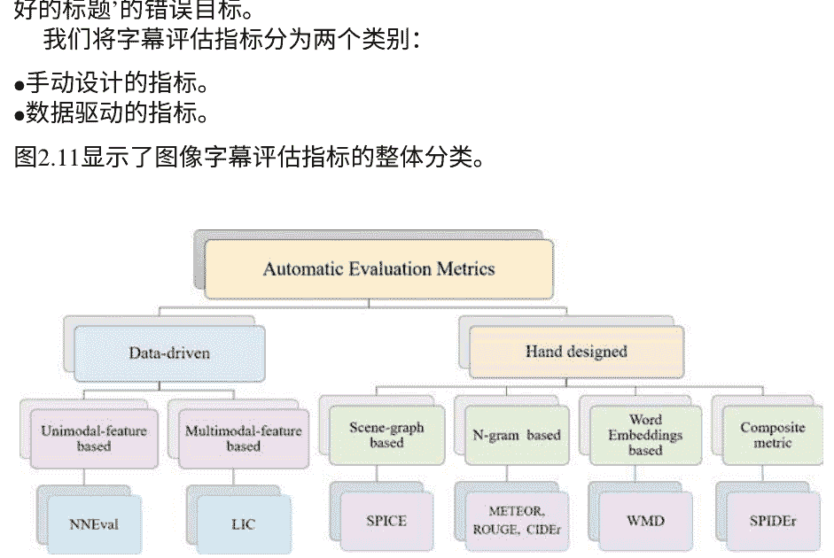

###### 2.4.2.1 手工设计的度量标准

手工设计的度量标准是一组手工制作的标准/特征，用于衡量文本之间的相似性。标题之间的相似性不是直接使用原始形式的标题来评估的。相反，标题首先被转换为另一种表示形式，例如n-gram、场景图或词袋嵌入。

然后，这些表示形式被用来衡量候选标题和参考标题之间的相似性。相似性度量可以基于召回率、精确率、F-度量等。例如，BLEU基于候选标题和参考标题之间的n-gram重叠精确率。如[98]所讨论的，自动度量标准捕捉了不同语言层次上标题之间的对应关系：

表2.1 各种自动字幕度量标准的属性

| 名称 | 字幕表示 | 相似性度量 | 语言层次 | 分数范围 | 领域 |
|---|---|---|---|---|---|
| BLEU [16] | N-gram | N-gram精度 | 词汇和句法 | 0–1 | 机器翻译 |
| METEOR [18] | Unigrams | 基于单词匹配的F-mean | 词汇和语义 | 0–1 | 机器翻译 |
| ROGUE-L [17] | N-gram序列 | 基于最长公共序列的F-score | 词汇和句法 | 0–1 | 机器摘要 |
| WMD [104] | 词嵌入 | 词移距离 | 词汇和语义 | 0–1 | 文档相似度 |
| CIDEr [19] | Tf-idf加权N-gram | N-gram余弦相似度之和 | 词汇和句法 | 0–10 | 图像字幕 |
| SPICE [20] | 语义场景图 | 基于场景图相似性的F-score | 语义 | 0–1 | 图像字幕 |
| SPIDEr [105] | – | – | 词汇、语义和句法 | 0–1 | 图像字幕 |
| LIC [23] | 句子嵌入 | 已学习 | 未知 | 0–1 | 图像字幕 |
| NNEval [24] | 度量分数的向量 | 已学习 | 词汇、语义和句法 | 0–1 | 图像字幕 |
| LCEval [108] | 度量分数的向量 | 已学习 | 词汇、语义和句法 | 0–1 | 图像字幕 |

词汇、语义和句法。例如，像BLEU这样的单元格度量只评估标题之间的词汇相似性。而SPICE则捕捉候选和参考标题之间的语义相似性。其他度量标准如METEOR和WMD主要捕捉候选标题的词汇正确性，同时通过同义词匹配和词嵌入来捕捉一定程度的语义对应关系。表2.1概述了现有手工设计和数据驱动方法的各种属性。下面总结了各种现有度量标准：

- BLEU [16]是一种基于精确度的度量标准，它计算候选文本和参考文本之间的n-gram匹配次数。BLEU分数通过修改后的n-gram精确度分数的几何平均值计算，乘以一个简洁度惩罚因子来惩罚短句子。
- METEOR [18]是一种基于召回率的度量标准，它匹配候选文本和参考标题之间的单词。它还利用了同义词和词干提取来更好地对齐文本。而度量分数被定义为单词精确度和n-gram召回率的调和平均值，其中召回率的权重高于精确度。
- ROUGE-L [17]通过计算标题之间的最长公共子序列（LCS）来衡量标题之间的相似性。两个标题的最长公共子序列（LCS）指的是具有最大长度的公共单词序列。基于LCS的F分数被称为Rouge-L。
- CIDEr [19]通过计算n-gram的一致性来评估候选和参考字幕之间的一致性。常用的n-gram通过计算词频逆文档频率加权来降低权重。候选字幕和参考字幕的n-gram之间的平均余弦相似度被称为CIDEr分数。CIDEr分数的均值被称为CIDEr，其中n=1,2,3,4。
- SPICE [20]评估字幕之间的语义对应关系。候选文本和参考文本被转换为称为场景图的语义表示。场景图编码了字幕中存在的对象、属性和关系。形成一组与场景图对应的逻辑元组来计算F分数。其中，F分数基于元组的连接。
- WMD [104]使用词嵌入估计两个句子之间的距离。一个标题的嵌入词需要覆盖到另一个标题的嵌入词的最小距离被称为“词移距离”。每个标题都被表示为一个加权的词嵌入点云 d∈R^N，其中两个词i和j之间的距离被设置为它们对应的word2vec嵌入之间的欧氏距离[106]。
- 词汇差距[107]是一个最近的度量标准，它衡量了描述的语义丰富性作为质量的度量。该度量标准基于整个标题系统输出与训练语料库之间的词汇多样性。在参考描述语料库和候选描述语料库之间计算。

###### 2.4.2.2 数据驱动的度量

通过数据驱动的方法可以学习用于衡量文本之间对应关系的语言特征，其中使用了学习算法。下面讨论了一些最近提出的基于学习的度量方法：

- NNEval [24] 是最早的基于学习的字幕度量之一，它经过训练，能够在人类和机器字幕之间进行二元分类。NNEval 首先将字幕转换为另一种表示形式，即度量分数的向量。然后将该向量输入神经网络，将输入的字幕分类为机器生成还是人类生成。分类的概率被用作度量分数。
- LCEval [108] 是 NNEval 的扩展，旨在捕捉用于质量评估的标题之间的词汇、句法和语义对应关系。LCEval 提供了对影响学习度量性能的参数的洞察，并研究了不同语言特征与学习度量的标题级相关性之间的关系。
- LIC [23] 是另一种学习度量，它被训练用于区分人类生成的标题和机器生成的标题。它不仅使用标题进行训练，还使用源，即图像。图像特征通过CNN提取，而候选和参考标题通过LSTM编码为句子嵌入。所有特征通过紧凑双线性池化进行组合，并馈入softmax分类器。将标题属于人类类别的概率作为度量分数。

基于学习的度量在与人类判断的标题和系统级相关性方面显示了改进。然而，仍有改进的空间。随着字幕系统的不断改进，需要将更强大的语言特征与多样化的训练示例结合起来。

##### 2.4.3 基于分心任务的方法

字幕系统需要同时具备视觉和语言理解能力，以生成充分的描述。除了分析输出的字幕之外，研究人员还开发了另一种系统化的评估字幕模型的方法。请记住，计算机视觉的最终目标是深度视觉理解，而字幕被认为是其代表。人类可以轻松识别出诱饵字幕，或者最适合图像的字幕。对于任何图像，人类都可以为其编写字幕；而对于给定的字幕，人类可以想象出图像。给定一组字幕，人类有能力选择最合适/充分的字幕。需要评估的是字幕系统是否只是记忆现有的字幕，还是实际上已经发展出了一些语言和视觉的感知能力[109]。

现有的自动评估方法比较粗糙，需要更好的方法来对字幕系统进行细粒度评估[110]。为了评判字幕系统的视觉和语言理解深度，文献中提出了各种数据集[109–111]。这些数据集包含了图像与正确和扰动（错误）字幕的配对。字幕模型需要区分正确和错误的字幕，并/或检测错误的单词或/和纠正错误的单词。一个例子是FOIL数据集（在图像和语言字幕之间找到一个不匹配）[111]，其中每个图像包含一个不匹配的字幕（包含一个错误单词的字幕）。Shekhar等人[111]提出了使用FOIL数据集评估字幕系统的三个任务：（1）分类不匹配的字幕，（2）检测和（3）纠正不匹配的单词。

丁等人[109]还发布了一个机器理解数据集来利用字幕模型能够理解视觉和语言模态的程度。任务是从一组伪装中识别最适合图像的字幕，即选择正确目标的准确性。准确性反映了模型对视觉的理解。Hodosh等人[110]设计了一组二选一任务来利用图像字幕系统的优点和缺点。每个任务都由图像和正确和错误的字幕配对组成。

字幕系统必须选择正确的字幕而不是错误的字幕。作者将此数据集构建为Flickr30K [122]的扩展。对于每个任务，正确的句子以不同的方式被扰动。例如，错误的句子可能只是原始字幕的一部分，或者具有不同的场景或地点提及，并且可能传达完全不同的语义含义。作者得出结论，图像字幕任务远未解决，并强调了现有模型的各种不足之处。

这些任务的主要目的是评估机器的视觉和语言理解能力。人类可以很方便地检测句子中的语义错误，或者选择最合适的图像标题。这些任务也期望字幕模型能够做到同样的事情。虽然这是对模型进行细粒度评估的一大步，但仍然远未完善，可以毫不夸张地说，人类质量评估仍然无可替代。

#### 2.5 图像字幕数据集

人类通过不同的感官模式以各种方式进行学习。例如，我们通过眼睛看到的东西会在我们的大脑中注册；我们阅读的内容不仅发展了我们的语言能力，还培养了各种其他技能。也许，对于学习来说，通过数据（通过感官器官）的重要性是不可否认的，即使对于人类也是如此。一个孩子接触不同环境的次数越多，他/她的智力技能、推理能力和语言能力等就会越发展。同样，AI算法也通过数据（可能是图像、标签、文本、声音等）来培养。数据的重要性是不可否认的。

数据集对于任何领域的研究进展以及研究社区之间的协同发展都至关重要。大型数据集，如ImageNet[112]，在推动计算机视觉研究方面起到了至关重要的作用，并加速了各种学习算法的性能，从而引发了深度学习的热潮。

基准数据集用于进行各种挑战，例如MSCOCO，以解决现有问题并开拓新的领域。对于计算机视觉而言，数据包括图像和标签；对于自然语言处理而言，数据是带注释的文本；对于图像字幕等领域，数据集需要包含图像及其相应的字幕。

尽管在线上有大量的图像数据，并且还在不断增加，但是配有字幕和合适描述的图像的可用性相对较少。因此，构建图像字幕数据集不仅具有挑战性，而且耗时且资源密集。图像字幕数据集是按照一套准则系统收集的，旨在为学习算法提供多样化的示例。正如所说的“一图胜千言”，对于每个给定的图像，可能有许多合理的描述。每个人可能以自己的方式描述一张图像。事实性、幽默、简洁、负面等都是可能采用的风格。因此，应该为每个图像收集什么样的描述呢？

对于图像分类和物体识别等任务，通常会达成一个单一的标签。但是在图像描述方面，三个不同的人可能以三种或更多不同的方式描述一张图像。每个人的描述方式取决于他们的语言能力、经验、观察和风格等等。因此，每个用于图像字幕的数据集都具有其独特性。使用不同的人类主体收集，一些数据集更注重包含各种图像，而其他数据集则受到在描述中引发情感的需求驱动。其中一些数据集可能是应用特定的，例如医学、新闻和体育。拥有各种此类数据集对于开发复杂的模型至关重要。

一个好的数据集的一些一般特性是：它应该是可重用的，公开可用以促进研究和开发，并且应该代表广泛的现实世界场景。

字幕数据集的文本内容通常是通过一些流行的众包网站（如AMT [113]）进行众包，要求人工工作者遵循某些指南，遵守某些语言要求。图像则通常从流行的社交网站（如Flickr）或其他公开可用的图像资源中获取。质量控制也非常重要。在收集图像及其相应的标题后，它们需要经过后期预处理步骤，以符合标题模型的训练/测试要求。

为了推动这一研究领域的发展，已经开发了各种数据集，每个数据集都有特定的意图，以满足特定的限制或研究空白。某些数据集中的图像侧重于特定方面，如活动，而其他数据集则更注重语言学，例如如何描述图像。没有一个单一的数据集能够满足所有需求（如多样性、情感和简洁性），但每个数据集都有其自身的重要性。一些数据集基于众包生成的标题，另一些基于用户生成的标题，某些数据集中的图像可能是特定领域的，如卡通、图表、抽象场景、X光等，而其他数据集可能是从互联网或Flickr上收集的通用图像。由于版权问题，视觉数据并不容易获取。商业数据集通常较大，但不对公众和研究社区免费开放。人们在公共平台上发布的内容（如Flickr）可能并不是最能代表真实世界情景的。真实世界远非仅仅是随机点击。此外，语言内容也存在差异。一些数据集具有更多的描述性标题，而其他数据集可能具有简短或带有情感的标题。

有些可能是多语言的，而其他一些可能只有一个语言的字幕。数据集在大小方面也有所不同，即图像-字幕对的数量。各种图像字幕数据集的详细信息如表2.2所示。根据现有数据集的不同特征，我们将它们分类如下：

- 通用字幕数据集
  - 单语言
  - 多语言
- 风格化字幕数据集
- 领域特定字幕数据集

##### 2.5.1 通用字幕数据集

这些数据集包含与通用活动或场景相对应的图像，并且在图像数量和来源（互联网或众包）以及配对字幕的语言（英语、中文、日语和荷兰语等）方面有所不同。然而，它们的字幕通常是事实性的，即它们与视觉内容相对应（图2.12）。在这些数据集中，有些只包含单语言（如英语）字幕，而其他则有多语言字幕。因此，我们进一步将它们分类为单语言和多语言数据集。下面讨论这些数据集的详细信息：

表2.2 各种图像字幕数据集，按时间顺序组织

| 数据集 | 图像 | 图像来源 | 字幕 | 语言 | 发布 | 特征 |
|---|---|---|---|---|---|---|
| IAPR TC-12 | 20,000 | 互联网和viventa | 70,460 | 英语/德语/西班牙语 | 2006 | 多语言通用字幕 |
| PASCAL1K | 1,000 | PASCAL VOC [114] | 5,000 | 英语 | 2010 | 通用字幕 |
| SBU 1M | 1,000,000 | Flickr | 1,000,000 | 英语 | 2011 | 通用字幕 |
| BBC新闻数据集 | 3,361 | BBC新闻 | 3,361 | 英语 | 2011 | 领域特定字幕 |
| 摘要 | 10,020 | 通过AMT制作 | 60,120 | 英语 | 2013 | 通用字幕 |
| VLT2K | 2,424 | PASCAL VOC 2011 [115] | 7,272 | 英语 | 2013 | 通用字幕 |
| Flickr8K | 8,100 | Flickr | 40,500 | 英语 | 2013 | 通用字幕 |
| Flickr30K | 31,783 | Flickr | 158,915 | 英语 | 2014 | 通用字幕 |
| MSCOCO | 164,062 | Flickr | 820,310 | 英语 | 2015 | 通用字幕 |
| Déjà图像 | 400,000 | Flickr | 180,000 | 英语 | 2015 | 通用字幕 |
| 日本帕斯卡 | 1,000 | PASCAL1K [42] | 5,000 | 英语/日语 | 2015 | 多语言通用字幕 |
| 卡通字幕 | 50 | 纽约客 | 250,000 | 英语 | 2015 | 领域特定字幕 |
| MIC测试集 | 31,014 | MSCOCO [116] | 186,084 | 英语/德语/法语 | 2016 | 多语言通用字幕 |
| KBK-1M | 1,603,396 | 荷兰报纸 | 1,603,396 | 荷兰 | 2016 | 领域特定字幕 |
| 双语字幕 | 1,000 | MSCOCO | 1,000 | 英语/德语 | 2016 | 多语言通用字幕 |
| Multi30K | 1,000 | Flickr30K | 1,000 | 英语/德语 | 2016 | 多语言通用字幕 |
| Flickr8K-CN | 8,000 | Flickr8K | 45,000 | 英语/中文 | 2016 | 多语言通用字幕 |
| SentiCap | 2,359 | MSCOCO | 8,869 | 英语 | 2016 | 风格化字幕 |
| 视觉基因组 | 108,077 | MSCOCO和YFCC100M [117] | 5,403,840 | 英语 | 2017 | 通用字幕 |

| 数据集 | 图像 | 图像来源 | 字幕 | 语言 | 发布 | 特征 |
|---|---|---|---|---|---|---|
| Stock3M | 3,217,654 | 股票网站 | 3,217,654 | 英语 | 2017 | 通用字幕 |
| STAIR | 26,500 | MSCOCO | 1,31,740 | 日语/英语 | 2017 | 多语言通用字幕 |
| AIC-ICC | 2,40,000 | 互联网 | 1,200,000 | 英语/中文 | 2017 | 多语言通用字幕 |
| Flickr30K-CN | 1,000 | Flickr30K | 5,000 | 英语/中文 | 2017 | 多语言通用字幕 |
| RSICD | 10,921 | 遥感图像 | 54,605 | 英语 | 2017 | 领域特定字幕 |
| FlickrStyle10K | 10,000 | Flickr | 20,000 | 英语 | 2017 | 风格化字幕 |
| COCO-CN | 20,342 | MSCOCO | 27,218 | 英语/中文 | 2018 | 多语言通用字幕 |
| 概念字幕 | 3,330,000 | 互联网 | 3,330,000 | 英语 | 2018 | 通用字幕 |
| SMACDA | 1,000 | PASCAL50S [19] | 50 | 英语 | 2019 | 通用字幕，眼动数据 |
| Nocaps | 15,100 | 打开图像 [118] | 1,66,100 | 英语 | 2019 | 领域特定字幕 |
| 个性化字幕 | 2,01,858 | YFCC100M | 2,41,858 | 英语 | 2019 | 风格化字幕 |
| 好消息 | 4,66,000 | 互联网 | 4,66,000 | 英语 | 2019 | 领域特定字幕 |
| 图注 | 1,09,512 | 机器生成 [119] | 2,19,024 | 英语 | 2019 | 领域特定字幕 |

10https://www.viventura.de/.
11https://www.flickr.com/.
12https://www.newyorker.com/tag/newspapers.

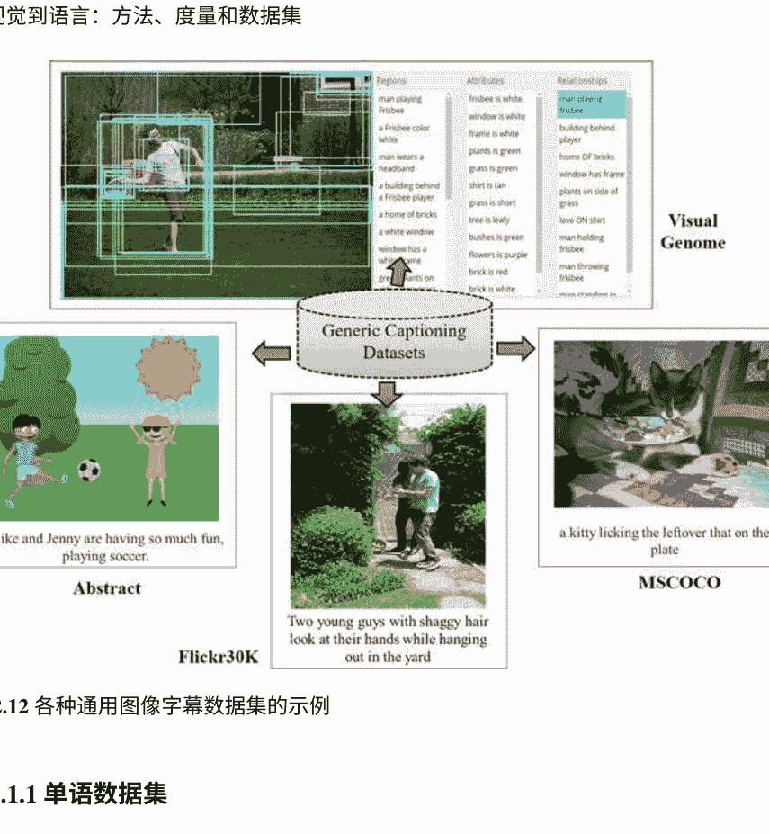

图2.12 各种通用图像字幕数据集的示例

###### 2.5.1.1 单语数据集

- Pascal1K[42] 是一个流行的数据集，其图像是从 PASCAL Visual Object Classes (VOC) 2008 的开发和训练集 [42] 中选择的。为了获得每个图像的描述，使用了亚马逊机械土耳其人 (AMT) [43]，每个图像由五个不同的人描述。PASCAL1K 中的字幕简单，主要关注人和动物执行某些动作。
- SBU1M[35] 是一个包含一百万张图像及其相关字幕的 Web 规模收集。它是通过对对象、物品、属性、动作和场景进行查询从 Flicker 中获取的。作者最初检索到了更多的图像(超过一百万张)和原始的人工撰写的字幕，然后将其过滤为仅有一百万张照片。剩下的一百万张图像具有与图像内容相关且视觉描述性的字幕。
- 摘要[120] 数据集由10020个抽象图像组成，这些图像是从80个剪贴画中创建的。这些图像是通过AMT创建的，描绘了两个孩子（一个男孩和一个女孩）在户外玩耍的场景。在创建这些图像的过程中，AMT工作者遵循了一些具体的指导方针。这些抽象图像的描述是由一组不同的工作者生成的，而不是创建图像的工作者。
- 视觉和语言树库（VLTK）[121] 包含来自PASCAL VOC 2011动作识别数据集的图像。每个图像都附有三个使用AMT获得的描述。每个描述由两个句子组成，第一个句子描述了图像中正在进行的动作、执行该动作的人员和感兴趣的区域。而第二个句子则描述了图像中与动作直接无关但最重要的其他区域。该数据集中的341个图像子集使用多边形标注了描述中提到的区域，同时还提供了标注区域的视觉依赖表示。
- 选择_Flickr8K_[10]的图像是为了代表各种不同的场景和情境，因为作者对描述事件、场景和实体的概念性标题感兴趣。每个图像有多个标题，满足多样性的需求。
- _Flickr30K_[122]是Flickr8K的扩展，包含31,783张从Flickr获取的照片。该数据集中的图像是各种日常活动、场景或事件的照片。每个图像都通过AMT服务获得了5个描述，遵循与Flickr相同的指导方针。Flickr30K提供了图像中短语的详细基础，可以帮助找到图像区域和标题部分之间的对应关系，从而有助于基于图像的语言理解。
- _MSCOCO_[116]是最大的图像识别、分割和标题数据集之一。它是图像描述研究中广泛使用的数据集，也引发了MSCOCO标题挑战。它利用Microsoft COCO通过对Flickr上各种场景类型和对象类别的查询收集的图像。目前，它包含123,287张图像，每张图像都与通过AMT服务生成的五个标题相关联。
- D j images[123] 数据集是一个包含四百万张图片和一百八十万個独特用户生成的标题的大型图像-标题语料库，这些标题是从Flickr上编译而来的。这个数据集最初通过查询Flickr下载了七亿六千万张图片来收集，查询的关键词是693个名词。然后，只保留那些至少包含一个动词、介词或形容词的图像-句子对。从剩下的标题中，只保留那些重复的标题。在Deja I mage Captions数据集中，一个单独的标题对应着多个图片。
- _Visual Genome_[124] 包含108,000张图片，每张图片都密集地注释了对象、属性和对象之间的成对关系。Visual genome提供了对多个图像区域的人工生成描述。与其他图像-标题数据集不同，这些数据集的标题通常描述显著的区域，visual genome提供了场景级别的描述，以及每张图片多达50个的各种低级描述。这个数据集中的图像区域描述是通过AMT众包获得的。
- _Stock3M_[69] 包含用户上传的股票网站上的图片。上传的图片也附带用户编写的标题。这些图片种类繁多，标题简短但具有挑战性。

###### 2.5.1.2 多语言数据集

- IAPR TC-12[125] 是最早的数据集之一，包含20,000张照片，用多种语言（英语、德语和西班牙语）表达描述。这个数据集的大部分图片来自旅行公司“Viventura” 10，其余的图片则通过雅虎、谷歌和必应等各种搜索引擎获取。该数据集包括人物、动物、各种体育运动和行为、城市、风景和当代生活的其他方面的图片。图片的注释由一到五个句子组成。第一句（几句）描述图片最显著的方面，而后面的描述图片的周围环境或设置。
- 日本帕斯卡[126] 数据集由图像与英语和日语文本配对组成。该数据集的创建旨在促进图像介导的跨语言文档检索。图像和英文标题来自UIUC Pascal Sen-tence数据集，每个英文句子都由日本专业翻译人员翻译成日语标题。
- MIC测试集[127] 包含1000张图像是MSCOCO数据的多语言版本的一部分。作者通过众包收集了每个英文标题的法语和德语翻译。然后，这些翻译由三位母语为该语言的人进行验证。
- 双语标题[128] 是一个德英平行数据集，是通过从训练语料库中随机选择1000张图像构建的。在每个图像的五个英文标题中，随机选择一个标题由德语母语者翻译成德语。
- Multi30K[129]通过将1000个测试图像与德语翻译配对，扩展了Flickr30K数据集。其中一些德语标题是由专业的德语翻译人员翻译的，而另一些则是独立获取的，没有使用英语标题。该数据集中的标题质量经过了手动评估和自动检查。
- Flickr8K-CN[130]包含未标记图像的中文标题，是Flick8k数据集的双语扩展。作者使用了本地众包服务将Flick8k的英文描述翻译成中文。
- STAIR[131]是一个基于MSCOCO图像的大规模日语图像标题数据集。作者为164,042个MSCOCO图像注释了五个日语标题，总计约820,310个标题。注释由兼职工人和众包工人提供。完成这个数据集花费了半年时间和2100名工人。
- SMACDA[132]是一个有趣的数据集，其中包含了眼动数据与图像及其描述的配对。这些图像是从PASCAL50S [19]获取的。共有五名参与者参与了数据收集，每张图像都记录了人类注视点和口头描述。所有图像的口头描述都被转换为文本形式。
- AIC-ICC（AI Challenger-Image Chinese Captioning）数据集[133]：该数据集中的图像是通过遵循特定指南从搜索引擎中收集的，以确保每个选定的图像可以用一句话描述，并且应该描绘多个对象以形成复杂的场景。每个图像都有五个由五个不同的中国母语者撰写的标题。
- Flickr30K-CN [134]是用于跨语言图像字幕的另一个数据集。它是通过扩展 Flickr30K 的训练和验证集构建的。Flickr30K中的每个图像都使用百度¹翻译进行了中文标题的注释。而测试集图像则由五名中国学生手动注释。
- COCO-CN[135]通过中文标题和标签扩展了MSCOCO。这些图像通过界面和预定义的方法进行了注释。对于任何给定的图像，最合适的中文标题是通过MSCOCO标题进行机器翻译获得的中文标题池中检索出来的。然后，注释者被要求根据检索到的标题和图像，使用自己的观点编写标题。
- 概念性标题[136]是一个包含约330万个图像-标题对的大型数据集。这些图像和配对的标题是从网络上收集的，以代表不同的风格。创建了一个自动流水线来过滤不符合质量标准的标题和图像。

##### 2.5.2 风格化字幕数据集

与收集事实（通用）字幕相比，收集风格化字幕更具挑战性。风格化字幕数据集中的字幕包含各种情感或风格（图2.13）。此外，字幕中的情感可能不是视觉上的，即它们不是由视觉内容明确反映出来的。在这些数据集上训练的算法可以学习人类风格，也可以生成幽默或个性化的字幕。

- SentiCap[74]是最早的风格化字幕数据集之一。该数据集中的图像来自MS COCO。然而，与每个图像相对应的具有积极或消极情感的字幕是通过众包获得的。对于每个图像，有3个具有积极情感的字幕和3个具有消极情感的字幕。为了质量验证，对字幕进行了描述性和情感正确性的测试。
- FlickrStyle10K[137]是基于Flickr30k数据集构建的。注释是使用AMT进行收集的。注释者被展示了一些事实性的字幕，并被要求注入风格，使其更加浪漫或有趣。该数据集总共包含10,000张图像。其中9,000张图像每张都附有一个幽默和浪漫的字幕。而剩下的1000张图像每张都有五个幽默和浪漫的字幕。

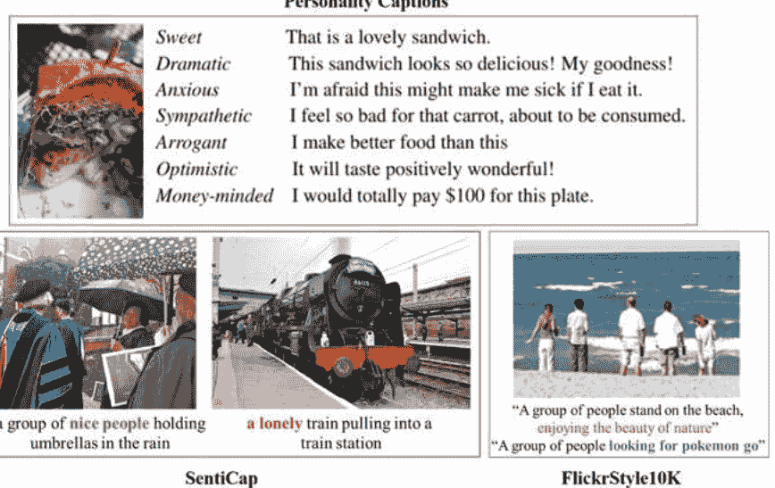

图2.13 各种风格化字幕数据集的图像字幕对

- 人格字幕[100] 是最近最具风格化的数据集之一。图像来自YFCC100M数据集，而字幕则是通过众包工人收集的。该数据集包含大约215个与甜美、戏剧性和乐观等人格特征相对应的字幕。

##### 2.5.3 领域特定字幕数据集

该数据集中的图像对应于特定的领域或应用，例如医学X射线、新闻图像、新闻漫画或遥感图像等。下面讨论了其中的一些类别：

###### 2.5.3.1 新闻图像字幕数据集

BBC新闻[54] 数据集是最早和最大的新闻数据集之一，包含了各种主题的图像、字幕和新闻文章。这些字幕是免费获取的，但有些噪音，因为它们并不是为视觉和语言任务而创建的。

KBK-IM[138]包含了从1992年到1994年荷兰报纸上提取的各种各样的图像，配有标题、文章和已知图像的位置。该数据集中的标题大多是非事实性的，即它们指的是可能不在图像中存在的事物，例如政治观点和意见。

Good News[139]是最新的新闻图像字幕数据集，包含了4,66,000个图像字幕对。作者使用纽约时报的API来检索2010年至2018年的文章。这是目前可用的最大的新闻字幕数据。
与MSCOCO中的通用字幕相比，这些字幕更长，更具描述性。

###### 2.5.3.2 卡通字幕数据集

卡通字幕[140]包含了一大批卡通和它们的字幕，可以帮助设计更具吸引力的代理。这些卡通来自纽约客的字幕比赛，参赛者被要求为新闻卡通写一个有趣的字幕。该数据集大约有50个卡通，每个卡通至少配有5000个人工生成的字幕。

###### 2.5.3.3 遥感字幕数据集

RSICD-遥感图像字幕数据集[141]具有超过10,000张图像。遥感图像中的视觉对象与通用图像中的对象非常不同。这些图像中没有方向感，并且可能具有旋转和平移变化。该数据集中图像的字幕是由具有注释经验和相关知识的志愿者编写的。每个图像都附有五个字幕。

###### 2.5.3.4 图片字幕数据集

FigCap[142]是一个用于图片字幕的数据集。这些图形是基于基础数据合成生成的，并与字幕配对。该数据集包含五种类型的图形：水平条形图、垂直条形图、饼图、折线图和虚线图。与图像配对的描述既是高层次描述又是详细描述。然而，该数据集中的图形和字幕都是合成的。

###### 2.5.3.5 新颖字幕数据集

Nocaps[143]是一个最近用于新颖物体字幕的数据集，包含了来自Open Images验证和测试集的15,100张图片。为罕见物体生成字幕是一项具有挑战性和有趣的任务。该数据集包含的图片平均具有4个独特的物体类别，并且该数据集没有过多地被常见的类别如人、汽车等所主导。每张图片收集了11个字幕。
这些字幕通过AMT收集，其中10个用作人类参考，而一个用于oracle测试。

#### 2.6 视觉字幕的应用

多年来，视觉字幕从纯粹的研究课题发展为具有实际应用和商业影响的领域。它在辅助技术、媒体、机器人、体育和医疗等各个领域都可以发挥重要作用。

##### 2.6.1 医学图像字幕

计算机视觉和自然语言处理的最新进展推动了疾病自动诊断和医学扫描描述的进步。现如今，医学界对于医学扫描和测试的自动生成描述越来越感兴趣。医生和专家需要编写他们的发现、诊断和治疗报告。然而，手动编写报告可能耗时、主观且容易出错。

Jing等人[144]探索了一个框架，用于预测X射线的分类标签，并生成结果的描述。他们的模型使用卷积神经网络（CNN）提取输入图像（即X射线）的视觉特征，并将其输入到多标签分类（MLC）网络中，以预测相应的诊断标签。然后，每个标签在标签词汇表中由一个词嵌入向量表示。这些嵌入向量对应于所考虑图像的语义特征。接下来，来自CNN的视觉特征和来自嵌入向量的语义特征与共同关注模型相结合，生成一个上下文向量。然后，使用两个串联的基于LSTM的网络对这个上下文向量进行解码，生成医学报告的描述。由于医学报告通常包含多个句子，生成的报告有一个有趣的特点，即不仅仅是由一个单独的标题组成的句子，而是以分层的方式生成长篇报告。第一个LSTM网络生成了一个高层次的主题向量列表，然后将其馈送到第二个LSTM网络中。然后，第二个网络为每个主题向量生成一个句子。通过这种方式，生成的描述由第一个LSTM识别出的高层次主题的每个句子组成。除了X射线，这种方法还可以潜在地应用于其他类型的医学扫描。

在医学领域中，对深度学习的主要批评之一是深度网络被视为“黑盒子”，并且不能提供对不同特征或变量在决策中的适当解释，以满足医学专家的要求。为了克服这个问题，张等人提出了一种可解释的框架机制，用于临床病理学中从医学图像自动诊断疾病并生成报告。它包括三个组成部分：图像模型、语言模型和注意机制[22]。 图像模型使用卷积神经网络从输入图像中提取特征并对输入图像进行分类。 语言模型基于长短期记忆（LSTM）网络，使用图像特征生成诊断报告。 注意机制[22]使框架能够通过突出显示决策所依据的图像区域来提供结果的解释。 通过对系统预测的关键图像区域与专家确定的重要区域进行定性分析，结果显示出良好的相关性。

##### 2.6.2 生活记录

视觉字幕的另一个潜在应用是通过智能手机或其他便携相机捕捉的图片和视频进行总结和整理。 图像字幕系统通常适用于单个图像，而视频字幕则需要连续的视频。 然而，我们在一天或一个事件中拍摄的大多数照片并不连续，而是彼此相关的。 要能够描述或总结一堆图片，系统应该能够找到它们之间的各种复杂关系。 此外，这些关系和上下文还严重依赖于拍照人或上下文中的人，即字幕系统应根据生成“生活记录”的人进行个性化。

通过对日常生活照片的文本描述，从大量收藏中检索与特定事件相关的媒体变得更容易。 Fan等人[146]引入了一个类似的系统，由CNN和LSTM网络的组合组成。 他们的系统可以像写日记一样自动生成一天事件的文本描述。 他们的框架首先为每个图像生成多个字幕，作为第一人称叙述。 然后将不同图像的字幕组合成图像序列的描述。 尽管在这个应用中仍有很大的改进空间，但未来的研究可能会导致个人的自动生活记录器。

##### 2.6.3 体育视频评论

从视频中生成描述还可以用于提供体育视频的评论。 这与传统的视频描述模型不同，因为评论比标题或简单句子要长得多，不仅需要关注细节，还需要区分比赛中的不同队伍和球员。

Yu等人[147]使用CNN和LSTM的组合来生成长篇描述从篮球比赛的视频中。 他们的算法首先对两支队伍的球员和球进行分割，然后进行球员的姿势检测。 另一个神经网络用于检测视频剪辑中球员的动作。

##### 2.6.4 报纸字幕

自然语言处理中一个有趣的话题是文本摘要。当文本和视觉信息都可用时，可以将其与图像字幕相结合，创建一个组合模型，例如在报纸和杂志中。从视觉字幕的角度来看，这个问题更接近于视觉问答的范畴，因为它需要分析两种模态，即文本描述和视觉图像，以生成给定数据的字幕。

Feng等人[54]提出了一个两步系统来为新闻文章生成字幕。使用词袋模型方法从文本文档中选择重要关键词。对于相关的图像，提取SIFT [148]特征，并使用概率模型来检测图像中的不同对象，然后转换为视觉词袋模型[149]。这样可以以相同的方式表示文本和视觉信息，以便以依赖变量的形式进行处理。在第二步中，从收集到的特征和关键词生成描述。他们的系统能够为新闻文章中的图像生成不错的字幕，尽管使用最先进的深度网络而不是概率模型可能进一步改进。

##### 2.6.5 辅助技术字幕

视觉字幕的主要应用之一是用于辅助技术。视觉字幕可以用于自动描述图像、视频、社交媒体动态甚至日常活动，以帮助视觉受限和盲人。它可以使盲人更自由地进行日常任务，无需他人的帮助。

如今，社交媒体已成为我们生活中不可或缺的一部分。社交媒体上的许多内容都是以图片和视频的形式呈现的。与其他人相比，视觉受限的人在这方面感到被排除在外，因为他们只能通过文本消息在社交媒体上享受和交流。借助视觉字幕的帮助，可以将社交媒体上的视觉内容以文本形式描述。Facebook研究团队的吴等人[150]引入了一个系统，可以自动生成社交媒体图像的描述。他们使用目标检测和场景识别算法来向用户描述图像。

该系统可以检测面部（带有某些表情）、物体和主题，并以超过80%的置信度向用户描述检测到的物体。这项技术的另一个实际应用是微软的“Seeing AI”应用程序<sup>12</sup>（适用于苹果设备）和其他类似的智能手机应用程序。这些应用程序使用设备的摄像头实时检测面部、物体和场景。它们还可以预测各种面部表情、性别和年龄。它们还可以描述通过智能手机摄像头可见的场景，并在一定程度上描述场景中物体之间的各种动作和关系。此外，它们还可以阅读文本并识别条形码以识别不同的产品。这可以扩展到让人们不再专注于屏幕，例如谷歌Home的食谱和Adobe的图书阅读器。基本上，与语音助手的集成是另一个重要的应用领域。

## 2.6.6其他应用

除了上面讨论的应用之外，视觉字幕还有许多其他应用，例如媒体检索和机器人技术。随着大量的视觉数据生成，其组织和检索变得困难。视觉字幕可以用于为图像和视频提供文本描述，并以有组织的方式存储它们。任何个人都可以使用有意义的文本描述从大型数据库中检索视频或图片，或使用一些自动的基于文本的检索方法[151]。

视觉字幕和问题回答对于人形机器人和辅助机器人也非常有用。人形机器人需要实时从视觉流中解读信息并进行推理，以便与人类进行有用和有意义的互动。同样，它将帮助辅助机器人分析和描述情况，以帮助他们进行日常活动。

在过去的十年中，视觉字幕系统的领域取得了巨大的进展，特别是由于深度学习的快速发展。随着时间的推移，随着更多的改进，视觉字幕领域的许多当前挑战将被克服，具有视觉描述能力的设备将成为我们日常生活中的常见部分。

## 2.7将图像字幕扩展到其他视觉到语言任务

在前几节中，详细讨论了图像字幕、其分类、各种挑战、应用和评估措施。在本节中，我们简要介绍讨论一些与图像字幕密切相关的应用，如视频字幕、视觉对话、视觉问答和视觉叙事。我们将这些任务与图像字幕进行比较，并概述它们的相似之处或差异。尽管这些应用属于不同的领域，但字幕输出仍可用于帮助这些任务的输出。上述应用正在快速发展，相关文献日益丰富，为了完整起见，我们简要讨论与这些任务相关的最新或最具代表性的最先进技术。

##### 2.7.1 视觉问答

视觉问答（VQA）是一个研究领域，专注于设计能够回答与图像内容相关的自然语言问题的自主系统。与图像字幕系统相比，VQA系统以图像和关于该图像的自然语言问题作为输入，然后生成一个合适的答案作为输出，以自然语言形式呈现[4]。例如，如图2.14所示，VQA的输入是一张猫的图片，自然语言问题是“在垫子上坐着什么？”。VQA系统将“一只猫”作为自然语言答案或输出。

为了准确回答给定图像的问题，VQA系统需要一系列的能力，例如目标检测（例如在图2.14中检测到猫和垫子），目标识别（例如在图2.14中识别到猫和垫子），活动识别（例如猫正在坐着），问题理解，知识库推理（例如图像中是否有垫子？）和问题理解（问题解析/解释）。因此，视觉问答比图像字幕更具挑战性。这可以从以下事实推断出来，即VQA系统要回答的问题直到运行时才确定，并且VQA系统需要额外的信息，该信息不一定存在于输入图像中。所需的信息可能是关于图像内容的特定知识或常识。

例如，给定一张图像，如图2.14所示，显示着“一只猫在垫子上”，如果有人问“为什么猫坐在垫子上？”，VQA系统必须提供对这个问题的答案，不仅要检测场景，比如“房间”，还要知道“垫子通常被用作休息的地方”。

Noh等人[152]提出了一种用于VQA任务的迁移学习技术，该技术在没有问题的情况下学习视觉概念，然后将学习到的概念转移到VQA模型中。一种被称为任务条件视觉分类器的神经网络被训练用于学习视觉概念。分类器的任务由任务特征（从问题中推断出）定义，并用作回答单元。还提出了一种基于语言知识源的无监督任务发现技术，用于训练任务条件视觉分类器。他们的实验结果表明，所提出的框架适用于具有超出词汇表的答案的VQA任务。关于任务特征和无监督任务发现的进一步解释超出了本章的范围，请参阅[152]了解详细信息。

##### 2.7.2 视觉叙事

叙事是一种古老的人类活动，它提供了一种参与、分享建议、教育、灌输道德和保护文化的方式[5]。受此启发，人工智能研究开始关注这个任务，将人类的理解和智能引入这个新兴领域。前述的VQA任务，包括图像字幕，侧重于对输入图像的直接和字面描述，这些图像本身包含静态时刻，缺乏上下文。因此，这些任务远不能满足自然交互所需的能力。

相比之下，视觉叙事依赖于视频或一系列图像，如图2.14所示，它们描绘了事件的发生。从视觉角度来看，经过训练的视觉叙事系统可以推理出图像序列中的视觉时刻。从语言角度来看，从直接描述（如图像字幕的情况）转向叙述使得视觉叙事系统能够产生更具对话性和说明性的语言。例如，描述“这只猫图2.14中的“坐在橙色垫子上”（图像字幕）捕捉到了图像内容，这是字面的。另一方面，“猫坐在漂亮的红色垫子上喝她的牛奶”（图像描述）则提供了关于喝牛奶和感到困倦的进一步推断。当牛奶喝完后，猫感到困倦，在垫子上打盹（图像故事讲述，图2.14）进一步推断了喝牛奶和感到困倦。

近年来，视觉故事讲述领域取得了显著进展，最近涌现出了许多研究作品。为了完整起见，我们简要讨论了最近的一种视觉故事讲述方法。Huang等人[5]开发了第一个名为SIND的视觉故事讲述数据集，并提出了一个故事生成模型。为了训练他们的故事生成模型，采用了序列到序列的递归神经网络。采用这种网络架构的原因是它将单个图像字幕扩展到多个图像。递归神经网络在fc7向量上运行，以编码图像序列（即提取有用的视觉特征）。然后，故事解码器模型通过使用softmax损失逐个生成故事的单词。他们的基准模型已经显示出生成良好的视觉故事。

##### 2.7.3 视频字幕

视频字幕受到图像字幕任务的启发。然而，与输入为静态图像的图像字幕不同，视频字幕系统的输入是一个视频（图2.14）或一系列图像。因此，视频字幕的目标是用自然语言描述视频的视觉内容。由于这个任务涉及到一系列事件的处理，即视频形式，所以视频字幕比图像字幕更具挑战性。

视频字幕需要通过捕捉输入视频中事件的细节和发生情况来理解场景。因此，视频字幕系统不仅关注感兴趣的动态对象，还考虑了其周围环境，并考虑了背景、动作、物体、人物与物体的互动、事件的发生以及事件发生的顺序。例如，如图2.14所示，视频字幕系统捕捉到了感兴趣的对象（即猫），它的动作和事件序列（例如，喝牛奶和睡觉），并生成了一个字幕：“猫喝牛奶并在红色垫子上睡觉”。

对于大多数人来说，视频字幕是一个微不足道的任务，但对于机器来说却非常具有挑战性。大多数现有的视频字幕技术依赖于编码器-解码器框架。编码器部分学习独特的视觉特征，解码器部分生成字幕。编码器-解码器框架的局限性在于它只能一次处理一个源视频。因此，该框架的重点仅限于一个单词及其相应的视觉特征。因此，现有的视频字幕方法未能充分利用单词与输入视频之间的各种视觉上下文之间的关系。为了解决这个问题，Pei等人提出了记忆关注循环网络（MARN）用于视频字幕。在MARN中，他们采用了一个基于注意力的循环解码器和一个记忆模块（称为注意力记忆解码器），用于存储词汇中每个单词的描述信息。这种架构捕捉了单词与其视觉环境之间的完全对应关系，从而为每个单词提供了详细的理解。MARN已经在Microsoft Research-Video to Text（MSRVTT）和Microsoft Research Video Description Corpus（MSVD）数据集上显示出提高和增强视频字幕质量的效果。

##### 2.7.4 视觉对话

尽管图像字幕、视频字幕和视觉问答任务取得了快速进展，但很明显这些任务仍然不能与用户进行双向交流。例如，一个经过训练的图像字幕系统可以通过为给定的输入图像生成图像字幕与人类进行对话，而不需要人类以对话形式提供任何输入。类似地，VQA任务代表了与人类的一轮对话（例如，“垫子上坐着什么？”），VQA系统会回答“一只猫”，但不考虑用户之前提出的任何问题或系统提供的答案。此外，VQA系统不支持用户的任何后续问题。

为了实现主动的机器人机交互，并将视觉和语言的交叉点推向新的水平，引入了视觉对话的概念。视觉对话是一个新兴的研究主题，位于自然语言处理、对话管理和计算机视觉的交叉点上。与图像字幕相比，视觉对话通过以自然语言与用户进行有意义的对话来实现双向交流。给定一张图像、对话历史记录（即之前的问题和答案）以及关于图像的新问题，视觉对话系统试图回答这个问题。由于其积极的人机交互性质，视觉对话在帮助视障用户理解周围环境、数据分析和机器人导航等方面具有广泛的应用。

郭等人[154]提出了一个用于视觉对话任务的两阶段图像-问题-答案协同网络。在第一阶段，也称为主要阶段，学习了图像、对话历史和初始问题的代表向量。为了实现这一目标，使用Faster-RCNN在输入图像中检测对象及其特征。然后，使用卷积神经网络对这些特征进行编码。由于问题和对话历史包含文本数据，因此使用LSTM对其进行编码。然后，根据与图像和问题对相关性对所有生成的候选答案进行评分。在第二阶段，也称为协同阶段，根据其正确性的概率对与图像和问题协同的答案进行排名。该技术已被证明在Visual Dialog v1.0数据集上实现了最先进的视觉对话性能。

##### 2.7.5 视觉定位

视觉定位可以被视为图像字幕的逆向任务，目前在研究界引起了很多关注。与其他视觉到文本任务（上述讨论）不同，视觉定位系统以单词或句子形式的自然语言查询作为输入，并旨在定位输入图像中最相关的对象或感兴趣区域。为了实现这一目标，视觉定位系统考虑查询中的主要焦点，最终试图理解图像并在图像中定位感兴趣的对象。视觉定位是人机交互的重要技术，可以使机器获得对现实世界的类人理解。

#### 2.8 结论和未来工作

在过去的十年中，视觉到语言任务引起了很多关注。在各种视觉到语言任务中，本章的重点是“图像字幕”，这是该领域的一个基础性和开创性问题。图像字幕是各种视觉理解任务的基础，例如视觉定位、视觉问答和视觉叙事。字幕模型的目标是模仿人类描述视觉输入（图像）的特征，用自然语言进行描述。然而，这并不是一项简单的任务，因为为了使机器生成的字幕类似于人类，它们需要具备各种质量特征。其中最重要的两个特征是充分性/相关性和流畅性。字幕应与图像相关，语义正确且句法良好。除此之外，字幕还可以具备其他卓越的特质，如描述性、简洁性、幽默和风格，这些特质在我们看来是可选的和领域特定的。

在过去的十年中，我们在开发强大的字幕模型、评估指标和字幕数据集方面取得了显著进展。最先进的图像字幕模型基于深度编码器-解码器架构。互联网上有大量的非配对语言和视觉数据，但配有字幕/描述的图像相对较少。能够融合语言知识和计算机视觉学习的模型，而不太依赖于配对数据（图像-字幕），将非常有用。无监督/半监督学习的字幕是该领域的新兴趋势。新颖物体字幕是另一个有前途的方向。就人类而言，他们可以通过常识、语言感知或简单地说他们不认识这个物体来轻松处理新颖物体。人类可以通过描述其属性或与类似物的相似之处来描述一个未知的物体或场景，而不是给出错误的答案。最先进的模型缺乏这种能力，需要解决这个研究空白。

对模型和其输出的评估对于任何领域的进展至关重要。我们讨论了各种字幕评估方法，其中自动评估指标最受欢迎。然而，现有的字幕评估指标远非完美。由于现有测量方法的缺陷，字幕领域的大部分进展是误导性的。生成不准确或无意义描述的字幕模型可能会带来危险，并且在现实世界中没有应用。描述应该与图像有很好的基础。重要的不仅是分析模型对视觉的理解程度，还包括它们在训练集之外的泛化能力。正如文献[156]中所指出的，字幕模型倾向于利用数据集中的偏见生成合理的输出。因此，了解字幕模型学习了什么，识别数据集和其偏见的不足之处，以及模型是仅仅记忆字幕还是真正理解视觉内容，这一点非常重要。这就是有效评估方法的作用所在。了解模型失败/成功的原因以及其能力、缺点和优势。

本章还讨论了其他各种视觉到语言任务，例如VQA，视觉定位和视觉对话，在文献中已经独立研究过。这些任务中的大部分代表了机器模型对视觉和语言的理解。然而，任何具有良好视觉和语言理解能力的模型都应该能够进行相关任务，只需进行少量修改。例如，强大的字幕模型可以作为VQA的基准。应该开发常见的基准模型，对各种视觉到语言任务都有帮助，而不仅仅是特定的任务。此外，整合不同的视觉到语言任务是创建未来模型的关键。

#### 参考文献

1.  M. Alan, 图灵，计算机和智能。 Mind 59(236), 433–460 (1950)
2.  A.M. 图灵，计算机和智能，见《解析图灵测试》(Springer, 2009)，第23–65页
3.  R. Bernardi, R. Cakici, D. Elliott, A. Erdem, E. Erdem, N. Ikizler-Cinbis, F. Keller, A. Muscat, B. Plank等, 图像的自动生成描述：模型、数据集和评估方法的综述。人工智能研究杂志 (JAIR) 55, 409–442 (2016)
4.  S. Antol, A. Agrawal, J. Lu, M. Mitchell, D. Batra, C. Lawrence Zitnick, D. Parikh, Vqa:视觉问答, 在IEEE国际计算机视觉会议论文集（2015），第2425-2433页
5.  T.-H.K. Huang, F. Ferraro, N. Mostafazadeh, I. Misra, A. Agrawal, J. Devlin, R. Girshick, X. He, P. Kohli, D. Batra等, 视觉叙事, 在北美计算语言学协会人类语言技术会议论文集（2016），第1233-1239页
6.  S. Venugopalan, M. Rohrbach, J. Donahue, R. Mooney, T. Darrell, K. Saenko, 序列到序列-视频到文本, 在IEEE国际计算机视觉会议(2015年), 第4534-4542页
7.  S. Khan, H. Rahmani, S.A.A. Shah, M. Bennamoun, 卷积神经网络在计算机视觉中的指南。合成. Lect. Comput. Vis. 8(1), 1-207页（2018年）
8.  U. Nadeem, S. A. A. Shah, F. Sohel, R. Togneri, M. Bennamoun, 场景理解的深度学习, 在深度学习应用手册.(Springer, 2019年), 第21-51页
9.  A. Jaimes, S.-F. Chang, 多层次索引视觉信息的概念框架, 在互联网图像, 第3964卷, 国际光学与光子学学会(1999年), 第2-15页
10. M. Hodosh, P. Young, J. Hockenmaier, 将图像描述作为排序任务: 数据, 模型和评估指标. 人工智能研究杂志 47, 853-899 (2013)
11. T.-Y. Lin, M. Maire, S. Belongie, J. Hays, P. Perona, D. Ramanan, P. Dollár, C. L. Zitnick, Microsoft coco: 上下文中的常见物体, 在欧洲计算机视觉会议. (Springer, 2014), 第740-755页
12. A.C. Berg, T.L. Berg, H. Daume, J. Dodge, A. Goyal, X. Han, A. Mensch, M. Mitchell, A. Sood, K. Stratos, 等等, 理解和预测图像中的重要性, 在2012年IEEE计算机视觉和模式识别会议, (IEEE, 2012), 第3562-3569页
13. A. Rohrbach, A. Torabi, M. Rohrbach, N. Tandon, P. Chris, L. Hugo, C. Aaron, B. Schiele, 电影描述. https://arxiv.org/pdf/1605.03705.pdf
14. A. Rohrbach, L.A. Hendricks, K. Burns, T. Darrell, K. Saenko, 图像中的对象幻觉. arXiv: 1809.02156
15. E. van Miltenburg, D. Elliott, 自动图像描述中的改进空间: 一个错误分析. arXiv:1704.04198
16. K. Papineni, S. Roukos, T. Ward, W.-J. Zhu, Bleu: 一种用于自动评估机器翻译的方法, 在第40届计算语言学年会上的论文集中, 计算语言学协会(2002), pp. 311-318
17. C.-Y. Lin, Rouge: 用于自动摘要评估的软件包, 文本摘要化分支
18. S. Banerjee, A. Lavie, Meteor: 一种用于机器翻译评估的自动度量标准, 与人类判断的相关性改进, 在ACL Workshop On Intrinsic and Extrinsic Evaluation Measures For Machine Translation And/or Summarization(2005), pp. 65-72
19. R. Vedantam, C. Lawrence Zitnick, D. Parikh, Cider: 基于共识的图像描述评估, 在IEEE计算机视觉和模式识别会议论文集中(2015), pp. 4566-4575
20. P. Anderson, B. Fernando, M. Johnson, S. Gould, Spice: 语义命题图像标题评估, 在欧洲计算机视觉会议上. (Springer, 2016) 第382-398页
21. M. Kilickaya, A. Erdem, N. Ikizler-Cinbis, E. Erdem, 重新评估图像字幕的自动度量. arXiv:1612.07600
22. K. Xu, J. Ba, R. Kiros, K. Cho, A. Courville, R. Salakhudinov, R. Zemel, Y. Bengio, 展示、关注和描述: 带有视觉注意力的神经图像字幕生成, 在国际机器学习会议上(2015), 第2048-2057页
23. Y. Cui, G. Yang, A. Veit, X. Huang, S. Belongie, 学习评估图像字幕, 在IEEE计算机视觉和模式识别会议上(2018), 第5804-5812页
24. N. Sharif, L. White, M. Bennamoun, S. Afaq Ali Shah, Nneval: 基于神经网络的图像字幕评估度量, 在欧洲计算机视觉会议(ECCV)的论文集(2018), 第37-53页

- 25. J. Devlin, H. Cheng, H. Fang, S. Gupta, L. Deng, X. He, G. Zweig, M. Mitchell, 用于图像字幕的语言模型: 怪癖和有效方法. arXiv:1505.01809
- 26. O. Vinyals, A. Toshev, S. Bengio, D. Erhan, 展示和描述: 一个神经图像字幕生成器, 在2015年IEEE计算机视觉与模式识别会议(CVPR)上, 第3156-3164页
- 27. A. Deshpande, J. Aneja, L. Wang, A.G. Schwing, D. Forsyth, 快速、多样化和准确的图像字幕生成, 受词性引导, 在IEEE计算机视觉与模式识别会议的论文集(2019), 第10695-10704页
- 28. J.A. Yip, R.A. Martin, 幽默感、情绪智力和社交能力。研究人员 40(6), 1202–1208 (2006)
- 29. W.E. Hauck, J.W. Thomas, 幽默与智力、创造力和有意识的和无意识的学习的关系。实验教育杂志 40(4), 52–55 (1972)
- 30. M. Yatskar, M. Galley, L. Vanderwende, L. Zettlemoyer, 看不见邪恶, 不说邪恶: 从密集标签图像生成描述, 出版第三届联合会议的论文词汇和计算语义学（*SEM 2014）(2014), pp. 110–120
- 31. T. Yao, Y. Pan, Y. Li, Z. Qiu, T. Mei, 用属性提升图像字幕, 在IEEE国际计算机视觉会议的论文(2017), pp. 4894–4902
- 32. P. Anderson, X. He, C. Buehler, D. Teney, M. Johnson, S. Gould, L. Zhang, 自底向上和自顶向下的注意力用于图像字幕和视觉问题回答, 在IEEE计算机视觉和模式识别会议的论文(2018), pp. 6077–6086
- 33. M. Hodosh, J. Hockenmaier, 基于句子的图像描述与可扩展的、显式的模型, 出版IEEE计算机视觉和模式识别会议研讨会(2013), pp. 294–300
- 34. A. Karpathy, L. Fei-Fei, 深度视觉语义对齐用于生成图像描述, 在IEEE计算机视觉和模式识别会议 (2015), pp. 3128–3137
- 35. V. Ordonez, G. Kulkarni, T. L. Berg, Im2text: 使用100万个带标题的照片描述图像, 在神经信息处理系统进展(2011), pp. 1143–1151
- 36. P. Kuznetsova, V. Ordonez, A. C. Berg, T. L. Berg, Y. Choi, 自然图像描述的集体生成, 在计算语言学协会第50届年会论文集: 长篇论文-第1卷, 计算语言学协会(2012), pp. 359–368
- 37. A. Oliva, A. Torralba, 场景的形状建模: 空间的整体表示。Int. J. Comput. Vis. 42(3), 145–175 (2001)
- 38. A. Torralba, R. Fergus, W.T. Freeman, 8000万个小图像: 一个用于非参数目标和场景识别的大数据集。IEEE Trans. Pattern Anal. Mach. Intell. 30(11), 1958–1970(2008)
- 39. G. Patterson, C. Xu, H. Su, J. Hays, 太阳属性数据库: 超越类别的更深入场景理解。Int. J. Comput. Vis. 108(1–2), 59–81 (2014)
- 40. S. Yagcioglu, E. Erdem, A. Erdem, R. Cakici, 基于分布式表示的图像字幕查询扩展方法, 在Proceedings of the 53rd Annual Meeting of the Association for Computational Linguistics and the 7th International Joint Conference on Natural Language Processing (Vol. 2: Short Papers) (2015), pp. 106–111
- 41. T. Baltrusaitis, C. Ahuja, L.-P. Morency, 多模式机器学习: 调查和分类。IEEE Trans. Pattern Anal. Mach. Intell. 41(2), 423–443 (2018)
- 42. A. Farhadi, M. Hejrati, M.A. Sadeghi, P. Young, C. Rashtchian, J. Hockenmaier, D. Forsyth, 每张图片都有一个故事: 从图像生成句子, 在: 欧洲计算机视觉会议。(Springer, 2010), pp. 15–29
- 43. R. Socher, A. Karpathy, Q.V. Le, C.D. Manning, A.Y. Ng, 用句子找到和描述图像的基于组合的语义。Trans. Assoc. Comput. Linguist. 2, 207–218(2014)
- 44. A. Karpathy, A. Joulin, L. F. Fei-Fei, 深度片段嵌入用于双向图像句子映射, 在神经信息处理系统进展(2014), 第1889-1897页
- 45. R. Kiros, R. Salakhutdinov, R.S. Zemel, 统一视觉-语义嵌入与多模态神经语言模型。arXiv:1411.2539
- 46. A. Krizhevsky, I. Sutskever, G. E. Hinton, 使用深度卷积神经网络进行Imagenet分类，在神经信息处理系统进展(2012)，第1097–1105页
- 47. M. Sundermeyer, R. Schlüter, H. Ney, LSTM神经网络用于语言建模，在国际语音通信协会第十三届年会(2012)
- 48. J. Mao, X. Wei, Y. Yang, J. Wang, Z. Huang, A. L. Yuille, 像孩子一样学习：从图像的句子描述中快速学习新颖的视觉概念，在IEEE国际计算机视觉会议论文集(2015)，第2533–2541页
- 49. X. Chen, C. Lawrence Zitnick, Mind's eye: A recurrent visual representation for image caption generation, in Proceedings of the IEEE Conference On Computer Vision And Pattern Recognition (2015), pp. 2422–2431
- 50. R. Lebret, P. O. Pinheiro, R. Collobert, 基于短语的图像字幕生成。arXiv:1502.03671
- 51. G. Kulkarni, V. Premraj, S. Dhar, S. Li, Y. Choi, A.C. Berg, T.L. Berg, 婴儿说话：理解和生成图像描述，于第24届CVPR. (Citeseer,2011)
- 52. Y. Yang, C.L. Teo, H. Daumé III, Y. Aloimonos, 基于语料库的自然图像句子生成，于自然语言处理的经验方法会议论文集，计算语言学协会(2011), pp. 444–454
- 53. T. Yao, Y. Pan, Y. Li, Z. Qiu, T. Mei, 用属性提升图像字幕。OpenReview2(5), 8 (2016)
- 54. 冯宇, M. Lapata, 新闻图片的自动字幕生成。IEEE Trans. Pattern Anal. Mach. Intell. 35(4), 797-812 (2012年)
- 55. 方华, S. Gupta, F. Iandola, R. Srivastava, L. Deng, P. Dollár, J. Gao, X. He, M. Mitchell, J. Platt, 等, 从字幕到视觉概念再到字幕
- 56. Kulkarni, V. Premraj, V. Ordonez, S. Dhar, S. Li, Y. Choi, A.C. Berg, T.L. Berg, Babytalk: 理解和生成简单的图像描述。IEEE Trans. Pattern Anal. Mach. Intell 35(12), 2891-2903 (2013年)
- 57. J. Johnson, A. Karpathy, L. Fei-Fei, Densecap: 用于密集字幕的完全卷积定位网络，在IEEE计算机视觉和模式识别会议 (2016年), pp. 4565-4574
- 58. J. Lu, C. Xiong, D. Parikh, R. Socher, 通过视觉哨兵进行自适应注意力的图像字幕生成, 在IEEE计算机视觉和模式识别会议(CVPR), (Vol. 6) (2017)
- 59. K.V. Deemter, M. Theune, E. Krahmer, 真实与基于模板的自然语言生成-之间的虚假对立? 计算机语言学。31(1), 15–24 (2005)
- 60. E. Reiter, R. Dale, 构建应用自然语言生成系统。自然语言工程。3(1), 57–87 (1997)
- 61. D. Elliott, F. Keller, 使用视觉依赖表示进行图像描述, 在2013年经验方法自然语言处理会议(2013), pp. 1292–1302
- 62. S. Li, G. Kulkarni, T.L. Berg, A.C. Berg, Y. Choi, 使用网络规模的n-gram组合简单的图像描述, 在第十五届计算自然语言学习会议上, 计算语言学协会 (2011), 第220-228页
- 63. K. Tran, X. He, L. Zhang, J. Sun, C. Carapcea, C. Thrasher, C. Buehler, C. Sienkiewicz, 野外丰富图像字幕, 在IEEE计算机视觉和模式识别会议研讨会上 (2016年), 第49-56页
- 64. A. Aker, R. Gaizauskas, 使用依赖关系模式生成图像描述, 在第48届计算语言学协会年会上, 计算语言学协会 (2010年), 第1250-1258页
- 65. I. Sutskever, O. Vinyals, Q. V. Le, 序列到序列学习与神经网络, 在: 神经信息处理系统进展(2014), pp. 3104–3112
- 66. L. Anne Hendricks, S. Venugopalan, M. Rohrbach, R. Mooney, K. Saenko, T. Darrell, 深度组合式字幕: 描述新颖物体类别而无需配对训练数据, 在 IEEE计算机视觉与模式识别会议论文集 (2016), pp. 1–10
- 67. S. Hochreiter, J. Schmidhuber, 长短期记忆. 神经计算 9(8), 1735–1780 (1997)
- 68. S. Ma, Y. Han, 通过结构化词汇喂养lstm来描述图像, 在2016年IEEE多媒体与博览会国际会议(ICME). (IEEE, 2016), pp. 1–6
- 69. Y. Wang, Z. Lin, X. Shen, S. Cohen, G.W. Cottrell, 骨架关键: 通过骨架-属性分解进行图像字幕, 在IEEE计算机视觉与模式识别会议论文集(2017), pp. 7272–7281
- 70. T. Mikolov, M. Karafiát, L. Burget, J. Černocký, S. Khudanpur, 循环神经网络基于语言模型, 在国际语音通信协会第十一届年会 (2010)
- 71. J. Mao, W. Xu, Y. Yang, J. Wang, Z. Huang, A. Yuille, 多模态深度字幕循环神经网络 (m-rnn). arXiv:1412.6632
- 72. J. Donahue, L. Anne Hendricks, S. Guadarrama, M. Rohrbach, S. Venugopalan, K. Saenko, T. Darrell, 长期循环卷积网络用于视觉识别和描述, 在IEEE计算机视觉与模式识别会议 (2015), pp. 2625–2634
- 73. Q. Wu, C. Shen, L. Liu, A. Dick, A. Van Den Hengel, 显式高级概念在视觉语言问题中的价值是多少？ , 在IEEE计算机视觉与模式识别会议(2016), 第203-212页
- 74. A.P. Mathews, L. Xie, X. He, Senticap: 用情感生成图像描述, 在第三十届AAAI人工智能会议 (2016)
- 75. Z. Gan, C. Gan, X. He, Y. Pu, K. Tran, J. Gao, L. Carin, L. Deng, 语义组合网络用于视觉字幕生成, 在IEEE计算机视觉与模式识别会议(2017), 第5630-5639页
- 76. Q. You, H. Jin, J. Luo, 随意图像字幕生成: 一种有效将情感注入图像描述的多功能方案. arXiv:1801.10121
- 77. J. Gu, G. Wang, J. Cai, T. Chen, 语言CNN在图像字幕生成中的实证研究, 在IEEE国际计算机视觉会议(2017), pp. 1222–1231
- 78. J. Aneja, A. Deshpande, A.G. Schwing, 卷积图像字幕生成, 在IEEE计算机视觉与模式识别会议(2018), pp. 5561–5570
- 79. Q. Wang, A.B. Chan, CNN+CNN: 图像字幕生成的卷积解码器. arXiv:1805.09019
- 80. Q. You, H. Jin, Z. Wang, C. Fang, J. Luo, 具有语义注意力的图像字幕生成, 在IEEE计算机视觉与模式识别会议(2016) pp. 4651–4659
- 81. Z. 朱, Z. 薛, Z. 袁, 面向图像字幕的主题引导注意力, 在2018年第25届IEEE国际图像处理会议 (ICIP) （IEEE, 2018年）, 第2615-2619页
- 82. M. Corbetta, G.L. Shulman, 大脑中目标导向和刺激驱动的注意力控制. Nat. Rev. Neurosci. 3(3), 201 (2002年)
- 83. T. 姚, Y. 潘, Y. 李, T. 梅, 探索图像字幕的视觉关系, 在欧洲计算机视觉会议 (ECCV) （2018年）, 第684-699页
- 84. R. Faster, 朝着具有区域建议网络的实时目标检测, 任少卿[j], Kaiming He, Ross Girshick和Jian Sun
- 85. X. 张, X. 王, X. 唐, H. 周, C. 李, 使用属性注意机制生成遥感图像描述. Remote Sens. 11(6), 612 (2019年)
- 86. B. 戴, S. Fidler, R. Urtasun, D. 林, 通过条件gan实现多样化和自然的图像描述, 在IEEE国际计算机视觉会议论文集 (2017年) , 第2970-2979页
- 87. M. Mirza, S. Osindero, 条件生成对抗网络. arXiv:1411.1784
- 88. R. Shetty, M. Rohrach, L. Anne Hendricks, M. Fritz, B. Schiele, 通过对对抗训练将机器与人类字幕匹配, 在IEEE国际计算机视觉会议中, (2017), 第4135-4144页
- 89. E. Jang, S. Gu, B. Poole, 使用Gumbel-Softmax进行分类重参数化. arXiv:1611.01144
- 90. Z. Ren, X. Wang, N. Zhang, X. Lv, L.-J. Li, 基于深度强化学习的图像标题生成, 在IEEE计算机视觉与模式识别会议中, (2017), 第290-298页
- 91. H.H. Clark, W.G. Chase, 对比句子与图片的过程。认知心理学 3(3), 472–517 (1972)
- 92. W.T. Fitch, 语言演化研究的实证方法。心理学通报评论24(1), 3–33 (2017)
- 93. W.T. Mitchell,图像、文本、意识形态的图像学(芝加哥大学出版社, 2013)
- 94. G. Lakemeyer, B. Nebel, 知识表示与推理的基础,在知识表示与推理的基础, (斯普林格出版社, 1994), pp. 1–12
- 95. L.-J. Zang, C. Cao, Y.-N. Cao, Y.-M. Wu, C. Cun-Gen, 常识知识获取的综述。计算机科学与技术杂志 28(4), 689–719 (2013)
- 96. K. Dinakar, B. Jones, C. Havasi, H. Lieberman, R. Picard, 用于检测、预防和缓解网络欺凌的常识推理。ACM交互智能系统 (TiiS) 2(3), 18 (2012)
- 97. E. Davis, 常识知识的表示 (Morgan Kaufmann, 2014)
- 98. N. Sharif, L. White, M. Bennamoun, S.A.A. Shah, 基于学习的复合度量用于改进字幕评估, 在ACL 2018学生研究研讨会 (2018) 中, pp. 14-20
- 99. P. Kuznetsova, V. Ordonez, T.L. Berg, Y. Choi, Treetalk: 图像描述的树的组合和压缩。计算机语言学协会交易。2, 351-362 (2014)
- 100. K. Shuster, S. Humeau, H. Hu, A. Bordes, J. Weston, 通过个性参与图像字幕, IEEE计算机视觉和模式识别会议论文集 (2019) , pp. 12516-12526
- 101. S. Venugopalan, L. Anne Hendricks, M. Rohrach, R. Mooney, T. Darrell, K. Saenko, 使用多样对象进行图像标注, 在IEEE计算机视觉和模式识别会议(2017), 第5753-5761页
- 102. K. Fu, J. Jin, R. Cui, F. Sha, C. Zhang, 将视觉关注点与场景特定上下文对齐：基于区域的图像标注。IEEE模式分析与机器智能 39(12), 2321-2334页(2016)
- 103. M. Mitchell, X. Han, J. Dodge, A. Mensch, A. Goyal, A. Berg, K. Yamaguchi, T. Berg, K. Stratos, H. Daumé III, Midge: 从计算机视觉检测生成图像描述, 在欧洲计算语言学协会第13届会议上, 计算语言学协会(2012), 第747-756页
- 104. M. Kusner, Y. Sun, N. Kolkin, K. Weinberger, 从词嵌入到文档距离, 在国际机器学习会议(2015), 第957-966页
- 105. S. Liu, Z. Zhu, N. Ye, S. Guadarrama, K. Murphy, 通过蜘蛛的策略梯度优化改进图像字幕。arXiv:1612.00370
- 106. T. Mikolov, I. Sutskever, K. Chen, G. S. Corrado, J. Dean, 词和短语的分布式表示及其组合性, 在神经信息处理进展中(2013), pp. 3111–3119
- 107. A. Kershaw, M. Bober, 词汇差距：自动图像描述质量的改进度量, 在第13届国际计算语义学会议:学生论文集(2019), pp. 15–23
- 108. N. Sharif, L. White, M. Bennamoun, W. Liu, S.A.A. Shah, Lceval: 用于字幕评估的学习组合度量。Int. J. Comput. Vis. 127(10), 1586–1610 (2019)
- 109. N. Ding, S. Goodman, F. Sha, R.oricut, 同时理解图像和文本：一项双重视觉-语言机器理解任务。arXiv:1612.07833

110. M. Hodosh, J. Hockenmaier, 用二进制强制选择任务对图像描述进行焦点评估，在第5届视觉和语言研讨会论文集中(2016)，第19-28页
111. R. Shekhar, S. Pezzelle, Y. Klimovich, A. Herbelot, M. Nabi, E. Sangineto, R. Bernardi, 找出图像和语言标题之间的不匹配。arXiv:1705.01359
112. J. Deng, W. Dong, R. Socher, L.-J. Li, K. Li, L. Fei-Fei, Imagenet: 一个大规模的分层图像数据库，在IEEE计算机视觉和模式识别会议。(IEEE,2009)，第248-255页
113. M. Buhrmester, T. Kwang, S.D. Gosling, 亚马逊的机械土耳其人：一种新的廉价但高质量的数据来源？心理科学的观点。6(1), 3-5 (2011年)
114. M. Everingham, L. Van Gool, C.K. Williams, J. Winn, A. Zisserman, 帕斯卡视觉对象类 (VOC) 挑战。计算机视觉国际期刊88(2), 303-338 (2010年)
115. M. Everingham, L. Van Gool, C. K. I. Williams, J. Winn, A. Zisserman, 帕斯卡视觉对象类挑战 (VOC2011) 结果 (2011年)。http://www.pascal-network.org/challenges/VOC/voc2011/workshop/index.html
116. X. Chen, H. Fang, T.-Y. Lin, R. Vedantam, S. Gupta, P. Dollár, C. L. Zitnick, 微软COCO字幕：数据收集和评估服务器。arXiv:1504.00325
117. B. Thomee, D. A. Shamma, G. Friedland, B. Elizalde, K. Ni, D. Poland, D. Borth, L.-J. Li, Yfcc100m: 多媒体研究中的新数据。arXiv:1503.01817
118. A. Kuznetsova, H. Rom, N. Alldrin, J. Uijlings, I. Krasin, J. Pont-Tuset, S. Kamali, S. Popov, M. Malloci, T. Duerig等, 开放图像数据集v4：规模化的统一图像分类、目标检测和视觉关系检测。arXiv:1811.00982
119. S. E. Kahou, V. Michalski, A. Atkinson, Á. Kádár, A. Trischler, Y. Bengio, Figureqa: 用于视觉推理的注释图像数据集。arXiv:1710.07300
120. C. L. Zitnick, D. Parikh, L. Vanderwende, 学习句子的视觉解释, 在IEEE国际计算机视觉会议论文集中(2013), pp. 1681–1688
121. D. Elliott, F. Keller, 一个视觉和语言数据的树库。
122. B. A. Plummer, L. Wang, C. M. Cervantes, J. C. Caicedo, J. Hockenmaier, S. Lazebnik, Flickr30k实体: 为更丰富的图像到句子模型收集区域到短语的对应关系，在2015年IEEE国际计算机视觉会议上(IEEE, 2015),pp. 2641–2649
123. J. Chen, P. Kuznetsova, D. Warren, Y. Choi, Déja图像标题: 一个重复的表达描述语料库，在北美计算语言学协会2015年会议论文集中(2015), 第504-514页
124. R. Krishna, Y. Zhu, O. Groth, J. Johnson, K. Hata, J. Kravitz, S. Chen, Y. Kalantidis, L.-J.Li, D.A. Shamma等, 视觉基因组: 使用众包密集图像注释连接语言和视觉。Int. J. Comput. Vis. 123(1), 32-73 (2017)
125. M. Grubinger, P. Clough, H. Müller, T. Deselaers, IAPR TC-12基准: 视觉信息系统的新评估资源, in International workshop ontoImage, (Vol. 2) (2006)
126. R. Funaki, H. Nakayama, 零样本跨语言文档检索的图像介导学习, in Proceedings of the 2015 Conference on Empirical Methods in Natural Language Processing (2015), 第585-590页
127. J. Rajendran, M. M. Khapra, S. Chandar, B. Ravindran, 用于多语言多模态表示学习的桥接相关神经网络。arXiv:1510.03519
128. J. Hitschler, S. Schamoni, S. Riezler, 用于图像字幕翻译的多模态中心。arXiv:1601.03916
129. D. Elliott, S. Frank, K. Sima’an, L. Specia, Multi30k: 多语言英德图像描述。arXiv:1605.00459
130. X. Li, W. Lan, J. Dong, H. Liu, 向图像添加中文字幕, 在2016年ACM国际多媒体检索会议论文集中, ACM (2016), pp. 271–275
131. Y. Yoshikawa, Y. Shigeto, A. Takeuchi, Stair captions: 构建一个大规模的日本图像字幕数据集。arXiv:1705.00823
132. S. He, H. R. Tavakoli, A. Borji, N. Pugeault, 一个同步的多模态注意力-字幕数据集和分析。arXiv:1903.02499
133. J. Wu, H. Zheng, B. Zhao, Y. Li, B. Yan, R. Liang, W. Wang, S. Zhou, G. Lin, Y. Fu, 等， Ai挑战者：一个用于深入理解图像的大规模数据集。 arXiv:1711.06475
134. W. Lan, X. Li, J. Dong, 流畅引导的跨语言图像字幕，在第25届ACM国际多媒体会议上，ACM(2017), pp. 1549–1557
135. X. Li, C. Xu, X. Wang, W. Lan, Z. Jia, G. Yang, J. Xu, Coco-cn用于跨语言图像标记、字幕和检索，IEEE多媒体交易。
136. P. Sharma, N. Ding, S. Goodman, R. Soricut, 概念性标题：用于自动图像字幕的清理、上义词化的图像替代文本数据集，在第56届计算语言学年会论文集中，(Vol. 1: 长篇论文) (2018), pp. 2556–2565
137. C. Gan, Z. Gan, X. He, J. Gao, L. Deng, Stylenet: 用样式生成有吸引力的视觉字幕，在IEEE计算机视觉与模式识别会议论文集中(2017), pp. 3137–3146
138. D. Elliott, M. Kleppe, 100万个带字幕的荷兰报纸图片。
139. A.F. Biten, L. Gomez, M. Rusinol, D. Karatzas, 好消息，大家！ 面向新闻图片的上下文驱动实体感知字幕，在IEEE计算机视觉与模式识别会议论文集中(2019), pp. 12466–12475
140. D. Radev, A. Stent, J. Tetreault, A. Pappu, A. Iliakopoulou, A. Chanfreau, P. de Juan, J. Vall mit-jana, A. Jaimes, R. Jha, 等， 幽默在集体话语中的应用：纽约客漫画字幕比赛中的无监督滑稽检测。arXiv:1506.08126
141. X. Lu, B. Wang, X. Zheng, X. Li, 探索遥感图像字幕生成的模型和数据。IEEE Tran. Geo sci. Remote Sen. 56(4), 2183–2195 (2017)
142. C. Chen, R. Zhang, E. Koh, S. Kim, S. Cohen, T. Yu, R. Rossi, R. Bunescu, 带有推理和序列级训练的图像标题生成。arXiv:1906.02850
143. H. Agrawal, K. Desai, X. Chen, R. Jain, D. Batra, D. Parikh, S. Lee, P. Anderson, nocaps: 大规模的新颖物体字幕。arXiv:1812.08658
144. B. Jing, P. Xie, E. Xing, 关于医学影像报告的自动生成，在计算语言学协会第56届年会论文集(Vol. 1:长论文), (2018), 第2577-2586页
145. Z. Zhang, Y. Xie, F. Xing, M. McGough, L. Yang, Mdnet: 一种语义和视觉上可解释的医学图像诊断网络，在IEEE计算机视觉与模式识别会议论文集(2017), 第6428-6436页
146. C. Fan, Z. Zhang, D.J. Crandall, Deepdiary: 生活记录图像字幕和摘要。J. Vis. Commun. Image Rep. 55, 40–55 (2018)
147. 于洪, 程胜, 侃斌, 王敏, 张军, 杨晓, 细粒度视频字幕生成体育叙事,在IEEE计算机视觉和模式识别会议(2018), pp. 6006–6015
148. D.G. Lowe, 尺度不变关键点的独特图像特征. Int. J.Comput. Vis. 60(2), 91–110 (2004)
149. 李飞飞, 识别和学习物体类别,CVPR短期课程 (2007)
150. 吴胜, 韦兰德, 法里瓦尔, 席勒, 自动alt文本: 面向社交网络服务中盲人用户的计算机生成图像描述, 在2017 ACM计算机支持的合作工作和社交计算会议论文集, ACM (2017),pp. 1180–1192
151. Y. Alemu, J.-b. Koh, M. Ikram, D.-K. Kim, 多媒体数据库中的图像检索:一项调查,在2009年第五届智能信息隐藏和多媒体信号处理国际会议上, (IEEE, 2009), pp. 681–689
152. H. Noh, T. Kim, J. Mun, B. Han, 通过无监督任务发现进行迁移学习，用于视觉问题回答，在IEEE计算机视觉和模式识别会议上(2019), pp. 8385–8394
153. W. Pei, J. Zhang, X. Wang, L. Ke, X. Shen, Y.-W. Tai, 基于记忆的循环网络用于视频字幕生成，在IEEE计算机视觉和模式识别会议上(2019), pp. 8347–8356
154. D. Guo, C. Xu, D. Tao, 图像-问题-答案协同网络用于视觉对话，在IEEE计算机视觉和模式识别会议上 (2019),pp. 10434–10443
155. C. 邓, Q. 吴, Q. 吴, F. 胡, F. 吕, M. 谭, 通过累积注意力进行视觉定位, IEEE计算机视觉与模式识别会议论文集(2018), pp. 7746–7755
156. L.A. 亨德里克斯, K. 伯恩斯, K. 赛恩科, T. 达雷尔, A. 罗尔巴赫, 女性也可以: 克服字幕模型中的偏见, 欧洲计算机视觉会议, (Springer,2018), pp. 793–811

## 第三章 地理空间数据分析的深度学习技术
### Arvind W. Kiwelekar, Geetanjali S. Mahamunkar, Laxman D. Netak, 和Valmik B Nikam

摘要消费电子设备，如移动手机、带有RFID标签的商品、位置和位置传感器，不断产生大量的位置增强数据，称为地理空间数据。传统上，这种地理空间数据用于军事应用。近年来，许多有用的民用应用程序已经设计和部署在这种地理空间数据周围。例如，一个推荐系统可以向游客推荐餐馆或旅游景点。同时，市政机构正在利用通过遥感设备生成的地理空间数据为市民提供更好的服务，如交通监控、坑洼识别和天气报告。通常，这些应用程序依赖于非层次化的机器学习技术，如朴素贝叶斯分类器、支持向量机和决策树。深度学习领域的最新进展表明，基于神经网络的技术优于传统技术，并为许多地理空间数据分析任务提供了有效的解决方案，如目标识别、图像分类和场景理解。本章对深度学习技术在分析地理空间数据方面的应用现状进行了调查。本章的组织结构如下：(i) 深度学习算法简介。(ii)地理空间分析：数据科学视角 (iii)遥感的深度学习技术 (iv)用于GPS数据分析的深度学习技术 (iv)用于RFID数据分析的深度学习技术。

-   A. W. Kiwelekar (✉) · G. S. Mahamunkar · L. D. Netak
    计算机工程系，德拉巴萨赫布·安贝德卡尔技术大学，
    罗内雷402103，雷格德，印度
    e-mail: awk@dbatu.ac.in
-   G. S. Mahamunkar
    e-mail: gsmahamunkar@gmail.com
-   L. D. Netak
    e-mail: ldnetak@dbatu.ac.in
-   V. B. Nikam
    信息与技术系，维尔玛塔·吉贾拜技术学院，孟买
    4000019，印度
    e-mail: vbnikam@it.vjti.ac.in

#### 3.1 引言

深度学习已经成为构建各种应用领域智能产品和服务的首选技术。深度学习在最近的复兴归因于三个关键因素。第一个因素是可用的高性能GPU，用于执行计算密集型的深度学习算法。其次，这种硬件的价格可负担得起。此外，深度学习算法成功的第三个关键是各种应用领域中开放数据集的可用性，例如ImageNet [1]，这些数据集对深度学习算法的广泛训练至关重要[2]。

深度学习技术有效应用的传统应用领域包括语音识别、图像处理、语言建模和理解、自然语言处理和信息检索[3]。所有这些应用领域都包括对原始多媒体数据进行处理和检索有用信息。深度学习技术在这些领域的成功引发了其在其他领域的应用，如生物医学[4]、药物发现[5]和地理信息系统[6]。

本章介绍了深度学习技术在地理空间数据分析中的应用现状，这是一个越来越多地应用深度学习技术来理解地球的领域之一。

#### 3.2 深度学习：简要概述

深度学习领域是机器学习的一个子领域，研究建立输入特征变量和一个或多个输出变量之间关系的技术。许多任务，如分类和预测，可以表示为输入特征变量和输出变量之间的映射关系。

例如，一个城市中房屋的价格是输入特征变量（如房间数量、建筑面积、城市中的位置等）的函数。机器学习算法的目标是从给定的输入数据集中学习一个映射函数，这被称为训练数据集。例如，变量 x1, x2,...,xn 是输入特征变量，变量 y 是输出变量，可以表示为

$$ y = f(x_1, x_2, \dots, x_n) $$

输入变量也被称为独立变量、特征和预测器。函数 f 被称为模型或假设函数。训练数据集可能包含或不包含 y 的值，即输出变量。当机器学习算法从特征和输出变量中学习函数 f 时，该算法被称为有监督算法。无监督学习算法仅从输入特征中学习函数 f，而不知道输出变量的值。这两种算法都被广泛应用于开发智能产品和服务。

存在许多机器学习算法（例如线性回归、逻辑回归、支持向量机[7]），这些算法对于学习基于输入特征的简单任务（例如基于输入特征预测房价，如卧室数量、建筑面积、地区）非常实用。这些学习算法的目标是减少预测输出变量值的误差。这个最小化目标由一个称为代价函数的函数捕捉。随机梯度下降是常用的优化技术之一，用于实现最小化目标。传统的机器学习算法在学习简单任务（例如预测房价和分类肿瘤为恶性或良性）方面已被证明是有用和有效的。在这种情况下，输入特征与输出变量之间的关系是一个涉及少量预定义特征的简单线性函数。

然而，在难以识别预测所需特征的情况下，它们无法有效执行，例如在给定图像中识别植物、河流和动物。在这种情况下，准确预测所需的输入特征数量很大，并且输入特征与输出变量之间的关系也是复杂且非线性的。

属于深度学习的算法集在这种情况下优于传统的机器学习方法。本节简要介绍了在地理空间数据分析中发现有用的深度学习技术。有关这些技术的更详细和详尽的讨论，请参考[2]。

##### 3.2.1 深度学习架构

深度学习技术试图在人工环境中复制或模拟人脑的工作方式。神经元网络是人脑的结构和功能单位。同样，人工神经网络（ANN）是大多数深度学习技术的基本元素。

##### 3.2.2 深度神经网络

一个简单的人工神经网络包括三个基本元素：（i）输入层（ii）隐藏层和（iii）输出层。输入层包含输入特征的值，输出层包含输出变量的值。隐藏层之所以被称为隐藏层，是因为隐藏层中神经元持有的值在信息处理过程中不可见。

一个层包含多个信息处理节点，称为神经元。人工神经元是一个信息处理节点，接收n个输入并产生k个输出。它本质上是一个映射函数，其输出分为两个步骤定义。第一步是对所有输入的加权乘积求和。数学上，可以表示为：

$$ Y_i = g\left( \sum_j W_{ij} * a_j \right) $$

其中，Y_i是第i个节点的输出，W_ij是第j个输入对第i个节点的权重，a_j是第j个输入的值。这个操作实现了矩阵乘法运算，是一个线性函数。在第二步中，第一步的输出被输入到一个非线性函数中，称为激活函数。神经网络可以使用以下任意一个函数：（i）Sigmoid函数（ii）双曲正切函数或（iii）修正线性单元（ReLU）函数。

现代深度神经网络由多个隐藏层组成，如图3.1所示，并使用ReLU作为激活函数。

DNN的训练是一个迭代过程，通常使用随机梯度算法来找到输入特征的参数或权重。参数的权重是随机初始化的，或者从预训练模型中使用。在输出层计算预测误差。在隐藏层，误差的梯度是相对于现有值的误差的偏导数。

图3.1 深度神经网络

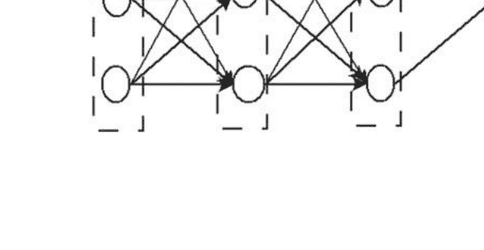将权重的梯度反馈回输入层，以在下一次迭代中更新权重的值。 这个过程被称为梯度反向传播。

这种看似简单的学习参数或权重的策略在许多图像处理和语音识别任务中有效地检测所需的特征，前提是具备进行矩阵乘法和大数据集的硬件。 从而消除了非分层分类和预测机制所需的手动特征工程的需求。

深度神经网络已成功用于检测对象，如手写数字和行人[8]。 总的来说，DNN在处理可以通过简单矩阵表示的二维数据方面效率高。

##### 3.2.3 卷积神经网络（CNN）

如前一节所示，DNN的隐藏层输入与前一层的所有输出相连，使得计算和处理高维矩阵的连接数量难以管理。 当图像尺寸具有高分辨率（1024 × 1024）时，会出现这种情况。 此外，DNN在数据集为二维时表现良好。 但是，大多数多模态数据集，例如彩色图像、视频、语音和文本，都是三维的。

当数据集是三维的且矩阵大小非常大时，使用卷积神经网络（CNN）。 例如，高分辨率彩色图像具有三个像素通道（即红色、蓝色、绿色），大小为1024 × 1024。

卷积神经网络的架构，如图3.2所示，可以分为多个阶段。 这些阶段执行预处理活动，例如识别低级特征并减少特征数量，然后由完全连接的神经网络执行主要的分类和预测任务。

预处理活动由卷积层和池化层完成。

卷积层对给定的输入数据大小和滤波器组进行逐步卷积操作，以创建特征图。这里，滤波器是表示模式或主题的可学习权重的矩阵。 此步骤的目的是识别例如图像中的边缘等低级特征。该层的基本假设是低级特征与像素配置相关[8]。池化层实现聚合操作，例如加法或最大化或平均化，以便在多个连接之间共享权重。从而减少了分类和/或预测所需的特征数量。

这些预处理阶段大大减少了CNN完全连接部分中的特征数量。

CNN在许多图像处理和语音识别任务中被发现很有用。因为CNN的工作基于这样一个假设，即许多高级特征是低级特征的组合。例如，一组边构成一个模式或图案，一组图案构成图像的一部分，一组部分构成一个对象[8]。

##### 3.2.4 循环神经网络（RNN）

第三种类型的神经网络是循环神经网络（RNN）。它在语音识别和机器语言翻译等许多领域中得到了应用。

RNN学习输入数据序列之间的依赖关系。与学习特征变量和输出变量之间关系的DNN和CNN不同，RNN学习网络在不同实例中输入的数据项之间的关系。为了实现这一点，RNN维护一个状态向量或内存，通过将当前输入的隐藏层连接到先前输入的隐藏层来实现，如图3.3所示。因此，RNN的输出不仅是当前输入数据的函数，还是迄今为止观察到的输入数据。因此，RNN可能会在两个不同的实例中为相同的输入给出两个不同的输出（图3.4）。

一种名为LSTM（长短期记忆）的RNN变体使用一个记忆单元来记住序列中数据项之间的长期依赖关系。这样的网络在问答系统和符号推理中被发现很有用，可以从一系列前提中得出结论。

##### 3.2.5 自编码器（AE）

自编码器是一种无监督的深度神经网络架构。与有监督的深度神经网络（例如DNN，CNN，RNN）不同，自编码器识别输入数据中的模式，而不是建立输入和输出变量之间的映射。减少输入向量的维度是转换活动的一个例子。在这种变体中，自编码器将一个 n维输入向量转换为一个 k维输出向量，其中 k < n。

这些网络学习了两个不同的假设函数，称为 *encode* 和 *decode*，如图3.4所示。函数 *encode* 的目的是将输入向量 *x* 转换为其他表示 *z*，其定义为

```
z = encode(x)
```

其中 *z* 和 *x* 是具有不同表示的向量。类似地，函数 *decode* 的目的是将向量 *z* 恢复到其原始形式：

```
x = decode(z)
```

函数 *encode* 和 *decode* 可以是简单的线性函数或复杂的非线性函数。如果数据高度非线性，则使用称为深度自动编码器的架构。

自动编码器通常用于降维和预训练深度神经网络。已经观察到，当CNN或RNN使用自动编码器进行预训练时，它们的性能会提高[9]。

#### 3.3 地理空间分析：数据科学的视角

地理空间数据分析的目的是通过收集、解释和可视化有关地球上、地球上方和地球下方发生的对象、属性和事件的数据来了解地球。我们用来管理这些信息的工具影响着我们对地球的认识。因此，本节简要介绍了支持地理空间数据分析的技术。

##### 3.3.1 支持地理空间数据收集的技术

用于收集位置特定信息的工具包括（i）遥感（ii）无人机（UAV）（iii）全球定位系统（GPS）和（iv）射频识别器（RFID）。本节简要解释了这些技术。

- 1. 遥感

遥感是一种广泛使用的技术，用于观察和获取地球上的信息，而无需进行任何物理接触。利用电磁辐射原理来探测和观察地球上的物体。遥感卫星上的传感器检测和记录从地球上的物体反射的辐射能量水平，而太阳是电磁辐射的主要来源。

遥感可以是主动或被动的。在被动遥感中，利用反射能量水平来探测地球上的物体，而在主动遥感中，利用发射和延迟之间的时间延迟来探测物体的位置、速度和方向。

遥感传感器收集的图像主要通过光谱分辨率和空间分辨率等属性进行描述。空间分辨率描述了栅格图像中一个像素对应的地球上的物理区域的大小。通常对应于1-1000米的区域。光谱分辨率对应于像素中使用的电磁波段的数量，通常对应于3个波段（例如红色、绿色和蓝色）到七种可见颜色。在某些遥感机制产生的高光谱成像中，100-1000个波段对应一个像素。

通过遥感获取的数据在许多地理空间分析活动中非常有用，例如精确农业[10]、水文学[11]、土壤湿度监测[12]等。

- 2. 无人机

无人机作为传统卫星遥感地球表面成像的成本效益替代品正在崛起[13]。与基于卫星的遥感一样，无人机配备了多光谱相机、红外相机和热相机。当无人机用于遥感时，已经报道了0.5-2.5米的空间精度[14]。无人机在精准农业 [14] 和民用安全应用 [15] 中找到了应用。

- 3. 全球定位系统 (GPS)

配备全球定位系统 (GPS) 的设备可以接收来自GPS卫星的信号，并计算其准确位置。智能手机、汽车和专用手持设备是GPS的例子。这些设备专门用于导航，显示目的地的方向，以及监测和跟踪感兴趣物体的移动。这些设备可以以5米到30厘米的精度确定其位置。从GPS设备收集的位置数据已被用于识别驾驶风格 [16]，预测交通状况 [17] 和交通管理。

- 4. 射频识别 (RFID)

它是一种低成本的GPS技术替代品，用于资产管理。当需要管理的资产在较短的范围内移动时，通常会优先选择它。与GPS设备不同，RFID标签是发射无线电波的设备，RFID跟踪器接收这些波来识别RFID标记设备的位置。最近，由RFID设备生成的数据被发现对识别人类活动[18]和预测订单完成时间[19]非常有用。

##### 3.3.2 地理空间数据模型

地理空间数据模型表示关于地球表面和参考对象位置的信息。用于表示这些信息的数据模型取决于采集数据的方式。当采集数据的方式是遥感和无人机时，使用栅格和矢量数据模型，而当采集数据的方式是GPS和RFID时，则使用GPS和RFID数据模型。

在遥感和无人机领域中，存在三种主要的数据模型，即栅格、矢量和三角不规则网络(TIN)。在栅格数据模型中，地球表面通过点、线和多边形来表示。在矢量表示中，地球表面通过存储数值的单元矩阵来表示。在TIN数据模型中，地球表面被表示为不重叠的连续三角形。

GPS数据包含了启用GPS设备的位置信息，包括经度、纬度、时间戳和用于定位设备的卫星。RFID数据包含了RFID标签的识别号码、位置和时间戳的信息。

##### 3.3.3 地理空间数据管理

地理信息系统 (GIS) 将地理空间分析的各个方面整合到一个统一的工具中。它结合了多个地理空间分析活动，如数据捕获、数据存储、数据查询、数据呈现和数据可视化。它为用户提供了一个用户界面来执行这些活动。

GIS集成了多种数据捕获技术，如基于卫星的遥感、基于无人机的遥感、GPS设备和纸质地图的扫描。

GIS使用多种数据模型，如栅格数据模型、矢量数据模型来表示地球表面作为底图。在底图之上，使用图层来准备显示道路、土地覆盖和人口分布等主题地图。

GIS的几个例子是ArcGIS [20]，Google Earth [21]，QGIS [22]。

#### 3.4 遥感数据分析的深度学习

图像构成了通过遥感方法获取的数据的重要部分。这些图像在信息表示和图形分辨率方面有所不同。通常，通过遥感获得的图像以矢量或栅格形式表示信息。根据图像的分辨率，它们可以是低分辨率（LR），高分辨率（HR）和非常高分辨率（VHR）类型。

深度学习技术被发现是处理各种图像的有希望的方法。特别是用于图像分割[23]，图像增强[24]，图像分类[25]，以及识别图像中的对象[26]的目的。

深度学习技术在遥感数据分析中的应用利用了图像处理领域的这些进展，开发了地理空间数据分析的新应用。本节简要回顾了一些最近的应用。详细调查见[27, 28]。

##### 3.4.1 数据预处理

由于大气条件的影响，通过遥感技术获得的图像通常质量较差。需要提高这些图像的质量，以从中提取有用的信息。

通常在这些图像上执行一系列活动，包括去噪、去模糊、超分辨率、全色增强和图像融合。最近，地球科学家开始应用深度学习技术来实现这一目的。表3.1显示了深度学习技术在图像预处理活动中的应用。

从表3.1可以看出，无论是有监督的（例如CNN）还是无监督的（例如自编码器），都被用于图像预处理。自动特征提取和与传统方法相当的性能是采用深度学习技术进行图像预处理的一些动力因素。

表3.1 深度学习图像预处理的应用

| 预处理活动 | 示例 | 使用深度学习技术 |
|------------|------|-------------------|
| 去噪 | 从低质量图像或带有无关细节的图像中恢复原始清晰图像 | 稀疏编码与去噪自编码器[29]去噪卷积神经网络[30]的组合 |
| 去模糊 | 从模糊图像中恢复原始或清晰图像 图像的模糊是由于遥感中的大气湍流引起的 | 卷积神经网络[31]，自编码器和生成式人工神经网络(GAN)[32]的组合 |
| 泛光、图像融合、超分辨率 | 在许多地理空间应用中，需要高空间和高光谱分辨率的图像。泛光是将低分辨率多光谱图像与高分辨率全色图像结合的方法。超分辨率将低分辨率高光谱(HS)图像与高分辨率多光谱(MS)图像结合 | 堆叠自编码器[33]，卷积神经网络[34] |

##### 3.4.2 特征工程

在深度学习的背景下，特征工程相对于传统的机器学习技术来说是简单的，因为许多深度学习技术如卷积神经网络可以自动提取特征。这是偏爱深度学习技术分析遥感图像的一个原因。然而，还存在其他特征工程步骤，下面将描述这些步骤，以便在类似应用中获得更好的性能和知识重用。

- 1. 特征选择：特征选择是特征工程中的关键步骤之一，旨在确定对建立输入和输出变量之间关系有贡献的最相关特征。早期的研究观察到三个关键因素影响机器学习技术的性能[35]。

这些因素包括（i）数据集的选择，（ii）机器学习算法和（iii）用于分类或预测任务的特征。在传统的非层次化机器学习方法中，通常使用回归分析来选择最相关的特征。

最近，在[36]中提出了一种基于两阶段深度学习技术的特征选择技术。它基于监督深度网络和自编码器的组合。第一阶段的深度网络学习复杂的低级表示。在第二阶段，无监督的自编码器学习简化的表示。还开发了一些专门针对地理空间应用的特殊深度学习技术，从遥感图像中提取空间和光谱特征[37, 38]。

- 2. 特征融合：特征融合是识别和区分特征的过程，以便使用最优特征集来分类或预测输出变量。例如，通过特征融合从低分辨率图像恢复高分辨率图像[39]。在[40]中提出了一种遥感特定的深度学习技术。该方法旨在对高光谱图像进行分类。第一阶段从输入数据中提取了一组多尺度特征用于CNN。在第二阶段，通过融合多尺度特征来识别一组有区分度的特征。

- 3. 迁移学习或领域自适应：关于遥感图像分类的领域自适应问题在[41]中进行了阐述。它被定义为将分类模型适应于与用于训练目的的图像不同的光谱属性或空间区域。通常，在这种情况下，训练好的模型无法准确分类图像，因为其获取方法或大气条件不同，它们被称为对数据变化敏感。领域适应是解决迁移学习问题的一种专门技术。迁移学习处理的是一个一般情况，即将训练好的分类器模型的特征适应于在一段时间或空间上不稳定的数据进行分类或预测。例如，通过遥感设备捕获的图像在白天和晚上会有所不同。

一种被称为转导策略的策略，采用了深度学习技术（例如，自动编码器）来解决迁移学习问题。该策略建议使用无监督算法（例如，自动编码器）在测试数据集上预训练深度学习架构，以识别区分特征。在这里，测试数据集用于预训练深度学习架构，而测试数据集与用于训练深度学习架构的训练数据集完全不同。该策略通过识别一组负责从观察到的数据中推广推理的区分特征来学习抽象表示。

##### 3.4.3 地理空间目标检测

从遥感或无人机获取的航空图像中检测或识别感兴趣的对象，如道路、飞机或建筑物，被称为地理空间目标检测。

它是从图像中识别对象的一般问题的特例。然而，许多挑战，如要检测的对象的尺寸较小、图像中的对象数量较多和复杂的环境[6, 43]，使得对象识别任务更加困难。因此，在这种情况下，DL方法被发现在提取低级特征和学习抽象表示方面非常有用。

当应用DL方法时，首先使用带有地理空间图像标签的模型（如CNN）进行训练，以分离出我们感兴趣的对象。用于训练的图像经过优化，以便检测特定的对象。可以重复这些步骤，直到图像分析模型能够准确地从给定的图像中检测出多种类型的对象[44]。

##### 3.4.4 地理空间分析中的分类任务

就像在计算机视觉和图像处理等其他领域一样，地理空间分析领域主要采用深度学习技术以各种方式对遥感图像进行分类，提取有用的信息和模式。下面讨论了其中一些应用案例。

这些分类任务可以是基于像素的，也可以是基于对象的[45]。在基于像素的分类中，像素根据光谱特性（例如分辨率）进行分组。在基于对象的分类中，一组像素根据光谱和空间特性被分类为各种几何形状和模式。为了进行分类，可以应用监督算法（例如CNN）或无监督算法（例如自编码器）。与传统的机器学习技术相比，深度学习技术在分类准确性方面在两种情况下都表现出色[6]。

一些经典的分类活动包括。

- 1. 土地覆盖分类：

地球表面上观测到的生物物理覆盖被称为土地覆盖。国际地球-生物圈计划（IGBP）已经确定了17个不同的类别来对地球表面进行分类。其中一些广泛的类别包括水域、森林、灌木地、稀树草原、草地、湿地、农田、城市、雪地和荒地[46]。

获取土地覆盖信息的两种主要方法是现场调查和遥感图像。当通过遥感获取信息时，应用DL技术。在[47-49]中，使用预训练的CNN模型对不同的土地覆盖类型进行分类。CNN是根据土地覆盖对地球表面进行分类的最常用技术。然而，在少数情况下也会应用其他技术，如RNN[50]。

- 2. 土地利用分类：

在这种分类模式下，地表可以根据其社会、经济和政治用途进行分类。例如，一块绿地可以用作网球场或板球场。一块城市土地可以用于工业或住宅用途。因此，没有固定的分类类别或分类系统来区分土地用途。

与土地覆盖分类类似，卷积神经网络（CNN）[51]通常用于根据其用途对土地用途进行分类和检测土地覆盖变化[52]。

- 3. 场景分类：

遥感图像中的场景是高级语义实体，例如密集人口区、河流、高速公路、高尔夫球场、机场等。在遥感图像中，监督和无监督的深度学习技术已被证明对场景理解和场景分类非常有效[53]。

此外，深度学习技术已经应用于特定的土地利用和土地覆盖分类案例，例如鱼类物种分类[54]、作物类型分类[47]和红树林分类[55]。

#### 3.5 GPS数据分析的深度学习

GPS设备，特别是车辆，正在以GB/秒的速度生成数据。这些数据包括设备的精确坐标，即经度和纬度，设备移动的方向和速度。这些信息揭示了许多有用于定向营销的行为模式。

利用这些数据的一种方法是识别人类驾驶员的驾驶风格。在不同的道路和环境条件下，加速、刹车、转弯的各种方法决定了驾驶员的驾驶风格。这些信息对于多个商业目的非常有用，例如保险公司可以用来降低驾驶风险，设计更好的车辆，培训自动驾驶汽车，并识别匿名驾驶员。

然而，准确确定驾驶风格的特征是一项具有挑战性的任务。因此，基于深度学习的技术对提取这些特征非常有用。 Dong等人[16]已经将DL技术应用于GPS数据以表征驾驶风格。该技术受到了语音识别中DL方法的应用的启发。他们将GPS数据解释为时间序列，并应用CNN和RNN来识别驾驶风格。从GPS设备收集的原始数据被转换为提取统计特征（例如平均值和标准差），然后被送入CNN和RNN进行分析。该方法通过识别驾驶员的身份进行了验证。

在另一个有趣的应用中，采用RNN和受限玻尔兹曼机[56]的组合来分析GPS数据，以预测交通网络中的拥堵演变。该技术有效地预测了一个地方的拥堵如何对其他地点产生连锁效应。

使用DL技术分析GPS数据还可以有效地管理资源。例如，在建筑行业中，对启用GPS的设备进行监控和分析[57]。

#### 3.6 射频识别数据分析的深度学习

射频识别和全球定位系统正在成为确定设备或资产位置的技术。然而，与全球定位系统相比，射频识别允许构建对较短地理范围敏感的位置应用。与全球定位系统机制不同，射频识别是一种低成本的替代方法，用于测量资产相对于射频识别追踪器的位置。全球定位系统启用的设备提供经度和纬度的绝对位置信息。

射频识别准确测量设备相对于射频识别追踪器的位置的潜力越来越多地被用于自动化制造厂。通过使用射频识别标记设备传输的位置数据，应用深度学习技术设计了各种智能应用。这些应用旨在识别制造或业务过程中的模式和活动。

在时空维度中发生活动时，深度学习技术被发现特别有效。例如，在医学领域，检测创伤复苏期间的活动[18]。

在这种情况下，活动识别被表示为多类分类问题。例如，在创伤复苏期间，活动包括氧气准备、血压测量、体温测量和心电图导联放置。为了检测这些活动，使用射频识别标记设备和射频识别追踪器的硬件设置来收集数据。使用卷积神经网络分析收集的数据，提取相关特征并识别创伤复苏期间的活动。

在制造过程的另一个应用中，深度学习技术已被用于准确预测作业完成时间。传统的作业完成时间方法依赖于历史数据的使用。这种预测与实际作业完成时间差异很大。文献[19]中提出的方法采用RFID标签和跟踪器来收集实时数据。然后，使用CNN将收集到的数据映射到历史数据中，以预测作业完成时间。

#### 3.7 结论

地理空间数据分析的范围非常广泛。数据收集方法从手动到基于卫星的遥感各不相同。已经开发了许多数据模型来表示地球表面和地球上的各种对象的各个方面。这些模型捕捉了绝对和相对位置特定的信息。

这些模型还揭示了静态和动态方面，光谱和空间分辨率。各种GIS工具被用于整合和管理地理空间信息。

到目前为止，利用这些收集到的信息提取模式、行为和预测等隐藏信息的有用目的受限于缺乏强大的分析方法。但基于深度学习的数据分析技术的出现为地理空间应用开辟了新的领域。

本章介绍了围绕地理空间数据分析的深度学习技术的一些新兴应用。这些应用根据采集数据的方式进行分类。

当数据采集方法是遥感和无人机时，深度学习架构如CNN和自编码器被越来越多地使用。DL技术的应用实现了诸如土地利用和土地覆盖等高级分类任务。

当GPS是数据采集的主要方法时，采集的数据需要被解释为一个序列或一系列数据。 在这种情况下，RNN与CNN一起越来越多地用于从GPS设备收集的交通和移动数据中识别隐藏的模式和行为。

CNN主要用于处理通过RFID设备收集的位置特定信息，适用于较短的地理区域。 这些分析可以识别制造或业务流程中的时空活动，并使用实时数据而不是历史数据进行预测，从而预测完成这些活动所需的时间。

这些深度学习技术在地理空间分析领域的新应用正在改善我们对地球的了解，为我们在移动过程中的行为提供新的见解，帮助我们做出决策（例如路线选择），并使我们成为更加环保意识的公民（例如预测森林土地的消耗水平和保护红树林）。

致谢作者们感谢印度政府人力资源发展部（MHRD）在Pandit Madan Mohan National Mission on Teachers Training（PMMMNTT）下提供的资助。 本章所呈现的工作基于开发的课程材料，用于培训工程师教师的地理空间分析和产品设计工程主题。

#### 参考文献

- 1. A. Krizhevsky, I. Sutskever, G.E. Hinton, 使用深度卷积神经网络进行Imagenet分类，收录于《神经信息处理系统进展》（2012），第1097-1105页。
- 2. I. Goodfellow, Y. Bengio, A. Courville, 在深度学习(MIT Press, 2016)
- 3. L. Deng, 一个关于深度学习的教程调查，涵盖了架构、算法和应用。 APSIPA Trans. Signal Inform. Process. 3 (2014)
- 4. C. Cao, F. Liu, H. Tan, D. Song, W. Shu, W. Li, Y. Zhou, X. Bo, Z. Xie, 深度学习及其在生物医学中的应用。 Genom. Proteom. Bioinform. 16(1), 17–32 (2018)
- 5. H. Chen, O. Engkvist, Y. Wang, M. Olivecrona, T. Blaschke, 深度学习在药物发现中的崛起。 Drug Discov Today 23(6), 1241–1250 (2018)
- 6. 张乐，张乐，博迪，遥感数据的深度学习：关于现状的技术教程。IEEE地球科学与遥感杂志 4(2)，22-40 (2016年)
- 7. P. Domingos, 关于机器学习的几个有用的知识。ACM通信 55(10)，78-87 (2012年)
- 8. Y. LeCun, Y. Bengio, G. Hinton, 深度学习。 自然 521(7553), 436 (2015年)
- 9. Q.V. Le等, 深度学习教程第2部分：自动编码器，卷积神经网络和循环神经网络。Google Brain(2015年)，第1-20页

## 地理空间数据分析的3种深度学习技术

- 10. S.K. Seelan, S. Laguette, G.M. Casady, G.A. Seielstad, 精准农业的遥感应用：学习社区方法。遥感环境 **88**(1-2), 157-169 (2003年)
- 11. T.J. Jackson, J. Schmugge, E.T. Engman, 遥感在水文学中的应用：土壤湿度。水文科学杂志 **41**(4), 517–530 (1996)
- 12. L. Wang, J.J. Qu, 卫星遥感在地表土壤湿度监测中的应用：一项综述。中国地球科学前沿 **3**(2), 237–247 (2009)
- 13. K. Themistocleous, 无人船平台在遥感应用中的使用：塞浦路斯的案例研究，在第二届遥感与环境地理信息国际会议*(RSCy2014)*中，卷. 9229 (国际光学与光子学学会, 2014), p.92290S
- 14. C.A. Rokhmana, 无人机遥感在印度尼西亚支持精准农业方面的潜力。环境科学会议论文集 **24**, 245–253 (2015)
- 15. K. Daniel, C. Wietfeld, 在民用安全行动中使用公共网络基础设施进行USAV远程感知。多特蒙德大学技术报告，德国FR (2011年)
- 16. W. Dong, J. Li, R. Yao, C. Li, T. Yuan, L. Wang, 用深度学习表征驾驶风格。arXiv预印本arXiv:1607.03611 (2016年)
- 17. X. Niu, Y. Zhu, X. Zhang, Deepsense: 一种新颖的出租车GPS轨迹交通预测学习机制，在2014年IEEE全球通信大会（IEEE，2014年），pp. 2745-2750
- 18. X. Li, Y. Zhang, M. Li, I. Marsic, J.W. Yang, R.S. Burd, 基于RFID的活动识别的深度神经网络，在第八届无线学生、由学生和为学生举办的研讨会（ACM，2016年），pp. 24-26
- 19. C. Wang, P. Jiang, 基于深度神经网络的实时作业车间RFID数据的订单完成时间预测。智能制造杂志 **30**(3), 1303–1318 (2019)
- 20. K. Johnston, J.M. Ver Hoef, K. Krivoruchko, N. Lucas,使用ArcGIS地统计分析师，vol. 380 (Esri Redlands, 2001)
- 21. N. Gorelick, M. Hancher, M. Dixon, S. Ilyushchenko, D. Thau, R. Moore, Google地球引擎：面向全球的地理空间分析。遥感环境 **202**, 18–27 (2017)
- 22. QGIS开发团队等，QGIS地理信息系统(开源地理空间基金会，2009)
- 23. V. Badrinarayanan, A. Kendall, R. Cipolla, Segnet：一种用于图像分割的深度卷积编码器-解码器架构。IEEE模式分析与机器智能交互 **39**(12), 2481–2495 (2017)
- 24. K.G. Lore, A. Akintayo, S. Sarkar, LLNet: 一种用于自然低光图像增强的深度自编码器方法。Pattern Recogn. **61**, 650–662 (2017)
- 25. T.-H. Chan, K. Jia, S. Gao, L. Jiwen, Z. Zeng, Y. Ma, Pcanet: 一种简单的深度学习基准用于图像分类？IEEE Trans. Image Process. **24**(12), 5017–5032 (2015)
- 26. J. Wu, Y. Yu, C. Huang, K. Yu, 深度多实例学习用于图像分类和自动注释，在*Proceedings of the IEEE Conference on Computer Vision and Pattern Recognition* (2015), pp. 3460–3469
- 27. L. Ma, Y. Liu, X. Zhang, Y. Ye, G. Yin, B.A. Johnson, 遥感中的深度学习应用：一项元分析和综述。ISPRS J. Photogramm. Remote Sens. **152**, 166–177 (2019)
- 28. X.X. Zhu, D. Tuia, L. Mou, G.-S. Xia, L. Zhang, F. Xu, F. Fraundorfer, 遥感中的深度学习：一份全面的综述和资源列表. IEEE 地球科学与遥感杂志 **5**(4), 8–36 (2017)
- 29. J. Xie, L. Xu, E. Chen, 使用深度神经网络进行图像去噪和修复，在神经信息处理系统进展(2012), pp. 341–349
- 30. K. Zhang, W. Zuo, Y. Chen, D. Meng, L. Zhang, 超越高斯去噪器：深度卷积神经网络的残差学习用于图像去噪. IEEE 图像处理杂志 **26**(7), 3142–3155 (2017)
- 31. S. Nah, T.H. Kim, K.M. Lee, 动态场景去模糊的深度多尺度卷积神经网络. 在IEEE 计算机视觉与模式识别会议论文集(2017), pp. 3883–3891
- 1. T.M. Nimisha, A.K. Singh, A.N. Rajagopalan, 盲解模糊的模糊不变深度学习，在IEEE国际计算机视觉会议 (2017)中, pp. 4752–4760
- 2. Y. Liu, X. Chen, Z. Wang, Z.J. Wang, R.K. Ward, X. Wang, 像素级图像融合的深度学习：最新进展和未来展望。*Inform. Fusion* **42**, 158–173 (2018)
- 3. G. Masi, D. Cozzolino, L. Verdoliva, G. Scarpa, 通过卷积神经网络进行全色增强。*Remote Sens.* **8**(7), 594 (2016)
- 4. D. Yan, C. Li, N. Cong, L. Yu, P. Gong, 遥感图像分析的结构化方法。*Int. J. Remote Sens.* 1–24 (2019)
- 5. N.T. Dong, L. Winkler, M. Khosla, 通过数据复杂性重新审视生物医学特征选择。*bioRxiv*, 第754630页 (2019年)
- 6. W. Zhao, D. Shihong, 光谱-空间特征提取用于高光谱图像分类：降维和深度学习方法。*IEEE Trans. Geosci. Remote Sens.* **54** (8), 4544-4554 (2016年)
- 7. Q. Zou, L. Ni, T. Zhang, Q. Wang, 基于深度学习的遥感场景分类特征选择。*IEEE Geosci. Remote Sens. Lett.* **12** (11), 2321-2325 (2015年)
- 8. W. Wang, R. Guo, Y. Tian, W. Yang, CFSNet：面向图像恢复的可控特征空间。arXiv预印本 arXiv:1904.00634 (2019年)
- 9. Z. Li, L. Huang, J. He, 一种用于高光谱分类的多尺度深度中层特征融合网络。*遥感* **11**(6), 695 (2019)
- 10. D. Tuia, C. Persello, L. Bruzzone, 领域适应用于遥感数据分类的最新进展概述。*IEEE地球科学与遥感杂志* **4**(2), 41–57 (2016)
- 11. Y. Bengio, 用于无监督和迁移学习的表示学习的深度学习，ICML无监督和迁移学习研讨会论文集(2012), pp. 17–36
- 12. C.-I. Cira, R. Alcarria, M.-Á. Manso-Callejo, F. Serradilla, 一种用于检测高分辨率航空图像中地理空间元素存在的深度卷积神经网络，多学科数字出版机构会议论文集vol. 19 (2019), p. 17
- 13. A. Estrada, A. Jenkins, B. Brock, C. Mangold, 使用自动生成的深度学习模型进行广域地理空间目标检测，美国专利申请10/013,774, 2018年7月3日
- 14. R.C. Weih Jr., N.D. Riggan Jr., 基于对象的分类与基于像素的分类：多分辨率图像的比较重要性。在GEOBIA 2010年地理目标基于图像分析会议中，比利时根特, 2010年6月29日至7月2日; **38**, 第4/C7部分, 第6页
- 15. A.D. Gregorio, 土地覆盖分类系统：分类概念和用户手册：LUCS,第2卷（粮食和农业组织，2005年）
- 16. N. Kussul, M. Lavreniuk, S. Skakun, A. Shelestov, 使用遥感数据进行土地覆盖和作物类型的深度学习分类。*IEEE地球科学与遥感通信快报* **14** (5), 778-782 (2017)
- 17. G.J. Scott, M.R. England, W.A. Starms, R.A. Marcum, C.H. Davis, 训练高分辨率图像土地覆盖分类的深度卷积神经网络。*IEEE地球科学遥感通讯* **14**(4), 549–553 (2017)
- 18. X. Guang, X. Zhu, F. Dongjie, J. Dong, X. Xiao, 通过深度学习自动对地理标记的野外照片进行土地覆盖分类。*环境建模与软件* **91**, 127–134 (2017)
- 19. Z. Sun, L. Di, H. Fang, 在Landsat和农田数据层时间序列中使用长短期记忆循环神经网络进行土地覆盖分类。*国际遥感杂志* **40**(2), 593–614 (2019)
- 20. P. Helber, B. Bischke, A. Dengel, D. Borth, Eurosat：用于土地利用和土地覆盖分类的新数据集和深度学习基准。*IEEE J. Sel. Top. Appl. Earth Observ. Remote Sens.* **12**(7), 2217–2226 (2019)
- 21. C. Cao, S. Dragicevic, S. Li, 使用卷积神经网络方法进行土地利用变化检测。*环境* **6**(2), 25 (2019)
- 22. G. Cheng, J. Han, L. Xiaoqiang, 遥感图像场景分类：基准和最新技术。*IEEE* **105**(10), 1865–1883 (2017)
- 23. A. Salman, A. Jalal, F. Shafait, A. Mian, M. Shortis, J. Seager, E. Harvey, 基于深度学习的非受限水下环境中的鱼类物种分类。*Limnol. Oceanogr. Methods* **14**(9), 570–585 (2016)
- 55. S. Faza, E.B. Nababan, S. Efendi, M. Basyuni, R.F. Rahmat, 深度学习在红树林分类中的初步研究，在IOP会议系列：材料科学与工程，第420卷（IOP出版社，2018年），第012093页
- 56. X. Ma, Y. Haiyang, Y. Wang, Y. Wang, 使用深度学习理论进行大规模交通网络拥堵演化预测。PLoS One 10 (3)，e0119044 (2015年)
- 57. N. Pradhananga, J. Teizer, 使用GPS数据自动进行施工现场设备时空分析。Autom. Constr. 29，107-122 (2013年)

### 第4章 食物识别中的深度学习方法

Chairi Kiourt, George Pavlidis, 和Stella Markantonatou

摘要基于图像的食物识别是一项特别具有挑战性的任务。 过去，传统的图像分析方法在分类准确性方面取得了较低的成果，而深度学习方法使得食物类型及其成分的识别成为可能。 食物盘中的内容通常是可变形的对象，通常包含复杂的语义，这使得定义它们的结构变得非常困难。 深度学习方法已经在这些挑战中展现出非常有希望的结果，因此本章重点介绍了一些在基于图像的食物识别中应用的流行方法和主要的三种解决方案，即从头开始设计、迁移学习和基于平台的方法，特别针对当前任务进行了概述，并进行了测试和比较，以揭示其固有的优势和劣势。 本章还配备了基本的背景材料，一个专门讨论相关数据集的部分，这些数据集在采用经验方法时至关重要，并且还有一些总结性的评论，强调未来的发展方向。

**关键词**
- 深度学习
- 食物识别
- 食物图像数据集
- 卷积神经网络

#### 4.1 引言

深度学习技术的出现提升了许多科学领域，通过基于图像或视频的高级方法和技术，提供了更好的对象预测和识别。在计算机科学中，特别是在计算机视觉和人工智能领域，图像分类是一项重要任务，许多最新进展来自于深度学习方法的对象识别[18, 28, 36, 40-42]。

食物是所有文化中日常生活的重要组成部分，在图像分类领域中构成了一个特殊的挑战，这是由于其视觉上复杂的复杂性以及由地区社区实践的各种成分混合所导致的语义复杂性。这个挑战已被证明具有许多复杂的方面[33, 46]。社交网络、专门的照片分享网站、移动应用程序和强大的搜索引擎提供的大量食物图像被认为是为科学目的开发新数据集的一种简便方法[33]。科学界建议，菜肴的自动识别（分类）不仅可以帮助人们轻松组织他们庞大的照片收藏，并帮助在线照片库使其内容更易访问，还可以帮助估计和跟踪日常饮食习惯和卡路里摄入量，并计划营养策略，甚至在受限制的临床环境之外[33]。

尽管有许多应用程序、算法和系统可用，但机器学习和计算机视觉社区尚未完全解决识别菜肴（食物）及其成分的问题[46]。这是因为食物图像缺乏独特的空间布局，通常在描绘场景或物体的图像中可以找到。例如，室外场景的图像通常可以分解为（a）地面，（b）地平线，（c）森林和（d）天空。这样的模式在食物图像中找不到。食物成分，如沙拉中的成分，是经常以不同形状和大小混合的，这很大程度上取决于地区习俗和文化习惯。需要强调的是，菜肴的性质通常由各种成分的不同颜色、形状和质地来定义[12]。然而，大多数情况下，描述食物的特征在单个图像中对人类来说很容易识别，而不考虑成分的几何变化。因此，可以认为食物识别是一个特定且非常复杂的分类问题，需要开发能够利用图像中的局部信息（特征）以及复杂的高级语义的模型。食物识别仍然是一个具有挑战性的问题，吸引着科学界的兴趣[12, 18]。

随着计算性能的提升和计算机视觉和机器学习的进步，食物识别在过去十年中蓬勃发展。松田等人[32]利用两种不同的方法[32]，对多个食物图像的准确性得分为55.8%，对单个食物图像的准确性得分为68.9%。第一种方法基于Felzenszwalb的可变形部件模型，第二种方法基于特征融合。2014年，第一批采用深度学习的作品之一学习是在[27]中开发的。 研究人员使用类似于AlexNet [28]的预训练（迁移学习）模型实现了72.26%的分类准确率。 在同一时期，Bossard等人在Food101数据集上使用随机森林实现了50.76%的分类准确率[4]。 研究人员指出，随机森林方法无法超越深度学习方法。 Kagaya等人得出了类似的结论，他们使用深度卷积神经网络（CNN）在分类准确率上达到了73.70%[24]。 第二年，深度CNN与迁移学习相结合，达到了78.77%[47]。 Christodoulidis等人在自定义数据集上引入了一种新的深度CNN方法，准确率达到了84.90%[9]。 2016年，Singla等人采用了GoogLeNet架构[41]，并使用预训练模型实现了83.60%的准确率[37]。 Lui等人[30]开发了DeepFood，并通过在修改版Inception [30]中使用优化的卷积技术获得了类似的结果。 研究人员报告了UEC-Food100数据集上76.30%的准确率，UEC-Food256数据集上54.70%的准确率，以及Food-101数据集上77.40%的准确率。

Hassannejad等人在UEC-Food100数据集上取得了81.45%的准确率，在UEC-Food256数据集上取得了76.17%的准确率，在Food-101数据集上取得了88.28%的准确率[17]，使用了谷歌的图像识别架构Inception V3 [42]。

2017年，Ciocca等人提出了一种新的方法，结合了基于深度CNN的分割和识别技术，在一个新的数据集上实现了78.30%的准确率[10]。 Mezgec和Koro[ušić [33]采用了流行的AlexNet的改进版本并引入了NutriNet，该网络使用通过网络搜索引擎获取的图像进行训练。 他们在520个食物和饮料类别上达到了86.72%的分类性能。 与AlexNet的原始结构相比，NutriNet使用了更少的参数。2018年，Ciocca等人引入了一个新的数据集，该数据集是从其他数据集合并而来的[12]。 他们在数据集上测试了几种流行的架构，包括具有50层的残差网络[18]，并将后者作为参考架构。 显然，许多不同的研究团队在食物识别的主题上进行了积极的工作，使用了各种方法和技术。 总的来说，最成功的方法是深度学习方法的变种。

本章的目的是介绍开发复杂的食物识别机器学习技术的可能路径。 它从介绍深度学习的基本概念开始，以建立基本的理解，并概述了最流行的深度学习框架，用于设计和开发新模型。 接下来，介绍了三种可能的开发方法，包括全新的架构、多种迁移学习适应和最相关的内容预测平台。

由于深度学习中采用的经验学习对数据要求较高，因此在一个单独的子部分中介绍了流行的食物识别图像数据集。 随后进行了所提出解决方案的比较研究，并在本章中提供了有关开发用于解决食物识别问题的深度学习模型的信息，以及相关科学领域的未来挑战列表。

#### 4.2 背景

最近的食物识别系统是基于深度卷积神经网络架构开发的[11, 12, 19, 46, 48]，因此，本节介绍了一些开发和利用高效食物识别CNN模型的“必知”技术和方法。

CNN是一个多层神经网络，具有独特的架构，旨在从每一层中提取数据的越来越复杂的特征，以正确确定输出。CNN非常适合感知任务。图4.1描述了一个简单的CNN架构，其中包含两个卷积层和两个池化层，位于网络的特征提取层。网络的分类层（顶层）由三层组成，(a)一个扁平化层，将最后一个卷积层的多个特征图（即多维数组（张量））转换为一维数组，(b)一个密集层和(c)一个预测层。预测层的输出在大多数情况下是独热编码，这意味着输出是分类类别的二进制向量表示。这个向量中被触发的单元（为真或“1”）表示CNN的预测，因此，每个类别由一串“0”和一个“1”表示，其位置确定了类别。

当存在非结构化数据集（例如图像）且模型需要从中提取信息时，通常使用CNN。例如，如果任务是预测图像标题：

- CNN接收彩色图像（即沙拉）作为像素的3D矩阵（三个2D强度图像的矩阵）；
- 在训练期间，隐藏层使CNN能够通过形成适当的滤波器来识别独特的特征并从图像中提取信息；
- 当网络学习过程收敛时，CNN能够提供关于图像所属类别的预测。

网络中的每个卷积至少包括一个输入，一个核（滤波器）和一个特征图（输出）。

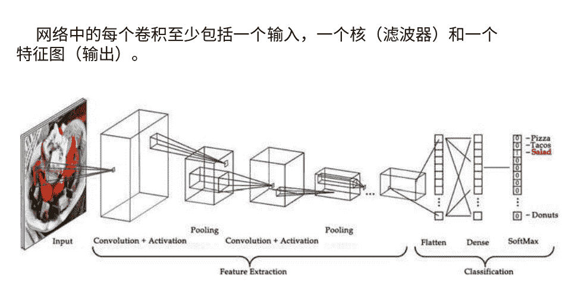

# 4.2.1 食物识别中的4种深度学习方法

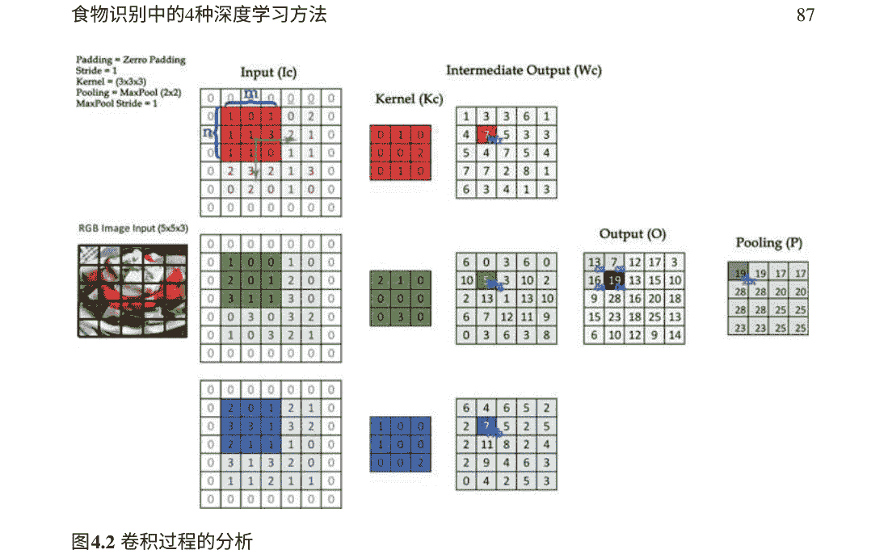

图4.2 卷积过程的分析

- 卷积神经网络的输入（或输入特征映射）通常是一个张量。¹ 张量是一个包含用于验证或训练卷积神经网络的多维数组。一个输入作为一个张量可以用 `(i, h, w, c)` 来表示，其中：`i` 是图像的数量，`h` 是图像的高度，`w` 是图像的宽度，`c` 是图像中的通道数。例如，`(64, 229, 229, 3)` 表示一个批次包含 64 张 229 × 229 像素和 3 个颜色通道（RGB）的图像。
- 卷积核（也称为滤波器和特征检测器）是一个具有固定值的小数组。将该数组与输入张量进行卷积可以揭示出视觉特征（如边缘）。卷积核以特定的步长和方向移动，以覆盖每个图像的整个表面。这些步长模式被称为步幅。步幅表示每次操作后卷积核移动的像素数。
- 输出特征图或者简单地说卷积的输出是由滤波器（核）从输入中提取的特征组，实际上是输入特征图的一种转换形式。输出特征图的张量大小主要取决于输入、核大小和步长。

图4.2描述了对一个RGB图像的整个过程（一个单步），在 5 × 5 × 3 的图像块上。对于输入张量的每个颜色通道 `c`，计算一个中间输出 (`W_c`)

$$ W_c = K_c \otimes I_{c_{(m,n)}} $$
(4.1)

其中 ⊗ 表示卷积，K_c 是卷积核，I_c(m,n) 是输入图像块。最终特征图O是通过添加每个通道的中间输出(W_c)来计算的：

$$ O = \sum_c W_c $$ (4.2)

为了减小特征图的大小，通常使用池化方法。池化通过使用某些函数对子区域进行总结来减小特征图的大小。用于此任务的典型函数是子区域（或子图）x的最大值（最大池化）或平均值（平均池化）。在图4.2的示例中使用了最大池化，表示为：

$$ O_x = \begin{bmatrix} 1 & 1 & 1 & 2 \\ 2 & 1 & 2 & 2 \end{bmatrix}, P_x = \max_{i,j=1,2}^{i,j} x $$ (4.3)

其中 $i_x, j$ 表示子图O_x的第i-th, j-th元素。通常，池化窗口（特征图的子区域）以特定的步幅移动。大多数情况下，内核的大小与输入张量的大小不一致，因此为了保持输出（特征图）的维度，并使内核能够正确地通过整个输入张量，需要使用数据填充策略。这在任何图像卷积应用中都很常见。填充是在输入张量周围添加额外值的过程。最常见的填充方法之一是零填充，它在输入张量的边界的每一侧添加零。有很多不同的方法来计算数字z。一个简单的方法是，如果使用步幅为1，则计算零填充的大小为 z =

$$ z = \lceil \frac{(k-1)}{2} \rceil $$
，其中k是滤波器大小，⌈⌉是向上取整操作。例如，大小为3x3的内核在每个维度上都施加了零填充，z = ⌈(3-1)/2⌉ = 1个零，它在每个图像维度的开头和结尾添加一个零。基于这些值，可以轻松计算卷积的输出大小。假设是一维情况或者是一个方形输入图像和滤波器核，计算任何卷积层的输出大小的公式如下

$$ o = \lfloor \frac{i - k + 2z}{s} \rfloor + 1 $$ (4.4)

其中o是输出的维度，i是输入的维度，k是滤波器大小，z是填充，s是步长，⌊⌋是向下取整操作。例如，在一个典型的情况下，i=5，k=3，z= ⌈(k-1)/2⌉ = 1和s=2，那么预期的输出大小应该是 o = ⌊(5-3+2)/2⌋ + 1 = ⌊4/2⌋ + 1 = 2+1=3。这个例子在图4.3中以图形方式描述，图中展示了使用适当的零填充进行方形图像卷积的前两个步骤。

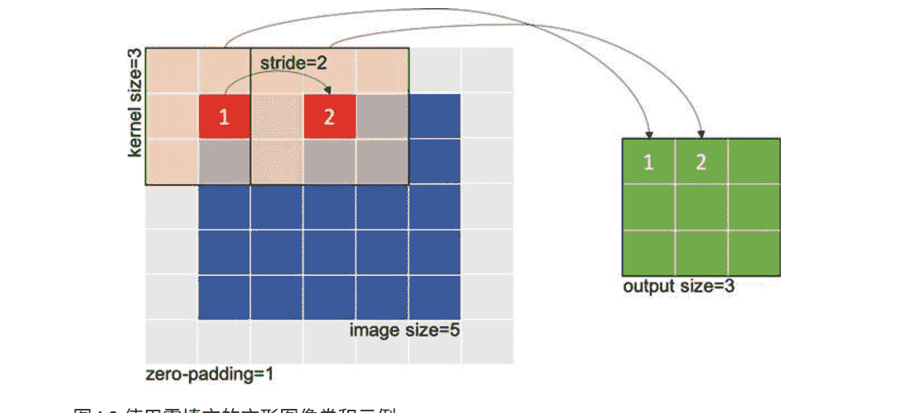

图4.3 使用零填充的方形图像卷积示例

在训练CNN时，有许多参数需要考虑，以实现有效的训练过程，最终产生一个强大而高效的深度学习模型。特别是当模型需要处理数百个到数百万个可训练参数时，就会面临许多挑战。其中最突出的问题是过拟合和欠拟合[16]。有几种方法可以缓解这些问题。欠拟合是指模型未能充分学习问题，在训练样本和验证样本上表现不佳（缺乏适应性）。过拟合是指模型对训练数据过度适应，但在验证样本上表现不佳（缺乏泛化能力）。显然，理想的情况是模型在训练数据和验证数据上都表现良好。因此，可以说当模型适当地学习数据集的训练样本并具有良好的泛化能力，并且在验证样本上表现良好时，该过程很可能产生了一个良好的拟合模型。图4.4中描绘了这些问题的简单示例。最左边的图表示数据集，包括训练样本和验证样本。从左数第二个图是欠拟合的示例，而从左数第三个图是过拟合的示例。

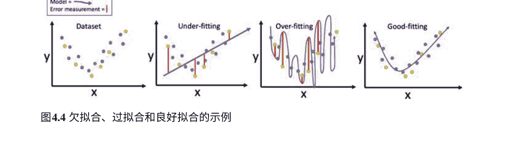

图4.4 欠拟合、过拟合和良好拟合的示例

左边是过拟合的一个例子。最右边的图表示一个良好拟合的模型。需要注意的是，在这些问题中计算误差的方法有很多种，在图4.4的图表中，基于验证数据的红色垂直线显示出来。

解决欠拟合问题的一些常见方法是增加数据集并延长训练时间，检查更合适的正则化方法，并检查模型是否不够强大（需要改变架构）。另一方面，使用流行的CNN架构，其中包含许多具有数百万个可训练参数的卷积层，过拟合的概率非常高。解决这个问题的方法是增加模型的灵活性，可以通过正则化技术实现，例如L1/L2正则化[3]、Dropout方法[38]和批归一化[21]。

L1正则化使用一种惩罚技术来最小化参数的绝对值之和，而L2正则化则最小化参数的平方和。L1和L2正则化都被称为“权重衰减”方法，因为它们试图尽可能保持网络权重较小。Dropout[38]在训练过程中随机删除神经元（单元和它们的连接），以便网络不过度依赖任何特定的神经元。批量归一化[21]主要用于提高网络的训练速度和性能，但也可以用于执行类似于dropout的正则化。批量归一化用于规范化每个层（中间层）的输入，以解决内部协变量漂移问题。它还允许使用更高的学习率，并且在某些情况下作为强大的正则化器，有时可以消除对Dropout的需求。除了前面介绍的方法之外，数据增强是另一种有效解决欠拟合或过拟合问题的流行技术。深度学习模型通常需要大量的数据才能得到适当的训练。因此，数据增强技术是训练过程中非常重要的一部分。可以应用于图像进行数据增强的一些最流行的操作包括（a）翻转，（b）随机裁剪，（c）倾斜，（d）颜色偏移，（e）旋转，（f）噪声破坏，以及（g）对比度变化。值得注意的是，当类别数量较多且网络过于复杂时，这些方法的组合可能是获得良好拟合模型的适当方法。

对于卷积神经网络和数学背景的深入研究，建议感兴趣的读者参考[8, 13, 16, 50]，或者相关的大量文献和在线资源。

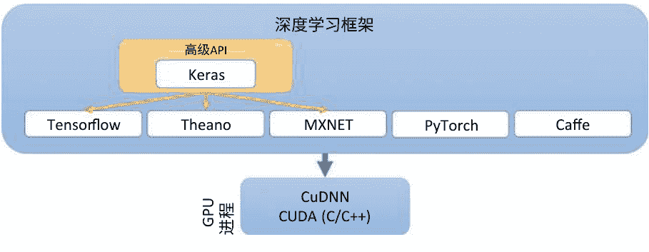

##### 4.2.2 受欢迎的深度学习框架

深度学习框架是一个包含接口、库、工具和应用程序的平台，允许开发人员和科学家轻松构建和部署复杂的深度学习模型，而不直接参与设计其架构和处理数学。此外，深度学习框架通过高级编程接口为设计、训练和验证深度神经网络模型提供构建模块。大多数这些框架依赖于GPU加速解决方案，如CuDNN，以实现高性能的多GPU加速训练。一个好的深度学习框架的一些关键特性包括：

- 性能优化
- GPU加速
- 良好的文档和良好的社区支持
- 易于编码
- 并行化进程
- 可用的深度模型/架构（应用）
- 预训练模型
- 多个可用的函数（例如优化器、激活函数、层等）
- 流行度
- 持续更新

基于这些关键特性，有六个深度学习框架脱颖而出，并在本节中介绍。图4.5展示了这些框架的简单分层视图，突出了它们都支持GPU加速。值得强调的是，只有Keras框架可以被视为高级API，它是在其他库的基础上开发的，主要关注提供用户友好且易于扩展的环境（框架）。

Caffe³[22]是最古老且最流行的深度学习框架，由杨清嘉在BAIR（伯克利人工智能研究）开发。Caffe支持逐层深度神经网络开发。虽然可以用Python编程语言开发新的层，但与用C++/CUDA编写的层相比，它被认为效果较差。Caffe除了提供Python API外，还提供MATLAB接口。在首次发布几年后，Caffe的创始人（贾扬清）及其在Facebook的团队于2018年开发了下一代Caffe框架，称为Caffe2。这个版本在更加用户友好的框架开发方面进行了改进。此外，它还提供支持移动应用程序的API。

此外，Caffe2支持开放神经网络交换（ONNX）格式，可以轻松集成其他框架（如MXNet、PyTorch等）的模型。实际上，自2018年5月2日起，Caffe2已经集成到PyTorch中。

TensorFlow⁴[1]是由Google的机器学习团队开发和支持的开源框架。它的开发和设计基于使用数据流图进行大规模分布式训练模型的数值计算。它包含200多个标准操作，包括各种数学运算、多维数组操作、流程控制等，都是用C++编程语言编写的。该框架支持GPU加速，也可以在CPU和移动设备上运行。因此，它可以被认为是既适用于科学研究又适用于产品开发的框架。它的明显缺点是需要使用低级API，对于没有经验的用户来说使用起来相当困难。然而，它已经集成到几个高级API中，如Keras、Estimator和Eager。

Keras⁵[7]是一个开源的神经网络库，运行在一些流行的框架上，如TensorFlow和Theano。它被认为是一个高级API（接口），用Python编写，而不是一个独立的机器学习框架，侧重于其可扩展性、模块化和用户友好的环境。它需要最少的知识和技术技能。自2017年以来，TensorFlow团队将Keras包含在TensorFlow的核心库中。

PyTorch⁶[2]是一个GPU加速的深度学习框架，由Python、C和CUDA等多种编程语言编写而成。它是由Facebook AI研究团队开发的。PyTorch比TensorFlow年轻，但在流行度上迅速增长，因为它在处理复杂架构时具有灵活性和开发的便利性。此外，它允许进行TensorFlow不支持的自定义。该框架被科学和工业界广泛使用，例如Uber在其应用中使用PyTorch。PyTorch得到了Facebook、Twitter和NVIDIA等一些高科技公司的支持。值得强调的是，PyTorch支持ONNX模型，可以在各种框架之间轻松交换模型。

Theano⁷[43]于2007年首次发布，并在蒙特利尔大学进行了开发。它是第二古老的重要Python深度学习框架。Theano通过在Python中使用NumPy来编译数学表达式和一些高效的本地库（如BLAS）在多个GPU和CPU上运行实验。2017年11月，Theano停止了主动升级，但仍在持续维护。请注意，Keras也可以在Theano之上运行。

MXNet[8][6]由Apache孵化并被亚马逊使用。它是第五受欢迎的深度学习库。MXNet的一个重要优点是其可移植性、轻量级开发和可扩展性，这使得它能够在多个GPU和CPU的计算机系统中进行有效适应。这一关键点使得MXNet非常强大和有用，适用于企业。此外，它的可移植性支持各种智能设备，如移动设备（使用Amalgamation）、物联网设备（支持AWS Greengrass）和无服务器（使用AWS Lambda）。此外，它与各种云服务直接兼容，非常适合云环境。MXNet支持Keras作为顶层接口，可以进行简单快速的原型设计。

MXNet支持ONNX格式的模型。有几项综合研究[23, 34]介绍了各种专注于机器学习的框架/库的优点和缺点。值得一提的是，大多数框架都有科学文档支持。下面简要介绍了前面提到的六个框架。它们都主要关注深度学习神经网络，并根据文献中的表4.1按照其受欢迎程度进行排序。请注意，尽管Theano是最古老的框架，但并不是最受欢迎的。在科学界中，最受欢迎的框架是Caffe。此外，Python编程接口对所有框架都是通用的。建议感兴趣的读者参考Nguyen等人于2019年发表的一篇广泛调查，该调查考虑了几乎所有的机器学习框架和库[34]。

4. [https://www.tensorflow.org/](https://www.tensorflow.org/)
5. [https://keras.io/](https://keras.io/)
6. [https://pytorch.org/](https://pytorch.org/)
7. [http://www.deeplearning.net/software/theano/](http://www.deeplearning.net/software/theano/)
8. https://mxnet.apache.org/

表4.1 最受欢迎的深度学习框架
| 名称 | 发布 | 编程接口 | 引用[a] |
| :--- | :--- | :--- | :--- |
| Caffe | 2014 | Python, MATLAB, C++ | 11,990 |
| TensorFlow | 2016 | Python, C++[b], Java[b], Go[b] | 9250 |
| Keras | 2015 | Python | 5399 |
| PyTorch | 2017 | Python, ONNX, C++ | 2718 |
| MXNET | 2015 | Python, C++, R, Java...[c] | 1077 |
| Theano | 2007 | Python, C++ | 572 |
[a] Google学术：最后访问于2019年11月7日
[b] 未完全涵盖
[c] 还有更多语言

#### 4.3 食物识别的深度学习方法

现如今，深度学习的从业者们在选择是开发新模型还是采用现有模型上存在争议，有时候意见截然不同。总结一下，开发一个应用于新领域（问题-任务）的新深度学习模型（架构）是一个复杂而耗时的过程，需要超出平均水平的编程和数学技能，以及对数据驱动（经验性）模型学习的理解。另一方面，当需要立即解决问题时，应采用微调的迁移学习。这种方法对技术技能和理论知识的要求较低，基本上只需要开发一个简单的分类方法。此外，现在有许多在线平台可以基于专有技术快速开发新模型，这些平台基本上充当开发者的黑盒子。这些平台提供了第三种选择，通常是预先训练了大量跨不同类别的数据集的机器学习系统，通过应用程序编程接口（API）提供解决方案给各种各样的问题。本节在移动旅游应用中的食物识别背景下回顾了这三种方法。研究从介绍相关图像数据集开始。

##### 4.3.1 食物图像数据集

深度学习方法，尤其是卷积神经网络方法，需要大量的数据集来构建高效的分类模型。现如今，即使有数百个可用的数据集，内容各异，但专注于营养内容（食物、饮料、成分等）的数据集非常有限且相当小[11]。在本节中，我们介绍了一些在文献中广泛使用的专注于食物识别的最受欢迎和大型数据集。表4.2总结了这些数据集，并按照它们包含的图像数量和引入年份对它们进行了排名。值得注意的是，过去五年中，许多团队一直在开发这些数据集。

表4.2 专注于食物类别的最受欢迎的大型数据集
| 名称 | 类别数 | 图像数 | 年份 | 描述 |
| --- | --- | --- | --- | --- |
| UECFood100 | 100 | 14,461 | 2012 | 大多数类别是日本流行的食物 |
| UECFood256 | 256 | 31,651 | 2014 |  |
| Food-101 | 101 | 101,000 | 2015 | 更一般的食物类别 |
| UMPCFood-101 | 101 | 100,000 | 2015 |  |
| VireoFood-172 | 172 | 110,241 | 2016 |  |
| Food524DB | 524 | 247,636 | 2017 |  |
| Food-101N | 101 | 310,000 | 2018 |  |

由于食物和它们的成分的识别是一个非常有趣和具有挑战性的问题，并且具有许多现实应用[10, 11, 33, 29]，因此需要更大规模的食物数据集。深度学习方法主要根据数学概率为每个样本（图像）提供预测。在大多数情况下，对预测的评估是基于网络结果（预测）与真实类别标签的比较。

top-1准确率是对预测结果进行排序，以确定目标输出（类别）是否与预测模型对图像进行的最高计算概率的类别相同。top-k准确率[51]可以定义为

$$ top-k = \frac{1}{N} \sum_{i=1}^{N} 1[a_i \in C_i^k] \qquad (4.5) $$
其中1[·] → {0, 1}表示指示函数。如果方括号中的条件满足，即表示$a_i$是问题$q_i$的真实答案，而 $C_i^k$是具有最高相似度答案的候选集合，则该函数返回1，否则返回0。

UECFood100⁹数据集[32]首次引入于2012年，包含100个食物图像类别。在每个图像中，食物项目位于一个边界框内。大多数食物类别（类）都是受欢迎的日本食物。因此，大多数食物类别可能对每个人来说都不太熟悉。该数据集的主要开发目的是在日本实现一个实用的食物识别系统。2014年，Kawano和Yanai使用该数据集分别获得了59.6%的top-1准确率和82.9%的top-5准确率[25]。

同一团队改进了他们的分类结果，在使用预训练的Deep CNN和ILSVRC2010¹⁰数据集[26]时，达到了72.26%的top-1准确率和92.00%的top-5准确率。

UECFood256¹¹数据集 [25] 包含256个食物图像类别。类别和图像的结构与UECFood100相似。再次，大多数食物类别都集中在日本食品上。该数据集被用于开发用于食物识别的移动应用程序。2018年，Martinel、Foresti和Micheloni在该数据集上实现了83.15%的top-1准确率和95.45%的top-5准确率[31]。

Food-101¹²数据集 [4] 是2014年由瑞士苏黎世联邦理工学院的计算机视觉实验室引入的。总共，该数据集每个101个食物类别（类别）都有一千张图像，共计101,100张图像。对于每个类别，提供250个测试图像和750个训练图像。所有图像都经过手动审核，训练图像故意添加了一些噪音，例如强烈的图像颜色偏移和错误的标签。所有图像都被重新缩放，使其最大边为512。

长度为512像素。 2018年，Martinel、Foresti和Micheloni在Food-101数据集上报告了90.27%的top-1准确率和98.71%的top-5准确率[31]。

UPMC Food-101[45]是在2015年开发的，被认为是一个包含100,000个食物项目的大型多模态数据集，分为101个类别。这个数据集是从网络上收集的，可以看作是Food-101的“孪生数据集”，因为它们共享相同的101个类别，并且大小大致相同。

VireoFood-172[5] 是一个包含描述食物类型和成分的图像数据集。该数据集包含来自172个类别的110,241张食物图像。所有图像都根据353种成分进行了手动注释。该数据集的创建者使用了MultiTaskDCNN，并实现了82.05%的top-1准确率和95.88%的top-5准确率[5]。

Food-524DB14[11] 是2017年推出的，被认为是最大的公开可用食物数据集之一，包含524个食物类别和247,636张图像。该数据集是通过合并现有数据集中的食物类别而开发的。该数据集是通过合并四个基准数据集构建的：VireoFood-172、Food-101、Food-50和UECFood256的修改版本。该数据集的创建者使用了流行的ResNet-50架构，并获得了81.34%的top-1准确率和95.45%的top-5准确率[11]。2018年，该数据集的一个修改版本Food-475发布，引入了一些小的差异[12]。

Food-101N[29]是由微软AI & Research于2018年在CVPR中引入的。该数据集旨在通过最少的人工监督来解决标签噪声问题。该数据集包含310,000张食谱图片，分为101个类别。Food-101和Food-101N以及UPMC Food-101数据集共享相同的101个类别。此外，Food-101N的图片更加嘈杂。Kuang-Huei、Xiaodong和Linjun使用CleanNet模型[29]实现了83.95%的Top-1准确率的图像分类。

请注意，开发一个具有全球知名食品类别的新大型数据集是非常困难和耗时的过程。如今，多个研究团队专注于自动化流程来开发更大的数据集。

自动化流程利用强大的图像搜索引擎、众包和社交媒体内容来执行数据收集任务。例如，Mezgec和Korousic [33]使用图像搜索引擎开发了一个食物数据集，结果非常有趣。

##### 4.3.2 方法一：新架构开发

本节介绍了一个名为PureFoodNet的CNN模型，该模型是为希腊的一个研发项目而开发的，该项目旨在为移动旅游应用程序提供区域希腊食品识别功能。该模型基于VGG架构[36]的构建块和原则（简单的同质拓扑结构）。开发新的CNN架构（模型）的常见做法是添加卷积层，直到模型开始表现良好并过拟合。然后，在模型的超参数上应用调整过程，直到出现一个拟合良好、高准确性的模型。这个过程耗时且需要大量的计算资源。例如，所提出的新模型PureFoodNet需要一个整月的时间才能在高端计算系统上开发和正确配置。

PureFoodNet的架构如图4.6所示。它由三个卷积块和一个分类块组成。第一个块包含两个卷积层，每个层都有128个滤波器。第二个块包含三个卷积层，每个层都有256个滤波器，第三个块包含三个卷积层，每个层都有512个滤波器。最后一个块通常被称为“顶层”或“分类层”，它包含一个具有512个神经元的密集层和一个具有101个输出的预测层（密集层）。对于这个模型的初始开发，请注意，预测层的输出被设计成与Food-101数据集的101个类别（食物类别）相匹配。为了避免PureFoodNet模型过拟合，架构包括经典的正则化机制，如Dropout、L2正则化和批归一化层。此外，为了PureFoodNet的调优，使用了一种权重初始化方法[14, 39]。为了实现快速准确的训练，采用了具有Nesterov动量的优化器[39]。

在食物识别和许多其他情况下，了解每个层（甚至每个神经元）学到了什么是很重要的。一种方法是通过可视化层的值（局部“知识”）来实现这一点。因此，可以很容易地解决未使用（死）滤波器的问题。通过检查许多不同输入的一些激活图是否全为零，可以注意到这个问题，这是由于学习率过高引起的症状。最常用的方法是在前向传递过程中可视化层的激活。使用ReLU激活函数的网络[15]通常在训练开始时的激活看起来太嘈杂（相对块状和密集）。经过几个训练周期并且网络开始表现良好后，激活的可视化变得更加直观、稀疏和局部化。

在图4.6中，每个块的上方都显示了一些指示性层的激活情况，以突出每个层所学到的信息。很明显，网络越低层（块1）观察，层所保留的信息越普遍，与之相反，高层（块3）学到的信息更具体/针对性。这是因为在许多食物图像中存在自相似性，即图像表面上相同形状的重复模式。这就是为什么卷积层引起的图像平铺可以改善成分的定位，从而改善对菜肴的学习和预测。

##### 4.3.3 方法二：迁移学习和微调

基于深度学习的食物识别方法的第二种替代路径依赖于使用流行的预训练深度学习模型，实现迁移学习技术。深度学习理论中的迁移学习是一种流行的机器学习技术，即将为特定任务开发和训练的模型在某些参数化下重新用于另一个类似任务（微调）。Torrey和Shavlink[44]提供了迁移学习的直观定义：“通过从已经学习过的相关任务中转移知识，改善对新任务的学习”。微调是使用预训练模型但不使用其顶层的过程，顶层被新的更适合新任务（数据集）的层替换。例如，如果要使用预训练的PureFoodNet模型，则应删除顶层（即图4.6中绿色矩形内的层），并仅保留卷积层及其权重。根据新任务（新数据集）的需求，应添加新的顶层，并将预测层的输出数量与新类别的数量关联起来。为了达到理想的性能，通常需要适当重新组合顶层、重新配置参数并进行多次重复。

由于迁移学习的易用性，现在很少有人从头开始开发和训练新的CNN模型（架构）。这是因为很难获得足够规模的数据集来完成特定任务。而且，正如之前提到的，开发一个新模型是复杂且耗时的。相反，更方便的做法是重用在非常大的数据集上训练过的模型，比如包含超过1400万张图片和20000个类别的ImageNet [49]。还要注意的是，ImageNet包含许多描绘食物或可食用物品的类别，因此在ImageNet数据集上预训练的模型预计在食物识别应用中非常有效且易于调整以提高性能。

## 4.3.4 第三种方法：深度学习平台

对于特定任务的新模型开发或现有预训练模型的微调有时是值得怀疑的，因为深度学习实践中存在第三种选择：强大的在线平台，这些平台在广泛的类别上使用大型数据集进行预训练。本节介绍了一些流行的基于图像的食物识别平台，以及对它们的效果评估和优缺点总结。这些平台每天都在进行训练，因此随着时间的推移不断改进。其中一些平台属于成熟的技术提供企业，他们从深度学习服务和应用中获益。这些企业向科学和工业界提供了将其基础设施用于商业用途的选择，可以通过付费订阅或有限的免费试用来使用，对于实验来说，在大多数情况下是足够的。需要强调的是，这些平台提供的预训练模型作为“黑盒子”工作，因为它们不提供足够的关于其预测机制、架构等的细节，并且它们的参数化是受限的。所有这些平台都提供多种工具和通过API的编程接口。

Vision AI (VAI)是由Google于2016年作为云服务开发的。它包括多种不同的特征检测，如光学字符识别（OCR），并通过专注于多种语言的手写文本识别机制进行增强，人脸检测，中等内容（成人、暴力等不适宜内容），地标和标志检测。

Clarifai (CAI) 是在2013年为ImageNet大规模视觉识别竞赛（ILSVRC）开发的，并在当年获得了前5名。Clarifai是唯一一个提供有关预测模型选择的选项的平台。它提供了一系列有趣的模型，用于不同的目的，如通用图像识别，人脸识别，不适宜观看（NSFW）识别，颜色检测，名人识别，食物识别等。

Amazon Rekognition (AR)于2016年由亚马逊推出，作为一项服务在收购深度学习初创公司Orbeus之后。Amazon Rekognition提供了对对象、人物、文本、场景和活动的识别，并且能够检测任何不适当的内容，在面部检测和分析方面具有相当的能力（情绪、年龄范围、睁眼、眼镜、面部毛发等）。

Computer Vision (CV)是由微软开发的认知服务的一部分。该平台可以检测图像中的颜色、人脸、情绪、名人、文本和不适宜内容。Computer Vision的一个重要特性是OCR系统，它可以识别25种不同语言的文本，并具有强大的内容解释系统。

#### 4.4 比较研究

本节对基于图像的食物识别的三种前述替代方案进行了比较研究。PureFoodNet的引入架构在Food-101数据集上与最流行的预训练模型进行了测试，而深度学习平台则在一个玩具实验中相互进行了测试，揭示了它们的优势和劣势。

##### 4.4.1 新架构对抗预训练模型

在任何事情之前，PureFoodNet的架构要比其他预训练模型更浅。在PureFoodNet的开发中，使用了随机权重初始化，以加快训练过程，并进行了学习率的自定义调整。在本节中，考虑了VGG16 [36]，InceptionV3 [42]，ResNet50 [18]，InceptionResNetV2 [40]，MobileNetV2 [35]，DenseNet121 [20]和NASNetLarge [52]深度CNN架构的实验。实验的Python代码可以通过源代码管理存储库访问。

在这些实验中，每个模型都使用完全相同的顶层（图4.6中绿色矩形中的层），以便进行公平比较。图4.7展示了每个模型的准确率柱状图，以及模型达到这些结果所需的训练轮数柱状图。准确率柱状图显示了每个模型的分类前1和前5的性能，包括训练（前1，前5）和验证（前1 val，前5 val）。在这些实验中，模型的训练在验证准确率停止提高的时刻停止，因此报告的模型所需的训练轮数有所差异。这是显而易见的。

大多数模型表现得相当好。最差的验证准确率为76%，对于VGG16模型来说，它也是学习速度最慢的之一。一个有趣的观察是，在图表中并不明显，NASNetLarge在很少的训练周期内取得了最好的分数，但是它需要的时间大约比其他预训练网络多83.33%，比PureFoodNet多约92%。显然，尽管PureFoodNet并不是最好的，但它表现得很好。

从top-5准确率的角度来看，PureFoodNet和NASNetLarge之间的性能差异微不足道。

根据应用程序的不同，人们应该始终考虑每个模型的复杂性，因此在性能和要求/规范之间存在一种权衡，并且应该达到一种平衡。NASNetLarge生成的模型大小约为PureFoodNet大小的86%。此外，在研究食物识别任务时，每个层所提供的分析应与食物结构的语义意义相一致，即成分。因此，在这个任务中，模型的效率不能通过典型的度量和指标来精确量化。因此，选择模型（架构）不能仅仅依赖于典型的性能得分（训练过程中达到的准确性）。优雅的模型选择是一个复杂的过程，除了类别预测之外，还应考虑更多的标准。

##### 4.4.2 深度学习平台之间的比较

在下面的段落中，展开了一个玩具实验，以提供对基于图像的食物识别中流行的深度学习平台评估的直观理解。

为实验选择了两个不同的测试图像（图4.8），内容复杂。这两个图像都包含多个成分。图像A（图4.8左侧）展示了一个希腊沙拉。这个图像包含一些明显的成分，比如切片的番茄、黄瓜、洋葱、奶酪（菲达奶酪）、橄榄、莳萝和香菜。图像B（图4.8右侧）展示了一个水果甜点，其中有草莓、蓝莓、奇异果、葡萄柚、橙子和杯底的奶油。

图4.9和图4.10分别展示了所有评估平台对这两个测试图像的预测结果，其中（a）绿色柱状图表示真正的正类（正确预测的类别，如成分、食物类型等），（b）红色柱状图表示假正类（错误预测的类别），（c）蓝色柱状图表示中立、部分正确或对本案例研究不重要的结果。即使对图4.9中呈现的结果进行肤浅比较，都清楚地显示出CV和AR在成分和整体结果方面表现不佳。VAI稍微好一些，但仍然识别出一些不存在的（或与上下文无关的）类别。CAI的表现明显更好，但也报告了图像中不存在的食物成分。显然，正确识别的类别数量以及它们的准确性，清楚地将CAI排名为图像A的最佳平台。值得注意的是，CAI是唯一一个识别到香菜存在的平台，而香菜在图像A的盘子上是在右下角。VAI以相当高的准确性预测食物类型可能是“卡普雷塞沙拉”（64%准确性）或以色列沙拉（63%准确性），这是因为这三种沙拉非常相似。

在图4.10中，显示了图像B上的结果，再次清楚地表明CV识别出了最少的类别，包括两个非常普遍的类别（新鲜的，食物）。然而，重要的是CV是唯一一个以非常低的置信度发现了“切片”类别的平台。AR也表现不佳，只识别出了少数正确的类别，并且置信度非常低。很明显，CAI和VAI在这种情况下表现良好。尽管CAI呈现了一些错误的正例（但仍然有一定相关性的结果），但对真正的正例有很高的置信度，并且报告的类别更多，使其成为一种有价值的工具。另一方面，VAI似乎成功避免了错误的正例，但类别数量和置信度都明显较低。

总的来说，从一个玩具实验来看，CAI和VAI在食物识别领域的测试内容识别平台中表现更好，CAI提供了稍微更好的结果，显然是因为它在食物方面有专门的模型。从开发者的角度来看，重要的是这些平台都不需要高级编程技能来开发图像内容分析系统。

#### 4.5 结论

基于图像的食物识别是一个具有挑战性的任务，它在过去十年中引起了计算机视觉和人工智能科学界的兴趣。可以肯定的是，一道菜可能包含各种不同的成分，这些成分的形状和大小可能取决于地区的传统和习惯。例如，今天全世界都知道，带有番茄、橄榄和洋葱的沙拉与地中海饮食有关。因此，区分希腊沙拉、卡普雷塞沙拉和以色列沙拉可能是一项困难的任务，即使对于人类。食材的切割和摆放方式可能是区分的一个线索，但这也是可以争论的。

在任何现代机器学习任务中，设计一个新的深度学习模型（架构）还是通过迁移学习利用现有模型，或者使用可用的基于图像的内容预测平台（通常通过API）是一个有争议的问题。设计新架构需要广泛的知识和直觉，而迁移学习基本上需要特定的知识，基于平台的应用开发只是一个技术解决方案。另一方面，从生产力和部署的便利性角度来看（在效率上做出妥协），这些方法的排名则相反，平台很容易排名第一。

本章重点讨论了基于图像的食物识别这个特别有趣和复杂的问题，并试图在这三种机器学习解决方案的基础上揭示每种方法的优势和劣势，并突出显示所提供的机会和这些方法及其先决条件中的固有威胁。此外，由于机器学习方法对数据需求量大，介绍了流行的大型食物识别数据集，并确定了对更具体和全球知名食品类别的需求。

该研究强调了对食品成分进行标记的需求，这将使深度学习方法能够获得更好的性能并提供更多有用的现实世界的应用（如营养和旅游）。总的来说，本章提出了在食品识别领域中采用深度学习方法的光明未来，并提出了一些未来的方向，例如：

- 创建大规模的食品数据集，具有特定内容，全球知名的食品数据类别
- 不仅使用食品类型（类别）对数据集进行标记，还使用食品成分（多标签类别）进行标记
- 开发混合方法以获得更好的结果，例如将新模型与预测平台相结合
- 开发和整合食品和成分本体
    - 以提高一般预测的准确性
    - 基于上下文因素制定规则（a）可能导致类似食品分离规则的制定，基于起源、习惯、文化等，（b）可能帮助基于地理位置、个人偏好等进行有针对性的预测。

致谢 本研究得到了欧洲区域发展基金和希腊国家基金通过运营计划竞争力、创业和创新的支持，项目编号为T1EDK-02015。我们还衷心感谢NVIDIA Corporation捐赠的Titan Xp GPU用于本研究的实验。

#### 参考文献

1. M. Abadi, P. Barham, J. Chen, Z. Chen, A. Davis, J. Dean, ..., X. Zheng, Tensorflow: 一个用于大规模机器学习的系统，在第12届USENIX操作系统设计和实现研讨会上，位于美国佐治亚州萨凡纳市（2016年），第265-283页
2. S.G. Adam Paszke, PyTorch中的自动微分，在第31届神经信息处理系统会议上，位于美国加利福尼亚州长滩市（2017年）
3. Y. Andrew, 特征选择, L1与L2正则化以及旋转不变性，在第二十一届国际机器学习大会(ACM, 2004)
4. L. Bossard, M. Guillaumin和L. Van Gool, Food-101—使用随机森林挖掘判别性组件，在欧洲计算机视觉大会(Springer, Cham, 2014), pp. 446–461
5. J. Chen和W.C. Ngo，基于深度的食材识别用于烹饪食谱检索，在 ACM多媒体(2016), pp. 32–41
6. T. Chen, M. Li, Y. Li, M. Lin, M. Wang, M. Wang, ... Z. Zhang, MXNet: 一种灵活高效的机器学习库，用于异构分布式系统，在NIPS机器学习系统研讨会(LearningSys) (2015)
7. F. Chollet, François Chollet. Keras.io. (2015). 访问Keras网站: https://keras.io
8. F. Chollet, Python深度学习(Manning出版社, 2018)
9. S. Christodoulidis, M. Anthimopoulos, S. Mougiakakou, 使用深度卷积神经网络进行饮食评估的食物识别,在国际图像分析和处理会议(Springer, Cham, 2015), 第458-465页

C. Kiourt等人

+   10. G. Ciocca, P. Napoletano, R. Schettini, 食物识别: 一个新的数据集, 实验和结果. IEEE J. Biomed. Health Inform. 21(3), 588-598 (2017)
+   11. G. Ciocca, P. Napoletano, R. Schettini, 学习基于CNN的特征用于食物图像检索,图像分析和处理的新趋势—ICIAP 2017: ICIAP国际研讨会, WBICV, SSandBE, 3AS, RGBD, NIVAR, IWBAAS, 和 MADiMa 2017 (Springer国际出版社, 意大利卡塔尼亚, 2017), 第426-434页
+   12. G. Ciocca, P. Napoletano, R. Schettini, 基于CNN的特征用于食物图像的检索和分类。计算机视觉和图像理解 176–177, 70–77 (2018)
+   13. V. Dumoulin, F. Visin, 深度学习卷积算法指南 (2016). arXiv arXiv: 1603.07285
+   14. X. Glorot, Y. Bengio, 理解训练深度前馈神经网络的困难, 第十三届国际人工智能和统计学会议(2010), pp. 249–256
+   15. X. Glorot, A. Bordes, Y. Bengio, 深度稀疏整流神经网络, 国际人工智能和统计学会议, 编辑: G. Gordon, D. Dunson, M. Dudk (2011),pp. 315–323
+   16. I. Goodfellow, Y. Bengio, 和 A. Courville, 深度学习 (MIT Press, 2016)
+   17. H. Hassannejad, G. Matrella, P. Ciampolini, I. DeMunari, M. Mordonini, S. Cagnoni, 食物图像识别使用非常深的卷积网络, 在第二届国际多媒体辅助饮食管理研讨会, 阿姆斯特丹, 荷兰 (2016年) , 第41-49页
+   18. K. He, X. Zhang, S. Ren, J. Sun, 深度残差学习用于图像识别, 在2016年IEEE计算机视觉和模式识别会议 (CVPR) , 拉斯维加斯, 内华达州 (2016年) , 第770-778页
+   19. S. Horiguchi, S. Amano, M. Ogawa, K. Aizawa, 针对食物图像的个性化分类器识别。IEEE Trans. Multimedia 20(10), 2836-2848 (2018年)
+   20. G. 黄, Z. 刘, L. van der Maaten, K. Weinberger, 密集连接的卷积神经网络, 在IEEE模式识别和计算机视觉会议 (2017年) , 第4700-4708页
+   21. S. Ioffe, C. Szegedy, 批归一化: 通过减少内部协变量偏移加速深度网络训练, 在ICML'15会议论文集第32届国际机器学习会议 (2015年) , 第448-4456页
+   22. Y. Jia, E. Shelhamer, J. Donahue, S. Karayev, J. Long, R. Girshick, ... T. Darrell, Caffe: 快速特征嵌入的卷积架构, 在第22届ACM国际多媒体会议 (ACM, 美国佛罗里达州奥兰多) , 第675-678页
+   23. A. Jovic, K. Brkic, N. Bogunovic, 通用数据挖掘的免费软件工具概述,在第37届国际信息与通信技术、 电子和微电子大会上(2014年), 第1112-1117页
+   24. H. Kagaya, K. Aizawa, M. Ogawa, 使用卷积神经网络进行食物检测和识别, 在第22届ACM国际多媒体会议上奥兰多, 佛罗里达州, 美国 (2014年), 第1055-1088页
+   25. Y. Kawano, K. Yanai, FoodCam: 一种基于智能手机的实时食物识别系统。多媒体工具应用 74(14), 5263-5287 (2014年)
+   26. Y. Kawano, K. Yanai, 利用领域自适应扩展现有食物图像数据集, 在ECCV Workshop on Transferring and Adapting Source Knowledge in Computer Vision (TASK-CV)会议上(2014年), 第3-17页
+   27. Y. Kawano, K. Yanai, 使用深度卷积特征进行食物图像识别, 在ACM UbiComp Workshop on Cooking and Eating Activities (CEA)会议上(2014c), 第589-593页
+   28. A. Krizhevsky, I. Sutskever, G.E. Hinton, 使用深度卷积神经网络进行ImageNet分类, 在第25届国际神经信息处理系统大会上, 内华达州塔霍湖 (2012年), 第1097-1105页
+   29. L. Kuang-Huei, H. Xiaodong, Z. Lei, Y. Linjun, CleanNet: 带有标签噪声的可扩展图像分类器训练的迁移学习, 在IEEE计算机视觉和模式识别会议 (2018)中
+   30. C. Liu, Y. Cao, Y. Luo, G. Chen, V. Vokkarane, Y. Ma, DeepFood: 基于深度学习的计算机辅助饮食评估的食物图像识别, 在第14届国际智慧城市和数字健康会议,中国武汉 (2016),第37–48页
+   31. N. Martinel, G. Foresti, C. Micheloni, Wide-slice residual networks for food recognition, 在2018 IEEE冬季计算机视觉应用会议 (WACV),内华达州塔霍湖(2018),第567-576页
+   32. Y. Matsuda, H. Hoashi, K. Yanai, 通过检测候选区域识别多个食物图像, 在IEEE国际多媒体和博览会(ICME)会议论文集中(2012)
+   33. S. Mezgec, S. Koroušić, NutriNet: 一种用于膳食评估的深度学习食物和饮料图像识别系统 营养素 9(7), 657 (2017)
+   34. G. Nguyen, S. Dlugolinsky, M. Bobák, V. Tran, A.L. García, I. Heredia, L. Hluchý, 用于大规模数据挖掘的机器学习和深度学习框架和库: 一项调查. 人工智能评论 52(1), 77–124 (2019)
+   35. M. Sandler, A. Howard, M. Zhu, A. Zhmoginov, L.C. Chen, MobileNetV2: 倒置残差和线性瓶颈, 在IEEE计算机视觉和模式识别会议上(2018), pp. 4510–4520
+   36. K. Simonyan, A. Zisserman, 非常深的卷积网络用于大规模图像识别, 在第三届IAPR亚洲模式识别会议(ACPR), 吉隆坡(2015年), pp. 730–734
+   37. A. Singla, L. Yuan, T. Ebrahimi, 使用预训练的GoogLeNet模型进行食物/非食物图像分类和食物分类, 在第二届多媒体辅助饮食管理国际研讨会, 阿姆斯特丹, 荷兰(2016年), pp. 3–11
+   38. N. Srivastava, G. Hinton, A. Krizhevsky, I. Sutskever, R. Salakhutdinov, Dropout: 一种简单的方法防止神经网络过拟合. 机器学习研究杂志。 15(1), 1929–1958 (2014)
+   39. I. Sutskever, J. Martens, G. Dahl, G. Hinton, 关于初始化和动量在深度学习中的重要性在国际机器学习会议(2013年), pp. 1139–1147
+   40. C. Szegedy, S. Ioffe, V. Vanhoucke, A. Alemi, Inception-v4, inception-resnet和残差连接对学习的影响, 在第三十一届AAAI人工智能大会(2017年)
+   41. C. Szegedy, W. Liu, Y. Jia, P. Sermanet, S. Reed, D. Anguelov, ... A. Rabinovich, 通过卷积深入学习, 在2015年IEEE计算机视觉和模式识别会议(CVPR), 波士顿, 马萨诸塞州(2015), 第1-9页
+   42. C. Szegedy, V. Vanhoucke, S. Ioffe, J. Shlens, Z. Wojna, 重新思考计算机视觉中的Inception架构, 在IEEE计算机视觉和模式识别会议(2016), 第2818-2826页
+   43. D. TheanoTeam, Theano: 一个用于快速计算数学表达式的Python框架 (2016). arXiv预印本 arXiv:1605.02688
+   44. L. Torrey, J. Shavlik, 迁移学习, 在机器学习应用研究手册中, 编者E. Soria, J. Martín, R. Magdalena, M. Martínez, A. Serrano (IGI Global, 2009), 第242-264页
+   45. X. Wang, D. Kumar, N. Thome, M. Cord, F. Precioso, 使用大型多模态食物数据集进行食谱识别, 在2015年IEEE多媒体与博览会研讨会(ICMEW)上, 都灵(2015), 第1-6页
+   46. M. Weiqing, J. Shuqiang, L. Linhu, R. Yong, J. Ramesh, 食品计算的综述 (ACM计算调查, 2019)
+   47. K. Yanai, Y. Kawano, 使用预训练和微调的深度卷积网络进行食物图像识别, 在2015年IEEE多媒体与博览会上, 都灵, 意大利(2015), 第1-6页
+   48. Q. Yu, M. Anzawa, S. Amano, M. Ogawa, K. Aizawa, 通过个性化分类器进行食物图像识别, 在第25届IEEE图像处理国际会议上, 雅典(2018), 第171-175页
+   49. M. Zeiler (2013). 访问 http://www.image-net.org/challenges/LSVRC/2013/results.php
+   50. M. Zeiler, R. Fergus, 可视化和理解卷积网络, in IEEE欧洲计算机视觉会议(2014), pp. 818–833
+   51. S. Zhang, X. Zhang, H. Wang, J. Cheng, P. Li, Z. Ding, 使用端到端字符级多尺度CNN进行中医问题回答匹配. 应用科学. 7(8), 767 (2017)
+   52. B. Zoph, V. Vasudevan, J. Shlens, V. Le, 学习可扩展的可迁移架构进行图像识别, in IEEE计算机视觉和模式识别会议(2018), pp. 8697–8710

## 第二部分

## 社交媒体和物联网中的深度学习

### 第5章
用于Twitter情感分析的深度学习：预训练词嵌入的影响

Akrivi Krouska, Christos Troussas和Maria Virvou

摘要 Twitter是最流行的微博平台，每天有数百万用户交换大量的文本消息，称为“推文”。这导致了大量的非结构化数据，即大数据。公司或组织可以分析这样的大数据，以提取客户对其产品或服务的看法，并监测市场趋势。自动理解用户生成内容背后的观点，称为“大数据分析”，是非常重要的。深度学习可以使大数据分析的判别性任务更加容易和高效。深度学习是机器学习的一个方面，它指的是具有多个层次的人工神经网络，并广泛用于解决大数据挑战，如语义索引、数据标记和即时信息检索。深度学习要求其输入以词嵌入的形式表示，即以高维空间中的实值向量表示。然而，词嵌入模型需要大型语料库进行训练，并呈现可靠的词向量。因此，有许多预训练的词嵌入可供利用。实际上，这些是由不同的研究团队制作的单词及其对应的n维词向量。

在这项工作中，我们使用大量推文数据进行了数据分析，将其作为大数据，并使用深度学习方法对其进行情感分类，其中包括四个著名的预训练词向量，即Google的Word2Vec，Stanford的Crawl GloVe，Stanford的Twitter GloVe和Facebook的FastText。一个主要的结论是，使用深度学习进行推文分类优于基准机器学习方法。

A. Krouska · C. Troussas · M. Virvou (✉)
软件工程实验室，信息学系，比雷埃夫斯大学，比雷埃夫斯，希腊e-mail: mvirvou@unipi.gr

A. Krouska
e-mail: akrouska@unipi.gr

C. Troussas
e-mail: ctrouss@unipi.gr

学习算法。同时，就预训练的词嵌入而言，FastText在数据集上提供了更一致的结果，而Twitter GloVe尽管维度较低，但准确率非常高。

关键词 深度学习 · 大数据 · Twitter · 情感分析 · 词嵌入 · CNN

#### 5.1 引言

Web 2.0的普及导致了一个数字化的景观，人们能够通过各种方式和应用在公共场合表达和分享他们的思想和观点，从而进行社交。这种社交互动的标志是微博，一种允许用户在线发布和分享短消息的在线广播媒介。Twitter是这类服务中最受欢迎的，每天有数百万用户交换大量的文本消息，称为推文。这导致了大量的非结构化数据，即大数据，可以整合到决策过程中，即大数据分析。大数据分析是一种复杂的过程，用于检查大量和多样化的数据集（大数据），以揭示包括隐藏模式、未知相关性、市场趋势和客户偏好在内的信息，从而帮助组织做出更明智的业务决策[1]。Twitter是这个过程中的一个宝贵媒介。本文重点分析推文的观点，称为Twitter情感分析。情感分析是一种旨在检测文本单位的情感内容，以识别人们对各种主题的态度和观点的过程[2]。

Twitter，拥有近6亿用户和每天超过2.5亿条消息，已成为情感分析中最大且最具活力的数据集之一。Twitter情感分析是根据用户意图传递的情感或极性对推文进行分类。这些信息在决策至关重要的许多情况下都非常有价值。例如，在政治中，意见和情感检测对于预测选举结果或估计政治家的接受程度非常有用[3]；在营销中，对销售预测、产品推荐和投资者选择非常有用[1]；在教育环境中，将学习者的情绪状态纳入学生模型，提供情感学习环境[4]。

Twitter情感分析在社交媒体挖掘中变得越来越重要，因为它可以获取关于各种商业和社会问题的众多参与者宝贵的意见。因此，许多研究人员专注于情感分析算法的应用和改进，以提供更高效准确的结果[5]。情感分析有三种主要方法：a. 基于机器学习的方法，使用分类技术对文本实体进行分类；b. 基于词典的方法，使用情感词典和权重确定极性；c. 混合方法，结合不同的方法[4, 6, 7]。实验结果表明，机器学习的方法具有更高的精度，而基于词典的方法在训练数据集缺乏数量和质量的情况下具有竞争力，因为它们需要很少的人工标记文档 [5, 7]。另一方面，结合适当的技术可以取得更好的结果，因为混合方法可以同时展示机器学习算法的准确性和词典的速度 [6]。然而，最近从机器学习领域出现了一种新的方法，即深度学习，使前面提到的方法黯然失色。

深度学习是机器学习的一个方面，它指的是具有多个层次的人工神经网络：一个输入层，一个输出层和至少一个隐藏层 [8]。深度学习中的“深”指的是具有多个隐藏层。神经网络复制了人脑，由大量的信息处理单元（称为神经元）组成，这些神经元组织成层次结构，共同工作。深度学习是一种分层特征学习，每一层都学习将其输入转化为稍微更抽象和复合的表示，通过非线性处理使用基于权重的模型和激活函数来指导输入值的重要性的每个神经元。迭代继续进行，直到输出数据达到可接受的准确率。

深度学习可以用来提取埋藏在大数据中的令人难以置信的信息[1]。它已经广泛应用于人工智能领域，如计算机视觉、迁移学习、语义解析和自然语言处理。因此，为了更准确的情感分析，许多研究人员实现了不同模型的这种方法，即CNN（卷积神经网络）、DNN（深度神经网络）、RNN（循环神经网络）和DBN（深度置信网络）[8]。结果表明，深度学习在情感分类中非常有益。除了更高的性能外，不需要精心优化的手工特征和特征工程，这是机器学习实践中最耗时的部分之一。使用深度学习可以更好地解决大数据挑战，如语义索引、数据标记和即时信息检索。

然而，它需要大量的数据集，并且训练过程非常耗时。

在这项研究中，我们应用了卷积神经网络对三个著名的Twitter数据集进行分析，分别是奥巴马-麦凯恩辩论（OMD）、医疗保健改革（HCR）和斯坦福Twitter情感黄金标准（STS-Gold，用于情感分类），使用了不同的预训练词嵌入。词嵌入是构建词和文档的向量表示的最有用的深度学习方法之一。它们的新颖之处在于能够捕捉词之间的句法和语义关系。最成功的词嵌入深度学习方法包括Word2Vec [9, 10]、GloVe [11]和FastText [12]。许多研究人员在情感分析实验中使用了这些方法 [13, 14]。尽管它们很有效，但它们的一个限制是需要大型语料库进行训练并得到可接受的词向量。因此，由于某些数据集的规模较小，研究人员不得不使用预训练的词向量。在这项研究中，我们对四种著名的预训练词嵌入进行了实验，分别是Google的Word2Vec、斯坦福的Crawl GloVe、斯坦福的Twitter GloVe和Facebook的FastText，并检验了它们对情感分类性能的影响。

本文的结构如下。首先，我们介绍了使用深度学习技术进行Twitter情感分析的相关工作。接下来，我们介绍了本研究的评估过程，描述了数据集、预训练的词嵌入和深度学习算法的使用。第5.4节涉及实验结果的比较分析和讨论。最后，我们提出了结论和未来的工作。

#### 5.2 相关工作

分析大数据的需求源于社交媒体的普及，高效地分类情感导致许多研究人员采用深度学习模型。所使用的模型在所采用的数据集维度、词嵌入和算法方面应用的深度学习技术以及所服务的目的方面各不相同。本节简要介绍了与Twitter情感分析相关的代表性研究，并根据上述维度对其进行了分类。

在[13]中，作者们尝试了深度学习模型以及现代训练策略，以实现更好的推文情感分类器。所提出的模型是通过软投票将10个CNN和10个LSTM集成在一起。集成的模型使用了不同的随机权重、不同的迭代次数、滤波器大小和嵌入预训练算法，即Word2Vec或FastText。GloVe变体被排除在集成模型之外，因为它的得分低于其他两种嵌入方式。

在[15]中，作者提出了一个三步骤的过程来训练他们的深度学习模型，以预测消息和短语级别的极性：

1.  使用Word2Vec神经语言模型初始化词嵌入，该模型在大型无监督推文数据集上进行训练；
2.  使用CNN进一步改进大型远程监督数据集上的嵌入；
3.  使用在前一阶段获得的词嵌入和网络的其他参数初始化具有相同架构的网络，然后在来自Semeval-2015的监督数据集上进行训练。

在[16]中，作者开发了一个双向长短期记忆（BLSTM）RNN，它结合了2个RNN：一个正向RNN，其中序列从左到右处理，一个反向RNN，其中序列从右到左处理。对于每个标记，两个RNN的输出的平均值用于计算模型对不良药物反应（ADR）识别的最终标签。对于预训练的词嵌入，他们使用了Word2Vec 400 M Twitter模型（由Frederic Godin提供），它是使用跳字算法在超过4亿条推文上进行训练的一组400维词嵌入。

在[17]中，作者提出了一种基于深度学习算法的新的分类方法，以解决Twitter垃圾邮件检测的问题。他们首先收集了10天的数据真实的推文语料库并应用Word2Vec进行预处理，而不是特征提取。随后，他们使用MLP实现了二进制检测，并将其方法与其他技术进行了比较，例如传统的基于文本的方法和基于特征的机器学习方法的支持。

在[18]中，作者们将卷积算法应用于Twitter情感分析，以训练深度神经网络，以提高准确性和分析速度。首先，他们使用GloVe模型在200亿条Twitter语料库上实现了无监督学习的词级嵌入。随后，他们将这种词表示与先前的极性得分特征和情感特征集合相结合，并将其作为输入输入到深度卷积神经网络中，以训练和预测五个Twitter数据集的情感分类标签。他们的方法与基准方法进行了比较，包括预处理技术和分类算法的使用。

在[19]中，作者提出了一种有效的深度神经架构，用于在四种语言的推文中进行无语言偏见分析。所提出的模型是一个卷积网络，具有字符级嵌入，旨在解决词嵌入和n-gram方法的固有问题。将该模型与具有不同嵌入的其他CNN和LSTM模型以及传统的基于SVM的方法进行了比较。

在[14]中，作者首先使用语义规则构建了一个推文处理器，然后训练字符嵌入DeepCNN来生成捕捉单词形态和形状信息的特征图。此外，他们还将全局固定大小的字符特征向量和单词级嵌入集成到Bi-LSTM中。作为预训练的单词向量，他们使用了具有300维度的公共可用的Word2Vec和具有200维度的Stanford的Twitter GloVe。结果表明，通过DeepCNN对Word2Vec或GloVe上构建的单词嵌入进行字符嵌入，可以提高Twitter情感分析的分类准确性。

在[20]中，作者应用深度学习技术对泰国Twitter数据的情感进行分类。他们使用Word2Vec训练LSTM和动态CNN方法的初始词向量。随后，他们研究了深度神经网络参数的影响，以找到最佳设置，并将这两种方法与其他经典技术进行了比较。最后，他们证明了词序对情感分析的影响。

为网络提供适当的词嵌入是实现有效和准确情感分析的关键因素。因此，本文集中评估了最流行的预训练词嵌入，即Word2Vec、Crawl GloVe、Twitter GloVe、FastText。实验是在三个Twitter数据集上使用CNN方法进行情感分析。

表5.1描述了本节中所述深度学习研究的分析，分析了使用的数据集、应用的深度学习技术和服务的范围。值得注意的是，作者主要使用了众所周知的词向量Word2Vec和GloVe来训练他们的网络和CNN作为基本算法。此外，在绝大多数情况下，目的是呈现深度学习方法的比较分析，并报告它们的性能指标。

#### 表5.1 深度学习研究分析

| 研究 | 推文数据集 | 推文数量 | 词嵌入 | 分类 | 范围 |
| --- | --- | --- | --- | --- | --- |
| 陈词滥调 [13] | SemEval-2017 | 12,379个测试集 | Word2Vec, FastText, GloVe | CNN和LSTM的集成 | 算法评估 |
| Severyn和Moschitti [15] | Twitter'15 | 5,482个测试集 | Word2Vec | CNN | 算法评估 |
| Cocos [16] | 不良药物反应（ADR）数据集和注意力缺陷多动障碍（ADHD）数据集的组合 | 844个（634个训练集-210个测试集） | Word2Vec 400 M Twitter模型（由Frederic Godin提供） | BLSTM | 不良药物反应（ADR）检测 |
| Wu等人 [17] | 真实生活10天地面真实数据集 | 1,376,206垃圾邮件推文 + 673,836非垃圾邮件 | Word2Vec | 多层感知机 | 垃圾邮件检测 |
| Jianqiang等人[18] | STS TD, SE2014, STS GD, SSTd, SED | 359, 5,892, 2,034, 3,326, 分别为2,648 | GloVe | DeepCNN | 算法评估 |
| Wehrmann等人[19] | 来自四种欧洲语言的推文 | 128,189（89,732训练，12,819验证，25,638测试） | 单词和字符级别的嵌入 | CNN, LSTM | 语言无关的翻译 |
| Nguyen和Nguyen [14] | STS语料库, Sanders, HCR | 80 K训练 + 16 K开发 + 359测试，991训练 +110开发 +122测试，621训练 +636开发 +665测试分别为 | Word2Vec, Twitter GloVe | DeepCNN, BLSTM | 算法评估 |
| Vateekul和Koomsubha [20] | 泰国推特数据 | 3,813,173 | Word2Vec | 动态CNN, LSTM | 算法评估 |
| 我们的 | OMD, HCR, STS-Gold | 1,904, 1,922, 2,034 相应地 | Word2Vec, Crawl GloVe, Twitter GloVe, FastText | CNN | 词嵌入评估 |

#### 5.3 评估过程

当前研究的范围是研究通过无监督学习从大型文本语料库中获得的顶级预训练词嵌入对训练用于推特情感分析的深度卷积神经网络的影响。图5.1说明了所采取的步骤。

首先，使用词嵌入将推文转换为相应的向量，以构建句子向量。然后，生成的向量被分为训练集和测试集。训练集被用作CNN的输入，以进行训练并在测试集上进行预测。最后，实验结果被制表，并进行了描述性分析，将CNN的结果与基准机器学习方法进行了比较。所有的预处理设置和分类都是使用Weka数据挖掘包进行的。

##### 5.3.1 数据集

本文中描述的实验是在三个众所周知且免费提供的Twitter数据集上进行的。选择它们的原因是它们包含了大量由知名大学为学术目的创建的推文，并且它们已经在各种研究中使用过。STS-Gold数据集[21]包含没有特定主题焦点的随机推文，而OMD [22]和HCR [23]包含特定领域的推文。特别是，OMD数据集包含与奥巴马-麦凯恩辩论有关的推文，而HCR数据集则专注于医疗保健改革。数据集的统计数据如表5.2所示，并且推文示例如表5.3所示。

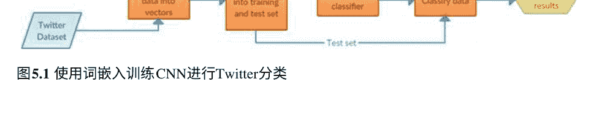

| 数据集 | 推文 | 积极的 | 消极的 |
|---|---|---|---|
| 奥巴马-麦凯恩辩论 (OMD) | 1904 | 709 | 1195 |
| 医疗保健改革 (HCR) | 1922 | 541 | 1381 |
| 斯坦福情感黄金标准 (STS-Gold) | 2034 | 632 | 1402 |

表5.3 推文示例

| 数据集 | 推文 | 极性 |
| :--- | :--- | :--- |
| OMD | 辩论是平局。我认为麦凯恩在某种程度上稍微占上风，因为他在问题上更有见识。结束语很好。#辩论08 | 积极的 |
| | 好的辩论。两位候选人都做得很好！#时事，#辩论08，#推文辩论 | 积极的 |
| | 我很失望。#推文辩论 | 消极的 |
| | #时事 #推文辩论很可悲，你看着这个辩论会认为麦凯恩是今晚唯一说对的人！ | 消极的 |
| HCR | 医疗保健不是特权，而是权利！这就是为什么我支持医疗保健改革。#HCR | 积极的 |
| | 也许你对自己的医疗计划感到健康和幸福，这很好。但不要阻碍那些生病和需要帮助的人。#HCR | 积极的 |
| | 当你不得不贿赂自己的党派时，你知道这是一项糟糕的法案 #tcot #tweetcongress #killthebill #HCR #handsoff | 消极的 |
| | 如果你反对政府接管医疗保健，请转发此推文 #hcr #tcot #gop #txgop #handsoff #codered | 积极的 |
| STS-Gold | 我爱我的新小可爱iPod！ 谢谢 @Santino_gq! Xoxoxox! | 积极的 |
| | 太兴奋了...我刚买了Taylor Swift的门票。啊啊啊啊 | 积极的 |
| | 很失望Taylor Swift没有推特 | 消极的 |
| | 试图设置Xbox Live，但失败得很惨...脑袋疼 | 积极的 |

##### 5.3.2 数据预处理

由于推文长度短且非正式，推文通常包含各种噪音和语言不规范。这些噪音和非结构化的句子会影响情感分类的性能[24]。因此，在特征选择之前，预处理阶段对于分类任务至关重要。预处理包括：

- 词干化（将词的变形形式减少到它们的词干、基本形式或根形式）
- 删除所有数字、标点符号和一些特殊符号
- 将所有标记转换为小写
- 删除停用词（指语言中最常见的词）
- 使用表情符号字典将表情符号和表情符号替换为它们的文本形式
- 对句子进行分词

在我们的实验中，我们使用维基百科表情符号列表、Weka词干提取器、彩虹停用词列表和Tweet-NLP。

##### 5.3.3 预训练的词嵌入

词嵌入是一组自然语言处理技术，其中单词被映射到高维空间中的实值向量[9]。这些向量的学习方式使得具有相似含义的单词在向量空间中具有相似的表示。这是一种比词袋模型更语义化的文本表示方法，在词袋模型中，单词或标记之间的关系被忽略，或者在二元组和三元组方法中被强制处理[10]。这种数值表示对情感分析至关重要，因为许多机器学习算法和深度学习方法无法处理原始形式的字符串，需要数值作为输入来执行任务。因此，有各种词嵌入方法可以应用于任何语料库，以构建一个具有数百维词向量的词汇表，捕捉大量的语义模式。

2013年，Mikolov等人提出了Word2Vec[9, 10]，现在已成为词嵌入的主流。Word2Vec采用了两级神经网络，其中使用了Huffman技术作为分层softmax来为常见词分配编码。该模型通过随机梯度下降进行训练，并通过反向传播获得梯度。此外，通过CBOW或Skip-gram获得每个单词的最优向量。

2014年，Pennington等人介绍了GloVe[11]，也变得非常流行。GloVe本质上是一个具有加权最小二乘目标的对数双线性模型。该模型基于词-词共现概率的比率具有编码某种形式的含义的潜力。

2016年，基于Word2Vec，Bojanowski等人提出了FastText[12]，它可以处理子词单元并具有快速计算能力。FastText通过引入子词建模扩展了Word2Vec。它不是将单个单词输入神经网络，而是将每个单词表示为字符n-gram的集合。一个单词的嵌入向量是其所有n-gram的总和。

词嵌入是一个要求大规模语料库进行训练并呈现可接受的词向量的复杂过程。因此，与其从头开始训练词向量，不如使用预训练的词嵌入，这些词嵌入在互联网上公开可用，用于通过深度学习架构进行情感分析。在本文中，我们使用了四个众所周知的预训练词向量，即Google的Word2Vec，³ Stanford的Crawl GloVe，⁴ Stanford的Twitter GloVe和Facebook的FastText，⁵ 以评估它们在情感分析中的效果。以下是对这些向量的简要描述。

Google的Word2Vec是在Google News数据集的一部分上进行训练的，大约有1000亿个单词。该模型包含300维向量，用于表示300万个单词和短语。Crawl GloVe是在42亿个标记（单词）的Common Crawl数据集上进行训练的，提供了一个包含200万个单词的词汇表，并具有300维的嵌入向量大小。另一方面，Twitter GloVe是在20亿条推文中训练的，包含270亿个标记。该表示具有200万个词汇和嵌入向量大小，包括50、100和200个维度。最后，FastText由300维的100万个词向量组成，训练于维基百科2017年、UMBC webbase语料库和statmt.org新闻数据集（160亿个标记）（表5.4）。

> ³ https://code.google.com/archive/p/word2vec/.
> ⁴ https://nlp.stanford.edu/projects/glove/.
> ⁵ https://github.com/facebookresearch/fastText/blob/master/pretrained-vectors.md.

##### 表5.4 预训练词向量的统计数据

| 预训练词向量 | 数据集 | 维度 | 语料库 | 词汇表 |
| --- | --- | --- | --- | --- |
| Word2Vec | 谷歌新闻 | 300 | 100亿 | 300万 |
| Crawl GloVe | 常见爬虫 | 300 | 420亿 | 200万 |
| Twitter GloVe | 推特 | 200 | 270亿 | 200万 |
| FastText | 维基百科2017年，UMBC webbase语料库和statmt.org新闻 | 300 | 160亿 | 100万 |

##### 5.3.4 深度学习

在本文中，我们使用了深度卷积神经网络（CNN）对推文进行分类。CNN是一类深度学习方法，它使用了一种变种的多层感知器，设计时需要最小的预处理[25]。首先，推文被分词并转换为单词嵌入的列表。然后，使用多个具有可变窗口大小的滤波器将创建的句子矩阵组合在一起。

因此，为每个可能的单词窗口大小生成了局部情感特征向量。然后，特征图通过非线性激活函数激活一个1-max-pooling层。最后，这个池化层通过softmax激活与输出层密集连接，生成情感分类的概率值，并使用可选的dropout正则化来防止过拟合。用于情感分类的卷积神经网络的架构如图5.2所示。

#### 5.4 比较分析和讨论

在本文中，我们对三个知名数据集进行了情感分析的CNN实验，使用了四种不同的词嵌入。本文的范围是评估预训练词嵌入（即Word2Vec，Crawl GloVe，Twitter GloVe和FastText）对Twitter分类性能的影响。

对于所有数据集，都应用了相同的预处理步骤。为了确定CNN的最佳设置，进行了许多实验。因此，我们设置了一个批量大小为50。应用了学习率技术来进行随机梯度下降，最大训练周期为100。我们为100个训练周期。我们尝试了各种滤波窗口，并得出结论将滤波窗口设置为5。此外，我们在卷积层使用ReLU作为激活函数，在输出层使用SoftMax。实验评估指标是对正面和负面推文的分类准确性，并将最佳CNN结果与其他先前研究中的基准分类器性能进行比较[5]。

表5.5展示了使用CNN在不同的词嵌入上达到的准确率百分比。我们观察到，在大多数实验中，使用FastText比其他方法表现更好。此外，尽管Twitter GloVe的维度较低且在一个相对较小的数据集上训练，但其表现令人满意。这种良好的准确率可能是因为该模型使用的语料库来自Twitter。

#### 表5.5 使用不同的词向量的CNN准确率在Twitter数据集上

| 数据集 | 词嵌入 | CNN准确率 |
|--------|--------|------------|
| OMD | Word2Vec | 81.98 |
| OMD | Crawl GloVe | 83.59 |
| OMD | Twitter GloVe | 82.79 |
| OMD | FastText | **83.65** |
| HCR | Word2Vec | 79.94 |
| HCR | Crawl GloVe | 80.45 |
| HCR | Twitter GloVe | 80.39 |
| HCR | FastText | **81.33** |
| STS-Gold | Word2Vec | 82.69 |
| STS-Gold | Crawl GloVe | 84.12 |
| STS-Gold | Twitter GloVe | **84.23** |
| STS-Gold | FastText | 82.57 |

这个模型使用的语料库来自Twitter，这可能是其准确率较高的原因。另一方面，Word2Vec似乎不如其他模型有效。

我们进一步将我们的方法与五种代表性的机器学习算法进行比较，分别是朴素贝叶斯、支持向量机、k-最近邻、逻辑回归和C4.5。在[5]中，这些分类器使用与当前研究相同的数据集进行评估，并将它们的性能列在表中。我们使用每个数据集的CNN版本的最佳准确率，以与基准算法进行比较。如图5.3所示，深度学习技术在所有数据集上表现优于其他机器学习方法。

#### 5.5 结论与未来工作

深度学习和大数据分析是当今数据科学中的两个热点问题。大数据分析对于需要从通过社交网络服务收集的大量数据中提取信息的组织非常重要。

这样的社交网络服务是一种微博服务，其中Twitter是其最具代表性的平台。通过Twitter，数百万用户每天交换公开信息，即“推文”，表达他们对各种问题的观点和感受。这使得Twitter成为最大和最具动态性的大数据集之一，用于数据挖掘和情感分析。深度学习是大数据分析的有价值工具。深度学习模型在自然语言处理和分类等多个领域取得了显著的成果。因此，在本文中，我们采用深度学习方法进行Twitter情感分类，旨在评估不同的词嵌入设置。

词嵌入的开发和使用是分类过程中的重要任务，因为深度学习技术需要数值作为输入，并且正确的输入可以提高算法的性能。

在这项工作中，我们研究了四种著名的预训练词嵌入，分别是Word2Vec、Crawl GloVe、Twitter GloVe和FastText，它们由可靠的研究团队开发，并在深度学习项目中广泛使用。结果表明，FastText在各个数据集上提供了更一致的结果。此外，尽管维度较低，Twitter GloVe的准确率也非常高。

我们未来的工作之一是研究使用不同参数从头开始训练的Twitter数据的词嵌入，如训练模型、维度大小、相关词汇等，并评估它们对分类性能的影响。

此外，另一个有趣的研究方向是比较不同的深度学习方法在算法结构、层、过滤器、函数等方面的分析，以确定适当的网络设置。

#### 参考文献

1. S. Sohangir, D. Wang, A. Pomeranets, T.M. Khoshgoftaar, 大数据：金融情感分析的深度学习。J. Big Data 5(1) 2018
2. V. Sahayak, V. Shete, A. Pathan, 在推特数据上的情感分析. Int. J. Innov. Res. Adv. Eng. (IJIRAE) 2(1), 178–183 (2015)
3. K.C. Tsai, L.L. Wang, Z. Han, 使用深度学习进行移动社交网络的缓存: 2016年美国选举的推特分析.IEEE Trans. Netw. Sci. Eng. (2018)
4. C. Troussas, A. Krouska, M. Virvou, 社交网络上情感分析的趋势: 预处理影响, 独立分类器和集成平均, in Machine Learning Paradigms (Cham, Springer, 2019), pp. 161–186
5. A. Krouska, C. Troussas, M. Virvou, 对社交网络服务上的情感分析算法进行比较评估. J. Univers. Comput. Sci. 23(8), 755–768 (2017)
6. C. Troussas, A. Krouska, M. Virvou, 对推特数据进行基于集成的情感分类器的评估, in 2016 7th International Conference on Information, Intelligence, Systems & Applications (IISA) (2016), pp. 1–6
7. H. Thakkar, D. Patel, 探讨推特情感分析的方法: 一项最新研究 (2015). arXiv:1512.01043
8. Q.T. Ain, M. Ali, A. Riaz, A. Noureen, M. Kamran, B. Hayat, A. Rehman, 使用深度学习技术的情感分析: 一项综述。Int. J. Adv. Comput. Sci. Appl. 8(6), 424 (2017)
9. T. Mikolov, K. Chen, G. Corrado, J. Dean, 在向量空间中高效估计词表示 (2013). arXiv:1301.3781
10. T. Mikolov, I. Sutskever, K. Chen, G.S. Corrado, J. Dean, 词和短语的分布式表示及其组合性, 在神经信息处理系统进展(2013), pp. 3111–3119
11. J. Pennington, R. Socher, C. Manning, Glove: 全局词向量表示, in 2014年经验方法在自然语言处理中的会议论文集 (EMNLP) (2014), 第1532-1543页
12. P. Bojanowski, E. Grave, A. Joulin, T. Mikolov, 用子词信息丰富词向量 (2016). arXiv:1607.04606
13. M. Cliche, BB_twtr在SemEval-2017任务4中: 使用CNN和LSTM进行Twitter情感分析 (2017). arXiv:1704.06125
14. H. Nguyen, M.L. Nguyen, 用于Twitter社交网络中句子级情感分类的深度神经架构, in 国际计算语言学协会会议 (2017), 第15-27页
15. A. Severyn, A. Moschitti, 使用深度卷积神经网络进行Twitter情感分析。在第38届国际ACM SIGIR信息检索研究与开发会议上 (2015年), 第959-962页

16. A. Cocos, A.G. Fiks, A.J. Masino, 用于标记Twitter帖子中不良药物反应的循环神经网络架构的深度学习。美国医学信息学协会。**24(4)**, 813-821页(2017年)
17. T. Wu, S. Liu, J. Zhang, Y. Xiang, 基于深度学习的Twitter垃圾邮件检测，在澳大利亚计算机科学周多会议(2017年)，第3页
18. Z. Jianqiang, G. Xiaolin, Z. Xuejun, 用于Twitter情感分析的深度卷积神经网络。IEEE Access **6**, 23253-23260页(2018年)
19. J. Wehrmann, W. Becker, H.E. Cagnini, R.C. Barros, 基于字符的卷积神经网络用于语言无关的Twitter情感分析，在国际联合会议上的神经网络(IJCNN) (2017), pp. 2384–2391
20. P. Vateekul, T. Koomsubha, 使用深度学习技术对泰国Twitter数据进行情感分析的研究,在2016年第13届国际计算机科学和软件工程联合会议(JCSSE) (2016), pp. 1–6
21. H. Saif, M. Fernandez, Y. He, H. Alani, 用于Twitter情感分析的评估数据集:一项调查和一个新的数据集, STS-Gold, 在第一届人工智能情感和社交媒体表达媒体国际研讨会(ESSEM 2013) (2013)
22. D.A. Shamma, L. Kennedy, E.F. Churchill, 推特辩论: 理解社区对未收集来源的注释,在第一届SIGMM社交媒体研讨会论文集中(2009), 第3-10页
23. M. Speriosu, N. Sudan, S. Upadhyay, J. Baldridge, 使用词汇链接和关注者图进行推特极性分类,在第一届无监督学习在NLP中的研讨会论文集中(2011), 第53-63页
24. A. Krouska, C. Troussas, M. Virvou, 预处理技术对推特情感分析的影响,在2016年第7届信息、智能、系统和应用国际会议论文集中(2016), 第1-5页
25. J. Zhang, C. Zong, 深度神经网络在机器翻译中的应用概述. IEEE智能系统. **30(5)**, 第16-25页(2015年)

### 第6章
良好的防御是强大的DNN：用深度神经网络保护物联网

Luke Holbrook和Miltiadis Alamaniotis

摘要 本章将物联网（IoT）领域作为背景，并提供了一种用于保护连接物联网设备的网络的新的深度学习解决方案。特别是，它讨论了一种全面的物联网防御解决方案，即一种新的物联网安全协议。在最近对1.2亿设备的攻击之后，对物联网安全解决方案的需求得到了重新审视。在当前的工作中，通过利用来自九个真实物联网设备的网络流量快照，研究了深度学习在关键安全应用中的应用。为此，使用支持向量机（SVM）、随机森林和深度神经网络（DNN）等一系列学习工具，在一组真实数据上测试了物联网网络中的异常检测。所得结果对所有测试算法都提供了高准确性。值得注意的是，DNN在测试模型中表现出最高的确定系数，因此，将DNN推广为物联网安全应用中更合适的解决方案。此外，DNN的学习自主性特征使其成为一种时间高效的现实世界算法，因为它不需要人工干预。

#### 6.1 引言

智能技术在日常生活中的应用推动了预计到2020年物联网设备数量将超过460亿 [1]。这些“智能”设备的涌入已经导致了分布式拒绝服务攻击等重大安全漏洞的出现。由于物联网设备的安全性正以很高的速度被利用，我们需要立即采取行动来保护我们的安全 [2]。网络安全的进步引入了一种有前途的无监督机器学习方法，能够检测异常网络数据包[3]。尽管这些方法已经证明有价值，但对于物联网安全来说，尤其是深度学习方面，这仍然是一个未触及的概念[4]。本章将研究使用深度学习来保护物联网网络。

最近的攻击利用了商物联网设备（COTS）[5]，并展示了对信息窃取和侵犯隐私的强大防御的迫切需求。其他研究人员已经分析了Mirai恶意软件的操作[6]，但本章将重点关注针对在服务器级别执行的物联网网络安全措施。测试的设备是九个易受恶意软件攻击的商用物联网产品。图6.1说明了实验设计。

假设物联网设备的持续流行和僵尸网络攻击将成为安全创新的驱动因素，并构成本章的基础[7]。假设可以开发无监督深度学习模型来自主进行异常检测，以帮助保护物联网设备网络的安全。

具体而言，提出了DNN作为检测异常物联网网络行为的优越算法。从九个物联网设备中提取数据，以识别正常物联网流量的统计特征，然后训练DNN学习该正常行为。当检测到异常网络数据包时，深度学习神经网络会发出红旗，表示恶意软件攻击。从云端或服务器中提取网络的统计信息，可以实现强大而实用的物联网应用。安装这项研究将依赖于DNN的效率，在现实的商业环境中部署这项技术。

典型的交通异常研究在结果上严重依赖于模拟数据，而这项研究使用了来自物联网设备的真实网络流量，这些设备遭受了两个猖獗的网络恶意软件家族Mirai和Gafgyt的攻击[8, 9]。这些恶意软件流量数据集可在[9]中获得。这项研究提供了解决物联网网络安全问题的客观解决方案，这是一个具有潜在大规模和动态系统的挑战性问题。结果提供了一种优于其他机器学习算法的恶意软件攻击解决方案，并且可以根据分析的网络进行定制。第6.2节总结了该领域的最新技术。第6.3节和第6.4节简要介绍了物联网安全和机器学习。最后，第6.5节和第6.6节讨论了实验设置和获得的结果。

#### 6.2 物联网网络安全的最新技术

物联网安全没有客观的协议，数据非常丰富。由于机器学习已经以各种方式实施，研究界已经成功地应用了机器学习工具来分类异常网络流量。

然而，将机器学习应用于物联网网络流量在很大程度上被忽视了。当前的工作对于物联网网络流量异常检测和分类的DNN的有效性做出了贡献。

Doshi等人[10]利用机器学习来处理商业物联网设备。他们的研究仅关注经典的机器学习算法，如K最近邻，线性核支持向量机，决策树，随机森林和神经网络[10]。研究人员证明，使用物联网特定的网络行为作为特征可以在物联网网络流量的DDoS检测中获得高准确性。他们的结果表明，家庭网关路由器可以使用不需要太多计算处理和协议无关的流量数据的机器学习算法自动检测DDoS攻击的本地源[10]。Canedo等人研究了将人工神经网络应用于物联网[11]。

此外，[12]中研究了物联网网络行为的特征，其中使用机器学习将“语义实例”应用于网络行为以确定网络使用趋势。这项研究不包括深度学习，并且是不确定的，可能是由于数据集大小不同引入了额外的容易出错的参数。主要结果显示，监督式机器学习算法在独立网络环境中取得了成功。本章将重点讨论DNN的无监督和自主性质，以及与典型的、经过充分研究的机器学习算法的比较。

将DNN应用于常规网络安全并不是一个新概念。太平洋西北国家实验室（PNNL）的研究人员创建了一个名为Safekit [13]的软件工具，它是一个用于识别网络内部威胁的开源应用程序，利用了深度学习[13]。它使用对组织的计算机网络活动进行详细分析作为早期检测和缓解内部网络威胁的关键组成部分。研究人员提出了一种在线无监督深度学习方法，用于实时检测系统日志中的异常网络活动。他们的模型根据个体用户的贡献来排名异常分数。行为特征用于增加可解释性，以帮助分析人员审查潜在的内部威胁案例。PNNL的研究重点不在物联网上，导致物联网网络安全研究存在空白。Du等人研究了利用RNN的网络安全技术[14]。DeepLog是一个利用长短期记忆（LSTM）的深度神经网络模型，用于将系统日志文件建模为自然语言序列[14]。DeepLog通过训练“正常”日志模式，并在模式偏离正常时检测异常。此外，DeepLog从底层系统日志中构建工作流程，一旦检测到异常，用户可以诊断异常并采取有效的对策。这项研究模型提供了结果，证明深度学习模型在监控网络流量方面是有用的，并可以推广到物联网。

利用深度自编码器检测异常网络行为也被证明是有效的[9]。Meidan等人提出了一种方法，该方法提取网络流量特征，并使用深度自编码器从物联网设备中检测异常。为了评估他们的方法，物联网设备被恶意软件实验性地攻击。他们的评估显示了该方法在攻击发起时准确和即时地检测到攻击的能力。与Meidan等人的研究不同，本章研究了深度自编码器而不是深度神经网络。最终，本章填补了使用深度神经网络进行物联网网络安全研究的空白。

#### 6.3 对物联网网络安全的担忧

##### 6.3.1 物联网网络安全简介

2015年2月，220万辆宝马汽车受到其“Connected Drive”物联网软件中的恶意软件的影响。这导致了未经授权的远程解锁汽车[15]。2015年7月，140万辆克莱斯勒汽车因“Uconnect”物联网仪表盘计算机中的漏洞而被召回，允许黑客控制仪表盘功能、转向、变速器和刹车[16]。下面给出了物联网设备使用的各种场景以及其服务的关键漏洞[2]：

- 1. “公共安全”组织使用许多物联网设备，例如救护车和军用无人机中的平板电脑。物联网设备被用作追踪感兴趣的人的设备。已经证实连接的交通信号灯的黑客攻击可以干扰交通并有可能导致事故。
- 2. “数字健康”对于那些无法离开自己家的人来说可能是理想的。相反，这可能带来重大的安全威胁。医院已经感受到被虚拟供应商劫持的影响。由于医疗信息的敏感性，隐私问题引起关注。最近在印度，由于终端应用程序缺乏适当的安全性，超过十亿用户的生物特征信息遭到泄露。连接手持医疗监护器与政府网站的编程接口（API）[17]。
- 3. “移动性”服务引入了大量的目标和可用性，涉及到车联网和下一代通信，使得自动驾驶汽车成为可能。针对这些连接车辆的攻击可能严重影响社会。
- 4. “制造业”可能会因为依赖物联网设备进行工业温湿度监测而受到影响。这些传感器被用于快速制造产品或提供服务。对这些传感器的攻击可能会对生产力造成严重破坏。
- 5. “智能城市”可能会因为基础设施遭受攻击而受到威胁。这意味着对旅游体验、移动支付方式和虚拟现实产生严重影响。
- 6. “公用事业”如智能电网、计量和废物管理可能会受到对其物联网子系统的攻击的影响。一旦这些系统瘫痪，大片人口将面临停电。研究人员已经通过网络篡改展示了电网变压器的完全瘫痪[18]。
- 7. “智能家居”可以提供照明、温度、音乐和视频等服务。在这里，物联网设备将包括各种传感器和电器设备，如温度传感器、火灾传感器、湿度传感器等。攻击者可以利用物联网设备在正常使用的幌子下表现出非理性行为。

图6.2说明了物联网设备将在低优先级和关键应用中部署的方式，例如军事、紧急服务、医疗保健中的远程手术和自动驾驶汽车[19-21]。一般来说，对整个物联网网络的攻击将从一个单独的物联网设备开始。这些设备可能位于没有任何人员监督的偏远地区，并可能被盗以修改其功能或窃取其信息以了解其漏洞[22]。攻击者可能利用这些漏洞来注入恶意代码或窃听，从而导致终端用户或网络的服务或收入的全部或部分损失。最近的Mirai僵尸网络攻击是DDoS攻击的现实后果的一个很好的例子[23]。用户的网络安全意识是另一个重要因素：通常默认密码不会更改，攻击者可以轻松进入物联网设备[5]。这意味着物联网设备必须具备强大的身份验证机制和防火墙，以防止未经授权的访问。

物联网恶意软件主要由两种僵尸网络方法主导，Gafgyt和Mirai。在下面的小节中，将详细讨论每种恶意软件，以准确描述它们的工作原理以及如何使用机器学习来进行防御。

总结一下，物联网威胁包括服务中断、信息窃取、设备盗窃、系统操纵和非法控制系统。通过禁用物联网设备或对服务平台进行DDoS攻击，可以导致服务中断。

##### 6.3.2 物联网恶意软件

物联网恶意软件主要由两种僵尸网络方法主导，Gafgyt和Mirai。了解Mirai和Gafgyt恶意软件对于用户的保护是必要的。在下面的小节中，将详细讨论每种恶意软件，以准确描述它们的工作原理以及如何使用机器学习来进行防御。

###### 6.3.2.1 Gafgyt恶意软件

大多数嵌入式程序使用Linux操作系统的一种变体，应用程序使用C编程语言编写。物联网设备往往安全性较低，这是由于设备本身的简单性和缺乏客观协议所导致的。目前分析的最常见的恶意软件是Gafgyt（也称为BASHLITE）。该恶意软件于2014年首次引入，并通过暴力破解方式感染设备，可能导致DDoS攻击[24]。

该恶意软件使用预定义的用户名和密码，并尝试通过随机选择IP地址和尝试各种用户名密码组合来访问本地网络，直到成功为止。通常，该恶意软件通过向系统发送垃圾信息帧和主机定义的bash命令来保持TCP端口打开[25]。在2016年8月，已经确定的僵尸网络中Gafgyt引起的感染中，96%是物联网设备（其中95%是摄像头和DVR，4%是家庭路由器，1%是Linux服务器）[25]。

###### 6.3.2.2 Mirai恶意软件

Mirai恶意软件是一种通过将受感染设备变成从属设备或“僵尸”来攻击网络，以便向其他网络发送访问请求并试图强制重置并获取网络访问权限的病毒[26]。被Mirai奴役的僵尸设备不断扫描互联网上常见的物联网设备IP地址。Mirai利用一个IP地址范围表，其中包括不会被感染的私有网络和分配给美国邮政服务和国防部的地址[26]。然后，恶意软件尝试通过访问一个包含60多个常用制造商用户名和密码的查找表来破解设备的安全性。感染的唯一症状是设备变慢和带宽使用增加，这使得Mirai对用户来说是一个非常危险的威胁[27]。重新启动设备是清除设备上的恶意软件的简单方法，但是，除非立即更改用户名和密码，否则设备将很快重新感染。截至2018年7月，已经发现了13个版本的Mirai恶意软件主动感染基于Linux的物联网设备[7]。与暴力破解攻击不同，几个Mirai的变种会根据设备的特定特征进行适应。安全性似乎对许多设备制造商来说是一个事后思考的问题[5]，这是Gafgyt和Mirai所利用的事实。

#### 6.4 机器学习的背景

机器学习是为了进行预测性分析而开发算法的科学，利用数据中的趋势[28]。21世纪是机器学习应用爆炸的时期：从与虚拟对手下棋到自动驾驶汽车[6]。根据问题的类型，机器学习算法可以分为两大类：分类和回归模型。分类模型很直观，它们的数据集通常不依赖于时间，并且将学习到的分类器应用于测试数据。相反，回归模型的使用是基于具有连续、时变变量的数据集的使用。

##### 6.4.1 支持向量机（SVM）

支持向量机（SVM）的优化目标是最大化分离超平面（决策边界）与最靠近该超平面的训练样本之间的距离[28]，如图6.3所示。

以下是对边界最大化的数学分析：

$$w_0 + \mathbf{w}^T x_{pos} = 1.$$

$$w_0 + \mathbf{w}^T x_{neg} = -1.$$

从(6.1)中减去(6.2)，得到：

$$\mathbf{w}^T (x_{pos} - x_{neg}) = 2.$$

然后，通过向量 w 的长度进行归一化，得到方程(6.3)的定义如下：

$$\| \mathbf{w} \| = \sqrt{\sum_{j=1}^{m} w_j^2}.$$

这种归一化使得(6.5)的表达式成立：

$$\frac{\mathbf{w}^T (x_{pos} - x_{neg})}{\| \mathbf{w} \|} = \frac{2}{\| \mathbf{w} \|}.$$

然后，(6.5)的左侧可以解释为平行超平面之间的距离。这是最大化的目标边界。通过在样本被正确分类的约束下最大化SVM函数，得出以下结论：

$$w_0 + \mathbf{w}^T \mathbf{x}^{(i)} \ge 1 \text{ if } y^{(i)} = 1 \text{ 对于 } i = 1, \ldots, N.$$

$$w_0 + \mathbf{w}^T \mathbf{x}^{(i)} \le -1 \text{ if } y^{(i)} = -1 \text{ 对于 } i = 1, \ldots, N.$$

其中 \(N\) 是数据集中的样本数量。方程式 (6.6) 和 (6.7) 声明所有负样本应该位于第一个平行超平面的一侧，而所有正样本应该位于第二个平行超平面的后面。无论在哪里使用机器学习进行二元分类，通常都会使用SVM。例如在面部检测、手写字识别和生物信息学中可以找到示例[29]。

##### 6.4.2 随机森林

决策树是随机森林的基础，每个节点使用二进制决策，堆叠在一起形成多层的“森林”。随机森林算法总结如下[28]:

- 1. 从数据中随机抽取大小为 \(n\) 的样本 (随机选择 \(n\) 个样本，可以重复选择)
- 2. 从样本中生成一棵决策树。在每个节点上：
    - a. 不重复地随机选择 \(d\) 个特征
    - b. 使用提供最佳分割的特征将节点分割成随机子集，根据目标函数进行分割，例如最大化信息增益
- 3. 重复这些步骤 \(k\) 次
- 4. 通过每棵树的预测结果进行聚合，通过多数投票来分配类别标签。

图6.4中的每个决策节点表示通过激活函数的一次传递，如果输入数据与遇到的特征高度相关，则选择其中一条路径。

由于用户不需要选择初始超参数值，算法也不需要调整，因此该算法被认为对由森林组成的各个决策树的噪声具有鲁棒性。一个经验法则是，树的数量越多，随机森林分类器的性能越好，但计算成本也会增加。

多数投票方法允许加权和确定性地识别恶意网络流量，并被标识为：

$$\hat{y} = \underset{i}{\text{argmax}} \sum_{j=1}^{m} w_j \chi_{A}(C_{j}(x) = i).$$

其中，\(w_j\) 是与基本分类器 \(C_j\) 相关联的权重，\(\hat{y}\) 是系统的预测类别标签， \(\chi_A\) 是特征函数， \(A\) 是唯一类别标签的集合。对于相等的权重，(6.8)可以简化为：## 6.4.3 深度神经网络（DNN）

多层网络的分层和连接的发现导致了现在所称的深度学习。深度学习被观察为人工智能的子集，如图6.5所示。特别是，本章将介绍深度学习的一个应用，即深度神经网络（DNN），或者许多连接层的神经网络。

图6.5 AI复杂

前向传播的过程用于计算DNN的输出，并具有以下特点[28]：

- (1) 从输入层开始，模型通过网络将训练数据的模式进行前向传播以生成输出。
- (2) 基于网络的输出，使用成本函数计算最小化误差。
- (3) 反向传播用于确定误差，找到其对网络中每个权重的导数，并更新模型。

多个时期用于评估学习模型的权重。一旦前向传播找到网络输出，然后应用反向传播来获得预测的类标签。图6.6说明了前向传播和反向传播。

本研究中的DNN从给定物联网设备的网络的特征向量中识别异常分数。该模型不使用基于时间的方法，而是同时比较设备上的所有网络数据。该DNN算法的数学模型主要基于Tuor等人的研究[13]。该模型接收设备的一系列T特征向量，并产生一系列T隐藏状态向量。DNN的最终隐藏状态是特征向量的函数，如下所示[13]：

$$
z_{l,t}^d = a(W_l z_{l-1,t}^d + b_t) \quad (6.11)
$$

这里是一个非线性激活函数，通常是ReLU、tanh或逻辑sigmoid。可调参数是权重矩阵（W）和偏置向量（b）。

图6.6 a前向传播和 b反向传播

#### 6.5 实验

系统设备日志中的原始事件被输入到特征提取系统中，该系统将数据配置为可识别的特征向量。设备的一组特征向量被输入到DNN中，通过反向传播[28]来训练以最小化异常分数。

在这项研究中，DNN的任务是使用从训练数据中最小化损失方程收集到的分类值对测试样本进行分类。尽管DNN基本上是从设备的“正常”行为中学习的，但该算法是无监督的，因为没有引入网络的先验知识。异常与预测误差成比例，足够异常的行为将被标记。

物联网网络流量被捕获并分解为表6.1中列出的每个设备的分类网络参数。统计参数在五个不同的样本收集时间内收集了每个流聚合特征。对于每个时间段，将参数值和活动计数导出为一个115维的数值特征向量。

表6.1 研究中确定的参数
| 数据特征 | 特征标题 | 特征的定义 |
| :--- | :--- | :--- |
| 流聚合 | H | – 源IP<br>– 统计最近来自此数据包主机 (IP) 的流量 |
| | MI | – 源MAC-IP地址– 统计最近来自此数据包主机 (IP +MAC) 的流量 |
| | HH | – 信道大小<br>– 统计从此数据包主机IP到数据包目的地IP的流量变化 |
| | HH_jit | – 信道大小抖动<br>– 统计从此数据包主机IP到数据包目的地IP的信道大小变化 |
| | HPHP | – 端口<br>– 统计最近离开此数据包主机IP +端口到数据包目标IP +端口的流量摘要<br>– 例如 192.168.4.2:1242 -> 192.168.4.12:80 |
| 统计 | 平均值 | – 传输数据包大小的平均偏差 |
| | 标准差 | – 数据包大小的标准差 |
| | 数量 | – 最近历史观察到的项目数量 |
| | 幅度 | – 两个流的均值的平方和的平方根 (主机与目标地址) |
| | 半径 | – 两个流的方差的平方和的平方根 (主机与目标地址) |
| | 协方差 | – 两个流之间的近似协方差 (主机与目标) |
| | 相关系数 | – 两个流之间的近似相关系数 |
| 时间框架 | L5-L0.01 | – 时间窗口中使用的衰减因子Lambda<br>– 这些统计数据捕捉了流的最近历史 |

异常分数定义如下：

$$
\hat{a}_t^d = -\log P_{\theta}(x_t^d|h_t^d).
$$

这里 P是概率， x是输入， h是相关的隐藏向量。 该模型将量化概率并为当前样本分配异常分数。

如果输入是异常的，那么算法不太可能给样本分配一个较大的概率密度分布，从而产生一个更窄且更高的损失值。

异常分数最初是最大值，当学习到正常行为模式时，随着时间的推移逐渐降低。当检测到每个异常分数时，计算均值和方差的指数加权移动平均值，并进行标准化。然后，将用于设备$d$在时间$t$上正确放置异常分数。DNN的实时方法允许立即对异常行为做出反应的灵活性。

##### 6.5.1 训练和测试数据

机器学习模型是基于从良性网络流量数据中提取的统计特征进行训练的。原始网络流量数据是通过在网络交换机上进行端口镜像捕获的。物联网网络流量是在设备连接到网络后立即收集的。网络流量收集过程遵循以下规则：

- (1) 网络流量源自己知IP地址
- (2) 所有网络源都源自相同的MAC和IP地址
- (3) 已知数据在源IP地址和目标IP地址之间传输
- (4) 收集目标TCP/UDP/IP端口信息。

从每个时间窗口提取了表6.2中显示的相同的23个特征：100毫秒、500毫秒、1.5秒、10秒和1分钟增量，总共115个特征。这些特征可以非常快速和增量地计算，以实时检测恶意数据包。表6.2还列出了正常网络流量特征在最长样本收集时间窗口（1分钟）内的统计值范围。这些特征对于捕获源IP欺骗和其他关键恶意软件攻击非常有用。例如，当受损的物联网设备伪造IP地址时，通过源MAC/IP（特征变量MI）和IP/通道（特征变量HP）将立即指示来自伪造IP地址的行为的异常得分[26]。

表6.2 从数据特征中收集的统计参数
| 统计 | HH | HH_jit | MI | H | HPHP |
| :--- | :--- | :--- | :--- | :--- | :--- |
| 平均值 | 330.46 | 1.56E + 9 | 300.45 | 300.45 | 300.45 |
| 标准差 | 145.71 | 5.66E + 17 | 2.12E + 4 | 2.12E + 4 | 71.57 |
| 数量 | 2.01 | 2.01 | 7.73 | 7.73 | 2.01 |
| 幅度 | 555.97 | - | - | - | 300.45 |
| 半径 | 6.91E + 4 | - | - | - | 1.16E + 4 |
| 协方差 | 5355.09 | - | - | - | 5372.24 |
| 相关系数 | 0.97 | - | - | - | 0.78 |
| 特征数量 | 7 | 3 | 3 | 3 | 7 |

## 机器学习模型的基准

机器学习算法的基准是手动确定的。训练和测试数据集的大小经过调整，以代表不同的现实环境[35]。对于DNN，隐藏层的数量从1到10进行了测试。

隐藏层维度从20到500进行了测试，并且还测试了各种大小的小批量，以确定最适合测试的恶意软件。此外，DNN的输入向量被调整为与115个特征兼容。对于SVM，线性核被确定为最适合分类的选项，并且在对数据进行概率估计时使用随机数生成器进行数据洗牌。

对于随机森林，估计器的数量进行了优化测试，从20到100。此外，对模型进行了在数据集的百分比上进行训练和测试的实验，其中使用了5%的数据集进行训练，剩下的95%的数据集用于测试。

#### 6.6 结果与讨论

结果分为 Gafgyt 和 Mirai 数据集。结果显示，与监督算法在相同数据上的表现相比，DNN 提供了更好的异常检测。DNN 还允许几乎自主的解决方案，足够强大以处理新出现的威胁。相比之下，其他测试的机器学习算法不能立即处理新类型的网络攻击。由于 DNN 使用小批量进行数据处理，混淆矩阵将显示较小的样本量（318个测试样本），与 SVM 和随机森林测试相比。

##### 6.6.1 结果

以下分析被分成各自的数据集。首先讨论Gafgyt恶意软件，然后是Mirai恶意软件。

###### 6.6.1.1 Gafgyt恶意软件

Gafgyt恶意软件的测试数据的统计性能显示在表6.3中，混淆矩阵显示在图6.7中。在本章中，系数被表示为决定系数用 $R^2$ 表示，它是模型捕获的特征值响应方差的比例。该值由(6.13)定义：

$$R^2 = 1 - \frac{SS\ E}{SST}.$$ (6.13)

这里 $SSE$ 是残差平方和，而 $SST$ 是总平方和。这些值是基于概率结果的最常见表示方式。均方误差（$MSE$）是一种衡量将机器学习模型拟合到数据集的成本的度量。

表6.3 Gafgyt测试数据的统计结果
| 算法 | 支持向量机 | 随机森林 | 深度神经网络 |
| :--- | :--- | :--- | :--- |
| R² | 0.6995 | 0.8263 | 0.9998 |
| 均方误差 | 0.0005 | 0.0003 | 0.0002 |
| 准确率 | 99% | 99% | 99% |

成本是将机器学习模型拟合到数据集的费用。均方误差（MSE）的数学公式为（6.14）。

$$MSE = \frac{1}{n} \sum_{i=1}^{n} (y^{(i)} - \hat{y}^{(i)})^2$$  (6.14)

从分析角度来看，准确度由（6.15）定义：

$$准确度 = \frac{TN + TP}{TN + TP + FN + FP}$$ (6.15)

其中，TN代表真阴性，TP代表真阳性，FN代表假阴性，FP代表假阳性。

混淆矩阵显示SVM、随机森林和DNN分别能够正确分类99%的网络流量。这种高准确性进一步加强了使用机器学习算法检测异常网络行为的普遍观念。

###### 6.6.1.2 Mirai恶意软件

Mirai和Gafgyt恶意软件的检测结果基本相似。统计性能显示在表6.4中，混淆矩阵显示在图6.8中。Mirai和Gafgyt数据集之间的差异在于SVM和随机森林的决定系数和均方误差较低。尽管统计参数下降，但三种算法的准确率仍然达到99%。

表6.4 来自Mirai测试数据的统计结果
| 算法 | 支持向量机 | 随机森林 | 深度神经网络 |
| :--- | :--- | :--- | :--- |
| R² | 0.6328 | 0.7689 | 0.9968 |
| 均方误差 | 0.0006 | 0.0004 | 0.0001 |
| 准确率 | 99% | 99% | 99% |

##### 6.6.2 讨论

在本节中，我们将根据所得结果探讨其影响。每个机器学习模型都获得了很高的准确性。这意味着对网络流量数据的某个特征有很大的依赖性。根据相应的决定系数值，DNN是更优秀的算法。由于该算法获得了较高的值，这表明DNN能够学习到相关性。回归模型并将其应用于测试数据。这可能是由于算法构建在10层神经网络之上。DNN还具有更高的真负率，这意味着该算法在网络安全应用中更优越，我们宁愿安全也不愿意冒险。可部署应用的物流需要无监督的方法，因为存在环境限制，如网络带宽和自主性，这些都是DNN所解决的。为了在这些限制下持续使用监督算法，需要应用额外的技术或者需要分析师的存在。

通过最大数据值分离观察到通道抖动是最重要的加权特征。该特征量化了发送流量的可变网络速率。这意味着DNN从已建立的网络通道中学到了最多。

可扩展性对于这项研究在实际环境中的应用至关重要。这三种机器学习算法在各自的领域中都具有可扩展性，然而DNN的结果表明该模型具有为其安装提供最大价值的能力。由于大规模物联网设备网络容易受到有针对性的DDoS攻击，最终的应用需要具备区分许多设备的能力[1]。鉴于DNN在单个设备上的表现已经得到证明，需要进行补充工作以区分网络中的n个物联网设备。

#### 6.7 结论

在本章中，我们讨论了技术背景和保护物联网的重要性。通过实验和结果，展示了解决物联网网络研究不足的解决方案。下面的段落中讨论了未来的工作和研究领域。

自主性是应用机器学习模型的期望目标。为了进一步提高鲁棒性，需要连续监测以及自适应决策。通过软件定义网络（SDN）的帮助，可以有效处理物联网设备的安全威胁，而不给物联网设备增加负担。

一个名为SoftThings的基于SDN的安全物联网框架提出了尽早检测异常行为和攻击并适当减轻的能力[36]。机器学习已被证明可用于SDN控制器，以随时间监测和学习物联网设备的行为。另一个选择是利用可部署在云端的应用程序。由于云端具有远程处理和对大量数据进行计算的能力，这对于DNN来说非常适合。商业云端可部署应用程序在物联网安全方面的应用可以在Zingbox的Guardian IoT中看到。与这项研究类似，Zingbox的应用程序采用深度学习来提供物联网设备的网络监控。

确定最重要的特征将是运行强大算法的重要关键。随着商业机器学习的关注，对特征工程的彻底分析将有助于分析该应用程序的安全性。在DEFCON 24 [37]上，研究人员已经表明，目前使用的机器学习算法存在固有的弱点。此外，[4]中的研究人员利用对Linux操作系统的了解，利用了TensorFlow的机器学习算法。对所提出的未来工作的理解将对进一步利用机器学习进行网络安全至关重要。

#### 参考文献

- 1. M. Weldon，智能世界的物联网蓝图（2015年）
- 2. M. Liyanage, I. Ahmad, A. B. Abro, A. Gurtov, M. Ylianttila (编)，5G安全全面指南 (Wiley, 2018年)，第640页
- 3. J. Dromard, G. Roudiere, P. Owezarski，在线可扩展的无监督网络异常检测方法。IEEE Trans. Netw. Serv. Manage. 14, 34–47 (2017年)
- 4. Q. Xiao, K. Li, D. Zhang W. Xu，深度学习实现中的安全风险 (2017年)
- 5. R. Sarang，趋势：2018年物联网恶意软件攻击 (2018年)。[在线]https://securingtomorrow.mcafee.com/consumer/mobile-and-iot-security/top-trending-iot-malware-attacks-of-2018/。2019年访问
- 6. 匿名，人工智能对社会是一种损害还是一种利益？（2018年）。[在线]https://www.forbes.com/sites/forbestechcouncil/2018/06/19/is-artificial-intelligence-a-detriment-or-a-benefit-to-society/#1a9080f549a5
- 7. 匿名，墙上的Mirai-Mirai。你现在有多少个？（2018年）。[在线]https://imgur.com/a/53f29O9
- 8. C. Kolias, G. Kambourakis, A. Stavrou和J. Voas，物联网中的DDoS：Mirai和其他僵尸网络，计算机（2017年）
- 9. Y. Meidan, M. Bohadana, Y. Mathov, Y. Mirsky, D. Breitenbacher, A. Shabtai, Y. Elovici, N-BaIoT: 使用深度自动编码器进行基于网络的物联网僵尸网络攻击检测。IEEE Pervasive Comput. 17, 12-22 (2018年)
- 10. R. Doshi, N. Apthorpe, N. Feamster, 机器学习用于消费物联网设备的DDoS检测, 在IEE E安全与隐私研讨会(2018), 第29-35页
- 11. J. Canedo, A. Skiellum, 使用机器学习保护物联网系统, 在年会隐私、安全与信任会议 (2016)
- 12. S. Lee, S. Wi, E. Seo, J. Jung, T. Chung, ProFIoT: 基于机器学习方法的物联网设备异常行为分析, 在IEEE国际电信网络和应用会议 (2017)
- 13. A. Tuor, S. Kaplan, B. Hutchinson, 深度学习用于结构化网络安全数据流中的无监督内部威胁检测 (2017)
- 14. M. Du, F. Li, G. Zheng, V. Srikumar, DeepLog: 通过深度学习从系统日志中进行异常检测和诊断, 在ACM SIGSAC计算机与通信安全会议, 纽约 (2017)
- 15. T. Brewster, 宝马更新修复了220万辆汽车的漏洞, 使得黑客可以轻易进入车内 (2015年)。 [在线]https://www.forbes.com/sites/thomasbrewster/2015/02/02/bmw-door-hacking/#435cfa346c92。 2019年访问。
- 16. A. Greenberg, 吉普车被黑客攻击后, 克莱斯勒召回了140万辆车辆进行漏洞修复 (2015年)。 [在线]https://www.wired.com/2015/07/jeep-hack-chrysler-recalls-1-4m-vehicles-bug-fix/。 2019年访问。
- 17. Z. Whittaker, 印度的国家身份数据库Aadhaar再次发生数据泄漏 (2018年)。 [在线]https://www.zdnet.com/article/another-data-leak-hits-india-aadhaar-biometric-database/。 2019年访问。
- 18. 网络战威胁。 [电影] (PBS, 美国, 2015)
- 19. N. Suri, M. Tortonesi, 第13节: 军事物联网 (IoT), 自主性和未来的事物 (2016)
- 20. A. Patel, R. Patel, M. Singh, F. Kazi, 在医疗保健行业中机器人技术的重要性: 一个物联网 (IoT) 的视角, 在物联网和大数据技术为下一代医疗保健(Springer, 2017), pp. 91–109
- 21. X. Krasniqi, E. Hajrizi, 利用物联网技术推动汽车行业从连接到全自动驾驶车辆, 在IFAC Papers Online (2016)
- 22. B. Barker, 机器人在输电和配电中承担艰巨任务。 Epri J. 1–3 (2019)
- 23. D. Su, Mirai DDoS攻击: 物联网行业的警钟 (2016年)。 [在线] https://www.nokia.com/blog/mirai-ddos-attack-wake-call-iot-industry/. 2019年访问
- 24. C.impanu, 周围有一个12万人的物联网DDoS僵尸网络 (2016年)。 [在线] https://news.softpedia.com/news/there-s-a-120-000-strong-iot-ddos-botnet-lurking-around-507773.shtml。 2019年访问
- 25. 匿名, 物品的攻击 (2016年)。 [在线] https://www.netformation.com/our-pov/attack-of-things-2/
- 26. I. Zeifman, D. Bekerman, B. Herzberg, Breaking down Mirai: 一个物联网DDoS僵尸网络分析 (2016年)。 [在线] https://www.incapsula.com/blog/malware-analysis-mirai-ddos-botnet.html。 2019年访问
- 27. T. Moffitt, Mirai IoT恶意软件的源代码发布 (2016年)。 [在线] https://www.webroot.com/blog/2016/10/10/source-code-mirai-iot-malware-released/。 2019年访问
- 28. S. Raschka, V. Mirjalili, Python机器学习 (Packt Publishing Ltd, Birmingham, 2017年)
- 29. 匿名, SVM (支持向量机) 的实际应用 (2017年)。 [在线] https://data-flair.training/blogs/applications-of-svm/
- 30. L. Lam, S. Suen, 多数投票在模式识别中的应用: 行为和性能分析, IEEE Transactions on Systems, Man and Cybernetics—Part A:Systems and Humans (1997年)

31. L. Khaidem, S. Saha, S. R. Dey. 使用随机森林预测股市价格的方向（2016）.
32. L. Min, X. Xu, Y. Tao, X. Wang. 基于RELIEFF的改进随机森林方法用于医学诊断[C]// IEEE国际嵌入式和普适计算会议. 2017.
33. S. Akbari, F. Mardukhi. 使用随机森林算法对银行客户进行分类[J]. Int. J. Math. Comput. Sci., 2014, 29: 828-832.
34. N. Donges. 随机森林算法（2018）[EB/OL]. https://towardsdatascience.com/the-random-forest-algorithm-d457d499ffcd, 2019.
35. A. Galstev, A. Sukhov. 在流量级别上进行网络攻击智能空间和下一代有线/无线网络[C]// Springer, 柏林, 2011: 326-334.
36. S. Bhunia, M. Gurusamy. 使用SDN在物联网中进行动态攻击检测和缓解[C]// IEEE国际电信网络和应用会议. 2017.
37. C. Chio. 机器欺骗: Pwning深度学习系统[C]// DEFCON, 拉斯维加斯, 2016.

## 医疗领域的深度学习

### 第7章 医学影像应用领域的深度学习技术调查

Shymaa Abou Arkoub, Amir Hajjam El Hassani, Fabrice Lauri, Mohammad Hajjar, Bassam Daya, Sophie Hecquet和Sébastien Aubry

摘要与其他行业不同，医疗保健行业一直是全世界所有人的首要任务。因此，不同专业的人们联合起来要求准确的医疗保健服务。全球范围内对于在许多筛查点和医院早期检测疾病的需求不断增加，这导致了对新的研究领域的需要。因此，研究人员在医疗行业中采用了深度学习算法，因为它在各个领域的问题上取得了最先进的结果。这些方法已经成为医学影像解释的选择技术，解决了以前难以解决的问题，并提高了性能水平。本章重点介绍了主要的深度学习


- S. Abou Arkoub · A. Hajjam El Hassani (通信作者)
勃艮第弗朗什-孔泰大学纳米医学实验室，UTBM，法国贝尔福，F-90010
电子邮件：amir.hajjam-el-hassani@utbm.fr
- S. Abou Arkoub
电子邮件：shymaa_arkoub@hotmail.com
- F. Lauri
勃艮第弗朗什-孔泰大学CIAD实验室，UTBM，法国贝尔福，F-90010
电子邮件：fabrice.lauri@utbm.fr
- M. Hajjar · B. Daya
黎巴嫩大学GRIT实验室，贝鲁特，黎巴嫩
电子邮件：mohammadhajjar@ul.edu.lb
- B. Daya
电子邮件：b_daya@hotmail.com
- S. Hecquet · S. Aubry
CHU Jean Minjoz骨关节放射学部，贝桑松，法国
电子邮件：sophiehecquet@yahoo.fr
- S. Aubry
电子邮件：sebastien.aubry@univ-fcomte.fr

#### 7.1 引言

自过去的四十年以来，医学技术成像首次引入，以其益处和出色的结果震惊了世界。它在医学领域引起了一场革命。治疗技术，如计算机断层扫描（CT），是由戈弗雷·亨斯菲尔德于1979年首次引入的，磁共振成像（MRI）和超声波于1980年，正电子发射断层扫描（PET）和X射线，在检测、诊断和治疗疾病方面取得了进展。尽管它具有出色的优点，但它仍然依赖于疲劳、错误、经验和速度有限的人类。这些错误或延迟可能包括诊断错误，给患者带来伤害。这就是为什么工程师和医生试图从计算机获得帮助，这就是机器学习如何介入这个领域的领域的故事的开始。

在20世纪90年代末，机器学习算法在医疗保健领域，特别是医学影像分析领域[1, 2]中变得越来越受欢迎。这些工具被用来从图像数据中检测模式，以进行预测和决策。然而，机器学习算法在将原始像素输入到机器学习模型之前，需要与任务相关的专家提取关键特征。此外，这些方法无法处理复杂数据（例如图像），并且存在过拟合、梯度消失/爆炸、计算速度慢和数据集规模小等关键问题。随着时间的推移，数据量和计算能力的快速增加以及被称为“深度学习”的先进机器学习算法的出现，解决了机器学习算法的外部限制。

深度学习算法是机器学习的一个子领域，通过将特征提取步骤整合到学习过程中，显著提高了传统机器学习方法的性能。这种端到端的架构由许多层组成，使其能够自动从原始数据输入中提取层次化的特征表示，并以自学习的方式进行高度抽象[3, 4]。深度学习的方法在医学影像分析的各个领域，如图像处理（如分割、配准、增强、重建等）、计算机辅助检测、计算机辅助诊断和预后等方面，表现出了创纪录的性能。这种学习算法帮助放射科医生快速准确地分析图像数据，实现实时疾病检测并及时预防。

就学习算法而言，深度神经网络被归类为有监督学习，它们在标记样本上进行训练（如CNN、RNN、LSTM），以及无监督学习，它们在无标记样本上进行训练（如GAN、DBM、DBN、SAE、DAE等）。由于图像的结构表示和相邻像素之间的相关信息，CNN技术被认为是首选的方法。用于理解图像内容，并在各种图像分析应用中提供了最先进的准确性[5]。然而，无监督网络也被有效地应用于不同的医学任务，例如使用深度自动编码器（DAE）进行脑疾病诊断[6]。

本章的目的是介绍在医学影像分析领域取得最先进结果的深度学习架构的关键学习要点。首先，我们回顾了传统机器学习技术如何发展为深度学习算法。然后，我们介绍了医疗领域中最常用的深度学习算法列表，以及它们的主要构建模块的解释。之后，我们描述了在将图像输入DNN之前如何对MRI进行预处理步骤。随后，我们调查了医学影像应用中深度学习方法的最新研究。最后，我们总结了医学影像应用中深度学习的当前工作限制和未来方向。

#### 7.2 从机器学习到深度学习

尽管它已经有77年的历史了，但最近深度学习的状态在计算机视觉、语言处理、情感分析等各个现实世界领域的问题上都有了突破性的解决方案。深度学习诞生于1943年的一台计算机上。当沃伦·麦卡洛和沃尔特·皮茨[7]基于线性阈值概念，创建了一个模拟人类神经元的计算算法时，深度学习开始崭露头角。基于这个想法，唐纳德·赫布在1949年写了一本关于神经元通路的书，强调了一个新概念，即“同时激活的神经元会相互连接”。在同一时期，罗森布拉特[8]在1958年引入了感知器的概念。这个想法提出了一个只有两层（输入节点和输出节点）的算法，模拟了麦卡洛-皮茨神经元，用于从研究数据中检测模式。在1960年，亨利·J·凯利发展了反向传播的基础，这是神经网络训练的基石。

不幸的是，在1985年之前，反向传播的概念并没有被注入到神经网络领域中。之后，Rumelhart等人[9]迅速展示了反向传播在人工神经网络中的重新发现。

Fukushima等人[10]是第一个在1980年以复杂的视觉方式引入深度学习架构的人。他添加了Necocognition的概念，这是一种多层次的层次设计，并将其视为第一个卷积神经网络。每个卷积神经网络由两层组成：卷积层和池化层。在1989年，LeCun等人[11]受到了Kunihiko Fukushima、Rumelhart、Williams和Hinton的上述工作的启发，并引入了第一个将卷积神经网络和反向传播结合起来识别手写数字的实际系统。然而，这个系统的训练时间过长，大约需要三天；此外，系统使用的训练数据效率低下。由于这些和其他问题，接下来的十年被称为“人工智能寒冬”，使得所谓的人工智能的命运只能成为一种假设。

这个十年的解冻始于1999年，当时计算机开始通过GPU获得更快的处理能力，数据收集也开始增长。这些改进对神经网络产生了革命性的进展。2012年，Krizhevsky等人[12]提出了一个名为AlexNet的CNN模型，以较大的优势赢得了ImageNet竞赛。随后的几年中，通过使用相关但更深层的架构，包括但不限于大规模视觉识别(ILSVRC)、人脸识别(Facebook DeepFace, 2015)和AlphaGo算法(Google DeepMind, 2016)，进一步发展了。深度学习的承诺回来了，这一次它真正引起了世界的想象，并最终达到了甚至超过了人们的期望。

#### 7.3 学习算法

机器学习是一种数据驱动的模型，通过将数据输入其中而不需要明确编程，从而学习像人类一样行动。机器学习有两种类型，即监督学习和无监督学习。

在监督学习中，每个数据样本由输入（预测器）表示为X，相应的输出（目标/标签）表示为Y。因此，基于损失函数的机器学习算法将学习将给定的输入映射到训练数据集中匹配的标签的权重。在测试期间，模型仅接受输入数据（x）以评估其在测试数据集中的类别。当输出是离散的时，监督学习被称为分类任务；当输出是连续的时，被称为回归任务。

在无监督学习中，每个数据样本仅包含预测器。因此，在训练过程中，模型从未标记的输入数据中学习隐藏的结构。当输出是离散的时，无监督学习被称为聚类任务；当输出是连续的时，被称为降维任务。

#### 7.4 人工神经网络

人工神经网络是一种基于我们大脑神经网络的计算机系统。人工神经网络由相互连接的层组成，包括：一个输入层从前一层收集输入信号，一个隐藏层用于训练权重，一个输出层形成预测层。每一层都是一组称为神经元的基本单元，其输出同时作为下一层的输入。请注意，模型的输入层是接受数据的底层信息层（图7.1）。

```
输出 = σ(W T σ(W T ... σ(W T × + b)) + b)
```

神经元是受人类神经系统启发的数学计算单元。神经元接收与其相连的前一层的一组输入X，将这些输入与相应的权重W相乘，并加上偏置B。然后，将这个线性组合的输出应用于非线性变换函数，即激活函数σ（图7.2）。

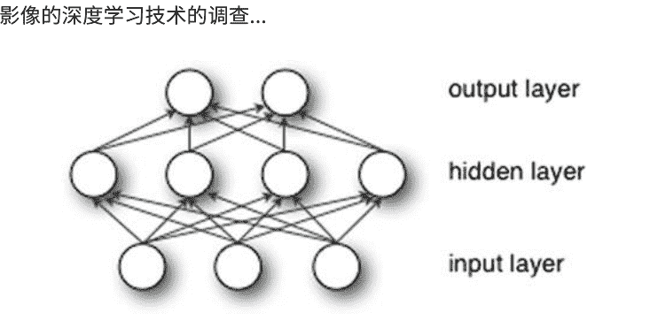

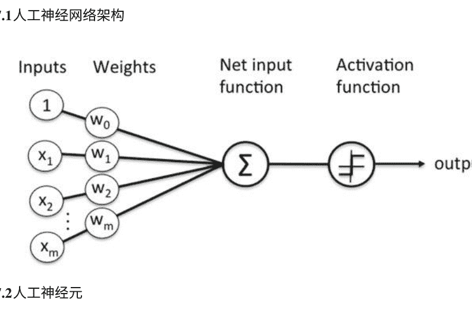

```
输出 = \sigma(W \cdot X + B)
```

##### 7.4.1 人工神经网络中的激活函数

激活函数是添加在网络中每个神经元上的数学方程，用于将输入信号映射到非线性输出值。它用于对下一层中的神经元是否应该被激活（发放）进行数学决策。函数的非线性性质的作用是为网络添加非线性特性，使其能够从高维、非结构化、非线性和大型数据集中学习和建模复杂任务。

###### 7.4.1.1 非线性激活函数的类型

**A. Sigmoid激活函数**

S形曲线范围从0到1（图7.3）。

$$F(x) = 1/1 + \exp(x)$$

Sigmoid函数的主要优点：

- 易于应用。
- 平滑梯度，防止输出值跳跃。
- 输出归一化，因为其输出值范围在零和一之间。

Sigmoid函数的主要缺点：

- 引入梯度消失问题。
- 计算开销大。
- 难以优化，因为Sigmoid函数不是以零为中心。

**B. Tanh激活函数**

S形曲线范围从 -1到1（图7.4）。

$$F(x) = 1 - \exp(-2x)/1 + \exp(-2x)$$

Tanh函数的主要优点：

- 易于优化，因为它以零为中心。
- 归一化输出。
- 平滑梯度。

图7.3 Sigmoid激活函数

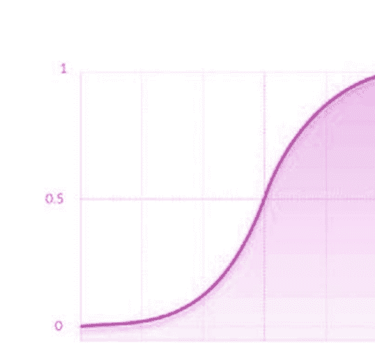

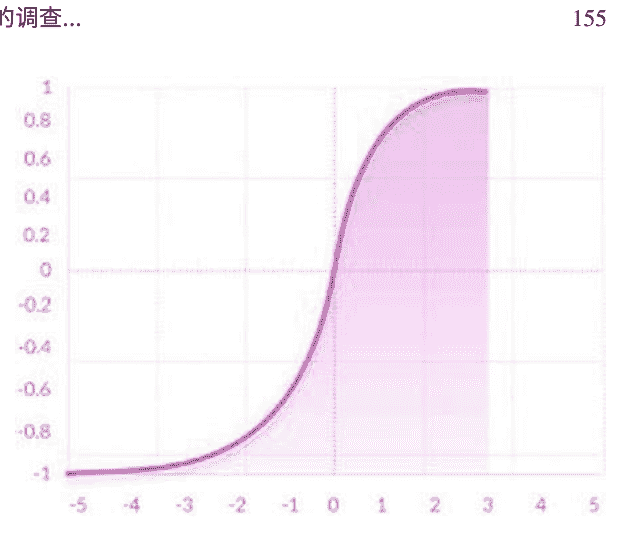

Tanh函数的主要缺点

- 梯度饱和->引入梯度消失问题。
- 收敛速度慢->计算成本高。

**C. Softmax激活函数**

范围从0到1

$$F(x) = \frac{\exp(X_i)}{\sum \exp(X_i)}.$$

Softmax激活函数的主要优点

- 用于多类别分类任务。

**D. Relu激活函数**

范围从0到 +无穷大 (图7.5)。

$$R(x) = \max(0, x)$$

Relu函数的主要优点

- 非饱和梯度->解决了梯度消失的问题。
- 快速收敛。
- 非线性->允许有效的反向传播。

Relu函数的主要缺点

- 当输入小于零时，死亡Relu问题导致神经元失活，阻止网络进行有效的反向传播。

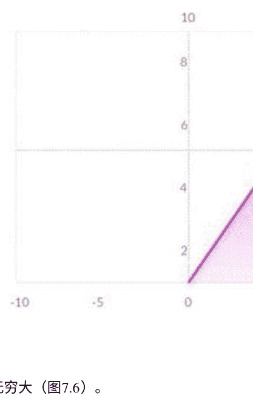

**E. Leaky Relu激活函数**

范围从 -∞ 到 +∞ (图7.6)。

$$F(x) = \max(0.1 \times x, x)$$

####### Leaky Relu函数的主要优点

- 防止Relu问题
- 快速收敛
- 防止梯度消失问题

####### Leaky Relu函数的主要缺点

- 由于负输入结果的低效性，预测不一致

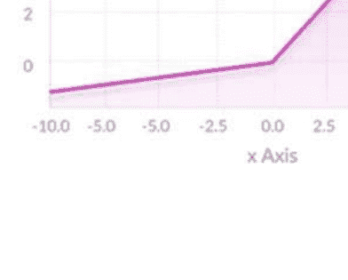

图7.7 Swish激活函数

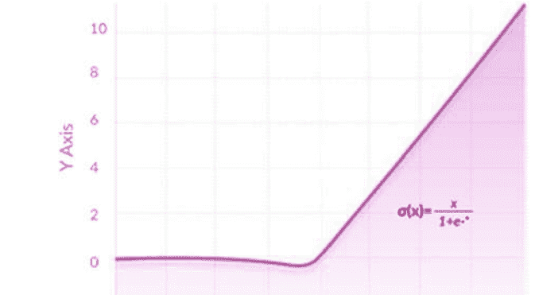

**F. Parametric Relu函数**

范围从负无穷大到 +无穷大

$$F(x) = \max(a * x, x)$$

**Parametric Relu函数的主要优点**

- 允许学习负输入值。
- 防止激活函数的死亡问题。
- 快速收敛。
- 防止梯度消失问题。

**参数化激活函数的主要缺点**

- 根据任务的不同表现出不同的性能。

**G. Swish**

Google [13] 发现的一种新的激活函数，与 Relu 相比在相同的计算效率下表现更好（图 7.7）。

$$F(x) = x / \exp(-x)$$

##### 7.4.2 训练过程

训练过程是必须的，以使设计的模型能够从提供的数据中学习。整个训练过程可以总结如下：

###### 7.4.2.1 模型初始化

确定适当的初始化策略是训练过程中实现更高准确性和更高收敛性的关键步骤。

有三种参数初始化方法：

A. 将参数初始化为零。
将权重和偏置初始化为零不是一个好的做法，因为无论我们通过网络进行多少次反向传播迭代，所有权重都将接收相同的更新。因此，由于这种对称性质，神经元将无法学习。
B. 随机使用均匀分布或标准正态分布初始化参数。
这种技术比零初始化更高效，因为它打破了对称性并允许神经元学习。这种策略的问题是，当权重被初始化为大或小值并应用于sigmoid或tanh等激活函数时，梯度饱和会发生，导致学习速度变慢。
C. 使用Glorot et al. [14]或He et al. [15]的初始化技术初始化参数。
这些方法通过将权重初始化为适当的值，避免了收敛缓慢、训练误差率较低以及梯度消失和梯度爆炸问题。

Xavier初始化用于tanh激活函数：

$$\sqrt{\frac{1}{\text{size}^{(l-1)}}}$$
$$\text{randn}(\text{size}^l, \text{size}_{l-1}) * \text{np.sqrt} \left( \frac{1}{\text{size}_{l-1}} \right)$$

Kaiming初始化用于Relu激活函数：

$$\sqrt{\frac{2}{\text{size}^{(l-1)}}}$$
$$\text{randn}(\text{size}^l, \text{size}_{l-1}) * \text{np.sqrt} \left( \frac{2}{\text{size}_{l-1}} \right)$$

###### 7.4.2.2 前馈

在随机初始化权重之后，自然的下一步是检查模型的性能，这是通过将输入（研究数据）通过网络层（隐藏层）并直接计算实际输出来完成的。

###### 7.4.2.3 损失函数

损失函数是权重和偏差的函数，它是网络给定的真实值（目标值）与ANN输出值之间的差异。这个成本必须在整个数据集上进行。因此，损失函数必须在数据集中的所有样本上进行求和，以得到总误差。一般来说，机器学习算法的目标是将损失函数最小化，使其接近零。

###### 7.4.2.4 梯度下降

梯度下降（图7.8）是一个数学概念，它导致函数的全局最小值或局部最小值的位置。它处理损失函数关于模型权重的偏导数，以找到使成本函数减小更多的方向。梯度下降显示了每个权重对总误差的贡献程度。举个例子，想象一个人站在山顶上，试图找到下山的路；理想情况下，这个人会朝着最陡峭的方向迈出一小步。这个人会一步一步地下山，直到到达山脚。梯度下降以类似的方式运作，它从一个位置（权重和偏差的当前值）开始找到函数的最小值。然后，它计算负方向的梯度。最后，它朝着那个方向迈出一小步，定义一个新的模型，具有新的权重（w'），这样可以更好地分类点的错误会减小。通过重复这个过程，最小值最终会被达到。

成本函数的梯度由以下给出：

$$\frac{\partial C}{\partial w'_{jk}}$$

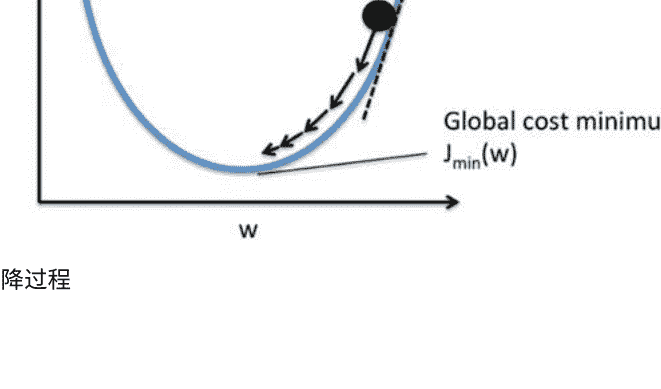

其中 y表示步长。

在机器学习中，步长通常被称为学习率。学习率既不能太大，否则将丢失极小值，也不能太小，否则训练过程将过于缓慢。它应该在$10^{-1}$到$10^{3}$的范围内。

**A. 梯度下降的类型**

**i. 批量梯度下降：**

在计算梯度下降的每次迭代中，所有训练样本都会被处理。然而，对于大型训练数据集来说，计算成本很高。

**ii. 随机梯度下降：**

这种策略每次迭代只处理一个训练样本。因此，参数在每次迭代中得到更新。这种方法的主要缺点是在处理大数据量时，当迭代次数较大时，会导致计算过程变得昂贵。

**iii. 小批量梯度下降：**

这种方法比之前的方法更快，因为它在每次迭代中处理一批训练样本，从而实现快速收敛。

**B. 梯度下降优化算法**

- 动量
- Nesterov加速梯度
- Adagrad
- Adadelta
- RMSprop
- Adam
- AdaMax
- Nadam
- AMSGrad

**C. 梯度下降问题**

深度架构网络的训练过程中存在一个问题，即由Pascanu等人解释的梯度消失和梯度爆炸问题。当梯度通过一系列矩阵乘法使用链式法则从输出层向初始层传播时，就会出现这个问题。这个问题可以总结为：

> “当梯度变得可忽略（<1）时，从权重矩阵中减去它不会产生任何变化。因此，模型停止学习，这就是梯度消失的问题。而如果梯度值变得太大（>1），从权重矩阵中减去它会得到一个很大的值。因此，模型将崩溃，这就是梯度爆炸的问题。”

## D. 梯度问题的解决方案

- i. 爆炸梯度下降的梯度剪切
如果梯度值超过特定阈值，就使用这个概念来剪切（重新缩放）梯度值，从而防止权重达到不希望的值并保持网络稳定（图7.9）。

```
$g \leftarrow \eta g / ||g||.$
```

- ii. 使用ReLU而不是tanh/sigmoid激活函数
tanh的范围是 -1到1，sigmoid的范围是0到1，这些函数的导数在极端值处饱和，随着x轴增加而趋近于零（图7.10，7.11）。

从前面的图表可以看出，当x轴上的值接近函数的极端值时，其导数接近于零，因此在向网络的后面深入时会消失。因此，梯度将会一次又一次地与一个小于1的值相乘。因此，在每个前一层中反向传播的梯度将变得越来越小，直到进入第一个隐藏层时几乎为零。因此，第一层的权重保持不变。ReLU激活函数（图7.12）通过给出导数为1来解决这个问题，使得梯度在向网络后退时保持不变。

- iii. 权重初始化
权重应该随机初始化以打破对称性，并且不应该太大或太小，以避免梯度消失/爆炸问题。

- iv. 应用正则化来防止梯度爆炸下降
对于值较大的权重应用L1和L2惩罚，以防止它们超过1的值。

### 7.4.2.5 反向传播
反向传播是通过计算每一层神经元输入的梯度下降来将总误差向后传播到网络的过程。这种方法被应用于优化权重、偏置，并最终减少总误差。梯度下降利用链式法则数学概念，在从节点到输出的嵌套方程中计算函数（损失函数）对任何变量的导数。因此，链式法则是一种用于找到一系列嵌套方程的导数的数学公式。

它使用莱布尼兹符号表示，如图7.13所示。如果你有一个应用于x的函数的变量A，如下所示：

```
A = f(x)
```

还有另一个应用于f(x)的函数g，如下所示：

```
B = g(f(x)),
```

那么B对x的导数表示为B对A的偏导数与A对x的偏导数的乘积。

```
d B / d x = d B / d A × d A / d x
```

### 7.4.2.6 更新权重
新权重 = 旧权重 — 导数率 * 学习率

### 7.4.2.7 迭代直到收敛
重复步骤2-6，直到达到给出低训练误差率、加快收敛速度和提高模型准确性的参数值。

#### 7.5 深度神经网络
深度学习是一种具有多个隐藏层的神经网络，本质上允许对特征进行生动的表示，并减少了对手动特征工程的需求。这种能力使得深度学习算法能够在各个领域的问题上取得最先进的结果。

##### 7.5.1 监督深度学习

###### 7.5.1.1 卷积神经网络
CNN是一种神经网络类型，两者都由相同的构建模块和学习概念组成：它们由一组层组成，其中一层将其输出馈送到下一层。每个层由一组具有可学习权重和偏差的神经元组成。每个神经元的权重在反向传播和梯度下降优化技术的每次迭代中进行更新。这些技术用于减少输出模型信号与真实标签之间的误差。请注意，更新模型参数的过程称为训练。那么CNN和ANN之间有什么区别呢？

回顾前一节中神经网络架构的定义：每个层的每个神经元都与前一层的所有神经元完全连接，同一层内的神经元是独立的，不共享参数。

此外，为了进行成功的训练过程，我们应确保输入数据的格式已进行二值化处理（手动特征工程），以便ANN能够识别出优先模式。当涉及到大量原始像素数据输入时，这种密集架构效果不佳。例如，想象一种情况，彩色图像的分辨率为250 × 250，这将导致250 × 250 × 3＝187,500个权重。

要从这么多的输入中学习，应该使用一个多层设计，其中有数百甚至数千个神经元。因此，使用多层设计会降低模型的性能并引入过拟合问题。

CNN架构模仿人类视觉皮层，使其能够从底层图像内容中编码信息，其中每个神经元在一层中与前一层的一小区域的神经元相连。因此，计算的权重数量被最小化。这种特性减少了内存存储需求并提高了算法的效率。CNN在各种图像领域任务（如分类、检测、分割）中取得了最先进的结果，使其成为视觉相关应用的首选技术。该模型旨在使用学习阶段的拓扑结构从原始像素图像中提取局部空间特征，其中包括卷积层、非线性函数和子采样层。

这种分层式架构使得卷积神经网络能够自动学习接近输入的低和中等特征，然后将它们组合成抽象表示，在模型的更深层次中提取高级特征。深度卷积神经网络之所以受欢迎，是因为大规模数据集和高计算能力资源的可用性，以及CNN在处理更复杂问题时表示能力的增强。卷积神经网络的重要动机包括自动特征提取、分层学习过程、权重共享、稀疏连接以及保持空间关系的能力。

**卷积神经网络的基本组件**
卷积神经网络的构建块由三种类型的学习阶段组成：卷积层用于自动特征提取，池化层用于子采样，全连接层用于将提取的特征映射到最终的输出类别。完整的卷积神经网络架构由这三个层的多个堆叠组成。这种排列在实现增强性能方面起着关键作用。

**A. 卷积层**
卷积层是CNN架构的核心。该层由一组卷积核（每个核代表一个神经元）组成，每个核表示一个可学习权重的小空间网格。卷积核具有固定的权重，在图像的每个小区域（具有与滤波器相同宽度和高度的小图像位置称为相应的区域）上应用，以便在图像的任何位置检测感兴趣的特征。这使得CNN在图像处理领域非常有效。这个过程被称为参数共享。

该层定义了两个基本的数学函数来执行自动特征提取，即线性（卷积函数）和非线性（激活函数）操作。卷积函数作为一个操作（图7.14）对两个数字网格进行卷积，其中第一个数字数组称为卷积核，应用于第二个网格，即输入图像的相应区域。在滤波器和图像的相应区域之间计算逐元素点积，然后将其求和以将输出值附加到特征图中的相应位置。然后，根据步长定义，递归地将滤波器在图像的宽度和高度上移动，以覆盖图像的元素，填充特征图的元素。此外，如果同一层中呈现不同类型的特征，则会形成一个集合。

为了表示这些不同的特征，需要使用多个内核，从而导致了多个特征图。该特征图表示了每个空间图像位置上激活的区域，其中滤波器看到了感兴趣的特征，如线条、边缘和曲线。这个激活图成为下一层的输入。

空间图像局部I和内核K之间的卷积操作（卷积操作用符号'\*'表示）的输出S定义如下。

```
S = (I * K)
```

在卷积操作过程中，滤波器可能会超出图像范围，从而阻止卷积层捕捉输入图像边缘区域的信息。因此，零填充技术被用来给滤波器提供更多的空间移动。此操作通过在图像边缘添加零值边框来实现。现在，卷积层从图像的每个区域获得贡献。
因为图像远离线性，并且由于卷积函数的输出值是线性的，所以在卷积操作之后直接添加非线性激活函数，以引入激活图的非线性特性。目前在CNN中使用的流行激活函数是ReLU。

**B. 池化层**
特征图对输入图像中特征的位置敏感。因此，对于输入图像发生的任何小变化（如裁剪、旋转和缩放），不同的特征图会呈现出不同的特征，使得CNN模型远离自动特征提取能力。为了解决这个问题，专家们在卷积层之后，特别是在激活函数之后插入了一个新的层。这个层用于将特征图下采样到一个较小的版本（通过减小激活图的高度和宽度）。下采样通过在特征图上应用池化操作（滤波器）来保留来自激活图元素的基本特征，并去除无用的细节元素。这个层对于输入图像中特征的任何移动都会产生相同的池化图；这个池化层的特性被称为局部平移不变性。池化滤波器的大小小于特征图的大小。通常，池化操作使用2 × 2维度的滤波器，步长等于2。

总结一下，池化层的主要优势是：
- 降低计算复杂度
- 提取低级特征
- 减小方差

目前最常用的两种池化方法（图7.15）是：
- 平均池化：取池化滤波器覆盖的特征图元素的平均值
- 最大池化：取池化滤波器覆盖的特征图元素中最活跃的元素

**C. 全连接层**
最后一个卷积或池化层的输出被展平成一个一维数组，并输入一个或多个密集层。因此，全连接层中的每个神经元都与前一层中的每个神经元连接，计算分类任务的概率得分。

**D. Dropout层**
过拟合是影响任何神经网络的重要问题，即模型在训练数据上调整得很好，但在测试数据上无法泛化。Dropout是一种通过随机将一些激活节点设置为零来解决这个问题的技术。该算法接受一个参数，表示在特定时期应该丢弃的节点数的概率。

**E. 批归一化**
批归一化是由Ioffe和Szegedy从Google Brain发现的一种归一化技术，用于解决特征映射中的内部协方差漂移问题。这个问题源于隐藏层中数据分布的变化，导致梯度消失问题。因此，减缓收敛速度并防止神经元学习。该算法通过将图像统一为零均值和单位方差来解决这个问题。这个层被插入在ReLU激活函数之前的隐藏层中。

**使用CNN进行迁移学习**
如上所述，深度学习算法需要大量的数据集才能有效运行并达到高精度。在医学影像分析等领域，很少有足够的数据集大小，因此从头开始训练深度学习算法是无用的。为了解决这个问题，科学家们引入了一种称为迁移学习的机器学习技术。迁移学习涉及使用预训练模型作为新CNN模型的特征提取器或权重初始化器。

根据新数据集的大小和新数据集与原始数据集的相似程度，引入了两种重要的迁移学习类型，它们是：

**A. 将原始模型用作固定特征提取器**
回想一下机器学习和深度学习之间的区别，深度神经网络通过其自动特征提取能力抑制了人工神经网络。固定特征提取器技术与人工神经网络的过程具有相同的思想，在人工神经网络中，我们在将输入数据馈送到模型之前手动提取特征。然而，在迁移学习的情况下，特征提取的繁重计算由预训练的深度模型完成。因此，为了使预训练模型在新模型上充当固定特征提取器，我们从预训练模型中删除最后一层“全连接层”。然后，我们将其余的层（已经学习过的层）作为目标模型的固定特征提取器，通过将预训练层连接到新模型的全连接层的输入。

**B. 微调预训练模型**
与之前的策略不同，微调技术修改了预训练模型的一些或全部学习权重。当新数据集的分布与原始数据集有些不同时，使用这种技术。请记住，深度学习模型的早期层具有通用特征表示（如边缘、线条、颜色等），而后期层则具有特定于数据集的特征。因此，可以微调网络的一些或全部高层部分，这些部分与所关注的分类任务相关。

选择的迁移学习类型基于基础数据集和新数据集之间的相似性以及目标数据集的大小。以下是探索四种独特情况的一些常规可靠指南:

- i. 目标数据集比原始数据集小且相似
在这种情况下，固定特征提取器类型是最合适的选择，因为新数据集与原始数据集具有相同的数据分布。由于这种相似性，预训练模型和目标模型都将具有相关的高层特征表示。然而，在这种情况下使用微调类型将被视为不良实践，因为由于数据规模不足，模型会过拟合。

以下是在新模型上执行特征提取的迁移学习步骤。
- 从预训练模型中移除全连接层
- 添加一个新的全连接层，其输出节点数与目标类别数相匹配
- 随机初始化目标模型中全连接层的权重
- 冻结预训练模型的权重
- 使用目标数据集训练新的全连接层

- ii. 目标数据集较大且与原始数据集相似
由于目标数据集的有效大小，如果在此场景中使用微调，模型不会过拟合。按照以下步骤微调目标网络。
- 从预训练模型中移除密集层
- 添加一个新的全连接层，其输出节点数与目标类别数相匹配
- 随机初始化新的全连接层的权重
- 解冻预训练模型的权重
- 从目标数据集重新训练整个网络

- iii. 目标数据集比原始数据集小且不同
仅使用微调将导致过拟合问题，仅使用固定特征提取器不准确，因为后面的隐藏层将携带特定于目标数据集的特征分布。相反，网络将同时使用两种迁移学习类型的组合，即使用较低层次的特征将预训练模型作为特征提取器，并微调模型的其余部分。该模式的实现如下：
- 从预训练模型中获取较早的层
- 向选定的层添加一个新的全连接层
- 随机初始化新的全连接层的权重
- 从目标数据集训练新的全连接层

- iv. 目标数据集庞大且与原始数据集不同
从头开始训练模型是可行的，因为数据量是有效的。然而，从预训练模型中初始化权重并进行调整，使得训练过程更快速是有优势的。在这种情况下，要执行的实现步骤与第三种情况中列出的步骤相同。

由于标注数据集规模不足，迁移学习在医学影像领域中被广泛使用。最初，医学影像分析领域集中在无监督的预训练模型上，如SAE和RBM。作者在[17, 18]中利用迁移学习算法，并将预训练的SAE和DBN应用于磁共振成像（MRI）以对患者进行正常或阿尔茨海默病（AD）的分类。

在最近的论文中，观察到了向预训练的监督模型（如CNN）的巨大跃迁。Shin等人[19]评估了在CT扫描数据集中应用迁移学习来检测腹部淋巴结（LN）和间质性肺病（ILD）的影响。作者对一个名为ImageNet [20]的大规模标记数据集上预训练的CNN模型进行了微调。这种方法在LN检测中实现了86%的敏感性，并且每个患者的误报率为三个。Ravishankar等人[21]通过使用超声图像将从ImageNet数据集建模的预训练CNN的学习权重转移到肾脏识别任务中进行了研究。他们得出结论，迁移学习的程度增加对CNN的性能有积极影响。Tajbakhsh等人[22]比较了预训练的CNN模型与使用医学影像数据从头开始训练的模型的性能。该研究涉及四种不同的医学影像应用（包括息肉检测、肺栓塞检测、结肠镜帧分类和内膜-媒介边界分割）以及三种不同的医学影像模态。他们发现，对CNN模型进行深度微调优于从头开始训练的CNN模型。

很少有研究人员专注于研究在应用于医学成像数据集时，哪种迁移学习（特征提取器和微调）能够产生最佳结果。在这项研究中，两位研究人员（安东尼和金）提供了相互矛盾的结果。安东尼等人[23]提出了一种将预训练的CNN模型进行微调和作为特征提取器进行比较的膝关节骨关节炎（OA）严重程度分类结果。在这种方法中，微调的效果优于特征提取，并且在分类准确率上达到了57.6%，而特征提取策略在细胞病理学图像上的准确率为70.5%，超过了69.1%的微调策略。最近，研究人员[25, 26]展示了微调在医学图像疾病分类中的能力。

作者使用了GoogLeNet Inception v3 CNN架构[27]，该架构在ImageNet[20]数据集上进行了预训练，包含了128万张图像。他们的结果达到了人类专家水平的表现。仅仅利用预训练的系统作为特征提取器还没有达到这些最先进的结果。

###### 7.5.1.2 循环神经网络
实际上，顺序数据无处不在；例如，音频表示一系列声波，而文本由一系列字符或单词组成，等等。传统的前馈模型无法处理这种类型的数据，因为模型的一系列属性限制，以下是一些示例：
- 前馈网络只接受固定长度的向量作为输入；这对于序列建模任务来说是一个问题，因为在序列建模中，用于预测下一个词的输入单词数量必须是动态的。
- 为了处理第一个问题，科学家们引入了一个具有有限单词数量的小固定窗口大小。这个解决方案在输入数据中引发了另一个问题，即由于给定给这个网络的有限历史，无法对输入数据的长期依赖性进行建模。
- 为了解决第二个问题，研究人员提出了另一种被称为“词袋”的方法。这种方法将整个序列表示为一组计数。使用计数时，所有的顺序信息都被完全忽略了，例如，想象一下两个具有完全不同语义含义的句子具有相同的词袋表示。
- 第三个问题中出现的问题通过扩大窗口的大小，并采用第一个问题中提出的解决方案来采用更多的单词来解决。在这种策略中，序列的每个输入都与网络连接，并具有单独的权重。这种方法防止了从一个序列的学习权重在某一点传递到另一个序列。

这些问题表明传统神经网络不适合处理序列数据，并进一步激发了一套特定的设计准则，用于序列建模问题。因此，新设计的模型需要具备以下能力：
- 处理可变长度的序列
- 跟踪长期依赖关系
- 保持信息顺序
- 在整个序列中共享参数

深度序列建模或RNN（图7.16）是一种神经模型，它以一种方式设计，使其能够解决由于其生成文本能力而引起的序列处理问题。RNN模型使用的配置层允许信息持久性。RNN拓扑结构已被应用于各种文本分析应用，如语音识别[28]、图像标题生成[29]、机器翻译[30]和许多其他MLP任务。

RNN模型中隐藏层的每个输出不仅连接到下一层的输入，还会返回到其输入，以更新其在时间t的内部状态，我们称之为ht。因此，隐藏状态通过在每个时间步应用一个依赖于先前状态ht-1和当前输入xt的权重的递归关系来维持。

```
$$ht = \sigma (xt + Rht - 1).$$
```

在每个时间步骤中都使用相同的参数（权重和R），这允许在序列建模的上下文中进行参数共享。

根据每个时间步骤计算的内部状态和一个单独的权重矩阵，RNN使用以下公式生成预测输出 $yt$。

```
$$yt = W * ht$$
```

该模型由于许多权重矩阵乘法和反复使用激活函数导数而导致梯度问题[31]（梯度消失或梯度爆炸），这些导数必须在时间上向输入传播错误时计算。为此，已经构建了一些特定的记忆单元，其中最早和最著名的单元是长短期记忆（LSTM）[32]和门控循环单元（GRUs）[33]。

尽管RNN在文本分析领域中很受欢迎，但RNN逐渐在图像分析应用中，特别是在医学图像分析空间中得到应用。Shin等人[34]使用深度CNN特征训练了RNN模型，以描述已识别疾病的上下文。Stollenga等人[35]使用多维递归NN以像素方式分割3D脑图像，其中每个像素都分配给一个类别。作者表明，在图像分割任务中，RNN优于CNN，因为CNN只能看到像素的小局部上下文，而RNN可以感知每个像素的整个时空上下文。Chen等人[36]提出了一个由完全卷积网络（FCN）和递归神经网络（RNN）构建的深度学习框架，用于从3D图像中分割神经元和真菌。

##### 7.5.2 无监督学习
###### 7.5.2.1 自编码器（AEs）和堆叠自编码器（SAEs）

自编码器[37]是一种无监督神经网络，由两个主要过程组成：编码（或降维）和解码（或升维）（图7.17）。在编码过程中，模型通过限制输入和输出值之间的重构误差来学习从输入数据中提取压缩特征表示。在这个阶段，输入层中的节点数量被减少到较小的数量在隐藏层中。

至于解码，模型使用隐藏层中提取的表示来恢复输入信息（这个过程称为重构）。在这个阶段，隐藏层中的节点数量增加到与输出层中的输入节点数量相同。在解码过程中，自编码器使用一种成本函数，当输入和输出值不同时，对编码器进行惩罚。

- 自编码器的主要优势是：
- 它减少了对标注数据的需求，因为它以无监督的方式工作。
- 它降低了输入的维度，因为隐藏节点的数量比输入要小；这迫使模型只保留对重构有用的有价值的输入特征，并且排除信息中的噪声。
- 它生成与训练样本相似的新数据，在数据量较小的领域中非常有用。

自编码器的简单架构在重构复杂输入数据方面的能力受到了很大限制。为了达到这个目的，多个自编码器被堆叠在一起形成一个强大的设计，称为SAE，其中第一个编码器训练的隐藏层被用作下一个编码器的输入，以此类推[38]。

SAE代表了一个深度学习模型，因为第一个自编码器将学习低层特征，而后面的自编码器将组合这些特征形成高层表示。在训练过程中，简单的堆叠自编码器架构可能会通过仅复制输入数据表示到输出层来过拟合，因为它有多种表示方式。为了使模型学习有价值的表示并增强发现过程，必须采用新的优化技术，即去噪和稀疏自编码器。

去噪自编码器[39]向输入添加噪声（如高斯噪声、盐和胡椒噪声等），强迫模型重新构建出无噪声的输入。另一个约束是稀疏自编码器[40]，在成本函数中添加了非稀疏惩罚项，当达到特定阈值时，会关闭一些神经元。

医学应用使用监督学习对设计的模型进行预测。Kallenberg等人[41]使用无标签数据训练自编码器来提取特征层次结构。他们使用学到的特征来训练一个监督模型，以对乳房纹理的严重程度进行分类和分割。

###### 7.5.2.2 限制玻尔兹曼机（RBMs）和深度置信网络（DBNs）

限制玻尔兹曼机[42, 43]是一个双向图模型，它由保存输入数据的可见层和保存特征表示的隐藏层组成。RBM架构假设层内部没有连接。然而，关系是以双向方式在不可见节点和可见节点之间建立的，所以从输入向量x得到特征表示h，反之亦然。基于这种对称连接的特性，RBM在从隐藏表示中重构输入样本的上下文中起作用。像自编码器一样，RBM也可以堆叠在一起构建一个称为DBN的深度架构[44]。顶部两层形成一个双向设计，而底层形成一个定向模型。

###### 7.5.2.3 变分自编码器

变分自编码器（VAE）[45]是一个从输入数据中学习概率分布的生成模型。VAE由贝叶斯推理编码器-解码器和两个损失函数（重构损失函数和Kullback-Leibler散度）[46]组成。编码器将输入向量编码为潜在表示空间，而解码器将潜在表示用于估计数据的概率分布。

## 7.6 MRI 预处理

在将 MRI 图像输入模型之前，必须对输入图像进行一些预处理步骤。这些步骤如下所示：

##### 7.6.1 序列排序

在同一序列中，我们必须分离不同切片的图像。可以使用直方图图像分析算法自动完成此操作，该算法允许我们检测同一序列中图像的直方图之间的不连续性。

##### 7.6.2 配准

有时患者会移动或其身体不在 MRI 扫描仪的中心位置，这导致图像彼此偏移。此时，图像应首先调整到一个典型的方向。

##### 7.6.3 标准化

对于同一患者，在相同的协议、相同的机器和相同的临床条件下，两个 MR 拍摄可能具有不同的光强度。这些差异会因机器型号的更改、对比剂的更改等而加剧。为了更好地收敛，有必要对图像进行标准化。许多 MRI 分割模型使用了 Nyul 等人的算法。然而，要对图像进行标准化，首先需要标记 MRI 的每个像素。实际上，由于某些部位（如肌肉）的亮度值与脂肪组织或骨骼不同，将相同的标准化应用于它们是荒谬的。然而，在 MRI 上进行像素分割只有在任务容易的区域才可能（例如：大脑 MRI）。因此，这个算法在一些可能感兴趣的领域中表现不佳，因为几乎没有对这些领域的分割解决方案。

##### 7.6.4 偏差场的校正

MRI图像在高频域中存在偏差，导致相同组织的强度变化。这种现象被称为偏差场失真，它与外部干扰、细胞内机制、材料缺陷等多个因素有关。这个问题倾向于降低图像的质量，并可能影响神经网络的收敛。图像噪声是一个严重的问题，它阻碍我们获得正确和精确的结果。因此，解决这个问题将提升结果的准确性。为了解决这个问题，已经提出了前瞻性和回顾性方法[48]。

前瞻性方法处理MRI采集过程中的强度失真问题。它强调从设备中最小化偏差场。它依赖于几种技术，包括幻影、多线圈和独特的序列。

关于幻影方法，采用油或水的一种创新方法，对幻影图像进行平滑处理，使用中值滤波。然而，这种方法留下了30%的不均匀性率，这是相当高的。这个比率是一个显著的缺点，无法纠正患者引起的不均匀性。因此，科学家和物理学家提出了另一种方法。这个过程依赖于仔细记录幻影和线圈的方向和位置[49]。它主要通过数学技术和策略，对估计的不均匀性场进行几何变换，将其应用到任何获取的图像上。这些数学操作包括多项式[50]、曲线[51]和基于Biot-Savart定律的积分[52]。这些操作将不均匀性场缩小，并将其拟合到幻影图像上。为了减少不均匀性场对扫描结果的依赖性，Collewet等人提出了一种基于T1信号方程的数学模型，该模型使用幻影图像、翻转角度映射和参考物体。然而，这种解决方案的好处有限，需要特定的成像条件，并对输入参数的灵敏度较高。

另一种潜在的方法是多线圈成像。多线圈成像是一种依赖于通过不同线圈拍摄更多图像的方法。有两种类型的线圈：表面线圈具有高信噪比但存在严重的偏置场，而体积线圈则相反。1988年，Brey和Narayana研究并了解了每个线圈的特性。他们提出了一种将表面线圈和体线圈结合起来以获得中信噪比和无偏置图像的方法。Brey和Narayan依赖于分割经过滤的表面线圈图像和体线圈图像，然后进行平滑处理以获得所需的结果图像。然而，这种方法存在两个主要缺点。这些缺点可以总结为图像获取时间长且难以完全分离体线圈图像和表面线圈图像。因此，科学家的主要目标是如何解决或减小这些缺点。

为了解决时间问题，Lai和Fang在2003年注册了一个低分辨率的体图像到完整分辨率的表面线圈图像。然后样条曲面对偏差进行建模用于校正。关于分离问题，Fan在2003年建议将一个体线圈与多个表面线圈图像集成在一起，从而可以获得偏差用于估计。前瞻性的最终方法是独特序列。这种方法主要关注硬件部分，以解决和确保前瞻性过程的设计。它可以简要地描述为一种估计翻转角度的空间分布的方法，然后使用所得结果来测量强度不均匀性。它依赖于一种需要获取两幅图像的数学运算，其中第二幅图像是第一幅图像的两倍名义翻转角度。这种方法还依赖于多个接收线圈的敏感度编码。尽管这种方法可以最小化不均匀性伪影，但其主要目的是加快扫描过程的速度。

回顾方法比前瞻方法更高效。它相对而言比较通用，通常使用从获取的图像中获得的信息，其中解剖信息与强度不均匀性信息相结合。它依赖于几种方法，例如基于滤波的方法、基于曲面拟合的方法、分割方法和基于直方图的方法，每种技术都有其自己的策略。

首先，基于滤波的方法是一种将偏置场识别为从获取的图像的高频部分中提取出来的低频部分的方法，使用低通滤波器进行处理。这种技术的显著优势在于它便宜且简单易行。滤波方法有两个派生类别。它们是同态滤波和同态增强掩蔽。同态滤波方法用于对对数变换后的图像强度进行处理，而同态增强掩蔽用于校正MRI中的强度不均匀性。

另一种回顾方法是表面拟合，其中强度和梯度方法位于其下。表面拟合方法可以总结为对一系列包含偏差场信息的图像特征进行参数化表面拟合。

如上所述，表面拟合主要依赖于基于强度或基于梯度的方法。基于强度的方法主要依赖于将最小二乘参数化表面（以薄板样条的形式）拟合到一组像素的强度上。该方法可以使用手动选择、自动迭代或高斯主要组织模型来应用。而基于梯度的过程则依赖于一个假设，即适当大的均匀空间在整个图像上均匀分布。该方法在多项式表面中使用最小二乘拟合和独立组织分割进行了测试。这种策略没有利用所有信息来找到不均匀性场。其他研究人员引入了类似的方法，其中有限元表面模型用于计算和最小化均匀区域导数与表面模型之间的差异。另一种方法依赖于在均匀区域中积分导数来找到偏差场。然而，这些方法只在图像的均匀区域较大且典型时有效。

除此之外，还有基于分割的方法，被认为是回顾性方法之一。基于分割的方法使得强度不均匀性校正变得简单且适用。它主要依赖于机器学习（ML）、最大后验概率（MAP）、模糊c均值和非参数方法。ML和MAP用于使用参数模型近似图像概率分布，可以使用最大似然（ML）或最大后验概率（MAP）准则。它主要使用有限高斯混合模型来整合不均匀性。该模型使用期望最大化（EM）算法[54, 55]来估计其参数。

此外，模糊C均值是第二种基于分割的方法。它的主要特点是软分类模型。这个特性消除了混合类别的显式建模，从而提高了结果。在[56]中，作者提出了自适应模糊C均值，他们通过位置函数将类别质心乘以，从而近似了强度不均匀性。最后，非参数方法是最后一种分割方法，它使用非参数最大偏移或均值偏移聚类来确保达到预定目标。它不需要任何关于强度概率分布的先验知识，这是相当大的改进。它主要依赖于迭代最小化类别平方误差。

此外，正如上面简要讨论的那样，回顾也依赖于基于直方图的方法。基于直方图的方法直接关注图像强度直方图，并且在强度概率的先验知识上需要很少或没有初始化。基于直方图的方法有三种方法，分别是：高频最大化、信息最小化和直方图匹配。高频最大化是一个自动过程，不需要任何先验知识，并且适用于几乎所有的MR图像。它的目标是找到平滑的乘法场[57]。而信息最小化则通过对图像熵估计的约束最小化来消除强度不均匀性。这种方法基于一个假设，即强度不均匀性破坏会给无强度不均匀性的图像带来额外的信息。最后，最后一种基于直方图的方法是直方图匹配。直方图匹配将图像切割成小的子体积，考虑到具有稳定强度不均匀性。它是一个从图像的全局直方图初始化的具有七个参数的有限高斯混合模型。然而，它比信息最小化方法更不通用。

#### 7.7 医学成像中的深度学习应用

医学成像是一个重要的领域，有着大量的应用在各种临床事件中。它不仅仅局限于临床诊断，还扩展到手术和放射治疗策略的规划、完成和评估领域。医生使用许多成像模式（如CT扫描、MRI、X射线、PET等）来查看内部身体结构，检测异常情况，并对病例进行准确诊断。然而，人类对复杂数据（图像）的解释受到其主观性、不同翻译者之间的显著变异、疲劳以及超过处理能力的大量图像数据的限制。

此外，需要记住放射科医生的角色不仅仅是分析医学成像，还有其他职责，这将使放射科医生很难分配时间，因为图像分析的工作量正在增加。有趣的是，一种名为深度学习的计算机视觉技术解决了先前描述的问题，使放射科医生能够更快速、更准确地执行更有价值的医学任务。

##### 7.7.1 分类

在医学影像学中，分类是指将影像数据分配给预定义的类别。根据分类任务的不同，输出可以是二进制的（例如，区分正常和受影响的病变）或多类别的（例如，识别研究中疾病的严重程度，区分不同的病症等）。

###### 7.7.1.1 使用监督学习进行分类

许多研究论文调查了采用CNN模型将胸部X射线分类为良性或恶性的有用性。Rajkumar等人[58]引入了迁移学习（预训练和微调）和数据增强的概念来解决放射学图像数据数量不足的问题。他们采用了GoogLeNet [59]的CNN模型，该模型是一个由22个卷积层组成的模型，经过训练用于对1850个经过增强的胸部X射线观察进行分类，这些观察数据从112,120个胸部X射线图像中得到。Rajpurkar等人[60]开发了所谓的chestnut，这是一个修改过的预训练DenseNet [61]，它是一个由121个卷积神经网络层组成的模型，经过训练用于对ChestX-ray14数据集[62]中的112,120个胸部正面视图图像进行分类，这些图像被分为14个胸部疾病，包括肺炎。首先，该模型旨在从X射线图像中输出一个二进制标签，用于肺炎检测任务。该模型的过程经过分析，并与具有分别4年、7年、25年和28年经验的四名放射科医生使用420个胸部正面X射线测试数据集进行比较，该模型的F1得分（0.435）高于放射科医生的平均F1得分（0.387）。然后，该模型被扩展为分类14种胸部疾病的存在/不存在，该模型的性能优于Wang等人[62]、Yao等人[63]的先前最新结果，差距超过0.05 AUROC。

深度神经网络已广泛应用于分析脑部图像，从MRI图像中分类阿尔茨海默病。Hosseini-Asl等人[64]设计了一个模型，从3D MRI脑部图像中分类阿尔茨海默病；他们将工作分为三个步骤，即预处理、特征提取和AD分类。在预处理阶段，他们对MRI图像进行了空间归一化和去颅操作。在特征提取阶段，他们使用在CADDementia数据集上预训练的3D卷积自编码器（3D-CAE）从3D MRI图像中提取局部模式。这个阶段学习到的特征然后被输入到下一个阶段，作者采用了一个3D深度监督自适应卷积神经网络（3D-DSA-CNN）从ADNI数据库中将患者分类为健康脑、MCI或AD。这个结构的准确率（99%）比其他最先进的预测模型更高。Korolev等人[65]提出了一个模型，可以通过深度学习设计来分类阿尔茨海默病（AD）的3D MRI图像，并绕过以前关于AD分类任务的研究所提出的问题。

他们克服了MRI分类中的两个众所周知的问题，它们是：
- 使用预训练技术在小型神经影像数据集上训练深度网络。 请注意，训练深度网络需要大量的数据。
- 使用端到端模型进行自动特征提取，以避免手工制作特征生成和提取过程引入的延迟。

深度3D卷积神经网络（VoxCNN和ResNet）的设计方法分别来自普通（VGG）和残差（VoxResNet）3D CNN架构，它们在阿尔茨海默病神经影像计划（ADNI）数据集上进行了训练，用于对MRI脑图像进行分类任务。 尽管之前的研究（例如[64]）达到了更高的准确性，但这种端到端方法最直接，因此计算时间较短。

###### 7.7.1.2 使用无监督学习进行分类

无监督学习算法逐渐被用于从基于图像的信息中区分恶性和良性器官。陈等人[66]提出了一个深度卷积自编码器框架，以辅助对未标记的CT扫描图像中的肺结节进行分类。由于标注数据集不足，这项研究以无监督的方式进行，这个模型可以有效地从小型标记数据集中学习图像特征。

程等人[67]在两种不同的模态（超声和CT）上利用堆叠去噪自编码器（SDAE）来避免显著的图像处理错误和不准确的特征表示，这可能导致分类偏差。使用SDAE相对于传统的CADx的主要关键特性是自动特征提取和噪声容忍度，这使得模型能够处理来自不同成像模态的噪声特性。

Plis等人[68]展示了深度置信网络（DBN）在脑成像和神经科学中的应用，以学习出色的特征表示并发现功能和结构神经成像数据（fMRI）中的空间关系。

Suk等人[6]使用深度自编码器（DAE）提取非线性分层式功能关系，以区分患者的fMRI图像是否正常或轻度认知障碍。

##### 7.7.2 检测

检测任务是指定位对疾病有贡献的医学成像区域，通过突出与疾病相关的体素位置来完成。放射科医生手动扫描图像，寻找区分一个器官结构与另一个器官结构的特定解剖标志。然而，人工解读耗时且容易受到变异、主观性和疲劳的影响。

###### 7.7.2.1 使用监督学习进行检测

由于其精确的检测性能，CNN模型已被应用于检测应用中。Dou等人[69]提出了一种基于三维卷积神经网络的自动新方法，用于从磁共振成像（MRI）中检测CMBs。本研究采用了三维模型，因为它能够以最小的计算能力捕捉更高级的特征表示，并因此实现了高检测准确性。Shin等人[70]评估了五种不同的CNN架构，用于从CT扫描成像中检测胸腹部淋巴结（LN）和间质性肺疾病（ILD），以检验从预训练模型到计算机辅助检测问题的迁移学习参数的有用性。

###### 7.7.2.2 使用无监督学习进行检测

很少有研究人员在计算机辅助检测中进行深度无监督学习。
Xu等人[71]利用堆叠稀疏自编码器（SSAE）来定位组织病理图像中的细胞核，用于乳腺癌检测应用。SSAE仅使用像素强度提取高级特征。然后，将学习到的特征输入分类器，将每个图像块分类为核或非核类别。

##### 7.7.3 分割

分割是将成像数据分割为不同的器官和其他子结构的过程，通过在感兴趣对象周围绘制轮廓，可以定量检查临床参数，识别体积和形状。

从图像信息（如强度和纹理）出发，分割任务将组成目标对象内部的一组体素映射到相应的类别。深度学习框架在医学成像应用中取得了重大进展，大大提高了图像语义分割任务的性能。

###### 7.7.3.1 使用监督学习进行分割

许多研究已成功地应用了不同的医学模式上的CNN模型，以分割感兴趣的器官，并将所获得的结果用于进一步的应用任务。脑分割是癌症诊断的关键步骤；这一步骤应该具有高准确性，以建立成功的诊断过程。赵等人[72]提出了一个统一的肿瘤分割框架，其中包括CNN和RNN模型，CNN在多模态脑MRI图像块上进行训练，而RNN在图像切片上进行训练，并使用从CNN学到的参数。然后，两个模型都使用图像切片进行微调。Moeskops等人[73]通过使用三个不同卷积核大小的CNN模型，在MRI脑图像上进行自动分割。这种多尺度架构被提出来为每个组织分配不同的类别，其中具有小块大小的模型捕捉局部纹理，而具有较大块大小的模型则消化空间特征。总体而言，该方法在五个不同数据集上的平均结果为0.82至0.91。

其他研究领域专注于前列腺分割。杨等人[74]通过提出基于RNN的模型来解决手工特征描述符中丢失局部信息的问题。他们的研究包括三个学习阶段，首先将超声图像序列化为动态序列。然后，引入多视图融合策略，将不同视图中的预测形状进行整合。
最后，将顺序数据馈送到RNN模型中进行自动前列腺分割。所提出的架构在处理前列腺不完整边界方面优于几种先进方法。Milletari等人[75]使用来自PROMISE2012数据集的三维MRI前列腺图像训练了端到端的全卷积神经网络，用于预测前列腺分割。

###### 7.7.3.2 使用无监督学习进行分割

无监督深度学习技术在医学影像分割应用中被广泛使用，因为它们可以处理缺乏注释的训练样本。Avendi等人[76]提出了一种基于堆叠自编码器的自动分割方法，用于从心脏MRI中分割右心室（RV）。该模型在来自MICCAI 2012 RV分割挑战数据库的16个心脏MRI图像上进行了训练，并实现了平均Dice系数为82.5%。

Bi等人[77]使用生成对抗网络（GAN）模型作为预处理步骤，以克服稀有注释成像数据的限制。由于生成对抗网络（GAN）算法具有生成逼真特征表示的固有能力，因此可以在不同复杂性水平上捕获感兴趣区域（ROI）特征。
然后，将提取的特征输入到完全卷积网络（FCNs）中，以从底层医学图像中分割出感兴趣区域。

Su等人[78]应用稀疏重构和堆叠去噪自编码器（DAE）进行细胞分割应用。

## 7.7.4 注册

注册，也称为空间对齐，是将分离但互补的图像数据模态的集成任务，通过将坐标从一幅图像转换到另一幅图像来完成。注册任务的目标是定位最佳变换，以最佳地对齐输入图像中的感兴趣对象。

这个过程为临床医生提供了来自不同资源的各种信息。随着深度学习方法的快速发展，研究人员已经开始将这些框架应用于注册领域，以获得最佳的注册性能结果。这些进展改善了临床事件跟踪，如理解疾病的病因、改善医疗程序的规划和执行，普遍检测未被注意到的医疗问题，以及对大脑功能进行映射。

### 7.7.4.1 使用监督学习进行注册

基于CNN的技术可以用作自动注册任务，以解决传统注册方法的限制，如强度变化、图像噪声、计算速度慢、捕获区域小和处理大规模图像等。为了定位植入器官的姿态和位置，Miao等人[79]利用合成X射线图像上的5个CNN模型，通过对膝关节植入物、手部植入物和经食管探头的三维模型进行二维X射线注册。

每个CNN模型都在一个单独的局部区域上进行训练，并以分层的方式连接起来，将复杂的配准分解为较简单的子问题，以便独立适应。这种方法实现了更高的注册率（79-99%）和更快的注册速度（0.1秒），比传统的基于强度的注册方法更快。

杨等人[80]以编码器-解码器的方式介绍了一个由堆叠的CNN层构建的模型，名为quicksilver。作者使用微分同胚映射（LDDMM）注册模型来预测图像块的变换参数。这种架构将2D的计算时间减少到1500 ×，将3D的计算时间减少到66 ×。

Cheng等人[81]使用深度学习技术研究了多模态医学图像的相似度度量。这些图像包含两种不同的成像模态。作者通过分别在第一和第二成像模态的图像数据上训练两种深度学习技术（堆叠去噪自编码器和去噪自编码器）生成了共享特征表示。然后，这些特征表示被用来初始化一个深度分类器的权重，该分类器在第一和第二模态的对齐图像数据上进行训练，生成相似度度量。最后，图像配准方法使用生成的相似度度量将第一图像数据的体素映射到第二图像。

Simonovsky等人提出了类似的策略[82]。唯一的区别是作者使用了不同的深度方法（CNN）来估计相似度，即不同模态的两个补丁之间的成本，并优化配准任务的转换参数。作者通过将不同模态的图像对齐来准备输入数据，然后将其馈送到CNN模型中，该模型由一组体积卷积层和ReLU非线性层组成。

#### 7.8 结论

深度学习算法在与计算机视觉相关的任务中取得了显著进展。然而，在医学影像应用中使用这些技术仍然存在一些挑战。

使用深度学习技术分析医学影像的一个重要主题是由于公共数据集的缺乏，特别是高质量标注图像的稀缺性。标注数据集是困难、耗时且需要领域专家，因为医疗数据需要高度敏感性。另一个重要的挑战是目标类别之间的数据不平衡，尤其是在研究罕见疾病时更为严重。

研究人员已经采取了一些方法来克服这些障碍，包括:

- 使用迁移学习程序将预训练模型的学习权重转移到自己的深度学习模型中。
- 使用数据增强来生成更多的训练样本，通过对图像进行不同的变化（如平移、旋转、裁剪、翻转等）。注意，数据增强可能导致过拟合的风险。
- 使用生成模型（如VAEs和GANs）生成合成医疗数据。
- 在各种服务提供商之间共享数据。共享数据的潜在问题是图像质量的异质性以及患者隐私和个人信息的泄露问题。

深度学习方法在各种医疗应用中取得了惊人的改进；然而，增长尚未开始。关于当前机器学习和深度学习技术的限制，投资者已经开辟了未来的方向和研究领域。这些方向列在以下各节中。

DL训练过程的核心被称为超参数（例如，隐藏神经元的数量，dropout概率，学习率，迭代次数），需要对这些参数进行多次调整操作，以达到DL模型的期望性能。正在进行积极的研究来动态处理超参数调整，从而找到最优参数。Domhan等人[83]提出了一种方法，可以根据最初几次迭代的曲线来自动检测最优参数。这个过程可能导致性能不佳，因为它依赖于一些初始数据点。Shen等人[104]通过引入一个智能系统来解决这个问题，该系统可以找到所需参数的方向和大小。

如前所述，在深度学习训练过程中，标注数据是具有挑战性的。针对这个问题的快速提出的解决方案在不同的应用场景中无法达到优秀的性能。请注意，十年来，PACS系统已经在大多数医院中常规使用，用于对数百万张图像进行自由文本报告的标注，这是一个耗时的过程。因此，通过在文本挖掘任务中使用深度学习方法，这些报告可以用于为图像生成准确的标注。然而，这些方法是复杂的，并且需要人工专家的参与；这个问题导致了开辟重要的研究领域，以提供平滑和高效的解决方案。

此外，标记数据的可用性并不意味着这些数据是无噪声的。标签噪声是训练深度学习模型的一个限制因素，导致糟糕的分类性能。这个问题仍然是一个待解决的挑战，应该在不久的将来加以解决。

Nie等人报道了另一个新的应用[84, 85]，他们提出了使用GAN算法从MRI图像生成脑部CT扫描的想法。这个想法很有帮助，因为它避免了患者接受辐射，并降低了成本。

#### 参考文献

1.  S. Wang, R.M. Summers, 机器学习和放射学。医学图像分析。(2012)
2.  M. de Bruijne, 医学图像分析中的机器学习方法：从检测到诊断。医学图像分析。(2016)
3.  Y. Bengio, 学习人工智能的深度架构：机器学习的基础和趋势 (现在，波士顿，2009年)，127页
4.  Y. LeCun, Y. Bengio, G. Hinton, 深度学习。自然 521, 436–44 (2015)
5.  D.C. Ciresan, A. Giusti, L.M. Gambardella, J. Schmidhuber, 使用深度神经网络在乳腺癌组织学图像中检测有丝分裂，医学图像计算和计算机辅助干预会议论文集 (2013)
6.  H.I. Suk, C.Y. Wee, S.W. Lee, D. Shen, 使用深度学习的状态空间模型估计静息态功能动力学。NeuroImage 129, 292–307 (2016)
7.  W.S. McCulloch, W. Pitts, 神经活动中内在思想的逻辑演算。数学生物学报告。5(4), 115–133 (1943)
8.  F. Rosenblatt，感知器：大脑中信息存储和组织的概率模型。心理学评论 65 (6), 365-386 (1958年)
9.  D.E. Rumelhart, G.E. Hinton, R.J. Williams, 通过反向传播学习表示错误。自然 323, 533-536 (1986年)
10. K. Fukushima, S. Miyake, 新认知：一种自组织神经网络模型，用于竞争和合作中的视觉模式识别机制 (Springer, 德国柏林, 1982年)，第267-285页
11. Y. LeCun等, 反向传播应用于手写邮政编码识别。神经计算 1 (4), 541-551 (1989年)
12. A. Krizhevsky, I. Sutskever, G.E. Hinton, 使用深度卷积神经网络进行ImageNet分类，在Advance Neural Information Processing System (2012年) 中，第1097-1105页
13. P. Ramachandran, B. Zoph, Q.V. Le, Swish: 一种自门控激活函数 (2017)
14. X. Glorot, Y. Bengio, 理解训练深度前馈神经网络的困难。Aistats 9, 249–256 (2010)
15. K. He, X. Zhang, S. Ren, J. Sun, 深入研究整流器: 在图像分类上超越人类水平的性能, *IEEE国际计算机视觉会议论文集*(2015), 第1026-1034页
16. R. Pascanu, T. Mikolov, Y. Bengio, 关于训练循环神经网络的困难, 第30届国际机器学习大会论文集(2013), 第1310-1318页
17. T. Brosch, R. Tam, 通过深度学习对脑部MR/进行流形学习, 医学图像计算与计算机辅助干预, vol. 8150. 计算机科学讲义 (2013), 第633-640页
18. H.-I. Suk, S.-W. Lee, D. Shen, 用于AD/MCI诊断的分层特征表示和多模态融合的深度学习。*NeuroImage* **101**, 569-582 (2014)
19. Shin HC, Roth HR, GAO M, Lu L, Xu Z, 等, 用于计算机辅助检测的深度卷积神经网络: CNN架构, 数据集特征和迁移学习, *IEEE Trans. Med. Imaging* **35**, 1285–98 (2016)
20. O. Russakovsky等, Imagenet大规模视觉识别挑战。*Int. J. Comput. Vis.* **115**, 211-252 (2015)
21. H. Ravishankar等, 理解医学图像深度迁移学习的机制, *in Proceeding of International Workshop Large-Scale Annotation Biomedical Data and Expert Label Synthesis* (2016), pp. 188-196
22. N. Tajbakhsh等人, 用于医学图像分析的卷积神经网络: 完全训练还是微调? *IEEE Trans. Med. Imag.* **35(5)**, 1299-1312 (2016年)
23. J. Antony, K. McGuinness, N.E.O Connor, K. Moran, 使用深度卷积神经网络量化放射性X线照片的膝关节骨关节炎严重程度。arxiv: 1609.02469 (2016年)
24. J. Kim, V.D. Calhoun, E. Shim, J.H. Lee, 具有权重稀疏性控制和预训练的深度神经网络提取分层特征并增强分类性能: 来自整个大脑静息态功能连接模式的精神分裂症证据。*Neuroimage* **124**, 127-146 (2016年)
25. A. Esteva, B. Kuprel, R.A. Novoa, J. Ko, S.M. Swetter, H.M. Blau, S. Thrun, 皮肤癌的皮肤科医生级别分类使用深度神经网络。*Nature* **542**, 115-118 (2017年)
26. V. Gulshan, L. Peng, M. Coram, M.C. Stumpe, D. Wu, A. Narayanaswamy, S. Venugopalan, K. Widner, T. Madams, J. Cuadros, R. Kim, R. Raman, P.C. Nelson, J.L. Mega, D.R. Ebster, 开发和验证一种用于检测糖尿病视网膜病变的深度学习算法在视网膜底片中。*JAMA* **316**, 2402-2410 (2016年)
27. C. Szegedy, V. Vanhoucke, S. Ioffe, J. Shlens, Z. Wojna, 重新思考计算机视觉中的Inception架构(2015年)。 https://arxiv.org/abs/1512.00567
28. H. Sak, A. Senior, F. Beaufays, 用于大规模声学建模的长短期记忆循环神经网络架构, 在*Interspeech会议论文集中* (2014年)
29. A. Karpathy, L. Fei-Fei, 用于生成图像描述的深度视觉-语义对齐, 在计算机视觉和模式识别会议论文集中 (2015年) , 第3128-3137页。
30. I. Sutskever, O. Vinyals, Q. V. Le, 序列到序列的神经网络学习。技术报告。*NIPS* (2014年) 。
31. Y. Bengio, P. Simard, P. Frasconi, 用梯度下降学习长期依赖性是困难的。*IEEE Trans. Neural Netw.* **5**, 157-166 (1994年) 。
32. S. Hochreiter, J. Schmidhuber, 长短期记忆. 神经计算 **9(8)**, 1735-1780 (1997)
33. K. Cho, B. Van Merrienboer, C. Gulcehre, D. Bahdanau, F. Bougares, H. Schwenk, Y. Bengio, 使用RNN编码器-解码器学习短语表示进行统计机器翻译。arXiv:1406.1078 (2014)
34. H.-C. Shin, K. Roberts, L. Lu, D. Demner-Fushman, J. Yao, R.M. Summers, 学习阅读胸部X射线: 用于自动图像注释的循环神经级联模型, 在*IEEE计算机视觉模式识别会议的论文集*(2016), pp. 2497-2506
35. M.F. Stollenga, W. Byeon, M. Liwicki, J. Schmidhuber, 并行多维LSTM,在*神经信息处理系统进展*(2015), pp. 2998-3006
36. J. Chen, L. Yang, Y. Zhang, M. Alber, D.Z. Chen, 将完全卷积和循环神经网络结合用于三维生物医学图像分割, 在Advance Neural Information Processing System (2016)的论文中, 第3036-3044页
37. H. Bourlard, Y. Kamp, 多层感知机和奇异值分解的自联想。Biol. Cybern. 59, 291–94 (1988)
38. Y. Bengio, P. Lamblin, D. Popovici, H. Larochelle, 深度网络的贪婪逐层训练, 在第19届神经信息处理系统会议(NIPS 2006)上, 由B. Scholkopf, J.C Platt, T. Hoffmann (2007)编辑, 第153-160页
39. P. Vincent, H. Larochelle, I. Lajoie, Y. Bengio, P.-A. Manzagol, 堆叠去噪自编码器: 使用局部去噪准则在深度网络中学习有用的表示。J. Mach. Learn. Res. 11(12), 3371–3408 (2010)
40. C. Poultney, S. Chopra, Y.L. Cun, 等人, 基于能量模型的稀疏表示的高效学习, 在《神经信息处理系统进展》(2007), 第1137-1144页
41. M. Kallenber等人, 无监督深度学习应用于乳腺密度分割和乳腺摄影风险评分。IEEE Trans. Med. Imag. 35(5), 1322-1331页(2016)
42. G. Hinton, 训练受限玻尔兹曼机的实用指南。动量 9(1), 926 (2010)
43. P. Smolensky, 动态系统中的信息处理: 和谐理论的基础, 在《并行分布式处理: 认知微结构的探索: 基础》, 卷1 (MIT Press, Cambridge, MA) (1986), 第194-281页
44. G.E. Hinton, S. Osindero, Y.-W. Teh, 一种用于深度信念网络的快速学习算法. Neural Comput. 18(7), 1527–1554 (2006)
45. D.P. Kingma, M. Welling, 自编码变分贝叶斯 (2013)
46. J. Ker, L. Wang, J. Rao, T. Lim, 医学图像分析中的深度学习应用. IEEE Access 6, 9375–9389 (2018)
47. L. G. Nyul, J. K. Udupa, X. Zhang, MRI尺度标准化方法的新变体. IEEE Trans. Med. Imaging 19(2), 143–150 (2000)
48. U. Vovk, F. Pernus, B. Likar, MRI中强度不均匀性校正方法综述, IEEE Trans. Med. Imaging 26(3) (2007)
49. D.A. Wicks, G.J. Barker, P.S. Tofts, 矫正任意方向MR图像中的强度不均匀性。磁共振成像。11, 183–196 (1993)
50. M. Tincher, C.R. Meyer, R. Gupta, D.M. Williams, 多项式建模和减少MRI中RF体线圈空间不均匀性。IEEE Trans. Med. Imag. 12(2), 361–365 (1993)
51. B.R. Condon, J. Patterson, D. Wyper, A. Jenkins, D.M. Hadley, 磁共振成像中的图像非均匀性: 其大小及其校正方法。Br. J. Radiol. 60,83–87 (1987)
52. E.R. McVeigh, M.J. Bronskill, R.M. Henkelman, 磁共振成像中接收线圈的相位和灵敏度。Med. Phys. 13, 806–814 (1986)
53. G. Collewet, A. Davenel, C. Toussaint, S. Akoka, 修正自旋回波T(1)-加权图像中的强度不均匀性。磁共振成像。20, 365–373 (2002)
54. W.M. Wells, W.E.L. Grimson, R. Kikinis和F.A. Jolesz, MRI数据的自适应分割。IEEE Trans. Med. Imag. 15(8), 429–442 (1996)
55. A.H. Andersen, Z. Zhang, M.J. Avison, D.M. Gash, 多光谱脑MR图像的自动分割。神经科学方法。122, 13–23 (2002)
56. D.L. Pham, J.L. Prince, 在强度不均匀性存在的情况下, 图像分割的自适应模糊C均值算法。模式识别信件。20, 57–68 (1998)
57. J.G. Sled, A.P. Zijdenbos, A.C. Evans, MRI数据中自动校正强度不均匀性的非参数方法。IEEE Trans. Med. Imag. 17(1), 87–97 (1998)
58. A. Rajkumar, S. Lingam, A.G. Taylor, M. Blum. J. Mongan, 使用深度卷积神经网络对放射照片进行高通量分类。数字图像。30(1), 95–101 (2017)
59. C. Szegedy等人, 深入探讨卷积, 在IEEE计算机视觉模式识别会议(2015), 第1-9页

+   60. P. Rajpurkar等人, CheXNet: 基于深度学习的胸部X射线肺炎检测 (2017年)

+   61. G. Huang, Z. Liu, L. Van Der Maaten, K. Q. Weinberger, 密集连接卷积网络 (2016年)

+   62. X. Wang, Y. Peng, L. Lu, Z. Lu, M. Bagheri, R. M. Summers, ChestX-ray8: 医院规模的胸部X射线数据库和弱监督分类和定位常见胸部疾病的基准 (2017年)

+   63. L. Yao, E. Poblenz, D. Dagunts, B. Covington, D. Bernard, K. Lyman, 通过利用标签之间的依赖关系从零开始学习诊断 arXiv预印本 arXiv: 1710.10501 (2017年)

+   64. E. Hosseini-Asl等人, 通过3D深度监督适应性卷积网络进行阿尔茨海默病诊断。 Front Biosci. 23, 584–596 (2018年)

+   65. S. Korolev, A. Safiullin, M. Belyaev, Y. Dodonova, 用于3D脑MRI分类的残差和普通卷积神经网络 (2017年)

+   66. M. Chen, X. Shi, Y. Zhang, D. Wu, M. Guizani, 使用卷积自编码神经网络进行医学图像分析的深度特征学习。 IEEE Trans. Big Data (2017年)

+   67. J.Z. Cheng, D. Ni, Y.H. Chou, J. Qin, C.M. Tiu, Y.C. Chang等, 基于深度学习架构的计算机辅助诊断：应用于乳腺病变的超声图像和CT扫描中的肺结节。 Sci. Rep. (2016年)

+   68. S.M. Plis, D.R. Hjelm, R. Salakhutdinov, E.A. Allen, H.J. Bockholt, J. D. Long, H.J. Johnson, J.S. Paulsen, J.A. Turner, V.D. Calhoun, 神经影像学的深度学习：一项验证研究。 Front Neurosci (2014)

+   69. Q. Dou, H. Chen, L. Yu, L. Zhao, J. Qin, D. Wang, 等人, 通过3D卷积神经网络从MR图像中自动检测脑微出血。 IEEE Trans. Med. Imaging (2016)

+   70. H.-C. Shin 等人, 深度卷积神经网络用于计算机辅助检测：CNN架构数据集特征和迁移学习。 IEEE Trans. Med. Imag. 35(5), 1285–1298 (2016)

+   71. J. Xu, L. Xiang, Q. Liu, H. Gilmore, J. Wu, J. Tang, 等人, 用于乳腺癌组织病理学图像核检测的堆叠稀疏自编码器 (SSAE)。 IEEE Trans. Med. Imaging (2016)

+   72. X. Zhao, Y. Wu, G. Song, Z. Li, Y. Zhang, Y. Fan, 一种将FCNN和CRF集成用于脑肿瘤分割的深度学习模型。 Med. Image Anal. (2018)

+   73. P. Moeskops, M.A. Viergever, A.M. Mendrik, L.S. de Vries, M.J.N.L. Benders, I. Işgum, 使用卷积神经网络对MR脑图像进行自动分割。 IEEE Trans. Med. Imag. 35(5), 1252–1261 (2016)

+   74. X. Yang, L. Yu, L. Wu, Y. Wang, D. Ni, J. Qin, 等, 用于超声图像中自动前列腺分割的细粒度递归神经网络, 在第三十一届AAAI人工智能大会 (AAAI-17) 上, 由S.S. Singh, S. Markovitch编辑 (2017年2月4日至9日, 旧金山, 加利福尼亚州; AAAI Press, Palo Alto (加利福尼亚州))

+   75. F. Milletari, N. Navab, S. Ahmadi, V-net: 全卷积神经网络用于体积医学图像分割, 在第四届国际会议上3D Vision (3DV) (2016), pp. 565–571

+   76. M.R. Avendi, A. Kheradvar, H. Jafarkhani, 使用基于学习的方法从心脏MRI中自动分割右心室。磁共振医学。 78(6) (2017)

+   77. L. Bi, D. Feng, J. Kim, 基于全卷积网络 (FCN) 的医学图像分割的双路径对抗学习。可视化计算。 34(6–8) (2018)

+   78. H. Su, F. Xing, X. Kong, Y. Xie, S. Zhang, L. Yang, 使用稀疏重构和堆叠去噪自编码器在组织病理学图像中进行稳健的细胞检测和分割。计算机科学讲义 (Springer, Cham, 2018), 第9351页

+   79. S. Miao, Z.J. Wang, R. Liao, 用于实时2D/3D配准的CNN回归方法。 IEEE Trans. Med. Imag. 35(5), 1352–1363 (2016)

+   80. X. 杨, R. Kwitt, M. Styner, M. Niethammer, Quicksilver: 快速预测图像配准—一种深度学习方法。 Neuroimage 158, 378–396 (2017)

+   81. X. 程, L. 张, Y. 郑, 多模态医学图像的深度相似性学习。 Comput. Methods Biomech. Biomed. Eng. Imag. Vis. 6(3), 248–252 (2016)

+   82. M. Simonovsky, B. Gutiérrez-Becker, D. Mateus, N. Navab, N. Komodakis, 一种深度度量用于多模态配准, 在国际医学图像计算和计算辅助干预会议 (Springer, 2016), pp. 10–18

+   83. T. Domhan, J.T. Springenberg, F. Hutter, 通过学习曲线外推加速深度神经网络的自动超参数优化, 在第24届国际人工智能会议, 编辑 Q. Yang, M.J. Wooldridge (2015)

+   84. D. Nie 等, 具有上下文感知的生成对抗网络的医学图像合成, 在国际医学成像和计算机辅助干预会议 (2017), pp. 417–425

+   85. D. Nie, X. Cao, Y. Gao, L. Wang, D. Shen, 使用3D完全卷积网络从MRI数据估计CT图像, 在第4届国际生物医学数据大规模注释和专家标签合成研讨会上 (2016年), 第170-178页

## 第8章脑电图中的深度学习方法

Krzysztof Kotowski, Katarzyna Stapor和Jeremi Ochab

摘要 脑电图 (EEG) 记录的体积、变异性和高噪声水平使得它们难以用标准机器学习技术处理。深度学习方法，特别是受大脑结构启发的人工神经网络，更适合该领域，因为它们具有端到端的方法。它们已经在计算机视觉中表现出色，并在脑电图领域越来越受欢迎。本章介绍了脑机接口、医学诊断和情感识别中用于EEG记录分类、分割和增强的最先进架构和方法。在实验部分，以Eriksen任务中错误响应检测为例，介绍了用于EEG的深度学习完整流程，并展示了与传统机器学习方法相比的优势。此外，还提供了适用于深度学习的公共EEG数据源的精选列表和未来应用的指南。

#### 8.1 引言

人脑中含有大约860亿个神经元[1]，这些神经细胞是学习、记忆、行为、感知和意识的生物基础的电活动的来源。揭示数十亿个电冲动如何映射成我们的思维是神经科学的最终目标。在这个领域的优势可能有助于治疗心理和神经疾病，提高我们的认知能力，加快人与计算机之间的交流，并支持技术进步的新思路。人类大脑的复杂性使其极难解码。数以千计的乏味实验，配合测量设备和计算机科学的技术发展，只提供了神经科学的基本原则。深度人工神经网络（受大脑启发）似乎是探索我们生物神经网络每秒产生的海量数据的下一个重要步骤。

##### 8.1.1 脑电图简介

通过脑电图（EEG）可以非侵入性地测量大脑的电活动（源自古希腊词“encephalo”，意为“头部内部”）。这种方法是由德国神经学家汉斯·伯格（Hans Berger）于1924年引入的。脑电图设备由一顶带有一组电极的帽子（如图8.1所示）、信号放大器和记录仪组成。它们的价格从几百美元的低成本个人设备（如Emotiv EPOC +，我们研究中使用的一种）到数万美元的研究级系统（如BrainProducts actiChamp，德国Gilching的BrainProducts Inc.公司）不等，后者用于本章描述的实验。使用放置在头皮上的几个电极组成的脑电图系统来测量大脑活动存在问题，就像在嘈杂的鸡尾酒会上用玻璃杯贴墙窃听数十亿次对话一样，无法精确确定信号的来源。

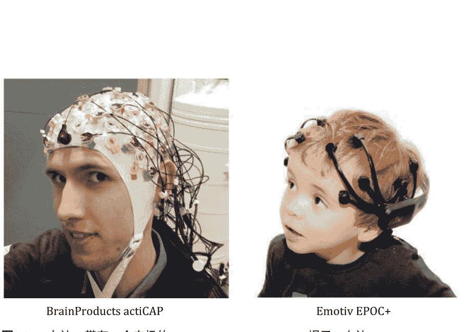

提供这种机会的方法是功能性磁共振成像（fMRI），它通过观察高分辨率脑部扫描中的血氧水平来推断脑活动。然而，fMRI扫描仪更昂贵（数百万美元），非常笨重，并且每次扫描的时间分辨率很低，约为一秒钟（与脑电图每秒数千个样本相比）。因此，脑电图仍然是最受欢迎和最易于获取的脑监测方法。目前，只有基于脑电图的解决方案足够便携和廉价，可以实现实际应用，如脑-计算机接口（BCI）。类似于脑电图的其他非侵入性方法是测量电脑活动引起的磁场的脑磁图（MEG）。脑电图的侵入性版本称为电-皮层脑电图（ECoG），电极直接放置在脑表面上。

典型的脑电图（EEG）信号样本是一个由实数值组成的二维矩阵，表示设备在连续时间戳（由设备的采样频率定义）上记录的每个电极（通道）的电位。生理信号，尤其是脑电图（EEG），存在低信噪比的问题。典型信号的幅度范围为几微伏（μV）到几十微伏，噪声的幅度约为1微伏，而伪迹可能达到几十微伏（例如，眼睑闪烁、肌肉运动、电极杂音）。即使对于该领域的专家来说，对脑电图时间序列进行手动分析也具有挑战性。计算机化的过程是从这些数据中提取相关信息的必要步骤。最简单且常用的方法是通过计算信号的功率谱密度（PSD）来降低维度（如图8.2所示）。该信号的频谱可以划分为特定的频带，称为δ波（1-4 Hz）、θ波（4-8 Hz）、α波（8-12 Hz）、β波（13-30 Hz）和γ波（30-70 Hz）。每个频带中神经振荡的幅度被证明是特定心理状态的指标，例如，α波可以在放松清醒状态下从枕叶检测到，并且闭眼时可以增加（图8.2）。这种分析通常用于情绪、压力、疲劳、注意力、睡眠障碍和麻醉深度的研究。相比原始脑电图信号，脑波更容易解释，并且被用作简单分类器的输入。

大量传统的机器学习和模式识别算法已经应用于EEG数据[4]，最常见的是支持向量机（SVM），Fisher的线性判别分析（LDA）和贝叶斯分类器，它们是基于用功率谱密度、常见空间模式[5]和xDAWN[6]计算的特征构建的。然而，深度学习和用于EEG分析的大规模数据集的最新发展（在第8.2.1节中描述）引起了研究人员的极大关注。

如果2D EEG样本与特定事件的时刻锁定在一起，即刺激呈现，它们被称为时域中的事件相关电位（ERP）分析[7]中的时期。EEG反映了成千上万个同时进行的脑过程，因此在单个时期的EEG记录中，反映单个事件或刺激的特定组分可能无法区分。实验者必须为每个刺激类别收集许多时期，并对它们进行平均，以减弱ERP中的无关活动并注意到每个类别的波形之间的差异。然而，经典的机器学习方法[8]和深度学习方法[9]都能够对单次试验进行分类，而不需要平均，这使它们适用于实时脑机接口。ERP波形由底层组成部分组成（如图8.3所示）。在实际应用中，最受欢迎的ERP组分之一是P300（在刺激开始后约300毫秒在覆盖顶叶的电极上达到峰值的正电位），自1988年以来用于心灵打字脑机接口[10]，现在也被深度学习[11–13]广泛研究。在本章的实验部分8.3中，更详细地描述了错误相关负性（ERN）组分，并使用深度学习方法进行了分析。因此，整个章节更加注重ERP分析。

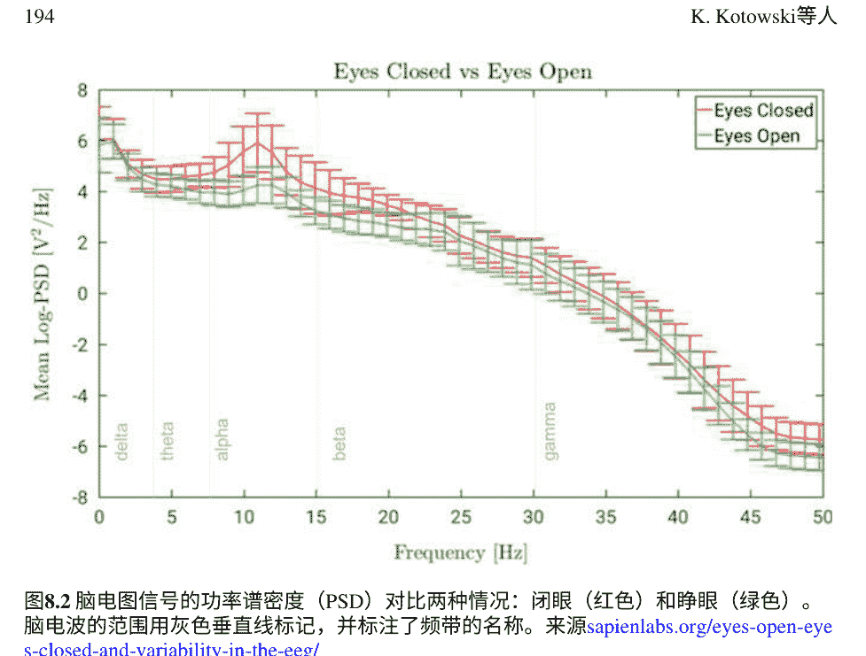

图8.2 脑电图信号的功率谱密度（PSD）对比两种情况：闭眼（红色）和睁眼（绿色）。脑电波的范围用灰色垂直线标记，并标注了频带的名称。来源sapienlabs.org/eyes-open-eyes-closed-and-variability-in-the-eeg/


图8.3 左侧：带有峰值标记的ERP波形示例。右侧：构成此ERP波形的组件（示例改编自[7]）。

#### 8.2 文献综述

深度学习方法现在在计算机视觉应用中非常流行，并且正在成为EEG分析的最新技术。最近的综述文章[4, 9, 14, 15]表明，自2010年以来，在该领域发表了数百篇相关文章，并且每年的文章数量呈二次增长的趋势。

##### 8.2.1 公共数据集

大量公开可用的数据集是任何领域广泛采用深度学习解决方案的关键要素。它提供训练数据，为其他研究人员提供比较基准，并支持结果的可重复性。深度学习在计算机视觉领域表现出最先进的性能，主要是因为像ImageNet [16]这样的大规模数据集的高可访问性。获得高质量的EEG数据比图像更加困难和昂贵，幸运的是，有一个不断增长的公共资源集。适用于深度学习的公共数据集的精选列表（足够大、多样化且结构清晰）列在表8.1中。此外，还有多个包含较小EEG数据集的公共数据库，这些数据集不一定对深度学习有用，但可能对补充其他数据集有用，包括PhysioBank [34]、BNCI Horizon 2020 [35]、UCSD HeadIT [32]、UCI Machine Learning Repository [36]、BCI competitions [37], Kaggle平台[38], OpenNeuro平台[39], Open Science Framework [40], Scientific Data期刊[41]和其他[42, 43]。

##### 8.2.2 预处理方法

脑电图数据本质上非常嘈杂。它们受到所有其他生理和环境信号的严重影响，例如心跳、眨眼和运动、呼吸、吞咽和实验对象的其他运动、出汗和皮肤电位的变化、电极位移、电缆运动以及与外部电磁场的干扰。以前，脑电图信号是由人工专家手动检查和过滤的。最近，自动识别和去除脑电图伪迹是文献中广泛研究的主题[44]。

在研究实践中，频率域滤波是最常见和有效的预处理方法。高达0.1 Hz的低频滤波可以去除直流分量，并有助于减少由变化的电极阻抗引起的慢漂移。高达4 Hz的频率滤波可以减少运动伪迹、心跳和眼动的影响，但会损失重要的δ波段，例如在睡眠分析中。产生最快振荡的人脑中的伽马波频率高达70 Hz，因此通常对更高频率进行低通滤波以去除任何不相关的高频噪音。通常使用零相位前后数字Butterworth滤波器，因为它们不改变相位，也不移动信号。当实验不在电磁屏蔽室中进行时，使用50 Hz（或60 Hz）的陷波滤波器来减少电器设备的影响。或者，使用多锥体回归技术可以更准确地滤除50 Hz（或60 Hz）的谐波，以识别显著的正弦波伪迹[45]。

对ERP时段进行基线校正可以作为低频滤波的替代或扩展。这是一个非常简单的操作，即从刺激呈现之前的预刺激时段（通常是100毫秒或200毫秒）的所有样本中减去样本的均值。

常见平均参考（CAR）是从每个通道中减去所有通道的逐样本平均值的操作。已经证明，这个简单的操作可以最小化参考位置活动的影响，并准确估计测量电场的头皮拓扑[46]。

通过提取独立成分（ICA）[47]的EEG信号，手动检测拓扑图中的特征模式（图8.4），并从原始信号中去除这些成分，可以实现眨眼滤波。自动眨眼校正需要额外的眼电图记录（EOG），用于测量眼睛前后之间的角膜视网膜静电势。眨眼在EOG中很容易检测，并可以使用多种方法从EEG数据中去除。最简单的方法是去除受眨眼影响的信号片段。更复杂的方法涉及提取EEG信号的独立成分（ICA），并去除与EOG高度相关的成分。然而，后一种方法在计算上很昂贵，可能不适用于实时应用。

使用深度学习进行自动伪迹检测和去除是脑电图预处理的未来方向之一。例如，前一段提到的眼睑闪烁检测可以通过在适当数据集上训练的深度学习模型来实现，或者在实验的准备阶段进行。最近发布的TUH脑电图伪迹语料库[17]针对使用深度学习进行伪迹检测，其中包括咀嚼、颤抖、电极脱落、肌肉伪迹和背景事件。

在深度学习中，缺乏预处理也是一种选择。深度学习的一个重要优势是它可以从原始、未经滤波的数据中学习。

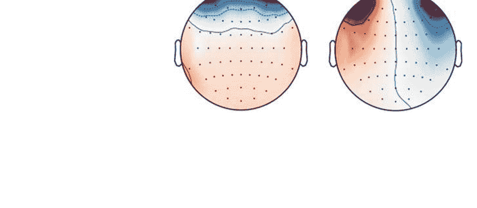

表8.1 适用于深度学习的公共脑电数据集的精细列表
| 数据库名称 (年份) [参考文献] | 数据集大小 | 数据集目的 |
|---|---|---|
| NEDC TUH脑电癫痫 (2018年, v1.5.0) [17] | 642个受试者, 5610个记录 (920小时) | 癫痫发作检测 |
| TUH脑电伪迹语料库 (2018年, v1.0.0) [17] | 213个受试者, 310个记录 | 自动脑电伪迹检测 |
| CHB-MIT (2009年) [18] | 23个受试者, 664个记录 (844小时) | 癫痫发作检测 |
| Niuewland等人 (2018年) [19] | 356个受试者, 每个9个不同实验室的160个试验 | 预测即将到来的单词 |
| DEAP (2012年) [20] | 32个受试者, 每个超过40分钟 | 情绪识别 |
| DREAMER (2018年) [21] | 23个受试者, 每个约60分钟 | 情感识别, 低成本设备 |
| MAHNOB-HCI (2012) [22] | 27个受试者, 每个约30分钟 | 情绪识别 |
| SEED (2018) [23] | 15个受试者, 每个录音 (约48分钟) 45次 | 情绪识别 |
| MASS (2014) [24] | 200个受试者, 每个整夜录音 | 睡眠阶段分析 |
| CAP睡眠数据库 (2001) [25] | 108个受试者, 每个整夜录音 | 睡眠障碍评分 |
| BCI2000运动/想象 (2004) [26] | 109个受试者, 每个1500个一到两分钟的录音 | 运动/想象分类 |
| Kaya等人 (2018) [27] | 13个受试者, 每个录音 (60小时) 75次 | 运动想象分类 |
| Cho等人 (2017) [28] | 52个受试者, 每个36分钟 | 运动想象分类 |
| Cao等人 (2018) [29] | 27个科目, 62个90分钟的录音 | 驾驶员的疲劳水平 |
| WAY-EEG-GAL (2014) [30] | 12个受试者, 每个3936次试验 | 解码感觉、意图和行动 |
| Babayan等人 (2019) [31] | 216个受试者, 每个16分钟 | 静息状态-闭眼和睁眼分类 |
| 大脑的IMAGENET (2018) [32] | 1个受试者, 70,060个3秒试验 | 感知图像分类, 低成本设备 |
| 大脑数字的MNIST (2015) [33] | 1个受试者, 1,207,293个2秒试验 | 感知图像分类, 低成本设备 |与直觉相反，有时候，深度学习甚至在没有任何预处理的情况下取得更好的结果。这表明，在深度学习解决方案中，预处理工作应该局限于去除明显的伪迹或明确防止过拟合的方法。

##### 8.2.3 输入表示

在脑电图的深度学习中，有3种主要的输入形式策略[14]：

1.  使用传统方法提取的特征,
2.  使用原始信号值的矩阵,
3.  使用转换成图像形式的脑电信号.

第一种方法在文献中最为普遍，因为它允许使用更简单的深度学习模型。关于简单脑电应用中的深度学习的大多数论文使用功率谱密度（PSD）或信号的统计特性（均值、方差、偏度、峰度、中位数或标准差）作为网络的输入。更复杂的方法使用小波变换、短时傅里叶变换（STFT）或常见空间模式（CSP）。

然而，独立的特征提取方法在设计简单神经网络时很有用，但在使用深度模型和大型数据集时可能不是最优的。深度学习的流行度正在上升，因为深度神经网络能够处理高维数据，而无需研究人员额外的努力。它们能够在训练过程中自动提取适当的特征。尽管如此，在某些特定任务中，一些基本的预处理（例如用于眼动的4 Hz低通滤波器[43]或使用EOG去除眨眼）可以防止过拟合。

此外，卷积神经网络（CNN）在图像处理中的高流行度导致了将这些架构转化为脑电图（EEG）中的信号图像的想法。这些转换有多种类型：

-   简单的2D信号矩阵——其中每个像素对应于不同通道和不同样本编号上的电位值[48]。这种表示等同于原始信号，但被CNN视为图像。
-   3D信号网格——将连续时间帧的2D信号矩阵堆叠成3D体积[49]。
-   频谱地形图——将3D中的电极位置投影到2D平面上，计算每个电极在试验时间范围内的脑波功率（阿尔法、贝塔、伽马等），并在电极位置之间线性插值填充2D平面[51]。
-   频率图—使用傅里叶变换能量图[52]或短时傅里叶变换[53]的标准可视化方法。

##### 8.2.4 数据增强

数据增强是对抗过拟合和增加训练数据量最有效的方法之一。对于高度不平衡的数据集，如癫痫或Flanker任务中的错误响应，它非常有用。在计算机视觉领域，可以通过对图像进行视觉检查来评估不同类型的增强（旋转、翻转、裁剪、变形）的影响和适用性。即使使用类似图像的表示，检查EEG数据也更加困难。因此，所有的增强技术都必须基于对脑功能的了解。EEG增强是一个新兴的领域，只有三项详细研究[54-56]显示出非常有希望的结果。即使是最简单的方法，如向EEG样本添加高斯噪声，也大大提高了在SEED和MAHNOB-HCI数据集上的情感识别准确性[55]。第二种报告的方法是为EEG信号的少数类别生成傅里叶变换替代物，在CAP Sleep数据库上将准确性提高了24%[56]。最复杂的方法是使用深度生成模型，如生成对抗网络（GAN），在大规模真实EEG数据集上进行训练，以生成人工样本。这种方法在运动想象BCI竞赛中得到了应用，将测试准确性从83%提高到86%。其他论文通过添加不同类型的噪声、重叠时间窗口、采样原始记录的不同相位或交换半球来进行增强；但只有少数论文报告了其对结果准确性的影响[15]。

##### 8.2.5 架构

深度学习与人工神经网络密切相关。在过去的几年中，不同类型的架构大量涌现，尤其是在计算机视觉领域。传统的全连接人工神经网络、多层感知器（MLPs）、受限玻尔兹曼机（RBMs）和深度置信网络（DBNs）已被更专业的模型和层所取代。在脑电图领域中，最流行的架构与计算机视觉领域类似，即卷积神经网络（CNN）。它在关于脑电图的深度学习文章中被使用超过40%，无论实验任务类型如何，都是最常采用的架构[14, 15]。CNN的设计允许将脑电图数据中的空间和时间关系编码为网络的多层可训练卷积滤波器集合。只有最后两层或三层构成传统的全连接（密集）分类器。

此外，还设计了多个支持层，以防止过拟合，加快训练速度并减少参数数量。最流行的方法是池化（主要是最大池化，较少使用平均池化）、dropout 和批处理归一化层。所有这些方法都已经在最先进的深度架构中使用，专门用于EEG分类，即图8.5中介绍的EEGNet [57]和[49]中的DeepConvNet。据作者报道，使用Dropout和Batch-Normalization显著提高了准确性。有趣的是，通过将非常常见的（EEG领域文章中的70% [14]）修正线性单元（ReLU）激活替换为指数线性单元（ELU），两个模型的准确性都有显著提高。

脑电图记录首先是时间序列。因此，递归神经网络（RNN）被设计用于寻找数据序列（如语音或文本）中的模式，也被应用于脑电图领域。最近的大多数RNN架构使用长短期记忆（LSTM）单元来有效地探索脑电信号中的时间依赖性。之前使用的门控循环单元（GRUs）被证明比LSTMs差[58]。RNN在情绪识别和癫痫检测方面取得了有希望的结果[14]，但目前在运动想象方面不如CNN适用[59]，也没有使用RNN进行ERP分析的研究报告。RNN脑电图论文的数量不断增加，满足了对这种类型架构更深入研究和更好输入形式的需求。RNN经常与CNN结合成混合架构，其中CNN将特征输出到LSTM模块中。这些混合架构是情绪识别领域的最新技术[60]。

深度自动编码器（AEs）和变分自动编码器（VAEs）以及生成对抗网络（GANs）的高流行度开始在脑电图（EEG）领域中传播。它们支持无监督学习和特征通过学习如何降低数据的维度而不丢失相关信息来进行特征提取。自动编码器的编码器部分将输入数据压缩到更低维度的隐藏表示，解码器部分尝试重构原始输入以最小化模型的损失。自动编码器的简化结构如图8.6所示。这种方法在重建缺失或损坏的脑电图片段[61, 62]和从隐藏表示中提取特征[63]方面非常有用。生成模型基于自动编码器的思想，但它们引入了额外的机制（GANs中的鉴别器网络和VAEs中的“重参数化技巧”）和损失函数来规范隐藏表示空间。然后，通过解码器重新转换的这种规范化表示可以用于生成模仿原始数据特征的新样本，如第8.2.4节所述。此外，GANs还可以作为EEG数据的高质量上采样方法[64]。基于自动编码器的架构U-Net [65] 在图像分割方面取得了惊人的结果，然而据我们所知，它尚未应用于脑电图，这可能是一个有前途的研究方向。

##### 8.2.6 特征可视化

深度学习的最大缺点之一是提取特征的可解释性较低。最近在计算机视觉领域有一些努力，以更好地理解特征的相关性归因，从而产生了像DeepLIFT [66, 67]这样的算法。 DeepConvNet和EEGNet的作者成功地将其应用于EEG数据，如图8.7所示。除了诊断和解释之外，对于数据挖掘和EEG数据的探索，这种方法是一个强大的工具。从这种分析中得出的结论可能成为新的神经科学理论的基础。

##### 8.2.7 应用

深度学习方法已经被提出用于医学、心理学、汽车和娱乐等广泛的应用领域。在每个应用中，给出了一个包含参考文献和使用的网络类型的详细总结[14, 15]。表8.2只是我们提出的划分为五个主要领域的所有报告应用的简要列表：医学、支持性BCI、娱乐BCI、汽车和心理学。

表8.2 深度学习在EEG中的应用分为五个领域

| 领域 | 具体应用 |
|------|----------|
| 医学 | 癫痫检测和预测。监测麻醉的深度。<br>诊断：癫痫、阿尔茨海默病、痴呆、缺血性中风、精神分裂症、睡眠和意识障碍、注意力缺陷多动障碍和自闭症谱系障碍 |
| 支持性BCI | 文本和鼠标输入。无声语音解码。使用机器人手臂进行抓取和举起的接口。运动想象。控制电动轮椅。人员识别 |
| 娱乐BCI | 游戏输入设备。监测心理状态。睡眠评分 |
| 汽车 | 监测驾驶员的疲劳和困倦 |
| 心理学 | 情绪和情绪识别。ERP检测。支持新理论 |

## 8.3 实际例子-埃里克森弗兰克任务

本节介绍了应用于EEG的深度学习的基本流程，从实验设计，数据准备到模型的训练和验证。 它的目的不是为了达到最好的结果，而是从实际角度呈现方法，并评估其中一种最先进的模型的有效性。

##### 8.3.1 材料

在这个特定的实验中，我们对修改后的埃里克森弗兰克任务[69]中的错误和正确反应进行分类感兴趣。该任务包括呈现一个目标二进制符号（例如，一组两个字母中的一个，如埃里克森的原始表述中所做的，或者指向两个方向中的一个的箭头[68]，如我们的示例中所做的），其周围有其他四个符号，即所谓的“弗兰克”符号，两个在每一侧。 弗兰克符号要么与中央目标符号完全相同（一致条件），要么与之完全不同（不一致）。 被要求回答目标符号是什么。

这个认知任务旨在测试抑制（抑制上下文建议的反应）和选择性注意力等方面。通过引发大量错误，它也可以用于研究错误监测。具体来说，在脑电图研究中，可以检测到所谓的“错误敏感”ERP成分，尤其是错误相关负性（ERN） [69]。ERN是在执行任务中犯错误后在脑电图记录中出现的负偏移；在反应时间任务中，它在反应后的40-100毫秒达到峰值，最大振幅出现在头皮的额中央记录点上[70, 71]。这种事件相关电位的存在强烈暗示深度学习可能能够仅通过脑电图检测人类表现中的错误。

###### 8.3.1.1 参与者

共有80名参与者：39名男性和41名女性，平均年龄23.1 ±3.4岁（平均值和标准差）。由于各种原因，有4名受试者被排除在外，稍后将进行描述。符合资格的标准是：惯用右手和不使用神经药物物质。所有受试者均提供了书面知情同意，并获得了时间上的经济补偿。该研究获得了波兰克拉科夫雅盖隆大学生生物伦理委员会的批准。

###### 8.3.1.2 程序

研究方案包括6分钟的静息状态记录（3分钟睁眼后跟3分钟闭眼），以及Eriksen的干扰者任务。这里不使用静息状态记录。干扰者任务包括在屏幕上呈现四种刺激类型（左右、一致和不一致），共384次，随机顺序且比例相等。连续刺激之间呈现一个固定的十字架。刺激持续时间设置为250毫秒，刺激之间的时间间隔随机选择：800、1000、1200和1400毫秒。超过800毫秒的反应不记录。刺激使用E-Prime 2.0 (Psychology Software Tools, Pittsburgh, PA) 在60 Hz屏幕上呈现。实验的时间过程如图8.8所示。

参与者被要求尽可能快速和准确地回应；如果屏幕上的中央箭头指向左边，他们应该用食指按下按钮1，如果中央箭头指向右边，他们应该用中指按下按钮2。答案使用PST Chronos响应和刺激设备进行注册。干扰者测试以一个包含20个刺激的训练开始，屏幕上会提供关于回应正确性的反馈。

整个任务平均耗时11分钟。由于错误过多或回应过晚，有3名受试者被排除在外。对于其他人，回应时间为408 ±52毫秒（中位数和中位数偏差，排除超过8%的回应过晚的情况）。总体而言，正确回应占83.6 ±9.0%，错误回应占9.3 ±5.3%。每个受试者的正确、错误和迟答次数见图8.9。

图8.9我们Flanker实验中受试者的正确、错误和迟钝反应次数

###### 8.3.1.3 EEG注册

数据使用BrainVision Recorder软件在2500 Hz采样率下进行注册使用actiCHamp (Brainproducts GmbH, Gilching, Germany) 放大器，64个活动电极（带有主动屏蔽），按照10-10系统放置，Cz作为参考电极，以及被动EOG电极（一个电极位于眼睛下方，一个电极位于眼角，可以记录水平和垂直眼动）。电极的阻抗保持在10 kΩ以下（平均为5.9 ±5.1 kΩ，有2%的通道超过20 kΩ）。由于采样率较低，一个试点记录已被从进一步分析中移除。

###### 8.3.1.4 方法

数据导入和过滤在Matlab R2016a中使用EEGLAB 13.5.4b [70]完成。所有后续步骤均在Python 3.6.2中实现，使用NumPy 1.16.2进行向量操作，使用MNE 0.17.1包[72]进行EEG数据处理和可视化，以及使用Tensorflow GPU 1.12和Keras 2.2.4进行神经网络。

图8.10 所有参与者的错误和正确答案的总体平均值，在所有预处理步骤之后。左边：电极FCz。右边：电极Cz

###### 8.3.1.5 预处理

所有信号最初在1到1245 Hz范围内进行带通滤波，使用默认的双向最小二乘FIR滤波器。此外，为了避免不必要的陷波滤波，使用CleanLine插件降低了50 Hz交流电线噪声及其谐波。在手动分析过程中检测到的个别坏通道使用球面样条算法进行插值[73]。脑电图（EEG）被重新参考为共同平均参考（CAR）。为了加快计算速度并降低训练数据的维度，EEG的采样率从2500降低到125赫兹。在可能的情况下，通过去除与眼电图（EOG）高度相关的独立成分来应用眼电图滤波。如果由于任何原因眼电图滤波失败，则丢弃任何电极上的峰-峰电位超过125 μV的时期。这一点很重要，因为事件相关负性（ERN）在额中央电极位点[71]最强，并且前额电极受到眨眼的影响很大。同一篇文章[71]是限制分析通道子集为14个最相关的通道（FCz，Fz，FC1，FC2，FC3，FC4，Cz，CPz，C1，C2，CP1，CP2，Pz，POz）的论据，以加快训练速度并降低网络的复杂性。最后，在参与者的反应之前的100毫秒到500毫秒范围内提取时期，并进行100毫秒基线校正。在经过上述预处理后，对所有参与者的错误和正确答案进行平均，结果呈现在FCz和Cz电极的图8.10中。在输入网络之前，时期根据全局均值和标准差进行标准化。

###### 8.3.1.6 架构和输入形式

选择了EEGNet进行实现，因为它在ERP数据集上表现出优越的性能[57]，并且在Github上很容易获取（github.com/vlawhern/arl-eegmodels）。根据EEGNet的作者的建议，网络的输入由一个简单的_2D信号矩阵表示，其中有14个通道作为连续的行，75个样本作为连续的列。通道的顺序与前一节中列出的顺序完全一致。该架构被参数化为EEGNet-8.2版本，其中 F1 =8个长度为64的时间滤波器（作者发现将其设置为采样率的一半效果很好）， D =2个空间滤波器， F2 =16个逐点滤波器， p =0.5的丢失率和 N =2个输出类别，分别对应正确或错误的答案。网络的损失函数被设置为分类交叉熵。使用F1分数指标评估模型。使用自适应学习率Adam优化器进行基于梯度的优化。

训练是以跨学科的方式进行的。每个学科随机选择15%的正确样本和15%的错误样本作为测试集。每个学科的其他70%的正确答案和70%的错误答案被添加到训练集中。剩下的样本被合并到验证集中。Flanker任务的特点是类别不平衡，正确答案比错误答案多得多。这是深度学习中许多数据集的常见问题。这里通过简单地添加附加样本来解决这个问题，这些样本使用高斯噪声（均值为零，标准差为0.05）进行增强，以平衡训练、验证和测试集。这意味着随机分类器的预期准确率为50%。最终，训练集包括35,927个时期，验证集和测试集都有7,654个时期。

###### 8.3.1.7 训练和结果

EEGNet网络以批量大小16进行了50个时期的训练。在一台中等配置的个人电脑上，使用i5-4210U 1.7 GHz CPU、NVIDIA GeForce 840 M 2 GB GPU和12 GB RAM内存，训练时间约为1小时。训练损失达到了0.2914，相应的训练F1分数为0.9333。最佳模型的验证损失和F1分数分别为0.3137和0.9230。

正如[57]中所述，网络的结果与最先进的传统机器学习方法进行了比较，采用了xDawn空间滤波、黎曼几何、通道子集选择和L1特征正则化（xDawn +RG），在2015年的Kaggle BCI竞赛中取得了最佳结果（github.com/alexandrebarachant/bci-challenge-ner-2015）。在图8.11中，以混淆矩阵的形式呈现了xDawn +RG和EEGNet在测试集和整个数据集上的结果比较。相应的整体准确率和F1分数显示在图下方。EEGNet的结果略优于xDawn +RG。这表明深度学习可以轻松地达到最佳传统机器学习方法的结果，并可应用于错误响应和其他类型的ERP的分类。整个数据集的分类时间对于EEGNet（5.98秒）比xDawn+RG（11.92秒）低两倍。每个时代的分类时间为毫秒级，可以在实时应用中使用深度学习。

**Test set**

**xDAWN + RG**

| True label \ Predicted label | Correct | Incorrect |
|------------------------------|---------|-----------|
| Correct                      | 82.2    | 17.8      |
| Incorrect                    | 15.2    | 84.8      |

Accuracy: 83.63%
F1-score: 0.8528

**EEGNet-8.2**

| True label \ Predicted label | Correct | Incorrect |
|------------------------------|---------|-----------|
| Correct                      | 84.3    | 15.7      |
| Incorrect                    | 11.9    | 88.1      |

Accuracy: 86.35%
F1-score: 0.8758

**Whole dataset**

**xDAWN + RG**

| True label \ Predicted label | Correct | Incorrect |
|------------------------------|---------|-----------|
| Correct                      | 81.7    | 18.3      |
| Incorrect                    | 15.5    | 84.5      |

Accuracy: 83.28%

**EEGNet-8.2**

| True label \ Predicted label | Correct | Incorrect |
|------------------------------|---------|-----------|
| Correct                      | 85.5    | 14.5      |
| Incorrect                    | 11.5    | 88.5      |

Accuracy: 87.11%

图8.11混淆矩阵和整体得分，对于xDAwn +RG方法（在左侧）和EEGNet（在右侧）在测试集和所有样本（训练、验证和测试）上

#### 8.4 总结

深度学习已被证明是一种在可访问足够数据的情况下进行脑电图分析的先进方法。多种深度学习方法和架构，包括CNN、RNN、DBM和混合类型，可以成功解决各种脑电图任务，包括医疗和脑机接口应用，取得与传统算法和传统机器学习方法相当或更好的结果。

深度学习在脑电图中的可能性不仅仅局限于分类问题。其中许多方法受到计算机视觉领域的启发或改编。自编码器和生成模型用于无监督学习、特征提取、数据增强、伪数据过滤和人工数据生成。 然而，在这些领域仍然只有很少的研究。

深度学习的流行在于使用神经网络与现成的公共代码库和数据库，无需繁琐的预处理和选择适当的特征提取方法，将开发和研究时间降到最低。 不断增长的公共数据集使得可以训练更深层次的模型。 深度学习最大的缺点之一——缺乏特征可解释性的问题已经通过特征可视化方法得到解决。 它们可能是探索和支持新的神经科学理论的有用工具。

本章的实验部分显示了使用深度卷积神经网络（即EEGNet）对错误响应的事件相关电位进行分类的简单性和有效性。 结果略优于最先进的传统机器学习方法。 这支持了对文献综述的结论。 然而，关于EEG的深度学习仍需要更多的研究。 包括更好的输入公式（特别是对于RNNs），预处理对结果的影响，为EEG专门设计的图层以及从计算机视觉领域引入更多新颖的方法。

未来的发展方向可能受到低成本可穿戴EEG设备的流行度的影响，这些设备具有较低的信号质量并暴露于许多伪迹。

致谢

本工作部分得到了波兰格利维采西里西亚理工大学信息学研究所青年研究员的法定资金支持（BKM/560/RAU2/2018），部分得到了波兰国家科学中心的资助，编号为2015/17/D/ST2/03492（JO）。 我们要感谢Magda Gawlowska为EEG实验的设计。

#### 参考文献

- 1. F.A.C. Azevedo等人，神经元和非神经元细胞数量相等，使人脑成为一个等比例放大的灵长类动物大脑。J. Comp. Neurol. **513**(5), 532–41 (2009)
- 2. L.F. Haas，汉斯·伯格（1873–1941），理查德·卡顿（1842–1926）和脑电图。J. Neurol. Neurosurg. Psychiatry **74**(1), 9–9 (2003)
- 3. K. Kotowski, K. Stapor, J. Leski, M. Kotas, 验证Emotiv EPOC +提取情绪面孔处理的ERP相关性。Biocybern. Biomed. Eng. **38**(4), 773–781 (2018)
- 4. F. Lotte等人，基于EEG的脑机接口分类算法综述：10年更新。J. Neural Eng. **15**(3), 031005 (2018)
- 5. Z.J. Koles, M.S. Lazar, S.Z. Zhou, 背景脑电图中人口差异的空间模式。Brain Topogr. **2**(4), 275–284 (1990)
- 6. B. Rivet, A. Souloumiac, V. Attina, G. Gibert, xDAWN算法用于增强诱发电位：应用于脑-计算机接口。IEEE Trans. Biomed. Eng. **56**(8), 2035–2043 (2009)
- 7. S.J. Luck, 设计和解释ERP实验的十个简单规则, in Event-related Potentials: A Methods Handbook (The MIT Press, 2004), pp. 17–32
- 8. H. Cecotti, A.J. Ries, 单次事件相关电位检测的最佳实践：应用于脑-计算机接口。Int. J. Psychophysiol. **111**, 156–169 (2017)
- 9. F.A. Heilmeyer, R.T. Schirrmeister, L.D.J. Fiederer, M. Völker, J. Behncke, T. Ball, EEG深度学习架构的大规模评估框架, 2018年IEEE国际系统、人类和控制论会议（SMC）, 第1039-1045页
- 10. L.A. Farwell, E. Donchin, 从你的头脑中说出来：利用事件相关脑电位的脑部辅助装置。脑电图和临床神经生理学, **70**(6), 510-523页 (1988年)
- 11. R. Joshi, P. Goel, M. Sur, H.A. Murthy, 使用卷积LSTM和深度学习集成方法进行单次P300分类, 智能人机交互, 第11278卷, U.S. Tiwary编辑 (Springer, Cham, 2018年), 第3-15页
- 12. M. Liu, W. Wu, Z. Gu, Z. Yu, F. Qi, Y. Li, 基于批归一化的深度学习用于P300信号检测。神经计算 **275**, 288–297 (2018)
- 13. H. Shan, Y. Liu, T. Stefanov, 一种用于准确的P300检测和脑机接口字符拼写的简单卷积神经网络, 在第二十七届国际人工智能联合会议上 (瑞典斯德哥尔摩，2018年), pp. 1604–1610
- 14. A. Craik, Y. He, J.L. Contreras-Vidal, 用于脑电图（EEG）分类任务的深度学习：一篇综述。J. Neural Eng. **16**(3), 031001 (2019)
- 15. Y. Roy, H. Banville, I. Albuquerque, A. Gramfort, T. H. Falk, J. Faubert, 基于深度学习的脑电图分析：一篇系统综述。J. Neural Eng. (2019)
- 16. O. Russakovsky等人, ImageNet大规模视觉识别挑战。Int. J. Comput. Vis. (IJCV) **115**(3), 211–252 (2015)
- 17. V. Shah等人, The temple university hospital seizure detection corpus. Front Neuroinf. **12**, 83 (2018)
- 18. A.H. Shoeb, 应用机器学习进行癫痫发作检测和治疗。论文, 麻省理工学院 (2009年)
- 19. M.S. Nieuwland等人, 大规模复制研究揭示了语言理解中的概率预测限制。eLife **7**, e33468 (2018)
- 20. S. Koelstra等人, DEAP：用于情感分析的数据库；使用生理信号。IEEE Trans. Affect. Comput. **3**(1), 18–31 (2012)
- 21. S. Katsigiannis, N. Ramzan, DREAMER：通过无线低成本现成设备的脑电图和心电图信号进行情感识别的数据库。IEEE J. Biomed Health Inf. **22**(1), 98–107 (2018)
- 22. M. Soleymani, J. Lichtenauer, T. Pun, M. Pantic, 用于情感识别和隐式标记的多模态数据库。IEEE Trans. Affect. Comput. **3**(1), 42–55 (2012)
- 23. W. Zheng, W. Liu, Y. Lu, B. Lu, A. Cichocki, EmotionMeter: 用于识别人类情绪的多模态框架。IEEE Trans. Cybern. 1–13 (2018)
- 24. C. O'Reilly, N. Gosselin, J. Carrier, T. Nielsen, 蒙特利尔睡眠研究档案：用于仪器基准测试和探索性研究的开放资源。J. Sleep Res. **23**(6), 628–635 (2014)
- 25. M.G. Terzano等人, 用于人类睡眠中周期性交替模式（CAP）评分的图谱、规则和记录技术。Sleep Med. **2**(6), 537–553 (2001)
- 26. G. Schalk, D.J. McFarland, T. Hinterberger, N. Birbaumer, J.R. Wolpaw, BCI2000：一个通用的脑-计算机接口（BCI）系统。IEEE Trans. Biomed. Eng. **51**(6), 1034–1043 (2004)
- 27. M. Kaya, M.K. Binli, E. Ozbay, H. Yanar, Y. Mishchenko, 一个大型的脑电图运动想象数据集, 用于脑电图脑-计算机接口。Sci. Data **5**, 180211 (2018)
- 28. H. Cho, M. Ahn, S. Ahn, M. Kwon, S.C. Jun, 运动想象脑-计算机接口的脑电图数据集。GigaScience **6**(7), gix034 (2017)
- 29. Z. Cao, C.-H. Chuang, J.-K. King, C.-T. Lin, 在持续注意力驾驶任务中的多通道脑电图记录。Sci. Data **6**(1), 19 (2019)
- 30. M.D. Luciw, E. Jarocka, B.B. Edin, 多通道脑电图记录在3,936次抓握和举起试验中，重量和摩擦力变化。科学数据 **1**, 140047 (2014)
- 31. A. Babayan等, 年轻和老年成年人的MRI、脑电图、认知、情绪和外周生理数据集。科学数据 **6**, 180308 (2019)
- 32. D. Vivancos, 大脑的IMAGENET (2018). [在线] http://www.mindbigdata.com/opendb/imagenet.html。访问日期: 2019年7月8日
- 33. D. Vivancos, 大脑数字的MNIST (2015). [在线] http://mindbigdata.com/opendb/index.html。访问日期: 2019年7月8日
- 34. Ary L. Goldberger等, PhysioBank、PhysioToolkit和PhysioNet. 循环 101(23), e215–e220 (2000)
- 35. BNCI Horizon 2020. [在线] http://bnci-horizon-2020.eu/database/data-sets. 于2019年7月8日访问
- 36. UCI机器学习库. [在线] https://archive.ics.uci.edu/ml/index.php. 于2019年7月8日访问
- 37. BCI竞赛. [在线] http://www.bbci.de/competition/. 于2019年7月8日访问
- 38. Kaggle EEG竞赛. [在线] https://www.kaggle.com/datasets?search=eeg. 于2019年7月8日访问
- 39. OpenNeuro公共数据集. [在线] https://openneuro.org/public/datasets. 于2019年7月8日访问
- 40. 开放科学框架. [在线] https://osf.io/search/?q=eeg. 于2019年7月8日访问
- 41. Scientific Data Journal EEG数据集. [在线] https://www.nature.com/search?q=eeg&journal=sdata. 于2019年7月8日访问
- 42. EEG/ ERP 数据可供免费公开下载. [在线] https://sccn.ucsd.edu/~arno/fam2data/publicly_available_EEG_data.html. 访问日期: 2019年7月8日
- 43. brain signals.de. [在线] http://www.brainsignals.de/. 访问日期: 2019年7月8日
- 44. M.K. Islam, A. Rastegarnia, Z. Yang, Methods for artifact detection and removal from scalp EEG: a review. Neurophys. Clinique/Clin. Neurophys. 46(4), 287–305 (2016)
- 45. P. Mitra, H. Bokil, Observed Brain Dynamics (Oxford University Press, New York, 2007)
- 46. J. Dien, 平均参考的应用问题: 回顾、批评和建议。行为研究方法仪器计算机 30(1), 34–43 (1998)
- 47. S. Makeig, A.J. Bell, T.-P. Jung, T.J. Sejnowski, 对脑电数据进行独立成分分析, 在第8届神经信息处理系统国际会议 (1995, 科罗拉多州丹佛) 上, 第145-151页
- 48. B. Yang, K. Duan, C. Fan, C. Hu, J. Wang, 使用深度学习自动去除脑电中的眼动伪迹。生物医学信号处理与控制 43, 148-158页 (2018年)
- 49. R.T. Schirrmeister等, 使用卷积神经网络进行脑电解码和可视化: 脑电分析中的卷积神经网络。人类脑成像 38 (11), 5391-5420页 (2017年)
- 50. R. Manor, A.B. Geva, 用于多类别快速连续视觉呈现脑机接口的卷积神经网络。计算神经科学前沿 9, 146页 (2015年)
- 51. P. Bashivan, I. Rish, M. Yeasin, N. Codella, 通过深度循环卷积神经网络从EEG中学习表示。arXiv:1511.06448 [cs] (2015)
- 52. W. Abbas, N.A. Khan, DeepMI: 用于多类运动意象分类的深度学习, 在2018年IEEE工程与医学生物学会(EMBC)第40届年会(2018), 第219-222页
- 53. Y.R. Tabar, U. Halici, 一种新颖的深度学习方法用于EEG运动意象信号的分类。J. Neural Eng. 14(1), 016003 (2016)
- 54. Q. Zhang, Y. Liu, 通过条件深度卷积生成对抗网络进行数据增强来提高脑机接口性能。CoRR abs/1806.07108 (2018)
- 55. F. Wang, S. Zhong, J. Peng, J. Jiang, Y. Liu, 通过深度卷积神经网络进行EEG情绪识别的数据增强, 在多媒体建模(2018), 第82-93页
- 56. J.T. Schwabe dal, J.C. Snyder, A. Cakmak, S. Nemati, G.D. Clifford, 通过使用傅里叶变换替代物解决噪声信号分类问题中的类别不平衡。arXiv预印本 arXiv:1806.08675 (2018)
- 57. V.J. Lawhern, A.J. Solon, N.R. Waytowich, S.M. Gordon, C.P. Hung, B.J. Lance, EEGNet: 一种用于基于脑机接口的脑电信号的紧凑型卷积神经网络。J. Neural Eng. 15(5), 056013 (2018)
- 58. D. Britz, A. Goldie, M.-T. Luong, Q. Le, 大规模探索神经机器翻译架构，在2017年经验方法在自然语言处理会议（丹麦哥本哈根，2017年），pp. 1442–1451
- 59. Z. Wang, L. Cao, Z. Zhang, X. Gong, Y. Sun, H. Wang, 短时傅里叶变换和深度神经网络用于运动想象脑机接口识别。Concurr. Comput. Pract. Exp. 30(23), e4413 (2018)
- 60. B.H. Kim, S. Jo, 用于识别人类情绪的深层生理影响网络。IEEE Trans. Affect. Comput. 1–1 (2018)
- 61. J. Li, Z. Struzik, L. Zhang, A. Cichocki, 使用去噪自编码器从不完整的脑电图中进行特征学习。Neurocomputing 165, 23–31 (2015)
- 62. Y. Jia, C. Zhou, M. Motani, 用于具有缺失观测的患者数据中的特征学习的时空自编码器，在2017年IEEE国际生物信息学和生物医学会议（BIBM）（堪萨斯城，MO，2017年）中，第886-890页。
- 63. M. Dai, D. Zheng, R. Na, S. Wang, S. Zhang, 使用新颖的深度学习框架对运动想象的脑电图进行分类。Sensors 19(3), 551 (2019)
- 64. I.A. Corley, Y. Huang, 通过生成对抗网络提高EEG空间分辨率的深度EEG超分辨率，2018年IEEE EMBS国际生物医学健康信息学会议（BHI）(2018), pp. 100–103
- 65. O. Ronneberger, P. Fischer, T. Brox, U-Net: 用于生物医学图像分割的卷积网络，医学图像计算与计算机辅助干预—MICCAI 2015 (2015), pp. 234–241
- 66. A. Shrikumar, P. Greenside, A. Kundaje, 通过传播激活差异学习重要特征，第34届国际机器学习大会论文集70, 3145–3153 (2017)
- 67. M. Ancona, E. Ceolini, C. Öztireli, M. Gross, 对深度神经网络的基于梯度的归因方法的更好理解 arXiv预印本arXiv:1711.06104 (2017)
- 68. K.R. Ridderinkhof, G.P. Band, G.D. Logan, 自适应行为研究: 年龄和无关信息对抑制行为能力的影响。Acta Physiol. (Oxf) 101 (2–3), 315–337 (1999)
- 69. S.J. Luck, 事件相关电位技术导论 (MIT出版社,2014)
- 70. M. Falkenstein, J. Hohnsbein, J. Hoormann, L. Blanke, 跨模态分割注意力对后期ERP成分的影响。II. 选择反应任务中的错误处理。Electroencephalogr. Clin. Neurophysiol. 78(6), 447–455 (1991)
- 71. S. Hoffmann, M. Falkenstein, 大脑中的预测性信息处理: 错误和响应监控。Int. J. Psychophys. 83(2), 208–212 (2012)
- 72. A. Gramfort等, 使用MNE-Python进行MEG和EEG数据分析。Front. Neurosci. 7, 267 (2013)
- 73. R. Srinivasan, P.L. Nunez, D.M. Tucker, R.B. Silberstein, P.J. Cadusch, 使用样条拉普拉斯方法对EEG进行空间采样和滤波以估计皮层电位。Brain Topogr. 8(4), 355–366 (1996)

# 第四部分

# 系统控制中的深度学习

## 第9章 基于MISO自适应神经网络模糊推理系统模型的混合数字PI控制策略的实现和设计 - 以MIMO离心式冷水机组为案例研究

Roxana-Elena Tudoroiu, Mohammed Zaheeruddin, Sorin Mihai Radu, Dumitru Dan Burdescu和Nicolae Tudoroiu

摘要本文继续介绍了改进最近在FedCSIS'2018国际会议上发表的单输入单输出自回归移动平均模型的新贡献，改进主要体现在准确性、简洁性和实时快速实现方面。通过开发准确的多输入单输出自适应神经模糊推理系统模型，可以改进任何过程或控制系统的非线性动力学建模。

与会议论文相比，新颖之处在于进一步研究了混合闭环控制策略结构的设计和实现，该结构由提出的改进模型与数字PI控制器相结合，显著提高了跟踪精度性能、超调量和振荡次数、瞬态收敛速度以及对连续阶跃变化的鲁棒性。

R.-E. Tudoroiu
数学与信息学，Petrosani大学，罗马尼亚
电子邮件：tudelena@mail.com

M. Zaheeruddin
建筑土木与环境工程，康考迪亚大学，加拿大蒙特利尔
电子邮件：zaheer@encs.concordia.ca

S. M. Radu
机械与电气工程，Petrosani大学，罗马尼亚
电子邮件：sorin_mihai_radu@yahoo.com

D. D. Burdescu
软件工程系，克拉约瓦大学，罗马尼亚克拉约瓦
电子邮件：dburdescu@yahoo.com

N. Tudoroiu (✉)
加拿大圣安妮德贝尔维尤的约翰·阿伯特学院工程技术部
e-mail: ntudoroiu@gmail.com

输入设定点。通过在MATLAB软件环境中进行广泛的仿真实验，然后与MATLAB仿真结果进行严格的性能分析，证明了这种新的控制方法的有效性，该方法与标准的两个输入和单个输出数字PI控制器在同一个案例研究中获得的结果进行比较。

- 离心制冷机
- 系统辨识
- ARMAX模型
- 神经模型
- ANFIS模型
- PI控制器

#### 9.1 引言

本文继续进一步研究，改进了在最近的国际会议论文FedCSIS'2018中发布的成果，该会议于波兹南，波兰于2018年9月9日至12日举行。新建模方法的创新之处在于对会议论文中开发的单输入单输出（SISO）自适应神经模糊推理系统（ANFIS）模型进行了显著改进，应用于新研究论文中重新考虑的相同案例研究，更具体地说是离心式冷水机组，这是一种在多种控制系统应用中最常用的设备，来自于暖通空调（HVAC）领域[1]。

基本上，本文的主要贡献是对提到的会议论文中引入的线性离散时间自回归滑动平均模型（ARMAX）进行了显著增强，该模型是通过使用众所周知的最小二乘估计（LSE）方法生成的[1, 2]。

他们改进的版本，即在先前的会议论文中开发的ANFIS模型，用于两个SISO控制环路，对应于适当的多输入多输出（MIMO）离心式冷水机组分解，在新方法中扩展为多输入单输出（MISO）控制环路模型。由于其相当简单和快速的实时实现，MISO模型更受欢迎。新提出的闭环控制结构是两个核心模型的混合组合，其中一个是人工神经网络（ANN），另一个是模糊逻辑（FL）系统模型，这些模型在[3-5]中有详细记录。ANN系统模型可以在并行、分布式或本地信息上执行多个计算，并具有高处理能力和适应性。因此，ANN系统模型的设计目的是模仿人脑系统在建筑结构、学习和操作技术方面的能力。

如今，我们对人工智能（AI）技术几乎在各个领域广泛应用的前景感到着迷，包括实用语音、机器学习和翻译、自动驾驶车辆和家庭与工业机器人技术的广泛实施。同时，作为人工智能的主要领域之一，人工神经网络（ANNs）在架构设计、学习和操作技术方面也取得了重大进展，因此可以解决传统方法难以解决或难以计算的问题[3]。此外，人工神经网络已被广泛接受由于其准确性和开发复杂非线性模型以及解决各种任务的能力，科学家们对其青睐有加。

读者可以在我们多年的学术研究活动中获得与人工神经网络相关的一些初步结果，参见[4]。

模糊逻辑建模技术作为一个强大的工具，可以将来自不同来源的不精确信息结合起来，用于专家知识的表达。正如[1]中所提到的，模糊逻辑是一种适合于“没有数学描述的复杂系统”的建模方法。

我们在研究论文[5, 6]中提出了一种有趣的模糊逻辑建模方法，用于改善混合模糊滑模观测器估计器对闭环直流伺服电机速度的控制性能。

在本研究论文中，所提出的MISO混合闭环控制结构是离心制冷机系统的比例积分（PI）数字控制器和MISO ANFIS模型的集成结构。离心制冷机是一个复杂度很高且非线性动力学很强的多输入多输出（MIMO）系统，详细内容可参见研究论文[2]。正如[1,2]中所述，离心制冷机是最广泛使用的设备之一，因为它们具有“高容量、可靠性和低维护要求”。在[2]中进行的广泛文献综述显示，关于离心制冷机的瞬态和稳态建模已经有了大量的经典研究成果，如[7–16]。此外，还可以通过与离心制冷机系统集成的单输入单输出（SISO）或多输入多输出（MIMO）模型的混合控制ANFIS系统模型的最新研究来扩展该领域。

在[17]中开发了一种有趣的集成ANFIS建模方法，其中将ANN的学习能力与模糊推理系统（FIS）的知识方面集成在一起，以“提供增强的预测能力，而不是独立使用单一方法”。类似地，在[18]中，将组合的神经模糊建模技术集成到离心制冷机控制系统的故障检测、诊断和隔离（FDDI）策略中。总之，在这个领域中，我们有很大的机会利用所得到的研究初步结果，以便在离心制冷机控制系统上探索、开发和实施最合适和智能的建模和控制策略。本文的其余部分结构如下。第9.2节介绍了非线性制冷机组的闭环仿真结果。第9.3节生成了两个MISO ARMAX和ANFIS模型，并将模型验证仿真结果与通过大量MATLAB仿真收集的输入-输出测量数据进行了比较。第9.4节开发了改进的PI ANFIS闭环控制策略，作为第9.3节中生成的ANFIS模型和标准数字PID控制器的智能组合混合结构。在MATLAB R2018b软件平台上实时实现了离心制冷机的数字PI ANFIS MISO闭环控制策略的仿真结果，并通过与前两个PI闭环控制的严格性能分析进行了比较。在第9.4节开始介绍的策略。最后，在第9.5节中总结了本研究论文的相关贡献。

## 9.2 离心制冷机系统分解-闭环模拟

在系统描述中，离心制冷机组被视为一个具有高复杂性动态的开环导向对象。为了生成准确的线性离散时间多项式ARMAX模型，需要在离心制冷机组的开环或闭环中设置一个适当的装置，该装置收集输入-输出测量数据集。在本研究论文中，首选一个标准的集中式MIMO PI闭环非线性离心制冷机控制系统设置，该设置由两个主要解耦的SISO标准PI闭环控制子系统的互连组成。

如[1,2]所示，第一个控制子系统是蒸发器内的冷冻水温度标准PI控制环，第二个控制子系统是冷凝器内的制冷剂液位标准PI控制环。有关正在研究的全非线性离心制冷机动态模型的详细信息以及ARMAX建模方法的一些初步结果，请参阅我们研究工作的附录1 [2]，第299-305页。在MATLAB R2018b软件上实现的MIMO闭环PI集中式离心制冷机SIMULINK动态模型和有用的模块细节，请参见图9.1、9.2和9.3，类似于[2]中开发的模型。

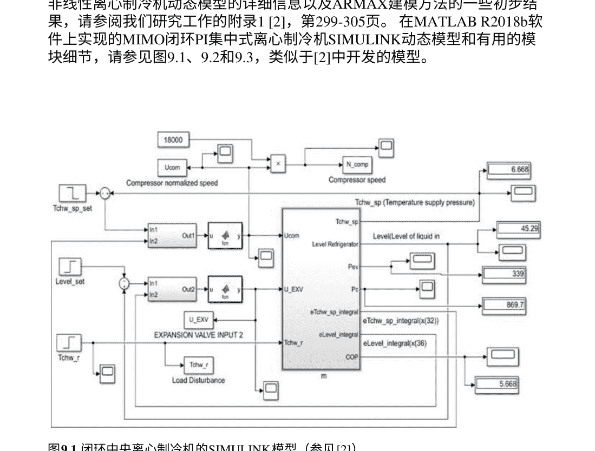

图9.1 闭环中央离心制冷机的SIMULINK模型（参见[2]）

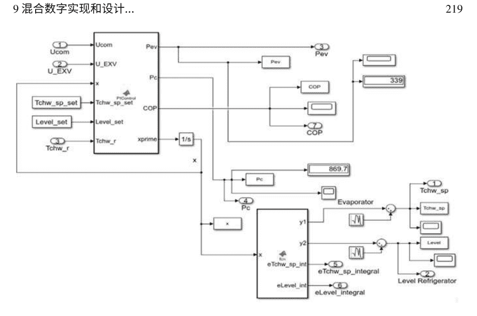

图9.2 PI控制块（MATLAB函数）和蒸发器和冷凝器子系统输出块（MATLAB函数）的SIMULINK模型（参见[2]）

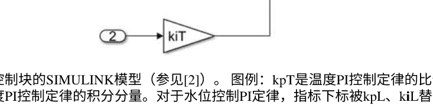

图9.3 PI控制块的SIMULINK模型（参见[2]）。图例：kpT是温度PI控制定律的比例分量，kiT是温度PI控制定律的积分分量。对于水位控制PI定律，指标下标被kpL、kiL替代。

基于这个SIMULINK模型，通过广泛的闭环模拟，收集了构建两个线性MISO多项式ARMAX模型所需的最合适的输入输出测量数据集，这两个模型分别连接到非线性离心制冷机的完全解耦的MISO控制回路。这种分解的好处是构建两个线性准确的低阶ARMAX模型，实现简单。

这些模型能够在各种工作条件下捕捉整个非线性多输入多输出冷水机组的动态，有效地提供更多设计合适闭环控制策略的灵活性。图9.4和9.5显示了两个闭环控制子系统，蒸发器和冷凝器的双测量输入输出数据集。在这两个图中，输入和输出分别表示为：

u₁ = Ucom，压缩机的相对速度

Input-Output Data
Chilled water Temperature (y1)

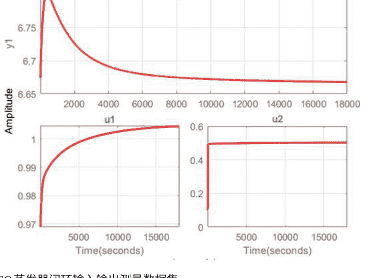

图9.4 MISO蒸发器闭环输入输出测量数据集

Input-Output Data
Refrigerant liquid level in Condenser

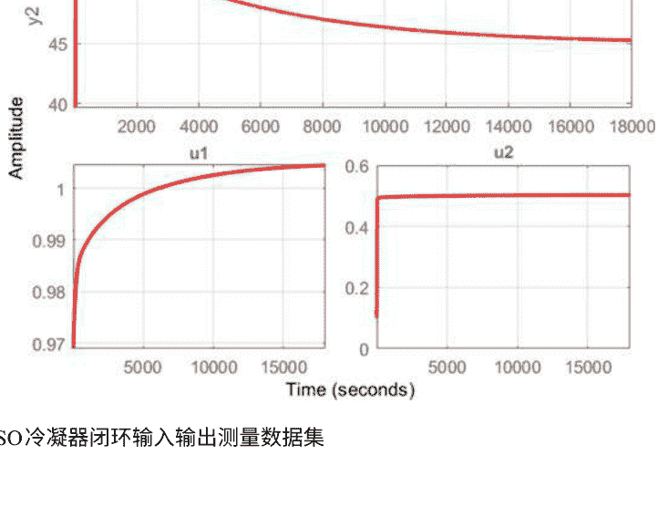

图9.5 MISO冷凝器闭环输入输出测量数据集

u_2 = u_EXV，膨胀阀的开度
y_1 = Tchw，蒸发器中的冷却水温度输出
y_2 = L，冷凝器中的制冷剂液位输出。

#### 9.3 MISO ARMAX和ANFIS多输入多输出离心式冷水机组模型

在本节中，我们基于前一节中收集的集中式MIMO冷水机组闭环控制系统的输入输出测量数据集，构建了蒸发器和冷凝器控制子系统的MISO（两个输入和一个输出）模型。

##### 9.3.1 MISO ARMAX和ANFIS蒸发器子系统模型

基本上，ARMAX是MATLAB的系统识别工具箱中的一个有用函数，用于估计线性离散时间多项式ARMAX模型的参数，基于著名的最小二乘误差（LSE）识别方法，也在[1, 2]中介绍过。

此外，系统识别工具箱提供了模拟从物理过程中获得的数据的选项，并将其打包成适当的MATLAB格式的IDDATA对象，其中包含输入输出测量数据集。

此外，ARMAX MATLAB函数基于预测误差方法，并且需要多项式ARMAX模型的顺序。此外，ARMAX MATLAB函数还指定了从测量传感器到每个闭环控制器的反馈路径中的信号流的纯传输延迟作为新参数。ARMAX模型是“本质上是线性的”，其优势在于“快速设计模型结构和参数识别”，正如[1, 2]中所述。为了生成MISO ARMAX模型，最好将输入输出数据集样本分成两个子集，第一个子集用于模型预测，第二个子集由剩余样本组成，用于模型验证。

从根本上讲，受噪声干扰的线性MISO控制系统的一般描述如下：

y = H_y^u u + H_y^e e          (9.1)

其中u, y是控制系统的输入向量和标量输出，而e是一个未测量的白噪声干扰源[1, 2]。H_y^u和H_y^e分别表示输入输出传递矩阵函数和噪声干扰的描述将通过不同的参数化方式进行估计。与一般描述(9.1)相对应的离散时间ARMAX模型为：

$$\begin{aligned}
A(q)y(t) &= B_1(q)u_1(t) + B_2(q)u_2(t) + C(q)e(t) \\
A(q) &= 1 + a_1q^{-1} + \cdots + a_{n_a}q^{-n_a} \\
B_1(q) &= b_{10}q^{-n_{1k}} + b_{11}q^{-n_{1k}-1} + \cdots + b_{1n_{1b}}q^{-n_{1k}-n_{1b}} \\
B_2(q) &= b_{20}q^{-n_{2k}} + b_{21}q^{-n_{2k}-1} + \cdots + b_{2n_{2b}}q^{-n_{2k}-n_{2b}} \\
C(q) &= 1 + c_1q^{-1} + \cdots + c_{n_c}q^{-n_c}
\end{aligned}$$
(9.2)

其中 $n_a$, $n_{1b}$, $n_{2b}$ 和 $n_c$ 表示多项式 $A(q)$, $B_1(q)$, $B_2(q)$ 和 $C(q)$ 的阶数, 而 $n_{1k}$, $n_{2k}$ 是每个输入-输出通道中的纯传输延迟。
这里 $q$ 是一个向前移位的时间算子, 即 $qy(t) = y(t+1)$, $qu(t) = u(t+1)$, $qe(t) = e(t+1)$ 而 $q^{-1}$ 是一个向后移位的时间算子, 即: $q^{-1}y(t) = y(t-1)$, $q^{-1}u(t) = u(t-1)$, $q^{-1}e(t) = e(t-1)$, $t=kT$, $k \in \mathbb{Z}^+$ 是离散时间描述, $T$ 是采样时间。在ARMAX模型结构 (9.2) 中, 很容易识别出三个特定的项, 即与 $A(q)$-多项式相关的AR (自回归) , 与噪声相关的MA (移动平均) 对应于 $C(q)$-多项式, 以及表示“额外”外部输入向量 $B(q)u(t)$ 的X。 就一般传递函数 $H_y^u$ 和 $H_y^e$ 而言, ARMAX模型对应于以下参数化:

$$H_y^u(q) = \frac{[B_1(q)\ B_2(q)]}{A(q)}, \quad H_y^e(q) = \frac{C(q)}{A(q)}$$
(9.3)

具有共同分母的复数域中, $z = e^{Ts}$, $z \in \mathbb{C}$, $s = \sigma + j\omega$, $j = \sqrt{-1}$, $\omega = 2\pi f$, 并且 $f$ 是以赫兹为单位的信号频率测量。
方程 (9.3) 现在可以写成如下形式:

$$H_y^u(z) = \frac{[B_1(z)\ B_2(z)]}{A(z)}, \quad H_y^e(z) = \frac{C(z)}{A(z)}$$
(9.4)

命令窗口提供有关MATLAB中生成的蒸发器子系统内部的冷却水温度的MISO ARMAX模型的以下有用信息:

```
mARMAX_T = 离散时间ARMAX模型:
A(z)y(t) = B(z)u(t) + C(z)e(t)
A(z) = 1 - 1.71z^{-1} + 0.7104z^{-2}
B_1(z) = 2.899z^{-2} - 2.73z^{-3} - 0.1684z^{-4}
B_2(z) = -0.003326z^{-2} + 0.01051z^{-3} - 0.006553z^{-4}
C(z) = 1 - 0.7521z^{-1}
```
样本时间：1秒

参数化：

多项式阶数： $n_a = 2, n_b = [2\ \ 2], n_c = 1, n_k = [2\ \ 2]$

自由系数个数：9

状态：

使用ARMAX对时域数据进行估计。

拟合估计数据：95.25%（预测重点）

FPE: 2.895e-06, MSE: 2.888e-06

蒸发器开环控制子系统的MISO ARMAX模型在预测和验证阶段均显示在图9.6中。

总之，MISO ARMAX模型的动力学是五阶的，“彩色噪声”的动力学是一阶的，输入信号延迟了一个时间样本。因此，原始非线性离心制冷机动力学的状态空间维数，大约为39，被大幅降低到五阶，但仍然较高。

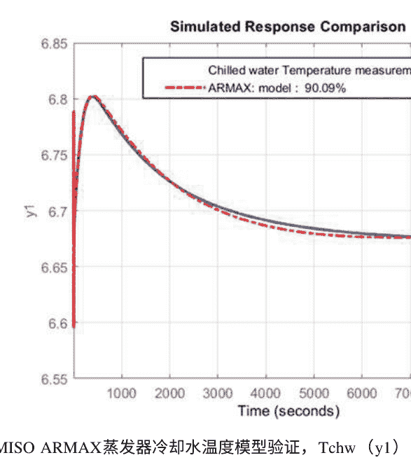

图9.6 MISO ARMAX蒸发器冷却水温度模型验证，Tchw（y1）

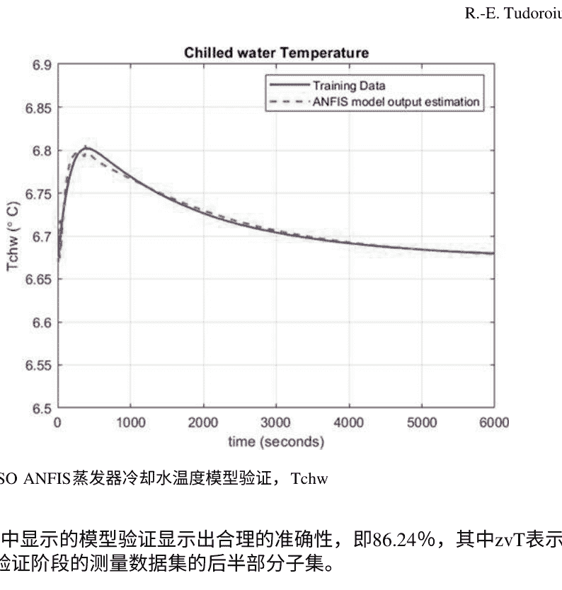

图9.7 MISO ANFIS蒸发器冷却水温度模型验证，Tchw

图9.6中显示的模型验证显示出合理的准确性，即86.24%，其中zvT表示选择用于验证阶段的测量数据集的后半部分子集。

调用MATLAB的 anfis命令，可以直接打开与自适应神经模糊训练Sugeno类型FIS相关的MATLAB R2018b软件包命令行，生成一个SISO冷却水温度模型ANFIS，并在图9.7中显示模拟结果。MATLAB的子程序 anfis使用混合学习算法来识别MISO，Sugeno类型FIS模型的隶属函数参数。使用LSE和反向传播梯度下降方法的组合来训练FIS隶属函数参数，以建模给定的输入-输出（u, y）数据集。

对于一组输入输出测量数据（u, y），例如，下面的MATLAB R2018b代码行是ANFIS模型的核心：

```
options = genfisOptions('GridPartition');
options.NumMembershipFunctions = 5;
in_fis = genfis(u, options);
options = anfisOptions;
options.InitialFIS = in_fis;
options.EpochNumber = 30;
out_fis = anfis([u y], options);
evalfis (u, out_fis)
```

蒸发器对应于MISO ARMAX模型的改进MISO ANFIS模型如图9.7所示。

比较图9.6和9.7中显示的MATLAB仿真结果，对于MISO模型ARMAX和ANFIS，我们可以看到ANFIS模型在冷却水温度方面的准确性有了巨大的提高。这种改进将成为为闭环蒸发器控制子系统构建最合适的PID ANFIS控制策略的真正优势。

##### 9.3.2 MISO ARMAX和ANFIS冷凝器子系统模型

与前面的第9.3.1节一样，命令窗口提供了有关MATLAB中生成的冷凝器子系统中制冷剂液位的SISO ARMAX模型的以下有用信息：

```
mARMAX_L = 离散时间ARMAX模型:
A(z)y(t) = B(z)u(t) + C(z)e(t)
A(z) = 1 - 1.49z^{-1} + 0.4894z^{-2}
B_1(z) = 1062z^{-1} - 2035z^{-2} + 973.9z^{-3}
B_2(z) = -7.481z^{-1} + 9.104z^{-2} - 3.678z^{-3}
C(z) = 1 - 0.9135z^{-1}
采样时间: 1秒
参数化:
多项式阶数: n_a = 2, n_b = [2 2], n_c = 1, n_k = [1 1]
自由系数的数量: 9
状态:
使用ARMAX对时域数据进行估计。
拟合估计数据: 99.28% (预测重点)
FPE: 0.000279, MSE: 0.0002782
```

图9.8显示了冷凝器开环控制子系统的MISO ARMAX模型在预测和验证阶段中的情况。

模型描述显示，SISO ARMAX模型的动力学是二阶的， “彩色噪声”的动力学也是二阶的，输入信号延迟了一个时间样本。因此，原始非线性离心式冷水机组动力学的状态空间维数，约为39，被大幅降低到次低可能阶数。

## Simulated Response Comparison

图9.8 MISO ARMAX冷凝剂液位模型验证，液位（y2）

图9.8中对该模型的验证显示出很高的准确性，达到92.19%，其中zvL表示选择用于验证阶段的测量数据集的后半部分子集。

还可以调用anfis命令，该命令可以直接在与Adaptive Neuro-Fuzzy训练相关的MATLAB R2018b软件包命令行中打开，生成一个MISO冷凝剂液位模型ANFIS，并在图9.9中显示模拟结果。

## 9.4 离心制冷机PID闭环控制策略-性能分析

本节首先通过简要回顾[2]中使用PI闭环控制器对非线性MIMO离心制冷机组进行MATLAB SIMULINK仿真的结果，使用图9.1中表示的SIMULINK模型，建立了性能比较和分析的坚实基线。

在Figs. 9.10和9.11中，展示了制冷剂液位在冷凝器中的蒸发器温度和跟踪设定点的MATLAB模拟结果，并在Figs. 9.12和9.13中展示了跟踪设定点的步变化。值得注意的是，对于以下四个图中的所有情况，与所提出的PID闭环策略获得的MATLAB模拟结果不同，非常长的瞬态响应，特别是在蒸发器内的冷却水温度方面，沉降时间约为3小时。

此外，我们对两种提出的闭环控制策略的性能进行了严格分析，模拟结果在MATLAB R2018b吸引人的环境中实时进行，分别在不同的图表中描述图9.11 PI MIMO Simulink模型仿真结果用于跟踪设定点闭环冷凝器制冷剂液位（参见[2]）

图9.12 PI MIMO Simulink模型仿真结果用于跟踪设定点闭环蒸发器冷却水温度的步变（参见[2]）

相同测量输入输出数据集的时间尺度。基于前一节开发的两个MISO ARMAX模型，MATLAB SIMULINK模型以矩阵传递函数表示的第一个数字PI闭环控制策略的状态空间描述如图9.14所示，对应于以下等效的五阶动力学描述：

-   对于蒸发器控制内部的MISO ARMAX制冷水温度子系统：

图9.13 PI MIMO Simulink模型模拟结果，用于跟踪设定点闭环冷凝器制冷剂液位的步变（参见[2]）

图9.14 PI MISO ARMAX Simulink模型，用于蒸发器制冷水温度和冷凝器制冷剂液位闭环控制子系统

$$A = \begin{bmatrix} 0 & 0 & 0 \\ 1 & 0 & -0.7104 \\ 0 & 1 & 1.71 \end{bmatrix}, \quad B = \begin{bmatrix} -0.0842 & -0.003276 \\ -1.365 & 0.005254 \\ 1.45 & -0.001663 \end{bmatrix}$$
$$C = \begin{bmatrix} 0 & 0 & 2 \end{bmatrix}, \quad D = \begin{bmatrix} 0 & 0 \end{bmatrix} \qquad (9.5)$$

-   对于冷凝器控制子系统中的制冷剂液位：

$$ A = \begin{bmatrix} 0 & 0 & 0 \\ 1 & 0 & -0.4894 \\ 0 & 1 & 1.49 \end{bmatrix}, B = \begin{bmatrix} 30.43 & -0.1149 \\ -63.6 & 0.2845 \\ 33.2 & -0.2338 \end{bmatrix} $$

$$ C = \begin{bmatrix} 0 & 0 & 32 \end{bmatrix}, D = \begin{bmatrix} 0 & 0 \end{bmatrix} \quad (9.6) $$

具有由方程组(9.5)和(9.6)给定的动力学的两个系统的状态空间矩阵表示通常写成以下形式：

$$ x(k+1) = A x(k) + B u(k) $$
$$ y(k) = C x(k) + D u(k) $$

$$ x(k) = \begin{bmatrix} x_1(k) \\ x_2(k) \\ x_3(k) \end{bmatrix}, u(k) = \begin{bmatrix} u_1(k) \\ u_2(k) \end{bmatrix}, y(k) = \begin{bmatrix} y_1(k) \\ y_2(k) \end{bmatrix} \quad (9.7) $$

其中，$x(k)$表示第三维度的状态向量，$u(k)$是输入向量，而$y(k)$表示输出向量。MISO ARMAX线性离散时间模型的采样时间为1秒。通过大量的MATLAB模拟，图9.15和9.16展示了阶跃输入响应的跟踪精度性能。

位于图9.14顶部的蒸发器子系统内部的冷却水温度控制回路中，数字PI控制器的比例部分调谐参数设置如下：$kp_{11}=0.1$, $ki_{11} = 0.001$, $kp_{12} = 0.1$, $ki_{12} = 0.001$。类似地，数字PI控制器

图9.16 PI MISO冷凝器制冷剂液位设定点跟踪性能，Level

从图9.14底部的方块开始，对应于冷凝器内的制冷剂液位，$kp_{11} = 0.1$, $ki_{12}= -1e-5$, $kp_{21}= -0.1$, 和$kp_{22} = 1e-6$。MATLAB跟踪精度性能模拟结果显示在图9.17和9.18中，对应于步输入设定点响应，并在图9.19和9.20中，证明了在输入设定点连续变化时的跟踪精度性能鲁棒性，当制冷剂液位保持在一个恒定水平，即43%。

对于MISO数字PI ANFIS智能混合控制结构，MATLAB模拟结果显示的重要改进值得注意。

图9.17 PI MISO ANFIS蒸发器冷却水温度设定点跟踪性能，Tchw

图9.18 PI MISO ANFIS蒸发器冷却水温度对设定点跟踪性能的鲁棒性，Tchw

图9.19 PI MISO ANFIS冷凝器冷媒液位设定点跟踪性能，Level

最后两个图，图9.19和图9.20，展示了应用于蒸发器冷却水温度的PI ANFIS SISO控制策略在高跟踪精度、非常快的瞬态速度和对跟踪设定点的阶跃变化具有很强的鲁棒性方面取得的出色整体性能。与先前的第一个MISO ARMAX数字PI控制结构相比，与MATLAB模拟结果相比。值得注意的是，MISO ANFIS数字PI控制策略在瞬态期间的行为更加真实，冷凝器中的冷媒液位紧密跟随蒸发器内的冷却水温度的变化，两者几乎同时达到稳态。MATLAB模拟结果显示，与第一个控制策略相比，瞬态稳定时间较长，收敛瞬态速度非常快。

图9.20 PI鲁棒性MISO ANFIS冷凝器制冷剂液位对设定点跟踪性能的变化，水平

通过第二个控制策略。此外，与第二个控制结构相比，第一个控制结构的超调量和振荡次数要大得多。两个ANFIS PI控制器的比例和积分调节参数分别调整为以下值：$kp_{1} = 0.001$和$ki_{1} = 0.01$，用于蒸发器冷却水温度闭环控制子系统，以及$kp_{2}= -0.0001$, $ki_{2}=0.01$，用于冷凝器控制子系统中的制冷剂液位。

值得一提的是，所有MATLAB仿真都是以采样时间$T_s = 1$秒进行的。

然而，在瞬态过程中，我们注意到蒸发器内的冷却水温度和冷凝器中的制冷剂液位只出现了一次振荡。过冲作为一个振幅对整体性能没有显著影响的现象对受控冷凝器的控制有重要意义。

## 9.5 结论

本研究论文是作者在这一研究领域多年来初步结果的延伸和传播。本文的创新之处在于对高非线性和复杂性的MIMO离心式冷却机组的线性离散时间多项式ARMAX模型的改进。

MISO ANFIS模型是基于与生成ARMAX模型相同的输入输出测量数据构建的MIMO离心式冷却机组。MISO数字PI ANFIS控制策略结构基于ANFIS模型，代表了自适应神经模糊结构和数字PI控制器的智能混合组合。本研究论文中开发的两种控制策略的性能比较表明第二种MISO ANFIS数字PI控制策略在跟踪准确性、超调量、瞬态收敛速度和对跟踪输入设定值的步变的鲁棒性方面，优于第一个MISO ARMAX数字PI控制策略的性能显著改善。

致谢感谢加拿大自然科学与工程研究委员会（NSERC）对该项目的研究资助（发现性拨款）。

#### 参考文献

1.  R.-E. Tudoroiu, M. Zaheeruddin, N. Tudoroiu, D.D. Burdescu, MATLAB实现了一种自适应神经模糊建模方法，应用于非线性动态系统-以一个案例研究为例，在波兹南，波兰的计算机科学和信息系统联合会议论文集中，第15卷（2018年），第577-583页
2.  N. Tudoroiu, M. Zaheeruddin, S. Li, R.-E. Tudoroiu, 在实时MATLAB仿真环境中设计和实现了闭环PI控制策略，用于非线性和线性HVAC离心式冷水机组控制系统的ARMAX模型。Adv. Sci. Technol. Eng. Syst. J. 3 (2), 283-308 (2018)
3.  J.M. Zurada, 人工神经网络导论, 第一版 (West Publishing company, St. Paul, USA, 1992)
4.  M. Zaheeruddin, N. Tudoroiu, 神经PID跟踪控制的排气温度系统, Elsevier. 能源转换与管理 45, 2405–2415 (2004)
5.  S.M. Radu, R.-E. Tudoroiu, W. Kecs, N. Ilias, N. Tudoroiu, 实时实现一个改进的混合模糊滑模观测器估计器. 科学与技术进展. 工程系统. J. 2 (1), 214–226 (2017)
6.  R.-E. Tudoroiu, W. Kecs, M. Dobritoiu, N. Ilias, S-V. Casavela, N. Tudoroiu, 实时实现具有未知不确定性的直流伺服电机执行器, 使用滑模观测器, ACSIS, Gdansk, Poland, vol. 8 (2016) pp. (2016)
7.  S. Bendapudi, J.E. Braun等人，离心制冷机系统的动态模型-模型开发、数值研究和验证。ASHRAE Trans. 111, 132–148 (2005)
8.  A. Beyene, H. Guven等人，传统制冷机性能模拟和现场数据。Int.J. Energy Res. 18, 391–399 (1994)
9.  J.E. Braun, J.W. Mitchell等人，变速离心制冷机模型。ASHRAE Trans. (1987). (美国纽约)
10. M.W. Browne, P.K. Bansal，离心液体制冷机的稳态模型。Int. J. Refrig. 21(5), 343–358 (1998)
11. J.M. Gordon, K.C. Ng, H.T. Chua, 离心制冷机，热力学建模和诊断案例研究。Int. J. Refrig. 18(4), 253–257 (1995)
12. P. Li, Y. Li, J.E. Yaoyu, Seem: 基于Modelica的水冷离心式制冷机动态建模, 在普渡大学国际制冷与空调会议上(2010), pp. 1–8
13. P. Popovic, H.N. Shapiro: 离心式压缩机建模研究. ASHRAE Trans. (1998). (加拿大多伦多)
14. M.C. Svensson, 非稳态建模的水-水热泵装置, 在第20届国际制冷大会上, 澳大利亚悉尼 (1999)
15. D.J. Swider, M.W. Browne, P. Bansal, V. Kecman, 利用神经网络建模蒸气压缩液体制冷机. Appl. Thermal Eng. J. 21(3), 311–329 (2001)
16. H. Wang, S. Wang, 一种离心式制冷机的机械模型用于研究暖通空调动力学. 建筑. 服务. 工程. 研究. 技术. 21(2), 73–83 (2000)
17. M. Gholamrezaei, K. Ghorbanian, 综合模糊逻辑和神经网络在轴流压缩机性能预测中的应用. 电力能源 **229**(8), 928–947 (2015)
18. Q. Zhou, S. Wang, F. Xiao, 离心制冷机系统故障检测和诊断的新策略, HVAC & R Res. J. **15**(1), 57–75 (2009)

### 第10章 深度强化学习算法综述及倒立摆系统的比较结果

Recep Özalp, Nuri Kâmil Varol, Burak Taşıci, 和 Ayşegül Uçar

摘要 倒立摆问题的控制是一个经典的控制问题，对于从自动驾驶车辆到机器人等许多领域都非常重要。本章介绍了深度强化学习算法在控制平衡杆问题中的应用。本章的第一部分回顾了深度强化学习方法的理论，如深度Q网络（DQN）、带有优先经验回放的DQN（DQN+PER）、双重DQN（DDQN）、双重Dueling深度Q网络（D3QN）、Reinforce、异步高级Actor-Critic异步（A3C）和同步优势Actor-Critic（A2C）。然后，考虑在OpenAI Gym环境中实现深度强化学习方法的平衡杆问题。最后，对平衡杆问题上所有方法的性能进行了比较。结果通过表格和图形呈现。

-   深度Q网络
-   带有优先经验回放的深度Q网络
-   双重深度Q网络
-   双重Dueling深度Q网络
-   Reinforce
-   异步高级Actor-Critic异步
-   同步优势Actor-Critic
-   倒立摆系统

R. Özalp · N. K. Varol · A. Uçar (✉)
土耳其埃拉泽省菲拉特大学机电工程系，邮编23119
e-mail: agulucar@firat.edu.tr

R. Özalp
e-mail: rozalp@firat.edu.tr

N. K. Varol
e-mail: 171134109@firat.edu.tr

B. Taşıci
土耳其埃拉泽省菲拉特大学技术科学职业学院，邮编23119
e-mail: btasci@firat.edu.tr

© 编辑（如适用）和作者，独家许可给Springer Nature Switzerland AG 2020
G. A. Tsihrintzis和L. C. Jain（编者），机器学习范式，智能系统中的学习与分析18,
https://doi.org/10.1007/978-3-030-49724-8_10

#### 10.1 引言

近年来，现代控制工程取得了显著的发展[1]。PID控制被认为是最先进的技术，但在工业中仍然普遍使用。模型预测控制、状态反馈控制、自适应控制器和最优控制器已经得到了发展[1, 2]。这些控制器大多数需要系统动力学和系统建模。因此，正在寻找不需要系统模型和逆模型的控制结构。

强化学习方法已被证明是一种有前途的智能替代传统控制方法[1, 2]。

强化学习是机器学习方法的第三个流派，允许代理根据自己的经验通过试错来找到最佳行动[3-7]。与监督学习和无监督学习不同，数据集通过强化信号隐式标记。由于代理的自学习特性，强化学习方法的重要性日益增加。在许多领域，如生产控制、博弈论、金融、通信、自动驾驶车辆、机器人等，强化学习方法已经成功应用[8-15]。

文献中包括许多强化学习方法，如表格Q学习，Sarsa，演员-评论家方法和策略梯度[4]。在DeepMind引入AlphaGo之后，在围棋比赛中，强化学习算法以4-1的比分击败了职业围棋选手李世石[16]，基于深度神经网络（DNNs）的许多新的强化学习方法出现了[17-21]。卷积神经网络（CNNs）和长短期记忆网络（LSTM）是DNNs的变体，使用大量数据[22-28]。例如，目标检测和识别算法使用数百万张图像进行训练，如ImageNet [29]。另一方面，这些方法不使用手工设计的特征，在高维状态空间中很难确定，或者不使用任何特征提取方法。这些优势扩大了传统强化学习的应用范围。最成功的应用包括对移动和人形机器人的控制，包括摄像头，激光雷达，IMU等传感器[30-36]。

在本章中，我们将在OpenAI GYM环境[42]上应用深度Q网络（DQN）[17, 18]，带有优先经验回放的DQN（DQN+PER）[37]，双重DQN（DDQN）[20]，双重Dueling DQN（D3QN）[22]，Reinforce [38]，异步高级Actor Critic异步（A3C）[39]和同步高级Actor Critic异步（A2C）[39, 41]来解决平衡杆问题。比较了深度强化学习算法在该问题中的性能。评估了一些控制参数，如上升时间、设定时间、最大回报和平均奖励，以进行比较目标。本章的组织如下。第10.2节介绍了强化学习的基础知识，接着介绍了深度强化学习算法的理论。第10.3节描述了平衡杆问题。第10.4节给出了模拟结果及讨论。第10.5节总结了结论。

#### 10.2 强化学习背景

强化学习是通过马尔可夫决策过程（MDP）来设计的，详见第10.2.1节[3, 4]。一个代理通过试错规则和与环境的交互来学习其行为。代理根据时间t的状态选择一个动作a，然后接收与该动作对应的反馈奖励信号r。它开始接收下一个状态s_{t+1}。图10.1给出了这个一般结构的示意图。

##### 10.2.1 马尔可夫决策过程

MDP是一种用于优化决策的离散时间随机控制过程，面对不确定性[3]。在MDP中，环境动态被定义为从一个状态s转移到下一个状态s'的转移概率分布，如下所示：
```
$p(s_{t+1}=s', r_{t+1}=r|s_t, a_t)$
```
仅依赖于当前状态和动作的表达式被称为马尔可夫性质。转移概率提供环境信息如下：
```
$\sum_{s_{t+1}\in S} \sum_{r\in R} p(s_{t+1}, r_{t+1}|s_t, a_t) = 1, \forall s_t \in S, a_t \in A$
```
```
$p(s_{t+1}, |s_t, a_t) = \sum_{r\in R} p(s_{t+1}, r_{t+1}|s_t, a_t)$
```

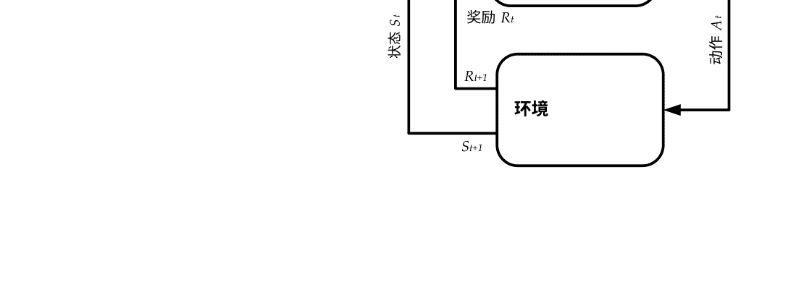

```
$$r(s_t, a_t) = \sum_{r \in R} r \sum_{s_{t+1} \in S} p(s_{t+1}, r_{t+1} | s_t, a_t)$$ \n(10.4)
```

MDP是一个五元组 $S, A, P, R, \gamma$，其中S是可能状态的空间，A是可能动作的空间，$P: S \times A \times S \rightarrow [0, 1]$是从一个状态$s$到下一个状态$s_{t+1}$的转移概率，$R: S \times A \rightarrow \mathbb{R}$是奖励函数，指定从一个状态$s$到下一个状态$s_{t+1}$的动作的奖励$r$，而 $\gamma \in [0, 1)$是指数折扣因子。

代理的目标是从每个状态中最大化总折扣累积回报，如下所示：
```
$$R_t = \sum_{k=0}^{\infty} \gamma^k r_{t+k+1}$$ \n(10.5)
```
由于折扣因子 $\gamma$，短期奖励比长期奖励更重要[4]。选择$\gamma$约为零，以赋予近期获得的奖励重要性，而选择$\gamma$约为一，则是为了未来的奖励。

策略 $\pi$被定义为在给定状态 $s_t$下选择一个动作的策略。确定性策略是将状态转换为动作的函数，而随机策略是根据状态映射到动作的概率分布。

在策略 $\pi$下，与状态 $s_t$相关的预期回报值由值函数 $V_{\pi}(s)$给出。
```
$$V_{\pi}(s) = \mathbb{E}[R_t | s_t = s] = \mathbb{E}_{\pi} \left[ \sum_{k=0}^{\infty} \gamma^k r_{t+k+1} | s_t = s \right].$$ \n(10.6)
```
根据动态规划[3]，可以很容易地估计（10.5）中的值函数，其形式如下：
```
$$V_{\pi}(s) = \mathbb{E}_{\pi} \left[ \sum_{k=0}^{\infty} \gamma^k r_{t+k+1} | s_t = s \right] \n = \sum_{a \in A} \pi(s, a) \sum_{s' \in S} P_{ss'}^a [ R_{ss'}^a + \gamma V_{\pi}(s') ].$$ \n(10.7)
```
使用贝尔曼方程[5]，根据策略 $\pi$ over的状态和动作，定义了最优状态-动作值函数Q-函数，如下所示：
```
$$Q_{\pi}(s, a) = \mathbb{E}_{\pi} [R_t | s_t = s, a_t = a] \n = \mathbb{E}_{\pi} \left[ \sum_{k=0}^{\infty} \gamma^k r_{t+k+1} | s_t = s, a_t = a \right]$$
```
```
$$= \sum_{s' \in S} P_{ss'}^a \left[ R_{ss'}^a + \gamma V_\pi (s') \right]. \tag{10.8}$$
```

给定转移概率和奖励值，最优Q函数可以通过使用动态规划算法[3]递归求解。其中一种算法是值迭代。在值迭代中，首先估计Q值（10.8），然后通过最大化Q值更新值函数$V_\pi(s_t) = \max$直到所有状态的值函数的前后变化很小，算法才会运行并确定最优策略[4]。

通过使用递归值函数，可以使用动态规划方法确定最优策略。另一方面，当转移概率和奖励值未知时，可以使用强化学习来确定在某个状态下应采取的动作。在强化学习中，代理与环境进行交互，在某个状态下采取不同的动作，并近似地建立从状态到动作的映射。

强化学习包括基于模型和无模型的方法。基于模型的方法通过与环境的减少交互生成模型，而无模型的方法则直接通过与环境的交互从经验中学习。它不需要转移概率和奖励函数的模型。Q学习是一种无模型强化学习算法[6]。对于每个状态和动作对，Q值会迭代地估计为：
```
$$Q_{t+1}(s_t, a_t) = Q_t(s_t, a_t) + \eta \left[ r_t + \gamma \left[ \max_{a'} Q_t(s_{t+1}, a_{t+1} | s_t = s, a_t = a) \right] - Q_t(s_t, a_t) \right] \tag{10.9}$$
```
其中 $\eta$ 是学习率。

##### 10.2.2 深度Q学习

表格Q学习使用状态-动作对生成Q矩阵。该算法在不大的环境和连续的状态-动作对中提供良好的结果。事实上，Q-learning算法被认为是在连续状态下逼近Q函数的问题。通常，前馈神经网络（FNNs）[7,43]被用于构建Q函数，梯度下降方法被用于FNNs的训练阶段，以找到此问题的最优解。然而，在具有大维度和离散或连续状态动作的复杂环境中，FNNs是不足够的。因此，为了摆脱这个缺点，提出了DQNs [17,18]。DQNs是通过使用DNN、CNNs和LSTMs构建的，这些都是DNNs的一种，已经成功地应用于许多应用领域。

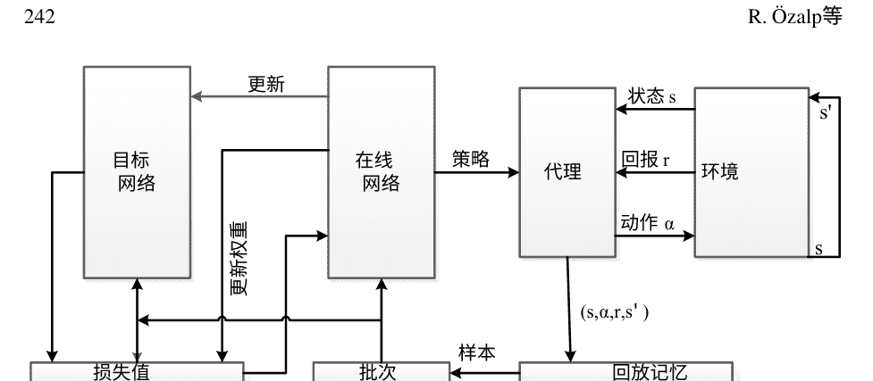

对于大型图像和传感器输入，无需耗时的特征提取处理的领域[25-36, 44]。

图10.2显示了DQN的原理。在DQN中，网络通过使用类似于监督学习的梯度下降方法进行训练[7]。然而，目标先前是未知的。因此，为了生成目标，首先固定第(i-1)次迭代的网络参数，然后使用固定参数来近似计算下一个状态-动作对的目标，通过使用估计的最大Q值的折扣值和当前奖励的加法。

### 目标定义为
```
$$y_t = r_t + \gamma \max_{a_{t+1}} Q_t(s_{t+1}, a_{t+1}; w_{i-1})$$ (10.10)
```
在第$i$次迭代中，网络参数在哪里

### 要优化的损失函数定义为
```
$$L_i(w_i) = \mathbb{E}_{\pi} [(y_t - Q(s_t, a_t; w_i))^2]$$ (10.11)
```
其中 $y_t$和 $Q_t(s_t, a_t; w_i)$分别表示目标网络输出和主网络输出。与监督学习类似，损失函数的梯度计算如下
```
$$\nabla_{w_i} L_i(w_i) = \mathbb{E} [(y_t - Q(s_t, a_t; w_i)) \nabla_{w_i} Q(s_t, a_t; w_i)].$$ (10.12)
```
在DQN中，探索定义为代理在训练阶段开始时尝试所有之前未知的动作。另一方面，利用表达代理使用所选择的动作。如果最大化折扣总累积回报，则称之为贪婪行为。DQN是一种离策略方法，因为它学习一个贪婪策略，即在每个状态下选择最高价值的动作。当一个动作被多次实现时，预期该状态-动作对的奖励会减少。

而DQN更喜欢尝试次数最少的动作。然而，这会导致错过一些更好的动作，并且没有探索。这被称为探索-利用困境。有两种探索方法，直接和间接。直接探索技术使用过去的记忆，而间接探索技术则不使用它们。直接方法的规模多项式与状态空间的大小成比例，而非直接方法在有限确定性环境中通常以指数方式扩展与状态空间的大小成比例。在直接方法中，通过探索来最大化香农信息增益。

在具有高维状态空间的无模型强化学习中，通常不使用直接探索[4]。著名的间接方法是 ε贪婪和softmax探索，也被称为Boltzmann探索。在 ε贪婪中，调整为一个常数，确定采取随机动作的概率。在训练阶段的开始时， ε值被初始化为较大的值以进行探索，然后通常逐渐降低到接近0.1以进行利用。Boltzmann方法使用加权概率的动作，而不是随机动作或最优动作。Boltzmann softmax方程为
```
> P_t(a) = \frac{\exp(Q_t(a)/\tau)}{\sum_i^n \exp(Q_t(i)/\tau)} \tag{10.13}
```
其中 τ是控制softmax分布扩展的温度参数。在训练阶段的开始，所有的动作都被平等对待，然后像(10.13)中那样稀疏分布。

在DQN中，神经网络由于连续观察之间的相关性和Q值之间的小变化而导致一些不稳定问题。在[17, 18]中，提出了两个解决方案：经验回放和冻结目标网络。在经验回放解决方案中，代理生成的经验 E_t=(s_t, a_t, r_t, s_{t+1})被存储在回放内存中，跨多个剧集。从回放内存中随机抽取小批量样本来训练DQN。这样可以获得不相关的样本和小方差的更新。

在每个时间步骤中更新参数会导致学习中的振荡或阻碍。冻结目标网络解决方案[18]建议目标网络的权重在大部分时间内保持冻结，而策略网络的网络则进行更新。后来，它被更新以近似策略网络。

##### 10.2.3 双重深度Q学习

DQN在选择和评估动作时使用相同的Q值[20]。这可能会导致动作值的高估，在不准确和噪声的情况下产生正偏差。DDQN被提出来缓解DQN的限制[20]。DDQN使用两个独立的网络来选择和评估动作。在双重DQN中，首先通过在线网络进行最大化操作来选择动作。其次，在目标网络中估计所选动作的Q值。DDQN的目标函数与DQN的(10.7)目标函数类似。
```
$$ y_t = r_t + \gamma Q_t \left( s_{t+1}, \max_{a_{t+1}} Q_t(s_{t+1}, a_{t+1}; w_t^V); w_t^T \right) $$
```
其中 $w_t^V$ 和 $w_t^T$ 是值网络和目标网络的参数，分别。

DQN或DDQN使用从回放内存中均匀采样的经验。经验的重要性没有顺序。为了给一些经验更多的重要性，优先经验回放（PER）在[37]中提出。一些重要的转换被重播。Moore和Atkeson [45]使用PER消除偏差并提高性能。PER的解决方案如下
```
$$ p = (error + e)^a $$
```
其中错误被映射到优先级。$e >0$是一个常数，$a$在范围$[0, 1]$内并赋予错误的重要性，0表示所有样本具有相等的优先级。

##### 10.2.4 双重竞争深度Q学习

D3QN被提出来以获得比DQN [21]更快的收敛速度。这个架构有一个底部外壳结构，然后分成两个流来估计状态值函数 $V(s_t)$和相关的优势函数 $A(s_t, a_t)$如图10.3所示。底部外壳结构的构造方式类似于DQN和DDQN，只是最后一个全连接层不同。Q函数是通过结合两个流[21, 33, 46]来估计的。
```
$$ Q(s_t, a_t; w, w^V, w^B) = V(s_t; w, w^V) + A(s_t, a_t; w, w^A) $$
```
其中 $w$是底部外壳结构的参数，$w^V$ 和 $w^A$是具有全连接层的优势和值流的参数。Q函数的估计值为
```
$$ Q(s_t, a_t; w, w^V, w^B) = V(s_t; w, w^V) + \left( A(s_t, a_t; w, w^A) - \max_{a_{t+1}} A(s_t, a_t; w, w^A) \right) $$
```
为了实现更好的稳定性，最大值与平均值重新调整,

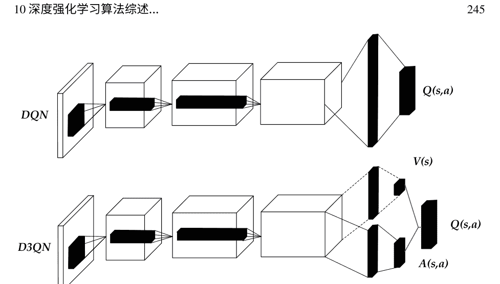

图10.3 DQN和D3QN网络结构[21]

```
$$Q\left(s_t, a_t; w, w^V, w^B\right) = V\left(s_t; w, w^V\right) + \left( A\left(s_t, a_t; w, w^A\right) - \frac{1}{|\mathcal{A}|} A\left(s_t, a_t; w, w^A\right) \right)$$
```
其中 $|\mathcal{A}|$ 是动作的数量。

### 10.2.5 强化

与以Q-learning为代表的值函数方法相比，策略搜索方法基于梯度方法[38]。这些方法使用期望回报的梯度 $J$ 来更新随机策略的参数 $w_i$ of stochastic policy $\pi_w(s_k, a_k; w)$。
```
$$w_i = w_i + \eta \nabla_w J$$
```
强化是估计梯度 $\nabla_w J$ 的方法之一[38]。在这种方法中，似然比被定义为：
```
$$\nabla_w B^w(l) = B^w(l) \nabla_w log B^w(l) J$$
```
其中 $B^w(l)$ 是参数 $w$ 的分布。参数集 $w$ 的预期回报写作：
$$J^{w} = \sum_{l} B^{w}(l) R(l)$$ \quad (10.21)
其中 $R(l)$ 是第 $l$ 个回合的回报。$R(l) = \sum_{k=1}^{K} a_k r_k$ 其中 $a_k$ 是步骤 $k$ 的加权因子。通常情况下，$a_k$ 被选择为(10.5)中的折扣因子或者1/K。
$$\nabla_w J^w = \sum_l \nabla_w B^w(l) R(l) = \sum_l B^w(l) \nabla_w log B^w(l) R(l) = \mathbb{E}\{\nabla_w log B^w(l) R(l)\}$$ \quad (10.22)
随机策略 $\pi^w$ 的分布 $(s_k, a_k)$ 被计算：
$$B^w(l) = \sum_{k=1}^{K} \pi^w(s_k, a_k)$$ \quad (10.23)
$$\nabla_w log J^w = \mathbb{E}\left\{ \left( \sum_{k=1}^{K} \nabla_w log \pi^w(s_k, a_k) \right) R(l) \right\}.$$ \quad (10.24)
在应用中，称为基线的 $b_k$ 从回报项中减去，得到结果梯度为：
$$\nabla_w log J^w = \mathbb{E}\left\{ \left( \sum_{k=1}^{K} \nabla_w log \pi^w(s_k, a_k) \right) (R(l) - b_k) \right\}.$$ \quad (10.25)

##### 10.2.6 异步深度强化学习方法

演员-评论家强化学习算法通常由两部分组成[39, 40]。演员部分表示策略 $\pi(a_t|s_t; w'_a)$ 评论家部分表示值函数 $V(s_t; w_c)$，其中 $w'_a$ 和 $w_c$ 分别是演员和评论家的参数集。演员负责为每个动作提供概率，评论家负责为状态提供值。如图10.4所示，代理在状态 $s_t$ 中选择一个动作 $a_t$，如果值函数的误差为正，则加强该行为。

A3C使用多个代理。每个代理都有自己的参数和一个环境的副本。A3C中的异步强调多个代理的异步并行执行。这些代理与它们自己的环境进行交互。它们中的每一个都由一个全局网络控制。在A3C中，优势被定义为
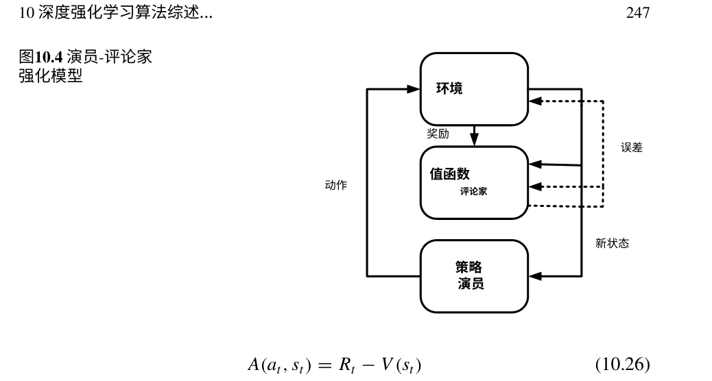

```
A(a_t, s_t) = R_t - V(s_t)
```
其中 R_t是时间步骤t的总回报， V(s_t)是称为基线的值函数。评论家根据以下损失进行优化：
```
损失 = (R_t - V(s_t; w_c))^2.
```
演员使用(10.28)中的梯度进行训练，包括策略 π的熵 H的添加。
```
∇_{w_a'} log π(a_t|s_t; w_a') (R_t - V(s_t; w_c)) + β ∇_{w_a'} H(π(s_t; w_a'))
```
其中 log π(a_t|s_t; w_a') 表示在状态s_t下按照策略 π采取行动 a_t的对数概率，而 β是控制熵正则化强度的超参数。

由于A3C应用了引导法，方差减小，学习加速。A3C适用于连续和离散动作空间。前馈和循环网络结构都可以在A3C中使用。一般来说，A3C使用一个具有一个softmax输出和一个线性输出的CNN来表示演员和价值函数。

A2C是一种同步、确定性的A3C方法[40]。如图10.5所示，在A2C中，每个代理先完成自己的回合，然后更新策略和价值函数网络。A2C在GPU上的工作效果更好，速度比A3C更快。

#### 10.3 倒立摆问题

在本章中，考虑了经典控制理论中的倒立摆问题。该系统由一个固定在二维平面上移动的小车上的杆组成。小车可以在平坦的表面上向左或向右移动。控制的目标是问题是在其质心上保持直立位置的平衡。由于重力和不稳定性，该系统是非线性的。因此，它的控制是困难的。为了使杆保持平衡，小车必须通过施加力在平衡点的左右两侧移动。图10.6展示了倒立摆问题及其参数的设置。

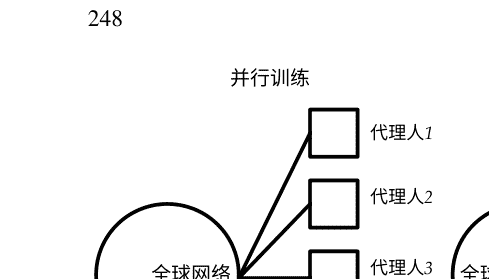

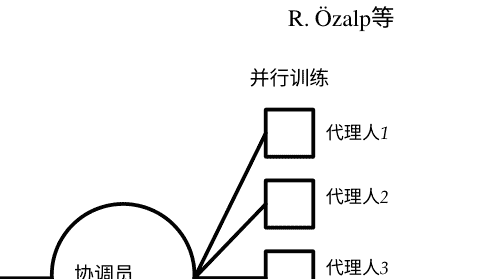

图10.5 A3C与A2C的结构[47]

图10.6中的系统具有状态空间形式
> $$\begin{bmatrix} \dot{x}_1 \\ \dot{x}_2 \\ \dot{x}_3 \\ \dot{x}_4 \end{bmatrix} = \begin{bmatrix} x_3 \\ x_4 \\ \frac{m(g\cos(x_2)-lx_4^2)\sin(x_2)+u}{M+m\sin^2(x_2)} \\ \frac{g\sin(x_2)}{l} + \frac{\cos(x_2)}{l} \frac{m(g\cos(x_2)-lx_4^2)\sin(x_2)+u}{M+m\sin^2(x_2)} \end{bmatrix}, \quad \text{(10.29)}$$
其中 $x = (x_1, x_2, x_3, x_4)$ 是小车位置、摆角、小车速度和摆速度，M和m分别表示小车和摆的质量，g是重力加速度，u是外力。

图10.6 倒立摆系统[48]

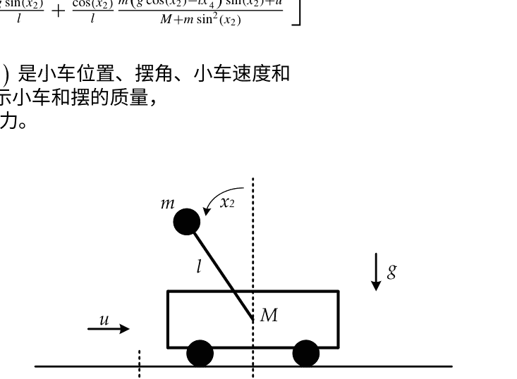强化学习不需要系统模型或逆模型来进行控制。

#### 10.4 实验结果

在本章中，我们使用了OpenAI Gym环境中的“Cartpole-v1”[42]。在这个环境中，g、M、m、l的值分别为9.8、1.0、0.5。在平衡杆车问题中，施加两个力或动作，其大小为-1和1。每个回合的最大持续时间为500。

当杆子离支点超过15度、杆子倒下或者小车离中心超过2.4个单位时，每个回合都会结束。如果小车位置和杆子角度没有违规，奖励为1，否则奖励为0。我们使用Python中的Keras和Tensorflow生成了所有深度强化学习算法。特别地，网络的性能取决于适当设置的隐藏层神经元数量。参数设置没有固定规则。在本章中，我们考虑到训练时间过长且性能不增加的情况下，评估了隐藏层神经元数量为24、32和64的网络性能。表10.1、10.2、10.3、10.4、10.5分别给出了(DQN, DQN with PER, DDQN), D3QN和(Reinforce, A3C, and A2C)的所有网络结构和其他超参数。在网络中，优化方法选择为Adam [49]。均方误差(MSE)和交叉熵误差(CCE)被用作损失函数[49]。使用了修正线性单元(Rectifier Linear Units, Relu)和softmax激活函数[49]。

在实验中，所有深度强化学习网络结构都在平衡杆问题上进行了评估。所有实验都重复了10次，并获得了它们的平均学习曲线。为了进一步评估所得结果，使用了以下性能统计指标，如平均回报、最大回报、上升时间和稳定时间。在控制性能指标中，上升时间被定义为从稳态值的10%上升到90%所需的回合数，而稳定时间被定义为稳态值达到并保持在给定范围内所需的回合数。

网络的结果在表10.6中呈现。使用DDQN获得的平均回报最大值为207.12。另一方面，使用DDQN获得的上升时间和稳定时间的最小值分别为40和80。观察到DDQN在平衡杆问题的训练速度和获得的奖励方面是足够的。从图表中还可以看出，比赛的第二名是DQN，其平均奖励值、上升时间和稳定时间较好。

图10.7和10.8显示了网络的学习曲线。图表显示，获得的最大回报为500，所有网络都达到了500。此外，DQN和DDQN的学习曲线没有振荡，并且以快速的方式达到了稳态值。

表10.1 DQN、DQN with PER和DDQN的网络结构和超参数

| 超参数 | 数值 |
|---|---|
| 折扣因子 | 0.99 |
| 学习率 | 0.001 |
| Epsilon | 1.0 |
| Epsilon衰减 | 0.999 |
| Epsilon最小值 | 0.01 |
| 批量大小 | 64 |
| 训练开始 | 1000 |
| 回放记忆 | 2000 |
| a | 0.6 |
| e | 0.01 |
| 网络结构 | |
| 隐藏层 | 2 |
| 隐藏层激活函数 | 修正线性单元 |
| 输出激活函数 | 线性 |
| 输出数量 | 2 |
| 优化器方法 | Adam |
| 损失函数 | 均方误差 |

表10.2 Reinforce的网络结构和超参数

| 超参数 | 数值 |
|---|---|
| 折扣因子 | 0.99 |
| 学习率 | 0.001 |
| 网络结构 | |
| 隐藏层数量 | 2 |
| 隐藏层激活函数 | Relu |
| 输出激活函数 | Softmax |
| 输出数量 | 2 |
| 优化器方法 | Adam |
| 损失函数 | CCE |

实验观察到A3C和A2C的性能特别受到权重初始化的影响，并且在每次运行时提供了不同的结果，尽管尝试了不同的权重初始化方法，如Xavier和He Normal [49]。从表10.6可以看出，DQN，DQN with PER，DDQN，D3QN，Reinforce，A3C和A2C的最佳隐藏神经元数量分别为32，24，32，32，64，32和64。

表10.3 D3QN的网络结构和超参数

| 超参数 | 数值 |
| --- | --- |
| 折扣因子 | 0.95 |
| 学习率 | 2.5e-4 |
| Epsilon衰减 | 0.99 |
| 回放记忆 | 2000 |
| Tau | 1 |
| 网络结构 | |
| 隐藏层 | 2 |
| 隐藏层激活函数 | Relu |
| 输出激活函数 | 线性 |
| 输出数量 | 2 |
| 优化器方法 | Adam |
| 损失函数 | 均方误差 |

表10.4 A3C的网络结构和超参数

| 超参数 | 数值 |
| --- | --- |
| 折扣因子 | 0.99 |
| 演员学习率 | 0.001 |
| 评论家学习率 | 0.001 |
| 线程 | 8 |
| 演员部分的网络结构 | |
| 隐藏层数量 | 2 |
| 隐藏层激活函数 | Relu |
| 输出激活函数 | Softmax |
| 输出数量 | 2 |
| 优化器方法 | Adam |
| 损失函数 | CCE |
| 评论家部分的网络结构 | |
| 隐藏层/节点数 | 2 |
| 隐藏层激活函数 | Relu |
| 输出激活函数 | 线性 |
| 输出数量 | 1 |
| 优化器方法 | Adam |
| 损失函数 | 均方误差 |

#### 10.5 结论

本章主要考虑了平衡杆车控制问题。本章的主要目的是回顾深度强化学习。

表10.5 A2C的网络结构和超参数

| 超参数 | 数值 |
| :--- | :--- |
| 折扣因子 | 0.99 |
| 演员学习率 | 0.001 |
| 评论家学习率 | 0.005 |
| **演员部分的网络结构** | |
| 隐藏层数量 | 2/24 |
| 隐藏层激活函数 | Relu |
| 输出激活函数 | Softmax |
| 输出数量 | 2 |
| 优化器方法 | Adam |
| 损失函数 | CCE |
| **评论家部分的网络结构** | |
| 隐藏层/节点数 | 2 |
| 隐藏层激活函数 | Relu |
| 输出激活函数 | 线性 |
| 输出数量 | 1 |
| 优化器方法 | 均方误差 |

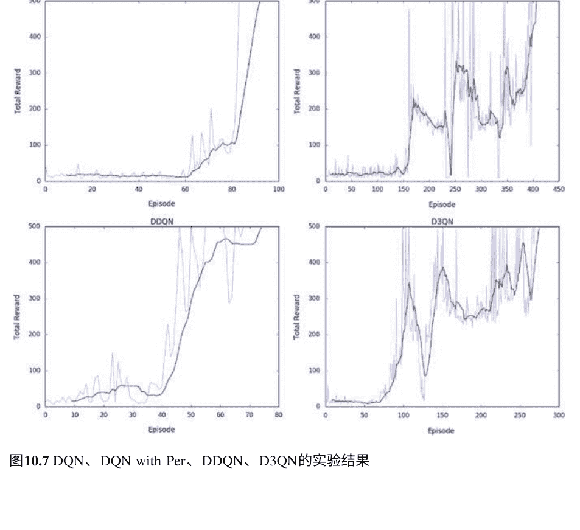

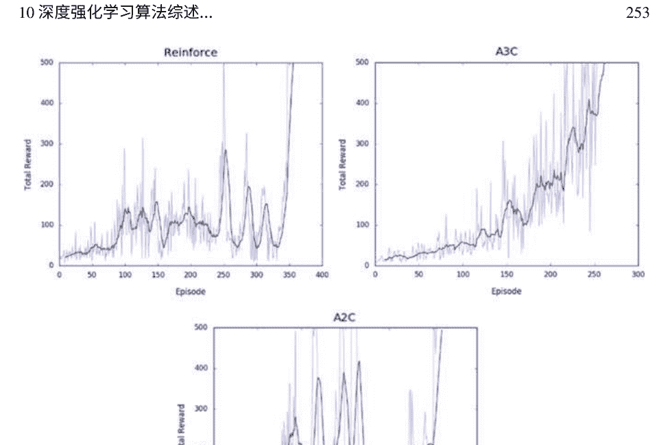

## 图10.8 Reinforce、A3C、A2C的实验结果

本文旨在回顾文献中的方法，并展示这些方法在平衡杆车问题上的性能。

本章首先描述了最先进的深度强化学习方法，如DQN，DQN with PER，DDQN，D3QN，Reinforce，A3C和A2C。其次，构建了不同的网络结构。最终使用Keras中生成的方法解决了OpenAI Gym环境中的平衡杆问题。

通过累积奖励、平均奖励、最大奖励、上升时间和稳定时间来展示深度强化学习方法的有效性。实验结果表明，DDQN在控制方面表现出色。观察发现，DDQN在这个平衡杆问题上取得了最好的平均回报、上升时间和稳定时间，尽管已知Reinforce、A3C和A2C等方法具有快速和高精度。

同时，实验结果表明网络结构对于卓越性能至关重要。

未来的工作将重点关注复杂问题，以测试深度强化学习方法的性能，包括数据和图像输入。

| 方法 | 隐藏神经元数量 | 平均奖励 | 最大奖励 | 上升时间 | 稳定时间 |
| :--- | :--- | :--- | :--- | :--- | :--- |
| DQN | 24 | 112.64 | 500 | 114 | 140 |
| | 32 | 86.79 | 500 | 83 | 100 |
| | 64 | 179.02 | 500 | 141 | 180 |
| DQN + Per | 24 | 137.47 | 500 | 232 | 300 |
| | 32 | 147.57 | 500 | 161 | 430 |
| | 64 | 206.34 | 500 | 250 | 300 |
| DDQN | 24 | 140.30 | 500 | 108 | 180 |
| | 32 | 207.12 | 500 | 46 | 80 |
| | 64 | 191.64 | 500 | 99 | 180 |
| D3QN | 24 | 122.02 | 500 | 120 | 320 |
| | 32 | 201.04 | 500 | 99 | 280 |
| | 64 | 244.09 | 500 | 125 | 400 |
| Reinforce | 24 | 126.43 | 500 | 364 | 450 |
| | 32 | 120.02 | 500 | 293 | 450 |
| | 64 | 102.50 | 500 | 250 | 355 |
| A3C | 24 | 156.62 | 500 | 257 | 430 |
| | 32 | 191.50 | 500 | 244 | 255 |
| | 64 | 161.17 | 500 | 240 | 500 |
| A2C | 24 | 130.35 | 500 | 202 | 440 |
| | 32 | 101.45 | 500 | 191 | 379 |
| | 64 | 179.44 | 500 | 78 | 260 |

致谢本研究得到了土耳其科学技术研究委员会（TUBITAK）的支持，资助号码为117E589。此外，本研究中的GTX Titan X Pascal GPU由NVIDIA Corporation捐赠。

#### 参考文献

+   1. K. Ogata, Y. Yang, 现代控制工程，第4卷（伦敦，2002年）
2. A.E. Bryson, 应用最优控制：优化、估计和控制（Routledge，2018年）
3. M.L. Puterman, 马尔可夫决策过程：离散随机动态规划（Wiley, 2014）
4. R.S. Sutton, A.G. Barto, 强化学习：一种介绍(MIT Press, 2018)
5. K. Vinotha, 动态规划中的贝尔曼方程。Int. J. Comput. Algorithm 3(3), 277–279 (2014)
6. C.J. Watkins, P. Dayan, Q-learning. Mach. Learn. 8(3–4), 279–292 (1992)
7. S.S. Haykin, 神经网络与学习机(Prentice Hall, New York, 2009)
8. P. Abbeel, A. Coates, M. Quigley, A.Y. Ng, 强化学习在特技直升机飞行中的应用， in *Advances in Neural Information Processing Systems* (2007), pp. 1–8
9. Y.C. Wang, J.M. Usher, 强化学习在基于代理的生产调度中的应用。Eng. Appl. Artif. Intel 1. **18**(1), 73–82 (2005)
10. L. Peshkin, V. Savova, 自适应路由的强化学习，在2002年国际联合神经网络会议论文集中。IJCNN'02 (Cat. No. 02CH37290), vol. 2(IEEE, 2002), pp. 1825–1830. (2002, May)
11. X. Dai, C.K. Li, A.B. Rad, 基于强化学习调整模糊控制器的自主车辆控制方法。IEEE Trans. Intell. Transp. Syst. **6**(3), 285–293 (2005)
12. B.C. Csáji, L. Monostori, B. Kádár, 强化学习在分布式基于市场的生产控制系统中的应用。Adv. Eng. Inform. **20**(3), 279–288 (2006)
13. W.D. Smart, L.P. Kaelbling, 移动机器人的有效强化学习，在2002年IEEE国际机器人与自动化大会论文集（编号02CH37292）中，第4卷（IEEE, 2002年），第3404-3410页。(2002年5月)
14. J.J. Choi, D. Laibson, B.C. Madrian, A. Metrick, 强化学习和储蓄行为。金融学 **64**（6）, 2515-2534 (2009年)
15. M. Bowling, M. Veloso, 多智能体强化学习的随机博弈理论分析（编号CMU-CS-00-165）。（卡内基梅隆大学匹兹堡校区计算机科学学院，2000年）
16. D. Silver, A. Huang, C.J. Maddison, A. Guez, L. Sifre, G. Van Den Driessche, J. Schrittwieser, I. Antonoglou, V. Panneershelvam, M. Lanctot, S. Dieleman, 用深度神经网络和树搜索掌握围棋。自然, **529** (7587), 484 (2016年)
17. V. Mnih, K. Kavukcuoglu, D. Silver, A. Graves, I. Antonoglou, D. Wierstra, M. Riedmiller, 使用深度强化学习玩Atari游戏(2013). arXiv:1312.5602
18. V. Mnih, K. Kavukcuoglu, D. Silver, A.A. Rusu, J. Veness, M.G. Bellemare, A. Graves, M. Riedmiller, A.K. Fidjeland, G. Ostrovski, S. Petersen 通过深度强化学习实现人类水平的控制。自然 **518**(7540), 529 (2015)
19. H.V. Hasselt, 双Q学习，在神经信息处理系统进展中(2010), pp. 2613–2621
20. H. Van Hasselt, A. Guez, D. Silver, 使用双Q学习的深度强化学习，在第三十届AAAI人工智能会议上(2016年3月)
21. Z. Wang, T. Schaul, M. Hessel, H. Van Hasselt, M. Lanctot, N. De Freitas, 深度强化学习的对抗网络架构 (2015). arXiv:1511.06581
22. J. Sharma, P.A. Andersen, O.C. Granmo, M. Goodwin, 基于Q矩阵迁移学习的深度Q学习在新型火灾疏散环境中的应用 (2019). arXiv:1905.09673
23. A. Krizhevsky, I. Sutskever, G.E. Hinton, 使用深度卷积神经网络的Imagenet分类,在神经信息处理系统进展(2012), pp. 1097–1105
24. A. Karpathy, G. Toderici, S. Shetty, T. Leung, R. Sukthankar, L. Fei-Fei, 使用卷积神经网络的大规模视频分类,在IEEE计算机视觉与模式识别会议论文集(2014), pp. 1725–1732
25. T.N. Sainath, O. Vinyals, A. Senior, H. Sak, 卷积, 长短期记忆, 全连接深度神经网络,在2015年IEEE国际声学、语音和信号处理会议(ICASSP) (IEEE, 2015), pp. 4580–4584. (2015年4月)
26. O. Abdel-Hamid, A.R. Mohamed, H. Jiang, G. Penn, 将卷积神经网络概念应用于混合NN-HMM模型的语音识别,在2012年IEEE国际声学、语音和信号处理会议(ICASSP) (IEEE, 2012), pp. 4277–4280. (2012年3月)
27. A. Uçar, Y. Demir, C. Güzelis, 采用深度学习在自动驾驶应用中实现目标识别,在2016年国际智能系统和应用创新研讨会(INISTA) (IEEE, 2016), pp. 1–5. (2016年8月)
28. H.A. Pierson, M.S. Gashler, 机器人学中的深度学习:近期研究综述. Adv. Robot. **31**(16), 821–835 (2017)
29. L. Fei-Fei, J. Deng, K. Li, ImageNet: 构建一个大规模图像数据库. J. Vis. 9(8), 1037–1037 (2009)
30. A.E. Sallab, M. Abdou, E. Perot, S. Yogamani, 深度强化学习框架用于自动驾驶. Electron. Imaging 2017(19), 70–76 (2017)
31. Y. Zhu, R. Mottaghi, E. Kolve, J.J. Lim, A. Gupta, L. Fei-Fei, A. Farhadi, 基于深度强化学习的室内目标驱动视觉导航, in2017 IEEE国际机器人与自动化大会 (ICRA) (IEEE, 2017), p. 3357–3364. (2017年5月)
32. S. Levine, C. Finn, T. Darrell, P. Abbeel, 深度视觉运动策略的端到端训练. J.Mach. Learn. Res. 17(1), 1334–1373 (2016)
33. L. Xie, S. Wang, A. Markham, N. Trigoni, 通过深度强化学习实现基于单目视觉的避障 (2017). arXiv:1706.09829
34. X.B. Peng, M. van de Panne, 使用深度强化学习学习运动技能：动作选择是否重要？, 在 ACM SIGGRAPH/Eurographics计算机动画研讨会 (ACM, 2017), 第12页. (2017年7月)
35. G. Kahn, A. Villaflor, B. Ding, P. Abbeel, S. Levine. 自监督的深度强化学习与通用计算图用于机器人导航, 在2018 IEEE国际机器人与自动化会议 (ICRA) (IEEE, 2018), 第1-8页. (2018年5月)
36. T. Hester, M. Vecerik, O. Pietquin, M. Lanctot, T. Schaul, B. Piot, D. Horgan, J. Quan, A. Sendonaris, I. Osband, G. Dulac-Arnold, 从演示中进行深度Q学习, 在第32届 AAAI人工智能大会 (2018年4月)
37. T. Schaul, J. Quan, I. Antonoglou, D. Silver, 优先经验回放 (2015). arXiv:1511. 05952
38. R.J. Williams, 连接主义强化学习的简单统计梯度跟随算法. 机器学习. 8(3–4), 229–256 (1992)
39. V. Mnih, A.P. Badia, M. Mirza, A. Graves, T. Lillicrap, T. Harley, D. Silver, K. Kavukcuoglu, 深度强化学习的异步方法, 在国际机器学习会议, pp. 1928–1937. (2016年6月)
40. A.V. Clemente, H.N. Castejón, A. Chandra, 深度强化学习的高效并行方法 (2017). arXiv:1705.04862
41. R.R. Torrado, P. Bontrager, J. Togelius, J. Liu, D. Perez-Liebana, 深度强化学习用于通用视频游戏人工智能, 在2018年IEEE计算智能与游戏 (CIG) (IEEE, 2018), 第1-8页. (2018年8月)
42. G. Brockman, V. Cheung, L. Pettersson, J. Schneider, J. Schulman, J. Tang, W. Zaremba, Openai gym (2016). arXiv:1606.01540
43. Y. Demir, A. Uçar, 切换电路的神经网络和模糊神经网络建模与仿真. COMPEL Int. J. Comput. Math. Electr. Electron. Eng. 22(2), 253-272 (2003)
44. Ç. Kaymak, A. Uçar, 语义图像分割的简要调查和应用于自动驾驶, 收录于深度学习应用手册 (Springer, Cham, 2019), 第161-200页
45. A.W. Moore, C.G. Atkeson, 基于记忆的强化学习: 优先级扫描的高效计算, 在神经信息处理系统进展 (1993), pp. 263–270
46. R. Özalp, C. Kaymak, Ö. Yildirum, A. Uçar, Y. Demir, C. Güzelis, 基于视觉的深度强化学习在人形机器人运动中的实现, 在2019年IEEE国际智能系统与应用创新研讨会 (INISTA) (IEEE, 2019), pp. 1–5 (2019年7月)
47. https://lilianweng.github.io/lil-log/2018/04/08/policy-gradient-algorithms.html. 于2019年9月9日访问
48. C. Knoll, K. Röbenack, 通过多项式反馈生成具有预定频率和振幅的稳定极限周期, 在国际系统、信号与设备多会议 (IEEE, 2012), pp. 1–6. (2012年3月)
49. I. Goodfellow, Y. Bengio, A. Courville, 深度学习 . (MIT Press, 2016)

## 第五部分

## 特征向量中的深度学习

## 处理

### 第11章 使用支持向量机进行股市预测

K. Liagkouras和K. Metaxiotis

摘要 支持向量机（SVM）是机器学习中一个成熟的技术。在过去的几年中，支持向量机已经被广泛应用于各种领域。本文通过使用支持向量机研究股票价格预测。股票价格预测是金融领域中最具挑战性的研究和实践领域之一。作为SVM的输入参数，我们利用了一些著名的股票技术指标和宏观经济变量。为了评估SVM的预测能力，我们将所提出的模型的结果与伦敦富时100指数的一些成分股的实际股票走势进行比较。

关键词 支持向量机·股票价格预测·技术指标·宏观经济变量

#### 11.1 引言

预测是利用历史数据来预测未来变化的过程。尽管世界各地的经理和企业都使用预测来帮助他们做出更好的未来决策，但有一个特定的业务领域从不同的预测方法的发展中受益最多：股票市场预测。由于股票价格的动态、非线性、复杂和混沌性质，股票价格的预测一直是金融工程中一个重要且具有挑战性的主题。

机器学习[10]和人工智能技术的出现使得处理股票价格的计算要求高的模型成为可能。

> K. Liagkouras (✉) · K. Metaxiotis
决策支持系统实验室，信息学系，比雷埃夫斯大学，希腊比雷埃夫斯市，卡拉奥利和迪米特里乌大街18534，电子邮件：kliagk@unipi.gr

K. Metaxiotis
e-mail: kmetax@unipi.gr

预测[7]。在过去的几年中，已经开发出了各种技术，我们区分了源自人工神经网络（ANNs）[9, 27]和支持向量机（SVMs）[21, 29]的方法，因为它们引起了学术界和从业者的越来越多的兴趣。ANN是一种计算模型，其分层结构类似于人脑中的神经元结构[2]。许多研究探讨了ANN在股票价格预测中的有效性。

下面，我们提供了该领域最新研究结果的简明介绍。

Adhikari和Agrawal [1]提出了一种组合方法，其中金融数据集的线性部分通过随机游走（RW）模型进行处理，剩余的非线性残差则使用前馈ANN（FANN）和Elman ANN（EANN）模型的集成进行处理。所提出方案的预测能力在四个真实世界的金融时间序列上以三个常用误差统计量为指标进行了检验。Pan等人[25]提出了一种使用多层前馈神经网络预测澳大利亚股市指数的计算方法。

根据作者的说法，他们的研究重点是发现用于预测股市价格的最佳神经网络或一组自适应神经网络。

根据Ou和Wang [23]，与股价预测相关的一个重要困难是股市固有的高波动性，导致了较大的回归误差。根据作者[23]的说法，与价格预测相比，股票方向预测更简单且更准确。ANN的一个缺点是，当神经网络模型过度拟合训练数据集时，预测未探索样本的效率会迅速降低。特别是在处理可能导致ANN形成复杂模型的嘈杂股票数据时，更容易遇到过度拟合问题。

相应地，大量的研究利用基于SVM的方法进行股票价格预测[34]。Rosillo等人[26]使用支持向量机(SVM)来预测标准普尔500指数的每周变化。作者们在股票交易模拟中使用了技术交易规则，这些规则在股票市场分析中常用，如相对强弱指数、移动平均收敛差离和标准普尔500的日回报率。

根据作者的说法，SVM能够识别市场中买入或卖出的最佳时机。

Thenmozhi和Chand [29]研究了使用支持向量回归预测六个全球市场的股票价格，包括来自美国的道琼斯和标准普尔500指数，来自英国的富时100指数，来自印度的NSE指数，来自新加坡的SGX指数，来自香港的恒生指数和来自中国的上海证券交易所，研究期间为1999年至2011年。该研究提供了证据，表明全球股票市场是相互关联的，市场间的价格传输信息，包括新兴市场，可以带来更好的日内交易回报。

Gavrishchaka和Banerjee [6]研究了现有模型在预测股市波动性方面的局限性。根据作者[6]，基于支持向量机（SVM）的波动性模型能够从多尺度和高维市场数据中提取信息。特别是，根据作者的说法，SP500指数的结果表明SVM能够高效地处理高维输入以考虑波动性的长期记忆和多尺度效应，并且通常优于主流的波动性模型。

Özorhan等人[24]研究了在外汇市场上预测货币对运动方向和幅度的问题。作者们使用了支持向量机（SVM）以及一种新颖的方法来处理输入数据和交易策略。特别是，输入数据包含从货币价格数据（即开盘价、最高价、最低价和收盘价）生成的技术指标，以及这些技术指标的表示作为趋势确定性信号。最后，输入数据还会根据每个交易日进行动态调整，使用遗传算法。实验结果表明，使用趋势确定性技术指标信号与原始数据相结合可以提高整体性能，并且动态调整输入数据以适应每个交易周期会增加利润。

Gupta等人[8]在多准则决策框架中提出了一种综合方法来进行投资组合选择。作者使用支持向量机将金融资产分为三个预定义的类别，基于它们在一些关键金融准则上的表现。接下来，他们使用实数编码遗传算法来解决多准则投资组合选择问题。

根据Cortes和Vapnik[4]的说法，支持向量机通常具有更好的泛化性能和较低的过拟合风险，而不像人工神经网络。根据Kim[12]的说法，支持向量机在预测股市未来走势方面表现优于人工神经网络，并且他报告称，他在韩国综合股价指数200（KOSPI 200）的实验中，使用支持向量机获得的最佳预测性能为57.8%。另外两项独立研究，第一项由Huang等人[11]进行，第二项由Tay和Cao[28]进行，也证实了支持向量机在股市走势预测方面的优越性。根据Huang等人[11]的分析，基于支持向量机的模型在预测日经225指数（NIKKEI 225）的走势方面达到了75%的命中率。

一个潜在的研究限制涉及前述研究的测试环境。特别是，在大多数研究中，测试是在样本数据集内进行的。即使在测试是在一个样本外的测试环境中进行的情况下，测试也是在不太可能代表市场波动的小数据集上进行的。

使用SVM进行股票价格预测的另一个困难在于底层问题的高维空间。事实上，股票市场成分股的数量可以从小型股票市场的30-40只股票到大型股票市场的数百只股票不等，这导致了一个高维空间[20]。

此外，被检测的测试实例越大，对内存和计算时间的要求就越大。

本文的组织结构如下。在第11.2节中，我们概述了SVM并描述了它们如何集成到我们的模型中。在第11.3节中，我们确定了影响股票价格风险和波动性的因素。在第11.4节中，我们提出了使用SVM预测股票价格的模型。最后，在第11.5节中，我们讨论了实验结果并总结了本文。

#### 11.2 支持向量机

支持向量机最初由Vapnik [30]开发。一般来说，SVMs是具有决策函数容量控制和核函数使用特征的特定学习算法[31]。在其最简单的形式中，支持向量机是一种用于区分两个可分离组 {(x; y)} 的监督学习方法，其中标量目标变量 y 等于 +1或-1。向量输入变量 x 是任意的，通常被称为“分离超平面”或在 x 空间中分离正负案例的平面。

对于线性可分的情况，在三属性情况下，分离二进制决策类的超平面由以下关系给出：

$$ y = w_0 + w_1 x_1 + w_2 x_2 + w_3 x_3, \quad (11.1) $$

其中 y 是输出结果，x 是属性值，有四个权重 w_i。权重 w_i 由学习算法确定。在方程 (11.1) 中，权重 w_i 是确定超平面的参数。最大间隔超平面可以用以下方程表示，其中包括支持向量：

$$ y = b + \sum a_i y_i \mathbf{x}(i) \cdot \mathbf{x}, \quad (11.2) $$

其中 y_i 是训练样本 x(i) 的类别值。向量 x 表示一个测试样本，向量 x(i) 是支持向量。在这个方程中，b 和 a_i 是确定超平面的参数。最后，为了找到支持向量和确定参数 b 和 a_i，需要解决一个线性约束二次规划问题。

对于非线性可分的情况，方程 (11.2) 的高维版本可以通过以下关系给出：

$$ y = b + \sum a_i y_i K(\mathbf{x}(i), \mathbf{x}), \quad (11.3) $$

SVM使用核函数 K(\mathbf{x}(i), \mathbf{x}) 将输入转换为高维特征空间。有一些不同的内积生成核[32]，用于构建具有不同类型非线性决策边界的机器。在不同的核函数中选择最小化估计的模型，选择最佳模型。图11.1说明了核函数的工作原理。特别地，通过使用核函数 K，可以计算出分离超平面，而无需显式地进行特征空间的映射[33]。

#### 11.3 股票价格的风险和波动性决定因素

股票价格存在两个主要的不确定性来源。第一个风险来源与一般经济条件有关，如利率、汇率、通货膨胀率和商业周期[14, 15]。上述宏观经济因素都无法准确预测，并且都会影响股票的回报率[13]。第二个不确定性来源是公司特定的。从分析角度来看，它与公司的前景、管理层、研发部门的成果等有关。一般来说，公司特定风险可以定义为影响特定公司而对其他公司没有明显影响的不确定性。

假设一个风险投资组合只包含一只股票（假设为股票1）。如果现在我们决定向我们的投资组合中添加另一只股票（假设为股票2），那么对投资组合风险会有什么影响？这个问题的答案取决于股票1和股票2之间的关系。如果两只股票的公司特定风险不同（从统计学角度来看，股票1和股票2是独立的），那么投资组合的风险将会降低[16]。实际上，这两种相反的影响互相抵消，从而使投资组合的回报稳定。

统计学中股票1和股票2之间的关系被称为相关性。相关性描述了两个资产的回报如何随时间相对移动[17]。测量相关性最常见的方法是相关系数（r）。相关系数的取值范围为-1到1。图11.2展示了两种极端情况：完全正相关（r=1）和完全负相关（r=-1）。

另一种衡量任意两只股票之间关系的方法是协方差[18]。协方差的计算公式如下：

$$ \sigma_{X,Y} = \frac{1}{N} \sum_{t=1}^{N} (X_t - X)(Y_t - Y) \quad (11.4) $$

我们之前介绍的相关系数与协方差之间存在关系。这个关系通过以下公式来说明：

$$ r_{X,Y} = \frac{\sigma_{X,Y}}{\sigma_X \sigma_Y} \quad (11.5) $$

相关系数与协方差相同，唯一的区别在于相关系数的取值范围是从-1到1。相关系数接近1意味着两只股票的收益率朝着相同的方向变动，相关系数接近-1意味着两只股票的收益率朝着相反的方向变动。相关系数 \( r_{X,Y} =0 \) 意味着两只股票的收益率是独立的。我们假设我们的投资组合由50%的股票1和50%的股票2组成。

在图11.2的左侧，因为这两只股票的回报完全正相关，所以投资组合的回报与我们单独持有股票1或股票2的回报一样波动。在图11.2的右侧，股票3和股票4完全负相关。这样，股票3的回报波动被股票4的回报波动抵消了。在这种情况下，通过多样化我们实现了风险的降低。

相关系数的重要性由以下公式表示：

$$ \sigma_p^2 = w_1^2 \sigma_1^2 + w_2^2 \sigma_2^2 + 2 w_1 w_2 r_{1,2} \sigma_1 \sigma_2 \quad (11.6) $$

方程式11.6给出了由两只股票1和2组成的投资组合的投资组合方程。每只股票的权重是 \( w \)，每只股票之间的相关系数是 \( r_{1,2} \) [19]。两只股票组合的标准差由以下公式给出：

$$ \sigma_p = (w_1^2 \sigma_1^2 + w_2^2 \sigma_2^2 + 2 w_1 w_2 r_{1,2} \sigma_1 \sigma_2)^{1/2} \quad (11.7) $$

从方程式11.7可以明显看出，股票之间的相关系数越低，投资组合的风险越低。

显然，如果我们继续将负相关的股票加入投资组合，公司特定风险将继续减少。然而，即使投资组合中有大量负相关的股票，也无法消除风险[20]。这是因为所有股票都受宏观经济因素的影响，如通货膨胀率、利率、商业周期、汇率等。因此，无论我们如何成功地实现投资组合的多样化[22]，它仍然面临一般经济风险。

在图11.3中，我们可以看到如果将大量负相关的股票加入投资组合，可以消除公司特定风险。除了公司特定风险之外，通过多样化可以消除的风险被称为非系统风险或可多样化风险。

在图11.4中，我们可以看到无论投资组合多么多样化，都无法摆脱投资组合对宏观经济因素的敞口。与一般经济风险相关的因素被称为市场风险、系统风险或不可多样化风险。

#### 11.4 使用SVM预测股市走势

##### 11.4.1 数据处理

预测值、数据后处理和结果分析。图11.5阐明了整个过程。

为了本研究的目的，我们使用了张[35]提出的动态训练池。基本上，训练窗口的大小始终是相同的常数，并且使用滚动窗口进行1、5、10、15、20、25和30天的预测，以确保在该时间使用所有可用的信息进行预测，同时不包含旧数据。图11.6说明了本研究如何实施动态训练池。

为了本研究的目的，我们使用了伦敦富时100指数中随机选择的20个成分股的每日收盘价，时间范围为2018年1月2日至2018年12月31日。在这段时间内，总共有252个数据点。在预处理阶段，数据被分为两组：训练组和测试组。其中200个数据点属于训练数据，剩下的52个数据点属于测试数据。如图11.6所示，我们采用了动态训练池，这意味着训练窗口的大小始终保持不变（即200个数据点），并且通过使用滚动窗口进行一天的预测。

在本文中，我们将股票价格预测问题视为分类问题。股票最近价格波动、指数波动、平均绝对误差（MAE）以及一些宏观经济变量（如国民生产总值（GNP）、利率和通货膨胀率）被用来预测未来1、5、10、15、20、25和30天的股票价格是高于当前价格（+1）还是低于当前价格（-1）。

##### 11.4.2 提出的SVM模型

为了本研究的目的，我们使用以下径向核函数：

$$ K(x_i, x_k) = \exp\left(-\frac{1}{\delta^2}\sum_{j=1}^{n}(x_{ij} - x_{kj})^2\right) \qquad (11.8) $$

其中$\delta$被称为核函数的带宽[12]。该函数根据示例与训练点之间的欧氏距离对测试示例进行分类，并且更重视较近的训练点。

##### 11.4.3 特征选择

在这项研究中，我们使用六个特征来预测股票价格的走向。其中三个特征来自宏观经济学领域，另外三个特征来自技术分析领域。我们选择从宏观经济学领域包括三个变量，因为众所周知宏观经济变量对股票价格有影响。为了本研究的目的，我们使用以下宏观经济变量：(a) 国民生产总值(GNP)，(b) 利率，以及(c) 通货膨胀率。

| 特征名称 | 描述 | 公式 |
| :--- | :--- | :--- |
| σ_s | 股票价格波动性是根据过去n天内给定股票价格每天的百分比变化的平均值计算的。 | (Σ_{i=-n+1}^{i} (C_i - C_{i-1})/C_{i-1}) / n |
| σ_i | 指数波动率是过去n天内指数每天价格的平均百分比变化 | (Σ_{i=-n+1}^{i} (I_i - I_{i-1})/I_{i-1}) / n |
| MAE | 平均绝对误差（MAE）衡量了一组预测中误差的平均大小，而不考虑其方向 | (1/n) Σ_{i=1}^{n} |y_i - x_i| |
| GNP% | 国民生产总值（GNP）计算GNP增长率的公式如下 | ((GNP_i - GNP_{i-1})/GNP_{i-1}) × 100 |
| 利率% | 利率是借款的成本 计算利率变化的百分比变化的公式如下 | ((IR_i - IR_{i-1})/IR_{i-1}) × 100 |
| 通货膨胀率% | 通货膨胀率是一段时间内物价总水平的百分比增长 计算通货膨胀率的公式如下 | ((CPI_i - CPI_{i-1})/CPI_{i-1}) × 100 |

a 其中C_i是股票在时间 i的收盘价。分别地，I_i是指数在时间i的收盘价。在MAE中，y_i是预测值，x_i是实际值。IR_i代表时间i的利率。最后，CPI_i代表时间 i的消费者价格指数。我们使用这些特征来预测未来1、5、10、15、20、25和30天的价格变动方向。

根据Al-Qenae等人的研究[3]，发现通货膨胀率和利率的增加对股票价格有负面影响，而国民生产总值的增加对股票价格有正面影响。

我们分别使用以下三个技术分析指标：(a)价格波动性，(b)行业波动性和(c)平均绝对误差（MAE）。关于所选特征的更多细节，请参见表11.1。

#### 11.5 结果和结论

图11.7展示了所提出模型在预测股票价格方向1、5、10、15、20、25和30天之后的平均预测准确性。

通过观察图11.7，可以明显看出所提出模型在预测股票价格方向1天之后的最佳平均预测准确性。

此外，随着预测时间的增加，预测准确性急剧下降。

事实上，所提出模型在预测股票价格方向30天之后时的平均预测准确性略高于简单的随机猜测。这一最新发现支持了有效市场假说[5]，即股票价格已经反映了所有可用信息，因此技术分析不能成功地用于预测未来价格。

图11.7 所提出模型在预测股票价格方向的平均预测准确性

根据有效市场假设，股票价格只会对新信息做出反应，而新信息无法提前预测，因此股票价格的走势无法可靠地预测。因此，根据有效市场假设，股票价格表现得像是随机漫步。因此，提出的模型可以在预测股票价格走势1-5天之前提供帮助。对于更长的时间跨度，提出的模型的预测准确性急剧下降，略优于简单的随机猜测。

#### 参考文献

1.  R. Adhikari, R.K. Agrawal, 金融时间序列预测的人工神经网络和随机漫步模型的组合。神经计算应用。**24**(6), 1441–1449 (2014)
2.  R. Aghababaayan, N. TamannaSiddiqui, 人工神经网络预测德黑兰股市。国际高级计算机科学应用。特刊人工智能。(2011)
3.  R. Al-Qenae, C. Li, B. Wearing, 股票价格的信息共享: 科威特股票交易所. Multinatl. Finan c. J. **6**(3 & 4), 197–221 (2002)
4.  C. Cortes, V. Vapnik, 支持向量网络. Mach. Learn. **20**(3), 273–297 (1995)
5.  E.F. Fama, 有效的资本市场: 理论和实证研究综述. J. Financ 25(2). 在美国金融协会第二十八届年会论文集, 纽约, 纽约, 1969年12月28日-30日 (1970年5月), pp. 383–416.
6.  V.V. Gavrishchaka, S. Banerjee, 支持向量机作为股市波动预测的高效框架, CMS 3:147–160 (2006)
7.  M. Gilli, E. Schumann, 在金融建模中的启发式优化. Ann. Oper. Res. **193**(1), 129–158 (2012)
8.  P. Gupta, M.K. Mehlawat, G. Mittal, 使用支持向量机和实数编码遗传算法进行资产组合优化. J. Glob. Optim. **53**, 297–315## 使用支持向量机进行股市预测

- 9. E. Guresen, G. Kayakutlu, T.U. Daim, 在股票市场指数预测中使用人工神经网络模型。Expert Syst. Appl. 38(8), 10389–10397 (2011)
- 10. C.J. Huang, P.W. Chen, W.T. Pan, 使用多阶段数据挖掘技术构建台湾股票的预测模型。Neural Comput. Appl. 21(8), 2057–2063 (2011)
- 11. W. Huang, Y. Nakamori, S.-Y. Wang, 使用支持向量机预测股票市场的运动方向。Comput. Oper. Res. 32(10), 2513–2522 (2005)
- 12. K.-J. Kim, 使用支持向量机进行金融时间序列预测。Neurocomputing 55(1), 307-319 (2003)
- 13. K. Liagkouras, K. Metaxiotis, 一种新的引导变异算子及其在解决基于基数约束的投资组合优化问题中的应用。Expert Syst. Appl. 41(14), 6274-6290 (2014). Elsevier
- 14. K. Liagkouras, K. Metaxiotis, 使用多目标进化算法进行高效投资组合构建：最佳实践和性能指标。Int. J. Inf. Technol. Decis. Making 14(03), 535-564 (2015). World Scientific
- 15. K. Liagkouras, K. Metaxiotis, 研究多目标进化算法的不同配置问题对约束投资组合优化问题的有效前沿形成的影响。J. Oper. Res. Soc. 69(3), 416-438 (2018)
- 16. K. Liagkouras, K. Metaxiotis, 多期均值-方差模糊组合优化模型带有交易成本。Eng. Appl. Artif. Intell. 67(2018), 260–269 (2018)
- 17. K. Liagkouras, K. Metaxiotis, 处理多约束组合优化问题的复杂性支持新型MOEA。J. Oper. Res. Soc. 69(10), 1609–1627(2018)
- 18. K. Liagkouras, K. Metaxiotis, 一种新的高效编码多目标算法解决基数约束组合优化问题。Ann. Oper. Res. 267(1–2), 281–319 (2018)
- 19. K. Liagkouras, K. Metaxiotis, 提高进化算法的性能：一种新的利用进化过程信息的方法及其在模糊组合优化问题中的应用。Ann. Oper. Res. 272(1–2), 119–137 (2019)
- 20. K. Liagkouras, 一种新的三维编码多目标进化算法应用于组合优化问题。Knowl.-Based Syst. 163(2019), 186–203 (2019)
- 21. C.J. Lu, T.S. Lee, C.C. Chiu等, 使用独立分量分析和支持向量回归进行金融时间序列预测。Decis. Support Syst. 47(2), 115–125 (2009)
- 22. K. Metaxiotis, K. Liagkouras, 多目标进化算法用于投资组合管理：一份全面的文献综述。Expert Syst. Appl. 39(14), 11685–11698 (2012). Elsevier
- 23. P. Ou, H. Wang, 十种数据挖掘技术预测股票市场指数的运动。Mod. Appl. Sci. 3(12), 28 (2009)
- 24. M.O. Özorhan, I.H. Toroslu, O.T. Sehitoglu, 使用支持向量机和遗传算法进行预测的强度偏置模型汇率。Soft Comput. 21, 6653–6671 (2017)
- 25. H. Pan, C. Tilakaratne, J. Yearwood, 利用神经网络预测澳大利亚股市指数，利用动态波动和市场相互影响。J. Res. Pract. Inf. Technol. 37(1), 43–55 (2005)
- 26. R. Rosillo, J. Giner, D. de la Fuente, 综合使用VIX和支持向量机在S&P 500预测中的有效性。Neurocomputing 25, 321–332 (2013)
- 27. E.W. Saad, D.V. Prokhorov, D.C. Wunsch等人, 使用时延、循环和概率神经网络进行股票趋势预测的比较研究。IEEE Trans. Neural Netw. 9(6), 1456–1470 (1998)
- 28. F.E.H. Tay, L. Cao, 在金融时间序列预测中应用支持向量机。Omega 29(4), 309–317 (2001)
- 29. M. Thenmozhi, G.S. Chand, 基于支持向量机的全球市场信息传递预测股票回报。Neurocomputing 27, 805–824 (2016)
- 30. V.N. Vapnik, 统计学习理论 (Wiley, 纽约, 1998)
- 31. V.N. Vapnik, 统计学习理论概述。IEEE Trans. Neural Netw. 10, 988–999 (1999)
- 32. L. Wang, J. Zhu, 使用两步核学习方法进行金融市场预测的支持向量回归。Ann. Oper. Res. 174(1), 103–120 (2010)
- 33. C. Wong, M. Versace, CARTMAP: 金融时间序列预测中的自动特征选择神经网络方法。Neurocomputing 21(5), 969–977 (2012)
- 34. F.C. Yuan, 使用遗传算法优化支持向量回归进行销售量预测。Appl. Math. 3(1), 1480–1486 (2012)
- 35. 张宇，使用隐马尔可夫模型预测金融时间序列，西蒙弗雷泽大学，2004年

### 第12章 机器深度学习在无人机冲突预测中的实验探索

布莱恩·希尔本

摘要 将无人机引入城市空域将面临几个独特的挑战。其中之一是如何监控和解决（潜在的高密度/低可预测性）无人机交通。很容易想象这个任务超出了当前（基于人类的）空中交通管制系统的能力。一种潜在的解决方案在于使用机器学习（ML）来预测无人机冲突。当前的工作是在欧洲委员会的Horizon 2020 TERRA项目的框架下进行的，实验性地探索了ML在无人机冲突预测中的应用。

通过深度学习（多层神经网络）方法，这项工作实验性地操纵了交通负载、交通可预测性和前瞻时间。在测试“最坏情况”的过程中，仅依靠极其有限的数据（仅有飞机瞬时状态，没有任何意图信息）和有限的神经网络架构。即使如此，结果表明（特别是在结构化交通条件下），机器学习在无人机冲突预测方面具有巨大潜力的好处。二元分类准确率通常在90%以上，并且在最苛刻的情况下错误往往倾向于假阳性（即错误地预测会发生冲突）。讨论考虑到（1）更丰富的数据（真实世界与随机生成的数据）和（2）建模架构的改进（例如递归神经网络，卷积神经网络和LSTM架构）很可能会增强这些观察到的好处。

#### 12.1 简介

将无人机交通引入城市空域可能会让空中交通管理(ATM)界纷纷思考如何适应这种新型飞行器，其潜在数量和不可预测性可能会超过当前基于人类的空中交通管理方法[1, 2]。一个可能的解决方案在高密度空域中，使用机器学习(ML)技术预测(并可能解决)无人机冲突的方法可能是一个解决方案。

这项研究的目的不是开发一个优化的ML模型，而是通过低保真离线模拟实验探索ML在无人机冲突预测方面的潜在好处，具体来说：基于瞬时交通模式快照，一个(简单的)ML模型能够多好地预测该模式是否会导致最终的空域冲突(定义为进入静止禁区)？ 其次，模型性能如何受到交通水平、交通可预测性和模型的‘前瞻’时间等参数的影响？

##### 12.1.1 空域和交通假设

这项工作始于几个假设。 首先，我们想测试'边缘情况'，或者最坏情况。 如果机器学习能够在最具挑战性的假设下预测冲突，那么我们将有鼓舞人心的证据表明实际结果只会更好。 出于分析的原因，我们的交通假设包括以下内容[3]:

- 城市空中移动（UAM）场景-预计飞行时间短，轨迹变化频繁；
- 高交通密度-这在预测的未来城市无人机场景中是隐含的，但我们打算推动交通水平的极限；
- 缺乏意图信息-没有飞行计划信息（关于目的地、速度、高度、航向变化等）可用。 相反，只提供最小状态信息（瞬时高度、速度和航向）；
- 随机的无人机移动-如果所有无人机的移动都是完全可预测的，那么机器学习冲突预测将变得微不足道。 实际上，VLL无人机操作将具有相当数量的结构和确定性。 然而，我们故意引入了高度随机的无人机移动，再次测试机器学习的最坏情况场景；
- 禁飞区域-被表示为静态不允许区域（例如，周围的安全敏感区域）。 此分析包括一个单一的、静态的“无人机禁飞区”，冲突被定义为对该区域的侵入。

##### 12.1.2 方法论假设

这项工作旨在使用最具挑战性的方法测试机器学习冲突预测。 具体而言，这意味着我们使用的任何机器学习模型都不能向前或向后看，也不能使用除每个无人机的简单瞬时状态之外的任何其他信息。 出于研究目的，冲突预测问题被简化为模式识别之一。我们采用了一种监督学习方法，特别是一个相当有限的架构：标准的深度学习（即多隐藏层）人工神经网络。虽然神经网络方法的改进（包括RNN、CNN和LSTM的改进）预计会显示出更好的时间序列处理和更好的分类性能，但我们采用了一个更简单的神经网络架构，以建立基准最差情况模型性能。此外，我们着手训练不同的模型（共36个），以便通过实验比较模型性能，评估交通水平、交通随机性和前瞻窗口范围对机器学习冲突预测性能的影响。

#### 12.2 人工神经网络（ANNs）简介

传统的计算架构存在几个严重的限制。首先，它们依赖于一个中央强大的处理器，所有数据都以串行方式处理。串行处理要求在编程时将所有知识符号编码，并在一个离散的位置上。某些类型的问题，如模式识别和非线性判别，串行方法处理效果不佳。

为了解决串行计算的这些局限性，几十年前开始研究了“连接主义”计算模型，该模型通过节点（“神经元”）和连接来表示网络中的学习，以模拟人脑[4]。人工神经网络（ANNs）由一组神经元组成，每个神经元都是一个可以并行操作的简单处理器。通过修改神经元之间的连接权重（正或负），可以创建和加强记忆，并且连接权重通常表示为矩阵。这些神经元行为的基本原理是，通过相对简单的单元之间的合作，可以表示知识，其中每个单元将阈值与加权输入的总和进行比较，并产生非线性输出作为响应[5]。

人工神经网络的概念源于“感知器”的发展，它是一个简单的连接主义模型，首次结合了可调节的神经元间权重、用于传播这些权重的前馈机制以及将输出与目标值进行比较的误差反馈算法。在该系统中，权重最初设置为某个随机非零值，然后系统计算表示输入与目标之间差异的误差信号。然后将该误差信号传递回系统。通过误差反馈和权重前馈机制的分布式模式（兴奋和抑制）激活，网络可以学习预测变量和目标变量之间的关系，或者发现输入因素中的聚类模式。

在最基本的层面上，人工神经网络简单地对输入的加权（兴奋或抑制）激活进行求和。尽管图12.1显示了一个单独的中间节点，在大多数真实世界的例子中，有一个或多个“隐藏层”的多个神经元。

图12.1 一个基本的“感知器”（左）和一个具有一个隐藏层的前馈神经网络（右）

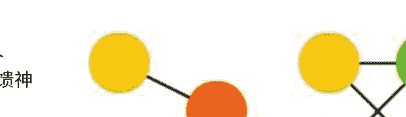

图12.2 基本的人工神经网络操作

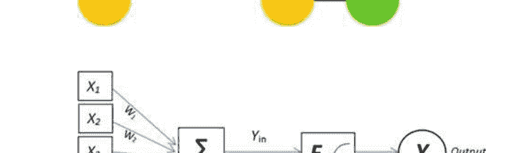

表12.1 神经网络的假设输入和目标数据

| 案例 | 肥胖 | 锻炼 | 吸烟 | 高血压 | 家族史 | 心脏病发作 | |
| :--- | :--- | :--- | :--- | :--- | :--- | :--- | :--- |
| 1 | 1 | 0 | 0 | 1 | 0 | 0 | 训练子批次 |
| 2 | 0 | 1 | 1 | 0 | 1 | 1 | |
| 3 | 0 | 1 | 0 | 0 | 1 | 0 | |
| n-2 | 1 | 1 | 0 | 1 | 0 | 0 | 测试子批次 |
| n-1 | 0 | 0 | 0 | 1 | 0 | 1 | |
| n | 0 | 0 | 0 | 0 | 1 | 0 | |

然后，这个网络求和的激活通过非线性激活函数传递给净输入（图12.2）。

在这里使用的人工神经网络建模采用了监督学习方法。表12.1显示了一个假设的数据集，将五个健康因素（预测因子）与心脏病发作（目标）的发生率联系起来。批次或完整数据集由样本或案例组成。在这个例子中，每个样本都是一个独立的人（在我们的无人机分析中，每个样本都是一个交通样本快照）。通常，人工神经网络建模涉及将整个批次随机分割成训练和测试子批次。在将网络训练多次暴露于训练子批次后，通过评估先前未见过的测试子批次上的预测性能来验证训练网络的性能。

神经网络建模在过去几十年中取得了进展，例如通过引入“隐藏层”（通过激活函数将加权输入组合起来产生输出，从而使网络能够解决异或问题）、非二进制的权重调整方法（具体来说，是最小均方方法）和用于节奏的松弛算法错误纠正步骤。最常见的和简单的现代ANN架构包括前馈、反向传播和隐藏层。如后面所讨论的，神经网络方法的最新架构改进包括卷积神经网络（CNN，用于增强模式识别）[6]，循环神经网络（RNN，融入增强记忆）[7]，以及长短期记忆模型（LSTM，添加了“遗忘”功能，从而允许滑动窗口处理时间序列）[8]。某些（更复杂的）ANN，如本分析中使用的ANN，有时被称为深度学习模型，其中多个隐藏层按顺序用于改进特征提取。

请注意，尽管现在已经有足够普遍的ANNS，可以使用COTS软件包甚至Excel附加模块来构建ANNS，但在架构设计中仍然存在相当多的'黑魔法'，包括隐藏层的规范、学习和错误修正率以及算法等。需要明确的是，在当前环境中，ANNS存在两个潜在的限制值得注意：

- 结果的不透明度- 正如前面所提到的，一些机器学习算法（包括ANNS）可以具有鲁棒性，即它们总能找到某种解决方案。然而，解释解决方案可能会很困难。ANNS的内部工作通常是不透明的；
- 有限处理时间序列数据的能力- 传统的ANNS方法在静态模式识别任务中表现良好。然而，在处理时间序列数据方面，它们并不那么出色（想象一下飞机轨迹在交通中的逐步变化）。更复杂的机器学习方法用内部神经元状态（RNN中的'记忆'）甚至神经元内部状态衰减（LSTM中的'遗忘'）来替代简单的ANNS前馈机制。

人工神经网络的一个主要优势是它们可以处理非线性。如果目标和输出之间没有线性关系，这一点非常重要。例如，可能是这样的：肥胖的人会发生心脏病发作；肥胖的锻炼者不会发生心脏病发作；肥胖的吸烟者会发生心脏病发作（无论是否锻炼）；而瘦瘦的吸烟者不会发生心脏病发作（无论是否吸烟）。由于这种非线性，传统的线性回归方法在这种情况下会失败。

#### 12.3 无人机测试场景和交通样本

城市无人机环境由一个20 ×20的网格表示，总共有400个单元格。每个单元格要么被占用，要么为空。发展测试确定了限制区域的数量和大小，以产生合理数量的禁区入侵。决定使用一个单一的静止禁区，如图12.3所示。一个简化的假设是忽略高度，并且只考虑无人机在二维空间中的移动（禁区被假定从地面向上延伸）。其次，速度之间没有差异无人机。最后，冲突仅被定义为进入PZ的领空侵犯，而不是无人机之间的分离损失（假设无人机保持垂直分离）。

交通样本是从三种不同类型的无人机航线构建的，如图12.4所示。请注意，无人机只能沿基本方向（北、南、东或西）飞行。通过-航线在不改变航向的情况下穿越该区域。TCP-航线（即轨迹变化点航线）在穿越航线上添加了概率性的航向变化。在随机的3-6步之后，TCP航线的无人机要么继续直行，要么进行90°的左/右转弯。随机的TCP函数通常以50%的无航向变化（即继续直行），25%的左转和25%的右转为权重。最后，十种可能的公交-航线（5个航线，可以向任何方向飞行）是预定义的TCP轨迹。公交航线的无人机都是在样本开始时间之后进入该区域的，除了公交航线9和10（它们在该区域的中心飞行一个正方形模式，并且已经在它们的航线上出生）。

正如后面讨论的那样，分析比较了“随机”和“结构化”路况，作为一种实验操作。随机条件使用了TCP路线专门地。结构化条件使用了通过路线和公交路线的随机组合。

图12.3 快照，16个出生的无人机的交通样本（注意红色的PZ）

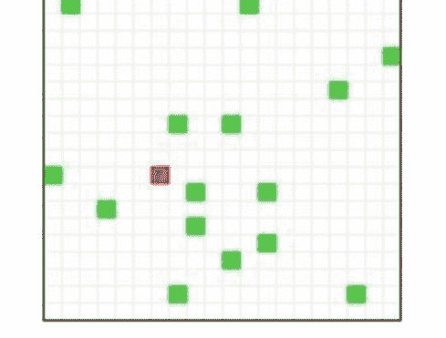

图12.4 通过路线（左），TCP路线（中），和公交路线（右）

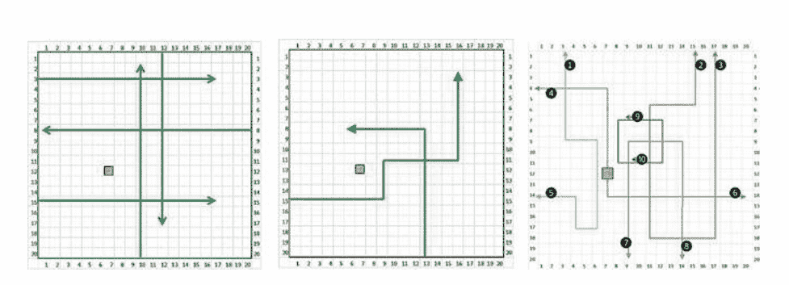

每个交通样本包含40个时间步骤。 每个无人机的首次出现在步骤1和15之间随机定时。 每个无人机通过每个时间步骤前进一个单元格来保持当前方向（不悬停）。 这意味着通过路线的无人机将在20个步骤中穿越该区域。 每个交通样本还包含4、8或16个出生的无人机（这也是一种实验操作，如后面所述）。 由于出生时间是随机化的，瞬时在区域内的无人机数量可能会有所变化。

##### 12.3.1 实验设计

分析使用了一个3 × 2 × 2的实验设计，并变化了以下因素：

- 飞机数量(4 vs 8 vs 16)——停靠飞机的总数；
- 前瞻时间(低 vs 高)——快照时间，以步数表示，在冲突之前；
- 交通结构(低 vs 高)——随机化 vs 半结构化的交通流量。

现在更详细地描述这些因素。

###### 12.3.1.1 飞机数量

飞机数量 (4、8或16) 被操纵为停靠飞机的总数。 请注意，瞬时扇区内的数量可能会有所不同。 飞机的出生时间在每个交通样本的前15个步骤中进行了随机化。 除了巴士路线9和10，它们在扇区中心附近飞行一个固定的正方形模式，所有无人机都从边缘进入扇区。 扇区出口立即关闭，并且没有来自20 × 20网格之外的交通。

###### 12.3.1.2 前瞻时间

因为目标是使用最弱的数据（仅当前位置）来训练神经网络模型，使用单个交通快照，所以检查系统应该提前多少时间查看冲突是至关重要的。 ANN应该提前查看两步吗？四步？二十步？ 请注意，对于典型的冲突预测算法，我们预计算法在时间范围较短（轨迹不确定性较小）时表现更好。 然而，相同的逻辑不一定适用于ANN方法。 例如，神经网络可能通过尽早识别披萨送餐无人机首次离开其巴士路线轨迹时表现最佳。

先行快照的时间只能在交通生成和冲突样本提取之后建立。图12.5显示了冲突交通样本在四步和八步提前的先行快照，作为一个例子。请注意，先行概念仅适用于冲突样本。对于非冲突交通样本，使用了一个配对过程来随机确定在相同的时间范围内的快照时间（以控制屏幕上无人机的数量和模式）。

对于每种结构和飞机数量的组合，使用了六个不同的先行时间（T冲突之前的1-6步），并为总共36个组合开发了单独的ANN模型。对于分析，先行时间通常被合并为两个水平，即低水平（提前1-3步）和高水平（提前4-6步）。然而，细粒度分析还评估了向前看作为连续的1-6步，以查看预测准确性随时间范围的变化。

###### 12.3.1.3 交通结构

结构操作也预计会影响交通可预测性。同样，随机条件仅使用TCP路由。转弯的时间和方向是随机的。然而，结构条件使用了通过路线和公交路线的组合（名义上以50/50的比例随机选择）。注意结构条件对交通的可预测性提高了多少。在结构条件下，76个扇区周边单元中可能首次出现无人机的只有8个单元与公交或通过路线相关联。除了这八个单元之外，进入周边单元的任何无人机都必须是通过飞行，并且其轨迹可以立即确定（除了角落单元，可能朝两个方向之一前进，因此不是立即确定的）。这意味着，给定足够的暴露时间，神经网络系统最终可以在64/76或84%的情况下在第一步确定无人机是通过飞行。因此，我们预计结构操作对模型性能会有很大影响。

##### 12.3.2 ANN设计

神经网络建模是在NeuralDesigner v2.9中完成的，这是一个用于预测分析和数据挖掘的机器学习工具包，建立在Open NN库的基础上。建模使用了400-3-1架构（即400个输入节点，一个包含3个节点的隐藏层和一个二进制输出节点），采用标准的前馈和反向传播机制以及逻辑激活函数。网络中的每个400个单元都表示为一个输入节点。每个输入节点根据占用情况进行简单编码，即给定单元可以是占用（1）或空闲（0）。ANN的输出节点仅表示交通模式是否最终发展为冲突（0/1）。每个批次的最大训练迭代次数设置为1000。

##### 12.3.3 过程

交通生成、预处理和ANN建模过程的整体流程如图12.6所示。使用交通生成工具，创建了每个批次包含5000个交通样本的初步批次。为每个飞机数量和结构级别组合创建了单独的批次。对于每个批次，样本随后被自动处理以识别冲突与非冲突结果，从冲突样本中提取1-6步的多个前瞻快照，并从非冲突样本中提取匹配的快照。然后对目标输出进行标记，并将样本组合成最终的批次文件。然后将该批次文件随机分割为60/40的训练和测试子批次文件。在使用相应的训练子批次文件对36个网络进行训练后，测试每个网络对其相应的测试子批次文件的分类能力。下一节将介绍这些测试的结果。

#### 12.4 结果

##### 12.4.1 二元分类准确率

最简单的性能度量是分类准确率。也就是说，有多少样本被正确地分类为冲突或非冲突？
每个ANN模型都有一个简单的二元输出：预测是否会发生冲突。这是一个经典的二元分类任务的例子，其特点是两个“世界状态”和两个可能的预测状态。如图12.7所示，二元分类表允许我们识别四种结果：真正例（TP），真反例（TN），假正例（FP）和假反例（FN）。

在信号检测术语中，这些结果分别被称为：命中、正确拒绝、误报和漏报[9]。
这四个分类结果使我们能够定义以下比率：

- 准确率—正确分类的比率，定义为：ACC = [TP + TN]/[TP + FN + TN + FP]
- 错误率 = 1 - ACC = [FN + FP]/[TP + FN + TN + FP]
- 真正阳性率（也称为敏感性）= TP/[TP + FN]
- 真负性率（也称为特异性）= TN/[TN + FP]

对于结构化交通，分类性能似乎存在上限效应。无论交通或前瞻时间如何，分类准确率都接近最优（不低于0.948）。这意味着在结构化交通中，ANN模型能够几乎完美地预测哪些交通样本会导致冲突。这并不令人意外。正如前面讨论的，在结构化交通中，大多数（84%）的无人机在进入扇区后的第二步就可以预测。到第3步，唯一的不确定性就是剩下的16%是通过路线还是公交路线。

图12.7 二元分类结果

然而，随机流量在模型性能上显示出一些变化。随机流量下的分类性能仍然非常高，范围从0.72到0.98，通常远高于随机猜测水平（Youdens指数值为0.5，如表12.2所示，表示猜测水平）。然而，在随机流量下（表12.3），我们开始看到机器学习性能随着预测时间和流量计数的增加而下降（分类性能随之恶化），并且在流量、结构和预测时间之间出现了一种三方交互趋势。

图12.8显示了预测时间和飞机计数对整体分类准确性的影响。在这个视图中，数据有些被合并了。预测时间（1-6）被二分为低（1-3）和高（4-6）。飞机计数仅包括4和16这两个极端值。除了预测时间（预测时间越长，性能越差）和飞机计数（计数越高，性能越差）的主效应之外，还存在一种预测时间x飞机计数交互作用的轻微趋势。注意交互作用趋势，即在高流量下，预测时间越长的代价越大。

##### 12.4.2 分类敏感性和特异性

要获得更细粒度的视图，请参见图12.9的三个面板。这些面板展示了在随机流量下的分类性能，分别对应低、中和高飞机数量（从左到右面板）。每个面板还显示了向前看的影响，从1到6步。请注意，敏感性（TPR）和特异性（TNR）下降的模式因飞机数量而异。总体上，随着向前看的时间增加，机器学习的整体性能变差，但敏感性（TPR）和特异性（TNR）的模式因飞机数量而异。对于低流量，敏感性下降不成比例（即模型更倾向于FN而不是FP）。对于高流量，特异性下降（系统更倾向于FP而不是FN）。在最高级别上，这种交互趋势表明我们的ANN模型在最苛刻的流量样本下倾向于过度的假阳性。

##### 12.4.3 极端情况

为了测试一个最终的、更具挑战性的案例，我们生成了交通流量并训练/测试了一个ANN模型，使用随机交通流量、24架飞机和6个前瞻（见图12.10）。

在这种情况下，分类准确率仍然出奇地高（事实上，略高于16个无人机样本）。此外，这种极端情况扩展了图12.9的三个面板中观察到的特异性下降趋势（表12.4）。

表12.2 结果总结表，二元分类性能 结构化交通流量

| 指标 | 4-1 | 4-2 | 4-3 | 4-4 | 4-5 | 4-6 | 8-1 | 8-2 | 8-3 | 8-4 | 8-5 | 8-6 | 16-1 | 16-2 | 16-3 | 16-4 | 16-5 | 16-6 |
| --- | --- | --- | --- | --- | --- | --- | --- | --- | --- | --- | --- | --- | --- | --- | --- | --- | --- | --- |
| 分类准确率 | 0.981 | 0.971 | 0.978 | 0.963 | 0.991 | 0.991 | 0.986 | 0.971 | 0.968 | 0.948 | 0.982 | 0.989 | 0.98 | 0.982 | 0.99 | 0.973 | 0.991 | 0.999 |
| 错误率 | 0.019 | 0.028 | 0.021 | 0.037 | 0.009 | 0.009 | 0.014 | 0.029 | 0.032 | 0.052 | 0.018 | 0.01 | 0.024 | 0.018 | 0.01 | 0.027 | 0.008 | 0.003 |
| 敏感性 (TP) | 0.978 | 0.966 | 0.971 | 0.969 | 0.993 | 0.986 | 1 | 0.975 | 0.974 | 0.957 | 0.985 | 0.997 | 0.986 | 0.99 | 0.99 | 0.987 | 0.999 | 0.997 |
| 特异性 (TN) | 0.983 | 0.976 | 0.984 | 0.959 | 0.99 | 0.994 | 0.96 | 0.962 | 0.957 | 0.931 | 0.977 | 0.977 | 0.904 | 0.928 | 0.936 | 0.872 | 0.944 | 0.992 |
| 假阳性率 (FP) | 0.017 | 0.024 | 0.015 | 0.041 | 0.01 | 0.005 | 0.04 | 0.038 | 0.043 | 0.069 | 0.023 | 0.023 | 0.096 | 0.072 | 0.064 | 0.128 | 0.056 | 0.008 |
| 假阴性率 (FN) | 0.024 | 0.034 | 0.029 | 0.031 | 0.007 | 0.014 | 0 | 0.026 | 0.026 | 0.042 | 0.015 | 0.003 | 0.014 | 0.01 | 0.003 | 0.013 | 0.001 | 0.002 |
| Youden's指数 | 0.961 | 0.942 | 0.956 | 0.928 | 0.982 | 0.98 | 0.96 | 0.938 | 0.931 | 0.888 | 0.962 | 0.974 | 0.9 | 0.92 | 0.93 | 0.859 | 0.943 | 0.99 |
| ROCAUC | 0.995 | 0.996 | 0.994 | 0.99 | 0.996 | 0.991 | 0.991 | 0.995 | 0.99 | 0.977 | 0.996 | 0.993 | 0.978 | 0.982 | 0.987 | 0.968 | 0.927 | 0.988 |

| 结构 | 交通计数 | 前瞻 | 分类准确率 | 错误率 | 敏感性(TP) | 特异性(TN) | 假阳性率(FP) | 假阴性率(FN) | Youden's指数 | ROCAUC |
| ---- | -------- | ---- | ---------- | ------ | ---------- | ---------- | ------------ | ------------ | ------------ | ------ |
| 随机 | 4 | 1 | 0.984 | 0.016 | 0.974 | 0.986 | 0.014 | 0.026 | 0.931 | 0.994 |
| 随机 | 4 | 2 | 0.959 | 0.041 | 0.913 | 0.97 | 0.03 | 0.087 | 0.883 | 0.867 |
| 随机 | 4 | 3 | 0.947 | 0.053 | 0.847 | 0.971 | 0.029 | 0.153 | 0.818 | 0.975 |
| 随机 | 4 | 4 | 0.913 | 0.087 | 0.821 | 0.935 | 0.065 | 0.179 | 0.757 | 0.957 |
| 随机 | 4 | 5 | 0.89 | 0.11 | 0.796 | 0.913 | 0.087 | 0.204 | 0.709 | 0.931 |
| 随机 | 4 | 6 | 0.825 | 0.175 | 0.699 | 0.855 | 0.144 | 0.301 | 0.555 | 0.853 |
| 随机 | 8 | 1 | 0.976 | 0.024 | 0.98 | 0.973 | 0.027 | 0.02 | 0.954 | 0.988 |
| 随机 | 8 | 2 | 0.93 | 0.07 | 0.911 | 0.941 | 0.059 | 0.089 | 0.851 | 0.972 |
| 随机 | 8 | 3 | 0.88 | 0.116 | 0.83 | 0.914 | 0.086 | 0.17 | 0.74 | 0.94 |
| 随机 | 8 | 4 | 0.854 | 0.146 | 0.846 | 0.86 | 0.142 | 0.154 | 0.704 | 0.914 |
| 随机 | 8 | 5 | 0.814 | 0.186 | 0.751 | 0.849 | 0.151 | 0.249 | 0.6 | 0.89 |
| 随机 | 8 | 6 | 0.726 | 0.274 | 0.707 | 0.736 | 0.264 | 0.293 | 0.443 | 0.789 |
| 随机 | 16 | 1 | 0.98 | 0.02 | 0.98 | 0.981 | 0.019 | 0.022 | 0.96 | 0.993 |
| 随机 | 16 | 2 | 0.924 | 0.076 | 0.951 | 0.869 | 0.131 | 0.048 | 0.82 | 0.958 |
| 随机 | 16 | 3 | 0.866 | 0.134 | 0.903 | 0.791 | 0.209 | 0.096 | 0.695 | 0.913 |
| 随机 | 16 | 4 | 0.8 | 0.2 | 0.85 | 0.704 | 0.3 | 0.152 | 0.552 | 0.862 |
| 随机 | 16 | 5 | 0.77 | 0.233 | 0.856 | 0.588 | 0.412 | 0.143 | 0.444 | 0.802 |
| 随机 | 16 | 6 | 0.724 | 0.275 | 0.654 | 0.765 | 0.235 | 0.346 | 0.419 | 0.777 |

图12.8 飞机数量和前瞻对整体分类性能的影响，仅限随机流量

图12.9 随机流量的分类性能，敏感性和特异性

图12.10 极端情况：24架无人机，随机流量和六步前瞻

表12.4 结果摘要，二元分类性能，极端情况

| 指标 | 值 |
| --- | --- |
| 分类准确度 | 0.739 |
| 错误率 | 0.261 |
| 敏感性（TP） | 0.705 |
| 特异性（TN） | 0.758 |
| 假阳性率（FP） | 0.242 |
| 假阴性率（FN） | 0.295 |
| Youdens指数 | 0.46 |
| ROC AUC | 0.8 |

##### 12.4.4 ROC分析

接收器操作特性（ROC）曲线[9]在评估二元分类结果时非常有用，因为它整合了预测准确性在几个维度上的表现。基本上，ROC分析在不同的阈值设置下绘制了TP率（敏感性）与FP率（1-特异性）的曲线（图12.11）。图12.11的红色1:1水平线表示零预测能力（模型无法区分安全和冲突样本）。随着预测值的增加，ROC曲线（两条蓝色曲线）向ROC图的左上方增加。预测能力通常在ROC分析中表示为曲线下面积（AUC）。

如表12.2的最后一行所示，ROC AUC显示出天花板效应，对于结构化流量，值通常接近1。只有在最极端的情况下，即随机流量、高飞机数量、长期展望时，AUC略有下降（表12.3）。AUC随着展望的增加而稳步下降，特别是对于8和16架飞机。

以图12.12为例——AUC显示出对于随机4/5步样本的良好区分性能（0.931，左），对于随机8/5步样本的中等性能（0.890，中），以及对于随机16/5步样本的最差性能（0.802，右）。

##### 12.4.5 结果总结

就冲突预测性能而言，我们的机器学习模型的结果可以总结如下：

- 在结构化交通中，整体模型性能几乎完美；
- 在结构化交通中，无法找到交通计数和前瞻对模型的影响；
- 对于随机交通，模型的表现仍然相当不错；
- 对于随机交通，交通计数和（更多的是）前瞻对整体分类准确性有明显影响；
- 这种前瞻对准确性的影响揭示了其他参数的细微差异。对于低交通量，敏感性（真阳性率）下降的程度大于特异性（真阴性率）；对于高交通量，情况相反。换句话说，更长的前瞻会恶化整体分类性能，但低交通量偏向于假阴性，而高交通量偏向于假阳性；
- 即使在最具挑战性的条件下（随机、高流量、长期展望），机器学习分类准确率仍然相当高（76.5%）；
- 即使有随机流量，分类性能通常远远高于猜测水平，远远优于偶然；
- 即使面对24架无人机、随机流量和长期展望的极端情况，人工神经网络方法仍然表现出强大的分类性能。

#### 12.5 结论

即使只有最少的数据（即仅仅是瞬时交通快照），以及有限的神经网络架构（没有任何明确的时间序列处理能力），神经网络建模展示了在预测方面的潜在好处并对城市环境中的无人机轨迹进行分类。我们预计一旦部署，ML方法将展示出更好的性能，有两个主要原因。

首先，正如在其他地方所指出的，存在着可以更好地利用内存、时间序列处理、时间延迟和内存擦除功能的先进ML方法。静态ANNs在处理时间序列数据方面能力有限，在预测动态空中交通模式方面存在明显的局限性。相关的ML方法，如循环神经网络、卷积神经网络、时间延迟神经网络和长短期记忆，都很可能展示出更好的预测性能。

其次，机器学习在有意义的真实世界数据上表现可能更好，而不是随机生成的航班。神经网络方法（以及所有机器学习方法）假设数据中存在一些潜在的模式，网络可以发现这些模式。然而，我们生成的交通数据中的模式和结构相当低级。例如，我们使用标准的公交路线轨迹为无人机交通运动增加了一些规律性。尽管如此，这只是一种相当浅显的模式和含义。打个比方，想象一下实际的公交路线，可能在居住区和就业中心之间运行。路线本身是一种模式，但运动的方向和时间也有一些更深层次的含义（在某个时间将人们送到工作地点，然后在另一个时间将人们送回家）。在我们的交通样本中，就好像公交车按照正确的固定路线行驶，但是在随机的时间和方向上发射。因此，我们的悖论是：在实际无人机模式出现之前，我们能有多好地评估机器学习在实际无人机模式上的表现？可以推测，一旦我们拥有有意义的真实世界无人机交通模式数据，机器学习的表现会更好，而不是随机生成的样本。

总结一下，这个分析故意使用了有限的数据和简单的架构，以便对与分类相关的因素进行实验控制。尽管存在这些限制，神经网络建模提供了鼓舞人心的初步证据，表明机器学习方法在帮助预测城市无人机场景中的冲突方面非常有用。

致谢：本研究得到了欧盟“地平线2020”研究和创新计划的支持，属于SESAR联合企业（SJU）的一部分。

#### 参考文献

- 1. T. Duvall, A. Green, M. Langstaff, K. Miele, 空中移动解决方案：它们需要什么才能起飞。麦肯锡资本项目与基础设施，2019年2月
- 2. 欧盟，欧洲无人机展望研究。SESAR联合企业。2016年11月
- 3. TERRA，不同业务案例和VFR以及其他利益相关者的无人机要求派生要求。SESAR地平线2020 TERRA项目，交付物3.1（2019年）
- 4. J. Schmidhuber，神经网络中的深度学习概述。神经网络。61，85-117（2015年）
- 5. I. Goodfellow, Y. Bengio, A. Courville, 深度学习 (MIT出版社, 麻省剑桥, 美国, 2016)
- 6. Y. LeCun, Y. Bengio, 图像、语音和时间序列的卷积网络。在《脑理论和神经网络手册》中，M.A. Arbib编辑 (MIT出版社, 1995)
- 7. G. Petneházi, 用于时间序列预测的循环神经网络 (2019). arXiv:1901.00069
- 8. S. Hochreiter, J. Schmidhuber, LSTM可以解决长时间滞后问题。在第10届神经信息处理系统年会论文集, NIPS, 第473-479页,1996年12月
- 9. D.M. Green, J.A. Swets, 信号检测理论与心理物理学 (Wiley, 纽约, 1966)

### 第13章 用于早期预测易于失败学生的深度密集神经网络

Georgios Kostopoulos, Maria Tsiakmaki, Sotiris Kotsiantis和Omiros Ragos

摘要：近年来，计算能力的不断提升以及对大量数据的处理和分析的进展，给一个新的研究领域的发展提供了强大的推动力。深度学习是机器学习的一个新兴子领域，目前在科学家中引起了很大的关注，相对于传统的机器学习技术，具有显著的优势。深度神经网络已经成功应用于解决各种任务，如自然语言处理、文本翻译、图像分类、目标检测和语音识别。最近出现了许多值得注意的研究，涉及到在教育数据挖掘和学习分析领域使用深度学习方法。它们在教育领域的潜在应用为教育工作者提供了新的视角，以提高他们对来自不同教育环境的数据的理解和分析，从而提高学习和教学质量以及教育成果。在这种背景下，本研究的主要目的是评估深度密集神经网络在远程高等教育中早期预测易于失败的学生方面的效率。我们的研究利用了来自不同教育来源的大量学生特征，包括学生的特点、学术成就和在课程学习管理系统中的活动。实验结果表明，深度学习方法可以为构建更准确的预测模型做出贡献，同时及时识别出有困难的学生，以提供及时有效的干预措施。

关键词：深度学习 · 教育数据挖掘 · 学习分析 · 学生表现 · 早期预测

#### 13.1 简介

教育数据挖掘（EDM）是一个不断发展的跨学科研究领域，主要集中在开发和应用数据挖掘方法来处理来自各种学习环境的数据集[1]。EDM不仅仅旨在从学生的原始数据中提取有趣和有用的知识，而且主要关注解决重要的教育问题[2]。根据要解决的问题，EDM利用不同但相互依赖的领域的代表性方法，例如数据挖掘、机器学习和统计学等[3]。这些方法包括但不限于分类、回归、聚类、过程挖掘、社交网络分析和关联规则分析[1]。

近年来，计算能力以及大量数据的处理和分析方面的持续技术进步为一个新的研究领域的发展提供了强大的推动力。深度学习（DL）是机器学习的一个新兴子领域，目前在科学家中引起了很大的关注，相对于传统技术，它具有显著的优势[4]，例如在相关领域之间的迁移学习和自动特征提取[5]。深度神经网络已经成功应用于解决各种任务，例如自然语言处理、文本翻译、图像分类、目标检测和语音识别。最近，关于在EDM和学习分析（LA）领域中使用DL方法的显著研究已经涌现出来[6]。它们在教育领域的潜在应用对研究人员来说是一个巨大的挑战，并为处理和分析来自不同教育环境的大量数据开辟了新的视野[7]。

在这个背景下，本研究的主要目的是评估深度密集神经网络的效率，以便提前预测远程高等教育中容易失败的学生。从不同教育来源获取的大量特征被用于学生的特征、学术成就和课程学习管理系统（LMS）中的在线活动。实验结果表明，所提出的深度网络在F1-得分和AUC（曲线下面积）方面优于常见的分类算法。此外，它可以作为早期评估学生失败风险的工具，从而实现及时支持和有效的干预策略。

本章的剩余部分结构如下：第13.2节回顾了有关在教育领域实施深度网络的最新研究。本文介绍并描述了所提出的深度密集神经网络（Sect. 13.3）。第13.4节包括进行的实验及相关结果，而第13.5节总结了研究的发现。

#### 13.2 文献综述

尽管深度神经网络在人工语法学习、自动文本生成、文本翻译、图像分类和语音识别等各种任务中取得了显著的成果[8]，但在教育数据挖掘领域探索深度学习架构的研究数量确实有限[7]。关于在教育数据挖掘和学习分析领域实施深度网络的系统性文献综述见[6]。作为对该综述的后续，接下来几段将讨论在教育领域最近出现的一些值得注意的研究。这些研究的主要核心涉及分类问题（二元或多类），例如预测学生表现、最终成绩或远程学习课程的退学情况。

郭等人[9]基于深度学习多类分类模型开发了一种名为学生绩效预测网络（SPPN）的学生风险预警系统。构建了一个六层前馈网络，包括一个输入层、四个隐藏层和一个输出层。输入层接收学生数据，并使用修正线性单元（ReLU）作为激活函数，采用无监督学习算法对四个隐藏层进行预训练。在初始化网络权重并通过反向传播进行网络微调后，使用softmax函数在五个神经元的输出层中预测学生的最终得分{O，A，B，C，D}。结果显示，与多层感知机（MLP）、朴素贝叶斯（NB）和支持向量机（SVM）等三种常见分类算法相比，SPPN获得了最高的准确性值。

Okubo等人[10]构建了一个递归神经网络（RNN），用于预测一个为期15周的远程课程中学生的成绩。该网络包括一个输入层、一个隐藏层和一个输出层。RNN使用时间序列学生日志数据进行反向传播训练，而长短期记忆（LSTM）网络则作为中间层单元，以保留通过时间的反向传播误差。该模型在第六周的准确率超过90%，因此表明其对早期预测处于失败风险的学生的效率。

深度网络已被证明在预测大规模在线开放课程（MOOCs）中的学生退学或最终表现方面非常有效，这是EDM领域中两个典型且广泛研究的二元问题[11]。Wang等人[12]提出了一个用于预测MOOCs中学生退学的深度学习模型。卷积神经网络（CNNs）和递归神经网络（RNNs）在一个新的架构中结合在一起，包括一个输入层、一个输出层和六个隐藏层（一个递归层、一个全连接层、两个卷积层和两个池化层），同时应用ReLU激活函数。基于来自KDD Cup 2015的数据的实验结果表明，所提出的ConRec网络在精确度、召回率、F1-score和AUC等方面与典型的分类方法相比表现出了令人满意的性能。

在一项类似的工作中，Xing和Du [13]构建了一个临时DL模型，用于每周估计个别MOOC学生的退出概率。更具体地说，为每个学生建立了一个个性化的深度神经网络前向传播用于训练权重，反向传播使用批量梯度下降代价函数来更新权重的值。考虑准确率和AUC作为性能指标，所得到的结果表明DL方法在三种代表性的监督方法（k-最近邻算法，支持向量机和C4.5决策树）上具有优势。

最近，王等人[14]提出了一种基于LSTM的RNN模型，用于在MOOC平台上预测学生在解决开放式编程练习时的表现{通过，失败}。该模型使用学生在尝试解决练习时生成的程序嵌入序列作为输入进行训练，而获得的结果表明与基准方法相比，整体准确率提高了5%。此外，该模型能够理解学生的学习行为并将其分组到不同的聚类中。

在相同的背景下，Kim等人[15]实现了一种基于深度学习的算法，称为GriNet，用于提前预测两个8周的Udacity Nanodegree课程中学生的毕业表现{通过，失败}。该网络由嵌入层、双向LSTM（BLSTM）层、GMP层、全连接层和softmax输出层组成。学生的原始活动记录以及相应的时间戳被转化为一个向量序列，然后传递给BLSTM和GMP层。最后，GMP输出被顺序地输入到输出层中，用于计算学生的对数似然和估计他们的结果。结果表明，GriNet在早期预测处于风险中的学生方面具有显著的有效性。

Whitehill等人[16]提出了一种深度且全连接的前馈神经网络架构，利用Net2Net训练方法，在四十个MOOC课程中预测学生的认证情况。因此，他们改变了隐藏层的数量，以及每个隐藏层的节点数量，同时每次测量预测准确性。实验结果显示，包含五个隐藏层，每个隐藏层有五个神经元，可以得到一个非常准确的深度网络。

此外，还有一些与推荐任务、学生情感分析、自动短答题评分（ASAG）和特征提取相关的研究。唐等人[8]在两个数据集中应用了RNN模型：（a）学生在总结环境中写的文章，以及（b）MOOC点击流数据。深度模型由两个包含128个隐藏节点的LSTM层组成，用于预测给定“种子”上下文中的单词序列中的下一个单词，或者在写作时遇到困难时自动建议学习资源。

魏等人[17]提出了一种名为ConvL的迁移学习框架，用于检测在MOOC论坛帖子中表达的困惑感、紧急优先级和情感态度。ConvL架构包括一个CNN层用于提取局部上下文特征，以及一个LSTM层用于通过考虑特征的长期时间语义关系来计算表达式的表示。为此，他们利用堆叠的受限玻尔兹曼机（RBM）层自动提取关于答案、问题和学生的最具代表性特征的信息。最后，Bosch等[7]提出了一个由输入层、两个LSTM层、一个完全连接的嵌入层、三个隐藏层和一个输出层组成的DL网络。该网络最初在关于学生在电子学习平台上的互动方面的数据上进行训练，然后应用于自动特征提取和学生厌倦的诊断。

上述讨论的研究主要采用了CNN和LSTM，并在表13.1中进行了总结，同时提供了每个研究中使用的数据集的结构和来源、数据挖掘任务、用于比较构建的深度网络性能的方法以及评估指标。

#### 13.3 深度密集神经网络

深度学习在人工智能领域有着深厚的基础，并在过去几年中作为一个独立且高度适用的领域得到了发展[20]。DL架构使用由输入层、输出层和两个或多个隐藏层组成的模型，这些隐藏层由非线性处理单元组成，执行监督或无监督的特征提取和转换功能[7]。这些层按照层次结构排列，每一层的输入是前一层的输出，通过适当选择的激活函数计算得出。每个隐藏层对应于输入空间的不同表示，并提供了一个不同的抽象层次，希望更有用且更接近最终目标[5]。

输入层、两个稠密层和输出层是所提出的深度稠密神经网络（以下简称D DNN）架构的基础（图13.1）。输入层由14个输入单元组成，对应于每个输入特征。第一个隐藏层（L2）有12个隐藏单元，第二个隐藏层（L3）有6个隐藏单元。L2层和L3层都使用sigmoid激活函数。输出层（L4）由一个神经元组成，使用softmax激活函数和平方铰链损失函数[21]来预测输出类别。此外，网络权重使用Xavier初始化方法[22]进行初始化。DDNN参数的配置见表13.2。假设x1, x2, ..., x14表示数据集的输入，w_{ij}^{(l)}表示第l层的第j个节点与第l+1层的第i个节点之间的连接权重，a_i^{(l)}表示第l层的第i个节点的输出。因此，DDNN的计算可以通过以下方程给出：

$$ a_i^{(2)} = f_1\left( \sum_{j=1}^{14} w_{ij}^{(1)} x_j \right), i = 1, 2, \ldots, 12 $$

表13.1 总结了在EDM领域中讨论的DL研究

| 论文 | #数据集 | #特征 | #实例 | 源数据 | 输出特征 | DM任务 | 比较方法 | 指标 | 早期预测 |
|------|---------|-------|-------|--------|----------|--------|----------|------|----------|
| Guo等人[9] | 1 | N/S | 120,000 | 高中 | 最终成绩 | 分类 | MLP、SVM、NB | 准确率 | 否 |
| Okubo等人[10] | 1 | 9 | 108 | LMS | 最终成绩 | 分类 | 多元回归 | 准确率 | 是 |
| Wang等人[12] | 1 | 8 | 120,542 | MOOC | 辍学 | 分类 | SVM、LR、DT、RF | 精确度 | 是 |
| Xing和Du [13] | 1 | 13 | 3,617 | MOOC | 辍学 | 分类 | AdaBoost、高斯朴素贝叶斯、梯度树提升、支持向量机、k最近邻、C4.5 | F-分数、AUC、准确率 | 是 |
| Wang等人[14] | 1 | N/S | 79,553 | MOOC | 性能 | 分类 | 逻辑回归(LR) | 精确度、AUC | 否 |
|  | 2 | N/S | 10,293 | MOOC | [通过、失败] 进展 | 聚类 | {A,B,C,D,E} | 召回率、F-分数 |  |
| Kim等人[15] | 1 | N/S | 1,853 | MOOC | 性能 | 分类 | LR | AUC | 是 |
| Whitehill等人[16] | 1 | 19 | 528,349 | MOOC | {通过, 失败} 认证 | 分类 | LR | AUC | 是 |
| Wei等人[17] | 1 | N/S | 9,879 | MOOC | {是的, 不} 混淆 | 分类 | CNN, LSTM 的变体 | 准确率 | 否 |
|  | 2 | N/S | 5,184 | MOOC | {正, 负} 紧急性 | 分类 |  | 准确率 | 否 |
|  | 3 | N/S | 3,030 | MOOC | {正, 负} 情感 | 分类 |  | 准确率 | 否 |
| Zhou等人[18] | 1 | N/S | 100,000 | 电子学习平台 | {正, 负} 学习路径 | 推荐 | 聚类 | 准确率 | — |
| Zhang等人[19] | 1 | N/S | 16,228 | 电子学习平台 | 自动简短回答评分 | 建模 | 聚类和LSTM | 准确率 | — |
|  |  |  |  |  |  | 聚类 | LR, NB, SVB, DT | 精确度、召回率、AUC |  |
| Bosch和Paquette [7] | 1 | 3 | 94 | 电子学习平台 | 无聊 | 分类 | 高斯朴素贝叶斯、逻辑回归、决策树 | F-分数、AUC | - |
| 唐等人 [8] | 1 | 541 | 472 | Kaggle | 下一个单词 | 时间序列 | - | 准确率 | - |
| | 2 | 25 | 8,094 | MOOC | 资源 | 推荐 | - | 准确率 | - |

表13.2 DDNN参数配置

| 参数 | 值 |
|------|-----|
| 层数 | 4 |
| 第L1层（输入层）单元数 | 14 |
| 第L2层（第一隐藏层）单元数 | 12 |
| 第L2层激活函数 | Sigmoid |
| 第L3层（第二隐藏层）单元数 | 6 |
| 第L3层激活函数 | Sigmoid |
| 第L4层（输出层）单元数 | 1 |
| 第L4层激活函数 | Softmax |
| 损失函数 | 平方铰链损失 |
| 迭代次数 | 10 |
| 权重初始化方法 | Xavier |
| 优化算法 | 随机梯度下降 |
| 更新器 | Adam |
| 偏置更新器 | Sgd |

$$a_i^{(3)} = f_1\left( \sum_{j=1}^{12} w_{ij}^{(2)} a_j^{(2)} \right), \, i=1,2,\ldots,6$$

$$a_1^{(4)} = f_2\left( \sum_{j=1}^{6} w_{1j}^{(3)} a_j^{(3)} \right)$$

其中 $f_1, f_2$ 分别对应于 sigmoid 和 softmax 激活函数并且定义如下：

$$f_1(x) = \frac{1}{1 + \exp(-x)}$$

$$f_2(x_i) = \frac{\exp(x_i)}{\sum_{j=1}^{2} \exp(x_j)}, \, i=1,2$$

#### 13.4 实验过程和结果

本研究使用的数据集包括1,073名学生，他们参加了希腊开放大学的一整年课程。在2013-2014学年期间，收集了关于学生特征、成绩和在线活动的数据。因此，数据集总共包含14个输入特征（表13.3）。二元输出特征“Final”指的是学生在学年末的考试中的表现{及格、不及格}。输出类别{及格、不及格}的分布分别为21.9%和78.1%。

为了我们的研究目的，学年被分为四个连续的时间段（以下简称为步骤），取决于前两个五个可选联系会议（Ocs）和前两个书面作业（Wri）提交截止日期的日期，如图13.2所示。值得一提的是，在课程开始时，只有性别和是否是一年级学生或者在上一个学年未能通过期末考试并重新报名参加课程的学生的信息是可用的。

实验按照图13.2中描述的四个时间段分为四个步骤进行。每个步骤包括从学年开始到特定时间段结束时收集到的关于学生的所有可用信息。请注意，所有特征都会随着时间的推移而更新，而最后的第四步发生在学年中间之前，从而为容易失败的学生提供及时支持和有效干预。

所提出的深度网络在每个实验步骤中与八种熟悉的分类算法进行了测试，这些算法将在下面简要介绍：

##### 表13.3 数据集特征

| 特征 | 描述 | 值 |
| --- | --- | --- |
| 性别 | 学生性别 | {男性，女性} |
| 新生 | 一年级学生被定义为新生 | {是的，不} |
| Wri_i, i = 1, 2 | 第i次书面作业成绩 | [0, 10] |
| Ocs_i, i = 1, 2 | 学生在第i个可选联系会话中的缺席情况 | {0, 1} |
| L1 | 总登录次数 | 整数 |
| L2 | 伪代码论坛中的浏览次数 | 整数 |
| L3 | 编译器论坛中的浏览次数 | 整数 |
| L4 | 模块论坛中的浏览次数 | 整数 |
| L5 | 课程论坛中的浏览次数 | 整数 |
| L6 | 课程新闻中的浏览次数 | 整数 |
| L7 | 伪代码论坛中的帖子数 | 整数 |
| L8 | 编译器论坛中的帖子数 | 整数 |
| L9 | 模块论坛中的帖子数 | 整数 |
| L10 | 课程论坛中的帖子数 | 整数 |
| 最终成绩 | 学生在最终课程考试中的表现 | {通过，失败} |

##### 图13.2 学年的时间段

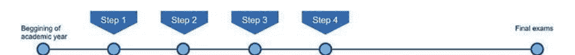

*   * k最近邻（k-NN）基于实例的学习算法[23]，一种非参数方法，广泛用于分类和回归问题。
*   C4.5决策树归纳算法[24]由Quinlan引入，基于ID3算法[25]。
*   JRip基于规则的算法，是RIPPER（重复增量修剪以产生错误减少）算法[26]的Java变体，被认为在处理带有噪声数据的大规模数据集时非常高效。
*   多层感知器（MLP）[27]，一种前馈人工神经网络，采用反向传播来训练模型。
*   朴素贝叶斯（NB）判别器，一种非常有效的离散和连续特征算法，基于贝叶斯定理，在给定类别标签的情况下假设所有特征都是独立的[28]。
*   随机森林（RFs）[29]，一种简单、强大且稳健的集成方法，用于分类和回归问题。
*   随机梯度下降（SGD）算法[30]。
*   顺序最小优化（SMO）分类器[31]，一种简单快速的支持向量机（SVM）训练算法[32]。

为了评估分类器的性能，我们考虑了两个广泛使用的指标，这些指标在不平衡数据集的情况下通常优于准确率[33]，就像我们的情况一样：F₁-分数和AUC。F₁-分数或平衡F分数是精确度（p）和召回率（r）的调和平均值，定义如下：

$$\text{F}_1\text{-分数} = \frac{2pr}{p+r} = \frac{2TP}{FP+2TP+FN}$$

其中TP，FP，TN，FN分别对应真正例，假正例，真反例和假反例，并从以下混淆矩阵（表13.4）计算得出。

AUC对应于ROC（接收者操作特性）下的面积曲线，被认为是比准确度更好的度量标准[34]。对于二元分类问题，AUC接近1的值意味着模型能够很好地区分两个输出类别。

首先，使用交叉验证重采样过程将数据集随机分成10个大小相等的折叠。因此，9个折叠形成了用于训练分类模型的训练集，另一个折叠用作评估模型的测试集。该过程重复10次，直到所有折叠都被用作测试集，并对结果进行平均[35]。关于F₁-分数和AUC度量标准的实验结果分别在表13.5和表13.6中呈现，其中每个步骤中的最高分数都以粗体突出显示。总体上，观察到无论应用何种性能度量标准，以及时间段，所提出的深度网络始终比其他分类方法取得更好的结果。

F₁-分数从第一步的0.782增加到第四步的0.819（即在学年中间之前）。就AUC指标而言，DDNN在其他分类方法中具有显著优势，值的范围从0.804到0.882。因此，可能会提前检测到有失败风险的学生，并及时提供支持措施和干预策略。

此外，为了检测所有分类器的特定差异，我们应用了Friedman Aligned Ranks非参数检验[36]和Finner事后检验[37]。根据Friedman检验，算法按照表现最佳者（较低的排名值）到最差者的顺序排列。在这两种情况下，DDNN方法占据主导地位。

**表13.4 混淆矩阵**

|  |  | 预测 |  |
| :--- | :--- | :--- | :--- |
|  |  | 失败 | 通过 |
| 实际 | 失败 | 真阳性 | FN |
|  | 通过 | FP | 真阴性 |

表13.5 F₁-得分结果

| 分类器 | 步骤 |  |  |  |
| :--- | :--- | :--- | :--- | :--- |
|  | 第一 | 第二 | 第三 | 第四 |
| DDNN | **0.782** | **0.802** | 0.798 | 0.819 |
| C4.5 | 0.766 | 0.790 | 0.791 | 0.799 |
| RFs | 0.746 | 0.772 | 0.784 | 0.782 |
| SMO | 0.736 | 0.762 | 0.774 | **0.825** |
| 3-NN | 0.752 | 0.768 | 0.764 | 0.794 |
| NB | 0.768 | 0.786 | 0.785 | 0.794 |
| MLPs | 0.766 | 0.783 | 0.795 | 0.798 |
| JRip | 0.781 | 0.796 | **0.800** | 0.810 |
| SGD | 0.741 | 0.766 | 0.777 | 0.815 |

表13.6 AUC结果

| 分类器 | 步骤 |  |  |  |
| :--- | :--- | :--- | :--- | :--- |
|  | 第一 | 第二 | 第三 | 第四 |
| DDNN | **0.804** | **0.840** | **0.847** | **0.882** |
| C4.5 | 0.626 | 0.724 | 0.691 | 0.693 |
| RFs | 0.756 | 0.805 | 0.826 | 0.840 |
| SMO | 0.558 | 0.595 | 0.613 | 0.718 |
| 3-NN | 0.740 | 0.747 | 0.770 | 0.796 |
| NB | 0.786 | 0.822 | 0.829 | 0.854 |
| MLPs | 0.800 | 0.808 | 0.826 | 0.841 |
| JRip | 0.648 | 0.655 | 0.691 | 0.726 |
| SGD | 0.584 | 0.601 | 0.619 | 0.703 |

如表13.7和13.8所示，拒绝了零假设（算法结果的均值相同）（显著性水平 α =0.1）。最后，使用DDNN作为控制方法的Finner事后检验结果在表13.7和13.8中呈现。因此，显然DDNN在F₁-得分和AUC方面获得了最佳结果，而其他所有方法在这两个指标上似乎都不太有竞争力。

#### 13.5 结论

在本研究中，我们努力提出并评估了一种深度密集神经网络的效率，用于远程高等教育中易于失败的学生的早期预测。由于最新的机器学习研究非常注重深度学习，我们从深度学习的角度解决了学生绩效预测的问题。我们的研究中使用了1073个研究生学生特征，涉及学生的特点、学术成就和课程LMS中的活动。实验结果表明，所提出的深度网络在F1-分数和AUC方面优于常见的分类算法。具体而言，F1-分数在0.782至0.819之间，而AUC值在0.804至0.882之间，在学年中期之前。因此，所提出的深度网络可以作为一种自动预警工具，用于早期估计处于失败风险的学生，以便及时提供支持和有效的干预策略，以提高他们的整体表现。

表13.7 F₁-得分的Friedman检验与Finner事后检验结果

| 算法 | 弗里德曼排名 | Finner事后检验 |  |
| :--- | :--- | :--- | :--- |
|  |  | 调整后的p值 | 零假设 |
| DDNN | 4.25000 | - | - |
| JRip | 7.50000 | 0.66265 | 接受 |
| C4.5 | 15.37500 | 0.15499 | 接受 |
| MLPs | 15.87500 | 0.15499 | 接受 |
| NB | 18.62500 | 0.08446 | 拒绝 |
| SGD | 24.25000 | 0.01447 | 拒绝 |
| SMO | 25.00000 | 0.01420 | 拒绝 |
| RFs | 27.50000 | 0.01076 | 拒绝 |
| 3-NN | 28.12500 | 0.01076 | 拒绝 |

表13.8 AUC的Friedman检验与Finner事后检验结果

| 算法 | 弗里德曼排名 | Finner事后检验 |  |
| :--- | :--- | :--- | :--- |
|  |  | 调整后的p值 | 零假设 |
| DDNN | 2.75000 | - | - |
| NB | 8.50000 | 0.44022 | 接受 |
| MLPs | 9.62500 | 0.39534 | 接受 |
| RFs | 13.12500 | 0.21211 | 接受 |
| 3-NN | 18.50000 | 0.05463 | 拒绝 |
| JRip | 24.62500 | 0.00663 | 拒绝 |
| C4.5 | 25.37500 | 0.00636 | 拒绝 |
| SGD | 31.25000 | 0.00052 | 拒绝 |
| SMO | 32.75000 | 0.00045 | 拒绝 |

#### 参考文献

1.  C. Romero, S. Ventura, 教育数据挖掘. Wiley Interdiscip. Rev. Data Min. Knowl. Discov. 3(1), 12–27 (2013)
2.  C. Romero, S. Ventura, 教育数据挖掘: 现状综述. IEEE Trans. Syst. Man, Cybern. Part C (Appl. Rev.) 40(6), 601–618 (2010)
3.  N. Bousbia, I. Belamri, 教育数据挖掘对基于计算机的学习环境的贡献是什么？在教育数据挖掘(Springer, 2014), pp. 3–28
4.  Y. LeCun, Y. Bengio, G. Hinton, 深度学习. Nature 521(7553), 436 (2015)
5.  J. Patterson, A. Gibson,深度学习: 从业者的方法(O'Reilly Media, Inc., 2017)
6.  O.B. Coelho, I. Silveira, 深度学习应用于学习分析和教育数据挖掘: 一项系统性文献综述, 在巴西计算机教育研讨会(Simpósio Brasileiro de Informática na Educação-SBIE), 第28卷,第1期,(2017) 第143页
7.  N. Bosch, L. Paquette, 无监督深度自编码器用于教育数据特征提取,在第10届国际教育数据挖掘会议的深度学习与教育数据研讨会(2017)
8.  S. Tang, J.C. Peterson, Z.A. Pardos, 深度神经网络及其在序列教育数据中的应用,在第三届(2016)规模学习ACM会议论文集(2016), 第321-324页
9.  B. Guo, R. Zhang, G. Xu, C. Shi, L. Yang, 预测教育数据挖掘中的学生表现,在2015年国际教育技术研讨会(ISET)论文集(2015), 第125-128页
10. F. Okubo, T. Yamashita, A. Shimada, H. Ogata, 一种用于学生绩效预测的神经网络方法,在第七届国际学习分析与知识会议论文集(2017), 第598-599页
11. P.M. Moreno-Marcos, C. Alario-Hoyos, P.J. Mu oz-Merino, C.D. Kloos, MOOCs中的预测: 一项综述和未来研究方向. IEEE学习技术交易(2018)
12. W. Wang, H. Yu, C. Miao, MOOCs中的辍学预测的深度模型,在第二届众包科学与工程国际会议论文集(2017), 第26-32页
13. W. Xing, D. Du, MOOCs中的辍学预测: 使用深度学习进行个性化干预,教育计算研究杂志(2018), 第0735633118757015页
14. L. Wang, A. Sy, L. Liu, C. Piech, 在编程练习中的深度知识追踪,在第四届（2017年）ACM学习规模会议上（2017年）,第201-204页
15. B.-H. Kim, E. Vizitei, V. Ganapathi, GritNet: 使用深度学习进行学生表现预测（2018年）。arXiv:1804.07405
16. J. Whitehill, K. Mohan, D. Seaton, Y. Rosen, D. Tingley, 深入研究MOOC学生退出预测（2017年）。arXiv:1702.06404
17. X. Wei, H. Lin, L. Yang, Y. Yu, 一种基于卷积-LSTM的深度神经网络用于跨领域MOOC论坛帖子分类。信息 8（3）, 92（2017年）
18. Y. Zhou, C. Huang, Q. Hu, J. Zhu, Y. Tang, 基于LSTM神经网络的个性化学习全路径推荐模型。Inf. Sci. (Ny) 444, 135–152 (2018)
19. Y. Zhang, R. Shah, M. Chi, 深度学习+学生建模+聚类: 有效的自动短答案评分的方法, EDM(2016), pp. 562–567
20. L. Deng, D. Yu, 其他人, 深度学习: 方法与应用。Found. Trends®in Signal Process. 7(3–4), 197–387 (2014)
21. K. Janocha, W.M. Czarnecki, 关于深度神经网络分类中的损失函数(2017). arXiv:1702.05659
22. X. Glorot, Y. Bengio, 理解训练深度前馈神经网络的困难, Proceedings of the Thirteenth International Conference on Artificial Intelligenceand Statistics(2010), pp. 249–256
23. D.W. Aha, D. Kibler, M.K. Albert, 基于实例的学习算法. 机器学习 6(1), 37–66 (1991)
24. J.R. Quinlan, C4.5: 机器学习程序(Elsevier, 2014)
25. J.R. Quinlan, 决策树归纳. 机器学习 1(1), 81–106 (1986)
26. W.W. Cohen, 快速有效的规则归纳, in机器学习会议1995 (Elsevier, 1995), pp. 115–123
27. F. Rosenblatt, 神经动力学原理. 感知器和脑机制理论 (1961)
28. I. Rish, 其他人, 朴素贝叶斯分类器的实证研究, in IJCAI 2001人工智能经验方法研讨会, vol. 3, no. 22 (2001), pp. 41–46
29. L. Breiman, 随机森林. 机器学习 45(1), 5–32 (2001)
30. J. Kiefer, J. Wolfowitz, 其他人, 随机估计回归函数的最大值. Ann. Math. Stat. 23(3), 462–466 (1952)
31. J. Platt, 顺序最小优化: 一种用于训练支持向量机的快速算法 (1998)
32. O. Chapelle, V. Vapnik, O. Bousquet, S. Mukherjee, 选择支持向量机的多个参数. 机器学习 . 46(1–3), 131–159 (2002)
33. M. Sokolova, N. Japkowicz, S. Szpakowicz, 超越准确度、F-score和ROC: 一族用于性能评估的判别度量, 在澳大利亚人工智能联合会议(2006), pp. 1015–1021
34. J. Huang, C.X. Ling, 使用AUC和准确度评估学习算法. IEEE Trans. Knowl. Data Eng. 17(3), 299–310 (2005)
35. Y. Zheng, J. Hu, k折交叉验证过程。J. 非参数统计 27(2), 167–179 (2015年)
36. J.L. 霍奇斯, E.L. 莱曼等人, 独立实验组合排名方法在方差分析中的应用。Ann. 数学. 统计 33(2), 482–497 (1962年)
37. H. 芬纳, 关于逐步多重检验程序中的单调性问题。J. 美国统计学会 88(423), 920–923 (1993年)

## 第六部分

## 算法性能评估

### 第14章 非参数性能评估：使用人工神经网络进行测量

Gregory Koronakos和Dionisios N. Sotiropoulos

摘要 大量的信息和数据要求使用数据分析方法，为组织提供有价值的见解，以改善其性能。数据包络分析（DEA）是主导的非参数和“数据驱动”技术，基于线性规划进行性能评估。尽管常规效率评估中的计算工作量微不足道，但在大规模应用中，连续求解优化问题会大大增加计算负荷。在本章中，我们开发了一种新的方法用于大规模性能评估，将数据包络分析（DEA）与人工神经网络（ANNs）相结合，以加速评估过程并减少计算工作量。我们研究了ANNs估计基本DEA模型效率得分的能力以及捕捉性能模式以改善DEA的区分能力。我们考虑了DEA的相对性质，通过确保用于训练和测试ANN的DMUs首先根据效率集进行评估。我们进行了几个实验来探索ANNs在估计DEA分数中的性能。我们的实验规模不同，包含从不同分布生成的数据。我们说明了我们的方法，除了计算节省外，还可以适当估计DEA效率得分，并且平均而言符合DEA属性，因此它可以成为大型数据集的性能评估的有用工具。


#### 14.1 引言

多数公共和私营部门中的不稳定环境和大量信息和数据的存在，使得使用复杂的数据分析方法成为必要，这些方法能够提供有价值的见解并帮助决策。特别是，公司和组织借助这些方法来探索其运营的各个方面，了解可能导致低效的原因，并最终提高其绩效。数据分析方法的主要特点是所获得的信息仅来自数据本身，即数据自己说话。

一种主要的非参数和“数据驱动”的性能评估技术是数据包络分析（DEA）。DEA不需要对数据的功能关系进行任何预定义的假设，并且被用于评估一组同质实体（称为决策单元）的相对效率。研究界和运营分析师都对DEA非常关注，因为它在提供绩效指标和有效处理无效率来源方面具有实际用途。

因此，DEA的应用领域非常广泛，例如DEA已被应用于银行、机场、大学、工业、国家、股票市场等的绩效评估。

根据绩效评估的上下文，分析可能包括大规模的历史记录或为实时分析处理的新数据，例如审计、股票市场等。虽然在常见的效率评估练习中，计算需求不是问题，但当评估的实体数量众多且具有高基数数据时，关注点变得尖锐，评估需要快速完成或数据流速度很高。通常，将DEA应用于分类和评分需要对每个评估实体进行线性规划（LP）的连续求解。然而，优化问题的规模取决于实体数量和每个实体涉及的数据的基数。Dulá [15]将信用卡欺诈检测的评估描述为一个动态数据环境，其中新实体随时间到达。输出被认为是交易价值、特殊购买和离家距离，而购买之间的时间被视为输入。诚然，这种类型的评估计算量很大，传统的DEA方法变得不实用，因此应该开发智能计算技术来减少总体计算负载并加速分析。

在DEA的背景下，已经开发了几个预处理器[10, 14]，用于检测和分类实体为高效和低效的实体，以及减少随之而来的优化负担。尽管在优化过程之前对数据进行预处理对于大规模应用程序至关重要，但预期仅对评估的实体进行分类，而不提供其效率得分。因此，另一个研究趋势旨在通过机器学习技术来解决性能评估中的这个问题。具体来说，通过结合人工神经网络（ANN）和DEA，以估计大规模数据环境中实体的效率。

Athanassopoulos和Curram [6]基于Cobb-Douglas生产函数生成了一种人工生产技术，以比较DEA和ANN评估单位的真实效率。在DEA的背景下，他们采用了面向输出的CCR和BCC模型。他们发现BCC模型相对于CCR模型和ANN更优越。此外，他们使用了250个商业银行分支机构的实证数据，其中有4个输入和3个输出，以比较DEA和ANN，但是从ANN获得的DMU排名与从CCR模型获得的排名更相似。在[11]中测量了伦敦地铁1970年至1994年的年度绩效。假设列车数量和工人数量为输入，而每年覆盖的总列车距离被假设为输出。得出结论，ANN提供与CCR和BCC模型类似的结果。Santin等人[23]基于非线性生产函数进行了ANN和参数性能评估方法以及非参数性能评估方法的比较。他们注意到在不同的观察数量和噪声场景下，ANN是传统方法的有希望的替代方案。在[26]中，DEA和ANN被整合用于评估一家加拿大大型银行的分支机构绩效。他们注意到从CCR模型获得的效率得分与由ANN估计的相应得分是可比较的。在[17]中，随机选择了一组DMU来训练ANN以估计CCR效率得分。使用了五个大型数据集来推导出ANN预测的效率得分似乎是良好的估计。在相同的思路中，Hanafizadeh等人[20]使用ANN来估计美国大量共同基金的效率，以减少对投资者的响应时间。

DEA和ANN也在[2-5]中结合使用，用于估计DMUs的效率。请注意，在这些研究中，ANN首先用于发现DMUs的输入和输出之间的关系，即生产函数。

在本章中，我们开发了一种新颖的方法，将DEA与ANN结合起来进行大规模评估，以估计DMUs的效率得分。通过这种方式，评估过程加速，计算工作量减少。通过ANN估计效率得分的研究的一个主要缺点是忽视了DEA估计器的相对性质，即DEA的有效前沿（有效DMUs）作为评分非前沿DMUs的基准。请注意，DEA和ANN之间的效率概念是不同的。ANN学习数据的中心趋势，而DEA构建一个包围它们的经验最佳实践（高效）前沿。在我们的方法中，我们确保用于训练ANN的DMUs首先针对高效集进行评估。为此，我们首先使用[13]中开发的BuildHull预处理过程来识别给定数据集的高效DMUs。然后，我们研究ANN估计CCR [9]和BCC [7]两个重要DEA模型提供的效率得分的能力。我们展示了我们的方法准确估计CCR和BCC模型的DEA效率得分。我们还验证了估计的效率得分是否满足上述模型的属性，即估计的BCC分数平均而言要大于或等于相应的CCR分数。请注意，由于人工神经网络的近似性质，基本的DEA属性可能在个体单位层面上不被满足。特别是，人工神经网络学习到的效率模式最终由一个全局非线性逼近函数生成，该函数将DEA的输入和输出映射到相应的DEA效率分数。这是两种方法之间的主要区别，因为在DEA的背景下，每个DMU的效率分数是从DMU特定的线性规划的最优解中得出的。此外，我们引入了DEA交叉效率的概念到人工神经网络中，以检验它们捕捉这种性能模式和提高其判别能力的能力。事实上，训练过交叉效率模式的人工神经网络提供了比CCR情况下从人工神经网络获得的更准确的效率分数估计和更好的DMU判别能力。值得注意的是，人工神经网络估计的交叉效率分数在平均和每个DMU个体上满足DEA属性。我们通过基于正态分布和均匀分布的合成数据集以及设计不同大小（DMU数量和输入输出数量）的各种实验来说明我们的方法。

#### 14.2 数据包络分析

数据包络分析是作为生产单位效率测量的计量（参数）方法的替代方法，通过使用线性规划。数据包络分析的起源和历史演变在[18, 24]中简要概述。在计量方法中，假设存在一个明确的生产函数（例如，柯布-道格拉斯函数），并估计该函数的参数以适应观测数据。另一方面，在数据包络分析中，不对将输入转化为输出的基础功能形式做任何假设。图14.1给出了DMU的示意图。数据包络分析不需要生产函数的先验知识，而只基于单位的观测数据，构建一个最佳实践生产边界来包围它们。这是数据包络分析的基本概念，即确定最佳实践单位以形成一个高效的边界，并作为非边界单位的基准。利用这些信息，可以将非边界（低效）单位与基准进行比较，并测量它们的效率水平。因此，数据包络分析得出的效率得分是相对而不是绝对的。

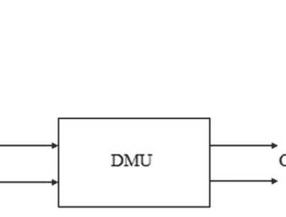

图14.1 一个典型的DMU表示

正如注意到的那样，DEA的主要目的是在DMU中识别最佳的生产实践，以得出经验性的生产前沿。最佳的生产实践是从生产可能性集（PPS）中的任何DMU中得出的，该集合在给定其输入水平的情况下产生最高水平的输出，反之亦然。

PPS，也称为技术，与DMU操作的生产过程有关。它是一个凸集，包含所有可行的输出水平，无论它们在实践中是否被观察到。这些可行的输入输出对应关系是通过插值法获得的，插值法是在观察到的DMU的输入输出束之间进行的。

CCR模型是在[9]中引入的，用于在恒定规模收益（CRS）假设下衡量DMU的相对效率。DMU的效率被定义为加权输出总和（总虚拟输出）与加权输入总和（总虚拟输入）的比率，权重是通过优化过程中对每个评估单元进行的。DMU的技术效率可以通过采用输入导向或输出导向来衡量。如果保护输入的一致性更为重要，则选择输入导向。或者，如果根据分析师的观点，输出的扩展更为重要，则选择输出导向。

假设有n个DMU，每个DMU使用m个输入来产生s个输出。我们用 $y_{rj}$ 表示单位j产生的输出水平 $r \in \{1, ..., s\}$，用 $x_{ij}$ 表示单位j使用的输入 $i \in \{1, ..., m\}$ 的水平。DMU j的输入向量为 $X_j = [x_{1j}, ..., x_{mj}]$，输出向量为 $Y_j = [y_{1j}, ..., y_{sj}]$。针对DMU $j_0$ 的输入导向CCR模型的效率如下：

$$
\begin{aligned}
\max \quad & e_{j_0} = \frac{\omega Y_{j_0}}{\eta X_{j_0}} \\
\text{s.t.} \quad & \frac{\omega Y_j}{\eta X_j} \leq 1, \quad j = 1, ..., n \\
& \eta \geq 0, \quad \omega \geq 0
\end{aligned}
$$ (14.1)

为了获得每个DMU的效率得分，模型（14.1）被制定和解决。变量 $\eta = [\eta_1, ..., \eta_m]$ 和 $\omega = [\omega_1, ..., \omega_s]$ 分别是与输入和输出相关的权重。这些权重是通过一种方式计算出来的，以便为评估的DMU $j_0$ 提供最高可能的效率得分。模型（14.1）的约束限制了DMU的效率得分在区间 $(0, 1]$ 内。通过应用Charnes和Cooper变换[8]，可以将输入导向的CCR模型（14.1）转化为线性规划问题。变换是通过考虑一个标量 $t \in \mathbb{R}_+$，令 $v = t\eta$ 和 $u = t\omega$，并将模型（14.1）的所有项乘以 $t > 0$ 来进行的。模型（14.2）在表14.1中呈现，是模型（14.1）的线性等效模型。表14.1还展示了CCR模型的包络形式（14.3），它是乘数形式（14.2）的对偶。表14.1中还呈现了乘数形式和包络形式的CCR模型的输出导向变体，模型（14.4）和（14.5）。请注意提供的效率分数

表14.1 输入和输出导向的CCR模型

| | 乘数形式 | 包络形式 |
|---|---|---|
| 输入导向 | $
\begin{aligned}
&\max \quad e_{j_0}=u Y_{j_0} \\
&\text { s.t. } \\
&v X_{j_0}=1 \\
&u Y_j-v X_j \leq 0, \quad j=1, \ldots, n \\
&v \geq 0, u \geq 0
\end{aligned}
$ (14.2) | $
\begin{aligned}
&\min \quad \theta \\
&\text { s.t. } \\
&\theta X_{j_0}-X \lambda-s^{-}=0 \\
&Y_{j_0}-Y \lambda+s^{+}=0 \\
&\lambda \geq 0, s^{-} \geq 0, s^{+} \geq 0
\end{aligned}
$ (14.3) |
| 输出导向 | $
\begin{aligned}
&\min \quad \frac{1}{e_{j_0}}=v X_{j_0} \\
&\text { s.t. } \\
&u Y_{j_0}=1 \\
&u Y_j-v X_j \leq 0, \quad j=1, \ldots, n \\
&v \geq 0, u \geq 0
\end{aligned}
$ (14.4) | $
\begin{aligned}
&\max \quad \varphi \\
&\text { s.t. } \\
&X_{j_0}-X \mu-\tau^{-}=0 \\
&\varphi Y_{j_0}-Y \mu+\tau^{+}=0 \\
&\mu \geq 0, \tau^{-} \geq 0, \tau^{+} \geq 0
\end{aligned}
$ (14.5) |

从输入导向模型 (14.2) 和输出导向模型 (14.4) 来看，它们是相同的，即两个模型之间存在互补关系。

**定义14.1 (CCR-效率)** $DMU_{j_0}$ 是CCR-有效的，当且仅当 $e^*_{j_0}=1$ 并且至少存在一个最优解 $(v^*, u^*)$，其中 $u^* > 0$ 且 $v^* > 0$。否则，$DMU_{j_0}$ 是CCR-无效的。

Banker等人通过BCC模型将CCR模型扩展为可变规模收益 (VRS) 模型[7]。在DEA中引入可变规模收益允许将总体效率分解为技术效率和规模效率，与CCR模型将它们聚合为单一指标的做法相反。

CCR模型和BCC模型的结构差异在于后者的乘法形式中有一个额外的无符号自由变量 $u_0$，这是与额外的凸性约束 $(e\lambda = 1)$ 在包络形式中相关联的对偶变量。表14.2展示了输入导向和输出导向的BCC模型。

效率的定义类似于定义14.1。从BCC模型得到的效率得分大于或等于从CCR模型得到的相应得分。然而，请注意输入导向模型 (14.6) 和输出导向模型 (14.8) 之间的倒数关系不可用。

我们在图14.2中提供了一个七个DMU的情况下的CRS和VRS假设下的边界的示意图，标记为A到G，它们使用一个输入产生一个输出，如表14.3所示。

在图14.2中，CCR模型的有效前沿包围了所有数据点 (DMUs)，它是由水平轴和通过DMU B的射线定义的线。在VRS假设下，有效前沿由DMUs A、B和C确定。分段有效前沿ABC是通过水平线通过的

表14.2 输入和输出导向的BCC模型

|   | 乘数形式 | 包络形式 |
|---|---|---|
| 输入导向 | $\max \quad uY_{j0} - u_0$<br>$\text{s.t.}$<br>$vX_{j0} = 1$<br>$uY_j - u_0 - vX_j \leq 0, \quad j=1,...,n$<br>$v \geq 0, u \geq 0$ | $\min \quad \theta$<br>$\text{s.t.}$<br>$\theta X_{j0} - X\lambda - s^- = 0$<br>$Y_{j0} - Y\lambda + s^+ = 0$<br>$e\lambda = 1$<br>$\lambda \geq 0, s^- \geq 0, s^+ \geq 0$ |
| 输出导向 | $\min \quad vX_{j0} - u_0$<br>$\text{s.t.}$<br>$vX_{j0} = 1$<br>$uY_j - vX_j + u_0 \leq 0, \quad j=1,...,n$<br>$v \geq 0, u \geq 0$ | $\max \quad \varphi$<br>$\text{s.t.}$<br>$X_{j0} - X\mu - \tau^- = 0$<br>$\varphi Y_{j0} - Y\mu + \tau^+ = 0$<br>$e\mu = 1$<br>$\mu \geq 0, \tau^- \geq 0, \tau^+ \geq 0$ |

图14.2 生产可能性集和效率前沿在CRS和VRS假设下

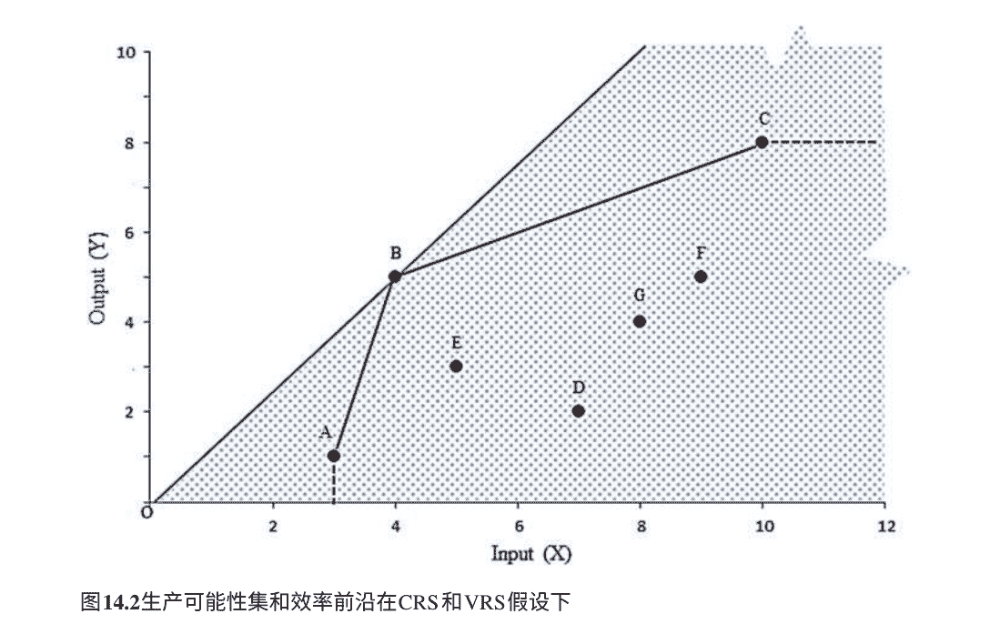

表14.3 单输入-输出案例

| DMU | A | B | C | D | E | F | G |
| --- | --- | --- | --- | --- | --- | --- | --- |
| 输入 (X) | 3 | 4 | 10 | 7 | 5 | 9 | 8 |
| 输出 (Y) | 1 | 5 | 8 | 2 | 3 | 5 | 4 |

通过C和通过A的垂直线包围所有DMU。可以推断出，规模收益的假设影响了边界的形状，因此也影响了DMU的性能，因为它是根据最佳实践单位（边界单位）进行衡量的。VRS边界更接近观测值（DMU），因为在BCC包络模型中施加的凸性约束（$e\lambda = 1$）导致观测值（DMU）的包络更紧。换句话说，凸性约束（$e\lambda = 1$）跨越了CRS生产可能性集合的一个子集。CCR和BCC模型为每个评估单位提供了效率得分，即这种建模方法赋予每个DMU确定其自身输入和输出权重的灵活性，以最大化其性能。

然而，这种自我评估受到了批评，因为它没有建立一个客观的现实，即评估的共同基础。为了消除 DEA 最优权重的变异性的影响，消除不现实的权重方案，并建立一种同行评估，Sexton 等人 [25] 和 Doyle 和 Green [12] 引入了交叉效率的概念。交叉效率被应用于[25] 用于对 DMU 进行同行评估的排名。此外，交叉效率可以用于改善有效DMU 之间的区分度。交叉效率的基本概念是在其他单位的光线下展示每个单位。

交叉效率是一个两阶段的过程，在第一阶段中，每个 DMU 的效率由 CCR 模型或 BCC 模型测量。在第二阶段，从第一阶段得出的所有 DMU 的最优权重值被应用于计算每个单位的交叉效率得分。最后，每个单位的交叉效率被计算为其交叉效率得分的算术平均值。请注意，交叉效率得分低于或等于从传统的 CCR 或 BCC 模型获得的效率得分。

我们在下面提供了一个基于Doyle和Green [12]提供的交叉效率矩阵的表格表示。交叉效率矩阵包含由评估下的DMUs的 $n \times n$ 效率分数。基于为DMU $d$ 计算的最优权重，DMU $j$ 的效率被表示为 $e_{dj}$。这些权重为DMU $d$ 提供了最高水平的效率 $e_{dd}$，矩阵的主对角线包含了DMUs可以达到的最高效率分数。给定DMU $j$ 的交叉效率是通过对列 $j$ 进行算术或几何平均得到的，用 $\bar{e}_j$ 表示（表14.4）。

表14.4 交叉效率矩阵

| 评级DMU | 已评级DMU | | | 同行的平均评估 |
| :--- | :--- | :--- | :--- | :--- |
| | 1 | ... | N | |
| 1 | $e_{11}$ | ... | $e_{1n}$ | $\bar{A}_1$ |
| $\vdots$ | $\vdots$ | $\ddots$ | $\vdots$ | $\vdots$ |
| N | $e_{n1}$ | ... | $e_{nn}$ | $\bar{A}_n$ |
| | $\bar{e}_1$ | ... | $\bar{e}_n$ | |
| | 同行的平均评估（被评估DMU的平均得分） | | | |

#### 14.3 人工神经网络

人工神经网络（ANNs）和多层感知器（MLPs），特别是，构成了能够处理广泛的监督、无监督和强化学习任务的典型模式识别模型。具体而言，大量的相关研究[1]表明，它们在处理属于分类、聚类和回归的一般框架内的各种模式识别任务时非常高效。事实上，当涉及回归问题时，MLPs表现出了通用逼近性质[22]，这意味着任何在有限多个不连续点的紧致子空间中定义的连续函数都可以被一个两层感知器任意接近地逼近。在这项工作的背景下，ANNs的这个特性非常重要，因为我们的主要目标是调查在DEA输入-输出的组合多维空间和可能效率的 $(0,1]$ 区间之间是否可以学习到足够的全局函数关系。然而，这个学习任务的特殊之处在于DEA分数实际上是通过一个单位特定的优化过程获得的。

#### 14.4 提出的方法

我们将DEA与ANN集成在一起，以估计DMU的效率得分，而不是为每个评估的DMU解决线性规划问题来推导其效率得分。通过这种方式，我们减少了计算工作量并加快了性能评估。

首先，我们使用两个重要的DEA模型，即CCR模型和BCC模型，在CRS和VRS假设下，来检验ANN估计从这些模型获得的效率得分的能力。具体而言，我们使用BCC输入导向模型（14.6）和BCC输出导向模型（14.8）。由于CCR输入导向模型（14.2）和CCR输出导向模型（14.4）由于它们之间存在的倒数关系而提供相同的效率得分，在分析中我们不加以区分并且我们提到## 14.4.1 数据生成-训练和测试样本

本研究中实现的数据生成过程涉及从两个概率密度函数中采样，即均匀分布和正态分布。
特别地，每个样本对应于一个(m+s)维随机向量，该向量由DEA上下文中每个DMU相关的m个输入和s个输出组成。每个随机向量的组成值是联合采样的，形成一系列独立的数据集，这些数据集是从上述分布中独立绘制的。

我们首先利用[13]中介绍的BuildHull预处理过程，为每个数据集在CRS和VRS假设下确定有效的DMU。如注意到的，将DEA应用于分类和评分需要连续解决每个评估的DMU的线性规划问题。然而，BuildHull过程快速提供了关键的有效集，用于性能评估，因为只需要比较和测量其余DMU的效率得分。然后，基于这个有效集，我们为训练中使用的DMU评分。通过这种方式，我们确保训练数据集中的DMU获得真实的效率得分。我们还仅为验证目的，在每个ANN中为用于测试的DMU评分。请注意，在具有流数据的要求环境中，新到达的DMU可能会改变整个评估的情况，即可能会影响所有DMU的效率得分。因此，我们建议首先将新到达的DMU与现有的有效集进行比较。这可以通过为新到达的DMU解决一个小型线性规划问题或检查新到达的DMU是否支配任何有效的DMU来实现。如果新到达的DMU将进入有效集，则为了考虑DEA的相对性质，我们建议重新评估用于训练和测试的DMU，并重新训练ANN。

每个数据集都被随机划分为两个不相交的训练和测试DMUs子集。每次运行中用于训练ANN的DMUs的百分比设置为整个数据集的65%。因此，剩下的35%用于测试每个ANN对DEA效率得分的估计能力。换句话说，每个数据集中35%的DMUs的效率得分不是通过优化过程推导出来的，而是直接作为相应训练过的ANN的估计值。这与快速识别高效集合相结合，加速了性能评估并显著减轻了计算负担。总之，我们的方法简化了大容量数据的性能评估。

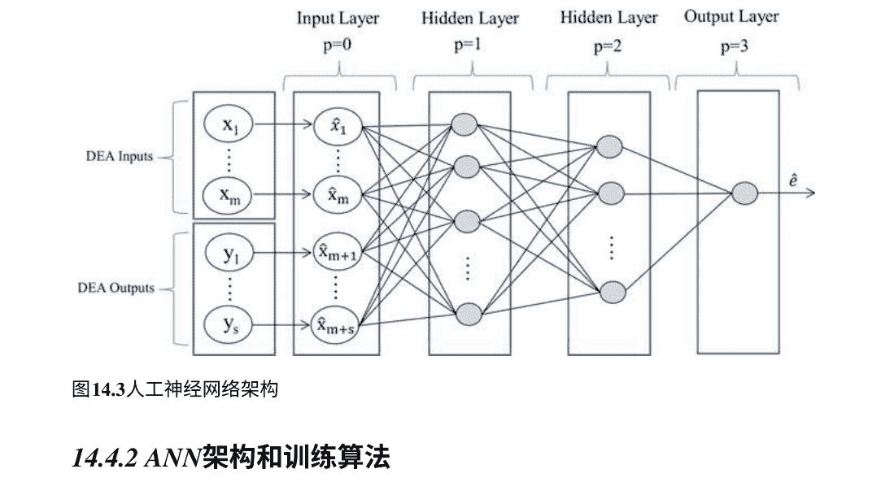

图14.3 人工神经网络架构

## 14.4.2 ANN架构和训练算法

我们采用一个前馈神经网络，由一个输入层、两个非线性隐藏层和一个线性输出层组成，如图14.3所示。请注意，对于每个DEA模型，我们采用一个特定的ANN。让 $0 \leq p \leq L$，其中 $L =3$是每个特定网络层的指示器，参数 $k_p$ 标识第 $p$层的神经元数量。具体来说，所使用的神经网络架构的第零层被馈送一个 $k_0$维输入特征向量（$k_0 = m + s$），形式为 $\hat{X} =$

$[ \hat{x}_1, \ldots, \hat{x}_m, \hat{x}_{m+1}, \ldots, \hat{x}_{m+s} ]^T$，其中前 $m$个特征维度对应于每个DMU消耗的输入（$\hat{x}_q = x_q, 1 \leq q \leq m$），后面的s个特征维度与每个DMU产生的输出相关（$\hat{x}_q = y_{q-m}, m + 1 \leq q \leq k_0$）。两个隐藏层由可变数量的节点组成，取决于输入特征空间的维度。我们的主要关注点是将每个DMU的组合输入和输出进行非线性映射到一个维度较低的空间，以更高效地学习基于DEA的性能模式（效率得分）[16]。

因此，考虑到在实验过程中输入空间的维度范围在[4,20]之间，我们决定每个隐藏层应包含前一层的神经元数量的一半，即 $k_1 = \left\lceil \frac{k_0}{2} \right\rceil$ 和 $k_2 = \left\lceil \frac{k_1}{2} \right\rceil$。神经网络的第三层包含一个单节点，即 $k_L =1$，为DEA输入和输出的任何给定配置生成效率分数。

神经网络的第p层中的每个神经元q（其中$1 \leq p \leq L$且$1 \leq q \leq k_p$）都与一个 $(k_{p-1} + 1)$维权重向量相关联 形式 $W_q^{(p)} = [w_{q0}^{(p)}, w_{q1}^{(p)}, \ldots, w_{qk_{p-1}}^{(p)}]^T$。特别是，突触权重 $w_{qq}^{(p)}$在第$(p-1)$层的第 $q$个节点与其他每个节点 $q'$之间的连接强度进行量化。

权重向量 $w_{q}^{(p)}$ 对应于与神经网络中的每个节点相关联的偏置项，其接受一个等于 $+1$ 的常数输入值。此外，让 $\hat{y}_{q}^{(p)}$ 表示第 $q$ 个神经元在第 $(p-1)$ 层生成的输出值，其中 $1 \leq p \leq L-1$ 且 $1 \leq q \leq k_p$。因此，为了保持神经网络零层节点的输出以及与每个偏置项相关联的常数输入值的相同数学表示法，我们可以写成

$\hat{y}_0^{(p)}$。因此，扩展输出第 $p$ 个网络层可以表示为 $(k_p + 1)$-维向量的形式如下 $\hat{Y}^{(p)} = \left[ +1, \hat{y}_1^{(p)}, \ldots, \hat{y}_{k_p}^{(p)} \right]^T$。在这个背景下，神经网络的每个隐藏层节点产生一个中间输出值 $\hat{z}_q^{(p)}$ 它是第 $p$ 层的权重向量与第 $(p-1)$ 层的扩展输出向量的内积，即 $\hat{z}_q^{(p)} = W_q^{(p)T} \hat{Y}^{(p-1)}$。这个中间值随后通过非线性激活函数传递，该函数为每个隐藏节点提供整体输出 $\hat{y}_q^{(p)} = f(\hat{z}_q^{(p)})$。本研究中每个隐藏神经元所使用的激活函数是双曲正切 Sigmoid 传递函数，其具有以下分析形式:

$$ f(x) = \frac{2}{1 + e^{-2x}} - 1 \quad (14.10) $$

最终，神经网络的整体输出，提供给给定 DEA 输入和输出对的实际效率得分的近似值，可以表示为:

$$ \hat{e}(X_j, Y_j) = \sum_{q'=0}^{k_{L-1}} w_{q'}^{(L)} \hat{y}_{q'}^{(L-1)} \quad (14.11) $$

神经网络的每个节点的最优权重向量 $\hat{W}_q^{(p)}$，其中 $1 \leq p \leq L$ 且 $1 \leq q \leq k_p$，可以通过在用于训练的 DMU 子集上应用反向传播迭代方案[19]来确定，给定相应的基于 DEA 的效率得分。特别地，通过令 $\mathcal{D} = \left\{ \left( \hat{X}_1, e_1 \right), \ldots, \left( \hat{X}_M, e_M \right) \right\}$ 用于表示训练 DMU 子集及其相关效率分数的符号，其中 $\hat{X}_j = [X_j, Y_j]^T$，我们可以构建以下误差函数:

$$ E = \sum_{j=1}^M E_j = \sum_{j=1}^M \left( e_j - \hat{e}(\hat{X}_j) \right)^2 \quad (14.12) $$

在这种情况下，神经网络每个节点的最优权重分配将通过最小化先前定义的误差函数相对于该特定权重向量来获得:

$$\hat{W}_q^{(p)} = \argmin_{W_q^{(p)}} E\left( W_q^{(p)} \right)$$

通过实施迭代权重更新方案，反向传播训练过程提供了上述优化问题的最优解，该方案根据以下公式进行建模：

$$W_q^{(p)}(t+1) = W_q^{(p)}(t) + \Delta W_q^{(p)}$$

对于每个神经元，实际的权重更新向量 $\Delta W_q^{(p)}$ 可以通过考虑 $j$th误差项对任何给定权重的依赖性来获得

由 $\partial E_j$ 捕获的向量 $\frac{\partial E_j}{\partial W_q^{(p)}} = \frac{\partial E_j}{\partial \hat{Z}_{qj}^{(p)}} \frac{\partial \hat{Z}_{qj}^{(p)}}{\partial W_q^{(p)}}$. 数量 $\hat{Z}_{qj}^{(p)}$ 是中间输出在第 $p$ 层的第 $q$ 个节点上，当给出第 $j$ 个训练实例时 $(X_j, e_j)$.

同样地, $\hat{Y}_j^{(p)}$ 可以解释为第 $p$ 层的向量输出，用于第 $j$ 个训练模式。最后，设置 $\delta_{qj}^{(p)} = \frac{\partial E_j}{\partial \hat{Z}_{qj}^{(p)}}$ 并评估中间节点输出相对于相应权重向量的偏导数 $\frac{\partial \hat{Z}_{qj}^{(p)}}{\partial W_q^{(p)}} = \hat{Y}_j^{(p-1)}$ 得到：

$$\Delta W_q^{(p)} = -\mu \sum_{j=1}^{M} \delta_{qj}^{(p)} \hat{Y}_j^{(p-1)}$$

其中 $\mu$ 是采用的学习率参数。

#### 14.5 结果

我们通过进行不同规模的十二个实验来说明我们的方法，即在实验中我们改变DMU的数量和输入-输出的数量。此外，每个实验包含五十个不同的数据集，其中每个数据集来自均匀分布或正态分布。在每个实验中，我们进行五十次运行作为数据集的数量。每次运行中用于训练ANN的DMU的百分比设置为整个数据集的65%。因此，剩下的35%用于测试每个ANN对DEA效率得分的估计能力。请注意，以这种方式，每次运行中的35% DMU（训练数据集）的效率得分不是从优化过程中获得的，从而节省了大量计算资源。实验过程的一般设置如表14.5所示。

表14.5 DEA—神经网络实验框架

| DMU的数量 | 数据分布: 均匀 (输入, 输出) | 数据分布: 正常 (输入, 输出) | 训练百分比 | 数据集的数量 |
|-----------|------------------------------|------------------------------|------------|--------------|
| 2000      | (2,2), (3,3), (10,10)        | (2,2), (3,3), (10,10)        | 65%        | 50           |
| 4000      | (2,2), (3,3), (10,10)        | (2,2), (3,3), (10,10)        |            |              |

我们对每个实验的每个数据集应用了CCR和BCC模型，并计算了交叉效率。人工神经网络得出的效率分数准确地近似了从上述DEA模型中获得的DEA效率分数。此外，人工神经网络估计的效率分数平均满足基本的DEA属性，就像传统的DEA模型得出的DEA效率分数一样。通过提供改进的效率分数，人工神经网络充分捕捉了交叉效率的性能模式，从而提高了DMU之间的区分度，就像原始的DEA交叉效率分数一样。

人工神经网络的逼近能力通过三个性能指标进行量化，即平均绝对误差（MAE），均方误差（MSE）和决定系数（R²）。具体来说，表14.6、14.7、14.8、14.9、14.10、14.11、14.12、14.13、14.14、14.15、14.16和14.17显示了显著低的

表14.6 实验1：均匀分布（2000个单位，2个输入，2个输出）

| DEA模型 | 平均训练性能: 均方误差 | 平均训练性能: MAE | 平均训练性能: R² | 平均测试性能: 均方误差 | 平均测试性能: MAE | 平均测试性能: R² |
|---------|------------------------|-------------------|------------------|------------------------|-------------------|------------------|
| CCR     | 0.0005177              | 0.0135022         | 0.9759971        | 0.0019624              | 0.0147677         | 0.9571647        |
| 交叉效率 | 0.0018474              | 0.0000694         | 0.9981910        | 0.0002269              | 0.0019189         | 0.9966411        |
| BCC输入导向 | 0.0014292              | 0.0323119         | 0.9028719        | 0.0047293              | 0.0345475         | 0.8766674        |
| BCC输出导向 | 0.0004822              | 0.0085362         | 0.9918879        | 0.0015638              | 0.0090114         | 0.9887132        |

表14.7 实验2：均匀分布（2000个单位，3个输入，3个输出）

| DEA模型 | 平均训练性能: 均方误差 | 平均训练性能: MAE | 平均训练性能: R² | 平均测试性能: 均方误差 | 平均测试性能: MAE | 平均测试性能: R² |
|---------|------------------------|-------------------|------------------|------------------------|-------------------|------------------|
| CCR     | 0.0008054              | 0.0229716         | 0.9711431        | 0.0030821              | 0.0262057         | 0.95061097       |
| 交叉效率 | 0.0011957              | 0.0000426         | 0.9995053        | 0.0001559              | 0.0012946         | 0.99898231       |
| BCC输入导向 | 0.0016829              | 0.0450134         | 0.9217769        | 0.0058899              | 0.0500299         | 0.89206884       |
| BCC输出导向 | 0.0006501              | 0.0154462         | 0.9767874        | 0.0022674              | 0.0168690         | 0.96682448       |

表14.8 实验3：均匀分布（2000个单位，10个输入，10个输出）

| DEA模型 | 平均训练性能 | | | 平均测试性能 | | |
|---|---|---|---|---|---|---|
| | 均方误差 | MAE | R² | 均方误差 | MAE | R² |
| CCR | 0.0002365 | 0.0052746 | 0.9952290 | 0.0093718 | 0.0763349 | 0.1661345 |
| 交叉效率 | 0.0003431 | 0.0000103 | 0.9999753 | 0.0001064 | 0.0009248 | 0.99966738 |
| BCC输入导向 | 0.0000350 | 0.0002519 | 0.9997417 | 0.0123801 | 0.0772409 | -1.5144433 |
| BCC输出导向 | 0.0000154 | 0.0001209 | 0.9997605 | 0.0067510 | 0.0382678 | -4.1821253 |

表14.9 实验4：均匀分布（4000个单位，2个输入，2个输出）

| DEA模型 | 平均训练性能 | | | 平均测试性能 | | |
|---|---|---|---|---|---|---|
| | 均方误差 | MAE | R² | 均方误差 | MAE | R² |
| CCR | 0.0003432 | 0.0120852 | 0.9713836 | 0.0011649 | 0.0125429 | 0.9623906 |
| 交叉效率 | 0.0016750 | 0.0000478 | 0.9975823 | 0.0001400 | 0.0016366 | 0.9965639 |
| BCC输入导向 | 0.0008870 | 0.0272546 | 0.9035072 | 0.00280971 | 0.0280332 | 0.8903747 |
| BCC输出导向 | 0.0003943 | 0.0110337 | 0.9732129 | 0.0013837 | 0.0114903 | 0.95934719 |

表14.10 实验5：均匀分布（4000个单位，3个输入，3个输出）

| DEA模型 | 平均训练性能 | | | 平均测试性能 | | |
|---|---|---|---|---|---|---|
| | 均方误差 | MAE | R² | 均方误差 | MAE | R² |
| CCR | 0.0005491 | 0.0218733 | 0.9692263 | 0.0018673 | 0.0234194 | 0.9600186 |
| 交叉效率 | 0.0011238 | 0.0000291 | 0.9994185 | 0.0001018 | 0.0011914 | 0.9990590 |
| BCC输入导向 | 0.0011497 | 0.0415489 | 0.9153117 | 0.0028097 | 0.0435698 | 0.9032587 |
| BCC输出导向 | 0.0004467 | 0.0134169 | 0.9801585 | 0.0016214 | 0.0146866 | 0.9688336 |

表14.11 实验6：均匀分布（4000个单位，10个输入，10个输出）

| DEA模型 | 平均训练性能 | | | 平均测试性能 | | |
|---|---|---|---|---|---|---|
| | 均方误差 | MAE | R² | 均方误差 | MAE | R² |
| CCR | 0.0005093 | 0.0199125 | 0.9659402 | 0.0045122 | 0.0533186 | 0.6988247 |
| 交叉效率 | 0.0003291 | 0.0000071 | 0.9999733 | 0.0000392 | 0.0005109 | 0.99990733 |
| BCC输入导向 | 0.0004001 | 0.0112380 | 0.9693166 | 0.0069929 | 0.0672786 | -0.0612705 |
| BCC输出导向 | 0.0001676 | 0.0051694 | 0.9693319 | 0.0041362 | 0.03559479 | -1.3247827 || DEA模型 | 平均训练性能 | | | 平均测试性能 | | |
| :--- | :--- | :--- | :--- | :--- | :--- | :--- |
| | 均方误差 | MAE | R² | 均方误差 | MAE | R² |
| CCR | 0.0001095 | 0.0032507 | 0.9967115 | 0.0004011 | 0.0034229 | 0.9943959 |
| 交叉效率 | 0.0000981 | 0.0000036 | 0.9999903 | 0.0000131 | 0.0001061 | 0.9999836 |
| BCC输入导向 | 0.0002217 | 0.0062241 | 0.9482878 | 0.0007450 | 0.0064625 | 0.9443861 |
| BCC输出导向 | 0.0001807 | 0.0054861 | 0.9323345 | 0.0006274 | 0.0056927 | 0.9276385 |

| DEA模型 | 平均训练性能 | | | 平均测试性能 | | |
| :--- | :--- | :--- | :--- | :--- | :--- | :--- |
| | 均方误差 | MAE | R² | 均方误差 | MAE | R² |
| CCR | 0.0001610 | 0.0049786 | 0.9934146 | 0.0006103 | 0.0055370 | 0.9880753 |
| 交叉效率 | 0.0000483 | 0.0000017 | 0.9999963 | 0.0000059 | 0.0000521 | 0.9999956 |
| BCC输入导向 | 0.0001783 | 0.0052404 | 0.9837195 | 0.0006452 | 0.0058177 | 0.9723390 |
| BCC输出导向 | 0.0001545 | 0.0046729 | 0.9680146 | 0.0005875 | 0.0052000 | 0.9582981 |

| DEA模型 | 平均训练性能 | | | 平均测试性能 | | |
| :--- | :--- | :--- | :--- | :--- | :--- | :--- |
| | 均方误差 | MAE | R² | 均方误差 | MAE | R² |
| CCR | 0.0000443 | 0.0011700 | 0.9952901 | 0.0013693 | 0.0113335 | 0.4260734 |
| 交叉效率 | 0.0000184 | 0.0000005 | 0.9999994 | 0.0000037 | 0.0000329 | 0.9999976 |
| BCC输入导向 | 0.0000326 | 0.0007493 | 0.9318946 | 0.0013357 | 0.0104425 | 0.0694910 |
| BCC输出导向 | 0.0000452 | 0.0012542 | 0.9540211 | 0.0010372 | 0.0082831 | 0.0986643 |

| DEA模型 | 平均训练性能 | | | 平均测试性能 | | |
| :--- | :--- | :--- | :--- | :--- | :--- | :--- |
| | 均方误差 | MAE | R² | 均方误差 | MAE | R² |
| CCR | 0.0000779 | 0.0031663 | 0.9970348 | 0.0002588 | 0.0032685 | 0.9956498 |
| 交叉效率 | 0.0014794 | 0.0000332 | 0.9799813 | 0.0000955 | 0.0014675 | 0.9799726 |
| BCC输入导向 | 0.0001616 | 0.0061362 | 0.9673725 | 0.0005156 | 0.0062954 | 0.9639029 |
| BCC输出导向 | 0.0001028 | 0.0037516 | 0.9901382 | 0.0003240 | 0.0039070 | 0.9891171 |

| DEA模型 | 平均训练性能 | | | 平均测试性能 | | |
| :--- | :--- | :--- | :--- | :--- | :--- | :--- |
| | 均方误差 | MAE | R² | 均方误差 | MAE | R² |
| CCR | 0.0001032 | 0.0044059 | 0.9936087 | 0.0003531 | 0.0046390 | 0.9914043 |
| 交叉效率 | 0.0000475 | 0.0000012 | 0.9999955 | 0.0000039 | 0.0000492 | 0.9999951 |
| BCC输入导向 | 0.0001197 | 0.0047470 | 0.9833310 | 0.0004108 | 0.0050146 | 0.9639029 |
| BCC输出导向 | 0.0000990 | 0.0040510 | 0.9885028 | 0.0003344 | 0.0043146 | 0.9850008 |

表14.17 实验12：正态分布（4000个单位，10个输入，10个输出）

| DEA模型 | 平均训练性能 | | | 平均测试性能 | | |
| :--- | :---: | :---: | :---: | :---: | :---: | :---: |
| | 均方误差 | MAE | R² | 均方误差 | MAE | R² |
| CCR | 0.0000603 | 0.0025160 | 0.9814983 | 0.0003774 | 0.0047189 | 0.9044561 |
| 交叉效率 | **0.0000293** | **0.0000066** | **0.9999960** | **0.0000027** | **0.0000354** | **0.9999935** |
| BCC输入导向 | 0.0000468 | 0.0018402 | 0.9642113 | 0.0004332 | 0.0049653 | 0.7062816 |
| BCC输出导向 | 0.0000514 | 0.0020357 | 0.9631799 | 0.0004345 | 0.0050021 | 0.7395385 |

每个实验中，MAE和MSE的误差测量值在五十次独立运行中进行了平均。在测试过程中获得的极高的R²值表明ANN能够以全局方式模拟DMU特定的DEA优化过程的能力。此外，我们观察到当ANN输入空间的维度增加时（DEA输入和输出的总和），获得的R²值会降低，即ANN的逼近能力会下降。

然而，当DMU的数量增加时，这种效果会减弱。例如，从具有2000个DMU的实验中得出的测试R²值（表14.8和14.14）低于具有4000个DMU的相应实验（表14.11和14.17）。

图14.4、14.5、14.6、14.7、14.8、14.9、14.10、14.11、14.12、14.13、14.14和14.15分别描述了每个实验中所有单位每次运行的平均效率得分。特别是，我们证明了DEA模型的基本属性有效地转移到了ANN框架中。事实上，ANN估计的BCC效率得分平均大于或等于相应的CCR得分。此外，当对单位进行平均时，估计的交叉效率得分低于或等于相应的CCR效率得分。

正如注意到的那样，从人工神经网络估计的BCC和CCR效率得分可能不满足DMU级别的基本DEA属性。这归因于

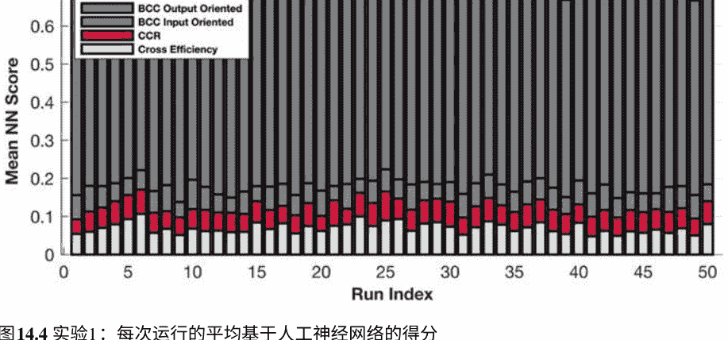

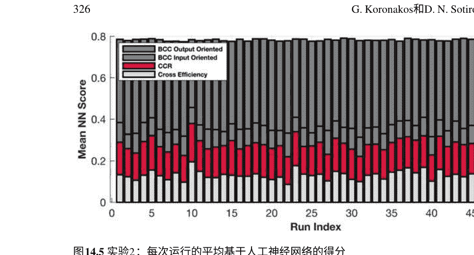

图14.5 实验2：每次运行的平均基于人工神经网络的得分

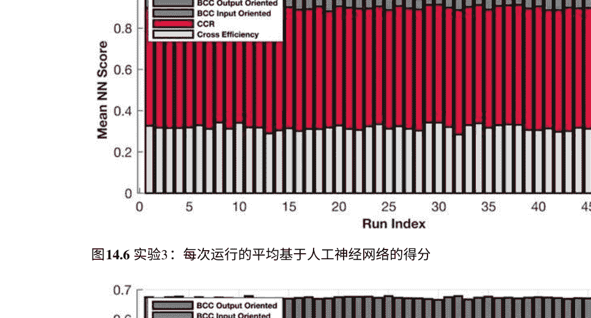

图14.6 实验3：每次运行的平均基于人工神经网络的得分

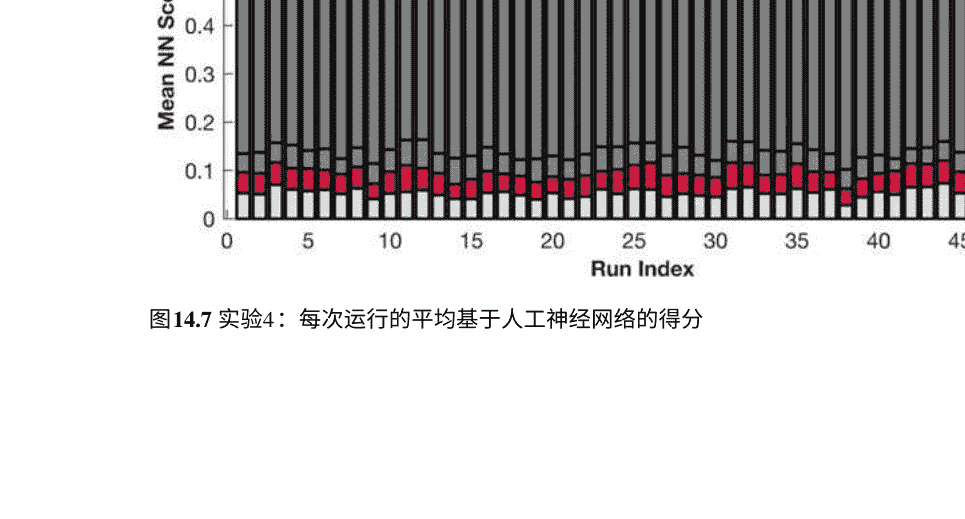

图14.7 实验4：每次运行的平均基于人工神经网络的得分

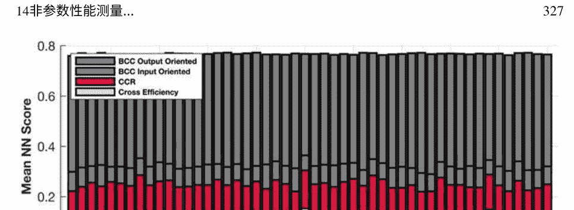

图14.8 实验5：每次运行的平均基于人工神经网络的得分


图14.9 实验6：每次运行的平均基于人工神经网络的得分


图14.10 实验7：每次运行的平均基于人工神经网络的得分


图14.11 实验8：每次运行的平均基于人工神经网络的得分


图14.12 实验9：每次运行的平均基于人工神经网络的得分


图14.13 实验10：每次运行的平均基于人工神经网络的得分


图14.14 实验11：每次运行的平均ANN得分


图14.15 实验12：每次运行的平均ANN得分

在DEA和ANN之间存在概念上的区别。特别是，在DEA中，每个DMU的效率得分是从DMU特定的LP的最优解导出的，而在ANN中，一个全局非线性逼近函数将每个DMU的DEA输入和输出映射到相应的效率得分。为了说明上述情况，我们提供了两个不同实验（1和7）中的两个不同运行的详细概述，其中包含从均匀分布和正态分布中获得的数据。图14.16展示了实验1中第5次运行中包含的2000个DMU的估计效率得分，很明显，并非所有DMU都满足基本的DEA属性。对于实验7中第5次运行中包含的2000个DMU的估计效率得分也是如此（见图14.18），该数据来自正态分布。相反，ANN估计的交叉效率得分满足DEA的属性


平均值和每个DMU的个体值，如图14.17和14.19所示，对于上述两个运行。

实验证明，DEA交叉效率性能模式可以有效地转移到ANN。在图14.20、14.21、14.22、14.23、14.24和14.25中，我们提供基于CCR和交叉效率估计得分的DMU排名，涉及六个指示性实验。 可以推断出，近似的交叉效率得分和排名低于或等于相应的CCR得分。 因此，DEA交叉效率概念所传递的区分能力的提高被转移到ANN。


图14.18 实验7-运行5：基于ANN的CCR模型、基于输入导向的BCC模型和基于输出导向的BCC模型的单位得分


图14.19 实验7-运行5：基于ANN的CCR模型和交叉效率的单位得分

#### 14.6 结论

在本章中，我们通过提出的方法追求提供加速大规模性能评估并提供显著计算节省的理论和实践工具。 为此，我们将数据包络分析与人工神经网络相结合，以估计评估单位的效率得分。 我们考虑了DEA的相对性质，通过使用预处理过程快速获得对ANN进行训练和测试的DMU首先对有效集进行评估。

我们研究了人工神经网络（ANNs）估计DEA模型（CCR和BCC）的效率得分的能力，以及捕捉跨效率的性能模式，从而提高DEA的判别能力。 我们设计了几个实验


图14.20 实验1-运行5：基于ANN的CCR模型和跨效率的单位得分


图14.21 实验2-运行5：基于ANN的CCR模型和跨效率的排序单位得分

不同大小的实验，包含从不同分布生成的数据。实验结果表明，我们的方法有效地估计了DEA的效率得分。此外，估计得分平均满足DEA里程碑模型的基本属性，即估计的BCC得分大于或等于相应的CCR得分。此外，训练在跨效率模式上的ANNs提供了更准确的DEA跨效率得分近似和更好的DMUs判别能力，而相应的CCR模型训练则不具备这些特点。最后，我们的方法是通用的，可以普遍应用于各种类型和来源领域的实体的性能评估（例如健康、隐私、股市等）。


图14.22 实验3-运行5：基于ANN的CCR模型和交叉效率的每个单位的排序分数


图14.23 实验7-运行5：基于ANN的CCR模型和交叉效率的每个单位的排序分数


图14.24 实验8-运行5：基于CCR模型和交叉效率的每个单位的ANN分数


图14.25 实验9-运行5：基于CCR模型和交叉效率的每个单位的ANN分数

致谢这项研究由希腊和欧盟（欧洲社会基金-ESF）共同资助，通过“人力资源发展、教育和终身学习”项目（MIS-5033021）在国家奖学金基金（IKΥ）实施的“博士后研究员强化-第二周期”项目中。

#### 参考文献

+   1. O.I. Abiodun, A. Jantan, A.E. Omolara, K.V. Dada, N.A. Mohamed, H. Arshad, 人工神经网络应用的最新技术综述。 Heliyon 4(11), e00938 (2018)
2. A. Azadeh, S.F. Ghaderi, M. Anvari, M. Saberi, H. Izadakhsh, 一种集成的人工神经网络和模糊聚类算法用于决策单元性能评估。 Appl. Math. Comput. 187(2), 584–599 (2007)
3. A. Azadeh, M. Saberi, M. Anvari, 一种集成的人工神经网络算法用于决策单元性能评估和优化。 Expert Syst. Appl. 37, 5688–5697(2010)
4. A. Azadeh, M. Saberi, M. Anvari, 一种集成的人工神经网络模糊C-Means-归一化算法，用于决策单元的性能评估：汽车工业和发电厂的案例。 计算机工业工程 60, 328–340 (2011)
5. A. Azadeh, M. Saberi, R.T. Moghaddam, L. Javanmardi, 一种集成的数据包络分析-人工神经网络-粗糙集算法，用于人员效率评估。 Expert Syst. Appl. 38, 1364–1373 (2011)
6. A.D. Athanassopoulos, S.P. Curram, 数据包络分析和人工神经网络作为评估决策单元效率的工具的比较。 运筹学杂志Soc. 47(8), 1000–1016 (1996)
7. R.D. Banker, A. Charnes, W.W. Cooper, 一些用于估计DEA中技术和规模无效率的模型。 管理科学。 32, 1078–1092 (1984)
8. A. Charnes, W.W. Cooper, 用线性分数函数编程。 海军研究物流。 9, 181–185 (1962)
9. A. Charnes, W.W. Cooper, E. Rhodes, 测量决策单元的效率。 欧洲。 J. Oper. Res. 2, 429–444 (1978)
10. W.C. Chen, W.J. Cho, 用于大规模DEA计算的过程。 计算机操作研究。 36, 1813–1824 (2009)
11. A. Costa, R.N. Markellos, 用神经网络模型评估公共交通效率。 Transp. Res. C 5(5), 301–312 (1997)
12. J. Doyle, R. Green, DEA中的效率和交叉效率: 推导、含义和应用. J. Oper. Res. Soc. 45(5), 567–578 (1994)
13. J.H. Dulá, 一种数据包络分析算法. INFORMS J. Comput. 23(2), 284–296 (2011)
14. J.H. Dulá, F.J. Lopez, 有限生成无界多面体的算法. INFORMS J. Comput. 18(1), 97–110 (2006)
15. J.H. Dulá, F.J. Lopez, 流式数据的数据包络分析 . Omega 4, 41–47 (2013)
16. S. Edelman, N. Intrator, 学习作为低维表示的提取. Psychol. Learn. Motiv. 36, 353–380 (1997)
17. A. Emrouznejad, E. Shale, 用于测量大规模数据集效率的组合神经网络和DEA。 计算机工业工程。 56, 249–254 (2009)
18. F.R. Forsund, N. Sarafoglou, 数据包络分析的起源。 产品分析杂志。 17, 23–40 (2002)
19. Goodfellow, I., Bengio, Y., Courville, A., 深度学习 (麻省理工学院出版社, 2016)
20. P. Hanafizadeh, H. Reza Khedmatgozar, A. Emrouznejad, M. Derakhshan, 用于测量互惠基金效率的神经网络DEA。 国际应用决策科学杂志。 7(3), 255–269(2014)
21. Lim, S., Zhu, J., DEA交叉效率评估在可变规模回报下。 J. Oper. Res. Soc. 66, 476–487
22. A. Pinkus, 神经网络中MLP模型的逼近理论。 Acta numerica 8, 143–195 (1999)
23. D. Santin, F.J. Delgado, A. Valiño, 技术效率的测量：神经网络方法。 Appl. Econ. 36(6), 627–635 (2004)
24. L.M. Seiford, 数据包络分析：艺术的演变 (197–1995) 。 J. Product. Anal. 7, 99–137 (1996)
25. T.R. Sexton, R.H. Silkman, A.J. Hogan, 数据包络分析：批评和扩展。新的直接。 程序评估。 1986, 73-105 (1986年) 。 https://doi.org/10.1002/ev.144
26. 吴，杨，梁，使用DEA-神经网络方法评估加拿大一家大型银行的分行效率。专家系统应用程序 31 (1) , 108-115 (2006年)

# 第15章关于群体智能和生物启发进化策略应用的综合调查

Alexandros Tzanetos和Georgios Dounias

摘要 多年来，机器学习使人类能够映射插值问题的模式，并提供了聚类和分类大量未知数据的方法。近年来，数学上难以用简单或天真的启发式方法解决的优化问题引发了对新方法的需求，即进化策略。这些方法受到自然界中植物和动物的策略的启发。然而，很多这些方法被称为自然启发，但它们的算法模型中并没有这样的灵感。此外，每年还提出了更多的进化方案，但缺乏应用使它们没有实际效用。在本章中，收集了所有群体智能方法以及那些不受群体、群体或群体启发，但仍然从动物行为中获得灵感的方法。研究了这两个子类别的应用，并提出了一些初步结果，以突出自然启发智能实用性的一些主要观点。

关键词 自然启发算法·群体智能·生物启发算法

#### 15.1 引言

机器学习（ML）的起源可以追溯到艾伦·图灵在二战期间成功解密恩尼格玛机的加密消息的时候，大约在1940年代初。八十年后，已经提出了许多方法来识别原始数据中包含的信息或解决困难的优化问题。

在这几十年里，已经进行了大量研究，旨在模拟人脑的方式，考虑问题的各个方面，以得出最终决策。人工智能（AI）领域旨在为计算机等机器提供决策能力，被称为计算智能（CI），包括模糊规则系统[1, 2]、机器学习[3-6]、人工神经网络[7-9]和进化算法。基于规则的系统使用逻辑表达式来表示和执行其他结果的操作或决策。除了模糊规则和模糊集合，这些系统还可以考虑决策变量之间的关系，以建模更高级别的决策[10]，被称为模糊规则系统。这种计算智能方法已经在控制系统[11]、知识表示[12]、计算机视觉[13]、图像检测[14]、自然语言处理[15]等领域中使用。

第一次尝试模仿人脑思维方式产生了一类计算智能，名为人工神经网络（ANN）。人脑由广泛的神经元网络组成。身体的每个动作都是通过一系列神经元传递给相应的身体部位的脉冲的结果。不同的序列导致不同的身体动作。这种独特的现象在ANN中进行建模。问题的输入数据构成ANN的第一层，而决策变量的可能组合通常构成多个隐藏层。输出层提供问题的解决方案。

因此，研究工作旨在实现人脑的适应能力，这是基于先前知识的结果[16]。这种新方法被称为机器学习（ML）。最常见的ML类型是监督学习，决策者必须提供一组广泛的数据，称为训练集，以便算法能够开发出更适合给定数据的模型。

这种方法为训练机器识别案例之间的相似性提供了机会，从而导致具有多个决策变量的案例的分类。然而，当聚类不被知晓时，必须找到另一种聚类案例的方法。无监督学习解决了这个问题。那时，预测模型对于时间相关数据问题非常有价值，比如股市预测。需要考虑的特征（决策变量）的众多导致了模型的不足。特征选择应运而生，以应对这个问题，作为另一种机器学习方法。接下来的几年，出现了许多其他机器学习方法，例如支持向量机（SVM）和强化学习。此外，还有许多其他应用程序被引入到机器学习方法中，例如推荐系统、异常检测等。虽然机器学习和人工神经网络被广泛用于分类、聚类和预测，但是有一些问题无法用这些方法解决。优化问题通常由数学方程描述，并且可以通过最大化或最小化目标函数来解决。目标函数可以是计算问题中某个量的方程，也可以是描述应该优化的重要决策目标之间关系的人工函数。

1975年，Holland [17] 提出了遗传算法（GA），它受到了自然界物种进化中的突变和交叉机制的启发。ANN与GA的结合使许多科学家寻找自然界的灵感。最初开发的算法最初被称为进化算法（EAs），因为在算法过程中它们会生成一个解，并在一定步骤中不断演化。然而，几年后，还有更多受自然启发的算法被提出，因此它们形成了一类名为自然启发算法（NIAs）或自然启发智能（NII）的算法。

在之前的工作中[18]，作者们介绍了一类受自然启发的算法，这些算法受到物理现象和科学定律的启发。本章重点介绍了最为人熟知的自然启发智能（NII）类别，即群体智能，并指出了一些方法不应被视为群体智能。这些方法，包括其他受植物和动物启发的方法，构成了自然启发智能（NII）算法的生物启发类别。介绍了这两类算法的应用，并讨论了许多方案缺乏应用的问题。介绍和讨论了一些关于自然启发隐喻的初步发现。

类似的工作可以在文献中找到，但感兴趣的读者无法在现有调查中找到所有已发表算法的综合收集。有关最知名的群体智能导向方案的调查已由[19, 20]进行。在[21]的工作中，提到了一些SI算法的应用，并收集了38个SI算法。另一个包含这些方案的列表以及对它们的简要讨论可以在[22]中找到。Del Ser等人进行了更详细的工作[23]。Roy等人在[24]中包含了许多群体智能和基于生物的算法，并对它们的应用进行了讨论。

所有上述工作都集中在特定的算法上，通常是已建立的方案（蚁群优化，粒子群优化等）。这些工作大多不研究算法更有用的特定应用领域。相反，提到了一些应用并进行了简要讨论。在本章中，可以找到所有以群体智能为导向或基于生物的方法，以及对每个算法范围的讨论。此外，已经进行了深入研究，以展示这些自然启发技术可以为哪些应用领域做出贡献。

下一节将解释什么是自然启发式智能，并对已提出的方法进行全面回顾。在第15.3节中，每个类别的应用都按算法进行介绍，并讨论统计结果。本文的结论总结在第15.4节，并设定了未来的研究目标。

#### 15.2 自然启发式智能

自然启发式智能（NII）描述了模拟自然界中出现的现象、群体中的觅食和社会行为，以及动物、昆虫和植物为应对日常问题而发展的策略。关于自然启发式智能的更全面定义可以在Steer等人的文章[25]中找到，其中指出“自然”一词指的是“任何不是有意识的人类设计产物的物理宇宙的一部分”。

因此，根据上述定义，自然启发式算法（NIA）可以受到物理现象和科学定律[18]、群体智能（SI）或其他不被大群动物（如群体）接受的策略的启发，而是某个物种的单个个体使用它们进行觅食或生存。作者经常犯的一个常见错误是声称他们提出的算法是一种群体智能方法，而实际上没有建模这种群体行为。在本节中，将根据这些简单的生物启发方法将可以归类为群体智能的自然启发方法与有机体为基础的方法分开。

正如图15.1所示，这两个类别从2000年代中期开始迅速增长。基于群体智能的流行度以及许多期刊和会议上发表的相关作品，我们预计这个类别会比另一个类别要大得多。然而，自2012年以来，有机体已经成为许多算法的灵感来源，因为发表的技术数量不断增长。2018年发表的15种有机体灵感算法令人瞩目。

同时也引发了一些担忧。 所有这些算法都是真正需要的吗？ 本研究通过研究这些算法解决的应用程序来调查这个问题。

在下面的分析中，选择了三个主要的问题领域来划分找到的应用程序；优化、分类或聚类以及其他应用，如预测。 所有使用CI方法解决的问题都可以归类为这三个类别之一。 在第二级分析中，我们重点关注优化问题的领域。大多数NII算法都是为了解决优化问题而开发的，而只有少数算法被提出作为聚类方法，例如Big Bang-Big Crunch [26]和Black Hole算法[27]。

许多工程优化问题，如桁架结构设计和机器复合设计，属于NII算法发现的第一类优化问题的有效工具。 另一个广泛应用领域是基于金融的，可以找到投资组合优化问题。 然后，运筹学问题是一个广泛的应用领域。 经典的已知问题，如旅行推销员问题（TSP）和分配问题都包括在这里。

能源问题，如众所周知的经济负荷分配（ELD），是应用领域的第四个领域。 最后，所有无法归类为上述任何一类的其他问题都包括在“其他”应用中。

不考虑包含混合方案的论文。 然而，提高自然启发算法性能的最佳实践是找到包含它的良好混合方案。 另一方面，在应用程序的总数中，还计算了对物理类比所启发的算法概念没有改变的初始算法的修改论文。

## ### 15.2.1 群体智能

群体智能（SI）一词由Beni和Wang [28]引入，用于描述机器人系统之间的集体行为。 然而，这个术语用于描述代理合作以实现问题目标的算法。 第一个SI算法是在Stochastic Diffusion Search [29]的名字下提出的，受到了一种名为Leptothorax acervorum的蚂蚁物种的一对一通信策略的启发。 多年来，已经通过许多应用来进行特征选择[30]、物体识别[31]、移动机器人自定位[32]、医学图像识别[33]和无线网络站点选择[34]。

1992年，Marco Dorigo在他的博士论文[35]中将蚁群优化提出为蚁群系统。 这个算法主要用于解决离散优化问题，如旅行商问题[36]、车辆路径问题[37]、调度问题[38, 39, 40]、分配问题[41]、集合问题[42]，但也被用于其他应用，如机器人学[43]、分类问题[44]，蛋白质折叠[45]等。

三年后，[46]提出了粒子群优化（PSO）来解决连续空间优化问题。PSO已被广泛应用于各种问题，如天线设计（H.[47]），生物医学[48]，通信网络[49]，金融[50]，电力系统[51]，机器人[52]，调度[53]，以及分类/聚类问题[54]和预测[55]和预测应用[56]。

上述所有方案都不包括在下面的研究中，因为它们对应于已在许多不同问题中实现的已建立的算法。有关它们更有用和修改的应用领域的更多细节可以在文献中的调查中找到。此外，人工蜂群和细菌觅食优化也被认为是已建立的方案，试图找到包含它们应用的所有论文将是不可能的。

SI类别中包含的其余方案分为三个子类别，基于它们的特性进行划分；觅食、社会行为和其他群体行为。觅食描述了动物群体寻找食物来源的策略。社会行为算法包括模拟群体和群体之间等级关系的特征。其他无法归入上述子类别的群体行为被称为“其他群体行为”。

值得一提的是，在Fister等人的工作中，虚拟蚂蚁算法和虚拟蜜蜂都被视为SI方法。然而，在这项工作中，不符合自然启发算法定义的方案已被排除在外。

### #### 15.2.1.1 觅食方法

许多群体智能（SI）方法受到动物、鸟类、昆虫或鱼类觅食策略的启发。最初，蚁群优化是第一个基于生物体（蚂蚁）协作寻找食物来源的SI算法。下一个觅食策略算法是在2002年提出的，基于细菌的觅食行为。

2004年，Wedde等人提出了蜂巢算法[59]。一年后，[60]提出了蜜蜂群优化算法，试图解决TSP路径问题。Pham等人提出了基于蜜蜂集体行为的另一个算法[61]。第二年，[62]提出了一种著名的优化算法，即人工蜜蜂群算法。

杨提出了另一种著名且非常有用的算法[63]，即蝙蝠算法。同年，又提出了基于蜜蜂行为的另一个算法[64]。2010年提出的第三种方法以觅食策略为灵感，被命名为狩猎搜索[65]。

虽然蟑螂群优化算法在2010年的第二届国际计算机工程与技术会议上首次提出，但该论文已被撤回，其最初的工作可以认为是2011年的工作[66]。

2012年，Shirzadi和Bagheri提出了盲鼠算法[67]。 受eurygaster的觅食方法的启发，[68]提出了一种同名算法，并将其应用于图分割问题。 Maia等人提出了基于蜜蜂的另一种方案[69]。 同年，Tang等人提出了狼搜索算法[70]。

2013年，[71]提出了非洲野狗算法作为一种工程优化方法。 同年，[72]提出了企鹅搜索优化算法。 最后，[73]在同一年提出了七点瓢虫优化算法。

Mirjalili等人提出了另一种具有挑战性的优化方法，名为灰狼优化器[74]。 同年，[75]提出了鸡群优化算法。 这两种方法都被应用于工程优化问题。 2015年，[76]提出了蟑螂群进化算法，之前同一作者曾提出过蟑螂遗传算法[77]。 同样在2015年，[78]提出了蝴蝶优化算法，后来给出了最终的名称[79]。

2016年，[80]提出了海豚群体优化算法。 受乌鸦启发，[81]提出了乌鸦栖息优化算法。 Mirjalili和Lewis [82]提出了鲸鱼优化算法。 同样在2016年，鸟群优化算法[83]被提出。

2017年，[84]提出了斑点鬣狗优化器，并将其应用于工程设计问题。 同年，曾等人提出了鲸鱼群体算法[85]。
受另一种鱼类的启发，[86]在接下来的一年提出了黄鞍鲷算法。 根据猫鼬的觅食策略，[87]提出了猫鼬族群算法作为解决TSP问题的方法。

最近提出的方案是旗鱼优化器[88]，已经应用于工程设计问题。

### #### 15.2.1.2 社会行为方法

研究人员的另一个灵感来源是群体、群体和群体成员之间的社会结构和行为。 受到鱼类社会行为的启发，[89]提出了鱼群算法。 四年后，[90]提出了萤火虫群优化算法。 [91]对蟑螂的社会行为进行了建模。

虽然大多数受蜜蜂启发的算法都出现在前一个子类中，但在2009年，[92]提出了大黄蜂算法。 同样在2009年，两个最著名的自然启发算法被提出，分别是布谷鸟搜索算法[93]和萤火虫算法[94]。 同年，石勤等人提出了海豚伙伴优化算法[95]。 受到蝗虫的启发，[96]提出了一种群智能算法。

2010年，[97]提出了白蚁群优化算法。 [98]受到磷虾的群居行为的启发，提出了一种算法。

受到蜘蛛的启发，[99] 提出了社交蜘蛛优化算法。同年，燕子群优化算法被提出 [100]。另一种蜘蛛的灵感 [101] 提出了蜘蛛猴优化算法。2015年，[102] 提出了非洲水牛优化算法作为TSP优化方法。值得注意的是，那一年有两种基于大象行为的不同算法被提出 [103, 104]，而在这两个作品中，S.Deb教授都是作者之一。同样在2015年，[105] 提出了看看鹧鸪雏鸟优化算法。同年，[106] 提出了蚯蚓优化算法，该算法被用于解决TSC问题，目标是找到满足题库约束的问题组合。

狮子优化算法是由Neshat等人提出的 [107]。海豚的沟通和社交行为启发了 [108] 提出了海豚群算法。郊狼的灵感 [109] 提出了同名算法。

最后，帝企鹅启发了[110]提出帝企鹅优化器，同时也[111]提出了帝企鹅群体。

### #### 15.2.1.3 其他群体行为

在这个子类别中，可以包括粒子群优化（PSO），它基于大群鸟类的移动方式。这种同时移动群体的现象构成了这个子类别。此外，基于其物理类比，随机扩散搜索也可以包括在这里。

虽然只有少数实现，但绵羊群遗传模型算法[112]在近二十年前就出现了。2007年，另一个基于细菌的算法被提出[113]，名为细菌群算法。Garcia和Pérez [114]提出了跳跃蛙优化算法，该算法应用于p-中位数问题。一年后，[115]提出了人工搜索群算法。Filho等人[116]提出了鱼群搜索算法，受到鱼类的群集行为启发，其中群体会作为一个整体转向，试图避开敌人并寻找食物。

Hierarchical Swarm Model是由陈等人于2010年提出的[117]。基于鸟类迁徙行为[118]，提出了迁徙鸟优化算法。王等人[119]提出了蜜蜂交配优化算法作为解决VRP问题的方法，灵感来自于蜜蜂交配优化算法，但这两种方案之间存在一些差异。

为了制定一个更简化的PSO版本，[120]提出了无权重群体算法。鸽子启发了[121]开发一种用于空中机器人路径规划的方法。动物的迁徙策略孕育了同名算法[122]。王等人[123]提出了帝王蝶优化算法。程等人[124]提出了蟑螂群体优化算法作为蟑螂群体优化算法的新版本，用于实现机器人导航。

自然启发算法中最常见的作者之一是S. Mirjalili，他发表了两种前述的群体智能技术：灰狼优化算法和鲸鱼优化算法。他提出的算法属于这个子类别的算法有Moth Flame Optimization [125]和Dragonfly Algorithm [126]，同时他还是Salp Swarm Algorithm [127]和Grasshopper Optimization Algorithm [128]的合著者。这些算法中的大多数是应用在工程设计优化问题上的初始工作。 2017年，[129]提出了Selfish Herd Optimizer，而在2018年又提出了四个新的算法； Biology Migration Algorithm [130]， Lion Pride Optimization Algorithm [131]， Meerkat-inspired Algorithm [132]和Wildebeests Herd Optimization [133]。 同年，另一种以蟑螂为灵感的方法被提出，名为Artificial Social Cockroaches [134]，主要用于图像检测。

## ### 15.2.2 受生物启发的算法

虽然群体智能方案受到集体行为的启发，但还有一些其他算法是基于个体观察到的策略和习惯。这些个体可以是动物、鱼类和鸟类，也可以是花卉物种、草和灌木。这个类别的所有算法灵感都来自生物。 在动物群体方法的子类中，有一些技术是受到动物物种（大型动物）、鸟类（鸟类）、鱼类（鱼类）以及细菌（内生动物和外生动物）、微生物和病毒（微生物）的启发，这是最大的子类之一。 植物群体方法包括所有受到植物生命形式（如树木和真菌）启发的算法。 第三个子类包括模拟器官操作（如心脏）或疾病治疗（如化疗）的方案。

### #### 15.2.2.1 基于动物的方法

在这个子类别中遇到的第一个算法是蜜蜂婚姻[139]，最初是为了解决可满足性问题而提出的。 下一个算法是在一年后提出的，名为细菌趋化性[140]，并用于解决一个翼型设计问题。 动物群包括病毒，所以基于病毒的算法也被归类在这里。 这些算法包括病毒系统[141]，基于猪流感模型的优化[142]，病毒毒力优化算法[143]和病毒群体搜索[144]。

尽管其名称提到了群体智能(SI)，但猫群体优化[145]是对SI的错误理解和与基于群体的方法混淆的最好例子。 同年，提出了洗牌蛙跳算法[146]和蜜蜂交配优化算法[147]。 [148]受到动物搜索行为和群体生活理论的启发，提出了群体搜索优化器。

在2007年，基于猴子的两个方案中的第一个方案被提出 [149]来解决潜在问题。第二个方案在一年后被提出。 [150]。受蜜蜂启发的另一个算法，名为蜜蜂采集花粉算法[151]，于2008年提出并应用于TSP，正如大多数受蜜蜂启发的算法一样。在那一年中，提出了一个最为知名的算法，名为基于生物地理学的优化算法[152]，该算法模拟了动物根据其地理特征进行迁移和突变的过程。

在2011年，提出了两个受昆虫启发的算法；水果蝇优化算法[153]和蚊子产卵算法[154]。蝙蝠再次成为灵感的话题，[155]提出了蝙蝠声纳算法。Aihara等人[156]提出了一种数学模型，用于描述树蛙的叫声方法，将该算法命名为日本树蛙算法。另一种鸟类，名为戴胜鸟，启发了[157]提出戴胜鸟启发式优化算法。按时间顺序，第一个受狮子启发的算法是由Rajakumar[158]提出的同名算法。同年，也提出了大鲑鱼奔跑算法[159]。

翻翻鱿鱼灵感[160]提出了同音算法。海豚的回声定位灵感[161]提出了解决工程问题的算法。埃及秃鹫优化算法由Sur等人提出[162]来解决背包问题。另一方面，[163]提出了绿鹭优化算法作为解决路径问题的方法。Keshtel，一种浅水鸭，是同音算法[164]的灵感来源。Jumper Firefly算法由[165]提出来解决分配问题。Tilahun和Ong[166]在他们的算法中对猎物和捕食者之间的不同行为进行了建模 。

细菌通过多年的研究成为了著名的灵感话题，这使得[167]提出了磁性细菌优化算法。此外，[168]提出了贻贝徘徊优化算法。

2014年，又出现了一种基于鸟类的方法，名为鸟类交配优化器[169]。此外，珊瑚礁优化算法[170]在那一年提出来应对路径问题。动物在其种群中分配食物资源的方式引发了资源竞争[171]。另一方面，不同物种在特定区域的共生关系启发了[172]提出共生有机体搜索算法。

Mirjalili [173] 也在这个类别中提出了蚁狮优化器。那一年还提出了人工藻类算法[174]和美洲豹算法[175]。

2016年出现了六种新技术；骆驼算法[176]、乌鸦搜索算法[177]、红鹿算法[178]、蚊子飞行优化算法[179]、鲨鱼嗅觉优化算法[180]和抹香鲸算法[181]。

2017年，蝴蝶[182]和甲虫[183]启发了新的算法。Haldar和Chakraborty [184]提出了鱼类电定位优化算法来解决可靠性问题。鲸类的物种继续激发着方法的创新，2017年Biyanto等人提出了虎鲸算法[185]。同年还提出了下蛋鸡算法[186]。Polap和Woz`niak [187]提出了极地熊优化算法来解决工程问题。Samareh Moosavi和Khatibi和Bardsiri [188] 提出了Satin Bowerbird Optimizer，灵感来自雄性缎鸟所建造的结构。

正如图15.1所示，2018年是基于生物体的最多发表算法的年份。受到海洋中的藤壶的启发，[189] 提出了Barnacles Mating Optimizer，并将其应用于分配问题。另一个受到海豚启发的方案是Dolphin Pod Optimization [190]。

那一年还出现了其他算法，包括Cheetah Based Optimization Algorithm [191], Puffer Fish的圆形结构 [192], Mouth Brooding Fish algorithm [193] 和 Pity Beetle Algorithm [194]。

同年，提出了Beetle Swarm Optimization Algorithm [195] 和 Eagle Piercing Optimizer [196] 作为工程优化技术。提出了Owl Search Algorithm [197] 来解决热流交换问题，提出了Pontogammarus Maoticus Swarm Optimization [198] 来解决太阳能光伏阵列问题。最后，提出了Rhinoceros Search Algorithm [199] 作为流水车间调度优化方法。

安第斯秃鹰算法 [200] 被提出来解决细胞形成问题。来自同一鸟类家族的 [201] 启发了秃鹰搜索算法。Shamsaldin等人提出了驴子和走私者优化算法 [202] 来解决TSP问题。猎鹰优化算法 [203], 飞鼠优化器[204], 哈里斯鹰优化算法 [205] 和煤炭燕鸥优化算法 [206] 在提出时都被应用于工程问题。 [207] 提出了人工喂鸟算法，应用于各种问题；TSP，神经网络训练等。

最近的方法还包括浣熊优化算法 [208], 海狮优化算法 [209] 和松鼠搜索算法 [210]。

###### 15.2.2.2 基于植物的方法

2006年, Mehrabian和Lucas [211] 提出了入侵杂草优化算法，成为第一个基于植物的方法。同年, [212] 提出了树苗生长算法。2008年, 提出了植物生长优化算法 [213] 来解决减速器问题, 2009年, 稻田算法 [214] 出现了。

人工植物优化算法[215]被提出来解决工程问题和植物净化氯苯问题。生态学启发的优化算法[217]也在2011年出现。受到一种名为physarum的霉菌的启发，[218] 提出了Physarum优化。 [219] 提出了花传粉算法，也作为一种工程优化工具。

2013年, 齐等人提出了根质量优化算法[220]，一年后[221] 提出了根生长算法。同年, 森林优化算法[222] 被提出作为一种聚类方法。

根和树也启发了Runner-root算法[223]，基于种子的植物繁殖算法[224]，树种算法[225]，自然森林再生[226] 和根树优化算法[227]。 2016年，[228] 提出了水藻算法来解决调度问题。

2018年提出了另外两种基于树的方法，分别是基于树的优化方法[229] 和树生长算法[230]。 应用于工程问题的蘑菇繁殖优化方法[231] 也在2018年提出。 另一种以粘液网状菌为灵感的方案，被称为粘液能量优化算法[232]，被提出作为一种解决TSP问题的方法。

###### 15.2.2.3 其他范例

最小的子类别主要基于身体器官。第一个是克隆选择算法[233]，于2000年提出。 如果有人想要更通用一些，遗传算法[17, 234] 和差分进化算法[235] 都适用于这个子类别。 然而，这两种技术都被认为是进化算法，是自然灵感方案的父类别。

尽管这可能引起很多讨论，但首先启发了转世概念[236]，然后提出了自然灵感优化方法[237]。 第一个算法被命名为转世算法，并应用于TSP问题，而第二个算法被命名为僵尸生存优化算法，并用于图像跟踪。

干细胞优化算法[238] 是第一个与身体部位特别是干细胞相关的算法。 然而，第一个受身体部位功能启发的算法是心脏算法[239]，并于2014年提出用于聚类分析。 一年后，侵袭性肿瘤生长优化[240] 被提出，随后肾脏启发算法[241] 被提出并应用于TSP问题。 一种类似于神经网络的方法，名为神经元通信[242]，最近作为一种工程优化方法出现。

基于人体试图稳定某种不正常工作的条件的现象，[243] 提出了自稳优化。这种条件可能是一种疾病，这也是人工传染病优化[244] 的灵感来源。 最新的方法被称为化疗科学算法[245]，并被提出用于解决TSP问题。

#### 15.3 应用领域和NII的开放问题

许多研究人员对于存在一个真实的物理模拟体持怀疑态度，这激发了一些作者提出所有这些算法的灵感。 然而，在这项工作中，基于应用领域对这些方案的使用进行了研究，其中每个算法都经过了测试或实施。

在所有表格中，列出了每个应用领域上发表的作品数量，第一个数字表示总发表作品数量，括号中的数字表示其中有多少作品发表在期刊上。没有任何应用的算法被排除在下面的表格之外。这种情况适用于最近发表的算法。令人惊讶的是，一些较旧的技术也是如此。总体上，31.3%的群智能(SI)方案和42.6%的基于生物体的算法在优化问题中没有实现。在聚类/分类问题中，这些百分比分别为57.8%和73.1%，而在其他问题领域中分别为51.8%和69.4%。总体上，27.7%的SI方法和37%的基于生物体的方法没有应用。三个算法中有一个从提出之时起就没有应用于任何问题。

然而，大多数这些算法是最近提出的，如图15.2所示。存在超过十年且未应用于问题的算法有Saplings Growing up Algorithm (2006)、Bee Collecting Pollen Algorithm、Jumping Frogs Optimization (2008)、Bumblebees algorithm、Dolphin Partner Optimization、Locust Swarms (2009)、Hierarchical Swarm Model、Reincarnation Algorithm (2010)。有趣的是，研究这些算法在一些知名优化问题中的性能。

除了上述提到的已建立方案外，表15.1列出了具有多个引用和超过100个应用的算法。由于在多个问题领域广泛使用，这些算法可以被视为几乎已建立的方案。这些方案的实施数量每天都在增加，因此我们将它们从下面的表格中排除。然而，它们被收集在一个单独的表格中，以将它们与已建立的知名技术区分开来，这些技术存在了大约二十年。

表15.1 根据应用领域划分的近期算法

| 算法 | 引用 | 应用 | 类别 |
| :--- | :--- | :--- | :--- |
| 蝙蝠算法 | ≈2697 | >150 | 群体智能 |
| 基于生物地理的优化 | ≈2280 | >150 | 基于生物体的 |
| 布谷鸟搜索 | ≈3759 | >150 | 群体智能 |
| 萤火虫算法 | ≈1368 | >100 | 群体智能 |
| 花传粉算法 | ≈930 | >100 | 基于生物体的 |
| 灰狼优化器 | ≈2194 | >100 | 群体智能 |
| 入侵杂草优化 | ≈959 | >100 | 基于生物体的 |
| 洗牌青蛙跳跃算法 | ≈768 | >150 | 基于生物体的 |

值得注意的是，其中四个是由Xin-She Yang教授提出的，他在自然启发算法的数学基础方面发表了很多工作[246]，并且还进行了这种技术应用方面的研究[247-249]。

##### 15.3.1 群体智能方法的应用

从表15.2中可以得出一个细节，即有一些算法似乎是非常好的优化工具，例如蜻蜓算法、鱼群算法、蛾火优化算法、蜜蜂算法和鲸鱼优化算法。这些技术在这个问题领域中比其他方案更常用。

群智能算法遵循自然启发式家族技术的趋势，其中优化问题占大多数实现。41.7%的SI技术应用于聚类问题，其中大多数实现在1-5个之间。

此外，表15.2的最后几行更好地解释了群体智能的应用领域。从该表中无法得出进一步的结果。每个算法（即觅食、社会行为或其他群体行为）建模的策略似乎与算法可应用于的问题类型无关。

一个有趣的问题是，子类别算法中遇到的特定特征是否使它们在特定类型的优化问题中更好。这些信息在表15.3中给出。除了鱼群算法和鲸鱼优化算法在许多问题领域被广泛使用之外，其他技术并不常用。

值得注意的例外是蜜蜂群优化（主要应用于车辆路径问题），蜜蜂算法在许多工程应用中有很多应用, 鸡群优化、蜻蜓算法、大象聚集优化、飞蛾优化、水母群算法和蜘蛛猴优化算法，都具有许多能源应用，已在许多工程和能源问题中实施的鲸群算法，以及在无人驾驶器中具有许多应用的鸽子启发式优化（无论是在聚类问题还是优化问题上）。

在实现最少的领域中，金融是其中之一。应用的种类繁多，几乎平均分布在工程和能源问题中。

表15.2 群智能算法的应用领域

| 算法 | 优化 | 分类/聚类 | 其他 |
| :--- | :--- | :--- | :--- |
| 非洲水牛优化 | 10(8) | - | 2(2) |
| 非洲野狗算法 | 1(1) | - | - |
| 动物迁移优化 | 7(4) | 3(3) | 3(2) |
| 人工搜索群算法 | 4(1) | - | - |
| 人工社交蟑螂 | - | 1(1) | - |
| 细菌群算法 | 5(1) | - | 1(1) |
| 蜜蜂群优化 | 16(15) | 1(1) | 4(2) |
| 蜜蜂群算法 | 4(3) | - | 2(1) |
| 蜜蜂巢 | 10(5) | - | - |
| 鸟群算法 | 9(4) | 3(3) | 4(1) |
| 蝴蝶优化算法 | 2(2) | 1(1) | - |
| 大黄蜂交配优化 | 2(2) | - | 1(1) |
| 鸡群优化 | 12(6) | 5(1) | 5(3) |
| 蟑螂群优化 | 3(3) | - | 1(1) |
| 海豚群算法 | 1(1) | - | 1(1) |
| 蜻蜓算法 | 42(25) | 4(3) | 18(11) |
| 帝企鹅优化器 | - | 1(1) | 1(1) |
| 大象聚群优化 | 15(8) | 1(1) | 2(1) |
| 大象搜索算法 | 3(2) | 2(1) | - |
| 鱼群算法 | 86(50) | 24(15) | 38(22) |
| 萤火虫群优化 | 11(7) | - | 10(8) |
| 狩猎搜索 | 13(7) | - | 1(1) |
| 磷虾群 | 27(16) | 8(5) | 3(2) |
| 狮子优化算法 | 4(3) | 2(2) | 2(2) |
| 猫鼬族群算法 | 1(1) | - | - |
| 迁移鸟优化 | 31(2) | 3(1) | 2(0) |
| 帝王蝴蝶优化 | 5(3) | - | - |
| 飞蛾优化算法 | 91(65) | 10(6) | 22(14) |
| OptBees | 2(1) | 3(1) | - |
| 企鹅搜索优化算法 | 4(2) | 2(2) | - |
| 鸽子启发式优化 | 34(26) | 8(8) | 6(4) |
| 乌鸦栖息优化算法 | 2(2) | - | - |
| 蟑螂侵扰优化 | 1(0) | - | - |
| 旗鱼优化器 | 1(1) | - | - |
| 水母群算法 | 37(25) | 5(5) | 12(8) |
| 双双鹧鸪雏鸟优化 | - | 2(2) | - |
| 七点瓢虫优化 | 1(0) | - | - |
| 羊群遗传模型算法 | 8(7) | - | 1(1) |
| 社交蜘蛛优化 | 32(21) | 9(5) | 10(8) |
| 蜘蛛猴优化算法 | 28(21) | 8(6) | 2(1) |
| 斑点鬣狗优化器 | 6(4) | - | 1(0) |
| 燕子群优化算法 | 1(0) | - | - |
| 白蚁群优化 | 2(1) | - | 1(0) |
| 蜜蜂算法 | 67(39) | 9(3) | 2(1) |
| 蜜蜂算法 | 51(27) | 4(0) | 16(5) |
| 无权群算法 | 2(1) | - | - |
| 鲸鱼优化算法 | 176(130) | 26(22) | 30(19) |
| 鲸鱼群算法 | 1(1) | - | - |
| 狼群算法 | 8(6) | - | 6(5) |
| 狼搜索 | 2(2) | 3(1) | 2(1) |
| 觅食 | 317(217) | 48(32) | 66(34) |
| 社交行为 | 229(144) | 57(38) | 78(53) |
| 其他群体行为 | 287(194) | 35(28) | 78(49) |
| 总计 | 833(555) | 140(98) | 222(136) |

表15.3 在优化问题中的群体智能应用数量

| 算法 | 工程 | 金融 | 运筹学研究 | 能源问题 | 其他应用 |
| :--- | :--- | :--- | :--- | :--- | :--- |
| 非洲水牛优化 | - | - | 6(5) | 3(2) | 1(1) |
| 非洲野狗算法 | 1(1) | - | - | - | - |
| 动物迁徙优化 | 3(2) | - | 2(1) | 1(0) | 1(1) |
| 人工搜索群算法 | 3(1) | - | - | 1(0) | - |
| 细菌群集算法 | 1(0) | - | - | 4(1) | - |
| 蜜蜂群优化 | 3(3) | - | 11(10) | - | 2(2) |
| 蜜蜂群优化 | - | - | 2(1) | 2(2) | - |
| 蜜蜂巢 | - | - | 3(3) | 1(0) | 6(2) |
| 鸟群算法 | 2(1) | - | 1(1) | 6(2) | - |
| 蝴蝶优化算法 | 1(1) | - | 1(1) | - | - |
| 大黄蜂交配优化 | - | - | 2(2) | - | - |
| 鸡群优化 | - | - | 2(1) | 8(4) | 2(1) |
| 蟑螂群优化 | - | - | 3(3) | - | - |
| 海豚群算法 | - | - | - | 1(1) | - |
| 蜻蜓算法 | 5(5) | - | 5(1) | 28(16) | 4(3) |
| 大象聚群优化 | 1(1) | - | 5(2) | 8(4) | 1(1) |
| 大象搜索算法 | - | - | 2(2) | - | 1(0) |
| 鱼群算法 | 23(12) | 1(1) | 42(25) | 21(8) | 9(4) |
| 萤火虫群优化 | - | - | 5(2) | 5(4) | 1(1) |
| 狩猎搜索 | 6(4) | – | 3(2) | 4(1) | – |
| 磷虾群 | 12(6) | 1(1) | 3(1) | 10(7) | 1(1) |
| 狮子优化算法 | 1(0) | – | 2(2) | 1(1) | – |
| 猫鼬族算法 | – | – | 1(1) | – | – |
| 迁徙鸟优化 | – | – | 31(20) | – | – |
| 飞蛾-火焰优化算法 | 15(11) | – | 6(5) | 69(48) | 1(1) |
| 帝王蝶优化 | 1(0) | – | 4(3) | – | – |
| OptBees | – | – | 2(1) | – | – |
| 企鹅搜索优化算法 | – | – | 3(1) | 1(1) | – |
| 鸽子启发优化 | 6(4) | – | 7(5) | 6(5) | 15(12) |
| 乌鸦栖息优化算法 | – | – | 2(2) | – | – |
| 蟑螂侵扰优化 | 1(0) | – | – | – | – |
| 旗鱼优化器 | 1(1) | – | – | – | – |
| 海鞘群算法 | 6(3) | – | 3(1) | 24(18) | 4(3) |
| 七点瓢虫优化 | – | – | – | 1(0) | – |
| 羊群遗传模型算法 | 1(1) | – | 7(6) | – | – |
| 社会蜘蛛优化 | 7(4) | – | 8(6) | 16(11) | 1(0) |
| 蜘蛛猴优化算法 | 4(3) | 1(1) | 4(4) | 19(13) | – |
| 斑点鬣狗优化器 | 4(3) | – | 1(0) | 1(1) | – |
| 燕子群优化算法 | - | - | 1(0) | - | - |
| 白蚁群优化 | - | - | 1(0) | 1(1) | - |
| 蜜蜂算法 | 32(17) | - | 8(5) | 5(1) | 6(4) |
| 无重量群算法 | 1(1) | - | - | 1(0) | - |
| 鲸鱼优化算法 | 37(30) | - | 35(26) | 98(69) | 6(5) |
| 鲸鱼群算法 | 1(1) | - | - | 1(1) | - |
| 狼群算法 | 1(1) | - | 6(4) | 1(1) | - |
| 狼搜索 | - | - | - | 2(2) | - |
| 觅食 | 88(62) | - | 78(58) | 129(83) | 22(14) |
| 社交行为 | 50(27) | 3(3) | 85(53) | 85(52) | 16(9) |
| 其他群体行为 | 44(29) | - | 72(47) | 144(96) | 27(22) |

##### 15.3.2 生物启发算法的应用

这类算法包括四种在各种问题中使用的算法；蚁狮优化器、果蝇优化和共生生物搜索。同时，前述的几种已经建立的方案（生物地理学优化、花传粉算法、入侵杂草优化和洗牌青蛙跳跃算法）也有许多应用。此外，猫群优化、乌鸦搜索算法、群体搜索优化器、蜜蜂交配优化和蜜蜂婚姻中也观察到了相当多的实现。

有机体启发的算法在聚类或分类问题上的应用比例为26.8%，这比群体智能方案的相应比例要小，如表15.4所述。

每个子类别（即动物群、植物群和其他范例）中算法数量的巨大差异解释了这些子类别在每个问题领域中总实现的分歧。

从表15.5中可以明显看出，基于有机体的方案在工程和能源问题中被广泛使用。众多的动物群方法使得这一点成为可能。

##### 表15.4 有机体启发算法的应用领域

| | 优化 | 分类/聚类 | 其他 |
| :--- | :---: | :---: | :---: |
| 变态优化 | – | – | 1(1) |
| 蚁狮优化器 | 93(65) | 5(4) | 12(9) |
| 人工藻类算法 | 7(7) | – | 1(1) |
| 人工冠状循环系统 | 2(2) | – | – |
| 人工植物优化算法 | 5(5) | – | – |
| 细菌趋化性 | 8(5) | – | 6(3) |
| 藤壶交配优化器 | 1(0) | – | – |
| 甲虫触角搜索算法 | 5(4) | 1(1) | 1(1) |
| 鸟类交配优化器 | 6(5) | 6(6) | 1(1) |
| 猫群优化 | 38(21) | 9(5) | 8(8) |
| 猎豹优化算法 | 1(1) | – | – |
| 化疗科学算法 | 1(1) | – | – |
| 资源竞争 | 5(2) | – | – |
| 珊瑚礁优化算法 | 10(10) | 1(0) | 1(1) |
| 乌鸦搜索算法 | 52(26) | 7(6) | 11(9) |
| 墨鱼算法 | 2(2) | 2(2) | 4(4) |
| 海豚回声定位 | 17(14) | – | – |
| 海豚群优化 | 1(0) | – | – |
| 生态启发式进化算法 | – | – | 1(0) |
| 埃及秃鹫优化算法 | 6(6) | 1(1) | – |
| 鱼类电感优化 | 2(0) | – | – |
| 鱼群搜索 | 7(3) | 1(1) | 7(2) |
| 森林优化算法 | 5(2) | 6(6) | 2(2) |
| 果蝇优化 | 115(82) | 13(7) | 27(22) |
| 蚱蜢优化算法 | 10(9) | – | 5(5) |
| 大鲑鱼迁徙 | 3(3) | 1(1) | – |
| 绿鹭优化算法 | 1(0) | – | – |

## 表15.4 (续)

| | 优化 | 分类/聚类 | 其他 |
| :--- | :---: | :---: | :---: |
| 群体搜索优化器 | 72(62) | 3(3) | 5(4) |
| 哈里斯鹰优化 | - | - | 2(2) |
| 心脏 | 2(2) | - | - |
| 蜜蜂交配优化 | 57(41) | 6(5) | 6(2) |
| 侵袭性肿瘤生长优化算法 | - | - | 1(0) |
| 日本树蛙 | 1(0) | - | 1(1) |
| 跳跃萤火虫算法 | 2(1) | - | - |
| Keshtel算法 | 1(1) | - | - |
| 肾脏启发式算法 | 7(7) | 1(1) | 2(2) |
| 虎鲸算法 | 2(1) | - | - |
| 狮子群体优化器 | - | 1(1) | 1(0) |
| 蜜蜂婚姻 | 70(62) | 3(3) | 1(1) |
| 猴子算法 | 18(15) | 2(2) | 1(1) |
| 猴子搜索 | 3(2) | - | - |
| 蚊子产卵 | 2(0) | - | - |
| 口孵鱼算法 | 1(1) | - | - |
| 贻贝漫游优化 | 5(4) | 1(1) | - |
| 自然森林再生 | 1(1) | - | - |
| 稻田算法 | - | - | 1(0) |
| 黏菌优化 | 11(7) | 1(1) | - |
| 植物生长优化 | 20(14) | - | - |
| 植物繁殖算法 | 3(3) | - | 1(1) |
| 北极熊优化算法 | 2(2) | - | - |
| 捕食者-猎物算法 | 4(4) | - | - |
| 根树优化算法 | 8(2) | - | 1(1) |
| 绢鸟优化器 | 4(4) | - | - |
| 自私群体优化器 | 2(2) | - | - |
| 鲨鱼嗅觉优化 | 5(5) | - | 1(1) |
| 抹香鲸算法 | 1(1) | - | 1(1) |
| 松鼠搜索算法 | 2(2) | - | - |
| 干细胞优化算法 | 1(0) | 2(1) | - |

## 表15.4 (续)

| | 优化 | 分类/聚类 | 其他 |
| :--- | :---: | :---: | :---: |
| 基于优化的猪流感模型 | 6(4) | – | 1(0) |
| 共生生物搜索 | 112(85) | 5(2) | 12(10) |
| 狮子算法 | 3(3) | 1(1) | 3(3) |
| 奔跑者-根算法 | 2(2) | – | 2(2) |
| 树生长算法 | 2(2) | 1(1) | – |
| 树种算法 | 10(7) | 3(2) | 3(1) |
| 病毒系统 | 15(8) | – | – |
| 病毒群体搜索 | 5(2) | – | – |
| 水草算法 | 1(0) | – | – |
| 动物群 | 1074(834) | 75(58) | 106(84) |
| 植物群 | 298(253) | 28(27) | 14(10) |
| 其他范例 | 13(12) | 3(2) | 4(3) |
| 总计 | 1385(1099) | 106(87) | 124(97) |

亚门类是有机体基础亚类别中使用最多的。而且，只有动物群体基础的方法被用于金融优化问题。

##### 15.3.3 比较和讨论

在表15.1中，提到了八种已建立的方案，分别是蝙蝠算法、基于生物地理学的优化、布谷鸟搜索、萤火虫算法、花粉传粉算法、灰狼优化器、入侵杂草优化和洗牌青蛙跳跃算法。在这个特殊的技术组中，还可以添加五种更多的技术，每种技术都有超过100个应用作品。这些算法是蚁狮优化器、蛾火优化算法和鲸鱼优化算法来自群体智能方案，以及果蝇优化和共生有机体搜索来自基于有机体的技术。

自然启发智能的对手通常主张其他计算智能方法在分类或聚类问题中的性能。正如在表15.2和15.4中所示，NIAs在优化问题上更高效。只有少数几种方案被提出用于其他类型的问题。特别是，所有上述算法中有33.3%至少在聚类或分类问题上有一个实现，38.5%用于其他问题领域。

此外，金融领域，只有少数算法被使用可能为这些技术提供具有挑战性的问题。投资组合优化、指数跟踪、股票预测和市场预测是其中一些问题。尽管一些上述金融问题包含在“其他问题”类别中，但这类作品的数量与“金融”优化类别问题中的数量一样少。

如图15.3所示，本文提到的大多数方法都没有超过50个实现。这个数字涉及到所有类型的问题领域。当单独研究本文中描述的两个自然启发式类别时，也观察到这种趋势。根据这些结果，我们可以假设已经有7个算法得到了确认，而另外13个算法趋向于得到确认（超过100个实现）。这个假设可能导致初步结论，即大约只有15%的提议方案可能提供一种良好的方法来解决问题。

## 表15.5 (续)

| | 工程 | 金融 | 运筹学研究 | 能源问题 | 其他应用 |
| :--- | :---: | :---: | :---: | :---: | :---: |
| 蚁狮优化器 | 19(13) | 1(1) | 21(15) | 51(35) | 1(1) |
| 人工藻类算法 | 1(1) | - | 2(2) | 4(4) | - |
| 人工冠状循环系统 | 2(2) | - | - | - | - |
| 人工植物优化算法 | - | - | - | - | 5(5) |
| 细菌趋化性 | 1(1) | - | - | 6(3) | 1(1) |
| 藤壶交配优化器 | - | - | - | 1(0) | - |
| 甲虫触角搜索算法 | 2(1) | - | - | - | 3(3) |
| 鸟类交配优化器 | 1(0) | - | 2(2) | 3(3) | - |
| 猫群优化 | 2(1) | - | 17(8) | 15(11) | 4(1) |
| 猎豹优化算法 | - | - | - | 1(1) | - |
| 化疗科学算法 | - | - | 1(1) | - | - |
| 资源竞争 | - | - | - | 5(2) | - |
| 珊瑚礁优化算法 | 2(2) | - | 2(2) | 5(5) | 1(1) |
| 乌鸦搜索算法 | 7(3) | - | 8(5) | 35(17) | 2(1) |
| 墨鱼算法 | 1(1) | - | - | - | 1(1) |
| 海豚回声定位 | 15(13) | - | - | 2(1) | - |
| 海豚群优化 | 1(0) | - | - | - | - |
| 埃及秃鹫优化算法 | 2(2) | - | 3(3) | 1(1) | - |

## 表15.5 (续)

| 算法类别 | 工程 | 金融 | 运筹学研究 | 能源问题 | 其他应用 |
| :--- | :---: | :---: | :---: | :---: | :---: |
| 鱼类电感优化 | - | - | 2(0) | - | - |
| 鱼群搜索 | 2(1) | - | 4(2) | 1(0) | - |
| 森林优化算法 | - | - | 4(2) | 1(0) | - |
| 果蝇优化 | 37(30) | 1(1) | 44(28) | 25(16) | 8(7) |
| 蚱蜢优化算法 | - | - | 1(1) | 8(7) | 1(1) |
| 大鲑鱼迁徙 | 2(2) | - | - | 1(1) | - |
| 绿鹭优化算法 | - | - | 1(0) | - | - |
| 群体搜索优化器 | 49(42) | - | 2(2) | 21(18) | - |
| 心脏 | - | - | 2(2) | - | - |
| 蜜蜂交配优化 | 4(1) | - | 16(12) | 36(27) | 1(1) |
| 日本树蛙 | - | - | - | - | 1(0) |
| 跳跃萤火虫算法 | - | - | 1(0) | 1(1) | - |
| Keshtel算法 | - | - | 1(1) | - | - |
| 肾脏启发式算法 | 1(1) | - | - | 5(5) | 1(1) |
| 虎鲸算法 | - | 1(1) | - | 1(0) | - |
| 蜜蜂婚姻 | 51(46) | - | 5(4) | 11(10) | 3(2) |
| 猴子算法 | - | - | 5(3) | 3(2) | 10(10) |
| 猴子搜索 | - | - | 1(1) | 2(1) | - |
| 蚊子产卵 | - | - | - | 2(0) | - |
| 口孵鱼算法 | - | 1(1) | - | - | - |

## 表15.5 (续)

| 算法 | 工程 | 金融 | 运筹学研究 | 能源问题 | 其他应用 |
| :--- | :---: | :---: | :---: | :---: | :---: |
| 贻贝漫游优化 | - | - | 1(1) | 1(1) | 3(2) |
| 自然森林再生 | 1(1) | - | - | - | - |
| 黏菌优化 | - | - | 5(4) | 3(2) | 3(1) |
| 植物生长优化 | - | - | 1(1) | 19(13) | - |
| 植物繁殖算法 | 1(1) | - | 1(1) | 1(1) | - |
| 北极熊优化算法 | - | - | - | 2(2) | - |
| 捕食者-猎物算法 | 1(1) | - | 2(2) | 1(1) | - |
| 蜂王进化 | 8(7) | - | - | 2(2) | - |
| 根树优化算法 | - | - | 8(2) | - | - |
| 绒鸟优化器 | - | - | 2(2) | 2(2) | - |
| 自私群体优化器 | - | - | - | 1(1) | 1(1) |
| 鲨鱼嗅觉优化 | 1(1) | - | 1(1) | 2(2) | 1(1) |
| 抹香鲸算法 | - | - | - | 1(1) | - |
| 干细胞优化算法 | 1(0) | - | - | - | - |
| 共生生物搜索 | 30(27) | 1(1) | 38(24) | 43(33) | - |
| 基于优化的猪流感模型 | 1(0) | - | 1(1) | 4(3) | - |
| 狮子算法 | - | - | 3(3) | - | - |
| 奔跑者-根算法 | - | - | - | 2(2) | - |

## 表15.5 (续)

| | 工程 | 金融 | 运筹学研究 | 能源问题 | 其他应用 |
| :--- | :---: | :---: | :---: | :---: | :---: |
| 树生长算法 | - | - | 2(2) | - | - |
| 树种算法 | 4(3) | - | 1(1) | 3(2) | 2(1) |
| 病毒系统 | - | - | 15(8) | - | - |
| 病毒群体搜索 | - | - | 1(1) | 4(1) | - |
| 水草算法 | - | - | 1(0) | - | - |
| 动物群 | 230(189) | 5(5) | 198(132) | 293(206) | 40(32) |
| 植物群 | 6(5) | - | 15(11) | 37(26) | 10(7) |
| 其他范例 | 4(3) | - | 3(3) | 5(5) | 1(1) |

##### 15.3.4 这些算法真的都需要吗？

仔细观察现有方案，可以发现有11种不同的受蜜蜂启发的算法，5种基于蟑螂和海豚的算法，以及4种狮子算法。此外，还有3种基于细菌、甲虫、青蛙、猴子、企鹅和狼的不同技术。最后，还有几种受蚂蚁、蝙蝠和鲸鱼启发的技术。这里的主要问题是，是否具有相同启发的算法具有共同的特征和相同的优化策略。

猴子算法（MA）基于猴子的概率爬升策略，而猴子搜索（MS）与该策略非常相似；猴子爬上树并在上升过程中随机找到新的分支。尽管这些算法受到相同策略的启发，但MA在优化问题上更有用，已有18项发表作品，而MS只有3项。但这里的重要细节是，MA的大部分应用是在最佳传感器布置方面[250, 251]。此外，MA在聚类问题上也有实现[252, 253]。

无论是蟑螂群体优化（CSO）还是蟑螂侵扰算法，似乎都不是有用的优化工具，尽管这两种算法都模拟了蟑螂的觅食策略。这两种技术只有少数应用，其中CSO主要应用于TSP和VRP问题。人工社交蟑螂算法仅应用于信息检索[134]。另一方面，蟑螂群体进化和蟑螂群体优化没有应用。

细菌觅食优化（BFO）被认为是一种成熟的方法，因此没有包含在上述表格中。另一方面，细菌趋化性（BC）和细菌群体算法主要应用于能源问题，但BC也有少数预测应用。然而，这两种方案与BFO的发表作品数量相差甚远。

在以企鹅为灵感的算法中，企鹅搜索优化算法是最常用的。然而，这种灵感的三种算法都只有很少的实现；企鹅搜索优化算法有6个实现，帝企鹅优化器有2个实现，而帝企鹅群体没有实现。

另一个重要的事情是指出相同灵感技术的最佳之处，或者至少提出每个算法优于其他算法的应用领域。在基于蜜蜂的算法组中，BeeHive算法被提出作为一种路由算法，其灵感来自于蜜蜂的沟通过程。这是一个与其他自然启发算法共享灵感但解决特定问题的很好的例子。它的大部分应用程序在网络问题中[254, 255]。一个例子是蜜蜂群优化，主要应用于TSP、分配和调度问题。

蜜蜂算法是最常用的蜜蜂启发式技术之一，共有71篇论文，其中32篇是关于工程优化问题的。另一个被广泛使用的算法是蜜蜂婚姻算法，有多达70个实现，其中51个是关于工程问题的。蜜蜂优化也是一种很好的优化方法（共有69篇论文），主要用于能源问题（其中36篇论文）。著名的人工蜜蜂群算法被认为是一种成熟的方法，因此不能与其他蜜蜂算法进行比较。

与其他受蜜蜂启发的方案相反，Bumblebees算法和Bee Pollen Collecting算法尽管分别在2009年和2008年发表，但没有应用。Bee Swarm Optimization、OptBees和Bumblebees Mating Optimization只在少数几篇论文中出现。

在受海豚启发的算法中，Dolphin Echolocation（DE）应用最广泛。Dolphin Swarm Algorithm和Dolphin Pod Optimization的性能无法与DE相提并论，每个算法只有一到两个实现。Dolphin Partner Optimization和Dolphin Swarm Optimization Algorithm除了最初的发表之外，在任何问题领域都没有实现。

在较小的规模上，甲虫启发的技术也是如此。可惜的是，Pity Beetle Algorithm和Beetle Swarm Optimization Algorithm没有应用，而Beetle Antennae Search Algorithm在7篇论文中出现，其中5篇是关于优化问题的。

Lion Optimization Algorithm和Lion's Algorithm每个都少于5个应用。Lion Pride Optimizer在聚类和图像分割[256]中各有一个实现，而Lion Pride Optimization最近没有应用。

虽然它们基于相同的青蛙策略（但是不同的物种），Shuffled Frog Leaping Algorithm（SFLA）、Japanese Tree Frogs（JTF）和Jumping Frogs Optimization（JFO）在应用数量上有很大的差异。SFLA主要解决工程问题，而JTF在传感器网络[257]和图着色[258]方面有一种实现。另一方面，JFO虽然在2008年提出，但没有应用。

此外，鲸鱼优化算法被认为是一个已经建立的方案，已经有173个作品解决了优化问题，而其他受鲸鱼启发的技术并没有遵循这个例子。鲸鱼群算法只有一个实现，抹香鲸算法和虎鲸算法都有两个作品，而座头鲸优化算法最近被提出，因此没有应用。

在灰狼优化器（GWO）、狼群算法（WPA）和狼搜索（WS）之间观察到了类似的情况，GWO在许多应用中被广泛使用，而WPA和WS只在少数应用中被实现。此外，蝙蝠算法（BA）和蝙蝠声纳算法（BSA）也是如此，BA已经得到了广泛应用，而BSA没有应用。蚂蚁群算法的比较优化和蚁狮优化（ALO）之间的比较是不公平的。然而，ALO可以在多达100个作品中找到，其中许多作品解决的是经济负荷分配问题、路径规划和调度问题，或者与设计相关的工程问题。

尽管蜘蛛猴优化算法是在2014年提出的（比其他两种以猴子为灵感的方案晚），但它已经在许多问题中得到了应用，并且有38篇发表的作品。猴子算法也很受欢迎，有21个实现，但猴子搜索只有三个实现。

总之，上述所有例子都表明，只有在解决新问题或其策略适用于特定应用时，作者才应该提出新方法。

#### 15.4 建议和未来工作

每年都会有越来越多声称受自然启发的算法被提出。这些算法中的大多数通常都不能解决新问题，甚至更糟的是，它们不能提供应对某些问题的新策略。相反，很多方案都是粒子群优化和蚁群优化的修改版本。其他方法与这两种方案的相似性应该进行研究。

在进行的工作中，作者们正在关注构成有用的自然启发算法的概念性模块，以提出开发这种方法的框架。然而，所有这些方案的存在使得对于特定类型的问题选择最佳算法变得不可能。因此，应该提出一个度量标准或开发一个网络工具，以报告每种类型问题的最佳选择。

还有一些有关自然启发算法使用情况的有用信息，可以创建单独的调查报告，以调查每个问题领域中解决的问题更频繁。这样的工作可以得出有用的发现，即哪些优化问题正在被最优解决，哪些问题可能是新的挑战。

此外，本章收集的算法中有很大比例（近30%）没有与之相关的应用。除了最近发布的算法外，其他方案应该在不同的问题上进行测试，以检查它们是否对特定问题或应用领域有用。

#### 参考文献

- 1. J. Jantzen，模糊控制基础：实用方法，第2版（Wiley Publishing，2013年）
- 2. L.A. Zadeh，模糊集。Inf. Control 8，338-353（1965年）
- 3. Y. Kodratoff, R.S. Michalski (eds.),机器学习：一种人工智能方法，卷III (Morgan Kaufmann Publishers Inc., 美国加利福尼亚州旧金山，1990年)
- 4. R.S. Michalski, J.G. Carbonell, T.M. Mitchell (eds.), 机器学习：一种人工智能方法 (Springer, 柏林，海德堡，1983年)
- 5. S.R. Michalski, G.J. Carbonell, M.T. Mitchell (eds.),机器学习一种人工智能方法，卷II (Morgan Kaufmann Publishers Inc., 美国加利福尼亚州旧金山，1986年)
- 6. T.M. Mitchell, J.G. Carbonell, R.S. Michalski (eds.),机器学习：当前研究指南 (Springer, 美国，1986年)
- 7. F. Rosenblatt, 感知器中的两个统计可分离性定理。思维过程的机械化，在国家物理实验室举行的研讨会论文集中，由DV Blake, Albert M. Uttley编辑 (Her Majesty's Stationery Office, 伦敦，1959年) ，第419-456页。
- 8. P.J. Werbos, 超越回归：行为科学中的新预测和分析工具。博士学位论文，哈佛大学 (1974年)
- 9. B. Widrow，M.E. Hoff，自适应开关电路。斯坦福大学加州斯坦福电子实验室 (1960年)
- 10. L. Magdalena，基于模糊规则的系统，在计算智能的Springer手册中，由J. Kacprzyk, W. Pedrycz编辑 (Springer, 柏林海德堡，2015年) ，第203-218页
- 11. H.R. Berenji，模糊逻辑控制器，在智能系统中模糊逻辑应用的简介中，由R.R. Yager, L.A. Zadeh编辑 (Springer, 美国，波士顿，MA, 1992年) ，第69-96页
- 12. L.A. Zadeh, 模糊逻辑中的知识表示，在模糊逻辑在智能系统中的应用，由R.R. Yager , L.A. Zadeh编辑 (Springer, 美国，波士顿, 1992年) ，第1-25页
- 13. J.M. Keller, R. Krishnapuram, 模糊集方法在计算机视觉中的应用，在模糊逻辑在智能系统中的应用，由R.R. Yager, L.A. Zadeh编辑 (Springer, 美国，波士顿, 1992年) ，第121-145页
- 14. S.K. Pal, 模糊性，图像信息和场景分析，在模糊逻辑在智能系统中的应用，由R.R. Yager, L.A. Zadeh编辑 (Springer, 美国，波士顿, 1992年) ，第147-183页
- 15. V. Novák, 模糊集在自然语言处理中的应用, in模糊逻辑导论智能系统应用, 编者 R.R. Yager, L.A. Zadeh (Springer, 美国, 波士顿, 马萨诸塞州, 1992), 页码 185–200
- 16. D. Michie，“备忘录”功能和机器学习。自然 218, 19–22 (1968)
- 17. J.H. Holland,自然和人工系统中的适应性:一种引导性分析及其在生物学、控制和人工智能中的应用(密歇根大学出版社, 英格兰牛津,1975)
- 18. A. Tzanetos, G. Dounias, 受自然现象和科学定律启发的优化算法:一项调查研究. Int. J. Artif. Intell. Tools 26, 1750022 (2017). https://doi.org/10.1142/s0218213017500221
- 19. A. Chakraborty, A.K. Kar, 群体智能：算法综述, inNature-Inspired Computing and Optimization: Theory and Applications , ed. by S. Patnaik, X.-S. Yang, K. Nakamatsu (Springer International Publishing, Cham, 2017), pp. 475–494
- 20. R.S. Parpinelli, H.S. Lopes, 群体智能的新启示：一项调查. Int. J. Bio-Inspired Comput. 3, 1–16 (2011). https://doi.org/10.1504/ijbic.2011.0387
- 21. A. Slowik, H. Kwasnicka, 自然启发的方法及其在工业应用中的应用—群体智能算法. IEEE Trans. Ind. Inf. 14, 1004–1015 (2018). https://doi.org/10.1109/tii.2017.2786782
- 22. B Chawda，J Patel自然计算算法—一项调查。Emerg. Technol. Adv. Eng. 6 (2016)
- 23. J. Del Ser, E. Osaba, D. Molina等, 生物启发计算：我们的现状和下一步。Swarm Evol. Comput. 48, 220-250 (2019)。 https://doi.org/10.1016/j.swevo.2019.04.008
- 24. S. Roy, S. Biswas, S.S. Chaudhuri, 自然启发的群体智能及其应用。 Int. J. Mod. Educ. Comput. Sci. (IJMECS) **6**, 55 (2014)
- 25. K.C.B. Steer, A. Wirth, S.K. Halgamuge, 寻求自然启发的理由, 在*Nature-Inspired Algorithms for Optimisation*, 编者R. Chiong (Springer, BerlinHeidelberg, 2009), pp. 51-76
- 26. O.K. Erol, I. Eksin, 一种新的优化方法：大爆炸-大收缩。 Adv. Eng. Softw. **37**, 106–111 (2006)
- 27. A. Hatamlou, 黑洞：一种新的启发式优化方法用于数据聚类。 Inf. Sci. **222**, 175–184 (2013)
- 28. G. Beni, J. Wang, 群体智能在细胞机器人系统中的应用，在*Robots and Biological Systems: Towards a New Bionics?*, 编辑：P. Dario, G. Sandini, P. Aebischer (Springer, Berlin, Heidelberg, 1993), pp. 703–712
- 29. JM Bishop, 随机搜索网络, 在*1989 First IEE International Conference onArtificial Neural Networks, (Conf. Publ. No. 313)*(IET, 1989), pp 329–331
- 30. V. Bhasin, P. Bedi, A. Singhal, 基于修改的随机扩散搜索和Fisher得分的隐写分析特征选择, 在*2014 International Conference on Advances inComputing, Communications and Informatics (ICACCI)*(2014), pp. 2323–2330
- 31. J.M. Bishop, P. Torr, 随机搜索网络, 在*Neural Networks for Vision, Speech andNatural Language*, 编辑：R. Linggard, D.J. Myers, C. Nightingale (Springer, Netherlands,Dordrecht, 1992), pp. 370–387
- 32. P.D. Beattie, J.M. Bishop, 自主轮椅中的自我定位. J. Intell. Rob. Syst. **22**, 255–267 (1998), https://doi.org/10.1023/a:1008033229660
- 33. M.M. al-Rifaie, A. Aber, 用随机扩散搜索在骨扫描中识别转移, 在*2012年国际医学和教育信息技术研讨会*(2012), pp. 519–523
- 34. S. Hurley, R.M. Whitaker, 用基于代理的方法选择无线网络站点, 在*2002年应用计算机协会学术会议*(ACM, 纽约, 纽约, 美国, 2002), pp. 574–577
- 35. M. Dorigo, 优化, 学习和自然算法. Ph.D Thesis, 米兰理工大学 (1992)
- 36. M. Dorigo, T. Stützle, ACO算法用于旅行商问题, 在工程和计算机科学中的进化算法, 由K. Miettinen (K. Miettinen, M.Makela, P. Neittaanmaki, J. Periaux, eds.) (Wiley, 1999), pp. 163–183
- 37. C. Fountas, A. Vlachos, 蚁群优化（ACO）用于车辆路径问题（VRP）的解决方案。 J. Inf. Optim. Sci. **26**, 135–142 (2005). https://doi.org/10.1080/02522667.2005.10699639
- 38. S. Fidanova, M. Durchova, 蚂蚁算法用于网格调度问题, 在大规模科学计算, 由I. Lirkov, S. Margenov, J. Wa´s niewski (Springer, Berlin Heidelberg,2006), pp. 405–412
- 39. W.J. Gutjahr, M.S. Rauner, 一种用于奥地利动态区域护士排班问题的ACO算法。 Comput. Oper. Res. **34**, 642–666 (2007). https://doi.org/10.1016/j.cor.2005.03.018
- 40. W. Wen, C. Wang, D. Wu, Y. Xie (2015) 一种基于ACO的云计算环境负载均衡调度策略, 在2015年第九届计算机科学与技术前沿国际会议. pp. 364–369
- 41. T. Stützle, M. Dorigo, 用于二次分配问题的ACO算法。 New Ideas in Optimization (1999)
- 42. L. Lessing, I. Dumitrescu, T. Stützle, 一种用于集合覆盖问题的ACO算法比较, 在*Ant Colony Optimization and Swarm Intelligence*, 编辑：M. Dorigo, M.Birattari, C. Blum, 等 (Springer, Berlin Heidelberg, 2004), pp. 1–12
- 43. M.A.P. Garcia, O. Montiel, O. Castillo等人, 使用蚁群优化和模糊成本函数评估的自主移动机器人路径规划。 Appl. SoftComput. **9**, 1102–1110 (2009). https://doi.org/10.1016/j.asoc.2009.02.014
- 44. D. Martens, M. De Backer, R. Haesen等人, 使用蚁群优化的分类。 IEEE Trans. Evol. Comput. **11**, 651–665 (2007). https://doi.org/10.1109/tevc.2006.890229
- 45. A. Shmygelska, H.H. Hoos, 用于2D和3D 疏水性极性蛋白质折叠问题的蚁群优化算法。 BMC Bioinform. **6**, 30 (2005). https://doi.org/10.1186/1471-2105-6-30
- 46. R. Eberhart, J. Kennedy, 使用粒子群理论的新优化器, 在*MHS'95, 第六届国际微型机器和人类科学研讨会*上。(IEEE, 1995年), 第39-43页
- 47. H. Wu, J. Geng, R. Jin等, 一种改进的综合学习粒子群优化及其在半自动天线设计中的应用。 IEEE Trans. AntennasPropag. **57**, 3018–3028 (2009). https://doi.org/10.1109/tap.2009.2028608
- 48. R.C. Eberhart, X. Hu, 使用粒子群优化的人类震颤分析, 在1999年进化计算大会-CEC99 (Cat. No. 99TH8406), vol.3 (1999), 第1927-1930页
- 49. M. Shen, Z. Zhan, W. Chen等, 双速离散粒子群优化及其在通信网络中的多播路由问题中的应用。 IEEE Trans. Ind.Electron. **61**, 7141–7151 (2014). https://doi.org/10.1109/tie.2014.2314075
- 50. J. Nenortaite, R. Simutis, 将粒子群优化算法应用于股票市场, 第五届智能系统设计与应用国际会议(ISDA '05)(2005), pp. 520–525
- 51. A.A.A. Esmin, G. Lambert-Torres, 使用粒子群优化算法进行功率损耗最小化, 第2006年IEEE国际神经网络联合会议论文集(2006) pp. 1988–1992
- 52. Y. Zhang, D. Gong, J. Zhang, 使用多目标粒子群优化算法进行不确定环境中的机器人路径规划。 Neurocomputing **103**, 172–185 (2013). https://doi.org/10.1016/j.neucom.2012.09.019
- 53. C.-J. Liao, 曾昭堂, P. Luarn, 一个离散版本的粒子群优化算法 用于流水车间调度问题. 计算机与运筹学 **34**, 3099–3111 (2007). https://doi.org/10.1016/j.cor.2005.11.017
- 54. B. Xue, 张敏, W.N. Browne, 用于特征选择的粒子群优化算法 在分类中的应用: 一种多目标方法. IEEE Trans. Cybern. **43**, 1656–1671 (2013). https://doi.org/10.1109/tsmcb.2012.2227469
- 55. 王勇, 吕杰, 朱磊, 马勇, 通过粒子群优化算法进行晶体结构预测. 物理评论 B **82**, 094116 (2010). https://doi.org/10.1103/physrevb.82.094116
- 56. I.-H. Kuo, S.-J. Horng, T.-W. Kao 等人, 一种基于模糊时间序列和粒子群优化算法的改进预测方法用于招生. 专家系统与应用 **36**, 6108–6117 (2009). https://doi.org/10.1016/j.eswa.2008.07.043
- 57. I. Fister Jr., X.-S. Yang, I. Fister等人, 自然启发算法在优化中的简要回顾 (2013年) 。 arXiv:13074186
- 58. K.M. Passino, 模仿细菌觅食的分布式优化和控制。 IEEE控制系统杂志 **22**, 52-67 (2002年) 。 https://doi.org/10.1109/mcs.2002.1004010
- 59. H.F. Wedde, M. Farooq, Y. Zhang, BeeHive: 一种受蜜蜂行为启发的高效容错路由算法, 在*Ant Colony Optimization and Swarm Intelligence*中, 由M. Dorigo, M. Birattari, C. Blum等人编辑 (Springer, Berlin Heidelberg, 2004年), 第83-94页
- 60. D. Teodorovic, M. Dell'Orco, 蜂群优化-一种用于复杂运输问题的合作学习方法。 Adv. OR AI Methods Trans. **51**, 60 (2005年)
- 61. D.T. Pham, A. Ghanbarzadeh, E. Koç等人, 蜜蜂算法-一种用于复杂优化问题的新工具, 在*Intelligent Production Machines and Systems*中, 由D.T. Pham, E.E. Eldukhri, A.J. Soroka等人编辑 (Elsevier Science Ltd, Oxford, 2006年), 第454-459页
- 62. D. Karaboga, B. Basturk, 一种强大而高效的数值函数优化算法: 人工蜂群 (ABC) 算法。 J. Glob. Optim. **39**, 459–471 (2007年) 。 https://doi.org/10.1007/s10898-007-9149-x
- 63. X.-S. 杨, 一种新的启发式蝙蝠算法, 在自然启发的合作优化策略 (*NICSO 2010*), 编辑 J. R. 冈萨雷斯, D.A. 佩尔塔, C. 克鲁兹等(Springer, 柏林, 海德堡, 2010), 页码 65–74

64. R. 阿克巴里, A. 莫哈迈迪, K. 齐亚拉蒂, 一种新的蜜蜂群优化算法用于数值函数优化. 非线性科学通讯. 数值模拟. **15**, 3142–3155 (2010). https://doi.org/10.1016/j.cnsns.2009.11.003

65. R. 奥夫塔德, M.J. 马赫乔布, M. 莎里亚特帕纳希, 一种新的受动物群体狩猎启发的元启发式优化算法: 狩猎搜索. 计算数学应用. **60**, 2087–2098 (2010). https://doi.org/10.1016/j.camwa.2010.07.049

66. C. Zhaohui, T. Haiyan, 蟑螂群体优化车辆路径问题. 能源 Proc. **13**, 30–35 (2011). https://doi.org/10.1016/j.egypro.2011.11.007

67. M.T.M.H. Shirzadi, M.H. Bagheri, 一种用于数值函数优化的新型元启发式算法: 盲裸鼠算法. SRE **7**, 3566–3583 (2012). https://doi.org/10.5897/sre12.514

68. F. Ahmadi, H. Salehi, K. Karimi, Eurygaster算法: 一种新的优化方法. 国际计算机应用 J. Comput. Appl. **57**, 9–13 (2012)

69. R.D. Maia, L.N. de Castro, W.M. Caminhas, 蜜蜂群体作为多模态连续优化模型: OptBees算法, in *2012 IEEE进化计算大会* (2012), pp. 1–8

70. R. Tang, S. Fong, X. Yang, S. Deb, 具有短暂记忆的狼搜索算法, 在第七届数字信息管理国际会议 (*ICDIM 2012*)中(2012), pp. *165–172*

71. C. Subramanian, A. Sekar, K. Subramanian, 一种新的工程优化方法: 非洲野狗算法. Int. J. Soft Comput. **8**, 163–170 (2013). https://doi.org/10.3923/ijscomp.2013.163.170

72. Y. Gheraibia, A. Moussaoui, 企鹅搜索优化算法(PeSOA), 在最近的应用人工智能趋势中, 编辑: M. Ali, *T. Bosse*, K.V. Hindriks, et al. (Springer, Berlin Heidelberg, 2013), pp. 22–231

73. P. Wang, Z. Zhu, S. Huang, 七点瓢虫优化: 一种新颖高效的元启发式算法用于数值优化. 科学世界杂志 (2013). https://doi.org/10.1155/2013/378515

74. S. Mirjalili, S.M. Mirjalili, A. Lewis, 灰狼优化器. 先进工程软件. **69**, 46–61 (2014). https://doi.org/10.1016/j.advengsoft.2013.12.007

75. X. Meng, Y. Liu, X. Gao, H. Zhang, 一种新的生物启发算法: 鸡群优化, 在国际群体智能会议 (*Springer, 2014*) pp. 86–94

76. S.-J. Wu, C.-T. Wu, 一种用于推断交互网络的生物启发优化算法: 蟑螂群演化. 专家系统应用. **42**, 3253–3267 (2015). https://doi.org/10.1016/j.eswa.2014.11.039

77. 吴思杰, 吴春涛, S型生物系统的计算优化: 蟑螂遗传算法. 数学生物科学. **245**, 299–313 (2013). https://doi.org/10.1016/j.mbs.2013.07.019

78. 阿罗拉, 辛格, 具有Lévy飞行的蝴蝶算法用于全局优化, 在 *2015年国际信号处理、计算和控制会议 (ISPCC)* (2015), pp. 220–224

79. 阿罗拉, 辛格, 蝴蝶优化算法: 一种全局优化的新方法. 软件计算. **23**, 715–734 (2019). https://doi.org/10.1007/s00500-018-3102-4

80. 永, 涛, 成志, 华娟, 一种新的随机优化方法—海豚群优化算法. 国际计算智能应用. **15**, 1650011 (2016). https://doi.org/10.1142/s1469026816500115

81. A. Brabazon, W. Cui, M. O'Neill, 乌鸦栖息优化算法. 软件计算. **20**, 525–545 (2016). https://doi.org/10.1007/s00500-014-1520-5

82. S. Mirjalili, A. Lewis, 鲸鱼优化算法. 先进的工程软件. **95**, 51–67 (2016)

83. X.-B. Meng, X.Z. Gao, L. Lu等, 一种新的生物启发式优化算法: 鸟群算法. 实验与人工智能. **28**, 673–687 (2016). https://doi.org/10.1080/0952813x.2015.1042530

84. G. Dhiman, V. Kumar, 斑点鬣狗优化器: 一种新颖的基于生物启发式的元启发式技术用于工程应用. 先进的工程软件. **114**, 48–70 (2017). https://doi.org/10.1016/j.advengsoft.2017.05.014

85. B. 曾, L. 高, X. 李, 鲸鱼群算法用于函数优化, 在智能计算理论和应用由D.-S. 黄, V. Bevilacqua, P. Premaratne, P. Gupta编辑 (Springer International Publishing, 2017年), 第624–639页

86. D. Zaldivar, B. Morales, A. Rodríguez等, 一种基于黄颡山羊鱼行为的新型仿生优化模型. 生物系统 **174**, 1–21页 (2018). https://doi.org/10.1016/j.biosystems.2018.09.07

87. ATS Al-Obaidi, HS Abdullah, O. Ahmed Zied, 猫鼬族群算法: 一种新的群体智能算法. 印度尼西亚电气工程与计算机科学杂志 **10**, 354–360页 (2018). https://doi.org/10.11591/ijeecs.v10.i1

88. S. Shadravan, H.R. Naji, V.K. Bardsiri, The Sailfish Optimizer: a novel nature-inspired meta-heuristic algorithm for solving constrained engineering optimization problems. Eng. Appl. Artif. Intell. **80**, 20–34 (2019). https://doi.org/10.1016/j.engappai.2019.01.001

89. X.L. Li, Z.J. Shao, J.X. Qian, 基于自主动物的优化方法: 鱼群算法. Syst. Eng. Theory Pract. **22**, 32–38 (2002). https://doi.org/10.12011/1000-6788(2002)11-32

90. K.N. Krishnanand, D. Ghose, 基于萤火虫群的优化算法在多模态函数和集体机器人应用中的应用. Multiagent Grid Syst. **2**, 209–222 (2006)

91. T.C. Havens, C.J. Spain, N.G. Salmon, J.M. Keller, 蟑螂侵扰优化, in 2008 IEEE Swarm Intelligence Symposium (2008), pp. 1–7

92. F. Comellas, J. Martinez-Navarro, Bumblebees: a multiagent combinatorial optimization algorithm inspired by social insect behaviour, in Proceedings of the First ACM/SIGEVO Summit on Genetic and Evolutionary Computation (ACM, 2009), pp. 811–814

93. X. Yang, S. Deb, Cuckoo Search via Lévy flights, in 2009 World Congress on Nature & Biologically Inspired Computing (NaBIC) (2009), pp. 210–214

94. X.-S. Yang, Firefly Algorithms for multimodal optimization, in Stochastic Algorithms: Foundations and Applications, ed. by O. Watanabe, T. Zeugmann (Springer, Berlin Heidelberg, 2009), pp. 169–178

95. Y. Shiqin, J. Jianjun, Y. Guangxing, A Dolphin Partner Optimization, in 2009 WRI Global Congress on Intelligent Systems (IEEE, 2009), pp. 124–128

96. S. Chen, 蝗虫群—一种新的多最优搜索技术, 在2009年IEEE进化计算大会上 (2009年), 第1745–1752页

97. R. Hedayatzadeh, F.A. Salmassi, M. Keshtgari等, 白蚁群优化: 一种优化连续问题的新方法, 在2010年第18届伊朗电气工程会议上 (2010年), 第553–558页

98. A.H. Gandomi, A.H. Alavi, 鲸群: 一种新的生物启发式优化算法. 非线性科学通讯. 数值模拟. **17**, 4831–4845 (2012)

99. E. Cuevas, M. Cienfuegos, D. Zaldívar, M. Pérez-Cisneros, 一种受社会蜘蛛行为启发的群体优化算法. 专家系统应用. **40**, 6374–6384 (2013). https://doi.org/10.1016/j.eswa.2013.05.041

100. M. Neshat, G. Sepidnam, M. Sargolzaei, Swallow swarm optimization algorithm: a new method to optimization. Neural Comput. Appl. **23**, 429–454 (2013). https://doi.org/10.1007/s00521-012-0939-9

101. J.C. Bansal, H. Sharma, S.S. Jadon, M. Clerc, Spider Monkey Optimization Algorithm for numerical optimization. Memet. Comput. **6**, 31–47 (2014). https://doi.org/10.1007/s12293-013-0128-0

102. J.B. Odili, M.N.M. Kahar, African buffalo optimization (ABO): a new meta-heuristic algorithm. J. Adv. Appl. Sci. **3**, 101–106 (2015)

103. S. Deb, S. Fong, Z. Tian, Elephant Search Algorithm for optimization problems, in 2015 Tenth International Conference on Digital Information Management (ICDIM) (2015), pp. 249–255

104. G.-G. Wang, S. Deb, L.D.S. Coelho, Elephant herding optimization, in 2015 3rd International Symposium on Computational and Business Intelligence (ISCBI) (IEEE, 2015) pp. 1–5

105. R. Omidvar, H. Parvin, F. Rad, SSPCO optimization algorithm (See-See Partridge Chicks Optimization), in 2015 Fourteenth Mexican International Conference on Artificial Intelligence (MICAI) (2015), pp. 101–106

106. G.-G. Wang, S. Deb, L.D.S. Coelho, 地蠕虫优化算法: 一种生物启发的元启发式算法用于全局优化问题. 国际生物启发计算杂志 **7**, 1–23 (2015)

107. M. Yazdani, F. Jolai, 狮子优化算法 (LOA): 一种自然启发的元启发式算法. 计算机设计与工程杂志 **3**, 24–36 (2016)

108. T. Wu, M. Yao, J. Yang, 海豚群算法. 信息技术与电子工程前沿 **17**, 717–729 (2016). https://doi.org/10.1631/fitee.1500287

109. J. Piererezan, L. Dos Santos Coelho, 郊狼优化算法: 一种新的元启发式算法用于全局优化问题, 在2018年IEEE进化计算大会 (CEC) (2018), pp. 1–8

110. G. Dhiman, V. Kumar, 皇帝企鹅优化器: 一种用于工程问题的生物启发算法. 基于知识的系统 **159**, 20–50 (2018). https://doi.org/10.1016/j.knosys.2018.06.001

111. S. Harifi, M. Khalilian, J. Mohammadzadeh, S. Ebrahimnejad, 皇帝企鹅群体: 一种新的元启发式算法用于优化. 进化智能 **12**, 211–226 (2019). https://doi.org/10.1007/s12065-019-00212-x

112. K. Hyunchul, A. Byungchul, 基于羊群遗传模型的新进化算法, 在2001年IEEE太平洋地区通信、计算机和信号处理会议, 第2卷 (IEEE Cat. No.01CH37233) (2001), pp. 514–517

113. W.J. Tang, Q.H. Wu, J.R. Saunders, 一种用于全局优化的细菌蔓延算法, 在2007年IEEE进化计算大会上 (2007), 页码 1207–1212

114. F.J.M. Garcia, J.A.M. Pérez, 跳跃蛙优化: 一种用于离散优化的新的群体方法. DEIOC工作文件 **3** (2008)

115. T. Chen, 一种模拟仿生智能优化算法: 人工搜索群体算法及其性能分析, 在2009年国际联合计算科学与优化大会上 (2009), 页码 864–866

116. C.J.A.B. Filho, F.B. de Lima Neto, A.J.C.C. Lins等, 鱼群搜索, 在启发式优化算法中, 编者 R. Chiong (Springer, Berlin Heidelberg, 2009), 页码 261–277

117. H. Chen, Y. Zhu, K. Hu, X. He, 分层群体模型: 一种新的优化方法. 离散动力学与自然社会 (2010). https://doi.org/10.1155/2010/379649

118. E. Duman, M. Uysal, A.F. Alkaya, 迁徙鸟优化: 一种新的元启发式方法及其在二次分配问题上的应用, in 进化计算应用, 编者: C. Di Chio, S. Cagnoni, C. Cotta, et al. (Springer, Berlin Heidelberg, 2011), pp. 254–263

119. Y. Marinakis, M. Marinaki, 蜜蜂交配优化算法用于车辆路径规划问题, in 群体智能手册: 概念、原理和应用, 编者: B.K. Panigrahi, Y. Shi, M.-H. Lim (Springer, Berlin Heidelberg, 2011), pp. 347–369

120. T.O. Ting, K.L. Man, S.-U. Guan 等, 无权重群体算法 (WSA) 用于动态优化问题, in 网络和并行计算, 编者: J.J. Park, A. Zomaya, S.-S. Yeo, S. Sahni (Springer, Berlin Heidelberg, 2012), pp. 508–515

121. 乔鹏, 段辉, 鸽子启发的优化: 一种新的群体智能优化器用于空中机器人路径规划. 智能计算与网络 **7**, 24–37 (2014). https://doi.org/10.1108/ijicc-02-2014-0005

122. 李晓, 张健, 尹敏, 动物迁移优化: 一种受动物迁移行为启发的优化算法. 神经计算应用 **24**, 1867–1877 (2014)

123. 王国根, 德布, 崔忠, 帝王蝶优化. 神经计算应用 (2015). https://doi.org/10.1007/s00521-015-1923-y

124. 程磊, 韩亮, 曾晓等, 适应性蟑螂群体优化用于杆状机器人导航. 仿生工程学报 **12**, 324–337 (2015). https://doi.org/10.1016/S1672-6529(14)60125-6

125. S. Mirjalili, 蛾火优化算法: 一种新的自然启发式范例. 知识基础系统 **89**, 228–249 (2015)

126. S. Mirjalili, 蜻蜓算法：一种解决单目标、离散和多目标问题的新元启发式优化技术。神经计算应用 **27**, 1053-1073 (2016年)。https://doi.org/10.1007/s00521-015-1920-1

127. S. Mirjalili, A.H. Gandomi, S.Z. Mirjalili等, 鲸腹蝠蝠群算法：一种生物启发式优化器用于工程设计问题。先进工程软件 **114**, 163-191 (2017年)。https://doi.org/10.1016/j.advengsoft.2017.07.002

128. S.Z. Mirjalili, S. Mirjalili, S. Saremi等, 用于多目标优化问题的蝗虫优化算法。Appl. Intell. **48**, 805-820 (2018年)。https://doi.org/10.1007/s10489-017-1019-8

129. F. Fausto, E. Cuevas, A. Valdivia, A. González, 一种受自私群体行为启发的全局优化算法。Biosystems **160**, 39-55 (2017年)。https://doi.org/10.1016/j.biosystems.2017.07.010

130. Q. Zhang, R. Wang, J. Yang等, 生物迁移算法：一种新的受自然启发的全局优化启发式方法。Soft. Comput. (2018年)。https://doi.org/10.1007/s00500-018-3381-9

131. A. Kaveh, S. Mahjoubi, 狮子群优化算法：一种用于全局优化问题的元启发式方法。Scientia Iranica **25**, 3113–3132 (2018). https://doi.org/10.24200/sci.2018.20833

132. C.E. Klein, L. dos Santos Coelho, 猫鼬启发式算法用于全局优化问题，在第26届欧洲人工神经网络研讨会ESANN 2018（比利时布鲁日，2018年4月25日至27日）中。

133. M.M. Motevali, A.M. Shanghooshabad, R.Z. Aram, H. Keshavarz, 野牛启发式算法：一种新的仿生进化算法，以银行客户细分为案例研究。国际模式识别与人工智能杂志 **33**, 1959017 (2018)。https://doi.org/10.1142/s0218001419590171

134. HA Bouarara, RM Hamou, A Abdelmalek, 增强人工社交蟑螂（EASC）用于现代信息检索，在信息检索和管理：概念、方法论、工具和应用（2018年），第928-960页。https://doi.org/10.4018/978-1-5225-5191-1.ch040

135. A. Kazikova, M. Pluhacek, R. Senkerik, A. Viktorin, 提出了一种新的群体优化方法，受到野牛行为的启发，在软计算的最新进展，由R Matoušek编辑 (Springer International Publishing, 2019年)，第146-156页

136. G. Dhiman, V. Kumar, 海鸥优化算法：理论及其在大规模工业工程问题中的应用。知识。基于系统。 **165**, 169-196 (2019年)。https://doi.org/10.1016/j.knosys.2018.11.024

137. R. Masadeh, A. Sharieh, B. Mahafzah, 基于声音行为的座头鲸优化算法用于云计算任务调度。Int. J. Adv. Sci. Technol. **13**, 121–140 (2019)

138. E. Cuevas, F. Fausto, A. González, 一种受集体动物行为启发的群体算法，在新的群体算法进展：运算符和应用，编辑：E.Cuevas, F. Fausto, A. González (Springer International Publishing, Cham, 2020), pp. 161–188

139. H.A. Abbass, MBO: 蜜蜂婚姻优化-一种单父多母的蜂群聚集方法，在2001年进化计算大会论文集,vol. 1 (IEEE Cat. No.01TH8546, 2001), pp. 207–214

140. S.D. Muller, J. Marchetto, S. Airaghi, P. Kournoutsakos, 基于细菌趋化性的优化。IEEE Trans. Evol. Comput. **6**, 16–29 (2002). https://doi.org/10.1109/4235.985689

141. P. Cortés, J.M. García, J. Muñuzuri, L. Onieva, 病毒系统：一种新的生物启发式优化方法。Comput. Oper. Res. **35**, 2840–2860 (2008). https://doi.org/10.1016/j.cor.2006.12.018

142. S.S. Pattnaik, K.M. Bakwad, B.S. Sohi et al., 基于猪流感模型的优化（SIMBO）。Appl. Soft Comput. **13**, 628–653 (2013). https://doi.org/10.1016/j.asoc.2012.07.010

143. M. Jaderyan, H. Khotanlou, Virulence Optimization Algorithm. Appl. Soft Comput. 43, 596–618 (2016). https://doi.org/10.1016/j.asoc.2016.02.038

144. M.D. Li, H. Zhao, X.W. Weng, T. Han, 一种新的自然启发式优化算法：病毒群体搜索。Adv. Eng. Softw. 92, 65–88 (2016). https://doi.org/10.1016/j.advengsoft.2015.11.004

145. S.-C. Chu, P. Tsai, J.-S. Pan, 猫群优化，在 PRICAI 2006: Trends in Artificial Intelligence, ed. by Q. Yang, G. Webb (Springer, Berlin Heidelberg, 2006), pp. 854–858

146. M. Eusuff, K. Lansey, F. Pasha, Shuffled frog-leaping algorithm: a memetic meta-heuristic for discrete optimization. Eng. Optim. 38, 129–154 (2006). https://doi.org/10.1080/03052150500384759

147. O.B. Haddad, A. Afshar, M.A. Mariño, 蜜蜂交配优化（HBMO）算法：一种新的水资源优化启发式方法。水资源管理 20, 661–680 (2006年)。 https://doi.org/10.1007/s11269-005-9001-3

148. S. He, Q. H. Wu, J.R. Saunders, 一种受动物行为生态学启发的新型群体搜索优化器，在 2006年IEEE国际进化计算会议上（2006年），pp. 1272–1278

149. A. Mucherino, O. Seref, 猴子搜索：一种新颖的全局优化元启发式搜索。 AIP Conf. Proc. 953, 162–173 (2007年)。 https://doi.org/10.1063/1.2817338

150. R. Zhao, W. Tang, 猴子算法用于全局数值优化。不确定系统杂志 2, 165–176 (2008年)

151. X. Lu, Y. Zhou, 一种新的全局收敛算法：蜜蜂采集花粉算法，在高级智能计算理论和应用中，带有人工智能方面的内容，由D.-S. Huang, D.C. Wunsch, D.S. Levine, K.-H. Jo编辑（Springer，柏林海德堡，2008年），第518-525页

152. D. Simon, 基于生物地理学的优化。IEEE Trans. Evol. Comput. 12, 702-713 (2008年)

153. W.T. Pan, 一种新的进化计算方法：果蝇优化算法，在 数字技术和创新管理会议论文集中（2011年）

154. A.A. Minhas Ful, M. Arif, MOX：一种新颖的全局优化算法，灵感来自蚊子的产卵地选择和卵孵化抑制。App. Soft Comput. 11, 4614-4625 (2011年)。 https://doi.org/10.1016/j.asoc.2011.07.020

155. M.A. Tawfeeq, 基于蝙蝠声纳原理的智能算法优化解决方案 (2012年)。 arXiv:12110730

156. I. Aihara, H. Kitahata, K. Yoshikawa, K. Aihara, 关于青蛙呼叫行为的数学建模及其可能应用于人工生命和机器人技术。Artif. Life Robot. 12, 29-32 (2008年)。 https://doi.org/10.1007/s10015-007-0436-x

157. M. El-Dosuky, A. El-Bassiouny, T. Hamza, M. Rashad, 新的戴胜鸟启发式优化算法 (2012年)。 CoRR arXiv:abs/1211.6410

158. B.R. Rajakumar, 狮子算法：一种新的自然启发式搜索算法。Proc.Technol. 6, 126-135 (2012年)。 https://doi.org/10.1016/j.protcy.2012.10.016

159. A. Mozaffari, A. Fathi, S. Behzadipour, 伟大的鲑鱼迁徙：一种新颖的生物启发式算法，用于人工系统设计和优化。IJBIC 4, 286 (2012年)。 https://doi.org/10.1504/ijbic.2012.049889

160. A.S. Eesa, A.M.A. Brifcani, Z. Orman, 鱿鱼算法-一种新颖的仿生优化算法。国际科学与工程研究杂志 4, 1978-1986 (2013)

161. A. Kaveh, N. Farhoudi, 一种新的优化方法：海豚回声定位。工程软件进展59, 53-70 (2013). https://doi.org/10.1016/j.advengsoft.2013.03.004

162. C. Sur, S. Sharma, A. Shukla, 埃及秃鹫优化算法-一种新的自然启发元启发式算法，用于背包问题，在第9届国际计算与信息技术会议(IC2IT2013)(Springer, 2013), pp. 227-237

163. C. Sur, A. Shukla, 新的仿生元启发式算法-绿鹭优化算法-用于旅行商问题和道路网络的优化，在群集、进化和模拟计算中，由B.K. Panigrahi, P.N. Suganthan, S. Das, S.S. Dash编辑 (Springer国际出版社, 2013), pp. 168-179

164. M. Hajighaei-Keshteli, M. Aminnayeri, Keshtel算法（KA）：一种受Keshtels喂养启发的新优化算法，在IEEE工业工程与管理系统会议（IEEE，摩洛哥拉巴特，2013年）中发表，第2249-2253页

165. M. Bidar, H. Rashidy Kanan, Jumper firefly算法，在ICCKE 2013（2013年）中发表，第267-271页

166. S.L. Tilahun, H.C. Ong, Prey-Predator算法：一种用于优化问题的新元启发式算法。信息技术决策与制造国际期刊14, 1331-1352页（2013年）。https://doi.org/10.1142/s021962201450031x

167. H. Mo, L. Xu, 磁性细菌优化算法用于多模态优化，在2013年IEEE群体智能研讨会（SIS）中（2013年），第240-247页

168. J. An, Q. Kang, L. Wang, Q. Wu, 蚌类徘徊优化：一种受生态启发的全局优化算法。Cogn. Comput. 5, 188-199（2013年）。https://doi.org/10.1007/s12559-012-9189-5

169. A. Askarzadeh, 鸟类交配优化器：一种受鸟类交配策略启发的优化算法。Commun. Nonlinear Sci. Numer. Simul. 19, 1213-1228（2014年）

170. S. Salcedo-Sanz, J. Del Ser, I. Landa-Torres等，珊瑚礁优化算法：一种新颖的元启发式算法，用于高效解决优化问题。Sci. World J.（2014年）。https://doi.org/10.1155/2014/739768

171. S. Mohseni, R. Gholami, N. Zarei, A.R. Zadeh, 资源竞争：一种基于动物行为生态学的新优化算法，2014年国际智能网络与协作系统会议(2014), pp. 311-315

172. M.-Y. Chen, D. Prayogo, 共生有机体搜索：一种新的元启发式优化算法。Comput. Struct. 139, 98-112（2014）。https://doi.org/10.1016/j.compstruc.2014.03.007

173. S. Mirjalili, 蚁狮优化器。Adv. Eng. Softw. 83, 80-98（2015）。https://doi.org/10.1016/j.advengsoft.2015.01.010

174. S.A. Uymaz, G. Tezel, E. Yel, 人工藻类算法（AAA）用于非线性全局优化。Appl. Soft Comput. 31, 153-171（2015年）。https://doi.org/10.1016/j.asoc.2015.03.003

175. C. Chen, Y. Tsai, I. Liu, 等，一种新的元启发式算法：具有学习行为的Jaguar算法，2015年IEEE国际系统、人类和控制会议（2015年），第1595-1600页

176. M.K. Ibrahim, R.S. Ali, 受骆驼行为启发的新型优化算法。伊拉克电子电气工程杂志 12, 167-177（2016年）

177. A. Askarzadeh, 一种用于解决约束工程优化问题的新型元启发式方法：Crow search算法。Comput. Struct. 169, 1-12（2016年）。https://doi.org/10.1016/j.compstruc.2016.03.001

178. A.F. Fard, M. Hajighaei-Keshteli, 红鹿算法（RDA）：一种受红鹿交配启发的新优化算法（2016），第33-34页

179. M. Alauddin, 蚊子飞行优化（MFO），在2016年国际电气、电子和优化技术会议（ICEEOT）中（2016），第79-84页

180. O. Abedinia, N. Amjady, A. Ghasemi, 基于鲨鱼嗅觉优化的新元启发式算法。复杂性 21, 97-116页（2016）。https://doi.org/10.1002/cplx.21634

181. A. Ebrahimi, E. Khamehchi, 长须鲸算法：一种用于生产优化问题的有效元启发式算法。J. Nat. Gas Sci. Eng. 29, 211-222页（2016）。https://doi.org/10.1016/j.jngse.2016.01.001

182. X. Qi, Y. Zhu, H. Zhang, 一种新的元启发式蝴蝶算法。计算机科学杂志 23, 226-239（2017）。https://doi.org/10.1016/j.jocs.2017.06.003

183. X. Jiang, S. Li, BAS：甲壳虫触角搜索算法用于优化问题（2017）。CoRR arXiv:abs/1710.10724

184. V. Haldar, N. Chakraborty, 一种基于象鼻鱼和鲨鱼的电定位原理的新型进化技术：鱼电定位优化。软件计算。21, 3827-3848（2017）。https://doi.org/10.1007/s00500-016-2033-1

185. T.R. Biyanto, Irawan S. Matradji等，虎鲸算法：一种受到虎鲸生活启发的算法。计算机科学杂志。124, 151-157（2017）。https://doi.org/10.1016/j.procs.2017.12.141

186. E. Hosseini, Laying chicken algorithm: a new meta-heuristic approach to solve continuous programming problems. J App. Comput. Math. 6, 10–4172 (2017). https://doi.org/10.4172/2168-9679.1000344

187. D. Polap, M. Woz’niak, Polar Bear Optimization Algorithm: meta-heuristic with fast population movement and dynamic birth and death mechanism. Symmetry 9 (2017). https://doi.org/10.3390/sym9100203

188. S.H. Samareh Moosavi, V. Khatibi Bardsiri, Satin bowerbird optimizer: A new optimization algorithm to optimize ANFIS for software development effort estimation. Eng. Appl. Artif. Intell. 60, 1–15 (2017). https://doi.org/10.1016/j.engappai.2017.01.006

189. M.H. Sulaiman, Z. Mustaffa, M.M. Saari等， Barnacles Mating Optimizer: 一种用于解决优化问题的进化算法，在2018年IEEE国际自动控制和智能系统会议(I2CACIS)(IEEE, 2018)，第99-104页

190. A. Serani, M. Diez, Dolphin Pod Optimization, 在机器学习、优化和大数据中, 由G. Nicosia, P. Pardalos, G. Giuffrida, R. Umeton编辑(Springer International Publishing, 2018), 第50-62页

191. C.E. Klein, V.C. Mariani, L.D.S. Coelho, Cheetah Based Optimization Algorithm: 一种新的群体智能范式, 在第26届欧洲人工神经网络研讨会(ESANN 2018)中, 由UCL计算机科学与电子学即将举行的会议(Bruges, Belgium, 2018年4月25-27日), 第685-690页

192. M.C. Catalbas, A. Gulten, 河豚的圆形结构: 一种新的元启发式优化算法, 2018年第三届电气与生物医学工程国际会议, 清洁能源与绿色计算 (EBECEGC)。(IEEE, 2018), pp. 1-5

193. E. Jahani, M. Chizari, 用一种新的算法解决全局优化问题-口孵鱼算法。Appl. Soft Comput. 62, 987–1002 (2018). https://doi.org/10.1016/j.asoc.2017.09.035

194. N.A. Kallioras, N.D. Lagaros, D.N. Avtzis, 悲伤甲虫算法-一种受到树皮甲虫行为启发的新元启发式算法。Adv. Eng. Softw. 121, 147–166 (2018). https://doi.org/10.1016/j.adven gsoft.2018.04.007

195. T. Wang, L. Yang, Q. Liu, 甲虫群优化算法: 理论与应用 (2018). arXiv:180800206

196. A.T. Khan, S. Li, P.S. Stanimirovic, Y. Zhang, 无模型优化使用鹰栖息优化器 (2018). CoRR arXiv:abs/1807.02754

197. M. Jain, S. Maurya, A. Rani, V. Singh, 猫头鹰搜索算法: 一种新颖的自然启发式全局优化方法。智能模糊系统杂志 34, 1573–1582 (2018). https://doi.org/10.3233/jifs-169452

198. B. Ghojogh, S. Sharifian, Pontogammarus Maeoticus Swarm Optimization: 一种元启发式优化算法 (2018). CoRR arXiv:abs/1807.01844

199. S. Deb, Z. Tian, S. Fong等人, 通过犀牛搜索算法解决排列流水车间调度问题。软件计算 22, 6025-6034 (2018年)。 https://doi.org/10.1007/s00500-018-3075-3

200. B. Almonacid, R. Soto, 安第斯秃鹰算法用于单元形成问题。自然计算18, 351-381 (2019年)。 https://doi.org/10.1007/s11047-018-9675-0

201. H.A. Alsattar, A.A. Zaidan, B.B. Zaidan， 新颖的元启发式秃鹰搜索优化算法。人工智能评论 (2019年)。 https://doi.org/10.1007/s10462-019-09732-5

202. A.S. Shamsaldin, T.A. Rashid, R.A. Al-Rashid Agha等人, 驴子和走私者优化算法: 一种协作工作方法来寻找路径。计算机设计工程杂志 (2019年)。 https://doi.org/10.1016/j.jcde.2019.04.004

203. E.H. de Vasconcelos Segundo, V.C. Mariani, L. dos Santos Coelho, 使用猎鹰优化算法设计换热器。Appl. Thermal Eng. (2019). https://doi.org/10.1016/j.applthermaleng.2019.04.038

204. G. Azizyan, F. Miarna eimi, M. Rashki, N. Shabakhty, 飞鼠优化器 (FSO)：一种用于工程问题的新型SI优化算法。Iran. J. Optim. (2019)

205. A.A. Heidari, S. Mirjalili, H. F aris et al., Harris hawks optimization: algorithm and applica-tions. Future Gener. Comput. Syst. 97 , 849–872 (2019). https://doi.org/10.1016/j.future.2019.02.028

206. G. Dhiman, A. Kaur, STOA: 一种基于生物启发的优化算法，用于工业工程问题。 Eng. Appl. Artif. Intell. 82, 148–174 (2019). https://doi.org/10.1016/j.engappai.2019.03.021

207. J.-B. Lamy, 人工喂鸟 (AFB) ： 一种受鸽子行为启发的新元启发式算法，在 Advances in Nature-Inspired Computing and Applications, ed. by S.K. Shandilya, S. Shandilya, A.K. Nagar (Springer International Publishing, Cham, 2019), pp. 43–60

208. S. Zangbari Koohi, N.A.W. Abdul Hamid, M. Othman, G. Ibragimov, Raccoon Optimization Algorithm. IEEE Access 7, 5383–5399 (2019). https://doi.org/10.1109/access.2018.2882568

209. R. Masadeh, 海狮优化算法。 Int. J. Adv. Comput. Sci. Appl. 10, 388–395 (2019)

210. M. Jain, V. Singh, A. Rani, 一种新颖的自然启发式优化算法: 松鼠搜索算法。 Swarm Evol. Comput. 44, 148–175 (2019). https://doi.org/10.1016/j.swevo.2018.02.013

211. A.R. Mehrabian, C. Lucas, 一种新颖的数值优化算法, 受到杂草殖民的启发。 Ecol. Inf. 1, 355–366 (2006). https://doi.org/10.1016/j.ecoinf.2006.07.003

212. A. Karci, B. Alatas, Saplings Growing up Algorithm的思维能力，在 Intelligent Data Engineering and Automated Learning–IDEAL 2006, ed. by E. Corchado, H. Yin, V. Botti, C. Fyfe (Springer, Berlin Heidelberg, 2006), pp. 386–393

213. W. Cai, W. Yang, X. Chen, 基于植物生长理论的全局优化算法: 植物生长优化, 在 2008年智能计算技术与自动化国际会议(ICTA) (2008), pp. 1194–1199

214. U. Premaratne, J. Samarabandu, T. Sidhu, 一种新的生物启发式优化算法, 在 2009年工业和信息系统国际会议(ICIIS) (IEEE, 2009), pp. 279–284

215. Z. Zhao, Z. Cui, J. Zeng, X. Yue, 用于约束优化问题的人工植物优化算法, 在 2011年第二届生物启发计算和应用国际会议 (2011), pp. 120–123

216. A. Salhi, E.S. Fraga, 自然启发的优化方法和新的植物繁殖算法 (印度尼西亚日惹, 2011), pp. K2.1–K2.8

217. R.S. Parpinelli, H.S. Lopes, 一种应用于数值优化的生态启发式进化算法, 在 2011年第三届世界自然与生物启发计算大会上, 第466-471页 (2011年)

218. Y. Song, L. Liu, H. Ma, A.V. Vasilakos, Physarum Optimization: 一种新的启发式算法用于最小曝光问题, 在 第18届年度国际移动计算与网络会议上 (ACM, 纽约, 纽约, 美国, 2012年), 第419-422页

219. X.-S. Yang, 花传粉算法用于全局优化, 在 非传统计算与自然计算中, 由 J. Durand-Lose, N. Jonoska (Springer, 柏林, 海德堡, 2012年) 编辑, 第240-249页

220. X. Qi, Y. Zhu, H. Chen等, 一种基于植物根生长的数值优化方法, 在 智能计算理论与技术中, 由 D.-S. Huang, K.-H. Jo, Y.-Q. Zhou, K. Han (Springer, 柏林, 海德堡, 2013年) 编辑, 第571-578页

221. 张华, 朱瑜, 陈辉, 根生长模型: 一种数值函数优化和植物根系模拟的新方法。 软计算。 18, 521-537 (2014年)。 https://doi.org/10.1007/s00500-013-1073-z

222. M. Ghaemi, M.-R. Feizi-Derakhshi, 森林优化算法。 专家系统应用。 41, 6676-6687 (2014年)。 https://doi.org/10.1016/j.eswa.2014.05.009

223. F. Merrikh-Bayat, 奔跑者根算法: 一种受自然界植物奔跑者和根的启发的解决单峰和多峰优化问题的元启发式算法。 应用软计算。 33, 292-303 (2015年)。 https://doi.org/10.1016/j.asoc.2015.04.048

224. M. Sulaiman, A. Salhi, 基于种子的植物繁殖算法: 饲养站模型。 Sci. World J. (2015). https://doi.org/10.1155/2015/904364

225. M.S. Kiran, TSA: Tree-seed algorithm for continuous optimization. Expert Syst. Appl. 42, 6686–6698 (2015). https://doi.org/10.1016/j.eswa.2015.04.055

226. H. Moez, A. Kaveh, N. Taghizadieh, Natural forest regeneration algorithm: a new meta-heuristic. Iran. J. Sci. Technol. Trans. Civil Eng. 40, 311–326 (2016). https://doi.org/10.1007/s40996-016-0042-z

227. Y. Labbi, D.B. Attous, H.A. Gabbar et al., A new rooted tree optimization algorithm for economic dispatch with valve-point effect. Int. J. Electr. Power Energy Syst. 79, 298–311 (2016). https://doi.org/10.1016/j.ijepes.2016.01.028

228. L. Cheng, Q. Zhang, F. Tao等，基于水草繁殖原理的一种新的搜索算法用于作业车间调度问题。 Int. J. Adv. Manuf. Technol. 84, 405–424 (2016)。 https://doi.org/10.1007/s00170-015-8023-0

229. B. Ghojogh, S. Sharifian, H. Mohammadzade，基于树的优化：元启发式优化的元算法 (2018)。 CoRR arXiv:abs/1809.09284

230. A. Cheraghalipour, M. Hajiaghaei-Keshteli, M.M. Paydar，树生长算法（TGA）：一种解决优化问题的新方法。 Eng. Appl. Artif. Intell. 72, 393–414 (2018)。 https://doi.org/10.1016/j.engappai.2018.04.021

231. M. Bidar, H.R. Kanan, M. Mouhoub, S. Sadaoui, 蘑菇繁殖优化（MRO）：一种新颖的自然启发式进化算法，在 2018年IEEE进化计算大会（CEC）（2018），第1-10页

232. X. Feng, Y. Liu, H. Yu, F. Luo, Physarum能量优化算法。 软计算。 23, 871-888（2019）。 https://doi.org/10.1007/s00500-017-2796-z

233. L.N. de Castro, F.J. von Zuben，具有工程应用的克隆选择算法，在 GECCO'00，人工免疫系统及其应用研讨会（2000），第36-37页

234. J.H. Holland, 遗传算法。 科学美国人。 267, 66-73 (1992)

235. R. Storn, K. Price, 微分进化-一种简单高效的全局优化启发式算法。 J.全局优化。 11, 341-359 (1997)

236. A. Sharma, 一种使用转世概念的新优化算法，2010年第11届国际计算智能与信息学术会议（CINTI）（2010），pp. 281-288

237. H.T. Nguyen, B. Bhanu, 僵尸生存优化：一种受僵尸觅食启发的群体智能算法，第21届国际模式识别大会（ICPR2012）（IEEE, 2012），pp. 987-990

238. M. Taherdangkoo, M. Yazdi, M.H. Bagheri，干细胞优化算法，生物启发计算与应用，由 D.-S. Huang, Y. Gan, P. Premaratne, K. Han编辑（Springer, Berlin Heidelberg, 2012），pp. 394-403

239. A. Hatamlou，心脏：一种新颖的聚类分析优化算法。 进展人工智能 2, 167–173（2014年）。 https://doi.org/10.1007/s13748-014-0046-5

240. D. Tang, S. Dong, Y. Jiang等，ITGO：侵袭性肿瘤生长优化算法。 应用软计算 36, 670–698（2015年）。 https://doi.org/10.1016/j.asoc.2015.07.045

241. N.S. Jaddi, J. Alvankarian, S. Abdullah，肾脏启发式算法用于优化问题。 Commun. Nonlinear Sci. Numer. Simul. 42, 358–369（2017年）。 https://doi.org/10.1016/j.cnsns.2016.06.006

242. S. Asil Gharebaghi, M. Ardalan Asl，使用神经通信的新元启发式优化算法。 国际优化土木工程杂志 7, 413–431（2017年）

243. V. Osuna-Enciso, E. Cuevas, D. Oliva等人，一种生物启发的进化算法：allostatic优化。 IJBIC 8, 154-169（2016年）

244. G. Huang，人工传染病优化：基于SEIQR流行病动力学模型的函数优化算法。 Swarm Evol. Comput. 27, 31-67（2016年） https://doi.org/10.1016/j.swevo.2015.09.007

245. M.H. Salmani, K. Eshghi，基于化疗科学的元启发式算法：CSA。 J. Opti.（2017年） https://doi.org/10.1155/2017/3082024

246. X.-S. Yang, X.-S. He，算法的数学分析：第一部分，在 Mathematical Foundations of Nature-Inspired Algorithms, X.-S. Yang, X.-S. He编辑（Springer International Publishing, Cham, 2019年）, pp. 59-73

247. X.-S. Yang, 自然启发的元启发式算法：成功与新挑战。 J. Comput. Eng. Inf. Technol. 01 (2012). https://doi.org/10.4172/2324-9307.1000e101

248. X.-S. Yang, 元启发式优化：自然启发的算法和应用，出自 Artificial Intelligence, Evolutionary Computing and Metaheuristics (Springer, 2013), 第405-420页

249. X.-S. Yang, X.-S. He, 自然启发式算法的应用，出自 Mathematical Foundations of Nature-Inspired Algorithms, 编者: X.-S. Yang, X.-S. He (Springer International Publishing, Cham, 2019), 第87-97页

250. T.-H. Yi, H.-N. Li, M. Gu, X.-D. Zhang, 结构健康监测中的传感器布置优化，使用封闭猴算法。 Int. J. Str. Stab. Dyn. 14, 1440012 (2014). https://doi.org/10.1142/s0219455414400124

251. T.-H. Yi, H.-N. Li, G. Song, X.-D. Zhang, 自适应猴子算法用于高层建筑结构健康监测的最佳传感器布置。 结构控制与健康监测。 22, 667–681 (2015). https://doi.org/10.1002/stc.1708

252. I. Hodashinsky, S. Samsonov, 使用猴子算法设计模糊规则基础分类器。 商业信息。 61–67 (2017). https://doi.org/10.17323/1998-0663.2017.1.61.67

253. J. Zhang, Y. Zhang, J. Sun, 基于猴子算法的入侵检测技术-《计算机工程》2011年14期。 计算机工程。 37, 131–133 (2011)

254. K. Kiran, P.D. Shenoy, K.R. Venugopal, L.M. Patnaik, 移动自组织多无线电网络中的容错蜂巢路由，在2014年IEEE第10区域研讨会(2014), pp. 116–120

255. X. Wang, Q. Chen, R. Zou, M. Huang, 基于蜂巢算法的ABC支持的QoS组播路由方案，在第5届国际ICST会议上，用于异构网络的质量、可靠性、安全性和鲁棒性。 ICST(计算机科学、社会信息学和电信工程学院)(ICST, 比利时布鲁塞尔, 2008), pp. 23:1–23:7

256. W. Li, M. Jiang, 基于模糊的狮子群优化在灰度图像分割中的应用, 2018年IEEE安全生产信息化国际会议(IICSPI) (2018), pp. 600–604

257. H. Hernández, C. Blum, 在传感器网络中实现日本树蛙叫声行为模型的研究: 可能改进的研究,在第13届年度遗传和进化计算会议的论文集中. (ACM, 纽约, 纽约,美国, 2011), pp. 615–622

258. H. Hernández, C. Blum, 分布式图着色: 基于日本树蛙叫声行为的方法. Swarm Intell. 6, 117–150 (2012). https://doi.org/10.1007/s11721-012-0067-2

### 第16章 通过聚类算法检测平板电脑发射的磁场水平

Alessia Amelio和Ivo Rumenov Draganov

摘要在本章中，我们研究了检测平板电脑发射的极低频磁场范围的问题。因此，对一组平板电脑的磁场进行测量。此外，对测量结果进行分析并根据七种著名算法进行聚类: (i) K-Means, (ii) K-Medians, (iii) 自组织映射, (iv) 模糊C-Means, (v) 期望最大化与高斯混合模型, (vi) 聚合层次聚类和(vii) DBSCAN, 以获得每个算法的不同磁场范围。根据Tjänstemännens Centralorganisation (TCO)标准提出的参考水平, 对获得的范围进行比较和评估, 以找到平板电脑表面上的危险区域, 这些区域在使用平板电脑时建立。分析显示了七种算法发现的范围之间的差异和相似之处, 并建议在平板电脑测量案例中使用最合适的算法。然后, 使用磁场范围计算暴露因子, 确定平板电脑用户对极低频磁场的实际暴露水平。研究证明了平板电脑表面上的危险区域与特定内部组件相对应, 并提出了安全使用平板电脑的建议。

- 模式识别
- 聚类
- 磁场
- 平板电脑
- TCO标准

#### 16.1 引言

磁场的测量代表了一个数据收集的过程。数据的多样性取决于测量的位置和时间。因此，所有数据都包含各种元素和特征，应该得到适当的处理和进一步分析。由于数据的变异性，创建具有相似特征的数据组可以使数据分析更容易。因此，聚类可以是一种最适合的数据挖掘选择，用于进行坚实而有意义的数据分析。

人类在生活中经常接触到各种不同的磁场。磁场可以根据其特性进行划分，即根据其来源和频率。如果考虑磁场的来源，那么只有自然磁场和人工磁场存在。自然磁场是由地球产生的，其振幅和频率保持恒定在8赫兹左右。相反，人工磁场是人造的，是技术发展的结果。它还覆盖了极低频（ELF），即30至300赫兹之间。此外，它还包括尤其在50或60赫兹附近的尖峰和峰值。

平板电脑是一种移动计算机，顶部有触摸屏，底部有电池，内部有主板和电路。此外，它还配备了麦克风、扬声器、摄像头和各种传感器。它至少有一个7英寸宽的屏幕。如果没有键盘，通常称为小册子。否则，它被称为可转换平板电脑。由于包含了不同的电子电路，它会辐射出频率依赖的磁场。

为了安全使用电子设备，已经提出了许多标准。TCO标准规定了测量几何和测试程序。它提出了一个安全限制 ≤200 nT，在ELF频率范围内，在平板电脑或笔记本电脑前后0.30 m处测量，即在5 Hz和2 kHz之间的扩展ELF范围内[28]。在我们的方法中，我们通过提出一种更适应与平板电脑工作方式的新测量几何来扩展TCO标准。此外，许多研究人员在他们的研究中指出了发射的磁场对人体健康的危害[1, 18]。因此，他们提出了不同的磁场安全限制，如1 μT [20], 0.4 μT [1], 0.2 μT [18]。在本文中，我们使用TCO标准提出的参考限制，即0.2 μT，超过这个限制对人体健康存在危险。

许多研究已经调查了人类暴露于ELF磁场（短期或长期）的破坏性后果。这非常重要，因为用户的皮肤、血液、淋巴和骨骼都在持续暴露于ELF磁场之下。因此，对于平板电脑的适当使用引起了一些关注 [32]。具体而言，已经对笔记本电脑用户暴露于ELF磁场的风险进行了调查 [2]。它指出，改变工程实践以减少设备或设备对ELF磁场的暴露应该更加深入研究，因为长期暴露于ELF磁场对人体健康有害 [4]。此外，还进行了一些关于ELF磁场对生物系统的影响的研究磁场暴露对生物系统（如鸟类）的影响已经得到了许多研究的证实，这些研究证实了它们的行为、繁殖成功率、生长和发育、生理学和内分泌学以及氧化应激的普遍变化[15]。最后，在[4]中对ELF磁场暴露的影响进行了广泛的探讨。它显示了关于DNA影响的许多相反的报告（27项研究报告了影响，而14项研究报告了无显著影响）。此外，白血病和肿瘤一直受到特别关注。一些分析表明，暴露于高于0.4 μT水平的ELF磁场可以被认为是极其危险的，因为它会使儿童白血病的风险翻倍[10]。此外，暴露于这种水平的ELF磁场对孕妇和胎儿非常危险[2]。因此，目前最常见的做法是避免长时间过度暴露（通常称为谨慎避免）[29]。值得注意的是，专家的最新意见已经记录了当前暴露标准的一些不足之处[4]。

因此，关于ELF磁场的一些新的标准化是预防性的。在本章中，我们探讨了由平板设备引发的ELF磁场的元素。尽管一些研究人员已经研究了笔记本电脑对人体健康的危害影响[2, 6–9, 22]，但据我们所知，没有人探索过平板电脑的问题。这是一个非常重要的话题，因为平板电脑的普及及与用户身体的密切接触以及其高度的便携性。出于这个原因，研究这个方向对于人类健康的保护非常重要。

本章的重点是检测由平板电脑发射的ELF磁场范围，对应于危险等级。为了实现这个目标，我们采用了七种著名的聚类算法：

- 1. K-Means
- 2. K-Medians
- 3. 自组织映射
- 4. 模糊C-Means
- 5. 带有高斯混合模型的期望最大化
- 6. 聚合层次聚类
- 7. DBSCAN

确定平板电脑的测量位置的聚类，对应于ELF磁场范围。通过这七种算法得到的结果进行分析和比较，根据TCO标准的安全限制，以便了解哪种算法最适合这个任务。在这种情况下，聚类分析比对不同原因的测量数据进行“平坦”分析更有用。第一个原因是聚类可以自动检测与危险等级相关的磁场范围，这是通过简单的数据观察无法找到的。第二个原因是危险等级包含与平板电脑位置相关的不同测量值。因此，它们对于评估平板电脑高磁场辐射点非常重要。类似的评估可以通过观察每个位置的测量数据轻松进行。然而，准确的评估需要给定数量的平板电脑位置和对其测量的观察。因此，聚类适用于该过程的自动化和泛化。最后，使用聚类来检测平板电脑发射的磁场范围是执行测量过程的另一种替代方式。基本上，它减少了影响单个值测量的错误，因为现在测量被构想为测量间隔。TCO标准由于其与所提出的几何和参考限制相关的严格规则，我们选择了Dard作为测量和比较ELF磁场范围的标准。制造商方面的广泛接受也起到了重要作用。具体而言，我们考虑了9种不同的平板电脑，以测量它们的ELF磁场。因此，我们使用K-Means、K-Medians、自组织映射、模糊C-Means、高斯混合模型的期望最大化、凝聚层次聚类和DBSCAN算法对平板电脑的测量位置关联的ELF磁场值进行聚类。

然后，我们将所得结果与与平板电脑的危险区域相关的最佳磁场范围进行比较。最佳磁场范围用于计算新的暴露因子。它与平板电脑的实际ELF辐射有特定的联系，用户在不同的平板电脑工作模式下暴露于其中。最后，将其水平与TCO标准确定的安全参考限制进行比较，以区分平板电脑使用的安全模式和危险模式。因此，聚类和暴露因子以及测量几何的更精细网格确定了用户所暴露的ELF磁场的先进和更精细的评估水平。

所有上述内容都特别关注以下要素：（i）应用不同的聚类技术来检测平板电脑发射的高风险区域的ELF磁场，（ii）提出一种新的以用户为中心的测量几何学，（iii）测量平板电脑在其附近发射的ELF磁场，（iv）获得对安全使用平板电脑有价值的结果，（v）获得对平板电脑设计师至关重要的结果，以便开发发射较低磁场的新电路并生产具有较小磁场渗透率的新材料，以及（vi）引入一种称为暴露因子的新测量方法，评估平板电脑用户在不同模式下对ELF磁场的真实暴露。

本章的组织如下。第16.2节解释了测量过程和与平板电脑一起工作的典型方式。第16.3节描述了用于数据聚类的不同方法。第16.4节评估了平板电脑用户对ELF磁场的暴露。第16.5节介绍了测量过程、聚类方法和暴露因子的结果，并对其进行讨论。最后，第16.6节得出结论并概述未来的工作方向。

#### 16.2 平板磁场的测量

##### 16.2.1 磁场

每个由电流 I供应的电子电路都会产生一个磁场。因此，平板内的任何电子电路都会辐射出一个磁场。如果电流 I在均匀导线中是稳定且恒定的，那么诱导的磁场可以用比奥-萨伐尔定律[16]表示：

$$
\mathbf{B}(\mathbf{r}) = \frac{\mu_0 I}{4\pi} \int_{\text{导线}} \frac{d\mathbf{l} \cdot \mathbf{r}}{r^2}
$$

其中积分是对导线长度求和，向量 $d\mathbf{l}$是具有与电流 $I$相同方向的线元向量，$\mu_0$是磁导率常数，$r$是计算磁场的位置与 $d\mathbf{l}$的位置之间的距离，$\mathbf{r}$是一个指向 $r$方向的单位向量。

此外，磁场 $\mathbf{B}$的特征是其大小和方向。可以计算为[2]:

$$
\mathbf{B}(\mathbf{r}) = B_x \cdot \mathbf{x} + B_y \cdot \mathbf{y} + B_z \cdot \mathbf{z}
$$

其中 $\mathbf{x}$，$\mathbf{y}$和 $\mathbf{z}$是彼此正交的位置向量，$B_x$，$B_y$和 $B_z$分别是沿着这些向量方向的磁感应强度的标量值。测量设备测量磁感应 $\mathbf{B}$的上述标量分量。利用这些值，可以计算磁感应 $\mathbf{B}$的均方根（RMS）:

$$
B = \sqrt{B_x^2 + B_y^2 + B_z^2}
$$

##### 16.2.2 测量设备

Lutron 3D EMF-828和Aaronia Spectran NF-5030是测量ELF磁场的设备。 Lutron 3D EMF-828测试仪带有外部探头，旨在确定由电力线、计算机、小工具、电器和发射邻近磁场的任何其他类似设备产生的磁场的大小[24]。它测量了三个轴向（X、Y、Z方向）上的磁场水平，即 $B_x$、$B_y$和 $B_z$。测量在30至300 $Hz$的频带范围内进行，通常称为ELF间隔。磁场可以在三个测量间隔内进行测量：20 μT、200 μT和2000 μT，分辨率分别为0.01 μT、0.1 μT和1 μT。

另一个测量设备是SPECTRAN NF频谱分析仪NF-5030[27]。它测量了磁场$B$的最小值、最大值、平均值和RMS，由其方向版本$B_x$、$B_y$和$B_z$给出，或者总值$B$。测量范围从1 pT到2 mT，在1 $Hz$至1 MHz的ELF间隔内。它具有6个预设的频率间隔用于测量。然而，用户可以定义自己的频率间隔，测量将在该间隔内进行。

图16.1展示了测量设备。


图16.1 测量设备: a Lutron 3D EMF-828, b SPECTRAN NF Spectrum Analyzer NF-5030

##### 16.2.3 TCO标准

TCO'05提出了在两个频率范围内测量磁场RMS值的方法: (i)频带I的频率范围为50 Hz至2 kHz, (ii)频带II的频率范围为2 kHz至400 kHz [28]。

TCO测量几何包括距离低频磁场发射器30 cm的测量位置。通常，发射器代表便携式计算机，如笔记本电脑或平板电脑。此外，所提出的测量几何具有通用性。因此，它也可以用于像交流适配器这样的磁场发射器。

不幸的是，便携式计算机用户的身体位置可能比所提出的测量位置更近。因此，从用户的角度来看，必须对较小距离或中心位置的ELF磁场值进行调查。TCO标准为发射磁场的物体提供了测量位置，如图16.2所示。

##### 16.2.4 实现的实验

该实验包括在指定的测量位置或平板周围测量磁场水平。通过在每个平板的顶部和底部的9个不同位置上测量磁场来进行实验（总共18个测量位置）。图16.3a, b显示了平板的顶部和底部测量位置。与TCO测量几何形状相比，我们提出了一种新的测量几何形状。

新的测量几何形状更适应便携式计算机[9]或平板电脑的使用方式，包括18个测量位置，而不仅仅是TCO标准提出的6个位置。此外，这些新提出的位置相互之间的距离约为5-6厘米，而不是TCO标准中的30厘米，比TCO提出的位置更精细5-6倍。值得注意的是，用户的手指和手掌始终与平板的顶部和底部区域密切接触。因此，双手的部分暴露在完全范围的直接ELF磁场中。

对不同制造商的9个平板电脑进行测量，分别命名为平板电脑1.....9。第一个平板电脑，平板电脑1，将主板放在平板电脑的机身内，并配备了外部键盘（可转换平板电脑）。其他的平板电脑，平板电脑2.....9，也将主板放在平板电脑的机身内，但它们没有外部键盘。在我们的情况下，平板电脑1的键盘不被考虑在内，因为它发射的磁场可以忽略不计。

图16.4显示了平板电脑在每个测量位置（测量几何）和一些高风险区域上的ELF磁场辐射测量结果，这些区域对应于特定的内部组件。此外，不同位置的平板电脑顶部和底部的ELF磁场辐射


图16.4显示了平板电脑顶部和底部的ELF磁场辐射测量结果（单位：μT）。超过0.2μT的安全参考限值的数值以灰色标记。与平板电脑的特定内部组件对应的区域以不同的颜色标记。

当屏幕关闭和打开时，模式减少了大约5%。ELF磁场辐射减少的原因是因为屏幕功耗低，并且顶部有一块集成的受保护的大猩猩玻璃，其磁导率较低。

值得注意的是，所有的平板电脑通常都在典型的工作环境中使用。这意味着它们用于上网浏览或Skype通话，查看图片和阅读文档和打字。此外，可以注意到平板电脑通常只作为电池供电设备使用。

###### 16.2.4.1 ELF磁场测量的针对性结果

在这个实验中，我们引入了更多点的针对性测量，其中发射ELF磁场。图16.5说明了每个平板电脑（平板电脑1，...，9）顶部的ELF磁场水平。

类似地，图16.6说明了每个平板电脑（平板电脑1，...，9）底部的ELF磁场水平。 从以上所有结果可以清楚地看出，18个测量位置足以对平板电脑用户对平板电脑电磁场的真实暴露进行合格和定量的评估。

##### 16.2.5 平板电脑的典型工作方式

为了测量平板电脑用户对真实的电磁场的暴露，需要探索在这些情况下与平板电脑一起工作的典型方式以及人体的姿势。平板电脑可以在所谓的纵向和横向方向上使用。在纵向方向上，平板电脑通常用于阅读文件，浏览互联网，查看图片等。此外，平板电脑在横向方向上也用于阅读文件，输入文件，浏览互联网，查看图片，拍照等。用户主要使用的平板电脑方向取决于用户的偏好。因此，根据与平板电脑的典型工作方式，将测量出不同水平的平板电脑用户对电磁场的暴露。

首先，介绍了典型的平板电脑横向布局使用方式。图16.7展示了用户手部与平板电脑的典型接触位置，即在其顶部和底部部分。其次，介绍了典型的平板电脑纵向布局使用方式。图16.8展示了用户手部与平板电脑的典型接触位置，即在其顶部和底部部分。从图16.7和16.8可以看出，值得注意的是用户的手部和手指并不与平板电脑的某些区域紧密接触，而存在特定的部分与用户紧密接触。显然，在平板电脑的某些部分，用户的手部和当手指与平板电脑紧密接触时，暴露于ELF磁场辐射的风险更大且更危险。相反，平板电脑的其他部分，用户的手和手指没有紧密接触的部分，对ELF磁场辐射的高暴露风险较低，因为ELF磁场随距离迅速减小。

#### 16.3 磁场聚类

对于每个9个平板电脑，每个测量位置在顶部部分，$T_{ii=1...9}$，以及底部部分，$B_{ii=1...9}$，都与一个单一特征相关联。它代表了在该位置测量的磁场感应的均方根，我们称之为$B$。因此，每个平板电脑在顶部部分和底部部分确定了9个特征。因此，从平板电脑的测量位置创建了两个单独的数据集。第一个数据集从顶部位置收集了81个特征，并且它被命名为顶部。第二个数据集包含了来自底部位置的81个特征，并且被命名为底部。

测量位置被分组成簇，以便检测平板电脑顶部和底部表面的ELF磁场发射范围。这是通过考虑每个位置的磁场特征来实现的。然后，根据它们的特征表示，在这些位置上进行聚类。它确定了平板电脑表面不同高风险区域发射的ELF磁场范围。

为了实现这个目标，每个数据集都使用七种不同类型的著名聚类算法进行分区：(i) K-Means [17, 25, 30], (ii) K-Medians [5, 8, 9, 23, 31], (iii) Self-Organizing Map [21, 30, 34], (iv) Expectation Maximization with Gaussian Mixture Models [12, 19], (v) Agglomerative hierarchical clustering [26], (vi) Fuzzy-C-Means [3, 13], 和 (vii) DBSCAN [14]。

##### 16.3.1 K均值聚类

K均值算法是一种基于中心的分区聚类方法[25]，在文献中用于根据数据的自然特征将数值离散化为范围[17, 30]。聚类（范围）的数量K是一个输入参数。该算法基于每个聚类由一个质心表示，该质心是该聚类中数据点的平均值。

该过程从选择K个随机初始质心开始。由于初始质心的位置会影响最终的聚类解决方案，因此质心应该被小心地定位，即尽可能远离彼此。算法的第一步是将每个数据点分配给其最近的质心，根据欧氏距离。在第二步中，从先前的分配重新计算新的K个质心。这两个步骤被迭代，质心逐渐改变位置，直到不再需要更多的变化为止。

算法的目标是最小化平方误差函数，即以下目标函数：

$$
J = \sum_{m=1}^{K} \sum_{i=1}^{z_m} ||x_i - c_m||^2 \qquad (16.4)
$$

其中 $||x_i - c_m||^2$是数据点 $x_i$在簇 $m$和质心 $c_m$之间的平方欧氏距离。$z_m$表示簇$_m$中的数据点数量。

##### 16.3.2 K-中位数聚类

K-中位数算法[5]是一种著名的基于中心的聚类方法，用于聚类一维数据，例如测量数据[8, 9, 23, 31]。聚类数 K是预先固定的，并且是方法的输入参数。与K-均值类似，它的基于中心的特性源于质心的概念，质心是算法中簇的代表。对于每个簇，其质心被计算为属于该簇的数据点的中位数值。它的优点在于对异常值的鲁棒性和生成比K-均值更紧凑的簇的能力[25]。该算法由三个主要阶段组成：

- 1. 初始质心选择
- 2. 数据点分配
- 3. 质心重新计算

在第一阶段，算法选择 $K$ 个初始质心。这是一个关键的方面，因为它们的选择会影响最终的聚类结果。在第二阶段，每个数据点被分配到最近的质心，根据对应特征之间的 $L_1$ 距离。在最后阶段，从新得到的簇中重新计算 $K$ 个质心。阶段2和3会多次迭代，直到质心不再改变位置为止。

K-Medians旨在最小化以下函数：

$$
J = \sum_{m=1}^{K} \sum_{i=1}^{z_m} \|x_i - c_m\| \quad (16.5)
$$

其中 $\|x_i - c_m\|$ 是数据点 $x_i$ 在簇 $m$ 中与质心 $c_m$ 之间的 $L_1$ 距离。$z_m$ 表示簇$_m$中的数据点数量。

##### 16.3.3 自组织映射聚类

Kohonen的自组织映射（SOM）[21, 34]是一种在某些情况下成功应用于离散化数值的分类方法[30]。它基于一个神经网络，根据训练数据的“形状”来学习并确定输出。它由位于规则的一维或二维网格上的总计 $N$ 个神经元组成。输入神经元的数量 $n$ 等于数据点的维度。输出神经元与输出中的聚类相关联，因此它们的数量 $K$ 可以等于聚类的数量。在网络中，每个输出神经元与所有输入神经元相连。因此，一个输出神经元 $i$ 与一个 $n$ 维向量 $w_i = [w_{i1}, ..., w_{i_n}]$ 相关联，称为原型向量，它是第 $i$ 个神经元的权重。

为了训练网络，一个由多个步骤组成的算法被迭代地运行，从第一个时期开始。最初，所有的权重都被初始化为小的随机值。在第一步中，算法从训练集中随机选择一个数据点 $x = \{x^1, ..., x^n\}$。然后，与 $x$ 距离最小的输出神经元 $i^*$，称为最佳匹配单元（BMU），被选为：

$$
i^* = \arg \min_i d^2(x, w_i) \quad (16.6)
$$

其中 $d^2(x, w_i)$ 是计算 $x$ 和输出神经元$_i$的原型向量 $w_i$ 之间的 $L_2$（欧几里德）距离：

$$
d^2(x, w_i) = \sum_{k=1}^{n} (x^k - w_{ik})^2 \quad (16.7)
$$

在第二步中，所有在邻域距离内的原型向量都通过以下权重更新规则进行更新：

$$
w_i(t + 1) = w_i(t) + \eta(t)(x - w_i(t)) \quad (16.8)
$$

其中 $\eta$ 是学习率，随时间单调递减。之后，迭代次数增加，并重复该过程，直到计算边界不再超过。在此过程结束时，SOM网络准备好进行聚类。

因此，给定输入数据点 $x$，其对应的BMU定义了该点所属的聚类。

在我们的情况下，SOM网络是一维的，因为我们处理ELF磁场值。因此，我们有 $t=1$，因为输入数据点是一维的。相应地，原型向量 $w_i$ 缩减为一个单一的权重。

此外，输出神经元的数量 $K$ 对应于ELF磁场范围的数量。SOM网络的优势在于将高维输入数据降维为一维或二维的网格。这使得数据更易于理解和解释。在这种情况下，输入数据是一维的。此外，输出神经元位于一个 $1 \times K$ 一维网格上。因此，维度的转换是隐式实现的。图16.9显示了使用的SOM模型。

##### 16.3.4 DBSCAN聚类

DBSCAN [14]来自于密度聚类算法，用于定位高密度区域和低密度区域之间的区域。密度被定义为给定半径 ($Eps$) 内覆盖的点的数量。为了分析目的，引入了三种类型的点：(i) 核心点，其数量 ($MinPts$) 在 $Eps$ 内超过一定数量，因此它们形成了簇本身；(ii) 边界点，它们少于 $MinPts$ 被包含在 $Eps$ 邻域内并且仍然在核心点的附近，并且 (iii) 噪声点，所有其他数据集中的点。距离小于 $Eps$ 的核心点属于同一簇。足够接近核心点的边界点也属于同一簇，而噪声点则不属于。用户需要定义一组值。这些是物理距离 $Eps$ 和所需的最小簇大小 $MinPts$。第一个可以通过使用k距离图来选择，但是太小的值会导致聚类的缺失，而太大的值则会导致只形成一个簇。参数 $MinPts$ 是根据维度数 $D$ 推导出来的，满足条件 $MinPts \ge D +1$。随着数据集的增长，较大的值更可取。因此，参考数据点半径为 $Eps$ 的数据点形成所谓的 $Eps$-邻域，包含不少于 $MinPts$ 个数据点的数据点形成所谓的核心点。如果数据点 $q$ 在数据点 $p$ 的 $Eps$-邻域内，并且 $p$ 是核心点，则数据点 $q$ 被认为是直接密度可达的。此外，如果存在数据点 $o$，使得数据点 $p$ 和数据点 $q$ 相对于 $Eps$ 和 $MinPts$ 都是密度可达的，则数据点 $p$ 与数据点 $q$ 在密度上是连接的。作为输入，传递了 $N$ 个数据点，并且全局定义了 $Eps$ 和 $MinPts$。输出由数据点的簇组成。为此目的执行以下步骤：

- 随机选择一个点 $P$,
- 找到与 $Eps$ 和 $MinPts$ 相关的 $P$ 周围的所有密度可达点,
- 如果 $P$ 是核心点，则形成一个簇,
- 如果 $P$ 是边界点，则继续处理数据集中的下一个数据点,
- 继续处理直到数据集的末尾.

该算法对噪声具有抵抗力，并且能够处理形状和大小各异的簇。DBSCAN的优点包括：(i) 不需要事先知道数据中的簇数量，可以找到各种形状的簇，(ii) 对异常值具有鲁棒性，(iii) 对数据在数据集中的排列不敏感，(iii) 加速区域查询，(iv) 只需要两个输入参数。缺点是它不完全确定性，并且结果取决于查询区域时的距离度量，需要对输入数据的尺度有良好的了解。

##### 16.3.5 用高斯混合模型的期望最大化

期望最大化（EM）算法[12, 19]用于估计最大似然参数，无法找到直接解决方案。部分数据观测是输入，通常伴随着潜在变量和未知参数。假设存在未观测到的样本，统计模型可以简化，这种情况下是混合模型。表明每个观察到的数据点都有一个相应的未观察到的数据点，定义了混合成分。有了似然函数，可以通过对所有未知值、潜在变量和参数的导数进行求解，找到一个最大值作为解。潜在变量的存在使得在大多数情况下，不可能同时对所有从所述问题中产生的方程组求解。可以通过数值方法找到解。可以选择任意值来为其中一个未知集合选择值，以获得另一个集合的值，然后得到对第一个集合的更好近似。在两个值集之间的计算切换将继续，直到它们达到稳定状态。在这个阶段，似然函数的导数为零，对应于一个最大值或一个鞍点[33]。从中得出未知参数的最大似然估计的输入样本集合 $X$ 的边际似然函数的形式为：

$$
L(\theta, X) = p(X|\theta) = \int p(X, Z|\theta) dZ, \quad (16.9)
$$

其中 $Z$ 是未观测到的潜在数据或缺失值的集合，$\theta$ 是未知参数的向量，而似然函数为 $L(\theta; X, Z) = p(X, Z|\theta)$。这种形式的实际应用很困难，因为 $Z$ 作为一系列事件会导致处理值随着序列长度的增加而呈指数增长。因此，作为一种更实质性的方法，需要迭代执行两个步骤：期望步骤，计算在当前近似 $\theta^{(t)}$ 下 $Z$ 与已知 $X$ 的条件分布的对数似然函数的期望值：

$$
Q(\theta|\theta^{(t)}) = E_{Z|X, \theta^{(t)}} [\log L(\theta; X, Z)]. \quad (16.10)
$$

- 最大化步骤，估计参数最大化以下值：

$$
\theta^{(t+1)} = \text{argmax}_{\theta} Q(\theta|\theta^{(t)}). \quad (16.11)
$$

通常，在实践中，输入样本集由独立观测组成，包含给定维度的两个或多个多元正态分布的混合物。在这种情况下，算法被定义为具有高斯混合模型的EM算法。尽管观察数据似然函数的增加，但不能保证收敛到达最大似然，也就是达到局部最大值。为了避免这种情况，还应用了一些基于启发式的附加技术。

##### 16.3.6 分层聚类

分层聚类[26]是一种聚类分析方法，旨在对聚类进行分层表示。有两种类型的分层聚类：

- 凝聚层次聚类是一种自下而上的方法，从底层的所有聚类开始合并，并向上移动到层次结构。
- 分裂，一种自上而下的方法，最初所有数据点都属于一个簇，通过递归应用分裂，实现了向下的移动层次结构。

通常将得到的层次结构表示为树状图。合并两个簇的决策是基于输入数据点之间的不相似度量来做出的。引入了一些性能度量来衡量数据点对之间的距离，以及一个链接准则来定义组的不相似度，即它们内部数据点的成对距离。常用的度量包括欧氏距离、曼哈顿距离、最大距离、马哈拉诺比斯距离等。一些流行的链接准则包括完全链接聚类、单链接聚类、平均链接聚类、质心链接聚类、最小能量聚类等。这种聚类的一个特点是可以应用任何有效的距离度量。然后，一个距离矩阵初始化聚类过程，而不是数据点本身。

图16.10给出了凝聚聚类的一个示例。让欧几里得距离成为所采用的度量。分区聚类可以在树的任何高度处实现，例如在第二层之后，累积的聚类是 $\{x_0\}$，$\{x_{12}\}$，$\{x_{34}\}$，$\{x_5\}$，$\{x_6\}$。随着树的层级增加，聚类变得更粗糙，例如在第3层之后，数据点落在聚类 $\{x_0\}$，$\{x_{12}\}$，$\{x_{3456}\}$ 中。

该过程依赖于逐步合并聚类。它从合并距离小于所选限制的两个最接近的元素开始。更直接的方法是构建一个距离矩阵，其中第 $i$ 行和第 $j$ 列的值是第 $i$ 个和第 $j$ 个数据点之间的距离。越高的树层级导致行和列的合并，距离也会更新。两个聚类 $Y$ 和 $Z$ 之间的距离可以从以下选取之一：


- 完全连接聚类，分析聚类中数据点之间的最大距离：$\max\{d(y, z) : y \in Y, z \in Z\}$。
- 单连接聚类，分析聚类中数据点之间的最小距离：$\min\{d(y, z) : y \in Y, z \in Z\}$。
- 每个聚类元素之间的平均距离（平均连接聚类）：$(1/|Y||Z|) \times \sum_{y \in Y} \sum_{z \in Z} d(y, z)$。
- 簇内方差的累积值。
- 合并簇的方差减少。
- 新形成的簇来自相同分布函数的概率。

聚类终止的数量准则假设达到预定义的相对较小的簇数。停止聚类的另一种可能性是距离准则。在那里，聚合发生在相对于上一次迭代的更大距离上。

##### 16.3.7 模糊C均值聚类

模糊C均值聚类由Dunn [13]提出，然后由Bezdek [33]进一步发展。参与聚类过程的输入数据点可以属于多个簇。为了实现收敛，必须对以下目标函数进行最小化：

$$J_m = \sum_{i=1}^{D} \sum_{j=1}^{K} \lambda_{ij}^m ||x_i - c_j||^2, \quad (16.12)$$

其中 $D$ 是数据点的数量， $K$ 是聚类的数量， $m$ 是影响模糊重叠的因素，表示为大于1的实数， $x_i$ 是第 $i$ 个数据点， $c_j$ 是第 $j$ 个聚类的中心， $\lambda_{ij}$ 是 $x_i$ 属于第 $j$ 个聚类的程度。这是真的：

$$\sum_{j=1}^{K} \lambda_{ij} = 1. \quad (16.13)$$

在聚类过程中执行以下步骤：

- 随机初始化所有 $\lambda_{ij}$,
- 根据方程找到聚类中心：
  $$c_j = \frac{\sum_{i=1}^{D} \lambda_{ij}^m x_i}{\sum_{i=1}^{D} \lambda_{ij}^m}. \quad (16.14)$$
- 通过应用以下表达式更新 $\lambda_{ij}$:
  $$\lambda_{ij} = \frac{1}{\sum_{k=1}^{K} \frac{\|x_i - c_j\|^{\frac{2}{(m-1)}}}{\|x_i - c_k\|}}. \quad (16.15)$$
- 使用(16.12)找到目标函数 $J_m$。
- 重复步骤2-4，直到 $J_m$ 的变化小于预定义的阈值或达到给定的迭代次数。

K-Means算法的主要区别在于为每个数据点引入了成员度量到不同聚类中心的因素和模糊重叠的因素。结果是最小化了簇内方差。然而，目标函数的最小值是局部的，分区取决于初始权重的选择，这也是K-Means算法的一个缺点。

#### 16.4 对平板电脑用户接触ELF磁场的评估

考虑到所有给定的事实，我们引入了一个额外的度量来评估对ELF磁场辐射的真实接触。它由聚类工具得到的危险水平和安全水平之间的差异组成。通过这种方式，我们得到了一个更符合ELF磁场真实环境的度量。这是通过引入一个校正因子 $cf_1$ 和 $cf_2$ (分别设置为1或2/3，即0.66，根据实验得到的值，由于距离减少了ELF磁场辐射的水平) 来实现的。在用户的手和手指与平板电脑接触的区域，校正因子 $cf$ 被设置为1，而在其他区域则设置为0.66。此外，当用户在不同模式下工作时，我们引入了不同的暴露因子 ($foe$) 来计算他们对ELF磁场辐射的接触。因此，引入了以下 $foe$： (i) 横屏模式下的 $foe_l$ ，(ii) 竖屏模式下的 $foe_p$。由于平板电脑用户在每个平板电脑方向上的暴露不同，我们引入了以下细分工作模式： (i) 横屏使用： (a) 观看模式的 $foe_{l,w}$， (b) 浏览模式的 $foe_{l,b}$， (c) 输入模式的 $foe_{l,i}$，以及 (ii) 竖屏使用： (a) 观看模式的 $foe_{p,w}$， (b) 浏览模式的 $foe_{p,b}$， (c) 输入模式的 $foe_{p,i}$。

为了详细说明这些暴露因子，将进一步探讨根据图16.7和16.8的危险和安全区域。之后，对不同暴露因子的确定和计算将变得清晰易懂。首先，我们将探索在纵向模式下使用时，具有修正因子1的平板电脑的危险（安全因子0.66）和安全部分。如果我们总共有18个测量位置，其中包括9个顶部测量位置和9个底部测量位置。


图16.11 测量位置的等效性：a在横向方向上的顶部和底部，b在纵向方向上的顶部和底部

如果平板电脑底部有测量位置，那么根据图16.11，我们有横向和纵向方向的情况。此外，在不同工作条件下，所有测量位置与平板电脑的位置如下所示。用户与平板电脑密切接触的位置标为红色。考虑到与校正因子1相关联的红色标记位置（用户的手和手指与平板电脑的主体密切接触），与校正因子0.66相关联的灰色标记位置（用户的手和手指并不总是与平板电脑的主体密切接触，但在附近）。图16.12展示了平板电脑在横向模式下的使用方式：（a）观看模式，（b）浏览模式和（c）输入模式（参见图16.7）。


图16.12 平板电脑在横向模式下的使用方式：a观看模式，b浏览模式，c输入模式 (红色标记的测量区域表示用户的手和手指与平板电脑的主体密切接触的位置)

根据图16.12，首先我们以不同的方式定义了横向模式下顶部和底部的独立暴露因子 $foe$。通过这种方式，计算出了横向操作模式下顶部位置的以下暴露因子：(a)观看模式的 $foe_{top,lw}$，(b)浏览模式的 $foe_{top,lb}$，以及(c)输入模式的 $foe_{top,lt}$：

$$foe_{top,lw} = \frac{\sum_{t=4,6,7,9} c_t \cdot cf_1 + \sum_{t=1,3,5,8} c_t \cdot cf_2}{n_{top}}, \quad (16.16)$$

$$foe_{top,lb} = \frac{\sum_{t=4,5,7} c_t \cdot cf_1 + \sum_{t=1-3,6,8,9} c_t \cdot cf_2}{n_{top}} \quad (16.17)$$

$$foe_{top,lt} = \frac{\sum_{t=7-9} c_t \cdot cf_1 + \sum_{t=1-6} c_t \cdot cf_2}{n_{top}} \quad (16.18)$$

其中 $cf_1$ 和 $cf_2$ 分别表示校正因子设置为1和0.66。此外，$n_{top}$ 是平板顶部的测量点数量，等于9。最后，$c_t$ 表示通过在顶部位置（横向模式）进行聚类获得的ELF磁场范围编号。

此外，平板底部位置的横向操作模式的 $foe$ 因子如下计算：(a) $foe_{bottom,lw}$ 表示观看模式，(b) $foe_{bottom,lb}$ 表示浏览模式，(c) $foe_{bottom,lt}$ 表示打字模式：

$$foe_{bottom,lw} = \frac{\sum_{b=4,6,7,9} c_b \cdot cf_1 + \sum_{b=1-3,5,8} c_b \cdot cf_2}{n_{bottom}} \quad (16.19)$$

$$foe_{bottom,lb} = \frac{\sum_{b=4,7} c_b \cdot cf_1 + \sum_{b=1-3,5,6,8,9} c_b \cdot cf_2}{n_{bottom}} \quad (16.20)$$

$$foe_{bottom,lt} = \frac{\sum_{b=4,6,7,9} c_b \cdot cf_1 + \sum_{b=1-3,5,8} c_b \cdot cf_2}{n_{bottom}} \quad (16.21)$$

其中，$cf_1$ 和 $cf_2$ 分别表示校正因子，设为1和0.66。此外，$n_{bottom}$ 是平板底部测量点的数量，等于9。最后，$c_b$ 表示通过在底部位置（横向模式）进行聚类获得的 ELF 磁场范围编号。

因此，图16.13展示了平板在纵向模式下的使用方式：(a) 观看模式，(b) 浏览模式和 (c) 输入模式（参见图16.8作为参考）。

根据图16.13，首先我们以不同的方式定义了在纵向模式下与平板电脑的顶部和底部部分分开的暴露因子 $foe$。因此，在平板电脑的顶部位置上，纵向操作模式的以下暴露因子 $foe$ 被计算为：(a) 观看模式的 $foe_{top,pw}$，(b) 浏览模式的 $foe_{top,pb}$，以及 (c) 输入模式的 $foe_{top,pt}$：

$$foe_{top,pw} = \frac{\sum_{t=2,8} c_t \cdot cf_1 + \sum_{t=1,3-7,9} c_t \cdot cf_2}{n_{top}} \quad (16.22)$$

$$foe_{top,pb} = \frac{\sum_{t=5,8} c_t \cdot cf_1 + \sum_{t=1-4,6,7,9} c_t \cdot cf_2}{n_{top}} \quad (16.23)$$


图16.13 纵向模式下平板电脑的使用：观看模式、浏览模式和输入模式（红色标记的测量区域表示用户的手和手指与平板电脑本体紧密接触的位置）

$$foe_{top,pt} = \frac{\sum_{t=3,6,9} c_t \cdot cf_1 + \sum_{t=1,2,4,5,7,8} c_t \cdot cf_2}{n_{top}} \quad (16.24)$$

其中 $cf_1$ 和 $cf_2$ 分别表示校正因子设置为1和0.66。此外，$n_{top}$ 是平板顶部的测量点数，等于9。最后，$c_t$ 表示通过聚类在顶部位置（纵向模式）获得的ELF磁场范围编号。

然后，计算平板底部位置纵向模式的暴露因子：(a) $foe_{bottom,pw}$ 用于观看模式，(b) $foe_{bottom,pb}$ 用于浏览模式，以及(c) $foe_{bottom,pt}$ 用于输入模式：

$$foe_{bottom,pw} = \frac{\sum_{b=2,8} c_b \cdot cf_1 + \sum_{b=1,3-7,9} c_b \cdot cf_2}{n_{bottom}} \quad (16.25)$$

$$foe_{bottom,pb} = \frac{\sum_{b=5,8} c_b \cdot cf_1 + \sum_{b=1-4,6,7,9} c_b \cdot cf_2}{n_{bottom}} \quad (16.26)$$其中 $cf_1$ 和 $cf_2$ 分别表示校正因子设置为1和0.66。此外，$n_{\text{底部}}$是平板底部的测量点数，等于9。最后，$c_b$表示通过在底部位置（纵向模式）进行聚类获得的ELF磁场范围编号。

最后，我们将考虑顶部和底部位置的综合或所谓的总暴露因素。这些总因素最好反映了用户在使用平板电脑时对发射的ELF磁场的暴露情况。横向平板电脑方向的总暴露因素是：（i）观看模式的总暴露因素，$l_w$，（ii）浏览模式的总暴露因素，$l_b$，以及（iii）输入模式的总暴露因素，$l_{to}$。

它们的计算方法如下：

$$\text{总暴露因素, } l_w = \frac{\sum_{l=4,6,7,9} c_l \cdot cf_1 + \sum_{l=1-3,5,8} c_l \cdot cf_2 + \sum_{b=4,6,7,9} c_b \cdot cf_1 + \sum_{b=1-3,5,8} c_b \cdot cf_2}{\text{总数}}, \quad \quad \quad (16.28)$$

$$\text{总暴露因素, } l_b = \frac{\sum_{l=4,5,7} c_l \cdot cf_1 + \sum_{l=1-3,6,8,9} c_l \cdot cf_2 + \sum_{b=4,7} c_b \cdot cf_1 + \sum_{b=1-3,5,6,8,9} c_b \cdot cf_2}{\text{总数}}, \quad \quad \quad (16.29)$$

$$\text{总暴露因素, } l_{to} = \frac{\sum_{l=7-9} c_l \cdot cf_1 + \sum_{l=1-6} c_l \cdot cf_2 + \sum_{b=4,6,7,9} c_b \cdot cf_1 + \sum_{b=1-3,5,8} c_b \cdot cf_2}{\text{总数}}, \quad \quad \quad (16.30)$$

其中 $cf_1$ 和 $cf_2$ 分别表示校正因子设置为1和0.66。此外，$n_{\text{总数}}$是测量点的数量，等于18（顶部9个加底部9个）。最后，$c_l$和$c_b$分别表示通过在顶部和底部位置（横向模式）进行聚类获得的ELF磁场范围编号。

以类似的方式，纵向排列的平板电脑中的暴露因素 $foe$如下：（i）观看模式 $foe_{total,pw}$，（ii）浏览模式 $foe_{total,pb}$，以及（iii）输入模式 $foe_{total,pto}$。此外，它们的计算如下：

$$\text{暴露因素}_{total, pw} = \frac{\sum_{l=2,8} c_l \cdot cf_1 + \sum_{l=1,3-7,9} c_l \cdot cf_2 + \sum_{b=2,8} c_b \cdot cf_1 + \sum_{b=1,3-7,9} c_b \cdot cf_2}{\text{总数}}, \quad \quad \quad (16.31)$$

$$\text{暴露因素}_{total, pb} = \frac{\sum_{l=5,8} c_l \cdot cf_1 + \sum_{l=1-4,6,7,9} c_l \cdot cf_2 + \sum_{b=5,8} c_b \cdot cf_1 + \sum_{b=1-4,6,7,9} c_b \cdot cf_2}{\text{总数}}, \quad \quad \quad (16.32)$$

$$\text{暴露因素}_{total, pto} = \frac{\sum_{l=3,6,9} c_l \cdot cf_1 + \sum_{l=1,2,4,5,7,8} c_l \cdot cf_2 + \sum_{b=2,3,8,9} c_b \cdot cf_1 + \sum_{b=1,4-7} c_b \cdot cf_2}{\text{总数}}, \quad \quad \quad (16.33)$$

其中 $cf_1$ 和 $cf_2$ 分别表示校正因子设置为1和0.66。此外，$n_{total}$是测量点的数量，等于18（顶部9个加底部9个）。最后，$c_l$和$c_b$分别表示通过聚类在顶部和底部位置（纵向模式）获得的ELF磁场范围编号。

最后，将暴露因子 $foe$ 与参考安全水平 $foe_{safe}$进行比较，参考安全水平是由分类水平确定的，并考虑参考因素根据TCO标准给出的排放水平，即0.2 μT。因此，这些平板电脑可以分为两组：（一）安全使用的平板电脑，和（二）不完全安全的平板电脑使用。根据暴露因子的水平$foe$进行划分。如果$foe$值低于或接近$foe_{safe}$，则该平板电脑可以被视为安全使用。相反，如果$foe$值高于$foe_{safe}$，则需要采取额外措施才能安全使用该平板电脑。

#### 16.5 结果与讨论

接下来，我们将介绍在平板电脑顶部和底部的典型测量位置测得的ELF磁场的结果。然后，我们对所得结果应用聚类算法来检测顶部和底部平板表面的ELF磁场范围。因此，我们讨论并比较了七种聚类算法得到的范围，以找到最佳结果。最后，我们使用最佳的ELF磁场范围来计算暴露因子，并评估所得结果。

##### 16.5.1 测量结果

测量值的统计处理已在MS Excel版本14.0.0中进行。表16.1和16.2分别报告了顶部（T1...T9）和底部（B1...B9）位置的ELF磁场的最小值、最大值、平均值和中位数的统计量。

首先要注意的是，平板在不同的顶部和底部位置发射出比0.2 μT的安全参考限值要高得多的ELF磁场峰值。在顶部部分的位置T1-T9上，以及底部部分的位置B1-B9上都可见。观察平均值也可以注意到，在顶部部分的位置T2-T5上，以及底部部分的位置B1-B4和B8-B9上，平均值都高于0.2 μT。

再次，从中位数可以看出，顶部部分的平板电脑在T4、T5和T7位置的值都超过了0.2 μT，在底部部分的平板电脑中，B1、B2、B4、B8和B9位置的值也超过了0.2 μT。

具体来说，我们可以观察到顶部部分的平板电脑在T3位置达到了0.8629 μT的绝对最大值。相反，底部部分的平板电脑在B3位置达到了0.9571 μT的绝对最大值。此外，顶部部分的平板电脑的绝对最小值在T3位置为0.0100 μT，而底部部分的平板电脑在B6位置为0.0141 μT。此外，如果我们观察顶部和底部部分的平均值，我们可以注意到底部部分会发出一些顶部部分没有的较高峰值。它们分别位于B2-B4、B8和B9位置，值分别为0.2310 μT、0.2341 μT、0.2575 μT、0.2926 μT和0.2774 μT。通过对底部位置的中位数值进行分析，可以得出结论，在位置B4处，峰值为0.3050 μT，比顶部位置更高。从这个分析中，我们可以得出结论，该平板在底部位置的ELF磁场较顶部位置更高。

这种趋势在图16.14中更加明显，图中显示了平板顶部位置T1...T9的相同计算统计测量（见图16.14a），以及平板底部位置B1...B9的相同计算统计测量（见图16.14b）。值得注意的是，在底部位置B3、B8和B9处，最大ELF磁场的峰值超过了0.80 μT。相反，在平板的顶部位置，测量到的ELF磁场仅在位置T3超过了0.80 μT。此外，在平板的底部位置，平均值在位置B2-B4和B8-B9超过了0.2 μT。相反，在平板的顶部位置，平均值在位置T2-T4超过了0.2 μT。同样，中位数在平板的顶部位置的位置T4和T5以及底部位置的位置B1-B2、B4以及平板电脑底部的B8-B9。这证实了平板电脑底部在统计量方面发射出更强的ELF磁场。

统计分析的结果来自于不同平板电脑位置（顶部和底部）的测量ELF磁场的点值，对于每个分析的平板电脑。为了深入分析，我们在图16.15中展示了每个平板电脑在顶部位置T1...T9（见图16.15a）和底部位置B1...B9（见图16.15b）的点测量值的分布。我们可以观察到，在平板电脑顶部的超过1/3的测量位置发射出高于0.2 μT的安全参考限值的高值（见图16.15a）。特别是，测量的ELF磁场值的分布大部分集中在T2和T5位置上，最高达到0.30 μT，在T1和T8位置上最高达到0.2 μT，在T3、T4、T6、T7和T9位置上最高达到0.10 μT。ELF磁场的最高峰值出现在T1、T2、T3和T4位置，导致表16.1中的最大值最高。此外，这些高峰值增加了平均值，特别是在T2、T3和T4位置。在T4和T5位置上，约一半的值超过了0.2 μT。因此，T4和T5位置显示了0.2557和0.2202 μT的最高中位数值。在图16.15b（底部位置）中，我们可以注意到与图16.15a（顶部位置）相比，更多的数据分布在较高的ELF磁场值上。

##### 16.5.2 聚类结果

在Matlab R2017a中进行了聚类分析。每个聚类算法都分别应用于顶部和底部数据集，以获得5个顶部和底部测量位置的范围，这被发现是适合笔记本电脑分析的数量[9]。每个范围都以包含在该范围内的测量位置的最小和最大ELF磁场值来表示。

在这种情况下，聚类原型并不具有信息量。此外，顶部和底部范围根据它们的最小值和最大值按升序排序，并以不同的颜色和编号，从1到5。然后，在聚类中涉及的9个顶部和底部平板的表示中构建危险性地图。它们显示了在给定的顶部或底部范围内发射ELF磁场值的测量位置。

根据每个范围中的最小和最大ELF磁场值，得到以下范围：
- 1. 非常高
- 2. 高
- 3. 中等
- 4. 低
- 5. 非常低

对于每个聚类算法，得到的范围，即顶部和底部数据集的聚类，被视为顶部和底部的危险等级。

对于确定每个聚类算法的参数值，采用了试错的方法。然后，选择确定最佳解决方案的参数组合，对每个算法进行了选择。

因此，K-Means和K-Medians算法在每个数据集（顶部和底部）上运行了10次。然后，选择优化函数最小值确定的聚类结果作为最终的聚类解决方案。

对于每次运行，通过使用最有效的方法初始化质心，从数据集中随机选择K个数据点作为初始质心。此外，K-Means和K-Medians的K输入参数设置为5，以获得与5个ELF磁场范围相关联的聚类类别的位置。

SOM构建了一个具有K =5个输出神经元的神经网络，用于确定5个ELF磁场范围。时期数等于200，神经元层的维度为1×5。初始覆盖输入空间的训练步骤数为100，邻域的初始大小为3。计算两个神经元之间的距离是通过计算一个神经元到另一个神经元的步骤数来实现的。已经进行了一个初步测试，以改变输出神经元的数量从2到10。从所得结果中，我们观察到2到4之间的神经元数量太低，导致训练数据的欠拟合，结果模型将高值分类为中间范围。另一方面，大于6的神经元数量导致训练数据的过拟合，结果模型在处理新样本时无法很好地泛化。最后，我们意识到5到6个神经元的数量适合这个任务。

因此，我们选择了5个输出神经元，以便将分类结果与其他算法进行比较。

在DBSCAN中，Eps距离值设置为0.02，MinPts的最小点数设置为1.5。在EM中，聚类的数量也设置为5。

层次聚类使用基于平均链接和欧氏距离的自下而上的聚合方法。获得的树状图被水平切割，以得到5个聚类。

最后，在模糊C均值算法中，聚类的数量设置为5，并且每个值都被分配给具有最高成员概率的聚类，以获得值的硬分区。

###### 16.5.2.1 K-Means结果

图16.16显示了K-Means算法检测到的ELF磁场范围（参见图16.16a）以及9个平板电脑的相应的顶部和底部危险性地图（参见图16.16b）。

我们可以观察到顶部范围与其对应的底部范围之间存在最小差异。这在非常低、中等和高范围中尤为明显。因此，所得到的范围不能捕捉到ELF磁场值的真实情况，因为底部部分的磁场值明显高于平板的顶部部分。此外，我们可以注意到非常高的顶部范围由一个单独的值组成。单个值为0.8629 μT，而其他高值包含在高范围内。无论如何，对于顶部和底部部分，我们可以注意到中等、高和非常高的范围与参考限制值0.2 μT以上的值相关联。中等范围是边界范围，因为它还包括略低于参考限制值的值。最后，非常低和低范围是安全的。

将图16.16b与第16.4图进行比较，值得注意的是，在顶部部分，中、高和非常高的范围大多数是在CPU所在位置发射的，在底部部分，是在电池所在位置发射的。然而，一些发射中等范围的位置对应于集成在主板上的其他内部组件（参见第3个平板电脑顶部）或RAM（参见第6个平板电脑顶部）。此外，我们可以观察到非常高的范围仅在顶部部分（参见平板电脑5）的最高峰0.8629 μT处（CPU所在位置）以及底部部分（参见平板电脑1、3和5）的最高峰处（电池和CPU所在位置）发射。CPU和电池区域的其他位置都发射高和中等范围，尽管其中一些位置特别危险（高发射值）。

|    | 顶部范围 | 最小值 | 最大值 | 底部范围 | 最小值 | 最大值 |
|---|---|---|---|---|---|---|
| 1 | 非常低 | 0.0100 | 0.0949 | 非常低 | 0.0141 | 0.0964 |
| 2 | 低 | 0.0990 | 0.1513 | 低 | 0.1068 | 0.1530 |
| 3 | 中等 | 0.1879 | 0.2640 | 中等 | 0.1841 | 0.2627 |
| 4 | 高 | 0.2760 | 0.5167 | 高 | 0.2867 | 0.6030 |
| 5 | 非常高 | 0.8629 | 0.8629 | 非常高 | 0.8592 | 0.9571 |

图16.16通过K-Means算法获得的ELF磁场范围（聚类类别）（a），以及相应的顶部和底部危险性地图（b）

###### 16.5.2.2 K-中位数结果

图16.17展示了K-中位数算法检测到的ELF磁场范围（参见图16.17a）以及相应的顶部和底部危险性地图对于9个平板电脑（参见图16.17b）。

我们可以注意到任何范围都由一个单一值组成。此外，底部范围远高于其相应的顶部范围。因此，顶部和底部部分测得的ELF磁场值之间的差异在范围水平上也是可见的。实际上，K-中位数将ELF磁场值分布在两个低于0.2 μT的顶部范围中，这两个范围非常低和低，两个高于0.2 μT的顶部范围中，这两个范围高和非常高，以及一个边界顶部范围，其中包括低于和高于参考限制的值。对于底部部分，算法找到一个安全范围，这个范围非常低，三个危险范围，这些范围中等、高和非常高，以及一个边界范围，这个范围低。它有助于捕捉顶部和底部部分排放的差异。

观察图16.4和16.17b，我们可以注意到K-Medians算法在识别超过0.2 μT参考限制的位置时是准确的，这些位置根据其值被分类为中等、高和非常高。特别是，我们可以观察到CPU区域（参见Tablets 1、3、5和6的顶部以及Tablets 3-5的底部）和电池区域（参见Tablets 1、3、4和9的底部）始终发射出非常高的范围。

| 顶部范围 | 最小值 | 最大值 | 底部范围 | 最小值 | 最大值 |
|---|---|---|---|---|---|
| 非常低 | 0.0100 | 0.0735 | 非常低 | 0.0141 | 0.1304 |
| 低 | 0.0768 | 0.1364 | 低 | 0.1432 | 0.2229 |
| 中等 | 0.1503 | 0.2291 | 中等 | 0.2506 | 0.2970 |
| 高 | 0.2490 | 0.3145 | 高 | 0.3030 | 0.3501 |
| 非常高 | 0.3957 | 0.8629 | 非常高 | 0.4601 | 0.9571 |

图16.17通过K-Medians算法获得的ELF磁场范围（聚类类别）（a），以及相应的顶部和底部危险性地图（b）## 16.5.2.3 SOM结果

SOM算法得到的聚类结果报告在图16.18中，显示了ELF磁场范围（参见图16.18a）和9个平板电脑的相应顶部和底部危险性地图（参见图16.18b）。我们可以观察到SOM算法确定了从1到4的间隔较大的顶部范围（从非常低到高，最小-最大差异在0.06到0.24之间，参见图16.18a）。然而，它在将非常高的范围缩小到单个值（即0.8629 μT）时存在问题。底部范围则不是这种情况。此外，可以看到平板电脑的顶部和底部发射之间的差异没有被范围所捕捉。事实上，顶部范围的最小值和最大值与相应的底部范围非常相似。无论如何，该算法找到了两个低于0.2 μT参考限制的顶部范围，分别是非常低和低，两个高于0.2 μT的顶部范围，分别是高和非常高，以及一个略微边缘的中间顶部范围。底部范围也是如此。

| | Top ranges | min. | max. | Bottom ranges | min. | max. |
|---|---|---|---|---|---|---|
| 1 | very low | 0.0100 | 0.0735 | very low | 0.0141 | 0.1304 |
| 2 | low | 0.0768 | 0.1364 | low | 0.1432 | 0.2229 |
| 3 | middle | 0.1503 | 0.2291 | middle | 0.2506 | 0.2970 |
| 4 | high | 0.2490 | 0.3145 | high | 0.3030 | 0.3501 |
| 5 | very high | 0.3957 | 0.8629 | very high | 0.4601 | 0.9571 |


图16.18 SOM算法得到的ELF磁场范围（聚类类别）（a）和相应的顶部和底部危险性地图（b）

图16.18b中的危险性地图和图16.4中的平板发射显示，与CPU区域对应的单个顶部位置发射非常高的范围（参见平板5顶部）。相反，CPU所在的其他位置被分类为中等和高等。此外，RAM区域发射中等范围（参见平板6顶部）。在底部部分，CPU和电池区域发射最高范围（参见平板1、3和5底部）。然而，大多数CPU和电池所在的位置被分类为中等和高等。

###### 16.5.2.4 DBSCAN结果

DBSCAN算法的聚类结果报告在图16.19中，显示了算法得到的ELF磁场范围（参见图16.19a）以及9个平板的相应顶部和底部危险性地图（参见图16.19b）。

我们可以观察到顶部范围低于其相应的底部范围。因此，DBSCAN保留了在统计分析中观察到的顶部部分的发射低于底部部分的特征。然而，在顶部部分，大部分危险值超过了0.2 μT的参考限制，并包括在中等和非常高的范围内，而高范围非常严格（最小-最大差异为0.01，参见图16.19a）。另一个问题是高范围和非常高范围重叠，特别是高范围是非常高范围的子范围。在底部部分，我们可以观察到非常高范围非常严格（最小-最大差异为0.02，参见图16.19a）。此外，只有一个安全范围，即非常低范围，它是边界范围，因为它包括低于和高于0.2 μT的值。

| | Top ranges | min. | max. | Bottom ranges | min. | max. |
|---|---|---|---|---|---|---|
| 1 | very low | 0.0100 | 0.0990 | very low | 0.0141 | 0.2506 |
| 2 | low | 0.1204 | 0.1513 | low | 0.2627 | 0.3501 |
| 3 | middle | 0.1879 | 0.3145 | middle | 0.4601 | 0.5101 |
| 4 | high | 0.4329 | 0.4456 | high | 0.6030 | 0.8592 |
| 5 | very high | 0.3957 | 0.8629 | very high | 0.9327 | 0.9571 |


图16.19 DBSCAN算法获得的ELF磁场范围（聚类类别） a，以及相应的顶部和底部危险性图 b

这个条件在图16.19b的顶部危险地图中可见。我们可以观察到大部分具有高发射值的位置被分类为中等，而其中一小部分被分类为高和非常高。特别是，对应于CPU区域的最高峰值发射高和非常高的范围（参见平板1、3、5和6以及图16.4）。然而，CPU区域的其他一些高峰被分类为中等（参见平板1和图16.4）。所有其他内部组件，包括RAM，都被分类为中等（参见平板6）。在底部部分，我们可以观察到仅有与CPU和电池区域对应的最高峰值位置发射高和非常高的范围（参见平板1、3、5和9以及图16.4）。所有其他高于0.2 μT的危险位置被分类为低和中等（参见平板3、4和7以及图16.4）。

###### 16.5.2.5 EM结果

图16.20显示了通过EM算法获得的聚类结果，以ELF磁场范围（参见图16.20a）和相应的顶部和底部危险性地图（参见图16.20b）来表示9个平板电脑。

在顶部部分，可以看到算法仅检测到一个安全范围（非常低），三个高于0.2 μT安全参考限制的危险范围（中等、高和非常高），以及一个边界范围（低）。在底部部分也存在类似的情况，中等和高等范围重叠，特别是中等范围是高等范围的子范围。此外，我们可以观察到底部范围的最小值和最大值与相应顶部范围的值非常相似。因此，该算法无法捕捉到顶部和底部排放之间的差异。

从最危险性地图和图16.4中，我们可以注意到大多数CPU位置发出高和非常高的范围（参见平板1、3、5和6）。相反，RAM发出低范围（参见平板6）。关于其他内部组件，它们没有明确的分类，因为它们有时被分类为高（参见平板7和9），有时被分类为中等（参见平板3），有时被分类为低（参见平板8）。在底部部分，高和非常高的范围与CPU和电池相关联（参见平板1、3、4和5）。然而，由于中等和高等范围重叠，一些被分类为中等的位置可能被分类为高等（例如在平板7中）。

| | Top ranges | min. | max. | Bottom ranges | min. | max. |
|---|---|---|---|---|---|---|
| 1 | very low | 0.0100 | 0.1513 | very low | 0.0141 | 0.1530 |
| 2 | low | 0.1879 | 0.2291 | low | 0.1841 | 0.2229 |
| 3 | middle | 0.2490 | 0.2640 | middle | 0.2910 | 0.3160 |
| 4 | high | 0.2760 | 0.3145 | high | 0.2506 | 0.3501 |
| 5 | very high | 0.3957 | 0.8629 | very high | 0.4601 | 0.9571 |

(a)


图16.20 ELF磁场范围（聚类类别）通过EM算法获得 a，并且相应的顶部和底部危险性地图 b

###### 16.5.2.6 分层聚类结果

图16.21a报告了通过凝聚层次聚类找到的ELF磁场范围，图16.21b显示了相应的顶部和底部危险性地图，用于9个平板电脑。

值得注意的是，顶部范围的最小值和最大值与相应底部范围的值相似。唯一的两个例外是中等和高等范围，在底部部分较高。因此，在范围级别上，顶部和底部排放之间的差异部分可见。

在顶部部分，算法检测到一个低于0.2 μT（非常低）的安全范围，三个高于0.2 μT（中等、高和非常高）的范围，以及一个边界范围（低），因为它还包括一些低于0.2 μT的值。然而，高和非常高的范围由一个单一值组成，分别为0.5167 μT和0.8629 μT。在底部部分，我们发现类似的情况，不同之处在于只有高范围由一个单一值0.6030 μT所特征化。

| | Top ranges | min. | max. | Bottom ranges | min. | max. |
|---|---|---|---|---|---|---|
| 1 | very low | 0.0100 | 0.1513 | very low | 0.0141 | 0.1145 |
| 2 | low | 0.1879 | 0.3145 | low | 0.1288 | 0.3501 |
| 3 | middle | 0.3957 | 0.4456 | middle | 0.4601 | 0.5101 |
| 4 | high | 0.5167 | 0.5167 | high | 0.6030 | 0.6030 |
| 5 | very high | 0.8629 | 0.8629 | very high | 0.8592 | 0.9571 |


图16.21 ELF磁场范围（聚类类别）是通过凝聚层次聚类算法（a）获得的，并且对应的顶部和底部危险性地图（b）

通过观察危险性地图和图16.4，我们可以注意到在顶部部分只有两个高峰，对应于CPU区域的一部分被分类为高和非常高（参见平板1和平板5）。另一方面，中间范围是由CPU区域的一部分发出的（参见平板3和平板6）。所有其他与值大于0.2 μT相关联的平板位置都被分类为低和非常低，包括RAM位置（参见平板6）。在底部部分，只有少数与CPU和电池区域相关的位置被分类为非常高和高（参见平板1、平板3、平板5和平板9）。CPU和电池的其他少数位置具有较高的值，被分类为中间。最后，所有其他值大于0.2 μT的位置都被分类为非常低和低。

###### 16.5.2.7 模糊C均值结果

图16.22显示了通过模糊C均值检测到的9个平板电脑的聚类结果以及相应的顶部和底部危险性图。我们可以观察到顶部和底部范围没有特定的问题（参见图16.22a）。在顶部部分，两个范围包括低于0.2 μT参考限制的值（非常低和低），两个范围包括高于0.2 μT的值（高和非常高），中间范围是边界范围，包括一些略低于0.2 μT的值。在底部部分，非常低的范围是唯一低于0.2 μT的范围。相反，中间、高和非常高的范围包括高于0.2 μT的值。最后，低范围是边界范围。除了非常低的范围外，其他范围在顶部和底部部分之间存在差异。特别是中间、高和非常高的顶部范围的最小值和最大值较低。

| | Top ranges | min. | max. | Bottom ranges | min. | max. |
|---|---|---|---|---|---|---|
| 1 | very low | 0.0100 | 0.0911 | very low | 0.0141 | 0.1304 |
| 2 | low | 0.0927 | 0.1513 | low | 0.1432 | 0.2506 |
| 3 | middle | 0.1879 | 0.2490 | middle | 0.2627 | 0.3501 |
| 4 | high | 0.2550 | 0.3957 | high | 0.4601 | 0.6030 |
| 5 | very high | 0.4329 | 0.8629 | very high | 0.8592 | 0.9571 |


图16.22 ELF磁场范围（聚类类别）由模糊C均值算法得到（a），以及相应的危险性顶部和底部地图（b）

比相应底部范围的值要大。无论如何，没有由单个值特征化的范围。

与图16.4相比，危险性地图确认了聚类结果（参见图16.22b）。在顶部部分，我们可以观察到CPU区域中的最高峰值被分类为非常高的范围（参见平板1、3、5和6）。高发射水平与CPU区域和其他内部组件所在的位置相关联（参见平板1、3、6、7和9）。RAM发射中等范围（参见平板6）。

最后，低于0.2 μT的较危险位置发射低和非常低的范围。在底部部分，电池和CPU区域中的最高峰值被分类为非常高（参见平板1、3和5）。CPU和电池区域的其他位置发射高和中等范围（参见平板3、4、7和9）。所有其他组件发射中低范围（参见平板7和8）。

###### 16.5.2.8 方法之间的比较

从上述所有内容中，我们可以发现最适合检测ELF磁场范围的聚类方法。特别是，与每个聚类结果相关的具体问题在图16.16a、16.17、16.18、16.19、16.20、16.21和16.22a中用灰色标记。我们观察到K-Means、SOM和凝聚层次聚类算法确定可能由单个值组成的范围。此外，它们不能捕捉或部分捕捉顶部和底部发射之间的差异，这可以从ELF磁场值的统计分析中看出（参见图16.16、16.18和16.21a中的灰色部分）。因此，它们不是寻找ELF磁场范围的可靠候选算法。另一方面，DBSCAN算法可能检测到非常严格或非常大的范围（参见图16.20a中的灰色部分），这可能导致它高估或低估平板电脑位置的危险性。此外，DBSCAN和EM算法都确定可能重叠或相互包含的范围（参见图16.19和16.20a中的灰色部分）。最终的两个候选算法是K-Medians和Fuzzy-C-Means，在检测到的ELF磁场范围方面优于其他候选算法（参见图16.17和16.22a）。实际上，它们不会找到重叠的范围或由单个值组成的范围。在这两个算法之间，K-Medians更好地捕捉了顶部和底部发射之间的差异，因为所有从低到非常高的顶部范围都低于相应的底部范围。因此，K-Medians算法是用于检测平板电脑发射的ELF磁场范围的最佳候选算法。从图16.17b中的顶部和底部危险性图中也可以看出，所有与CPU和电池对应的高发射区域都被算法正确分类为危险。

为了确认所得结果，我们在图16.23和16.24中绘制了不同算法得到的危险性地图的比较。在顶部部分（参见图16.23），我们可以观察到K-Medians算法在平板2的T1和T8位置，平板4的T2位置，平板5的T8位置，平板6的T1位置以及平板9的T1-T2位置与其他算法有所不同。在这些位置上，K-Medians算法获得了比其他算法更高的范围：从低到中等，从非常低到低，从中等到高。观察图16.4中对应于这些位置的ELF磁场值和内部组件，可以发现K-Medians的结果比竞争对手更公平。在底部部分（参见图16.24），我们可以观察到K-Medians的结果与EM结果在某些位置上相似（参见平板4和平板9）。主要区别在于K-Medians能够更好地区分危险位置和安全位置（参见图16.4中对应于平板3的B4位置，峰值为0.31 μT，或者平板1的B1位置，值为0.15 μT，K-Medians将其分类为中等，而EM将其分类为低）。

为了证明使用聚类的重要性，我们将通过K-Medians算法得到的结果与两种典型的离散化算法进行比较：（i）等宽分箱和（ii）等频分箱[11]（见图16.25）。等宽分箱将值的范围分成 K 个等宽的区间。相反，等频分箱将值的范围分成 K 个区间，使得每个区间大致包含相同数量的值。我们可以观察到，等宽分箱找到了一个不与任何值相连的顶部范围和一个只包含一个值的底部范围（在灰色中）。在等频分箱的情况下，非常高的顶部和底部范围将大部分值压缩到参考限制0.2 μT以上（在灰色中）。因此，不同的危险级别被平坦化。这主要是因为聚类方法能够按照数据的自然趋势将其分组成簇。这不是传统离散化方法所执行的，这些方法在ELF磁场范围等特定情境下可能失败。


图16.23 比较K-Means、K-Medians、SOM、DBSCAN、EM、凝聚层次聚类和模糊C-Means得到的9个平板电脑的顶部危险度图。对于每个对应于一个平板电脑的子图，y轴表示聚类ID（从1到5），x轴表示平板电脑的顶部（T1...T9）位置。


图16.24 K-Means、K-Medians、SOM、DBSCAN、EM、凝聚层次聚类和Fuzzy-C-Means对9个平板电脑的底部危险性地图进行比较。对于每个对应于一个平板电脑的子图，y轴表示簇ID（从1到5），而x轴表示平板电脑的底部（B1...B9）位置。

##### 16.5.3 暴露结果测量

K-Medians算法得到的聚类结果用于计算暴露因子 foe。具体而言，敌人结果测量分为两部分。在第一部分中，我们分别考虑顶部和底部ELF磁场曝光。因此，我们计算了顶部和底部发射的 foe因子。最后，在实验的第二部分中，我们整合了顶部和底部暴露的总敌因素，即称为总敌。

接下来，我们将9个测试的平板电脑标记为T1，...，T9，以便更容易解释。

从景观模式下平板电脑顶部的ELF磁场辐射中，我们得到了表16.3中给出的敌结果。

| 平板 | foe 顶部 ℓw | foe 顶部 ℓb | foe 顶部 ℓt |
|---|---|---|---|
| T1 | 2.2867 | 2.2867 | 2.1356 |
| T2 | 0.8489 | 0.7733 | 0.7733 |
| T3 | 1.1778 | 1.1778 | 1.1778 |
| T4 | 1.6578 | 1.6200 | 1.5822 |
| T5 | 0.8867 | 0.8111 | 0.7356 |
| T6 | 1.3978 | 1.3978 | 1.3978 |
| T7 | 3.2444 | 3.0933 | 3.0933 |
| T8 | 2.0689 | 1.8422 | 1.8044 |
| T9 | 2.4333 | 2.3200 | 2.3200 |

根据先前建立的分类，给出了考虑景观模式下平板电脑顶部ELF磁场辐射的敌因素值，见表16.3a。这些结果见表16.3b。

| TOP | foe top,ℓw | foe top,ℓb | foe top,ℓt |
|---|---|---|---|
| T1 | middle | middle | middle |
| T2 | very low | very low | very low |
| T3 | low | low | low |
| T4 | low | low | low |
| T5 | very low | very low | very low |
| T6 | low | low | low |
| T7 | high | high | high |
| T8 | middle | low | low |
| T9 | middle | middle | middle |

从给定的结果可以看出，T2和T5的平板电脑在长时间使用时非常安全。然而，T3、T4、T6和T8的平板电脑的ELF磁场辐射略高于T2和T5的平板电脑。因此，它们在长时间使用时也是安全的。相反，T1、T9和尤其是T7的平板电脑在景观模式下顶部的ELF磁场辐射水平较高。值得注意的是，它们在长时间使用时应极度谨慎。

|| Top ranges | min. | max. | Bin size | Bottom ranges | min. | max. | Bin size |
|---|---|---|---|---|---|---|---|---|
| 1 | very low | 0.0100 | 0.1806 | 38 | very low | 0.0141 | 0.2027 | 40 |
| 2 | low | 0.1806 | 0.3512 | 38 | low | 0.2027 | 0.3913 | 34 |
| 3 | middle | 0.3512 | 0.5217 | 4 | middle | 0.3913 | 0.5799 | 3 |
| 4 | high | 0.5217 | 0.6923 | 0 | high | 0.5799 | 0.7685 | 1 |
| 5 | very high | 0.6923 | 0.8629 | 1 | very high | 0.7685 | 0.9571 | 3 |

|| Top ranges | min. | max. | Bin size | Bottom ranges | min. | max. | Bin size |
|---|---|---|---|---|---|---|---|---|
| 1 | very low | 0.0100 | 0.0671 | 16 | very low | 0.0141 | 0.0700 | 16 |
| 2 | low | 0.0671 | 0.1300 | 16 | low | 0.0700 | 0.1304 | 16 |
| 3 | middle | 0.1300 | 0.2080 | 17 | middle | 0.1304 | 0.2150 | 17 |
| 4 | high | 0.2080 | 0.2870 | 14 | high | 0.2150 | 0.3070 | 14 |
| 5 | very high | 0.2870 | 0.8629 | 18 | very high | 0.3070 | 0.9571 | 18 |

图16.25 通过等宽和等频分箱方法获得的ELF磁场范围（聚类类别）

## 表16.4 在平板电脑顶部以纵向模式测量得到的不同的foe因子值

| 平板电脑 | f oe顶部,pw | f oe顶部,pb | f oe顶部,pt |
|----------|-------------|-------------|-------------|
| T1       | 1.9844      | 2.0222      | 1.9844      |
| T2       | 0.6600      | 0.6600      | 0.8489      |
| T3       | 1.1778      | 1.1778      | 1.1400      |
| T4       | 1.5822      | 1.5822      | 1.6200      |
| T5       | 0.6600      | 0.6600      | 0.7733      |
| T6       | 1.4356      | 1.3978      | 1.5111      |
| T7       | 2.9422      | 2.9422      | 3.0933      |
| T8       | 1.5400      | 1.5400      | 1.8800      |
| T9       | 2.2067      | 2.2067      | 2.3200      |

| TOP | foe_top,pw | foe_top,pb | foe_top,pt |
|-----|------------|------------|------------|
| T1  | low        | middle     | low        |
| T2  | very low   | very low   | very low   |
| T3  | low        | low        | low        |
| T4  | low        | low        | low        |
| T5  | very low   | very low   | very low   |
| T6  | low        | low        | low        |
| T7  | middle     | middle     | high       |
| T8  | low        | low        | low        |
| T9  | middle     | middle     | middle     |

表16.4显示了在平板电脑顶部以纵向模式考虑ELF磁场辐射时的foe因子值。同样地，考虑到平板电脑顶部以纵向模式的ELF磁场辐射，得到的foe因子值（见表16.4a）按照先前建立的分类进行分类，并在表16.4b中呈现。与横向模式类似，平板电脑T2和T5在较长时间使用时非常安全。此外，平板电脑T3、T4、T6、T8和部分T1的ELF磁场辐射略高于平板电脑T2和T5。然而，它们在较长时间使用时也是安全的。相反，平板电脑T7和T9在纵向模式下再次在顶部辐射更高水平的ELF磁场。因此，它们在使用过程中应谨慎使用。如果我们比较平板电脑在横向和纵向模式下在顶部的ELF磁场辐射，可以清楚地看出在纵向模式下使用平板电脑在较长时间使用时稍微更安全。

表16.5显示了考虑到平板底部景观模式下的ELF磁场辐射的敌因子值。考虑到平板底部景观模式下的ELF磁场辐射的敌因子值（见表16.5a）根据先前建立的分类进行分类，并在表16.5b中呈现。目前，平板T3和T5非常适合长时间使用。然后，平板T1、T2、T6、T8和T9，虽然比平板T3和T5稍微发出更高的ELF磁场，但也适合长时间使用。相反，平板T4和T7在景观模式下底部再次发出更高水平的ELF磁场。因此，长时间使用时应谨慎使用。

表16.6显示了在平板电脑底部以纵向模式下考虑ELF磁场辐射时的敌对因子值。表16.6a给出了在平板电脑底部以纵向模式下考虑ELF磁场辐射时的敌对因子值，而根据先前建立的分类，它们的分类情况在表16.6b中呈现。再次强调，平板电脑T2和T5发射的ELF磁场水平最低。因此，它们在更长时间的使用中是安全的。此外，平板电脑T3的使用非常安全，因为它发射的ELF磁场略高于前面提到的平板电脑。此外，平板电脑T1、T6、T8和T9发射的ELF磁场略高于平板电脑T2和T5。但是，它们在更长时间的使用中也是安全的。相比之下，平板电脑T4和尤其是T7在纵向模式下底部发射更高水平的ELF磁场。因此，它们应该谨慎使用。同样，如果我们比较平板电脑底部横向和纵向模式下ELF磁场的发射，我们可以观察到纵向模式下的使用在更长时间的使用中略为安全。为了显示在相同模式（横向或纵向）下平板电脑顶部和底部的ELF磁场发射是否存在差异，

## 表16.5在平板电脑底部以横向模式下通过测量获得了不同的敌对因子值。

| 平板电脑 | 底部左侧敌对因子 | 底部左下敌对因子 | 底部左上敌对因子 |
|----------|------------------|------------------|------------------|
| T1 | 1.8467 | 1.6200 | 1.8467 |
| T2 | 1.1467 | 1.0333 | 1.1467 |
| T3 | 1.0689 | 0.9933 | 1.0689 |
| T4 | 2.2867 | 2.0600 | 2.2867 |
| T5 | 1.0356 | 0.9600 | 1.0356 |
| T6 | 1.2511 | 1.1756 | 1.2511 |
| T7 | 2.7644 | 2.5378 | 2.7644 |
| T8 | 1.4778 | 1.3267 | 1.4778 |
| T9 | 1.6222 | 1.4711 | 1.6222 |

| BOTTOM | foe_bottom,pw | foe_bottom,pb | foe_bottom,pt |
|--------|---------------|---------------|---------------|
| T1 | low | low | low |
| T2 | low | low | low |
| T3 | low | very low | low |
| T4 | middle | middle | middle |
| T5 | low | very low | low |
| T6 | low | low | low |
| T7 | middle | middle | middle |
| T8 | low | low | low |
| T9 | low | low | low |

## 表16.6在平板电脑底部以纵向模式测量得到的不同foe因子值

| 平板电脑 | foe_bott,pw | foe_bott,pb | foe_bott,pt |
|----------|-------------|-------------|-------------|
| T1 | 1.5067 | 1.5067 | 1.4444 |
| T2 | 0.8067 | 0.8067 | 0.8333 |
| T3 | 1.0311 | 0.9933 | 0.8333 |
| T4 | 2.0600 | 2.0600 | 1.7778 |
| T5 | 0.7333 | 0.7333 | 0.7222 |
| T6 | 1.2511 | 1.1756 | 1.2222 |
| T7 | 2.5378 | 2.5378 | 2.2222 |
| T8 | 1.1000 | 1.1000 | 1.1667 |
| T9 | 1.4711 | 1.4711 | 1.3333 |

| BOTTOM | foe_bottom,pw | foe_bottom,pb | foe_bottom,pt |
|--------|---------------|---------------|---------------|
| T1 | low | low | low |
| T2 | very low | very low | very low |
| T3 | low | very low | very low |
| T4 | middle | middle | low |
| T5 | very low | very low | very low |
| T6 | low | low | low |
| T7 | middle | middle | middle |
| T8 | low | low | low |
| T9 | low | low | low |

###### 表16.7 使用六种不同的方式使用平板电脑获得的结果

| 平板电脑 | 横向 - 敌人队友胜负(%) | 横向 - 敌人队友胜负(%) | 横向 - 敌人队友胜负(%) | 纵向 - 敌人队友胜负(%) | 纵向 - 敌人队友胜负(%) | 纵向 - 敌人队友胜负(%) |
|----------|------------------------|------------------------|------------------------|------------------------|------------------------|------------------------|
| T1       | 123.83                 | 141.15                 | 115.64                 | 131.71                 | 134.22                 | 137.38                 |
| T2       | 74.03                  | 74.84                  | 67.44                  | 81.82                  | 81.82                  | 101.87                 |
| T3       | 110.19                 | 118.57                 | 110.19                 | 114.22                 | 118.57                 | 136.80                 |
| T4       | 72.50                  | 78.64                  | 69.19                  | 76.81                  | 76.81                  | 91.13                  |
| T5       | 85.62                  | 84.49                  | 71.03                  | 90.00                  | 90.00                  | 107.08                 |
| T6       | 111.72                 | 118.90                 | 111.72                 | 114.74                 | 118.90                 | 123.64                 |
| T7       | 117.36                 | 121.89                 | 111.90                 | 115.94                 | 115.94                 | 139.20                 |
| T8       | 140.00                 | 138.86                 | 122.11                 | 140.00                 | 140.00                 | 161.14                 |
| T9       | 150.00                 | 157.70                 | 143.01                 | 150.00                 | 150.00                 | 174.00                 |

我们引入了一个新的度量标准，它表示横向或纵向工作模式下顶部和底部敌人因子的比率。它的计算方式如下：

> 敌人队友= 顶部敌人 / 底部敌人, (16.34)

其中，敌人队友是通过使用六种不同的方式使用平板电脑来确定的，顶部敌人定义如下：敌人队友.胜负,敌人队友.胜败,敌人队友.胜平,敌人队友.胜平负,敌人队友.平败,敌人队友.平平，底部敌人定义如下：敌人队友.胜负,敌人队友.胜败,敌人队友.胜平,敌人队友.平败,敌人队友.平平。

表16.7显示了在所有六种不同的工作方式中，平板电脑的顶部和底部之间ELF磁场辐射的百分比。任何高于100%的值都表示在特定的工作模式下，平板电脑顶部的ELF磁场辐射高于底部的ELF磁场辐射。

为了通知这一点，在表16.7中将这些值以粗体显示。在横向模式下，9个平板电脑中有3个（T2、T4和T5）在顶部辐射的ELF磁场低于底部。相反，当这些平板电脑在横向模式下工作时，T1、T3、T6、T7、T8和T9在顶部辐射的ELF磁场高于底部。在纵向模式下，得到的结果几乎相同。

最后，我们通过将手和手指的位置在平板电脑的顶部和底部部分结合起来，来整合工作方式。这样，我们不再为顶部和底部部分定义一个因素，而是定义了与平板电脑的六种工作方式相关的总因素。表16.8呈现了横向模式的总因素结果。考虑到平板电脑横向模式下的ELF磁场辐射，总因素值（见表16.8a）根据先前建立的分类进行分类，并在表16.8b中呈现。平板电脑T2和T5可以被认为是完全安全的长时间使用。然后，

###### 表16.8 横向工作模式下平板电脑（顶部和底部ELF磁场辐射的组合）的总因素结果

### (a)

| 平板电脑 | f oe tot,lw | f oe tot,lb | f oe tot,lt |
|----------|-------------|-------------|-------------|
| T1 | 2.0667 | 1.9533 | 1.9911 |
| T2 | 0.9978 | 0.9033 | 0.9600 |
| T3 | 1.1233 | 1.0856 | 1.1233 |
| T4 | 1.9722 | 1.8400 | 1.9344 |
| T5 | 0.9611 | 0.8856 | 0.8856 |
| T6 | 1.3244 | 1.2867 | 1.3244 |
| T7 | 3.0044 | 2.8156 | 2.9289 |
| T8 | 1.7733 | 1.5844 | 1.6411 |
| T9 | 2.0278 | 1.8956 | 1.9711 |

### (b)

| FULL | foe total,lw | foe total,lb | foe total,lt |
|------|--------------|--------------|--------------|
| T1 | middle | low | low |
| T2 | very low | very low | very low |
| T3 | low | low | low |
| T4 | low | low | low |
| T5 | very low | very low | very low |
| T6 | low | low | low |
| T7 | high | middle | middle |
| T8 | low | low | low |
| T9 | middle | low | low |

对于长时间使用，T3、T4、T6、T8和部分T1和T9的片剂也是安全的。相反，T7片剂在长时间使用时是危险的，应谨慎使用。

## 表16.9 平板电脑肖像工作模式的总factors结果（顶部和底部ELF磁场发射的组合）

### (a)

| 平板电脑 | f oe tot,pw | f oe tot,pb | f oe tot,pt |
|----------|-------------|-------------|-------------|
| T1 | 1.7456 | 1.7644 | 1.7144 |
| T2 | 0.7333 | 0.7333 | 0.8411 |
| T3 | 1.0856 | 1.0856 | 0.9867 |
| T4 | 1.8211 | 1.8211 | 1.6989 |
| T5 | 0.6967 | 0.6967 | 0.7478 |
| T6 | 1.3056 | 1.2867 | 1.3667 |
| T7 | 2.7400 | 2.7400 | 2.6578 |
| T8 | 1.3200 | 1.3200 | 1.5233 |
| T9 | 1.8389 | 1.8389 | 1.8267 |

### (b)

| FULL | foe total,pw | foe total,pb | foe total,pt |
|------|--------------|--------------|--------------|
| T1 | low | low | low |
| T2 | very low | very low | very low |
| T3 | low | low | very low |
| T4 | low | low | low |
| T5 | very low | very low | very low |
| T6 | low | low | low |
| T7 | middle | middle | middle |
| T8 | low | low | low |
| T9 | low | low | low |

表16.9呈现了肖像模式的总敌人结果。考虑到平板电脑肖像模式中的ELF磁场辐射，表16.9a呈现了总敌人因子值，根据先前建立的分类进行分类，并在表16.9b中呈现。同样，T2和T5的平板电脑在长时间使用时完全安全。然后，T1、T3、T4、T6、T8和T9的平板电脑也是安全的。再次，T7平板电脑发射的ELF磁场最高，长时间使用时危险。因此，应谨慎使用。

如果我们使用总暴露因子比较横向和纵向模式下ELF磁场的辐射，我们可以观察到在纵向模式下使用平板电脑相对更安全，可以更长时间使用。

从表16.3、16.4、16.5、16.6、16.7、16.8和16.9可以看出，平板电脑T2和T5可以被认为是用户使用最安全的。此外，值得注意的是，大多数平板电脑都经过精心设计，这意味着它们在更长时间的使用中是安全的，因为它们的ELF磁场水平低于安全参考限值。然而，分析结果表明，作为买家的用户在选择特定平板电脑时应该非常谨慎。

从以上所有分析可以清楚地看出，选择一款适合长时间使用的平板电脑并不容易，因为需要考虑平板电脑的许多特性。我们的分析显示，许多平板电脑在长时间安全使用方面都经过精心设计。然而，在某些情况下，我们建议每隔几个小时暂停使用平板电脑。

最后，我们建议使用平板电脑的方法，以降低对更高水平的ELF磁场的暴露（更安全地使用平板电脑），具体方法如下：
- （i）在使用平板电脑较长时间后暂停使用，
- （ii）使用质量更好的平板电脑保护套（具有较低磁场渗透率的材料），以减少手指和手与平板电脑的密切接触，
- （iii）如有可能，使用可转换的平板电脑并添加外部键盘。

#### 16.6 结论

本章介绍了一项关于检测平板电脑在正常工作条件下发射的ELF磁场范围的研究。具体而言，我们尝试了七种常见的聚类算法：（i）K-Means，（ii）K-Medians，（iii）SOM，（iv）EM，（v）凝聚层次聚类，（vi）DBSCAN和（vii）Fuzzy-C-Means。对9个典型位置的9个平板电脑进行了ELF磁场的测量，分别在平板电脑的顶部和底部。它定义了一种新的便携设备测量几何，即笔记本电脑和平板电脑，克服了当前TCO标准的局限性。测量过程显示，平板电脑用户在某些区域暴露于对其健康有危险的ELF磁场水平。在顶部和底部位置测得的ELF磁场值被收集到顶部和底部数据集中。每个数据集都经过七种聚类算法的处理，以找到对应于对用户而言具有危险性的ELF磁场范围的值的聚类。

考虑到0.2 μT的TCO提议标准安全限制，评估了获得的范围。此外，将获得的范围与寻找检测顶部和底部危险等级的最可靠算法进行了比较。

结果表明，K-Medians算法最适合这个任务。此外，为了警告平板电脑用户可能的风险评估，还确定了磁场的危险区域。最后，K-Medians算法得到的结果被用于计算暴露因子。它量化了用户在与平板电脑的不同工作方式中所暴露的ELF磁场的实际水平。

考虑到用户与平板电脑的顶部和底部位置的接触，以不同方式使用平板电脑时，暴露因子的计算。

将来，我们将调查在平板电脑在所谓的“压力条件”下运行时，即平板电脑超负荷运行时，聚类算法检测到的ELF磁场范围。

致谢作者们将这一章节献给了他们的同事和朋友Darko Brodić副教授，他对这个研究课题做出了重要贡献。

#### 参考文献

1. A. Ahlbom, J. Bridges, R. de Seze等人，电磁场（EMF）对人类健康的可能影响.科学委员会对新兴和新识别的健康风险（SCENIHR）的意见。毒理学 246 (2-3) , 248-50 (2008年)
2. C.V. Bellieni, I. Pinto, A. Bogi等人，使用笔记本电脑的电磁场暴露。环境与职业健康档案 67 (1) , 31-36 (2012年)
3. J.C. Bezdek，具有模糊目标函数算法的模式识别 (Plenum Press, 纽约, 1981年)
4. BioInitiative工作组，C. Sage, David O. Carpenter编辑。BioInitiative报告：关于电磁辐射的生物学公众暴露标准的理论基础(2012). http://www.bioinitiative.org
5. P.S. Bradley, O.L. Mangasarian, W.N. Street, 通过凹凸最小化进行聚类。Adv. Neural Inf. Process. Syst. 9, 368–374 (1997)
6. D. Brodić, 分析笔记本电脑的极低频磁场辐射。Metrol. Meas. Syst. 23(1), 143–154 (2016)
7. D. Brodić, A. Amelio, 时变的笔记本电脑低频磁场辐射聚类。测量 99, 171–184 (2017)
8. D. Brodić, A. Amelio, 检测正常工作状态下或压力下笔记本电脑的极低频磁场范围。测量 91, 318–341 (2016)
9. D. Brodić, A. Amelio, 对笔记本电脑的极低频磁场辐射测量进行分类。测量科学评论 15(4), 202–209 (2015)
10. I. Calvente, M.F. Fernandez, J. Villalba等，暴露于电磁场及其与儿童白血病的关系：一项系统综述。科学总论 408(16), 2069–3062(2010)
11. R. Dash, R.L. Paramguru, R. Dash, 监督和无监督离散化技术的比较分析。国际高级科学与技术杂志 2(3), 29–37 (2011)
12. A.P. Dempster, N.M. Laird, D.B. Rubin, 通过EM算法从不完整数据中获得最大似然估计。J. R. Stat. Soc. Ser. B 39(1), 1–38 (1977)
13. J.C. Dunn, 一种与ISODATA过程相关的模糊方法及其在检测紧凑且分离良好的聚类中的应用。J. Cybern. 3, 32–57 (1973)
14. M. Ester, H. Kriegel, J. Sander, X. Xu, 一种用于在大型空间数据库中发现带有噪声的聚类的基于密度的算法，在第二届知识发现和数据挖掘国际会议(KDD)(AAAI Press, 1996), pp. 226–231
15. K.J. Fernie, S.J. Reynolds, 电力线电磁场对鸟类生殖生物学和生理学的影响：一项综述。J. Toxicol. Environ. Health Part B: Crit. Rev.8(2), 127–140 (2005)
16. I.S. Grant, W.R. Phillips, 电磁学, 第二版 (曼彻斯特物理学, Wiley, 2008)
17. A. Gupta, K.G. Mehrotra, C. Mohan, 一种基于聚类的监督学习离散化方法。Stat. Probab. Lett. 80(9–10), 816–824 (2010)
18. J.G. Gurney, B.A. Mueller, S. Davis 等, 儿童脑肿瘤发生与住宅电力线配置、电加热源和电器使用有关. Am. J. Epidemiol. 143, 120–128 (1996)
19. Hogg, R., McKean, J., Craig, A.,数理统计导论(Pearson Prentice Hall, Upper Saddle River, NJ, 2005), pp. 359–364
20. IEEE医学与生物学学会人与辐射委员会(COMAR)。 http://ewh.ieee.org/soc/embs/comar/
21. T. Kohonen，自组织形成拓扑正确的特征映射。生物控制论。43(1), 59-69 (1982)
22. T. Koppel, P. Tint，减少便携式计算机对极低频电磁场的暴露。农学研究。12(3), 863-874 (2014)
23. M. Lee, N. Duffield, R.R. Kompella, MAPLE: 一种用于维护数据包延迟测量的可扩展架构, 在ACM互联网测量会议(IMC), 纽约, 美国(2012), pp. 101-114.
24. Lutron http://www.lutron.com.tw/ugC_ShowroomItem_Detail.aspx?hidKindID=1&hidTypeID=24&hidCatID=&hidShowID=197&hidPrdType=&txtSrhData=
25. MacQueen, J. 一些多元观测分类和分析方法, 在第五届伯克利数理统计与概率研讨会, 美国加利福尼亚州 (1967年), 第281–297页
26. L. Rokach, O. Maimon, 聚类方法, 数据挖掘与知识发现手册 (Springer, 美国, 2005年), 第321–352页
27. SPECTRAN NF频谱分析仪NF-5030. http://www.aaronia.com/products/spec-trum-analyzers/NF-5030-EMC-Spectrum-Analyzer/
28. 2012-03-05-TCO认证笔记本电脑4.0, TCO Development, 瑞典职业员工联合会 (2012年)。 http://tcodevelopment.com
29. 美国环境保护署。 https://www3.epa.gov/
30. Vannucci, M., Colla, V.: 通过SOM进行连续特征的有意义离散化, 用于关联规则挖掘, 在欧洲人工神经网络研讨会, 布鲁日, 比利时 (2004年), 第489–494页
31. H. Wang, J. Zhang, 不确定数据上的一维k中心. Theor. Comput. Sci. 602, 114–124 (2015)
32. 世界卫生组织 (WHO), 极低频场 (环境健康标准, 专著, 2010), 第238页
33. C. Wu, F. Jeff, EM算法的收敛性质. Ann. Stat. 11(1), 95–103 (1983)
34. Zherebtsov, A.A., Kuperin, Y.A.. 自组织映射在DJIA和NASDAQ100投资组合聚类中的应用 (2003). arXiv:cond-mat/0305330

## 进一步阅读

35. J. Han,数据挖掘: 概念与技术 (Morgan Kaufmann Publishers Inc., 旧金山, 美国, 2005)
36. C.C. Aggarwa, C.K. Reddy,数据聚类: 算法与应用, 第1版 (Chapman and Hall/CRC, 2013)
37. B.W. 威尔逊, R.G. 斯蒂文斯, L.E. 安德森, 极低频电磁场: 癌症问题. 巴特尔出版社 (1990年)
38. P. 斯特布勒, 人类暴露于电磁场: 从极低频 (ELF) 到射频 (Wiley, 2017年)

## 作者简介


Alessia Amelio获得了卡拉布里亚大学（UNI-CAL）的计算机科学与系统工程博士学位。她目前是卡拉布里亚大学DI MES的研究员。Amelio博士的科学兴趣涉及数字图像处理、模式识别和人工智能领域。她是多个期刊的编辑委员会成员。在她的职业生涯中，她曾是多个科学活动的共同组织者，共同撰写了100多篇论文。


Ivo Rumenov Draganov从索菲亚技术大学（TU-Sofia）获得了电信学博士学位。他目前是索菲亚技术大学（TU-Sofia）电信学院的副教授。Draganov博士的科学兴趣包括数字图像处理、模式识别和神经网络。他是IEEE的成员。在他的职业生涯中，他参与了4个国际项目和10多个国家和机构的科学项目，并共同撰写了80多篇论文。