# 空间与时间中的无监督学习

计算机视觉与模式识别的进展

Marius Leordeanu

使用基于图的技术和深度神经网络的计算机视觉的现代方法

计算机视觉与模式识别的进展

创始编辑
Sameer Singh，Rail Vision，Castle Donington，英国

系列编辑
Sing Bing Kang，Zillow, Inc.，西雅图，华盛顿州，美国

咨询编辑
Horst Bischof，格拉茨理工大学，奥地利格拉茨
Richard Bowden，萨里大学，吉尔福德，萨里，英国
Sven Dickinson，多伦多大学，多伦多，安大略省，加拿大
Jiaya Jia，香港中文大学，沙田，新界，香港
Kyoung Mu Lee，首尔国立大学，首尔，韩国
Yoichi Sato，东京大学，东京，日本
Bernt Schiele，马克斯普朗克计算机科学研究所，萨尔布吕肯，萨尔兰州，德国
Stan Sclaroff，波士顿大学，美国马萨诸塞州波士顿

有关该系列的更多信息，请访问 http://www.springer.com/series/4205

Marius Leordeanu

无监督学习在空间和时间上
使用基于图的技术和深度神经网络的计算机视觉的现代方法

马里乌斯·利奥尔迪亚努
计算机科学与工程系
布加勒斯特理工大学
罗马尼亚布加勒斯特

ISSN 2191-6586
ISSN 2191-6594（电子版）

计算机视觉与模式识别的进展
ISBN 978-3-030-42127-4
ISBN 978-3-030-42128-1（电子书）
https://doi.org/10.1007/978-3-030-42128-1

© Springer Nature Switzerland AG 2020

本作品受版权保护。出版商保留所有权利，无论是全部还是部分材料，特别是翻译、重印、插图的使用、朗读、广播、微缩胶片复制、或以任何其他实体方式复制、传输或信息存储和检索、电子适应、计算机软件，或通过类似或不同的已知或今后开发的方法。

在本出版物中使用一般描述性名称、注册名称、商标、服务标志等，并不意味着即使在没有具体声明的情况下，这些名称也不受相关保护法律和法规的约束，因此可以自由使用。

出版商、作者和编辑可以安全地假设本书中的建议和信息在出版日期时被认为是真实和准确的。出版商、作者或编辑对本文中包含的材料不提供明示或暗示的保证，也不对可能存在的任何错误或遗漏负责。出版商在发表的地图和机构 affiliations 方面保持中立。

这个 Springer 品牌是由注册公司 Springer Nature Switzerland AG 发布的
注册公司地址是： Gewerbestrasse 11, 6330 Cham, Switzerland

献给让我成为一个孩子的父母，让我成为一个学生的老师和给予一切目标的学生们。

纪念所罗门·马库斯（1925年3月1日–2016年3月17日），罗马尼亚数学家、作家和我们许多人的守护天使。他是罗马尼亚学院的成员和布加勒斯特大学的数学教授。

## 前言
在时空无监督学习中，我们解决了人工智能中最重要且仍未解决的问题之一，即如何从大量的时空视觉数据中以无监督的方式进行学习，这些数据通常是免费提供的。本书涵盖了我们的主要科学发现和结果，同时从独特而有洞察力的角度关注该领域的最新进展。本文具有一致的结构，并且在深入研究中逻辑上连接了原始的数学公式和高效的计算解决方案，用于许多不同的无监督学习任务，例如图和超图匹配、聚类、特征选择、分类器学习、对象发现、识别和视频分割。这些任务以一个统一的整体形象呈现，将不同的任务在许多层面上联系起来，汇聚成更一般的无监督学习问题。我们从一组直观的无监督学习原则开始，然后逐渐构建必要的数学模型和算法工具。最终，我们得到了一个将图和深度神经网络结合起来的通用计算模型，用于无监督学习。总的来说，本书深深扎根于我们与卡内基梅隆大学机器人研究所、英特尔和谷歌研究、罗马尼亚科学院数学研究所“Simion Stoilow”和布加勒斯特理工大学的教授、同事和博士生们共同开展的科学工作。对于我们在无监督学习方面的工作，我们在2014年获得了罗马尼亚科学院颁发的最高数学奖“Gheorghe Moisil Prize”。

### 组织和特点
这本书分为八章，引导读者从一系列初始的直觉和无监督学习的常识原则，逐渐介绍和整合不同的任务、计算模型和解决方案，章节之间相互关联，具体如下:

- 第一章：在第一章中，我们介绍了七个无监督学习的原则，并简要介绍了下一章涉及的主题，与这些基本原则和概念密切相关。第一章逐渐构建了本书的整体框架，但没有涵盖最后的概念和模型，这些内容在最后一章中介绍。

- 第二章：在第二章中，我们介绍了图和超图匹配的问题，从最初的动机和直觉到优化和无监督学习的高效算法。在本章中，我们介绍了谱图匹配算法，后来与第6章中介绍的用于无监督目标分割的方法相关联。我们还介绍了整数投影固定点（IPFP）方法，其聚类扩展（第3章）后来用于超图聚类（第3章），无监督特征选择和分类器学习（第4章），以及视频中的描述符学习和目标发现（第5章）。我们广泛比较了我们的方法与许多其他图和超图匹配方法，并展示了显著的提升。我们还展示了无监督学习在图匹配中如何显著提高性能。

- 第三章：在第二章的基础上，我们将公式和算法扩展到图和超图聚类任务。这两个问题密切相关，类似的模型和算法可以同时解决。我们提出了一种基于整数投影固定点方法的高效聚类算法，该方法来自第二章。然后将IPFP聚类方法应用于第4章和第5章中定义的任务。

- 第四章：在第四章中，我们提出了一种将线性分类器学习作为聚类问题的高效方法。该公式既可以进行特征选择又可以进行分类，我们还提供了一种无监督解决方案。我们引入了特征符号的概念，并展示了通过知道这个符号，我们可以在不知道样本标签的情况下进行学习。用于学习的算法与第3章的聚类-IPFP方法相同。我们与许多线性分类方法进行比较，包括在视频分类任务上的支持向量机（SVM），并展示了在有限训练数据下更强大的泛化能力。

- 第五章：在本章中，我们将之前介绍的所有构建模块整合在一起。通过遵循第1章的初始无监督学习原则，我们在视频中创建了一个完全无监督的对象分割系统，该系统通过几代分类器学习，使用从简单像素到从整个图像中提取的深度特征的特征。我们在广泛的实验中展示我们的方法在几个具有挑战性的数据集上比以前发表的方法更高效和准确。

- 第六章：在第六章中，我们继续探索视频中的无监督对象发现，并提出了将对象发现作为空间-时间图中的分割的原始公式，其中每个像素视频都是一个节点。我们引入了一种新颖的特征-运动矩阵，它巧妙地将运动和外观结合起来，并通过高效计算特征向量，展示了在空间-时间图中主要感兴趣的物件可以作为一个强簇被发现。特征-运动矩阵的因此，数学公式和解决方案与第一章中的谱图匹配方法直接相关。我们在空间和时间中的光谱聚类方法快速且完全无监督，同时也能够适应任何类型的预训练特征，如果需要的话。我们在三个具有挑战性的数据集上进行测试，并超过其他无监督方法。当将它们的输出包含在特征-运动公式中时，我们还提高了其他监督方法的性能。

- 第七章：在第七章中，我们将进入多代无监督学习的下一个层次。我们引入了一个师生系统，以自我监督的方式学习，这样在下一代中训练的学生ConvNets群体形成了老师。这些想法建立在迄今为止呈现的材料上，但该系统是原创的，并展示了它如何在视频中无需任何人类监督来将对象分割成单个图像。虽然前几章更注重经典图模型而不是深度神经网络，但在第7章中，我们将重点转向深度学习。

- 第八章：在上一章中，我们将图和神经网络模型合并为一种新的循环时空图神经网络（RSTG）模型，它充分利用了两者的优势和特点，包括能够学习深层特征和多尺度的能力，以及在空间和时间上迭代地传递消息的能力。RSTG模型充分利用了时空领域，并证明了其在学习识别复杂运动模式和人类活动方面的有效性。在最后一部分中，我们介绍了视觉故事网络概念——一种通用的无监督学习机器，通过优化自身的自我一致性，在不同的世界解释之间通过多个预测路径进行学习。

### 目标受众
本书特别为具有探索精神、自然好奇和热情的人编写，他们敢于提出最具挑战性的问题并接受非传统的解决方案。他们可能是年轻的学生或有经验的研究人员、工程师和教授，他们正在学习或已经在计算机视觉和机器学习领域工作。我们希望本书能满足他们的好奇心，并向他们传达一个统一的无监督学习的大局观，从一些基本的常识原则开始，逐步发展成为一个完全通用的无监督学习机器。然而，为了充分理解本书涵盖的复杂内容，读者应具备扎实的数学和计算机科学背景，并且已经熟悉大多数计算机视觉和机器学习的概念。要完全理解更多的技术部分，这些部分将许多图算法和深度神经网络模型分布在几个计算机视觉问题上，鼓励读者掌握线性代数、概率与统计、优化和深度学习的基本要素。无监督学习在空间和时间上最终是为那些决心自己学习和发现的人准备的。

罗马尼亚布加勒斯特 Marius Leordeanu
2020年5月

## 致谢

# 致谢

没有我的亲爱的教授、导师、同事和学生们为我们的合作工作付出大量努力，这本书是不可能存在的。他们给了我他们的时间、信任和支持，我将永远感激。我们分享了希望、激情和价值观。最重要的是，我们分享了对知识和迷人的视觉世界的热爱。让计算机学会像我们学会看世界一样看世界，这是一个非常困难的问题。但这个挑战是迷人的，智力上的回报可能是巨大的，它值得我们所有的关注、激情和创造力的火花。无监督学习可能是当今科学和技术中的终极追求之一，有潜力打开我们现在无法想象的领域的大门。我们只能希望我们对自然界中的无监督学习的理解将有助于我们创造和使用资源、相互交流，最终过上我们的生活。

我们应该希望通过建立数学、计算机科学、神经科学、心理学、哲学和艺术等多个领域之间的桥梁，更好地理解学习，从而更好地理解我们自己。最终，这将导致对我们自己的意义和目的有更清晰的认识。为了这个崇高的目标，我将这本书献给它，并希望能够在这个目标的指引下不断成长和努力。

我最深切和最真挚的感激之情首先要表达给我的教授和导师们，他们给了我在研究中找到自己道路的机会，并在这些年里帮助我成长。我深深感谢我的亲爱的博士导师`Martial Hebert`，在我攻读博士学位期间，他作为一位研究者和人类的榜样，以他的智慧和善良指导着我。他在我成为一名计算机视觉和机器人研究员的最初步骤中，以他的善意、智慧和光明引导着我，这是在`卡内基梅隆大学（CMU）`完成的。我从他那里学到了很多，并且非常享受与他一起进行研究。本书中许多核心思想和结果都是在`Martial`的明智和关怀指导下共同创造和发展的。我还要向我在攻读博士学位期间的另一位伟大导师`Robert教授`表达我最深切的感激之情。与`柯林斯`一起工作、创造、辩论思想，并写下我关于目标跟踪和无监督学习的第一篇论文，是一种美妙的愉悦。

我深深感谢我的一位至亲朋友和导师，`Rahul Sukthankar`，我在`CMU`攻读博士期间认识了他。我们一起工作的旅程真是太神奇了。我从他那里学到了很多东西，与他一起在科学和精神层面上都有所提高。我和`Rahul`一起写的一些最好的论文。我们在一个由科学和探索的爱所统治的神奇空间相遇，在那里我们提出了最有趣的问题，进行了最大胆的智力旅程，并找到了最令人惊讶的解决方案。

我最深的感激和最温暖的思念也向我在`纽约市亨特学院`的计算机视觉第一位教授`Ioannis Stamos`致以。他让我进入了这个美妙的视觉世界，并给了我机会去做我一直梦寐以求的事情。我与他一起接触计算机视觉研究，并与他一起写下了我的第一篇论文。遇到他是一种真正的祝福，于是我踏上了寻找视觉和思维工作方式的旅程。从那时起，18年前，我的梦想成为了我的职业。

我最深切的感谢和最温暖的思念也要送给我的亲爱导师和朋友`Cristian Sminchisescu`，他给了我在自己的祖国`罗马尼亚`从事顶级计算机视觉研究的非凡机会。在他的指导和智慧下，我开始了作为独立研究员的职业生涯。我非常感谢他们之间富有成果的合作。他一直是勤奋、积极和成功的真正榜样。

我还要向我非凡的朋友和导师`Leon Zagrean`表达我最深切的希望、钦佩和爱意，他是`布加勒斯特Carol Davila大学`医学与神经科学教授。他是我们国家神经科学研究的真正先驱，也是一个具有非常高的道德和人文价值观的人。他对生活的深深热爱和对时空和谐的无尽追求，以令人惊讶和美妙的方式塑造和影响了本书中提出的核心思想。

我还要深深感谢我在`布加勒斯特理工大学`、`罗马尼亚科学院数学研究所`和`布加勒斯特大学`的亲爱同事、导师和朋友们，他们积极参与了本书的创作，通过无数次的讨论、思想交流、项目和论文的合作，我们共同努力。`Adina Florea`、`Ioan Dumitrache`、`Stefan Trausan Matu`、`Emil Slusanschi`、`Traian Rebedea`、`Elena Ovreiu`、`Nirvana Popescu`、`Mihai Dascalu`、`Lucian Beznea`、`Vasile Brinzanescu`、`Dan Timotin`、`Cezar Joita`、`Cristodor Ionescu`、`Sergiu Moroianu`、`Liviu Ignat`、`Ionel Popescu`、`Bogdan Ichim`、`Bogdan Alexe`、`Radu Ionescu`、`Viorica Patraucean`、`Razvan Pascanu`和`Gheorghe Stefanescu`是与我们一起在`罗马尼亚`和东欧地区培养年轻的人工智能研究员、专业人士和工程师的人们，为这个世界的这个部分带来了希望和变革的风。我必须由衷地感谢他们，因为他们在我们的努力中保持坚强并团结在一起。

最后，但并非最不重要的，我要感谢我亲爱的博士和研究生们。他们是我作为教授和研究员工作的主要目的。这本书的出版离不开他们，最终也是为他们和年轻一代人而奉献的。他们代表着。本书中呈现的大部分内容是他们努力和对知识和发现的热情的结果。`Ioana Croitoru`, `Vlad Bogolin`, `Andrei Zanfir`, `Mihai Zanfir`, `Emanuela Haller`, `Otilia Stretcu`, `Alexandra Vieru`, `Iulia Duta`, `Andrei Nicolicioiu`, `Elena Burceanu`, `Alina Marcu`, `Dragos Costea`, `Nicolae Cudlenco`, `Mihai Pirvu`, `Iulia Paraicu`和`Cristina Lazar`在本书中报告的研究结果中做出了重要贡献，并在写作过程中给予了我持续的反馈。我必须感谢他们的全力支持和出色的工作。他们给我一个更强的理由相信下一代将超越上一代，世界将交到好手中。

# 来源材料

大多数章节中呈现的材料主要基于以下一些已发表的作品：

- 第二章:
  - Leordeanu, Marius, 和 Martial Hebert. “一种使用成对约束的光谱技术解决对应问题。”IEEE国际计算机视觉会议(ICCV), 2005年。
  - Leordeanu, Marius, Martial Hebert, 和 Rahul Sukthankar. “一种整数投影固定点方法用于图匹配和地图推断。”在神经信息处理系统进展(NIPS) 2009年。
  - Leordeanu, Marius, Rahul Sukthankar, 和 Martial Hebert. “无监督学习用于图匹配。”国际计算机视觉杂志96卷, 第1期(2012年): 28–45。
  - Leordeanu, Marius, Andrei Zanfir, 和 Cristian Sminchisescu. “半监督学习和超图匹配的优化。” IEEE国际计算机视觉会议, 2011年。

- 第三章:
  - Leordeanu, Marius, 和 Cristian Sminchisescu. “高效的超图聚类。”在人工智能和统计学(AISTATS)中。2012年。

- 第四章:
  - Leordeanu, Marius, Alexandra Radu, Shumeet Baluja, 和 Rahul Sukthankar.“对特征进行标记而不是样本：使用最少监督的高效视频分类。”在第三十届AAAI人工智能会议(AAAI)中。2016年。

- 第五章:
  - Stretcu, Otilia和Marius Leordeanu. “视频中的对象发现的多帧匹配。”2015年英国机器视觉会议(BMVC)。
  - Haller, Emanuela和Marius Leordeanu. “通过高概率正特征的高效选择在视频中进行无监督对象分割。” IEEE国际计算机视觉会议(ICCV) 2017年。

- 第六章:
  - Haller, Emanuela, Adina Magda Florea和Marius Leordeanu. “用于视频对象分割的时空图优化。”1907.03326 (2019年)的arXiv预印本。

- 第七章:
  - Croitoru, Ioana, Simion-Vlad Bogolin和Marius Leordeanu。 “无监督学习前景对象分割。”国际计算机视觉杂志 (IJCV) 2019年: 1–24。
  - Croitoru, Ioana, Simion-Vlad Bogolin和Marius Leordeanu。 “从视频中无监督学习以检测单幅图像中的前景对象。” IEEE国际计算机视觉会议 (ICCV) 2017年。

- 第八章:
  - Nicolicioiu, Andrei, Iulia Duta和Marius Leordeanu。 “时空循环图神经网络。”在神经信息处理进展中系统 (NeurIPS) 2019年。

资金来源: 本书的撰写和大部分研究工作得到了`UEFISCDI`的支持，来自EEA Grant `EEA-RO-2018-0496`和项目`PN-III-P1-1.1-TE-2016-2182`以及`PN-III-P1-1.2-PCCDI-2017-0734`。

这本书很愉快地阅读。在无监督学习的重要探索中，这是及时的。作者描述了他过去十年的工作，增加了许多新内容，并通过他的“视觉故事图神经网络”在最后一章中提出了有趣的哲学观点。书中的一个关键机制是使用他的“整数投影固定点”（IPFP）方法与一阶泰勒级数展开，因此问题可以在一系列线性规划中解决。另一个重要机制是通过“学习”来进行谱聚类，以获得邻接矩阵或特征-运动矩阵的主特征向量。许多关于深度学习和无监督策略的书籍缺乏对视频分析的关注，而这本书完全弥补了这一点。作者多年来一直是这个时空人工智能领域的先驱。他的工作对许多其他作品和专利产生了重大影响。章节按照逻辑顺序构建，从图/超图匹配和聚类到外观和运动，再到利用大量网络形成的“学生”创造“教师”经过多代。通过在过程开始时允许一小部分监督信息的方式，例如分配一小部分“高度可能的正特征”（HPP）和“特征符号”，提供了一种现实的方法。了解所描述理论的实现几乎总是以显著的优势超越当前的艺术水平，尤其是在速度领域。作者非常注意将所提出的方法与许多当前的模型和实现进行比较。此外，每一章都对当前文献进行了深入而全面的概述。该理论描述得很好，既有坚实的数学理论，又有直观的故事，并且有批判性的讨论、许多参数变化、对陷阱的讨论和广泛的定量结果。正如作者所指出的，还有很多工作要做。但这本书是一个重要的进步，证明了许多想法的有效性。

总而言之，这是一本重要的新书。总的来说，这是一本重要的新书。

> Bart M. ter Haar Romeny 计算机视觉和生物医学图像分析的名誉教授，埃因霍温科技大学生物医学工程系荷兰埃因霍温

我非常喜欢对无监督学习过程进行系统化和逻辑化的提问和分析。Marius Leordeanu是一个出色的批判性思考者，他带领我们踏上一段激动人心的旅程，分享原创见解，并将我们带入从图像到观察图像中的事物的故事中。我发现他的方法吸引人，他的热情有感染力，他的论点扎实且表达得很好，我相信这本书将成为计算机视觉领域研究人员的标准参考。

> Alfred M. Bruckstein 以色列理工学院奥伦多夫科学主席以色列海法

我非常喜欢阅读《无监督学习在时空中的应用》！这是一个非常活跃的研究领域，很难在一本书中完整地呈现出来。与其对最近的工作进行枯燥的回顾，Marius Leordeanu使用一些明确但直观的原则引导读者踏上一段迷人的旅程，这些原则激发了对研究领域的新视角。作者们对这个主题的热爱在整本书中都是显而易见的，它将激励下一代研究人员去追逐更大的梦想！

> Rahul Sukthankar，谷歌研究院杰出科学家，加利福尼亚州山景城,美国

《时空中的无监督学习》概述了解决当今计算机视觉中最复杂的开放问题之一的途径。就像完成一个大拼图游戏一样，我们应该先按颜色、形状、大小和方向对拼图块进行排序，然后再尝试将这些块拼合在一起。Marius在让我们欣赏完整的图像之前，将无监督学习中涉及的所有互补任务和处理步骤放入了透视中。然后，我们可以用我们的思维之眼梦想刚刚获得的见解带来的可能性。

> Emil Slusanschi 布加勒斯特理工大学计算机科学教授布加勒斯特,罗马尼亚

以引人入胜的叙事方式，Marius通过展示一个拼图的碎片来吸引读者的注意力，这个拼图的完成似乎是计算机视觉领域一个关键问题的答案：我们如何以无监督的方式学习。

> Bogdan Alexe，计算机视觉的副院长和副教授，布加勒斯特大学，罗马尼亚布加勒斯特

无监督学习在机器学习和计算机视觉中是一个非常重要的主题，尚未完全探索。本书深入探讨了最近提出的用于计算机视觉中多个任务的无监督学习的技术和方法。这是一个很棒的学习经历，不仅适用于有经验的研究人员，也适用于机器学习的初学者。

各种提出的模型和理论最终汇聚在一起，当Marius介绍了一种新的计算机视觉无监督学习模型——视觉故事图神经网络时，该模型利用基于弱信号的分类器以师生方式进行训练，并在图像的多个层次上相互加强解释。这个模型还为视觉语言任务开辟了新的研究机会，但这可能是另一本书的主题！

> Traian Rebedea，计算机科学副教授，布加勒斯特理工大学，罗马尼亚布加勒斯特

Marius Leordeanu，他这一代最多产和最有创造力的研究者之一，在本书中描述了视觉无监督学习的基本要素，涵盖了图匹配、聚类、特征选择和应用，以及神经网络等主题。这些主题对于所有希望深入了解这一领域的人来说都是必读的。本书遵循Leordeanu的研究路径，使其不仅具有时效性，而且对研究人员来说也是必不可少的。Marius的激情、热情，以及他的直觉和洞察力都在这里得到了体现。这是一本对计算机视觉非常重要的书籍。

> Ioannis Stamos，计算机科学教授，亨特学院，纽约市立大学，纽约市，美国

## 目录

### 1 无监督视觉学习：从像素到视觉

#### 1.1 什么是视觉?

#### 1.2 什么是无监督视觉学习?

#### 1.3 时空中的视觉学习

##### 1.3.1 无监督学习的当前趋势

##### 1.3.2 与格式塔心理学的关系

#### 1.4 无监督学习的原则

##### 1.4.1 对象与上下文

##### 1.4.2 学习高概率正面特征

#### 1.5 无监督学习用于图匹配

##### 1.5.1 图匹配：问题形式化

##### 1.5.2 谱图匹配

##### 1.5.3 图的整数投影固定点方法用于图匹配

##### 1.5.4 学习图匹配

##### 1.5.5 监督学习用于图匹配

##### 1.5.6 无监督学习用于图匹配

#### 1.6 无监督聚类与分类器学习的结合

##### 1.6.1 图的整数投影固定点方法聚类

##### 1.6.2 特征选择作为图聚类问题

#### 1.7 视频中的无监督学习目标分割

#### 1.8 时空图

##### 1.8.1 优化算法

##### 1.8.2 多个无监督分割的学习教师-学生

##### 1.8.3 结论

#### 1.9 下一步

### 参考文献

### 2 图和超图匹配的无监督学习

#### 2.1 引言

##### 2.1.1 与无监督学习原则的关系

#### 2.2 图匹配

#### 2.3 超图匹配

#### 2.4 解决图匹配

##### 2.4.1 光谱匹配

##### 2.4.2 整数投影固定点算法

#### 2.5 理论分析

#### 2.6 解决超图匹配

#### 2.7 学习图匹配

##### 2.7.1 理论分析

##### 2.7.2 监督学习用于图匹配

##### 2.7.3 无监督和半监督学习用于图匹配

##### 2.7.4 学习成对条件随机场

#### 2.8 学习超图匹配

#### 2.9 图匹配实验

##### 2.9.1 无标签对应的学习

##### 2.9.2 不同图匹配算法的学习

##### 2.9.3 条件随机场实验

#### 2.10 超图匹配实验

##### 2.10.1 合成数据

##### 2.10.2 实际图像实验

##### 2.10.3 匹配人员

##### 2.10.4 监督学习与无监督学习

#### 2.11 结论与未来工作

##### 2.11.1 高效优化

##### 2.11.2 高阶关系

### 参考文献

### 3 图和超图聚类的无监督学习

#### 3.1 引言

#### 3.2 问题形式化

#### 3.3 算法：超图聚类的`IPFP`

#### 3.4 理论分析

##### 3.4.1 计算复杂度

#### 3.5 学习图和超图聚类

#### 3.6 第三阶超图聚类的实验

##### 3.6.1 线聚类

##### 3.6.2 不变性匹配

#### 3.7 结论与未来工作

### 参考文献

### 4 特征选择与无监督学习相遇

#### 4.1 引言

##### 4.1.1 与无监督学习原理的关系

##### 4.1.2 为什么标记特征而不是样本

#### 4.2 数学建模

##### 4.2.1 监督学习

##### 4.2.2 无监督情况：标记特征而不是样本

##### 4.2.3 直觉

#### 4.3 特征选择和通过`IPFP`进行聚类学习

##### 4.3.1 理论分析

#### 4.4 实验分析

##### 4.4.1 对比实验

##### 4.4.2 与`SVM`的额外比较

#### 4.5 有限训练数据的影响

##### 4.5.1 从有限数据中估计特征符号

##### 4.5.2 改变无监督数据的数量

#### 4.6 关于所选特征的直觉

##### 4.6.1 选定特征的位置分布

#### 4.7 结论和未来工作

### 参考文献

### 5 视频中无监督学习的物体分割：具有高概率正特征

#### 5.1 从简单特征到无监督分割在视频中

#### 5.2 无监督图像分割的简单方法

##### 5.2.1 快速颜色分割算法

#### 5.3 `VideoPCA`: 视频中的无监督背景减除

##### 5.3.1 使用`VideoPCA`的软前景分割

#### 5.4 使用`HPP`特征的视频无监督分割

##### 5.4.1 使用高概率正特征的学习

##### 5.4.2 使用`IPFP`的描述符学习

##### 5.4.3 结合外观和运动

#### 5.5 实验分析

##### 5.5.1 `YouTube-Objects` 数据集测试

##### 5.5.2 `SegTrack V2` 数据集测试

##### 5.5.3 计算时间

#### 5.6 结论和未来工作

### 参考文献

### 6 结合外观和运动: 无监督聚类用于空间和时间的对象分割

#### 6.1 引言

##### 6.1.1 与无监督学习原理的关系

##### 6.1.2 科学背景

#### 6.2 我们的谱分割方法

##### 6.2.1 创建时空图

##### 6.2.2 谱聚类分割

##### 6.2.3 幂迭代方法优化

#### 6.3 理论性质

##### 6.3.1 收敛性分析

##### 6.3.2 特征-运动矩阵

#### 6.4 实验分析

##### 6.4.1 分割初始化的作用

##### 6.4.2 节点特征的作用

## 第1章 无监督视觉学习：从像素到视觉

### 1.1 什么是视觉？

我试图想象我第一次睁开眼睛时世界是什么样子的。我看到了什么？我很确定我清楚地看到了每一个像素的颜色。然而，我看到了物体或人吗？当我看着我的母亲时，我看到了什么？当然，有那个温暖、明亮的存在让我靠近并让我感觉良好和安全，但是我对她了解多少呢？我能看到她美丽的深邃的眼睛、她长长的黑发和她最美妙的微笑吗？恐怕我可能错过了这一切，因为那时我真的不知道“眼睛”、“鼻子”、“嘴巴”和“头发”是什么。当我甚至不知道我是谁，人类是什么时，我怎么能把她看作一个人，一个和我自己一样的人呢？

因为我无法将任何事物与过去的经验联系起来，所以我无法“识别”或看到任何东西。因为图像的不同部分之间还没有建立起关系，所以还没有“可见的事物”。像素只是像素，我可能对其他一切都视而不见。仅仅观察到一些像素组具有相似的颜色，并不意味着我能够将它们视为某种事物。没有过去与任何事物相关联，将事物与其他事物联系起来并赋予它们意义和“现实性”。

现在当我看着我的母亲时，我能够看到她是谁：有很多经历将我们联系在一起。我生命中有许多不同时期的她的形象，也有许多我自己在那些时期的形象。所有这些记忆都紧密地联系在一起，并在空间和时间上相互作用，形成一个连贯的故事。所有这些母亲的形象通过她在我生命中独特的轨迹相互连接，使她成为我宇宙中的一个存在。当我看到她脸上的一个像素时，实际上我同时看到了很多事物。我看到了一个皮肤像素，一个面孔和一个人类像素。我还看到了一个属于我自己母亲的像素——这个在我生命中特殊而且独一无二重要的人。然后，在空间和时间的更高层次上，该像素也是我们，我和她，母亲和儿子的一部分，一直连接到那个最初的时刻。我还看到了一个属于人类和生命以及地球的像素，因为它绕着太阳旅行。现在我才能看到所有这些现实的层次，这需要多年的形成。

我的视野现在比以前更深，就在最初的那一刹，当它几乎不存在时。所有这些包含对象和对象部分、相互作用的视觉层，现在所有这些活动都同时存在且是真实的。当我第一次睁开眼睛时，世界刚刚开始运动。我一定感到了一种深深的、强烈的冲动，将我拉向那些意想不到的光线，它们带来了令人惊讶和诱人的图案舞蹈。但那时的我又知道什么会接下来发生呢？现在我看到的一切都是我们的故事。这是我作为世界的一部分的视觉故事，我正在努力更好地看到它，希望能够想象那时可能是什么样子，以及接下来会发生什么。

### 1.2 什么是无监督的视觉学习？

在我最需要的时候，我的母亲总是在我身边，并教会了我一些最重要的课程，但在我生命的最初几年里，她绝对不是教会我如何看的人。她没有把我视觉领域的每一个像素赋予意义，这在很多层面上都是如此。那简直是不可能的。是我的大脑教会了我如何看，大部分是通过自然而无监督的方式从我在世界上的许多经历中学到的。

是我的大脑将我所感知到的每一个像素赋予了意义和价值。是我的大脑将所有这些像素复制并排列在不同的更高或更低、同时存在的空间和时间层次上。所有这些层次，过去和现在，都在一个连贯的故事中达成共识。正是在这个故事中，我赋予了此时此地的意义，正是在这个空间和时间的世界中，我看到了。从这个基本观点出发，理解无监督的视觉学习将帮助我们理解世界上还有很多东西需要学习，还有很多东西需要看到，以更好地照顾我们的世界并改善我们的生活。出于同样的原因，自然界中的无监督视觉学习也对理解智能、思维方式以及我们如何构建真正智能的系统，让它们学会像人类一样看，并学会与我们所处的环境和谐相处，具有基础性的重要性。

无监督学习是人工智能研究者可能面临的最有趣的问题之一。如何学习关于世界的知识，了解其所有属性以及许多不同类型的物体如何以简单或非常复杂的方式相互作用？而且，除此之外，如何在没有真相的情况下学习所有这些？这真的可能吗？我们还没有答案，但我们知道孩子们可以在父母的最小干预下学习世界。当父母或教师介入我们的教育时，他们并没有明确告诉我们一切。他们绝对不会开始用语义标签标记我们视觉领域中的每个像素。从我们生命的最初几个月开始，我们的大脑就开始自己学习，将像素排列和分组成区域，并且我们不断获得经验时也开始赋予这些区域意义。至少，在最开始的时候，我们的经验不涉及与世界的复杂物理互动，我们的视觉学习主要基于观察。

尽管与世界互动对于学习至关重要，但在本书中，我们主要关注通过观察空间和时间中的世界来学习的内容，因为它在我们眼前展现出来。虽然我们在最后一章简要涉及互动的主题，并讨论我们如何采取行动然后从结果中学习，但我们认为我们应该首先关注从空间-时间数据中学习的更具限制性的情况，以更好地理解无监督学习的基本限制。我们应该做出什么样的假设？我们需要访问什么类型的数据，需要多少数据？我们可以学习哪些类型的类和概念？什么类型的计算模型可以解决无监督学习？正如本书中所展示的，这些基本问题可以揭示出普遍的答案，这些答案可以成为计算机视觉和机器人领域许多实际应用的实用工具。在本书的最后部分，我们将更多地涉足想象的世界，并敢于设想一个能够自主学习空间和时间的通用计算机视觉系统。从一开始，我们将建立一套无监督学习的通用原则，我们将通过具体任务、算法和大量实验评估逐章展示这些原则。最后，我们将展示如何利用这些基本原则构建一个能够自主学习多层次空间时间世界解释的通用系统，即统一的视觉故事网络。通过本书的学习，我们将更好地理解无监督学习最终是关于在自然世界中学习，而且它不能在没有来自庞大数据海洋的输入的情况下自行发生，这些数据遵循物理和经验统计规律。无监督学习不仅仅是关于快速高效的算法或某种计算模型的架构，它也非常关乎该模型所操作的世界。最后，我们必须达到与外部世界互动的学习水平，其中学习系统本身是其中一部分。从这个角度来看，计算机视觉中的无监督学习成为了一个了解学习和我们自己以及我们如何发现和“看到”周围世界的绝佳机会。

### 1.3 时空中的视觉学习

视觉是如此丰富，一张图片可以讲述千言万语。视觉也是我们对世界的第一个窗口，也是我们最重要的感官。视觉发生在时空中，创造了我们所看到的一切，从静止或运动中的物体到场景中发生的活动以及将所有演员及其复杂的相互作用融合在一起的整个故事。视觉几乎拥有一切，从最简单的彩色像素和常见物体到最狂野和最深刻的想象力，试图创造和反映我们生活的世界。因此，视觉必须考虑到物理和经验统计规律，在时空中给予自然界一致性和连贯性。因此，它必须建立在某些分组属性和统计原则之上，以反映这种连贯性。我们必须理解这些原则，并在构建计算模型时使用它们。

## 6.4.3 光流的作用

## 6.4.4 复杂性分析和计算成本

## 6.4.5 结果

## 6.5 结论

## 参考文献

## 7 在空间和时间上的无监督学习：教师和学生网络的几代

### 7.1 引言

#### 7.1.1 与无监督学习原理的关系

### 7.2 科学背景

### 7.3 多代教师-学生学习

### 7.4 我们的教师-学生系统架构

#### 7.4.1 学生路径：单图像分割

#### 7.4.2 教师路径：无监督目标发现

#### 7.4.3 无监督软掩模选择

#### 7.4.4 实现流程

### 7.5 实验分析

#### 7.5.1 消融研究

#### 7.5.2 前景分割测试

#### 7.5.3 迁移学习测试

#### 7.5.4 实验总结

### 7.6 无监督学习的总结讨论

### 7.7 总体结论和未来工作

#### 7.7.1 迈向通用视觉学习机器

## 参考文献

## 8 无监督学习的未来

### 8.1 引言

### 8.2 空间和时间中的循环图神经网络

#### 8.2.1 科学上下文

#### 8.2.2 循环时空图模型

#### 8.2.3 实验：学习运动和形状的模式

#### 8.2.4 实验：学习复杂的人物-物体相互作用

### 8.3 将事物放在一起

#### 8.3.1 几何层面上的协议

#### 8.3.2 语义层面上的协议

#### 8.3.3 高度可能的正面协议（HPP）特征

#### 8.3.4 运动模式作为HPP特征

#### 8.3.5 多个师生代际的学习

#### 8.3.6 视觉故事网络的构建模块

### 8.4 视觉故事图神经网络的黎明

#### 8.4.1 分类器应该高度相互连接

#### 8.4.2 与自适应共振理论的关系

#### 8.4.3 多层次的解释：深度、运动和意义

#### 8.4.4 本地对象及其在故事中的全局角色

#### 8.4.5 无监督学习在视觉故事网络中的应用

#### 8.4.6 多代学习进化

#### 8.4.7 学习新类别

### 8.5 视觉故事：从语言到更多

#### 8.5.1 从语言学习

#### 8.5.2 惊喜无监督学习

#### 8.5.3 自我发现

#### 8.5.4 明天的梦想

## 参考文献

## 索引

# 无监督学习在时空中的应用

如果我们想要有真正的学习机会，以无监督的方式在野外学习，那么学习的对象就是时空。在空间和时间上思考确实有一定的优势。存在和发生在我们周围的一切都是同时存在于空间和时间中的。没有什么是真正静态的。然而，如今计算机视觉研究主要集中在单幅图像处理和识别方法上。很少有方法直接从视频入手。这更多是出于历史原因：处理单幅图像的成本较低，并且人类表明单幅图像的识别是可能的。所以，如果人类可以做到并且成本更低，为什么不让程序也做同样的事情呢？

我们认为在监督设置中，单幅图像任务更有意义。如果我们想要无监督学习，那么我们应该更好地考虑现实世界中的事物：对象和更高级别的实体，动作和相互作用，复杂的活动和完整的故事，所有这些都同时存在于空间和时间中，并且两者之间有着深刻的联系。每个物体都会在下一刻稍微改变一点，无论是外观还是位置。在每个地方，都存在着时间和空间的变化元素，我们应该从中学习。物体的移动通常与其周围环境不同。它们的外观也与背景不同。因此，变化从一开始就同时存在于时间和空间维度。同时，物体在空间和时间上是一致且连贯的。它们的运动通常变化平滑，并且它们的相互作用遵循一定的模式。它们的外观也平滑变化，并且遵循一定的几何和颜色对称模式。因此，在我们的旅程开始时将视频作为输入似乎是必须的。

只有当我们考虑时空实际性时，才能充分利用物理世界的所有这些属性。如果我们想要根本性和普遍性地解决无监督学习的难题，我们应该充分利用自然界中普遍适用的每一条信息和属性。

从一开始就将视频作为输入，并同时考虑时空，这样做有第二个实际优势。有大量未标记的视频数据可供免费使用，能够自动标记这些数据将使任何解决方案在严格的监督设置中具有巨大优势，而后者需要非常昂贵的手动注释。

因此，无监督学习的能力对于研究和工业都非常有价值。此外，与单个图像相比，可用的视频数据量增加了很多，这有可能极大地改善泛化能力，并且可以从一开始就学习对象及其相互作用。

对象类通常通过它们在更大故事中扮演的动作和角色来定义。对象在其局部层面上的属性与其在全局时空背景中扮演的角色之间应该有一致性，只有在从一开始就考虑时空领域时，我们才能充分利用这种一致性。

## 无监督学习的当前趋势

无监督学习在机器学习、计算机视觉和机器人研究中的兴趣正在稳步增长。经典作品基于观察-真实世界的数据自然地根据颜色、纹理、形式或形状等核心、固有属性进行分组。因此，基于这些属性相似的元素应该属于同一组或簇，而不相似的元素应该放在不同的簇中。因此，机器学习中非常广泛的聚类研究领域诞生了，过去五十年中提出了大量的算法 Gan等人[1]，这些算法可以分为几个主要类别:

1. 与`K-means`算法`Lloyd[2]`和`Expectation-Maximization (EM)` `Dempster等人[3]`相关的方法，这些方法具有明确的概率公式，并试图最大化基于类别分配的数据似然性；

2. 直接优化簇密度的方法，如`Mean Shift`算法`Comaniciu和Meer[4]`， `Fukunaga和Hostetler[5]`以及基于密度的空间聚类(`DBSCAN`) `Ester等人[6]`；

3. 分层方法，以贪婪聚合的方式从较小的子簇形成簇`Day和Edelsbrunner[7]`， `Ward Jr[8]`， `Sibson[9]`， `Johnson[10]`或分裂聚类方法(`DIANA`) `Kaufman和Rousseeuw[11]`，从一个大簇开始，迭代地将较大的簇划分为较小的簇；

4. 谱聚类算法，它们基于数据点关联的图的特征向量和特征值`Cheeger[12]`， `Donath和Hoffman[13]`， `Meila和Shi[14]`， `Shi和Malik[15]`， `Ng等人[16]`。

本书讨论的聚类算法并应用于不同的计算机视觉问题主要与谱聚类方法相关。

直到不久之前，大多数无监督学习的研究都集中在提出和研究各种聚类算法上，如`Duda等人[17]`所述，这是有充分理由的。大多数无监督学习任务都需要隐式或显式地进行某种形式的聚类。作为机器学习领域的研究人员，我们都希望，即使没有明确说出来，世界的完整结构，包括其实体以不同方式移动、关联和行动，并被分组到特定类别中，应该在纯无监督学习设置中自然地出现。发现这样的结构，具有良好形式的实体和关系，立即意味着某种数据聚类。

此外，聪明的读者肯定会在整本书中观察到，这里提出的方法在其核心上也基于聚类原理。

当前无监督学习的研究比20年前更加多样化、复杂化。然而，无监督学习仍处于起步阶段，仍然存在许多缺失的部分，仍然是一个神秘的未解之谜。仍然有很多未解答的问题，还有一些问题甚至还没有被提出。此时，我们开始意识到时空领域相对于单幅图像情况具有重要优势，因为时间维度在聚类时提供了重要的信息。物体之间的区别不仅在于它们的外观，还在于它们的运动方式。属于一起的事物看起来相似，但也会移动那些在时间和空间上没有分开的物体会在一起，而那些分开的物体则在时间和空间上分离。时间维度强制了世界结构的额外一致性和连贯性，突然成为无监督学习难题中的一个关键因素。

因此，最初专门用于计算机视觉无监督学习的现代技术很自然地专注于时空、视频领域。例如，在经典的开创性论文`Sivic和Zisserman [18]`中，作者提出了一种基于匹配关键点的视频对象检索算法，该算法基于外观和几何上连续帧之间的稳定关键点。然后，这些稳定的聚类与单个物体相关联。虽然该论文并没有专门致力于无监督学习和聚类，但实际上它在从视频中检索对象的任务中严重依赖于无监督学习和聚类。在我们早期关于视频中对象发现的工作中，`Leordeanu等人 [19]`采用了类似的方法，通过在视频帧之间匹配的关键点的几何稳定性来发现对象的聚类。我们在实验中注意到一个有趣的事实：当一组关键点在特定时间内具有几何稳定性时，它们属于同一个对象的概率从几乎为0突然增加到几乎为1，这再次表明时间可以为无监督学习提供非常强的线索，指导什么应该属于一起，什么不应该属于一起。

自从第一个以无监督方式发现视频中的对象的方法出现以来，其他研究人员也开始研究这个方向，如`Kwak等人[20]`，`Liu和Chen[21]`，`Wang等人[22]`。视频中的对象发现任务正在蓬勃发展，如今大多数方法都是在深度学习的背景下进行的。关于从视频中无监督学习对象的研究似乎有几个方向。一个方向是从视频中发现对象掩码的任务。已经有几个流行的视频对象分割基准（例如`DAVIS数据集[23]`），方法从完全无监督的情况[24–28]到在给定数据集上仍然无监督但在其他数据集上进行了大量预训练的模型[29–42]，或者在第一个视频帧上具有人工注释的模型[23]。虽然允许方法在不同数据集上使用强大的预训练特征来在新数据集上进行学习的情况非常有趣，并且对无监督学习的未来有重要的见解，但这种情况本身绝对不是无监督的。然而，一旦我们拥有强大的预训练特征，它们是以监督还是无监督的方式训练的就不重要了。因此，当我们被允许使用预训练特征时，我们应该将这种情况视为非常重要的情况，因为实际上我们已经拥有大量的预训练模型和特征可用，并且我们应该找到最佳和最有效的方式来在无监督学习方案中使用它们，以应对不断增长的任务和数据集的数量、多样性和规模。

关于从视频中学习物体的任务的另一个研究方向是发现属于单个物体的特定关键点和特征，以及对这些物体关键点或物体部分的动态建模[19, 43–45]。另一方面，我们还有一些有限的论文来解决无监督学习匹配这些关键点或物体部分的问题，同时考虑到部分的局部外观和几何关系[46–51]。核心的基本思想是优化模型参数，使得匹配过程能够找到关键点或密集物体区域之间最一致的分组分配，从而在局部外观和拓扑或几何关系方面产生最强的一致性（或聚类）。

到目前为止，讨论的方法仅限于在图像或视频中发现物体，而没有考虑到三维世界的一致空间结构。我们应该记住，正是这种稳定的结构产生了一致的视频、深度或`RGB-D`序列。一旦我们发现属于某个物体的关键点或区域，我们可以利用几何和相机约束，即使只是隐含地，以改进图像中的物体发现，并推断出其在世界中的三维结构[52–54]。

此外，一旦我们将世界的图像与3D世界本身进行连接，我们还可以考虑静态的3D世界、移动的物体以及相机的运动。事实上，我们可以同时考虑它们并在学习过程中相互约束，这样一个预测运动的系统可以受到预测深度的系统的约束和“教导”，反之亦然。然后，我们达到了无监督学习的一个新水平，这是目前受到越来越多关注的领域，在这个领域中，由互补和协作路径组成的复杂系统被组合在一起，以加强并相互约束。因此，我们可以以无监督的方式同时学习从简单的`RGB`视频中预测深度、相机运动和其内在参数[55-62]。

虽然将多个路径组合成一个全局无监督学习系统的概念和艺术仍然需要发展，但它立即引出了我们的新概念——通用无监督学习机器，即视觉故事网络(VSN)，我们在最后一章中提出。这种无监督学习机器将通过自我监督和多个预测路径之间的共识来学习，从而获得关于它所能感知、交互和预测的“一切”的统一而连贯的故事。关于我们的新VSN概念的更多细节，请参阅第8章。

在我们讨论视觉故事网络之前，我们还应该引起读者的注意，无监督学习中的一个新趋势是将多种模态和感觉结合在一起。一旦我们想到使用多个信息源作为自我监督信号，并且观察到我们拥有的信息源越多，效果越好，我们立即想要跨越视觉的障碍，将触觉、听觉、平衡、温度、嗅觉或任何其他类型的感觉纳入无监督学习方程式中。这种通过跨模态预测进行无监督学习的研究方向虽然不是新的[63]，但目前正在引起越来越多的兴趣[64-69]，它直接与我们在本书中旨在确立和证实的更一般的原则相关。输入和预测类型越多样化和独立，越好，因为这样会更难找到一致性和共识，但最终结果也会更可靠和稳健。

## 1.3.2 与格式塔心理学的关系

那将会发生。我们可以开始想象，实际上，无监督学习问题可以在我们不断添加信息和约束条件的情况下自行解决。然而，我们应该记住，我们可能无法从一开始就学到所有东西，而是先学习更简单和更少的任务，使用有限的数据和预测路径。这与课程学习的概念有关[70]，这在过去十年的机器学习中进行了研究。同时，我们还应该期望学习可能需要几代学生和教师，他们在探索一个不断增长的世界时逐渐变得更强大。然而，此时，我们不应该过于超前，而是返回更基本的思想和原则，这些思想和原则将在本书的最后几章中用来建立一个更强大的无监督学习系统的案例。

首先，我们建议回到人类提出的一些最早的无监督学习和分组的思想。如果我们想要能够远见未来，我们应该准备好回到很久以前并深入研究。

许多当前的无监督学习方法与格式塔心理学的思想密切相关，甚至受到其启发。格式塔心理学创立于20世纪初的奥地利和德国，由Koffka [71]、Rock和Palmer [72]等人奠定了基础。格式塔心理学中使用的德语词语“gestalt”指的是元素或模式的配置。这种思维方式介绍并研究了物体是由部分构成的整体，并且与其部分的简单总和不同。这就是“整体大于部分之和”的说法的由来。因此，格式塔认知科学家提出并研究了几个“分组法则”，这些法则是大脑用来形成这种“整体”实体的。这些分组法则包括，例如，接近法则，即附近的元素很可能属于同一组，或者相似性法则，即相似的事物也应该被分组在一起。同样，显示对称性、几何连续性或共同命运（相似的运动）的元素也很可能属于同一组。除了将较小的事物组合成较大的事物的原则外，格式塔心理学还研究了我们如何有意识地将事物视为整体实体并将其解释与过去经验相关联。

下面我们将介绍关于无监督学习的关键观察结果，我们将其分为一组原则，我们只期望在统计意义上成立，而不一定是始终如此。我们的原则与最初的格式塔定律密切相关，在某种意义上可以看作是现代机器学习和计算机视觉背景下对这些定律的现代重新解释。虽然格式塔定律主要讨论分组的初始阶段，但我们进一步从计算的角度提出了原则，以便最终构建能够自主学习的人工系统。

## 1.4 无监督学习的原则

基于我们上述的动机和直觉，现在在我们的理论和实验之旅中，首先简明扼要地阐述我们指导工作的核心原则是有益的。正如我们在整本书中所展示的，所获得的结果和设计的计算模型都基于这些基本思想，旨在捕捉我们对无监督学习的直觉和一般方法的本质。

虽然这些无监督学习原则没有用精确的数学术语描述，但它们足够清晰和直观。然后，在接下来的章节中，我们将把这些常识规则转化为具体的数学公式和算法。现在，让我们用简洁的自然语言来表达它们。下面列举的原则之间存在着密切的关联。我们可以将它们压缩成更小的一组基本思想，但为了更好地与每一章节相关并更自然地遵循无监督学习过程，我们让它们逐渐演化。

### 原则1

> 对象在全局场景中是局部异常值，尺寸较小，外观和运动与其较大的背景不同。
>
> 对象通常看起来比包含它们的场景要小。往往它们具有不同的外观，与其周围的背景形成对比。让我们想象一朵在绿色田野上的花，它鲜艳的颜色显眼异常，或者一颗在树上等待被摘取的红色水果。即使是天空中的太阳也有非常强烈的黄光，与更大的蓝天形成鲜明对比。诚然，对象的感知颜色是我们视觉系统的产物。
>
> 然而，大脑中的视觉部分创造了对颜色的感知，使得这些物体与周围环境形成对比，并非偶然。它可以发现它们，了解它们，然后更容易地识别它们。当然，这个统计观察也有例外情况。著名的变色龙以其惊人的伪装能力就是一个例子。但是，如果所有物体都经常伪装，智能视觉和物体识别的能力将会很难发展。
>
> 物体在场景中也有不同的运动方式。它们通常更灵活，以比它们更静态的背景更复杂和更快的方式移动。实际上，在生物中，它们越小，行为就越快且更复杂。较小的鸟比较大的鸟更快地改变方向。生物视觉系统具有检测运动的能力并非偶然。光流估计，即图像中像素的表观运动，是计算机视觉中的一个基本问题，也是任何机器人视觉系统的重要能力。几乎在涉及运动的每个任务中，使用光流通常是必需的。

### 原则2

> 通常可以选择高精度（不一定高召回率）的数据样本，这些样本属于单个对象或类别。
>
> 事实上，我们经常可以发现在场景的部分或一系列数据属于单个对象或实体。虽然对象类别或实体类型可能仍然未知，但基于某些分组属性（我们将在本书中详细讨论），我们几乎可以确定这些样本（可以是像素、补丁、整个区域或其他数据样本组）属于同一类。
>
> 让我们想象一下，当我们第一次看到一种新的动物时。为了理解其独特的特征，我们首先应用我们已经知道的知识来了解这种动物的新属性。我们可能首先将动物的图像分解成我们可以识别的部分。我们可能会识别出腿在哪里，它的毛发，头部和身体的其他部分。最后，通过将它们全部重新组合，我们可能第一次了解它的独特整体外观。类似地，通过将其行为模式分解为可识别的部分，我们最终可能成功地学习其独特的行为模式。基于其外观、物理特征和行为，我们以后可能决定它属于哪个更大的类别。虽然起初我们对这种新动物一无所知，但通过识别几个同时出现的较小部分，它们在空间上非常接近并且似乎被某种毛发分组在一起，这引发了一个想法：在那个空间区域中有一只动物——一只单独的动物。让我们仅仅思考一下：如果它们都来自动物或物体，那么在空间中看到腿、身体和头部非常接近并且似乎被某种毛发分组在一起的机会有多大？我们可以确定所有这些部分构成一个整体，而它们独特的外观和排列方式可能让我们意识到我们可能第一次看到一种新的动物。
>
> 在这本书中，我们将看到许多情况，就像上面的例子一样，在空间和时间的同一区域中，几个已知类别的一致共现表明存在一个新类别，并且可以可靠地用于无监督方式下训练一个新的分类器的正例。

### 原则3

> 物体在空间和时间上显示出对称、连贯和一致的特性。基于外观、运动和行为的分组线索可以用于高精度地收集正对象样本。这些线索很可能属于单个对象或类别，被称为高概率正（HPP）特征。
>
> 我们人类感知在视觉场景中形成对象所使用的分组线索实际上就是高概率正（HPP）特征，它们以高概率将属于一起的场景部分聚集在一起。这些部分的像素场景具有相似的颜色分布、相似的纹理和对称的形状。这种在颜色、形状和外观上的一致很不可能是偶然发生的。这样一组外观相似的像素同时开始平滑地移动、改变方向，并且在背景场景中明显突出，这也是非常不可能的。在空间和时间上的分组可能无法给我们关于一个对象的所有信息，但它可以给我们足够多且高精度（不一定是高召回率）的正样本来开始学习过程，而背景负样本通常很容易收集。

### 原则4

> 物体在其时空邻域中形成强烈的运动轨迹和外观模式的聚类。
>
> 这个原则立即从前面的原则中得出。这也是很直观、很常识的。一个物体在空间和时间上应该是一致和连贯的。如果我们在空间中添加第四个时间维度，那么物体的物理部分通过这个4D世界将会非常紧密地连接在一起。因此，在视频帧的2D（图像空间）+1D（时间）世界中，图像序列中的相同紧密连接应该是可以预期的，因为每一帧都是3D世界中的投影。我们应该能够将物体描述为在空间和时间上通过相似的轨迹和外观特征强烈连接的点的聚类。显然，这些聚类应该相对于给定的尺度和时间邻域来看。例如，一辆汽车形成了这样一个强烈的聚类。但整个地球和其上的所有人、动物和物体也是如此，只是规模更大。地球也是太阳系中的一个物体。

### 原则5

> 偶然的对齐是罕见的。当它们发生时，通常表示模型和图像之间的正确对齐。对齐，可以是几何的或外观的，虽然它们很少见，但当它们发生时，会形成一个在多个方面相互加强的强大集群。
>
> 这个原则是无监督学习的核心。通过对齐，我们指的是复杂的对称性、形状的精细几何对齐、许多独立分类器输出的共现或运动模式的一致性，以及给定局部时空邻域中的外观。这样的对齐可能是偶然发生的，但它们并不一致发生。在时空中，它们是罕见的事件，除非有一个实体引起它们。这就是为什么这样的对齐是应该用于开始学习新对象和其他视觉类别的HPP特征。

### 原则6

> 当几个弱独立的分类器一直一起触发时，它们会发出一个信号，表明存在一个更高级别的类别，可以学习一个更强的分类器。
>
> 与前面的原则密切相关，除非许多独立的分类器同时触发，否则它们很难同时触发，除非它们同时触发在同一物体上，可能是在更高层次的语义或抽象中的未知类别。例如，不同的分类器可以在物体的不同部分触发，而没有一个单独的分类器可以“看到”整个物体。一个分类器可以触发它的腿部，另一个分类器可以触发它的躯干，另一个分类器可以触发它的头部或毛发，但没有一个分类器可以触发整个动物。当发生这种情况时，可以通过利用一组分类器的共同触发来学习一个更强的分类器来看到整个动物。

# Learning with Highly Probable Positive (HPP) Features

## 原则7

为了改进或学习新的类别，我们需要增加训练数据的数量和难度，以及分类器的能力和多样性。通过使用现有分类器之间的一致性作为新分类器的教师监督信号，我们可以在多个世代中以无监督的方式学习。

新的类别可以是比我们已知类别更高语义级别的概念。它们也可以只是我们不知道的不同类别。无论哪种方式，为了了解一个新类别，我们只能使用已有的分类器，因此我们将依赖它们一致（并且不太可能）的共同触发，以便可能捕捉到新对象或类别的时空区域，也就是迄今为止未见过的区域。这是因为我们还没有学会如何“看到”它。学习一个新类别需要现有分类器的共同触发，但也需要包含该新类别存在的足够数量的数据。

因此，必须添加新的、更具挑战性的数据（包含困难的、未知的案例或新类别）。此外，随着输入的无标签训练数据变得更具挑战性，与之匹配的分类器能力和多样性也变得重要。因此，我们可以在多个世代中进行学习，旧的分类器共同激活，为新的、更强大的分类器提供监督。从一代到下一代，分类器的社会可以演化，从仅能识别非常简单和局部的对象，发展成对周围视觉世界具有几乎完整、全面和连贯感知的普适无监督学习系统，如我们在最后一章中讨论的视觉故事网络概念。

### 1.4.1 对象与上下文

现在是时候举例说明如何使用无监督学习的第一个原则了，该原则在第1.4节中介绍。我们简要介绍了一种相对简单的方法，用于快速发现视频中的对象掩码，该方法在第4章中有详细介绍。无监督学习的第一个原则如下所述：

### 原则1

对象在全局场景中是局部异常值，尺寸较小，外观和运动与其较大的背景不同。

我们即将介绍的方法基于这样的观察：物体通常比包含它们的场景要小，并且它们在外观和运动模式上与周围的场景不同。我们可以将它们视为变化的小元素、离群值，与场景的其余部分形成互补对比。

视频序列中的帧包含大量冗余信息。很明显，帧存在于比它们的大小（帧中的像素数）要小得多的子空间中。我们还可以预期，子空间主要捕捉到背景场景的信息，因为背景覆盖了最大的部分并且在视频中占主导地位。

因此，如果我们使用主成分分析对视频进行建模，使每个帧成为一个数据点，那么第一主成分应该对应于这个大的背景。物体很小，在相邻帧之间变化较大，因此它们在背景中可以被视为噪声，并且预计由最后的高频特征向量表示。

我们的简单算法，称为 `VideoPCA`，首次发表于[73]，利用了这一观察结果，并基于应用于视频帧的主成分分析快速估计更有可能属于前景对象的帧像素。

根据视频PCA模型，背景由在降维子空间中重建的图像表示。设主成分为 $\mathbf{u}_i, \ i \in [1 \dots n_u]$（我们使用了 $n_u =8$），重建帧为：

```
\mathbf{f}_r \approx \mathbf{f}_0 + \sum_{i=1}^{n_u} (\mathbf{f} - \mathbf{f}_0)^T \mathbf{u}_i \mathbf{u}_i
```

我们得到的误差图像 `f_{dif} = |\mathbf{f} - \mathbf{f}_r|`。正如预期的那样，我们注意到差异图像增强了属于前景对象或由该对象移动引起的遮挡的像素（图1.1）。通过对这些区域进行足够大的高斯平滑，然后进行阈值处理，我们得到的掩码的像素更倾向于属于对象而不是背景。

在下一节中，我们进一步发展了这个想法，并提出了一种更成熟和有效的方法，从高概率属于对象的像素开始获取完整的对象掩码，并使用 `VideoPCA` 进行发现。

图1.1第一行：原始图像。第二行：使用PCA和前8个主成分进行重建的图像。第三行：原始图像与重建图像之间的误差图像。请注意误差图像增强了属于前景对象的像素。第四行：前景分割，作为从第三行的误差图像中估计的前景和背景的经验颜色分布的像素级前景后验概率

### 1.4.2 使用高概率正特征进行学习

在前一节中，我们展示了一种相对简单但有效的方法，用于在给定的视频序列中发现属于前景对象的像素，这基于观察（由第一原则给出）对象与其背景形成对比，并且可以被视为相对于背景模型的异常值。在本节中，我们进一步探索这种一般的分组线索，以发现对象并提出一种同时考虑第二原则的方法。

### 原则2

通常可以选择高精度（不一定高召回率）的数据样本，这些样本属于单个对象或类别。

我们将高度可能为正（与我们想要发现的类别相关）的样本或特征称为 `HPP` 特征。这些特征或样本不需要覆盖所有正样本集。我们应该记住，我们需要以无监督的方式发现它们，因此认为我们可以以高精度发现所有这些特征是不合理的。

如果是这样的话，无监督任务将被解决，并完全归入已知所有负样本和正样本的监督场景中。我们在这里声称的是，我们可以以高精度发现至少一小部分正样本（因此召回率可能较低），而这些正样本构成了学习我们的第一个分类器并启动无监督学习过程的基础。

> `HPP` 特征：`HPP` 特征构成了可能属于正面类别的数据或特征样本，这是我们想要学习的类别。我们提出的无监督学习原则表明，这些样本通常很容易以高精度检测出来，但不一定具有高召回率。高召回率最终通过多代分类器的重复学习过程来实现。

接下来，我们简要介绍一种有效的方法，利用 `HPP` 样本来发现对象掩码。我们首先介绍一个简化版本的方法，后面将会介绍一个更通用的算法。完整的方法将在第5章详细讨论。

在图1.2中，我们展示了一个玩具示例，假设一个小但不正确的边界框。这个边界框代表了考虑为正例的一组样本，这些样本很有可能被正确标记为正例。请注意，如果我们知道对象上的一个点，那么围绕它的一个小框很可能包含高概率的正样本。然后，我们将使用框内的像素作为正像素，框外的像素作为负像素，并构建前景和背景的颜色模型。不涉及数学细节，基本思想很简单。一旦我们基于假设的框学习了这些颜色模型，就可以将这些模型视为真实的模型，并获得基本相同的结果。事实上，如果满足一些直观且常见的假设，这在数学上是成立的。我们在第5章中对这个论断进行了完整的证明。

下面我们陈述了我们简单的基于颜色学习的对象分割使用 `HPP` 特征的主要假设（图1.2）。这些假设既适用于使用像素颜色的特定情况，也适用于无监督学习与 `HPP` 样本的更一般情况：

1. 第一个假设是对象在图像中通常比背景场景小。在一般情况下，这意味着真正的正样本集合只占整个样本集合的一小部分。

2. 第二个假设特别适用于边界框：我们要求边界框主要包含前景像素，而不一定是真正的边界框。一旦我们知道对象区域内的一个点，然后在其周围取一个小的边界框，通常可以实现这种情况。在一般情况下，这意味着考虑的 `HPP` 样本集合主要包含正样本（高精度）。在实践中通常可以选择一小组（大多数）未受污染的正样本。

3. 第三个也是最强的假设是，如果某种特定颜色在物体上出现的频率比在背景中出现的频率更高，那么这个属性在整个图像中都是成立的，与位置无关。这个想法在直觉上是有道理的，并且在实践中可以有效地使用，尽管它只是一个近似。它基于这样的观察：很多物体在背景场景中具有特定的、独特的颜色模式，并且这些模式显示出一定的对称性——颜色的分布在物体表面上通常是稳定的。

对于一般情况，我们可以用任何其他外观属性或更高级别的特征来替代颜色。这第三个假设要求 `HPP` 的小集合对整个集合具有代表性：也就是说，如果某个特定属性在正例集中出现的频率更高，那么它在考虑的 `HPP` 集合中也更常见。

在图1.3中，我们展示了如何应用这些假设并获得一种有效的前景物体分割方法。对于所选物体上的给定点，选择不同大小（尺度）的边界框。请注意，真实的物体尺度是未知的，因此我们采用多尺度方法并将结果结合起来。右侧显示的最终掩码是在不同尺度计算的掩码的平均值。请注意，当参考物体点在不同位置时，掩码的稳健性如何。掩码在不同尺度上似乎也是稳定的，这表明我们的假设在这种情况下是统计上有效的。

这个相对简单的想法提醒我们下一个关于无监督学习的原则，即：

### 原则3

物体在空间和时间上显示出对称、连贯和一致的特性。基于外观、运动和行为的分组线索可以用于高精度地收集正对象样本。这些线索很可能属于单个对象或类别，被称为 `HPP` 特征。

图1.4通过使用一个小而错误的边界框作为正样本训练集来学习颜色分割的直觉被推广到使用 `HPP` 特征进行学习的一般情况。我们证明，在一定的假设下，通常在实践中成立，只要正样本训练集具有很低的召回率（大多数真正的正样本训练样本被排除在外），但具有很高的精确度（它主要包含正确的正样本），就可以可靠地训练一个分类器。

上述想法与格式塔原则直接相关，并且当以无监督方式学习时，这些属性可以可靠地用作 `HPP` 特征。我们在为许多不同任务创建无监督学习模型时一直使用这个观察结果，并观察到它通常在实践中成立。

我们的玩具示例可以立即推广到一般情况，并且假设也是推广的，如所讨论的。我们所需要做的就是用数据样本替换像素的概念，并用集合`S`替换边界框，从中使用高精度选择的样本。我们在图1.4中展示了一般观点。在第5章中，我们详细介绍了一种从`HPP`特征学习的方法，该方法在几个世代中进行了泛化，从已经展示的单个像素开始，然后移动到补丁，最后到整个图像。基本思想如下：在第一次迭代中，我们使用`VideoPCA`选择高精度的正像素，并构建前景区域的像素级分类器。在第二次迭代中，我们选择更有可能是正确的前景区域，并学习基于补丁的前景对象分类器。然后，我们使用这些基于补丁的分类器获得新颖且更准确的对象掩码。然后，我们将第二次迭代的分割结果与分离前景和背景的运动线索相结合，以获得更好的前景掩码。在最后阶段，我们使用先前的输出（作为监督地面真实值）在基于相同`HPP`思想的选择下，训练一个深度神经网络（`U-Net` [74]）进行语义分割，只有具有更强平均响应且具有高精度的掩码作为训练样例提供给网络。在图1.5中，我们展示了一些代表性的视觉结果。

图1.5 在完全无监督的方式下发现的视频中的软分割。我们展示了一些代表性视频帧的定性结果。左列：输入图像。中列：在`HPP`的几次学习迭代后发现的掩码。右列：由`U-Net`生成的最终掩码，该网络使用前一阶段提供的一些输出作为监督掩码进行训练，这些输出是使用`HPP`策略自动选择的。

### 1.5 无监督学习用于图匹配

在本节中，我们开始开发优化工具，这些工具将用于高效解决下一章中涉及的数学问题。我们从现代计算机视觉的角度介绍图匹配问题，并提供了近似但在实践中非常高效的解决方案，这是一个`NP-hard`问题。在视觉图形中，匹配解决了在两个图像之间或在不同图像中的同一对象的两个形状或视图之间找到对应关系的任务。寻找对应关系的问题在计算机视觉中非常普遍，并且已经有很多应用和悠久的历史。

现代计算机视觉中的图形匹配始于2005年我们的原始谱匹配公式，该公式表明，如果我们利用自然统计学，这个计算复杂度很高的问题可以快速解决几何对齐。那时，我们第一次意识到几何对齐的罕见性和强大性。我们明白，偶然的对齐是罕见的而当它们发生时，是由于模板对象和图像中的对象之间的正确对应关系。此外，当几何对齐发生时，它们通常以多种方式对齐，并形成大量的几何一致性这些一致性表现为候选对应关系的聚类，它们相互加强。这个想法成为谱匹配算法的核心，该算法通过候选分配的特殊矩阵的主特征向量找到匹配解。正确候选对应关系之间的可能一致性与错误候选对应关系之间的不太可能一致性构成了我们在2008年开发的无监督学习方法的统计基础`Leordeanu`等人[47]。下面，我们简要介绍我们的图匹配优化和学习方法的数学公式和解决方案。在下一章中，我们将扩展材料，并提供更深入的分析以及广泛的实验评估。

#### 1.5.1 图匹配：问题形式化

我们以最一般的形式定义图匹配问题，如下所示：我们想要匹配两个带属性的图$G^P = (V^P, E^P, A^P)$和$G^Q = (V^Q, E^Q, A^Q)$。对于每个节点$i \in V^P$，都有一个关联的特征向量$A_i^P \in A^P$。这个特征通常描述了节点$i$的局部外观。类似地，对于每个节点$a \in V^Q$，我们有$A_a^Q \in A^Q$。对于每个边$(i, j) \in E^P$，我们有一个关联的向量$A_{ijP} \in A^P$，通常描述了节点$i$和$j$之间的几何关系。类似地，对于每个边$(a, b) \in E^Q$，我们有$A_{abQ} \in A^Q$。对于每对边$(i, j) \in E^P$和$(a, b) \in E^Q$，有一个配对得分函数$M_{ia;jb} = f(A_i^P, A_{ijP}, A_a^Q, A_{abQ})$，用于衡量第一阶段局部特征（由$A_i^P$和$A_a^Q$描述）和第二阶段关系（由$A_{ijP}$和$A_{abQ}$定义）之间的一致性，即候选对应关系$(i,a)$和$(j,b)$。我们可以类似地定义仅一元的得分函数$M_{ia;ia} = f(A_i^P, A_a^Q)$，在矩阵形式上可以存储在$M$的对角线上。然后，图匹配问题可以被形式化为一个整数二次规划（`IQP`），并且包括找到符合某些映射约束（如一对或多对一）并最大化二次得分函数$S(\mathbf{x})$（图1.9a）。这个函数也可以被解释为一个簇内得分，它捕捉了被解决方案指示向量$\mathbf{x}^*$认为是正确的候选分配组在局部外观和几何或其他类型的第二阶段关系方面的一致性有多好。

```
x* = arg max S(x) = arg max Ax = 1, x ∈ {0,1}^n, (1.1)
```

给定一对一/多对一约束`Ax = 1, x∈ {0,1}^n`，要求`x`是一个指示向量，如果一个图像的特征 `i`与另一个图像的特征 `a`匹配，则 `x_ia =1`，否则为零。通常，对于 `x`，会施加一对一约束，以使一个图像的一个特征最多可以与另一个图像的一个特征匹配。二次形式是计算机视觉中图匹配的最新、广义定义，也可以容纳之前的经典定义，如精确、不精确和加权图匹配，主要关注于找到两个图的节点之间的映射，使得边尽可能地保持不变。

方程`(1.1)`以一般形式包含了大多数图匹配的情况。在本书中，我们讨论了如何设计和学习具有不同程度监督的强大的二阶项 $M_{ia;jb}$，以及如何高效地近似优化匹配目标函数，因为找到方程`(1.1)`的真正最优解是`NP`难的。我们将展示本书中介绍的一个原则，即在自然界中“偶然的对齐是罕见的”，也是使得无监督学习用于图匹配成为可能的关键因素。

#### 1.5.2 谱图匹配

`原则5`

偶然的对齐是罕见的。当它们发生时，通常表示模型和图像之间的正确对齐。对齐，可以是几何的或外观的，虽然它们很少见，但当它们发生时，会形成一个在多个方面相互加强的强大集群。

在这里，我们简要介绍了我们的谱匹配算法，该算法于2005年由`Leordeanu`和`Hebert` [75]发表，旨在给出图匹配问题的近似解。这个算法可以用于各种各样的应用，因为它以最一般的形式处理图匹配问题，作为一个整数二次规划问题，并且不对一元和二阶项施加特定的数学形式。我们唯一要求的约束是一元和二元得分应该是非负的，并且它们应该随着匹配的质量增加而增加，也就是说，随着候选对应之间的变形误差减小。这些得分可以捕捉到外观和几何关系的任何类型的变形/改变/错误。

我们对图匹配问题在计算机视觉中的关键洞察是，正确的分配之间会有强大的、具有较大值的二阶得分，而错误的分配之间的这种较大值得分是不太可能的，因为偶然的几何对齐是非常罕见的事件。

图1.6 错误对应的配对（红色）不太可能保持几何形状，因此具有较低的配对得分。正确的分配对将保持几何形状并具有较高的配对得分。二阶几何关系通常比基于局部外观的一元项更强大。在这个例子中，仅考虑局部信息是无法实现正确匹配的。

仅通过正确的匹配才能保持配对的几何形状，因此鼓励使用这种类型的二阶几何信息进行鲁棒匹配。

这些二阶得分的概率特性使得包含二阶项/得分的匹配矩阵$M$具有非常特定的结构：由正确的分配形成的具有较大值的强大块，以及其他地方大部分为零值。这使得我们在优化步骤中可以放弃对解决方案的整数约束，并仅在之后施加它们，作为应用于该矩阵$M$的主特征向量的二值化过程。在图1.6中，我们提供了一个说明我们算法背后直观理解的例子。红色汽车的图像具有非常低的分辨率。因此，每个特征的局部外观对于两个连续帧之间的可靠匹配来说不够具有区分性。然而，帧之间的配对几何形状得到了很好的保留，因此很可能保持这种几何形状的配对分配是正确的。这只是一个说明性的例子，但是对于许多计算机视觉应用来说，使用配对的几何约束进行鲁棒匹配是合适的。

我们可以将 $M$视为候选匹配图的加权邻接矩阵。每个候选匹配（或对应关系）`(i, a)`可以看作是该图中的一个节点，包含有关候选匹配之间局部外观一致性的信息。节点之间的连接可以包含有关候选匹配之间几何信息的保持程度的信息。图1.7显示了一个候选匹配图的可能实例。较大的节点对应于更强的一元分数（在局部外观层面上更好的一致性），较粗的边对应于更强的二阶几何分数，反映了更强的一致性。

我们预期正确的匹配将形成一个强连通的集群，可以通过分析候选匹配图的加权邻接矩阵$M_{of}$的主特征向量来找到。特征向量的元素可以解释为每个候选匹配的正确性置信度，整数约束可以可以应用于对特征向量进行二值化，并获得图匹配问题的近似解。

在图1.8中，我们展示了矩阵$M$的可能结构。正确的分配将在该矩阵中形成一个具有较大成对元素的强块，而错误的分配之间的成对分数将大多为零。这将在$M$的主特征向量中得到反映。

### 谱匹配算法总结如下：

1.  创建候选分配的图形：构建候选矩阵 $M_{ia}$，将模型的特征 `i`与图像的特征 `a`对应起来，使得非对角线元素 $M_{ia;jb}$捕捉候选分配 `ia`和 `jb`之间的一致程度：它们有效地衡量模型对 `(i, j)`的几何和外观与图像对 `(a, b)`的几何和外观的匹配程度。矩阵的元素应为非负值，并且随着匹配（一致性）的质量增加而增加，表示候选分配 `ia`和 `jb`之间的一致程度。因此，每个候选分配 `ia`成为候选分配图中的一个节点。边上的值$M_{ia;jb}$（`ia`,`jb`）测量候选分配`ia`和`jb`之间的一致程度。

### 1.5.3 图匹配的整数投影固定点方法

-   2. 高效优化：使用幂迭代算法计算矩阵`M`的主特征向量`v`。在实践中，几次迭代（10-20次）就足够了。特征向量的大小与候选分配的数量相同，且只有非负值。每个值`v_ia`表示候选分配属于分配图中主要、最强的聚类的程度。那个置信度值是衡量匹配`ia`的正确可能性的度量。

-   3. 找到最终的离散解：最终的离散解可以通过贪婪的方式快速获得： (1) 我们选择具有最高置信度`v_ia`值的候选分配`_ia*`作为正确的分配，该分配尚未被选择或消除。 (2) 然后，我们消除与`ia*`冲突的所有剩余候选分配（可能具有相同的源或目标特征）。然后我们返回到步骤1。该过程将继续进行，直到所有分配要么被选择为正确的，要么被消除。

在谱图匹配之后，我们引入了另一种高效的图匹配算法（IPFP）[76]，它优于谱匹配和许多其他最先进的方法。自从它的出版以来，IPFP的修改版本已经应用于不同的计算机视觉任务，如Brendel和Todorovic [77]，Jain等人 [78]，Semenovich [79]，Monroy等人 [80]。IPFP可以作为独立的算法使用，也可以作为其他图匹配算法（如谱匹配）的离散化过程。正如我们在本书中所展示的，我们将IPFP和谱方法应用于具有非常相似数学形式的不同问题，在第3-6章中。IPFP可以有效地使用，只需进行最小的修改，适用于诸如马尔可夫随机场（MRFs）中的最大后验（MAP）推断Leordeanu等人[76]，图和超图聚类Leordeanu和Sminchis-escu [81]（以及第3章），无监督特征选择和分类Leordeanu等人[82]（以及第4章），无监督描述符学习（[83]和第5章），以及视频中的无监督对象分割Haller等人[84]（以及第6章）。

IPFP高效地解决了问题1.1的一个更紧的松弛问题，也被称为NP-难问题：

$$x^{*} = \arg \max_{x} \ S(\mathbf{x}) = \arg \max_{x} (\mathbf{x}^{T} \mathbf{M} \mathbf{x}) \quad \text{s.t.} \ \mathbf{A} \mathbf{x} = 1, \ x \geq 0. \qquad (1.2)$$

问题1.1和1.2之间唯一的区别在于后者的解允许取连续值。IPFP接受任何初始解作为输入，可以是软约束或离散约束，并快速计算出一个解，该解满足问题1.1的初始离散约束，并且得分通常比初始解高得多。

#### 算法1.1整数投影定点方法用于图匹配

```
初始化  x* = x0,  S* = x0^T M x0, k = 0,  其中  xi >= 0 且  x = 0;
重复
    1) 让 bk+1 = Pd(M xk), C = xk^T M (bk+1 - xk), D = (bk+1 - xk)^T M (bk+1 - xk);
    2) 如果 D >= 0, 则设置 xk+1 = bk+1. 否则，让 r = min(-C/D, 1)并设置 xk+1 = xk + r(bk+1 - xk);
    3) 如果 bk+1^T M bk+1 >= S*, 则设置 S* = bk+1^T M bk+1 并且 x* = bk+1
    4) 设置 k = k + 1
直到 xk-1 = xk
返回 x*
```

这里，步骤1中的`Pd(.)`表示对离散域的投影。IPFP是一种通用方法，可以应用于许多不同的任务，从数学公式的角度来看，它们之间的主要区别在于我们使用`Pd(.)`在实际的离散域上进行投影。有效离散解的域由约束矩阵`A`定义。在第2章中，我们将更详细地分析IPFP的理论性质，并在各种特征匹配任务上进行实验验证。虽然上述算法可能看起来有点技术性，但可以轻松地解释为两个主要阶段，这两个阶段会重复进行直到收敛。

-   1. 阶段1: 在第1步中，`Pd(.)`是对有效解的离散原始域的投影，由`Ax = 1, x ∈ {0, 1}^n`定义。尽管谱匹配使用的幂迭代在每次迭代中执行类似的投影，但是在单位球上（通过将`x`归一化为单位范数）和在连续域中进行优化，IPFP旨在在所需的离散域中最大化目标分数。该投影旨在找到离散域中最接近的向量，以欧几里德距离为准。由于所有可能的离散解具有相同的范数（我们期望具有相同数量的有效分配），`Pd(.)`可以简化为找到离散向量`bk+1 =arg maxb (b^T M xk)`，该向量最大化与`M xk`的点积。对于一对一约束，可以使用匈牙利方法高效地实现此投影；对于一对多约束，可以在线性时间内完成投影。对于图聚类的情况，如第1.6.1节和第3章所示，投影也可以在线性时间内快速完成。

-   2. 第二阶段: 下一步可以看作是在当前解`xk`和离散解`bk+1` 之间的线上进行分数的最大化。注意，`xk`可能具有软值，但它遵守问题1.2中稍微放松的约束条件`Ax = 1, x ≥0`，这些约束条件也被`bk+1`满足。因此，两者之间的任何点也将满足约束条件。线性最大化步骤可以通过闭式求解来实现，因为线性搜索可以归结为在单个参数`r`上优化二次函数。算法1.1提供了在`xk`和`bk+1`之间的线上找到最优解`xk+1`的精确方程。该方法重复进行直到收敛，并返回沿途找到的最佳离散解`x*`。该算法通常通过自身通过或非常接近离散解来收敛。它通常比初始起点有显著的改进。

**与谱匹配和幂迭代算法的关系：** IPFP受到幂迭代方法求特征向量的启发和强相关。它用离散域上的投影`Pd(.)`替换了在单位球上的投影，并在闭式形式下解决了线性优化问题。由于离散域可以是任何有效解的域，根据具体任务的要求，IPFP非常通用，可以应用于许多视觉任务，如图匹配、图形模型中的MAP推断以及图聚类。在第2章和第3章中，我们展示了如何将IPFP轻松地适应于在超图上高效应用于优化任务，其中超边将三个或更多节点连接在一起。

**与一阶泰勒展开的关系：** IPFP的另一个直观理解是，在每次迭代中，二次得分\(\mathbf{x}^T\mathbf{Mx}\)被当前解\(\mathbf{x}_k\)附近的一阶泰勒展开近似表示为\(\mathbf{x}_k^T\mathbf{Mx}_k + 2\mathbf{x}_k^T\mathbf{M}(\mathbf{x} - \mathbf{x}_k)\)。然后，在问题1.1的离散域中，通过最大化一阶近似来找到\(\mathbf{b}_{k+1}\)。接下来，在当前解和一阶近似的离散解之间的直线上，原始二次得分的最大化可以通过闭式形式实现，因为它可以简化为最大化一个关于单个参数的二次函数。在图1.9b中，我们将IPFP呈现为原始离散域中一系列的一阶优化步骤，每个步骤后跟着在连续域中的二次线优化步骤。

**与迭代条件模式算法的关系：** IPFP也可以看作是流行的迭代条件模式（ICM）算法[85]的扩展，具有并行更新所有节点解决方案的优势，同时保持最优性和收敛性。尽管直接并行化ICM不会通过允许解决方案采用软值并在离散解之间移动，它保证了从一次迭代到下一次的改进和收敛，通过并行更新节点。这使得它在经典的迭代条件模式算法上具有明显的计算优势。

**与Frank-Wolfe算法的关系：** 最后但并非最不重要的，IPFP还与Frank-Wolfe方法（FW）Frank和Wolfe[86]相关，这是一种经典的优化算法，最常用于运筹学。Frank-Wolfe方法应用于具有线性约束的凸规划问题，在形式上与IPFP相似，但有两个主要区别：FW算法优化凸问题而不是凹问题，如IPFP所做的那样。对于此问题，FW在收敛时速度较慢（因为凸函数在接近最优值时变为二次函数），而IPFP非常快，但是次优的。FW在初始解和一阶函数逼近的最优值之间进行线搜索，而IPFP则以闭合形式进行。IPFP是一种专门设计用于解决需要离散解的问题的方法，并根据具体任务的不同以多种方式利用它，其中一些在第2章和第3章中详细介绍。FW非常通用和高级，主要用于凸优化问题的连续域。

#### 1.5.4 学习图匹配

光谱匹配（SM）要求`M`具有非负元素，但整数投影固定点（IPFP）方法不需要。候选分配的一元项可以存储在`M`的对角线上，但实际上，如果我们直接考虑`M`的非对角线上的局部信息，以及成对得分`M_ia;jb`，并在对角线上保留零，效果更好。`M_ia;jb`本质上是由某个参数向量`w`定义的函数。我们使用的成对得分`M_ia;jb`的类型是

$$M_{ia;jb} = \exp(-\mathbf{w}^T \mathbf{g}_{ia;jb}), \qquad (1.3)$$

其中`w`是一组学习到的参数权重向量，`g_ia;jb`是一个包含非负误差和变形的向量，用于描述在将特征对`(i, j)`匹配到特征对`(a, b)`时的几何和外观的变化。

#### 1.5.5 图匹配的有监督学习

我们的目标是学习几何和外观参数`w`，使得主特征向量`M`和地面真值`t`之间的期望相关性最大化，这个相关性经验上与两者之间的点积之和成正比，对于所有的训练图像对：

$$J(\mathbf{w}) = \sum_{i=1}^{N} \mathbf{v}^{(i)}(\mathbf{w})^{T} \mathbf{t}^{(i)}, \qquad (1.4)$$

这里 $\mathbf{t}^{(i)}$ 是第 $i$ 个训练图像对的地面真值指示向量。我们通过梯度上升来最大化 $J(\mathbf{w})$:

$$w_j^{(k+1)} = w_j^{(k)} + \eta \sum_{i=1}^{N} \mathbf{t}_i^{T} \frac{\partial \mathbf{v}_i^{(k)}(\mathbf{w})}{\partial w_j}. \qquad (1.5)$$

为了简化符号，我们将使用 $\mathbf{F}'$ 来表示对 $\mathbf{w}$ 的某个元素对 $\mathbf{F}$ 的导数的向量或矩阵。在计算偏导数时，对于对称矩阵的特征向量（当 $\lambda$ 的阶数为1时），可以参考`Magnus`和`Neudecker` [87]，`Cour`等人[88]的方法，但该方法适用于任何特征向量的导数，并没有利用到 $\mathbf{v}$ 是具有较大特征间隙的主特征向量的事实。我们的想法是使用幂法来计算近似主特征向量的偏导数:

$\mathbf{v} = \frac{\mathbf{M}\mathbf{1}}{\sqrt{(\mathbf{M}\mathbf{1})^{T} (\mathbf{M}\mathbf{1})}}$。这里 $\mathbf{M}\mathbf{1}$ 通过递归计算得到 $\mathbf{M}^{k+1}\mathbf{1} = \mathbf{M}(\mathbf{M}^{k}\mathbf{1})$。由于幂法是计算主特征向量的首选方法，$\mathbf{v}$ 的导数是基于幂法估计的，不是近似值，而是准确值。因此，$\mathbf{v}$ 的偏导数计算如下:

$$\mathbf{v}' = \frac{\|\mathbf{M}\mathbf{1}\|^{2}(\mathbf{M}\mathbf{1})' - ((\mathbf{M}\mathbf{1})^{T}(\mathbf{M}\mathbf{1})')(\mathbf{M}\mathbf{1})}{\|\mathbf{M}\mathbf{1}\|^{3}}. \qquad (1.6)$$

上述需要的 $\mathbf{M}\mathbf{1}$ 的导数可以通过递归获得:

$$(\mathbf{M}\mathbf{1})' = \mathbf{M}'(\mathbf{M}\mathbf{1}^{-1}\mathbf{1}) + \mathbf{M}(\mathbf{M}\mathbf{1}^{-1}\mathbf{1}) \qquad (1.7)$$

我们在`Leordeanu`和`Hebert` [75]中展示了 $\mathbf{M}$ 具有较大的特征间隙（第一和第二特征值之间的差异），这使得上述方法在实践中更加稳定和高效。

### 1.5.6 无监督学习用于图匹配

在图匹配的无监督学习中，最大化 $v_r^*$ 而不是 $v_r$，可以通过最大化特征向量和从特征向量获得的二进制解之间的点积来实现，而不是地面真值。因此，在无监督训练期间，我们最大化以下函数:

$$J(\mathbf{w}) = \sum_{i=1}^{N} \mathbf{v}^{(i)}(\mathbf{w})^{T} \mathbf{b}(\mathbf{v}^{(i)}(\mathbf{w})). \qquad (1.8)$$

### 1.5.7 无监督学习用于图匹配

在第2章中，我们为当前离散匹配解的选择提供了理论和统计上的正当理由，以在无监督学习期间使用伪地面真值。关键思想是对于任何合理的起始点（参数 `w` 的初始化），正确的分配预计会在当前离散解 `b` 上出现的次数多于错误的分配。这样一个合理的起始点可以通过手动选择一些正负候选分配对并学习 `w` 来找到，以最佳地分离（分类）正负候选对。然后，我们证明只要给定的正确分配比负面分配更有可能被选择为正确的分配，所选择的少数正确分配将立即开始在所选择的候选分配的子图中形成一个强大的一致性集群，该集群将出现在 `b` 上。这个集群比由错误分配形成的噪声链接要强得多，将通过对目标函数（1.8）的梯度上升将参数向正确解拉动。

这里的数值困难可能是因为 `b(v^(i)(w))` 不是一个连续函数，而且可能无法明确地表示为 `w` 的函数，因为 `b(v^(i)(w))` 是一个迭代离散化过程的结果。然而，重要的是 `b(v^(i)(w))` 是分段常数，并且除了一组有限的不连续点之外，其导数处处为零。我们可以预期，我们只在 `b` 是常数且导数为零的点处评估梯度；因此，我们不应该担心 `b` 的不连续性，在实践中也不会成为障碍。

再次，我们通过梯度上升来学习：

$$w_j^{(k+1)} = w_j^{(k)} + \eta \sum_{i=1}^{N} b(v_i^{(k)}(w))^T \frac{\partial v_i^{(k)}(w)}{\partial w_j}. \qquad \text{(1.9)}$$

请注意，如果某些正确的分配已知，则可以自然地将有监督和无监督情况结合起来，只需将离散解决方案 `b` 中相应的值设置为常数并保持不变。如前所述，我们在第2章中提供了更多关于我们无监督方法效率背后的统计原因的理论证明，同时还进行了详尽的实验。然而，值得强调的是，这些统计观察完全基于对齐的相同能力——只有少数几个正确的候选 `N_c` 分配需要正确，才能开始形成一个强大的聚类，通过它们的 `O(N_c^2)` 两两几何一致性，将学习引向正确的方向。一旦这个过程开始并且向正确的方向迈出第一步，就没有回头的余地了。随着定义矩阵 `M` 元素的参数向量 `w` 越来越接近真实值，下一个学习迭代中被标记为正确的真正正确的候选分配数量也会增加。因此，`b` 越来越接近真实值，下一次参数更新将更加高效，逐步将 `(b(w), w)` 更接近真实值。

### 1.6 无监督聚类与分类器学习的结合

在下一节中，我们首先展示了如何将`IPFP`方法应用于具有最小修改的图聚类情况。在第3章中，我们还将展示`IPFP`如何轻松适应具有高阶边缘的聚类情况（超图聚类）。

然后，我们展示了将学习线性分类器的任务形式化为一个聚类问题，对于该问题，`IPFP`可以立即应用。因此，我们可以使用`IPFP`来学习线性分类器，它具有两个重要特性：（1）分类器对标记训练数据的不足非常稳健，甚至可以在无监督情况下进行训练，只要我们对其输入特征有一小部分知识，我们将其称为特征符号，稍后在本节中解释。其次，使用`IPFP`找到的最优分类器具有以下特性：它是一组自动选择的稀疏特征的平均值。因此，该分类器将是一个特征选择器，特征的平均值（或较低级别分类器的集合），同时也是线性分类器学习任务的最优解。

### 1.6.1 整数投影固定点方法用于图聚类

在第3章中，我们详细介绍了将`IPFP`应用于超图聚类的更一般情况。在这里，为了简单起见并更好地与之前的材料联系起来，我们将限制我们的案例只涉及具有节点之间成对关系的图。我们有一个由N个节点组成的集合，在图`G`中形成成对相似性链接，其对称邻接矩阵`M`捕捉这些成对的亲和力。与图匹配的情况类似，我们有一种二次聚类得分的类型`S(x) = x^T M x`，我们的目标是在解决方案`x`上的特定聚类约束下最大化该得分。同样，在这里，`x`是一个指示向量，对于每个节点`i`都有一个唯一的索引，如果`i`是最终聚类的一部分，则`xi=1`，否则为0。`Mi:j`表示节点`(i, j)`之间的成对相似性，它们的边`Mi:j`越强，`(i, j)`属于同一聚类的可能性就越大。

寻找一个好的聚类需要找到具有高聚类得分的特征子集`S`。即使我们知道聚类中元素的数量，最优地最大化`S`将是一个昂贵的组合问题。对于实际应用，我们希望快速找到一个好的近似解。再次，我们放松问题，并允许`x`在连续域`[0, \epsilon]`内取值；`\epsilon`作为聚类成员概率的上界：

$$x^* = \arg \max S(x) \quad \text{s.t.} \ \sum_i x_i = 1, \ x \in [0, \epsilon]^n. \qquad (1.10)$$

在 `\epsilon=1` 和 `{0,1}` 中的成对亲和性的情况下（对应于无权重的图），该问题与计算最大团的经典计算相同[89, 90]。

问题1.10中的L1范数约束偏向于稀疏解并偏向于分类值的成员分配。这使得离散化和寻找实际聚类更容易。如上所述，该解决方案将在图中产生一个单一且强大的聚类。为了找到多个聚类，一种想法[91]是删除属于已找到的聚类的点，并在剩余的点上重新开始解决问题。另一种想法[92]是从接近不同聚类的不同初始解开始，并在局部最大化聚类得分（1.10）。我们立即观察到问题1.10非常适合`IPFP`，并且我们需要改变的唯一一件事是投影函数 `Pd(.)`，因为在聚类的情况下，离散域与图匹配的情况不同。让我们首先定义 `d(x)=Mx`，以简化符号。为了更好地理解`IPFP`，我们现在将从当前解 `xt` 在给定迭代 `t` 的聚类得分的一阶泰勒展开的角度来看待它：

`S(x) ≈ 2d(xt)⊤x - S(xt)。(1.11)`

在连续域中最大化(1.10)的一阶近似结果得到以下线性规划，使用当前解 `xt` 定义：

`y* = arg max d(xt)⊤y s.t. Σ yi = 1, y ∈ [0, ε]ⁿ。(1.12)`

请注意，这个线性问题与第2.4.2节中介绍的投影 `Pd(.)` 相同，在每次迭代中 `t`，`y* = Pd(d(xt)) = Pd(Mx)`。在这里，离散的 `y*` 表示可能的聚类解决方案，并且在图匹配的情况下起到与离散 `b` 相同的作用在第2.4.2节中。如果在图匹配的情况下，可以通过匈牙利算法高效地找到 `b`，那么在图聚类的情况下，通过以下算法更容易找到线性规划(1.12)的最优解 `y*`：

```
算法1.2 优化问题1.12.

1.  d ← d(xt)
2.  c ← 1/ε
3.  将 d 按降序排序    d_{i₁} ≥ ... ≥ d_{i_c} ≥ ... ≥ d_{i_n}
4.  y_{i_l} ← ε, 对于所有 l ≤ c
5.  y_{i_{c+1}} ← 1 - cε
6.  y_{i_l} ← 0, 对于所有 l > c+1
7.  返回 y
```

相对容易证明上述方法返回全局最优解(1.12)。一旦我们知道如何找到 `y*`，我们可以立即将 `IPFP` 应用于图聚类的情况。

```
算法1.3 整数投影固定点方法用于图聚类
初始化 $\mathbf{x}_0, t \leftarrow 0$
重复
	如果 $\mathbf{d}(\mathbf{x}_t)^{\top} (\mathbf{y} - \mathbf{x}_t) = 0$ 停止.
	步骤2: $\alpha^* \leftarrow \arg \max_{\alpha} S((1 - \alpha)\mathbf{x}_t + \alpha \mathbf{y}^*), \alpha \in [0, 1]$.
	步骤3: $\mathbf{x}_{t+1} \leftarrow (1 - \alpha^*)\mathbf{x}_t + \alpha^* \mathbf{y}, t \leftarrow t + 1$
直到收敛
返回 $\mathbf{x}_t$
```

我们在图匹配和图聚类的背景下介绍了 `IPFP`。我们还以两种算法形式（算法1.1和1.3）进行了介绍，并给出了两个主要的理论证明，一个基于将 `IPFP` 与谱匹配中使用的幂迭代算法相关联的投影，另一个使用目标得分的一阶泰勒展开，将 `IPFP` 与 `Frank-Wolfe` 方法更相关。我们相信，理解和牢记所有这些不同的观点对于更好地理解这个相对简单的方法是重要的，这个方法在现代计算机视觉中有着广泛的应用领域，这些问题可以以类似的方式进行表述。一般的方法如下：

-   `IPFP`简介:
    1.  从原始目标得分的一阶泰勒近似开始。
    2.  优化一阶近似，通常归结为在原始离散域上的投影。这通常等同于在原始离散域中线性近似目标和解之间的点积最大化。
    3.  在当前解和上一步找到的离散解之间优化原始目标得分，通常以闭式形式进行。
    4.  用此步骤找到的新解更新解。
    5.  重复步骤2和3直到收敛。

### 1.6.2 特征选择作为图聚类问题

现在我们展示如何将著名的特征选择问题形式化为图聚类问题，并提出有监督和无监督的二次形式，其中 `IPFP` 作为聚类任务上的应用无需任何修改。类别通常仅由少数关键输入特征触发（可能是其他分类器的输出），如我们在图1.10中所示。该图展示了我们在第4.4节中详细介绍的实验中发现的一个案例。每个这样的特征充当一个弱分类器，与感兴趣的类别相关但只有弱相关。

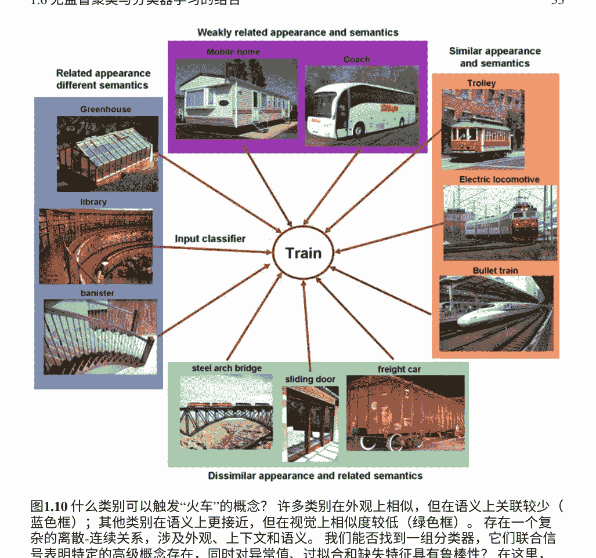

图1.10 什么类别可以触发“火车”的概念？许多类别在外观上相似，但在语义上关联较少（蓝色框）；其他类别在语义上更接近，但在视觉上相似度较低（绿色框）。存在一个复杂的离散-连续关系，涉及外观、上下文和语义。我们能否找到一组分类器，它们联合信号表明特定的高级概念存在，同时对异常值、过拟合和缺失特征具有鲁棒性？在这里，我们展示了分类器（例如图书馆、钢拱桥、货车、移动房屋、电车等），它们在有限的训练数据中被我们的方法一致选择为对“火车”类别提供有价值的输入。

单个特征或相关分类器的正输出的存在并不足以确定我们感兴趣的类别的存在。然而，当许多这样的关键输出同时触发时，它们的联合存在是一个强烈的信号，它们的平均输出可以成为一个强大的分类器。现在我们展示了我们可以将分类器学习形式化为一个特征选择任务，通过自动选择与给定分类问题相关的分类器子集。我们还展示了所选特征（或分类器）的平均响应是我们问题表达式的最优解，并且它变得等同于之前提出的图聚类表达式。`IPFP` 立即成为解决此特征选择任务的选择方法，我们提出了监督和无监督方法。这里介绍的工作并在详细介绍中呈现第4章，最初发表在 `Leordeanu` 等人的 `[82]` 中，揭示了我们提出的无监督学习原则的一个特定用例：

> > 原则6

> > 当几个弱独立的分类器一直一起触发时，它们会发出一个信号，表明存在一个更高级别的类别，可以学习一个更强的分类器。

在图1.10中，我们呈现了代表我们方法的结果。我们使用在 `ImageNet` 上预训练的图像级 `CNN` 分类器 `Jia` 等人的 `[93]`，来识别来自 `YouTube-Objects` 数据集 `Prest` 等人的视频帧中的火车。我们所知道的关于监督信号的一切就是 `CNN` 分类器与感兴趣类别的相关性。更具体地说，它们在正样本的输出值上是否平均比负样本的输出值更大？这是我们无监督方法所需的唯一信息。在训练期间，我们不需要知道哪些训练图像包含火车，哪些不包含。我们的方法可以在几乎无监督的方式下，从6000个预训练的 `CNN` 分类器的大池中快速发现相关特征组，这些分类器共同形成了一个强大的“火车”类别分类器。由于每个分类器对应一个 `ImageNet` 概念（通常与“火车”概念非常不同），我们展示了在30个实验试验中，使用不同的无标签训练集的正负样本，我们的方法一直选择的一些分类器。

#### 1.6.2.1 盲人与大象

图1.11所示的实验让我们想起了一个起源于印度次大陆的古老寓言，讲述了六个盲人想要了解一种新奇的动物——大象的特性，这种动物来到了他们的城镇。他们去触摸这只动物，并根据他们有限的触觉感知形成了对这种新动物的印象。一个人触摸到大象的鼻子，说这种动物像一条粗壮的蛇。另一个人触摸到大象的耳朵，认为大象像某种类型的扇子。另一个盲人的手碰到了大象的腿，他说这种动物看起来像一根树干，而另一个触摸到大象侧面的盲人觉得这种动物像一堵墙。触摸到大象尾巴的人认为大象像一根绳子，而触摸到大象象牙的最后一个人说大象光滑而坚硬，像一支矛（图1.11）。

这个寓言可以有很多解释，并且适用于我们学习和形成对世界的形象的很广泛的情况。由于我们有限的感官和有限的经验，我们对世界本质上形成了一个非常主观和有限的形象。然而，我们可以立即看到这个寓言完美地描述了我们第六个原则所涉及的情况，正如图1.11中的结果所示。我们注意到每个分类器在看到视图时都以自己的方式做出反应。

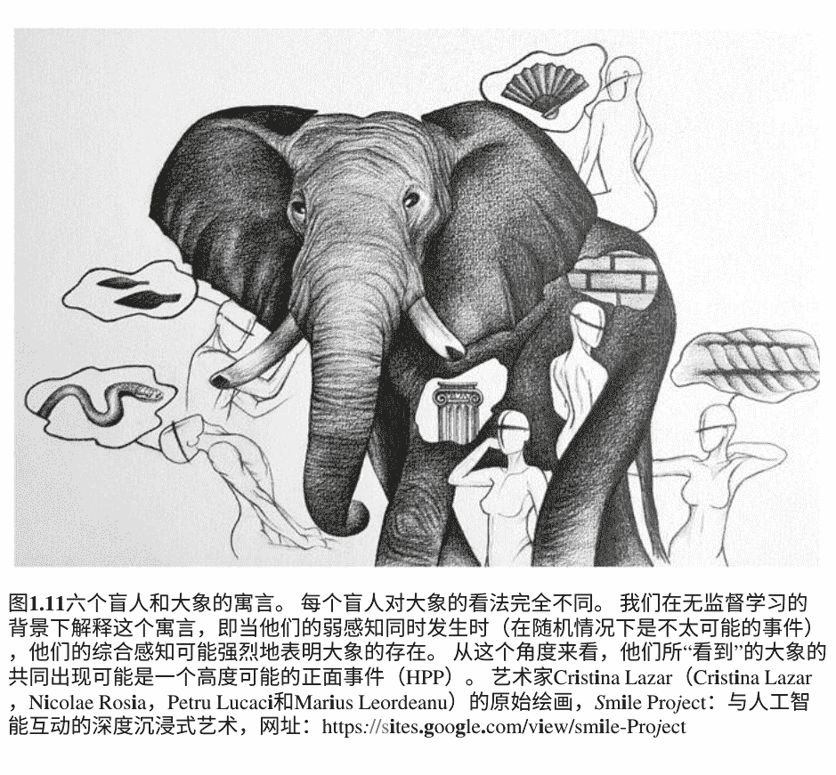

火车：一个人将其视为图书馆，另一个将其视为钢拱桥，或者货车，或者移动房屋，或者有轨电车。没有人将其视为“火车”，因为他们没有接受过“火车”的训练。他们有限的经验和超越所知的感知能力阻止了每个分类器对火车的反应，只对火车做出反应。相反，他们对于类别的反应通常与火车完全不同，就像盲人对大象的“类别”的看法与大象不同一样。

然而，在无监督学习的背景下，我们对这个寓言的不同新视角带来了以下新的认识：即使没有一个盲人独立地看到大象，当他们同时看到他们声称看到的物体时，很可能他们面前的是一只大象而不是其他动物。正如原则6所说，他们弱分类器的联合共现（输出错误类别但与大象呈正相关）共同成为一个非常强大的分类器，可以准确地检测到大象。

### 1.6.2.2 特征选择和分类器学习作为图聚类

我们处理二元分类的情况，并将一对多策略应用于多类情况。我们有一组 $N$ 个样本，每个第 $i$ 个样本表示为列向量 $\mathbf{f}_i$，我们的分类器输出值在 $[0, 1]$ 之间。我们希望找到向量 $\mathbf{w}$，其元素在 $[0, 1/k]$ 之间，并且具有单位 $l^1$-范数（这些约束基本上强制选择的特征数量为 $k$），使得当第 $i$ 个样本来自正类时，$\mathbf{w}^T\mathbf{f}_i \approx \mu_P$，否则 $\mathbf{w}^T\mathbf{f}_i \approx \mu_N$，其中 $0 \leq \mu_N < \mu_P \leq 1$。

对于一个标记的训练样本 $i$，我们固定了真实目标 $t_i = \mu_P = 1$（如果是正样本）和 $t_i = \mu_N = 0$（如果是负样本）。我们对特征 $f_j$ 施加聚类式约束，限制每个单独特征的影响，鼓励选择在组合中强大的特征，而没有一个特征单独占主导地位。我们寻找的解决方案是加权特征平均值，其集合响应在正样本上比负样本上更强。为此，我们希望任何特征 $f_j$ 在正样本上的期望值 $E_P(f_j)$ 大于其在负样本上的期望值 $E_N(f_j)$。

# 监督与无监督学习框架及视频对象分割

我们通过标记样本（或将其视为给定值）估计特征的符号 `sign(f_j) = E_P(f_j) - E_N(f_j)`，如果为负数，我们简单地翻转特征：`f_j \leftarrow 1 - f_j`。

## 监督学习

我们将监督学习任务制定为最小二乘约束最小化问题。给定特征矩阵 `\mathbf{F}` 大小为 `N \times n`，其中 `\mathbf{f}_i^T` 在第 `i` 行，以及真实目标向量 `\mathbf{t}`，我们寻找最小化 `\|\mathbf{Fw} - \mathbf{t}\|^2 = \mathbf{w}^T(\mathbf{F}^T\mathbf{F})\mathbf{w} - 2(\mathbf{F}^T\mathbf{t})^T\mathbf{w} + \mathbf{t}^T\mathbf{t}` 并满足所需约束的 `\mathbf{w}^*`。我们去掉最后一个常数项 `\mathbf{t}^T\mathbf{t}`，并得到以下凸最小化问题：

> $$\begin{align*} \mathbf{w}^* &= \arg \min_{\mathbf{w}} J(\mathbf{w}) \tag{1.13}\\ &= \arg \min_{\mathbf{w}} \mathbf{w}^T(\mathbf{F}^T\mathbf{F})\mathbf{w} - 2(\mathbf{F}^T\mathbf{t})^T\mathbf{w}\\ & s.t. \sum_{j} w_j = 1, \; w_j \in [0, 1/k]. \end{align*}$$

最小二乘法的表述与Lasso、Elastic Net和其他正则化方法有关，不同之处在于我们的情况下，`\mathbf{w}` 的各个元素受限于 `[0, 1/k]`。这导致了关于稀疏性的重要性质，并直接影响了泛化能力。对 `\mathbf{w}` 的这种约束实际上是关键，是将我们的问题转化为特征选择和图聚类的一个最重要的要素。

## 几乎无监督的情况

考虑一个正确翻转的带符号特征池，这些特征的符号可以通过少量标记样本给出或估计。我们假设正样本和负样本的带符号特征的期望值分别接近于真实目标值 (`\mu_P, \mu_N`)。这个假设在实践中可以通过适当的归一化来近似实现，该归一化可以从小的有监督集合中估计得到。然后，对于给定的样本 `i` 和满足约束条件的任何 `\mathbf{w}`，加权平均值 `\mathbf{w}^T\mathbf{f}_i` 的期望值也接近于真实目标 `t_i`：`E(\mathbf{w}^T\mathbf{f}_i) =`

然后，对于所有样本，我们有期望 `E(\mathbf{F} \mathbf{w}) \approx \mathbf{t}`，这样任何可行的解决方案都会产生平均而言近似正确的答案。因此，我们可以将监督学习方案视为试图减少特征集合输出的方差，因为它们的期望值接近于真实目标。如果我们将 `E(\mathbf{F} \mathbf{w}) \approx \mathbf{t}` 近似为目标 `J(\mathbf{w})`，我们得到一个新的无需真实目标的目标 `J_u(\mathbf{w})`，具有以下学习方案，一旦特征符号已知，就是无监督的。这里 `\mathbf{M} = \mathbf{F}^{\top} \mathbf{F}`：

\[

\begin{aligned}

\mathbf{w}^* &= \underset{\mathbf{w}}{\arg \min} \, J_u(\mathbf{w}) &(1.14)\\

&= \underset{\mathbf{w}}{\arg \min} \, \mathbf{w}^{\top} (\mathbf{F}^{\top} \mathbf{F}) \mathbf{w} - 2 (\mathbf{F}^{\top} (\mathbf{F} \mathbf{w}))^{\top} \mathbf{w}\\

&= \underset{\mathbf{w}}{\arg \min} \, (-\mathbf{w}^{\top} (\mathbf{F}^{\top} \mathbf{F} \mathbf{w})) = \underset{\mathbf{w}}{\arg \max} \, \mathbf{w}^{\top} \mathbf{M} \mathbf{w}\\

&\text{s.t.} \, \sum_j w_j = 1, \, w_j \in [0, 1/k].

\end{aligned}

\]

请注意，尽管有监督的情况是一个凸优化问题，但无监督学习方案是一个凹优化问题，这是NP难的。这是由于矩阵 `\mathbf{M}` 的符号变化。由于（几乎）无监督情况下的 `\mathbf{M}` 可以由更多的无标签数据创建，`J_u(\mathbf{w})` 实际上可能比 `J(\mathbf{w})` 更少噪声，并且产生显著更好的局部最优解-这是实验证实的事实。

## 直觉和整体方法

在第4章中，我们将更详细地讨论两种表达所揭示的见解。从一开始，我们注意到两种表达都非常适合IPFP进行优化，并且与之前介绍的聚类方法完全相同。当我们看一下更有趣的（几乎无监督的情况）时，与聚类的关系变得更加清晰，它由正（或半正）定矩阵 `\mathbf{F}^{\top} \mathbf{F}` 形成的二次项，其中包含样本之间特征响应对应的点积。该矩阵与特征的协方差矩阵密切相关，反映了它们在成对水平上的相关性。很明显，最大化二次项可以被解释为具有成对约束的聚类任务。正如我们将在第3章中展示的那样，在聚类约束下，问题的最优解保证是稀疏的，所有非零权重都等于 `1/k`。从直观和理论的角度来看，我们可以说我们的分类器学习任务只是（几乎）无监督情况下的聚类问题。我们通过找到具有最强簇内得分的特征组来解决任务，这是最大协方差的数量。它们强烈地同时发射或不发射，并且这种一致性，在随机情况下是不太可能的，是一种强大的监督信号，表明存在一个新类别。

在没有地面真实标签的情况下，如果我们假设池中的特征通常是正确签名且不冗余的，则最大协方差由那些随着隐藏类标签的变化而集体平均变化最大的特征达到。因此，我们希望（几乎）无监督的变体寻找以统一、综合的方式响应的特征，这种方式对两个类别的分布自然变化敏感。换句话说，好的特征响应的总体二阶信号的变化（由协方差矩阵捕获）由于两个类别之间的自然差异而最强，与更或多或少独立且经常相互抵消的噪声变化相比。

将分类器学习作为特征选择和聚类问题的整体算法可以总结如下：

```
算法1.4通过聚类进行特征选择和分类器学习
从一小组有标签样本中学习特征符号。
从无标签数据中创建具有翻转特征的F。
设置 M ← F^T F，找到 w* = arg_m w^T M w
s.t. ∑_j w_j = 1，w_j ∈ [0, 1/k]。
返回 w*
```

正如讨论的那样，IPFP可以立即应用，因为我们可以很容易地注意到算法1.4的第4步与之前讨论的聚类问题1.10的相似性：`w`扮演指示向量`x`的角色，而`1/k`扮演`\epsilon`的角色。该公式是一个聚类任务，IPFP直接应用。

### 1.7 视频中的无监督学习用于对象分割

到目前为止，我们已经建立了在空间和时间上进行无监督学习的基本要素、思想和算法。在视频中无需人工监督地发现移动的新对象是视觉学习中最有趣和具有挑战性的问题之一。通过观看视频，我们能学到多少，当大量视频数据可用但没有任何地面真实标签，我们只是被动观察者时，学习的限制是什么。这种情况似乎是最困难的，这正是我们想要研究它的原因，以更好地理解空时域学习的限制。我们在本节介绍的工作，然后在第6章中详细介绍，其核心基于无监督视觉学习的一个关键原则的观察结果，我们在开头介绍过：

> **原则4**

> 物体在其时空邻域中形成强烈的运动轨迹和外观模式的聚类。

尽管人们倾向于对给定视频镜头中的主要对象达成一致意见，描述了空间和时间中的某个邻域，但我们还不清楚如何做到这一点。还有许多有趣的问题等待回答：是哪些特定特征使一组像素突出为一个单一的主要对象在给定的序列中？是点轨迹的模式，共同的外观还是与背景的对比使对象突出为一个单一实体？还是所有这些因素的组合以及如何最好地结合它们？我们是否需要广泛的预训练或一些内在的更高级的“对象性”Alexe等人[95]的特征才能开始学习，或者我们原则上可以从头开始？

我们观察到世界在空间和时间上是一致和连贯的，被很好地结构化为共享许多分组属性的对象，早期的心理学家也认识到了这一点[71]。由于视频是空间和时间中4D世界的投影，它们应该继承许多其属性，同样，思维应该能够充分利用它们。接下来，我们简要介绍我们在空间和时间中进行对象发现的原始方法，最初发表在Haller等人[84]中，通过广泛的实验验证（第6章）证明使用非常简单的运动和外观特征可以发现空间和时间中的对象作为聚类。该方法足够通用，并且可以自然地扩展以合并更强大的预训练特征。

-   （1）对象的同一点在不同时刻由不同像素捕获，通过长程运动链-作为时间函数的空间轨迹将这些像素连接起来；

-   （2）占据不同空间位置的对象的不同点共享相似的运动和外观模式；

### 1.8 时空图

-   （3）对象的运动和外观模式通常可以相互预测，并在空时上对对象的形状和存在达成一致——从运动中估计的内容也应该从外观中估计。

因此，外观和运动可以相互提供监督信号，并共同发挥作用。在本书的最后一部分（第8章）中，我们进一步扩展了基于不同类型信息（例如运动与外观）的预测路径上的一致性寻找的相同思想，提出了一种新颖的视觉故事概念，旨在提供一种通用的无监督学习方法。我们再次认识到，只有通过相互协议，我们才能最终实现在野外的无监督学习，这种协议自然发生，因为空间和时间的结构、连贯性和一致性。

接下来，我们提出了一种新颖的时空图结构，其中分割被定义为具有运动和外观约束的谱聚类问题。分割然后被找到作为特征运动的主导特征向量。矩阵。从数学上讲，这种方法与我们之前对图匹配的表述立即相关，这也利用了一个具有非负元素的对称矩阵的主特征向量自然地反映了其相关图的主要、最强的簇。从概念上讲，视频中的每个像素都是我们图中的一个节点，但我们从不明确计算矩阵，因为那是不可能的。相反，我们提供了一种高效的方法，可以找到矩阵的主特征向量，而无需实际构造它。

给定一系列`$m$`视频帧，我们希望提取`$m$`软分割，每帧一个，定义序列中主要对象的掩码。从概念上讲，整个视频是一个图形，每个像素点都有一个节点。

**时空像素图**：我们定义时空图`$G = (V, E)$`：每个节点`$i \in V$`与视频序列的一个像素相关联。

**光流链**：由光流定义的轨迹从给定像素开始，沿着时间和空间的体积逐帧移动，定义了光流链(Fig.1.12a)。只有当它们之间至少存在一条链时，两个节点（像素）才会连接。这些像素预计代表对象上的同一物理点。

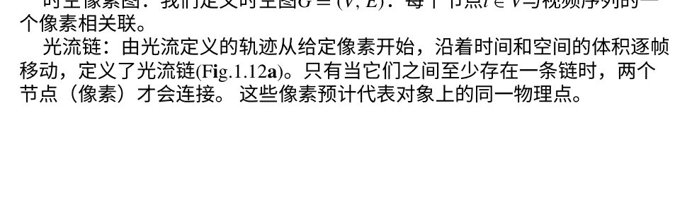

图1.12的视觉表示如何形成时空图。a `$i_0$`到`$i_{10}$`是图节点，对应于不同帧的像素。彩色线表示光流链，通过按顺序从一帧到下一帧追踪光流（向前或向后）形成。因此，如果存在一系列光流流将它们通过中间连续帧连接起来，两个节点将连接在一起。从给定节点出发，总会有两个流出，一个向每个方向，但可能没有或多个链进入（例如，节点`$i_7$`）。黑线表示图边，定义为至少由一条流链连接的节点之间的边。b流链也用于构建节点特征。对于给定的节点`$i_0$`，形成特征向量`$f_i$` 0 沿着出流链收集的数据，表示沿着链的运动和外观模式。

**运动矩阵**:`$\mathbf{M} \in \mathbb{R}^{n \times n}$`, 其中 `$\mathbf{M}_{i, j} = l(i, j) \cdot k(i, j)$`, 其中 `$k(i, j)$`是一个关于节点 `$i$` 和 `$j$`之间时间距离的高斯核函数, 而 `$l(i, j)=1$`表示节点 `$i$` 和 `$j$`按照上述解释连接, 否则为零。`$\mathbf{M}$`是对称的、半正定的, 具有非负元素, 并且预计非常稀疏。

**节点特征**：每个节点 `$i$`还通过其外观特征进行描述, 由向量 `$\mathbf{f}_i \in \mathbb{R}^{1 \times d}$`表示, 沿着从 `$i$`开始的每个运动链 (图1.12b) 收集一个方向的特征。我们将所有外观特征堆叠成一个特征矩阵 `$\mathbf{F} \in \mathbb{R}^{n \times d}$`。

**节点标签**：每个节点 `$i$`都有一个相关的 (软) 掩码标签 `$x_i \in [0, 1]$`, 表示我们认为该节点是感兴趣对象的一部分。因此, 我们可以在空间和时间上表示整个视频的分割解决方案, 作为一个指示向量 `$\mathbf{x} \in \mathbb{R}^{n \times 1}$`, 其中每个视频像素 (图节点) 都有一个标签 `$\mathbf{x}_i$`。

请注意, 符号与先前的图匹配和聚类公式相似。

我们在时空图中找到最主要的感兴趣对象, 这样属于主要对象的像素通过运动链强连接, 同时也可以从对象外观特征进行预测。值得一提的是, 我们并不期望运动链始终准确, 但我们确实期望属于同一对象的像素在 `$\mathbf{M}$`中形成一个强运动聚类。与之前讨论的图匹配和聚类的情况类似, 我们通过标签指示向量 `$\mathbf{x}$`来表示时空聚类, 其中 `$\mathbf{x}_i =1$`表示节点 `$i$`属于聚类, `$\mathbf{x}_i =0$`表示不属于聚类。然后, 聚类内部得分为 `$S_c = \mathbf{x}^T \mathbf{M} \mathbf{x}$`, 具有以下属性: 标签 `$\mathbf{x}$`允许取软值, 具有单位范数 `$\|\mathbf{x}\|_2 = 1$` (只有它们的相对值对于分割对象和背景很重要) , 并且位于特征子空间中: 它是特征矩阵 `$\mathbf{F}$`的列的线性组合。 要求 `$\mathbf{x}$`是 `$\mathbf{F}$`的列的线性组合可以通过要求 `$\mathbf{x} = \mathbf{P}\mathbf{x}$`来实现, 其中 `$\mathbf{P}$`是特征投影矩阵 `$\mathbf{P} = \mathbf{P}^T = \mathbf{F}(\mathbf{F}^T \mathbf{F})^{-1} \mathbf{F}^T$`, 它将向量投影到 `$\mathbf{F}$`的列所张成的子空间中。 我们得到了以下结果, 我们在第6章中证明:

**命题1.1** `$\mathbf{x}^*$`使得在约束条件下最大化 `$\mathbf{x}^T \mathbf{M} \mathbf{x}$`, 其中 `$\mathbf{x} = \mathbf{P}\mathbf{x}$`和 `$\|\mathbf{x}\|_2 = 1$`, 也使得在约束条件下最大化 `$\mathbf{x}^T \mathbf{P}\mathbf{M}\mathbf{P}\mathbf{x}$`, 其中 `$\|\mathbf{x}\|_2$`。

我们现在可以定义我们的最终优化问题为

$$\mathbf{x}^* = \arg \max_{\mathbf{x}} \mathbf{x}^T \mathbf{P}\mathbf{M}\mathbf{P}\mathbf{x} \quad \text{s.t.} \quad \|\mathbf{x}\|_2 = 1 \tag{1.15}$$

**特征-运动矩阵**：我们将 `$\mathbf{P}\mathbf{M}\mathbf{P}$`称为特征-运动矩阵, 它将对象在时空中的运动与外观特征 `$\mathbf{F}$`通过在特征空间上的投影 `$\mathbf{P}$`相耦合。

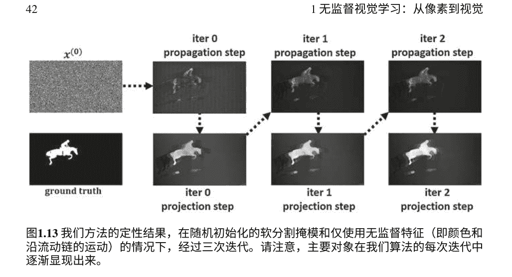

#### 1.8.1 优化算法

问题（方程1.15）通过主特征向量 `$\mathbf{x}^*$`来最优解 `$\mathbf{P}\mathbf{M}\mathbf{P}$`。这是一个经典的谱聚类案例[96]，也与谱方法在图匹配中相关[97]。注意根据Perron-Frobenius定理，`$\mathbf{x}^*$`必须具有非负值，因为 `$\mathbf{P}\mathbf{M}\mathbf{P}$`具有非负元素。我们的高效算法（算法1.5）通过幂迭代方法收敛到 `$\mathbf{x}^*$`，巧妙地利用了时空视频图，而无需显式计算 `$\mathbf{P}\mathbf{M}\mathbf{P}$`。算法（`GO-VOS`）的步骤在传播标签 `$\mathbf{x}$` 时交替进行，根据它们的运动链（由 `$\mathbf{M}$` 中的光流链定义）进行传播，并通过 `$\mathbf{P}$` 将 `$\mathbf{x}$` 投影到 `$\mathbf{F}$` 的特征列空间上（图1.13），同时也对 `$\|\mathbf{x}\|_2 =1$` 进行归一化。

**算法1.5 `GO-VOS`：无监督视频目标分割。**下面我们介绍了无监督目标分割的谱方法的三个主要步骤，通过幂迭代计算出主特征向量。请注意，我们的实现有效地计算了下面的三个步骤，而无需显式构建矩阵 `$\mathbf{M}$`。`$it$` 表示迭代次数。

1.  传播：`$x^{(it+1)} \leftarrow \mathbf{M}x^{(it)}$`
2.  投影：`$x^{(it+1)} \leftarrow \mathbf{P}x^{(it+1)}$`
3.  归一化：`$x^{(it+1)} \leftarrow x^{(it+1)}/\|x^{(it+1)}\|_2$`

请注意，`GO-VOS`（算法1.5）与图匹配的谱方法之间存在直接关系。该算法简化为寻找特征-运动矩阵 `$\mathbf{P}^T \mathbf{M} \mathbf{P}$` 的主特征向量。有趣的是，该算法还与IPFP相关，因为在传播步骤之后紧接着是投影步骤，而在这种情况下是在特征子空间上进行的。第二次投影直接在单位球体上进行。 相对容易证明该方法的三个步骤等价于对矩阵 `$\mathbf{P}^T \mathbf{M} \mathbf{P}$` 应用幂迭代。 它们可以解释如下：

-   **传播步骤**：该步骤仅传播运动信息，仅对编码运动的矩阵 `$\mathbf{M}$` 执行幂迭代。仅靠这一步骤无法发现物体，因为外观特征对于加强由运动传递的分组信息也很重要。该步骤可以通过投票过程高效实现，在视频中像素数量上是线性的（当光流链限制在每个节点周围的固定邻域时），并且不需要显式构建矩阵 `$\mathbf{M}$`。
-   **特征投影步骤**：该步骤确保所得到的解位于特征矩阵 `$\mathbf{F}$` 的列空间中，这意味着像素标签可以线性回归到特征子空间：每个软标签基本上是该节点处特征值的线性组合。通过这个投影步骤，运动和外观信息以互补的方式耦合在一起，从而加强彼此并使物体发现过程更加稳健。该步骤可以分别逐帧应用，速度和准确性得到改善。

- 归一化步骤：最后一个归一化步骤保持 L2 范数的 x 不会以不可预测的方式增长或缩小。请注意，在分割的情况下，只有相对软像素标签值对将软掩码分离为对象和背景区域起作用。

该算法在实践中具有出色的准确性和速度，在几个当前基准测试中产生了最先进的结果，如`DAVIS`、`SegTrack`和`YouTube-Object`数据集，我们在第6章中详细介绍。在图1.14中，我们展示了`SegTrack`数据集上的一些定性结果。

## 1.8.2 学习多个教师-学生生成的无监督分割

现在，在我们的引言章节结束时，我们将迄今为止提出的思想结合起来，并引入一个系统，以无监督的方式学习在单个图像上多个教师-学生生成中分割对象。在其核心，下面和第7章中更详细地介绍的方法，Croitoru等人[98, 99]结合了本章讨论的许多关键思想，特别是最后一个提出的第7原则，用于无监督学习。

> 原则7

> 为了改进或学习新的类别，我们需要增加训练数据的数量和难度，以及分类器的能力和多样性。通过这种方式，我们可以在几代人中以无监督的方式学习

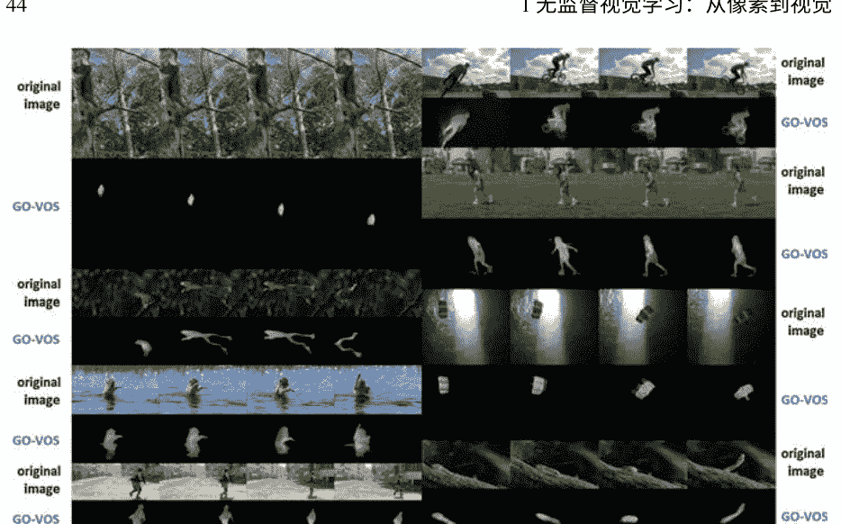

> 使用现有分类器之间的一致性作为新分类器的教师监督信号。

这里介绍的系统由两个主要路径组成，一个在视频或大型图像集合中执行无监督的对象发现——教师分支，另一个是学生分支，从教师那里学习在单个图像中分割前景对象。然后，无监督学习过程在几代学生和教师之间继续进行。在算法1.6中，我们介绍了我们方法的高级描述。我们方法的关键方面，确保了从一代到下一代的性能改进，包括：(1)存在一个无监督选择模块，能够选择教师生成的高质量掩码并将其传递给下一代学生进行训练；(2)训练具有不同架构的多个学生，通过它们的多样性来帮助训练下一次迭代的更好选择模块，并与选择模块一起形成更强大的教师路径；(3)可以访问更大数量和可能更复杂的未标记数据，随着代数的增加，这些数据变得更加有用。

我们的方法是通用的，学生或教师的路径不依赖于特定的神经网络架构或实现。通过许多实验和与最先进的方法的比较，我们还展示了（第7章）它适用于计算机视觉中的不同任务，如视频中的对象发现，无监督图像分割，显著性检测和迁移学习。

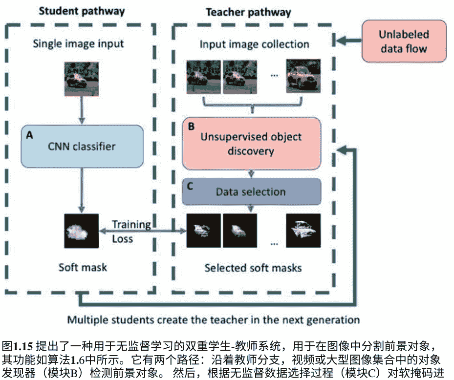

图1.15提出了一种用于无监督学习的双重学生-教师系统，用于在图像中分割前景对象，其功能如算法1.6中所示。它有两个路径：沿着教师分支，视频或大型图像集合中的对象发现器（模块B）检测前景对象。然后，根据无监督数据选择过程（模块C）对软掩码进行过滤。使用由输入图像（或视频帧）和该特定帧的软掩码（作为无监督标签）组成的最终一组对来训练学生路径（模块A）。整个过程可以在几个世代中重复进行。在每一代中，训练多个学生CNN，然后它们共同贡献于训练一个更强大的选择模块C（由深度神经网络建模），并形成下一次迭代中整体算法的更强大的教师路径。

在图1.15中，我们展示了我们完整系统的图形概述。在无监督训练阶段，学生网络（模块A）逐帧地从无监督的教师路径（模块B和C）中学习，以在单个图像中生成类似的物体掩码。模块B发现图像或视频中的物体。模块C选择由模块B生成的掩码是否足够好以传递给模块A进行训练。因此，学生分支尝试模仿模块B的输出，用于模块C选择的帧。它的输入只是单个图像-当前帧，而教师可以访问整个视频序列。

训练后的学生（模块A）的强度取决于模块B的性能。然而，正如我们在实验中看到的（第7章），选择模块C的能力有助于新的学生优于其初始教师模块B。因此，在本文中，我们将B称为初始的“教师”，将B和C一起称为完整的“教师路径”。算法1.6中提出的方法遵循系统从一次迭代中学习的主要步骤（一代）到下一代。完整的系统和步骤在第7章中有更详细的讨论。

在算法1.6的第一次迭代中，无监督的教师（模块B）可以随时间访问信息-视频。相比之下，学生在结构上更深，但它只能访问单个图像-当前视频帧。因此，教师在时间上发现的信息通过学生在添加的深度中被捕获，通过神经层次的抽象。在第一次迭代中训练了几个具有不同架构的学生网络。为了仅使用好质量的掩码作为监督信号，应用了无监督的掩码选择过程（在第1次迭代中非常简单）（模块C），如第7章第7.4节中所解释的那样。一旦训练了几个学生网络，它们可以以各种方式形成（如第7.4.1节和第7.5.1节中所解释的）下一次迭代的教师路径，以及一个更强大的无监督选择模块C，由一个名为`EvalSeg-Net`的深度神经网络表示，如第7章第7.4.3节中详细解释的那样。简而言之，`EvalSeg-Net`学习预测通常多样的学生之间的输出掩码一致性，这在掩码质量良好时统计上发生。因此，`EvalSeg-Net`可以用作无监督的掩码评估过程和强大的选择模块。然后，在下一代中运行新形成的教师路径（模块B和C）在更大的未标记视频集或图像集上，为下一代学生生成监督信号。在实验中，我们展示了下一次迭代中模块B和C的改进，以及数据量的增加，都是重要的，但不是必要的，以提高下一代的准确性。

请注意，虽然在第一次迭代中，教师路径需要接收视频序列作为输入，但从第二代开始，它也可以接收大型图像集合作为输入。由于训练时需要非常高的计算和存储成本，我们将实验限制在两代学习上，但我们的算法是通用的，可以运行多次迭代。

我们在广泛的实验中表明，即使只有两代，也足以在视频和图像的对象发现方面超越当前的技术水平。我们还通过实验证明，每个组件（模块A中的个体学生，模块B中的教师以及选择模块C）在下一代中都有明显的改进。

在图1.16中，我们展示了不同模型（包括它们的集合）在不同迭代中的视觉比较结果。从一个迭代到下一个迭代的质量改善明显可见，并且平均准确率（F-度量）也提高了5%。我们邀请读者仔细阅读第7章的材料，其中详细描述了我们提出的系统的描述和实验分析。在这里，我们总结了我们在分析结束时得出的一些结论和观察。

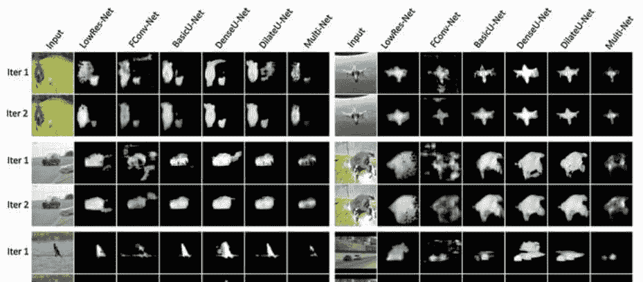

图1.16 每次迭代（生成）中模型之间的视觉比较。多网络，用于比较，表示五个模型之间的逐像素乘法。请注意第二代学生的优越掩模，形状更好，孔洞更少，边缘更锐利。还请注意集成多网络的相对较差的召回率，它产生较小、侵蚀的掩模。

### 算法1.6 无监督学习前景对象分割

- 步骤1: 在未标记的视频（或图像集合，在后续迭代中）中通过教师路径（图7.1中的模块B）执行无监督对象发现。

- 步骤2: 自动过滤掉在上一步骤中产生的低质量软掩模（图7.1中的模块C）。

- 步骤3: 使用剩余的掩模作为训练一个或多个学生网络的监督信号，沿着学生路径（图7.1中的模块A）进行训练。

- 步骤4: 使用当前一代中的一个或多个学生网络（一个新模块B）来学习一个更强大的软掩模选择器（一个新模块C），用于下一次迭代。

- 步骤5: 扩展未标记的视频或图像数据集，并返回到步骤1训练下一代（注意：从第一次迭代开始，训练数据集也可以扩展到未标记的图像集合，而不仅仅是视频）。

## 1.8.3 结论

我们在第7章的分析中得出的一个有趣的结论是，系统能够从第一次迭代到第二次迭代改善其性能。 有几个因素导致了这个结果，我们认为它们通过以下关系相关：（1）多个具有不同结构的学生确保多样性和相对独立的错误；（2）反过来，点（1）使得可能进行无监督训练的掩模选择模块学习预测一致性；（3）因此，点（2）处的选择模块成为一个良好的掩模评估网络；（4）一旦可用（来自3的评估网络），我们可以添加更大且可能更复杂的数据，以选择下一次迭代中具有良好对象掩模的更有趣的案例集；（5）最后，（4）确保在下一次迭代中的改进，现在我们可以返回到点（1）。

## 1.9 下一步

在这个介绍性的章节中，我们奠定了我们在空间和时间上进行无监督学习的基础。我们从一些直观的洞察力和动机开始，并提出了一套简明有效的无监督学习原则。它们基于我们在该主题上的理论和实证观察，涵盖了各种问题，从图匹配和聚类到无监督分类器学习、视频中的对象发现以及多个教师-学生世代的无监督学习。

我们将这些任务与主要的统一原则联系起来，并密切关注理论形式化、优化算法、图表示和解决方案的发展。这些解决方案从相对简单的开始，逐渐发展成更一般的方法和算法，例如使用`HPP`特征进行学习、应用于不同任务的谱技术以及整数投影固定点方法。所有这些方法都将在接下来的章节中详细介绍，包括理论和实验层面。我们希望读者现在对这些概念已经很熟悉，并且在深入探索接下来的内容时会更容易理解。

在最后一章中，我们重新强调和综合了本书中涵盖的思想，但从将无监督学习引入未来的角度来看。我们最终的目的是想象一个通用机器，即视觉故事网络，它可以自己学会看。要实现这样的系统，需要什么条件？今天的数学工具和神经网络，结合我们的实际经验，是否足以真实地思考这样一个系统？

我们特别邀请对人工智能和学习充满热情的年轻读者，一直探索本书直到最后。他们的创造力将带领他们进行一次意想不到的想象之旅，成长之旅和发现之旅，其中有许多有趣的思想和知识满足等待着他们。我们鼓励他们花时间阅读，思考，然后在时空的无监督学习世界中创造。通过这种方式，新一代人将设法将我们的知识推向我们现在认为不可能的更美好和令人惊讶的未来领域。

### 参考文献


1. 甘G，马C，吴J (2007) 数据聚类：理论，算法和应用，第20卷。Siam
2. 劳埃德S (1982) 最小二乘量化在pcm中。IEEE Trans Inf Theory 28 (2) : 129-137
3. 登普斯特AP，莱尔德NM，鲁宾DB (1977) 通过em算法从不完整数据中获得最大似然估计。J Roy Stat Soc: Ser B (Methodol) 39 (1) : 1-22
4. 科曼尼修D，米尔P (2002) 均值漂移：一种鲁棒的特征空间分析方法。Pattern Anal Mac Intell 24(5):
5. 福冈K，霍斯特勒L (1975) 密度函数梯度的估计及其在模式识别中的应用。IEEE Trans Inf Theory 21 (1) : 32-40
6. 埃斯特M，克里格尔HP，桑德J，徐X等 (1996) 一种基于密度的用于发现带有噪声的大型空间数据库中的聚类的算法。在：Kdd，第96卷，第226-231页
7. 戴WH，埃德尔斯布伦纳H (1984) 聚合层次聚类方法的高效算法。J Classif 1 (1) : 7-24
8. Ward JH Jr (1963年) 分层聚类以优化目标函数。J Am Stat Assoc 58 (301) : 236-244
9. Sibson R (1973年) Slink: 一种用于单链接聚类方法的最优效率算法。Comput J 16 (1) : 30-34
10. Johnson SC (1967年) 分层聚类方案。Psychometrika 32 (3) : 241-254
11. Kaufman L, Rousseeuw PJ (2009年) 在数据中查找群组：聚类分析简介，vol 344. Wiley
12. Cheeger J (1969年) 拉普拉斯算子最小特征值的下界。在：纪念S. Bochner教授的普林斯顿会议论文集，第195-199页
13. Donath WE, Hoffman AJ (1972年) 基于连接矩阵的图分区算法和计算机逻辑。IBM Tech Discl Bull 15 (3) : 938-944
14. Meila M, Shi J (2001年) 通过随机游走学习分割。在：神经信息处理系统的进展，第873-879页
15. Shi J, Malik J (2000) 归一化割和图像分割. PAMI 22(8)
16. Ng A, Jordan M, Weiss Y (2002) 光谱聚类的分析和算法. 在：NIPS
17. Duda RO, Hart PE, Stork DG (2012) 模式分类. Wiley
18. Sivic J, Zisserman A (2003) 视频谷歌：一种文本检索方法用于对象匹配在视频中. 在：CVPR
19. Leordeanu M, Collins R, Hebert M (2005) 从视频序列中无监督学习对象特征. 在：IEEE计算机学会计算机视觉和模式识别会议, IEEE计算机学会; 1999, vol 1, p 1142
20. Kwak S, Cho M, Laptev I, Ponce J, Schmid C (2015) 无监督的对象发现和视频集合中的跟踪. 在：IEEE国际计算机会议论文集, pp 3173–3181
21. 刘D，陈T (2007) 无监督视频对象发现的主题运动模型。在：CVPR
22. 王L，华G，Sukthankar R，薛J，牛Z，郑N (2016) 视频对象发现和共分割与极弱监督。IEEE模式分析和机器智能交易
23. Perazzi F, Pont-Tuset J, McWilliams B, Van Gool L, Gross M, Sorkine-Hornung A (2016) A 视频对象分割的基准数据集和评估方法。在：计算机视觉和模式识别
24. Lao D, Sundaramorthi G (2018) 将分层模型扩展到3D运动。在：欧洲计算机视觉会议（ECCV）论文集，第435-451页
25. Papazoglou A, Ferrari V (2013) 在无约束视频中快速对象分割。在：IEEE国际计算机视觉会议论文集，第1777-1784页
26. Keuper M, Andres B, Brox T (2015) 通过最小成本多切割进行运动轨迹分割。在：IEEE国际计算机视觉会议论文集，第3271-3279页
27. Faktor A, Irani M (2014) 通过非局部一致性投票进行视频分割。在：BMVC，第2卷，第8页
28. Haller E, Leordeanu M (2017) 通过高概率正特征的高效选择在视频中进行无监督目标分割。在：IEEE国际计算机视觉会议论文集，第5085-5093页
29. Luiten J, Voigtlaender P, Leibe B (2018) Premvos：提议生成、细化和合并用于2018年视频目标分割的davis挑战。在：2018年CVPR视频目标分割DAVIS挑战
30. Maninis KK, Caelles S, Chen Y, Pont-Tuset J, Leal-Taixé L, Cremers D, Van Gool L (2017) 不使用时间信息的视频目标分割。arXiv预印本arXiv:170906031
31. Voigtlaender P, L eibe B (2017) 在2017年davis挑战视频目标分割中的卷积神经网络的在线适应。在：2017年CVPR视频目标分割DAVIS挑战，第5卷
32. Bao L, Wu B, Liu W (2018) CNN in MRF: video object segmentation via inference in a CNN-based higher-order spatio-temporal MRF. In: Proceedings of the IEEE Conference on Computer Vision and Pattern Recognition, pp 5977–5986
33. Wug Oh S, Lee JY, Sunkavalli K, Joo Kim S (2018) Fast video object segmentation by reference-guided mask propagation. In: Proceedings of the IEEE Conference on Computer Vision and Pattern Recognition, pp 7376–7385
34. Cheng J, Tsai YH, Hung WC, Wang S, Yang MH (2018) Fast and accurate online video object segmentation via tracking parts. In: Proceedings of the IEEE Conference on Computer Vision and Pattern Recognition, pp 7415–7424
35. Caelles S, Maninis KK, Pont-Tuset J, Leal-Taixé L, Cremers D, Van Gool L (2017) One-shot video object segmentation. In: Proceedings of the IEEE Conference on Computer Vision and Pattern Recognition, pp 221–230
36. Perazzi F, Khoreva A, Benenson R, Schiele B, Sorkine-Hornung A (2017) 从静态图像中学习视频对象分割。在：IEEE计算机视觉和模式识别会议论文集，第2663-2672页
37. Chen Y, Pont-Tuset J, Montes A, Van Gool L (2018) 基于像素度量学习的视频对象分割。在：IEEE计算机视觉和模式识别会议论文集，第1189-1198页
38. Song H, Wang W, Zhao S, Shen J, Lam KM (2018) 金字塔扩张深度卷积LSTM用于视频显著对象检测。在：欧洲计算机视觉会议论文集（ECCV），第715-731页
39. Tokmakov P, Alahari K, Schmid C (2017) 带有视觉记忆的视频对象分割学习。arXiv预印本 arXiv:1704.05737
40. Jain SD, Xiong B, Grauman K (2017) FusionSeg: 学习将运动和外观结合起来，完全自动地在视频中分割通用对象。arXiv预印本 arXiv:1701.05384


- 41. Yang Z, Wang Q, Bertinetto L, Hu W, Bai S, Torr PH (2019) 锚点扩散用于无监督的视频对象分割。 在：IEEE国际计算机视觉会议论文集，第931-940页
- 42. Wang W, Song H, Zhao S, Shen J, Zhao S, Hoi SC, Ling H (2019) 通过视觉注意力学习无监督的视频对象分割。 在：IEEE计算机视觉和模式识别会议论文集，第3064-3074页
- 43. Kulkarni TD, Gupta A, Ionescu C, Borgeaud S, Reynolds M, Zisserman A, Mnih V (2019) 无监督学习物体关键点用于感知和控制。 在：神经信息处理系统进展，第10,723-10,733页
- 44. Minderer M, Sun C, Villegas R, Cole F, Murphy K, Lee H (2019) 从视频中无监督学习物体结构和动态。NeurIPS
- 45. Thewlis J, Bilen H, Vedaldi A (2017) 通过分解空间嵌入无监督学习物体地标。 在：IEEE国际计算机视觉会议论文集，pp 5916–5925
- 46. Roufosse JM, Sharma A, Ovsjanikov M (2019) 无监督深度学习用于结构化形状匹配。 在：IEEE国际计算机视觉会议论文集，pp 1617–1627
- 47. Leordeanu M, Sukthankar R, Hebert M (2009) 无监督学习图匹配。IJCV 96(1)
- 48. Halimi O, Litany O, Rodola E, Bronstein AM, Kimmel R (2019) 无监督学习密集形状对应。 在：IEEE计算机视觉和模式识别会议(CVPR)
- 49. Vo HV, Bach F, Cho M, Han K, LeCun Y, Perez P, Ponce J (2019) 无监督图像匹配和目标发现的优化。 在：计算机视觉和模式识别（CVPR）的IEEE会议
- 50. Pei Y, Huang F, Shi F, Zha H (2011) 基于流形对齐的无监督图像匹配。IEEE模式分析与机器智能 34(8): 1658-1664
- 51. Leordeanu M, Zanfir A, Sminchisescu C (2011) 半监督学习和超图匹配的优化。在：ICCV
- 52. Rezende DJ, Eslami SA, Mohamed S, Battaglia P, Jaderberg M, Heess N (2016) 从图像中无监督学习3D结构。在：神经信息处理系统的进展，pp 4996-5004
- 53. Cha G, Lee M, Oh S (2019) 无监督的三维重建网络。在：国际计算机视觉会议上
- 54. Nunes UM, Demiris Y (2019) 无监督学习任意刚体的三维运动结构。在：IEEE国际计算机视觉会议论文集，第3809-3817页
- 55. Chen Y, Schmid C, Sminchisescu C (2019) 单目视频中基于几何约束的自监督学习：连接光流、深度和相机。在：IEEE国际计算机视觉会议论文集，第7063-7072页
- 56. Godard C, Mac Aodha O, Firman M, Brostow GJ (2019) 深入研究自监督单目深度估计。在：IEEE国际计算机视觉会议论文集，第3828-3838页
- 57. Zhou T, Brown M, Snavely N, Lowe DG (2017) 从视频中无监督学习深度和自我运动。在：IEEE计算机视觉和模式识别会议论文集，第1851-1858页
- 58. Ranjan A, Jampani V, Balles L, Kim K, Sun D, Wulff J, Black MJ (2019) 竞争协作：无监督学习深度、相机运动、光流和运动分割。在：IEEE计算机视觉和模式识别会议论文集，第12,240-12,249页
- 59. Bian J, Li Z, Wang N, Zhan H, Shen C, Cheng MM, Reid I (2019) 从单目视频中无监督学习尺度一致的深度和自我运动。在：神经信息处理系统的进展，第35-45页
- 60. Gordon A, Li H, Jonschkowski R, Angelova A (2019) 野外视频中的深度：未监督的单目深度学习来自未知相机。arXiv预印本 `arXiv:1904.09986`
- 61. Yang Z, Wang P, Wang Y, Xu W, Nevatia R (2018) 乐高：通过观看视频一次性学习边缘与几何。在：IEEE计算机视觉和模式识别会议论文集，第225-234页
- 62. Yang Z, Wang P, Xu W, Zhao L, Nevatia R (2018) 从视频中无监督学习几何与边缘感知的深度法线一致性。在：第32届AAAI人工智能大会
- 63. de Sa VR (1994) 从跨模态环境结构中无监督学习分类。罗切斯特大学博士论文
- 64. Hu D, Nie F, Li X (2019) 深度多模态聚类用于无监督音视频学习。在：IEEE计算机视觉和模式识别会议（CVPR）
- 65. Li Y, Zhu JY, Tedrake R, Torralba A (2019) 通过跨模态预测连接触觉和视觉。在：IEEE计算机视觉和模式识别会议（CVPR）
- 66. Zhang R, Isola P, Efros AA (2017) 分裂脑自动编码器：通过跨通道预测进行无监督学习。在：CVPR，卷I，第5页
- 67. Pan JY, Yang HJ, Faloutsos C, Duygulu P (2004) 自动多媒体跨模态相关性发现。在：第十届ACM SIGKDD国际会议上的知识发现和数据挖掘，ACM, pp 653-658
- 68. He L, Xu X, Lu H, Yang Y, Shen F, Shen HT (2017) 通过对对抗学习进行无监督跨模态检索。在：2017年IEEE国际多媒体和博览会（ICME），IEEE, pp 1153-1158
- 69. 赵 H，甘 C，Rouditchenko A，Vondrick C，McDermott J，Torralba A (2018) 像素的声音。在：欧洲计算机视觉会议（ECCV）论文集，第570-586页
- 70. Bengio Y，Louradour J，Collobert R，Weston J (2009) 课程学习。在：第26届国际机器学习年会论文集，ACM，第41-48页
- 71. Koffka K (2013) 格式塔心理学原理。Routledge
- 72. Rock I, Palmer S (1990) 格式塔心理学。Sci Am 263: 84-90
- 73. Stretcu O, Leordeanu M (2015) 视频中的对象发现的多帧匹配。在：BMVC，第186-1页
- 74. Ronneberger O, Fischer P, Brox T (2015) U-net: 用于生物医学图像分割的卷积网络。在：国际医学图像计算与计算辅助干预会议。Springer，第234-241页
- 75. Leordeanu M, Hebert M (2005) 使用成对约束的对应问题的光谱技术。在：ICCV
- 76. Leordeanu M, Hebert M, Sukthankar R (2009) 用于图匹配和地图推断的整数投影固定点方法。在：NIPS
- 77. Brendel W, Todorovic S (2010) 分割作为最大权重独立集。在：NIPS
- 78. Jain A, Gupta A, Rodriguez M, Davis L (2013) 使用中层判别补丁表示视频。在：计算机视觉和模式识别，第2571-2578页
- 79. Semenovich D (2010) 张量幂方法用于高阶MRF中的高效地图推断。在：ICPR
- 80. Monroy A, Bell P, Ommer B (2014) 用于研究艺术图像的形态分析。图像视觉计算 32(6)
- 81. Leordeanu M, Sminchisescu C (2012) 高效超图聚类。在：人工智能和统计的国际会议上
- 82. Leordeanu M, Radu A, Baluja S, Sukthankar R (2015) 标记特征而不是样本：最小监督下的高效视频分类。arXiv预印本 `arXiv:1512.00517`
- 83. Haller E, Leordeanu M (2017) 通过高度可能的正特征的有效选择在视频中进行无监督对象分割。在：IEEE国际计算机视觉会议(ICCV)

- 84. Haller E, Florea AM, Leordeanu M (2019) 用于视频对象分割的时空图优化。arXiv预印本 `arXiv:1907.03326`
- 85. Besag J (1986) 关于脏图片的统计分析。J Roy Stat Soc 48(5): 259–302
- 86. Frank M, Wolfe P (1956) 二次规划的算法。Naval Res Logistics Q 3(1–2): 95–110
- 87. Magnus JR, Neudecker H (1999) 矩阵微分计算及其在统计学和计量经济学中的应用。Wiley
- 88. Cour T, Shi J, Gogin N (2005) 学习谱图分割。In: 国际人工智能和统计会议
- 89. Ding C, Li T, Jordan M (2008) 组合优化的非负矩阵分解：谱聚类、图匹配和团查找。In: IEEE国际数据挖掘会议
- 90. Motzkin T, Straus E (1965) 图的极大值和Turán定理的新证明。Canad J Math
- 91. Bulo S, Pellilo M (2009) 一种博弈论方法用于超图聚类。在：NIPS
- 92. Liu H, Latecki L, Yan S (2010) 强健聚类作为亲和关系的集合。在：NIPS
- 93. Jia Y, Shelhamer E, Donahue J, Karayev S, Long J, Girshick R, Guadarrama S, Darrell T (2014) Caffe: 用于快速特征嵌入的卷积架构。在：ACM多媒体
- 94. Prest A, Leistner C, Civera J, Schmid C, Ferrari V (2012) 从弱注释的视频中学习物体类别检测器。在：`CVPR`
- 95. Alexe B, Deselaers T, Ferrari V (2012) 测量图像窗口的目标性。IEEE Trans Pattern Anal Mach Intell 34(11): 2189–2202
- 96. Meila M, Shi J (2001) 光谱分割的随机游走视角。在：AISTATS
- 97. Leordeanu M, Sukthankar R, Hebert M (2012) 无监督学习的图匹配。Int J Comput Vis 96: 28–45
- 98. Croitoru I, Bogolin SV, Leordeanu M (2017) 从视频中无监督学习以检测单幅图像中的前景对象。在：2017年`IEEE`国际计算机视觉会议（`ICCV`），`IEEE`，第4345-4353页
- 99. Croitoru I, Bogolin SV, Leordeanu M (2019) 无监督学习的前景对象分割。计算机视觉国际期刊：1-24

## 第2章 图和超图匹配的无监督学习

### 2.1 引言

图和超图匹配是视觉中的重要问题。它们被应用于需要2D和3D特征匹配的各种任务，如图像对齐，3D重建和对象或动作识别。图匹配考虑通常编码几何和外观关系的成对约束。另一方面，超图匹配包括计算在特征集上的高阶关系，可以捕捉几何和外观信息。因此，使用高阶约束可以实现更鲁棒（甚至是不变）的匹配，以应对尺度变化、非刚性变形和异常值（`图2.1`）。

在时空领域中，许多对象或其他实体（例如人类活动）可以用具有节点上的局部信息和边缘或超边上的更全局信息的图形来表示。在许多计算机视觉任务中，找到两个图形模型之间的对应关系是一个问题，特征的类型可能因应用而异。我们可以使用图形匹配来注册形状，识别对象类别，或者解决更复杂的问题，如识别视频中的活动。图形匹配最终是找到在局部级别提取的特征和在边缘或超边（在超图匹配的情况下）计算的信息之间的一致性。这种高阶一致性从一个邻域传递到下一个邻域，确保最终的整体全局对齐。

本章介绍的材料在很大程度上基于以下论文：

Leordeanu, Marius, and Martial Hebert. “A spectral technique for correspondence problems using pairwise constraints.” IEEE International Conference on Computer Vision (ICCV), 2005.

Leordeanu, Marius, Martial Hebert和Rahul Sukthankar. “用于图匹配和地图推断的整数投影固定点方法。”在神经信息处理系统(NIPS) 2009中的进展。

Leordeanu, Marius, Rahul Sukthankar和Martial Hebert. “无监督学习用于图匹配。”计算机视觉国际期刊96卷1期(2012): 28-45.

Leordeanu, Marius, Andrei Zanfir和Cristian Sminchisescu. “用于超图匹配的半监督学习和优化。”2011年IEEE国际计算机视觉会议。

两个图模型之间的匹配在匹配过程中，通常是迭代的，可能的节点对应关系的信息通过边或超边传递，最终传播到两个图之间的潜在节点分配集合，并最终达到节点对节点匹配的收敛。需要注意的是，通过考虑超过成对边的信息，超图匹配在尺度变化、旋转或其他几何和外观变换方面可能更加鲁棒，尤其是在节点组或团体级别上。

近年来，关于图匹配的研究一直在不断增加[1-15]，大多数新方法使用或源自最初的`IQP`公式[2, 16]。很少有论文研究图匹配模型的参数学习任务，但对该主题的兴趣正在增加[17-21]。具有高阶约束的图匹配，即超图匹配，在计算机视觉中也越来越受关注[22-29]，主要是因为更强大的几何建模能力，通常能够进行相似性甚至是仿射不变匹配，并且在更高级别的团体中具有捕捉不变信息的能力。图匹配中另一个非常相关的研究方向是在原始离散域中直接高效地解决任务，其中最终的解决方案应该是[6, 27, 30, 31]。在我们关于该主题的原始论文中[6]，我们通过大量实验证明，在正确的离散域中进行次优优化往往比在放松的连续域中进行全局优化后进行非常简单的二值化步骤要好得多。图匹配中另一个有趣的方向是在多个图之间找到节点对应关系，这将使得跨多个图像或对象模型的图匹配成为可能。多图匹配任务在文献中已经有一些显著的方法[32, 33]，包括我们最初的张量公式[34]。

本章所介绍的材料基于我们先前发表的作品[19, 35]。它包括一组用于图形和超图匹配和学习的方法，从准确性、计算速度和整体效率来看，通常被认为是最先进的水平。我们对于图形和超图匹配的无监督和半监督学习方法，据我们所知，是计算机视觉文献中首次提出的算法。

在本章中，我们讨论了我们对于现代图形和超图匹配在计算机视觉中的一些贡献。我们提出了图形和超图匹配、优化和学习的方法，以传达这些密切相关问题的全面、统一的视角。我们为学习和优化开发的算法基于相同的核心思想，高阶公式是第二阶图形匹配情况的自然扩展。首先，我们介绍了图形匹配的一般`QAP`公式，这是我们在Leordeanu和Hebert [16]中提出的。然后，我们将其扩展到超图匹配，正如我们最初在Leordeanu等人[36]中提出的。我们的公式遵循Duchenne等人[22]的工作，他们将我们最初的谱匹配算法的幂迭代解扩展到高阶情况。我们提出了两种主要的图形匹配算法，即谱匹配(`SM`) [16]和整数投影`图2.1` 超图匹配比图匹配更强大。通过具有更高阶约束的匹配应用的几何和外观尺度不变模型，在尺度发生剧变的情况下，性能优于更简单的成对模型。

图匹配和条件随机场中的`MAP`推断的固定点方法（`IPFP`）[6]。这两种方法的组合效果很好，第一种方法为放松问题提供了最优解，第二种方法提供了一个强大的离散化过程，具有重要的理论保证，如爬升和收敛性质。接下来，我们提出了一种用于图匹配的监督和无监督学习的原始方法，引入了一种强大而高效的梯度下降算法。

我们对具有成对约束的图匹配问题的学习和优化方法构成了理论和实践基础，为具有更高阶几何和外观约束的超图匹配的类似方法的开发提供了基础。我们提出了对更高阶情况的扩展，并提供了在合成图像和真实世界图像上展示最先进性能的实验。本章介绍了一种统一的学习和优化视角，用于高效的图和超图匹配，然后将在第3章中扩展到图和超图聚类。

### 2.1.1 与无监督学习原理的关系

我们在下面重申了无监督学习原理（原理5），该原理在前一章中介绍，与图匹配密切相关，并有助于理解其关键见解：

> `原则5`

偶然的对齐是罕见的。当它们发生时，通常表示模型和图像之间的正确对齐。对齐，可以是几何的或外观的，虽然它们很少见，但当它们发生时，会形成一个在多个方面相互加强的强大集群。

# 图匹配与超图匹配

我们无法强调上述原理对于图匹配的推理和学习有多么重要。在这个任务的背景下，对齐通常指的是两个图的节点和边（或超边）之间的几何形状或外观上的一致性。它们也可能指的是在更高层次的语义抽象上的相似性。

然而，这些一致性在自然界中并不经常发生。偶然的对齐确实很少，而且在空间和时间上形成的一致性群集非常稀疏。例如，一个物体的某些部分可能与另一个不相关的物体的某些部分相似，这是偶然的。也有可能在不断移动的世界中，一个随机模式可能与一些众所周知的物体相似（例如，云的配置可能类似于小狗的形状）。然而，在没有任何有意义的连接的情况下，两个在空间和时间上稳定的结构在整个物体的层面上看起来相似的可能性非常小。

当这种形状、外观和完整结构的一致性变得压倒性时，通常意味着两个实体之间存在有意义的连接。这种关系可能是在身份的层面上（例如，它是从不同视角看到的同一个物体，或者在不同的时间点看到的同一个物体），也可能是在语义类别的层面上（例如，这些物体属于同一种类，具有相似的目的或意义）。

正如我们将在本章中看到的那样，节点和边的对齐在两个图之间的候选分配图中建立了强连接（也在第1章中讨论）。通过这样的强一致性连接，最有可能正确的候选分配将自然形成一个强簇。因此，找到正确的分配就变成了一个通常应该遵守某些匹配约束的聚类问题，即一个图中的一个节点最多能与另一个图中的一个节点匹配。因此，图匹配和聚类之间的联系是自然的，这就是为什么为一个问题设计的算法（例如，谱聚类或整数投影定点用于图匹配）可以很容易地适应另一个问题，只需对解向量的约束进行最小修改。

接下来，我们介绍图匹配的数学形式。然后，基于上述引入的直觉，我们介绍谱图匹配和整数投影定点算法。它们将进一步扩展到高阶匹配情况（超图匹配），并在第3章中适应具有高阶约束的聚类任务。重要的是要记住，这些章节中介绍的所有推理或学习方法都与聚类的一般概念密切相关，而聚类是所有无监督学习的核心。

## 2.2 图匹配

具有成对约束的图匹配问题包括解决最大化具有特定映射约束的二次评分函数的指示向量 `x*`：

```
$$\mathbf{x}^{*} = \arg \max \left(\mathbf{x}^{T} \mathbf{M} \mathbf{x}\right) \text { s.t. } \mathbf{A x}=\mathbf{1}, \mathbf{x} \in\{0,1\}^{n}, \quad(2.1)$$
```

其中 `x` 是一个指示向量，如果一个图像（或图）的特征 `i` 与另一个图像（或图）的特征 `a` 匹配，则 `x_{ia}=1`，否则为零；`Ax=1`, `x \in\{0,1\}^{n}` 强制对 `x` 施加一对一约束，以便一个图像的特征最多可以与另一个图像的一个特征匹配。在我们的工作中，`M` 是一个包含正元素的矩阵，其中包含成对评分函数，`M_{ia, jb}` 衡量了一个图像中的特征对 `(i, j)` 在几何和外观方面（例如，局部外观描述符的差异，成对距离，角度等）与另一个图像中的候选匹配对 `(a, b)` 的匹配程度。

尽管谱匹配（SM）算法要求 `M` 具有非负元素，但整数投影固定点（IPFP）方法不强制此要求。还要注意，候选分配的局部一元项可以存储在 `M` 的对角线上；在实践中，我们注意到在对角线上考虑这种局部一元信息并在对角线上留下零会产生更好的结果；还可以使用稍微不同的匹配目标形式，结合线性和二次项：`d^T x + x^T M x`。在这里，向量 `d` 的元素表示一元分数，`M` 包含了成对约束，与之前一样。

请注意，这个公式不适用于谱图匹配（第2.4.1节），但对于IPFP（第2.4.2节）和成对马尔可夫网络中MAP（最大后验）推断问题的二次公式是有效的[37-39]。主要区别在于对于MAP推断任务，解的约束 `Ax=1`, `x \in\{0,1\}^{n}` 通常是多对一的：图中的多个节点可以具有相同的标签。许多算法，包括我们的IPFP，都可以处理这两个问题，只需稍作修改。在本章中，我们介绍类似的学习算法，适用于图匹配和MAP推断这两个问题，以再次强调这两个任务之间的密切关系，并给出我们优化和学习方法的一般、全面的视角。

回到主要的QAP图匹配公式，我们提到 `M_{ia, jb}` 本质上是由某个参数向量 `w` 定义的函数。我们使用的成对得分 `M_{ia, jb}` 的类型，也与我们应用于超图匹配的关系类型密切相关。

```
$$M_{i a , j b}=\exp \left(-\mathbf{w}^{T} \mathbf{g}_{i a , j b}\right), \quad(2.2)$$
```

## 2.3 超图匹配

超图匹配是从图匹配自然延伸而来的，通过将等式2.1扩展为能够包含高阶约束的张量形式。计算机视觉中的第一个超图匹配方法是概率方法[24]和基于张量的高阶幂方法[22]。我们提出的公式适用于任意阶数的超图模型。然而，在实践中，三阶约束在效率和捕捉对象外观和几何的能力之间提供了一个很好的折衷。经典的图匹配方法处理的是特征之间的成对关系，这些关系在相似性、仿射或投影变换下不具有不变性。如果使用三阶约束，可以实现对这些变换的不变性。三阶关系仍然可以高效处理，同时能够建模更高阶的几何和外观。

物体可以用三角网格描述，特征位于角落，外观计算在三角形内部。在本章的其余部分，我们仅讨论三阶超图匹配，同时牢记相同的表达式原则上可以扩展到使用任意阶数的关系匹配。

给定两组特征，一组来自模型图像 `I_m`，另一组来自测试图像 `I_t`，第三阶（超图）匹配包括在两组特征之间找到对应关系，使得匹配分数作为候选匹配三元组的总和最大化。该分数可以考虑三元组的几何和外观信息，扩展了用于图匹配的成对分数。

通过具有唯一索引的候选匹配列表 `L_{ia} = (i, a)`（其中 `i` 来自 `I_m` 的特征，`a` 来自测试图像的特征），我们通过一个指示向量 `x`（与 `L` 长度相同）来表示可能的解决方案，其中 `x_{ia} = 1` 表示模型中的特征 `i` 与测试图像中的特征 `a` 匹配，`x_{ia} = 0` 表示不匹配。通常会施加一对一映射约束，即一个图像的特征可以与另一个图像的单个特征匹配，反之亦然：`\sum_{i} x_{ia} \le 1`，映射约束以矩阵形式写成 `Ax \le 1`, `x \in \{0, 1\}^n`，其中 `A` 是一个二进制矩阵。第三阶匹配分数是

```
$$S(\mathbf{x}) = \sum_{ia, jb, kc} H_{ia, jb, kc} x_{ia} x_{jb} x_{kc} \quad (2.3)$$
```

在这里，`H` 是一个具有非负元素的超对称张量。它们随着特征元组之间的匹配质量的提高而增加：`H_{ia, jb, kc}` 表示模型图像中的特征 `(i, j, k)` 的外观和匹配程度。

图2.2左：通过使用三阶表示（考虑几何和外观，通过三角形计算的匹配分数）将对象模型与图像进行匹配。右：第三阶分数 `H_{ia;jb;kc}` 可以是几何和外观的函数。几何信息可以用旋转不变角度（如 `\beta_i` ）、旋转相关角度（如 `\theta_{ij}` ）和成对距离（如 `d_{ki}` ）表示，如果除以周长，则可以是尺度不变的。外观可以用特征向量 `f_{ijk}` 表示，编码梯度、颜色或纹理信息。每个线索的相对重要性取决于应用程序，并且应在训练过程中自动学习。

从测试图像中提取几何特征 `(a, b, c)` 解决超图匹配意味着在一对一映射约束下找到最大化 `S(x)` 的解：

```
$$\mathbf{x}^* = \arg \max_{\mathbf{x}} \sum_{ia, jb, kc} H_{ia, jb, kc} x_{ia} x_{jb} x_{kc}. \qquad (2.4)$$
```

在实践中，可以使用任何类型的信息来设计得分 `H_{ia, jb, kc}`。大多数作者关注简单的几何关系[23, 24]，例如由特征三元组形成的三角形的角度差异（图2.2）。在这项工作中，我们展示了通过学习包含几何和外观信息的强大得分，可以显著提高匹配性能。我们使用的得分是

```
$$H_{ia, jb, kc} = \exp(-\mathbf{w}^T \mathbf{g}_{ia, jb, kc}), \qquad (2.5)$$
```

其中 `w` 是要学习的权重/参数向量，`g_{ia, jb, kc}` 是包含非负误差/变形的向量，用于建模匹配模型图像 `I_m` 中由特征 `(i, j, k)` 定义的三角形与测试图像 `I_t` 中的三角形 `(a, b, c)` 的变化。详见图2.2。

## 2.4 解决图匹配问题

## 2.4 解决图匹配问题

图匹配和超图匹配都是NP难问题，因此我们必须寻找高效的近似方法。在这里，我们简要回顾了我们在图匹配方面的主要方法，包括谱匹配[16]和整数投影固定点（IPFP）[6]，这些方法与我们后来在超图方面的工作相关，将在本章后面进行讨论。

### 2.4.1 谱匹配

自从发表以来，我们的谱图匹配方法已成功应用于广泛的计算机视觉应用中，对研究工作和商业专利都产生了重要影响。在这里，我们列举了一些在各个科学领域中使用谱图匹配的代表性研究方向：视频中的动作识别和对象交互建模[40–44]，对象类别的发现和建模[45–50]，捕捉3D人体表现[51]，3D场景获取[52]，2D对象匹配[53]，对称性检测和分析[54, 55]，3D形状集合中的自动注释[56]，医学图像中的脑沟皮层模式检测[57–59]，医学图像配准[60]，多个蛋白质相互作用网络的对齐[61]，基于Wi-Fi的室内定位[62]，人物再识别[63]，监控视频摘要[64]以及皮肤病变的检测和跟踪[65]。

谱匹配也是其他匹配算法发展的起点，例如带有仿射约束的谱匹配（SMAC）[3]，整数投影固定点（IPFP）[6]，张量高阶匹配[22]，概率和近似谱图和超图匹配[8, 24, 66–68]，以及基于谱松弛的MAP推理算法[37, 38]。

谱匹配最优地解决了以下问题2.1的放松变体：

```
$$\mathbf{x}^* = \arg\max (\mathbf{x}^T \mathbf{M} \mathbf{x}) \quad \text{s.t.} \quad \mathbf{x}^T \mathbf{x} = 1. \tag{2.6}$$
```

该问题的解由`M`的第一个特征向量给出。由于`M`只有正元素，根据Perron-Frobenius定理，特征向量元素也是正的，这使得特征向量的后处理离散化更容易。由于`M`的统计特性，这个特征向量也有直观的解释。我们观察到`M`可以被解释为一个图的邻接矩阵，其中节点表示候选分配，边 $M_{ia, jb}$ 表示这些可能分配之间的一致性。这个图具有特定的结构，这有助于我们理解为什么使用第一个特征向量来找到问题2.1的近似解是一个好主意。它包含以下内容：

- 主要由正确的分配形成的强连接簇，倾向于在彼此之间建立一致的链接（强边）。当分配对在它们放置对应关系的特征之间的成对关系（例如几何关系）上达成一致时，这些一致链接就形成了（参见图2.3）。
- 大量的错误分配主要位于该簇之外或与之弱连接（通过弱边），它们由于建立一致链接的概率较小以及形成这些链接的随机、非结构化方式而无法形成强连接簇。

这些统计特性促使了问题的谱方法。给定分配对应的特征向量值表示关联的程度。

图2.3左侧：图中的每个节点表示一个潜在的分配，例如ia，其中节点i来自一个图，可能与另一个图中的节点a匹配。矩阵`M`用于将图匹配定义为整数二次规划问题（方程2.1），它成为候选分配图的邻接矩阵。右侧：正确的分配更有可能建立强一致链接（图中的粗蓝线），而错误的分配则较少。因此，在图中形成了一个自然的簇，其中包含正确的候选分配，通过我们的谱方法可以快速找到，因为它们对应于矩阵`M`的主特征向量中的高值。通过利用数据中的自然统计特性（如在`M`中反映的），一个非常困难的问题变得容易解决。

该任务的分配的主要集群。我们可以采用各种离散化程序来找到近似解。一个想法是应用匈牙利方法，该方法有效地找到满足一对一映射约束条件并最大化与特征向量 `M`的点积的二进制解。另一个想法是使用我们最初在Leordeanu和Hebert[16]中提出的贪婪离散化算法：我们将主特征向量`v` of `M`的每个元素解释为相应分配正确的置信度。我们首先选择最大置信度的元素作为正确的，然后我们删除（在`v`中归零）与所选分配冲突（相对于一对一映射约束条件）的所有分配，然后我们重复此过程，直到所有分配被标记为正确或不正确。图匹配问题的特征向量松弛，结合贪婪离散化过程，使得谱匹配成为使用成对约束进行匹配的最高效算法之一。

### 2.4.2 整数投影固定点算法

在最近的一篇论文中，Leordeanu等人[6]提出了另一种高效的图形匹配算法（IPFP），它优于许多最先进的方法。自从它的出版以来，IPFP的修改版本已经应用于诸如分割[69]、高级视频表示[70]、超阶MRFs[71]、艺术图像分析[72]、异常检测的IPFP算法泛化[73]以及大规模图形匹配的快速IPFP[74]等任务。

Zaslavskiy等人[75]和Zaslavskiy [76]独立开发了一个在不同形式上与`IPFP`共享许多特性的算法。

`IPFP`可以作为一个独立的算法使用，也可以作为其他图形匹配算法（如谱匹配）的离散化过程。此外，`IPFP`还可以用于MRF和CRF中的MAP推断，这些问题被公式化为二次整数规划问题。它高效地解决了一个更紧密的问题2.1的松弛问题，该问题也被称为NP难问题：

```
$$\mathbf{x}^* = \arg \max (\mathbf{x}^T\mathbf{M}\mathbf{x}) \quad \text{s.t.} \mathbf{A}\mathbf{x} = \mathbf{1}, \mathbf{x} \geq \mathbf{0}. \quad\quad (2.7)$$
```

问题2.1和2.7之间唯一的区别在于后者允许解取连续值。整数投影固定点（`IPFP`）接受任何初始解（连续或离散），并快速找到一个满足问题2.1初始离散约束条件且得分更好（通常显著更好）的解：

#### 算法2.1 用于高阶匹配的顺序二阶展开

```
初始化 $\mathbf{x}^* = \mathbf{x}_0$, $S^* = \mathbf{x}_0^T \mathbf{M}\mathbf{x}_0$, $k = 0$, 其中 $x_i \geq 0$且 $\mathbf{x} = \mathbf{0}$;

重复

1) 让 $\mathbf{b}_{k+1} = P_d(\mathbf{M}\mathbf{x}_k)$, $C = \mathbf{x}_k^T \mathbf{M}(\mathbf{b}_{k+1} - \mathbf{x}_k)$, $D = (\mathbf{b}_{k+1} - \mathbf{x}_k)^T \mathbf{M}(\mathbf{b}_{k+1} - \mathbf{x}_k)$;

2) 如果 $D \geq 0$, 则设置 $\mathbf{x}_{k+1} = \mathbf{b}_{k+1}$。否则, 让 $r = \min(-C/D, 1)$并设置 $\mathbf{x}_{k+1} = \mathbf{x}_k + r(\mathbf{b}_{k+1} - \mathbf{x}_k)$;

3) 如果 $\mathbf{b}_{k+1}^T \mathbf{M}\mathbf{b}_{k+1} \geq S^*$, 则设置 $S^* = \mathbf{b}_{k+1}^T \mathbf{M}\mathbf{b}_{k+1}$并且 $\mathbf{x}^* = \mathbf{b}_{k+1}$

4) 设置 $k = k + 1$

直到 $\mathbf{x}_{k-1} = \mathbf{x}_k$

返回 $\mathbf{x}^*$
```

这里，步骤2中的$P_d(.)$表示投影到离散域，下面将进行讨论。

#### 与幂迭代算法的关系：

该算法与特征向量的幂迭代方法 loosely 相关，特征向量的幂迭代方法也被谱匹配所使用：在步骤2中，它用类似的更新替换了幂法的固定点迭代 $\mathbf{v}_{k+1} = P(\mathbf{M}\mathbf{v}_k)$，其中 $P(.)$表示在单位球上的投影，用类似的更新替换了幂法的固定点迭代 $\mathbf{b}_{k+1} = P_d(\mathbf{M}\mathbf{x}_k)$，其中 $P_d(.)$表示在一对一约束（用于图匹配）或多对一约束（用于MAP推断）上的投影。由于所有可能的离散解具有相同的范数，$P_d(.)$可以简化为找到离散向量 $\mathbf{b}_{k+1} =\arg \max_{\mathbf{x}_b}(\mathbf{b}^T \mathbf{M}\mathbf{x}_k)$。对于一对一约束，可以使用匈牙利方法高效地实现；对于多对一约束，可以在线性时间内轻松实现投影。

#### 与泰勒展开的关系：

该算法的直觉是：在每次迭代中，二次得分 $\mathbf{x}^T\mathbf{M}\mathbf{x}$可以在当前解 $\mathbf{x}_k$周围进行一阶泰勒展开近似：$\mathbf{x}^T\mathbf{M}\mathbf{x} \approx \mathbf{x}_k^T \mathbf{M}\mathbf{x}_k +$在离散域内，这个近似值在问题2.1的步骤2中被最大化，其中找到了 $\mathbf{b}_{k+1}$。

根据Leordeanu等人的研究[6]，命题2.1告诉我们，在问题2.7的连续域中，相同的离散`b_{k+1}`也最大化了线性近似。`b_{k+1}`的作用是在第一阶近似中同时在连续和离散域内提供最大可能的增加（或上升）方向。沿着这个方向，在问题2.7的连续域中可以进一步最大化原始二次得分（只要`b_{k+1} = x_k`）。在第3步，我们找到了沿着这个方向的最优点，也在问题2.7的连续域内。希望，并在实践中得到了确认，算法会趋向于收敛到离散解，这些解是问题2.7的最大值或接近最大值的。对于MAP推断问题，正如Leordeanu等人[6]所示，`IPFP`总是收敛到离散解，而对于图匹配问题，我们观察到它通常收敛到离散解，但并不总是。

与迭代条件模式算法的关系：`IPFP`也可以看作是流行的迭代条件模式（`ICM`）算法的扩展[77]，具有同时更新所有节点解决方案的优势，同时保持最优性和收敛性。

与Frank-Wolfe算法的关系：`IPFP`与`Frank-Wolfe`方法（`FW`）[78]相关，这是一种经典的优化算法，最常用于运筹学[79]。`Frank-Wolfe`方法适用于具有线性约束的凸规划问题。关于`FW`的一个众所周知的事实是，由于目标函数的凸性，它在最优解附近具有较慢的收敛速度，这就是为什么在实践中通常提前停止以获得近似解的原因。相比之下，在图匹配`IPFP`的情况下（通常应用于非凸问题），局部最优解往往是离散的（对于`MAP`，它总是离散的）。当解决方案是离散的时候，最优解实际上是在在线性近似优化过程中找到的，当找到离散点时，收敛是立即的。这个洞察也在我们的实验中得到了证明，`IPFP`通常会快速收敛。`IPFP`的问题域具有特定的一对一或一对多约束，这使得`IPFP`在一般情况下具有良好的性质，即通过简单的优化算法直接在离散域中应用投影函数（步骤2）得到离散解。此外，定义线搜索步骤的一个参数的二次函数具有闭合形式的最优解。

这是`IPFP`的另一个重要特性，用于高效的图匹配。

## 2.5 理论分析

**命题2.1** 对于任意向量`$\mathbf{x} \in \mathbb{R}^n$`，存在一个全局最优解`$\mathbf{y}^*$` of `$\mathbf{x}^T \mathbf{M} \mathbf{y}$`在问题2.2的定义域中具有二元元素（因此也在问题2.1的定义域中）。

**证明** 在约束条件`$\mathbf{A} \mathbf{y}=\mathbf{1}$`和`$\mathbf{y}>\mathbf{0}$`下，最大化`$\mathbf{x}^{T} \mathbf{M} \mathbf{y}$`关于`$\mathbf{y}$`的线性规划问题存在一个整数最优解，因为约束矩阵`$\mathbf{A}$`是完全单调的[9]。这对于一对一和多对一约束都成立。

由此可知，步骤2中的最大化`$\mathbf{b}_{k+1}=\arg \max \mathbf{b}^{T} \mathbf{M} \mathbf{x}_{k}$`在原始离散域中，也最大化了在问题2.2的连续域中的相同点积，具有放松约束`$\mathbf{A} \mathbf{x}=\mathbf{1}$`和`$\mathbf{x}>\mathbf{0}$`。这确保算法始终朝着在问题2.2的定义域中最大化二次函数线性近似的离散解移动。在实践中，大多数情况下，该离散解也在连续域内沿着相同方向最大化二次得分。因此，`$\mathbf{x}_{k}$`在每一步都很可能是离散的。

**命题2.2** 二次得分`$\mathbf{x}_{k}^{T} \mathbf{M} \mathbf{x}_{k}$`在每一步`$k$`都增加，序列`$\mathbf{x}_{k}$`收敛。

**证明** 对于给定的步骤`$k$`，如果`$\mathbf{b}_{k+1}=\mathbf{x}_{k}$`，我们有收敛。如果`$\mathbf{b}_{k+1}=\mathbf{x}_{k}$`，让`$\mathbf{x}$`在`$\mathbf{x}_{k}$`和`$\mathbf{b}_{k+1}$`之间的直线上，`$\mathbf{x}=\mathbf{x}_{k}+t\left(\mathbf{b}_{k+1}-\mathbf{x}_{k}\right)$`。对于任意的`$0 \leq t \leq 1$`，`$\mathbf{x}$`是问题2.2的可行域。令`$S_{k}=\mathbf{x}_{k}^{T} \mathbf{M} \mathbf{x}_{k}$`。让我们定义二次函数`$f(t)=\mathbf{x}^{T} \mathbf{M} \mathbf{x}=S_{k}+2 t C+t^{2} D$`，它是问题2.2在`$\mathbf{x}_{k}$`和`$\mathbf{b}_{k+1}$`之间的直线上的原始函数。由于`$\mathbf{b}_{k+1}$`在离散（和连续）域中最大化与`$\mathbf{x}_{k}^{T} \mathbf{M}$`的点积，因此`$C \geq 0$`。我们有两种情况：`$D \geq 0$`，当`$\mathbf{x}_{k+1}=\mathbf{b}_{k+1}$`（步骤3）和`$S_{k+1}=\mathbf{x}_{k+1}^{T} \mathbf{M} \mathbf{x}_{k+1}=f_{q}(1) \geq S_{k}=\mathbf{x}_{k}^{T} \mathbf{M} \mathbf{x}_{k}$`；和`$D<0$`，当二次函数`$f_{q}(t)$`在问题2.2的域中的最大值在点`$\mathbf{x}_{k+1}=\mathbf{x}_{k}+r\left(\mathbf{b}_{k+1}-\mathbf{x}_{k}\right)$`处凹。同样，它还可以得出`$S_{k+1}=\mathbf{x}_{k+1}^{T} \mathbf{M} \mathbf{x}_{k+1}=f_{q}(r) \geq S_{k}=\mathbf{x}_{k}^{T} \mathbf{M} \mathbf{x}_{k}$`。因此，该算法保证在每一步都增加得分。

由于得分函数在可行域上有上界，它必须收敛，这发生在`$C=0$`时。

通过在连续域中始终改进二次得分，在每一步中，下一个解决方案都朝着更适合解决原始问题2.1的离散解移动。

对于多对一约束（`MAP`推断），基本上可以得出算法将收敛到一个离散解的结论，因为问题2.2的极大值在离散域中[11, 12, 13]。这与`ICM`的另一个相似之处在于，它也收敛到一个最大值。因此，将我们的方法与`ICM`相结合不能改善`ICM`的性能，反之亦然。

**命题2.3** 如果`$\mathbf{M}$`是半正定的且具有正元素，则算法在有限次迭代中收敛到一个离散解，该解是问题2.2的最大值。

**证明** 由于`$\mathbf{M}$`是半正定的，我们总是有`$D \geq 0$`，因此`$\mathbf{x}_{k}$`对于任何`$k$`都是离散的。由于离散解的数量是有限的，算法必须在有限的步数内收敛到一个局部（或全局）最大值，该最大值必须是离散的。这个结果对于一对一和多对一约束显然是正确的。

当`M`是半正定的时，问题2.2是一个凹优化问题，众所周知全局最优解具有整数元素，因此也是原始问题2.1的全局最优解。在这种情况下，我们的算法只能保证在有限次迭代中找到一个局部最优解。凹优化问题的全局最优性是一个非常困难的任务，因为问题可能具有指数数量的局部最优解。实际上，如果在`M`的对角元素上添加足够大的常数，原始可能解的域中的每个点都成为一对一问题的局部最优解。因此，为了使问题凹优化而添加一个大常数并不是一个好主意，即使全局最优解没有改变。实际上，`M`很少是半正定的，但如果第一个特征值远大于其他特征值，那么它可能接近半正定，这也是我们的谱匹配算法所假设的情况。

**命题2.4** 如果`M`具有非负元素且为秩-1，则算法在第一次迭代后会收敛并返回原问题的全局最优解。

**证明** 设`v, λ`为`M`的主特征对。由于`M`具有非负元素，`v`和`λ`都是正数。由于`M`也是秩一的，我们有`$Mx_0 = \lambda(v^T x_0)v$`。由于`$x_0$`和`v`都具有正元素，很容易得出结论，在第一次迭代后，`$x_1$`是与主特征向量 (`$v^T x_0 =0$`在实践中几乎不可能发生) 具有最大点积的指示解向量。很明显，这个向量是全局最优解，因为在秩-1的情况下，我们有`$x^T Mx = \lambda_1(v^T x)^2$`，对于任意的`x`。

最近的两个算法[16, 24]都使用了`M`接近于秩-1的假设。光谱匹配[16]在这种情况下也返回了最优解，并假设秩-1的假设是一个小量噪声添加到的理想矩阵。概率图匹配[24]通过假设`M`的每个二阶元素`$ia, jb$`是特征`i`匹配到`a`和特征`j`匹配到`b`的概率的乘积来进行秩-1近似。然而，他们不是通过最大化二次评分函数，而是通过使用这些成对项的概率解释，并通过寻找与`M`在`KL`散度意义下最接近的秩-1矩阵来找到解决方案。如果`Zass`和`Shashua` [24]的假设完全符合，则光谱匹配、概率图匹配和我们的算法都将返回相同的解决方案。有关所有这些算法在实际实验中的比较，请参见第2.9节的实验。

## 2.6 解决超图匹配

超图匹配和图匹配都是NP难问题，因此通常需要寻找能够找到良好近似解的高效算法。复杂性在从二阶到高阶匹配的过渡中显著增加。因此，开发快速准确的算法变得更加困难。一些当前的方法[22-24]利用一阶近似（ROA）来降低复杂性。这要么放宽原始问题的一对一匹配约束[22]，要么基于概率解释[23, 24]修改公式。

关于实际计算机视觉应用的高阶匹配只有少数几篇论文发表。一个例子是在医学图像中寻找皮肤病变[80]。尽管高阶潜力具有理论优势，但超图匹配可能非常昂贵，这可能解释了有限数量的发表作品。即使在图匹配的情况下，矩阵`M`可能非常庞大。只有经过精心设计的高效方法才能利用匹配问题的内部统计信息来处理任务，通过构建稀疏矩阵或通过算法降低问题的复杂性。这可以通过因式分解矩阵[9]或通过利用某些局部几何变换约束的代数操作来实现[81]。在处理NP难的超图匹配问题时，必须记住这个任务非常昂贵，无论是在存储还是计算方面。

在本节中，我们提出了一种新的超图匹配方法，可以作为独立的方法使用，从一个均匀的初始解开始，或者作为由另一个算法返回的解的改进过程。与其他方法相反，我们的目标是最大化原始目标分数，同时尽可能保持原始的离散一对一匹配约束。我们通过实验证明，在原始域中进行局部优化比在放松域中进行全局优化更有效，这也是Leordeanu等人在二阶匹配的情况下观察到的事实。

我们提出的方法（算法2.2）是一个迭代过程，在每一步`k`中，通过当前解`x_k`的二阶泰勒展开来近似高阶得分`S(\mathbf{x})`。这将超图匹配问题转化为一个整数二次规划问题（IQP），围绕当前解`\mathbf{x}_k`进行定义。反过来，二阶近似可以在连续域`\mathbf{A}\mathbf{x} = \mathbf{1}`, `\mathbf{x} \in [0, 1]^n`中进行局部优化，非常高效。

给定一个可能的解`\mathbf{x}`在连续域`\mathbf{A}\mathbf{x}=\mathbf{1}`, `\mathbf{x} \in [0, 1]^n`，让矩阵`\mathbf{M}(\mathbf{x})`成为`\mathbf{x}`的函数，通过将张量`\mathcal{H}`边缘化得到如下：

$$M_{ia; jb}(\mathbf{x}) = \sum_{kc} \mathcal{H}_{ia; jb; kc} x_{kc} \quad (2.8)$$

类似地，我们定义列向量`\mathbf{d}`:

$$d_{ia}(\mathbf{x}) = \sum_{jb; kc} \mathcal{H}_{ia; jb; kc} x_{jb} x_{kc} \quad (2.9)$$

定义了`\mathbf{M}`和`\mathbf{d}`之后，我们可以将第二阶泰勒近似的第三阶匹配分数（公式2.5）写成如下形式：

$$S(\mathbf{x}) \approx S(\mathbf{x_0}) + 3(\mathbf{x}^T\mathbf{M}(\mathbf{x})\mathbf{x} - \mathbf{d}(\mathbf{x})^T\mathbf{x}). \quad (2.10)$$

我们可以通过优化二次分配成本函数`\mathbf{x}^T\mathbf{M}(\mathbf{x_0})\mathbf{x} - \mathbf{d}(\mathbf{x_0})^T\mathbf{x}`在连续域`\mathbf{A}\mathbf{x} = \mathbf{1}`, `\mathbf{x} \in [0, 1]^n`来局部改善得分周围的`\mathbf{x_0}`，因为第一项`S(\mathbf{x_0})`是常数。请注意，在实践中，矩阵`\mathbf{M}`通常接近半正定。在这种情况下，二次近似是一个凹优化问题，一般来说全局解决起来非常困难（与凸优化相反）。由于在每次迭代中，局部最大化就足够了，我们使用Leordeanu等人的高效方法[6]（算法2.2的内循环）。

**算法2.2 用于高阶匹配的顺序二次展开**
```
x ← x0
x* ← x0
S* ← ∑_{ia, jb, kc} H_{ia, jb, kc} x_{ia} x_{jb} x_{kc}

重复
    M_{ia, jb} ← ∑_{kc} H_{ia, jb, kc} x_{kc}
    d_{ia} ← ∑_{jb, kc} H_{ia, jb, kc} x_{jb} x_{kc}
    
    重复
        b ← π(2M x - d)
        S ← ∑_{ia, jb, kc} H_{ia, jb, kc} b_{ia} b_{jb} b_{kc}
        
        如果 S > S* 则
            S* ← S
            x* ← b
        结束如果
        
        t* = arg max_t [x(t)^T M x(t) + d^T x(t)], t ∈ [0, 1]
        其中 x(t) = x + t(b - x)
        x ← x + t*(b - x)
    直到收敛
直到 S* 不再改善

返回 x*
```
算法在`\mathbf{x_0}`处初始化，可以是均匀向量或者由另一个超图匹配方法（如HOPM [22]）给出的解。内循环（Leordeanu等人的方法[6]）在当前解周围局部优化超图匹配模型的二次近似。这个内循环可以看作是一个图匹配问题，局部近似了原始的超图匹配问题。这将我们的方法与Chertok和Keller [23]最近提出的方法联系起来，该方法也将张量边缘化为矩阵的图匹配问题。与Chertok和Keller [23]不同，我们的算法基于二阶泰勒近似，而不是张量的ROA。这种新颖的方法在我们的实验中获得了更好的目标分数。我们的方法也与概率算法[24]不同，后者将张量边缘化为向量，从而将高阶问题转化为线性问题。这可能解释了为什么概率方法[24]的表现不如我们的两种方法[23]。内循环由`$\mathbf{b} \leftarrow \pi(2\mathbf{M}\mathbf{x} - \mathbf{d})$`组成，这是在离散域上的投影，然后是线性最大化`$t^* = \arg \max_{t} [\mathbf{x}(t)^T \mathbf{M} \mathbf{x}(t) + \mathbf{d}^T \mathbf{x}(t)]$`，其中`$t \in [0, 1]$`，具有闭合形式的解（详见Leordeanu等人的[6]）。类似的想法最近也被用于图像分割[69]和高阶MRFs的MAP推断[82]。

## 2.7 学习图匹配

在本节中，我们介绍了有监督、半监督和无监督学习的图匹配方法，并详细说明了条件随机场的参数学习。

### 2.7.1 理论分析

我们提出的学习算法受到矩阵`M`及其主特征向量`v`的统计特性的启发，该特征向量是由谱图匹配算法[16]给出的连续解。为了从理论上分析`M`的特性，我们需要一些假设和近似。我们所做的假设是直观的，不一定严格。它们通过我们的大量实验得到验证。匹配问题的每个实例都是独特的，因此无法对`M`及其特征向量`v`的质量或解的质量做出绝对确定的说法。因此，我们必须关注`M`的平均（或预期）特性，而不是无限多个特例。我们提出了一个`M`的模型（图2.4），并通过实验证实了该模型。

# 图匹配的监督学习与模型分析

对于给定的匹配实验及其对应的矩阵`M`，令 `p_1 > 0` 是正确分配之间二阶得分的平均值 `E(M_{ia, jb})` 对于任意一对正确分配 `(ia, jb)`。同样地，如果至少有一个分配 `ia` 和 `jb` 是错误的，则令 `p_0 = E(M_{ia, jb}) \geq 0`。`p_1` 应该比 `p_0` 更高，因为正确分配的对应对在外观和几何上都应该一致，并且具有较强的二阶得分，而错误分配只是偶然具有如此高的成对得分。直观上，我们期望 `p_1` 越高，`p_0` 越低，匹配率就越高。我们还期望性能取决于它们的比值 `p_r = p_0 / p_1`，而不是它们的绝对值，因为乘以通过常数乘以不会改变主特征向量。

同样，我们定义平均特征向量值 `v_1 = E (v_{ia})` 对于正确分配 `ia`，而 `v_0 = E (v_{jb})`，对于错误分配 `jb`。光谱匹配算法假设正确的分配将对应于特征向量 `v` 的大元素，而错误的分配将对应于 `v` 中的低值，因此 `v_1` 越高，`v_0` 越低，匹配率越好。与 `p_r` 的情况一样，如果我们在学习过程中能够最小化所有图像对中的平均比率 `v_r = v_0/v_1` (由于特征向量的范数无关紧要)，那么我们预计能够优化整体训练匹配率。该模型假设完全连接的图，但我们的实验结果表明，对于弱连接的图，我们得到的结果也是有效的。

研究图像对中 `v_r` 和 `p_r` 之间的关系是很有用的。我们知道 `\lambda v_{ia} = \sum_{jb} M_{ia;jb}v_{jb}`。为了清晰地展示，我们假设左图像中的每个特征都有 `k` 个候选对应物在右图像中。我们做出以下近似 `E(\sum_{jb} M_{ia;jb}v_{jb}) \approx \sum_{jb} E(M_{ia;jb})E(v_{jb})`，考虑到任何 `v_{jb}` 几乎独立于任何特定的 `M_{ia;jb}`，因为 `M` 很大。这个近似实际上是一个“≥”不等式，因为相关性预计是正的（但非常小）。对于我们给定的矩阵 `M`，让我们称其为第一个特征值 `\lambda`。由此可见，对于正确的对应 `ia`，`\lambda E(v_{ia}) = \lambda v_1 \approx n p_1 v_1 + n(k - 1) p_0 v_0`。同样地，如果 `ia` 是错误的对应，则 `\lambda E(v_{ia}) = \lambda v_0 \approx n p_0 v_1 + n(k - 1) p_0 v_0`。将两个方程都除以 `p_1 v_1`，并取两者的比值，我们得到

$$v_r \approx \frac{p_r + (k - 1) p_r v_r}{1 + (k - 1) p_r v_r}. \quad (2.11)$$

解这个二次方程得到 `v_r`，我们得到

$$v_r \approx \frac{(k - 1) p_r - 1 + \sqrt{(1 - (k - 1) p_r)^2 + 4(k - 1) p_r^2}}{2(k - 1) p_r}. \quad (2.12)$$

使用方程2.11和2.12，可以验证 `v_r` 是 `p_r` 的单调递增函数，对于 `k >1`。事实上，这并不令人惊讶，因为我们期望较小的 `p_r = p_0/p_1`，较小的 `v_r = v_0/v_1`，并且特征向量 `\mathbf{v}` 越接近二进制的真实值 `\mathbf{t}`，错误分配的元素趋近于0。实际上，这个近似在实践中非常准确，如图2.6、2.7和2.8所示。此外，`v_r` 越小，期望的匹配率越高，即正确匹配的特征数除以总特征数。为了清晰起见，在这个分析过程中，我们假设两幅图像中的特征数量相等。我们还假设左图像中的每个特征都有一个正确的匹配项在右图像中。然而，正如我们在实验部分中所展示的，我们的算法对异常值的存在具有鲁棒性。

最小化 `v_r` 的一种方法是最大化 `\mathbf{v}` 和地面真实指示向量 `\mathbf{t}` 之间的相关性，同时确保左图像中的一个特征与右图像中的一个特征匹配。然而，在本章中，我们希望以无监督的方式最小化 `v_r`，即在训练过程中不知道 `\mathbf{t}`。我们提出的解决方案是最大化 `\mathbf{v}` 和其二进制版本（即匹配算法返回的二进制解决方案）之间的相关性。我们如何知道这个过程最终会得到一个接近真实地面真实值的 `\mathbf{v}` 的二进制版本？我们将在下一步研究这个问题。

对于给定的图像对，从 `\mathbf{v}` 中获得的二进制解决方案 `\mathbf{b}(\mathbf{v})`，遵守一一映射约束，由光谱匹配返回。暂时假设我们知道如何最大化 `\mathbf{v}^T \mathbf{b}(\mathbf{v})` 的相关性。我们预计将这将导致最小化比率 `v_r^* = E(v_{ia}|b_{ia}(\mathbf{v}) = 0)/E(v_{ia}|b_{ia}(\mathbf{v}) = 1)`。

如果我们让 `n_m` 为错误分类的分配数量，`n` 为真正正确的分配数量（与两个图像中的特征数量相同），并且 `k` 为每个特征的候选分配数量，我们可以得到下面两个方程：`E(v_{ia}|b_{ia}(\mathbf{v}) = 0) = \frac{n_m v_1 + (n(k-1) - n_m) v_0}{n(k-1)}` 并且 `E(v_{ia}|b_{ia}(\mathbf{v}) = 1) = \frac{n_m v_0 + (n - n_m) v_1}{n}`。将两者都除以 `v_1` 并取两者的比值，最终我们得到

$$v_r^* = \frac{m/(k-1) + (1 - m/(k-1)) v_r}{1 - m + m v_r}, \quad \quad (2.13)$$

其中 `m` 是匹配错误率 `m = n_m/n`。如果我们合理地假设 `v_r <1`（正确分配的特征向量值平均较高，错误分配的特征向量值平均较低）和 `m < (k -1)/k`（错误率低于随机），这个关于 `m` 和 `v_r` 的函数的偏导数都是严格正的。由于 `m` 也随着 `v_r` 的增加而增加，通过最大化 `\mathbf{v}^T \mathbf{b}(\mathbf{v})`，我们最小化 `v_r^*`，从而最小化 `v_r` 和真实错误率 `m`，因此可以期望无监督算法做正确的事情。在我们的所有实验中，我们得到的所有 `p_r`，`v_r`，`v_r^*` 和 `m` 的值都非常接近零，在实践中足够，即使我们基于梯度的方法可能没有找到全局最小值。

本节中得到的模型和方程式 `\mathbf{M}` 的验证结果在第2.9节中进行了实验验证。`\mathbf{v}` 和 `\mathbf{b}` 之间的相关性最大化，使得真实的误分类率m降低，`\mathbf{v}^T\mathbf{t}`最大化，`p_r`、`v_r`和`v_r^*`降低。

通过训练序列，我们确实降低了真实的误分类率 m，最大化了 `\mathbf{v}^T \mathbf{t}`，并降低了 `p_r`、`v_r` 和 `v_r^*`。

## 2.7.2 图匹配的监督学习

我们希望找到几何和外观参数 `\mathbf{w}`，使得 `\mathbf{M}` 的主特征向量与真实值 `\mathbf{t}` 之间的相关性（在监督学习情况下）最大化，这与所有训练图像对的以下求和式经验上成正比：

$$J(\mathbf{w}) = \sum_{i=1}^{N} \mathbf{v}^{(i)}(\mathbf{w})^T \mathbf{t}^{(i)}, \quad \quad (2.14)$$

其中 `\mathbf{t}^{(i)}` 是第 `i` 个训练图像对的真实值指示向量。我们通过坐标梯度上升法最大化 `J(\mathbf{w})`：

$$w_j^{(k+1)} = w_j^{(k)} + \eta \sum_{i=1}^{N} \mathbf{t}_i^T \frac{\partial \mathbf{v}_i^{(k)}(\mathbf{w})}{\partial w_j}. \quad \quad (2.15)$$

为了简化本章剩余部分的符号表示，我们使用 `\mathbf{F}'` 表示任意向量或矩阵 `\mathbf{F}` 相对于 `\mathbf{w}` 的某个元素的导数向量或矩阵。在对称矩阵的特征向量（当 `\lambda` 的阶数为1时）进行偏导数的一种可能方法在 Magnus 和 Neudecker [83] 的第8.8节中给出，在 Cour 等人的 [84] 中也给出了在谱聚类的上下文中的方法：

$$\mathbf{v}' = (\lambda \mathbf{I} - \mathbf{M})^{\dagger}(\lambda' \mathbf{I} - \mathbf{M}')\mathbf{v}, \quad \quad (2.16)$$

其中 `\mathbf{A}^{\dagger}` 表示 `\mathbf{A}` 的伪逆。

$$\lambda' = \frac{\mathbf{v}^T \mathbf{M}' \mathbf{v}}{\mathbf{v}^T \mathbf{v}}. \quad \quad (2.17)$$

这些方程式是通过使用`$\mathbf{M}$`对称和不等式`$\mathbf{v}^T \mathbf{v}' = 0$`和`$\mathbf{Mv} = \lambda \mathbf{v}$`得到的。然而，这种方法是通用的，因此不能充分利用这种情况下`$\mathbf{v}$`是具有大特征间隙的主特征向量。`$\mathbf{M} - \lambda \mathbf{I}$`很大且秩不足，因此在实践中计算其伪逆是不高效的。相反，我们使用幂法计算近似主特征向量的偏导数：`$\mathbf{v} = \frac{\mathbf{M}\mathbf{1}}{\|\mathbf{M}\mathbf{1}\|}$`。这与 Bach 和 Jordan [85] 有关，但在 Bach 和 Jordan [85] 中，该方法用于分割，并且正如 Cour 等人 [84] 所指出的，这种情况下可能非常不稳定，因为在分割和典型聚类问题中，第一和第二个特征值之间的特征间隙不大。

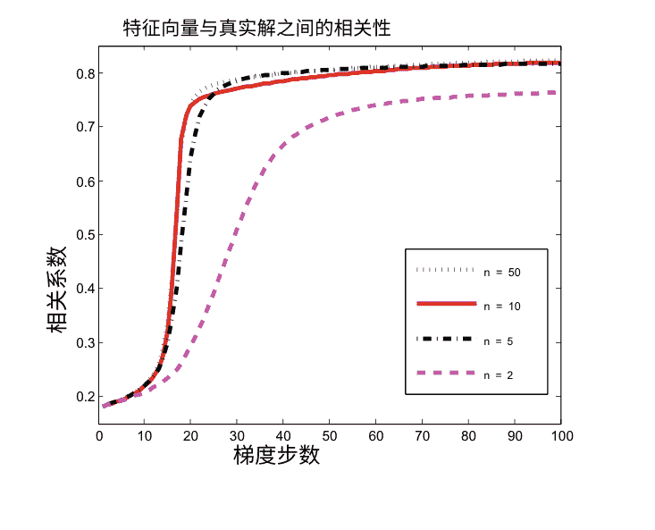

在这里，`$\mathbf{M}\mathbf{1}$`通过递归计算得到，`$\mathbf{M}^{k+1} = \mathbf{M}(\mathbf{M}^{k})$`。由于幂方法是计算主特征向量的首选方法，因此在学习中使用相同的近似方法是合理的。因此，估计的导数不是近似值，而是基于幂方法得到的精确值，因此`$\mathbf{v}$`本身是一个近似值。因此，`$\mathbf{v}$`的偏导数计算如下：

$$\mathbf{v}' = \frac{||\mathbf{M}\mathbf{1}||^2(\mathbf{M}\mathbf{1})' - ((\mathbf{M}\mathbf{1})^T(\mathbf{M}\mathbf{1})')(\mathbf{M}\mathbf{1})}{||\mathbf{M}\mathbf{1}||^3} \tag{2.18}$$

为了获得`$\mathbf{v}$`的导数，我们首先需要计算导数`$(\mathbf{M}\mathbf{1})'$`，可以通过递归获得：

$$(\mathbf{M}\mathbf{1})' = \mathbf{M}'(\mathbf{M}^{n-1}\mathbf{1}) + \mathbf{M}((\mathbf{M}^{n-1}\mathbf{1})') \tag{2.19}$$

由于`$\mathbf{M}$`具有较大的特征间隔，如 Leordeanu 和 Hebert [16] 所示，该方法稳定且高效。图2.5从经验上证明了这一点。该方法在迭代次数`$n$`的线性，但对`$n$`的数量没有敏感性，因为它同样适用于最低为5的情况。这些结果是在`$900 \times 900$`矩阵上进行的70次实验的平均值（稍后描述）。

为了更好地了解我们的方法与方程2.16相比的效率，在Matlab中计算方程2.16比我们的方法在`$900 \times 900$`矩阵上进行的实验中的`$n = 10$`花费的时间长1500倍（使用函数`pinv`）。在实践中，我们手动选择了梯度步长一次，并在所有实验中使用了这个值。

## 2.7.3 图形的无监督和半监督学习匹配

无监督学习的思想（在第2.7.1节中介绍）是最大化`$v_r^{*}$`而不是`$v_r$`，这可以通过最大化特征向量和从特征向量获得的二进制解之间的点积来实现。因此，在无监督训练期间，我们最大化以下函数：

$$J(\mathbf{w}) = \sum_{i=1}^{N} \mathbf{v}^{(i)}(\mathbf{w})^{T} \mathbf{b}(\mathbf{v}^{(i)}(\mathbf{w})). \qquad (2.20)$$

这里的困难在于`$\mathbf{b}(\mathbf{v}^{(i)}(\mathbf{w}))$`不是一个连续函数，而且也可能无法用`$\mathbf{w}$`的闭式表达式表示，因为`$\mathbf{b}(\mathbf{v}^{(i)}(\mathbf{w}))$`是一个迭代离散化过程的结果。然而，重要的是`$\mathbf{b}(\mathbf{v}^{(i)}(\mathbf{w}))$`是分段常数，并且在除了有限个不连续点之外的所有地方都具有零导数。因此，我们可以预期只在`$\mathbf{b}$`是常数且具有零导数的点处评估梯度。此外，在这些点上，梯度步骤将降低`$v_r$`（方程2.13），因为`$\mathbf{b}$`的变化（当梯度更新通过`$\mathbf{b}$`的不连续点时）不会影响`$v_r$`。降低`$v_r$`将增加`$\mathbf{v}^T\mathbf{t}$`并减小`$m$`，因此可以实现所期望的目标，而不必担心`$\mathbf{b}$`的不连续点。这在我们的每次实验中都得到了验证。然后，学习步骤函数变为

$$w_j^{(k+1)} = w_j^{(k)} + \eta \sum_{i=1}^{N} \mathbf{b}(\mathbf{v}_i^{(k)}(\mathbf{w}))^T \frac{\partial \mathbf{v}_i^{(k)}(\mathbf{w})}{\partial w_j}. \qquad (2.21)$$

在大多数实际应用中，用户对一些正确的分配有所了解，在这种情况下，半监督方法更加合适。我们的算法可以很容易地适应这种半监督场景，通过自然地结合监督和无监督学习步骤：每个步骤的离散解对于具有地面真实信息的分配具有固定值，而对于其余的未标记分配，我们使用与无监督情况相同的图匹配算法返回的解决方案。在我们提出的方法中，将有监督情况与无监督情况轻松地以原则性方式结合起来的能力是另一个优点。

## 2.7.4 学习成对条件随机场

Leordeanu和Hebert [37]提出的谱推断方法基于类似于特征向量的幂法的固定点迭代，该方法在L2范数约束下最大化二次得分 `$\sum_{b=1}^{L} {v_{ib}^*}^2 =1$`。这些约束要求每个位置的候选标签对应的子向量`$i$`的范数为1：

$$v_{ia}^{*} = \frac{\sum_{jb} M_{ia:jb} v_{jb}^{*}}{\sqrt{\sum_{b=1}^k v_{ib}^{*2}}}.$$

(2.22)

这个方程看起来类似于特征向量方程`$Mv = \lambda v$`。在这里，我们不是对特征向量应用全局L2归一化，而是对每个位置进行L2归一化。从一个具有正元素的向量开始，上述方程的不动点`$v^{*}$`具有正元素，是二次得分在约束条件下的全局最大值。

由于`$M$`具有非负元素 (Baratchart et al. [86]中的定理5), 所以 `$\sum_a v_{ia}^{*2} =1$`。

我们在这里提出的MAP问题的学习方法基于梯度上升，类似于图匹配的方法，并且需要对参数`$w$`对`$v$`进行求导。

让`$M_i$`成为大小为`nLabels` × `nLabels` × `nSites`的非方阵子矩阵，对应于特定的站点`$i$`。同时，让`$v_i$`成为相应的子向量`$v$`，通过以下迭代过程计算。让`$n$`成为特定的迭代次数:

$$\mathbf{v}_i^{(n+1)} = \frac{\mathbf{M}_i \mathbf{v}_i^{(n)}}{\sqrt{(\mathbf{M}_i \mathbf{v}_i^{(n)})^T (\mathbf{M}_i \mathbf{v}_i^{(n)})}}.$$

(2.23)

让`$\mathbf{h}_i$`成为每次迭代时定义的辅助向量的相应子向量:

$$\mathbf{h}_i = \frac{\mathbf{M}_i' \mathbf{v}_i^{(n)} + \mathbf{M}_i (\mathbf{v}_i^{(n)})'}{\sqrt{(\mathbf{M}_i \mathbf{v}_i^{(n)})^T (\mathbf{M}_i \mathbf{v}_i^{(n)})}}.$$

(2.24)

然后，可以通过递归地使用以下更新规则，将`$\mathbf{v}_i^{(n+1)}$`关于`$w$`的某个元素的导数，在步骤`$n+1$`中获得，作为`$\mathbf{v}_i^{(n)}$`的导数的函数，在步骤`$n$`中迭代。

$$(\mathbf{v}_i^{(n+1)})' = \mathbf{h}_i - (\mathbf{h}_i^T \mathbf{v}_i^{(n+1)})\mathbf{v}_i^{(n+1)}.$$

(2.25)

这个更新规则可以很容易地验证，与计算特征向量的导数的规则类似。

通过对定义这些成对潜在函数的方程进行计算，可以计算出`$M$`的各个元素相对于`$w$`的偏导数，这些方程在方程2.31中给出。当然，也可以使用其他微分函数来定义这些潜在函数。

在有监督和无监督的情况下，学习更新步骤与学习图匹配的步骤类似。在这里，我们介绍有监督的情况。在MAP问题的情况下，我们注意到无监督学习只能成功应用于较简单的问题，如第2.9.3节的实验所示。这是因为在MAP问题中很容易找到会极大偏好某个标签并使得放松问题的解几乎完全离散的参数。MAP的监督学习规则是

$$w_j^{(k+1)} = w_j^{(k)} + \eta \sum_{i=1}^{N} \mathbf{t}_i^T \frac{\partial \mathbf{v}_i^{(k)}(\mathbf{w})}{\partial w_j},$$

(2.26)

其中 `t_i` 是第 i 个训练图像的真实标签。

## 2.8 学习超图匹配

最近的超图匹配方法[22-24]基于张量 `H` 的一阶秩近似（ROA）。张量 `H` 的 ROA 是基于分配的概率独立的假设。让我们定义与候选分配列表 `L` 长度相同的概率分配向量 `p`，其中 `p_{ia} \in [0, 1]` 是特征 `I_m` 的 `i` 与特征 `I_l` 的 `a` 匹配的概率。在统计独立性假设下，张量 `H` 可以通过使用外积[23, 24]进行以下分解近似：

$$\mathbf{H} \approx \prod_{i=1...3} \otimes \mathbf{p}.$$

(2.27)

这个近似也与Duchenne等人使用的对称高阶幂方法（S-HOPM，算法2.3）相关[22]，其稳定点 `v` 是分配概率向量的近似，并给出了 `H` 的秩一近似。对称高阶幂方法[87]适用于超对称张量，并保证收敛到第三阶得分（方程2.5）的稳定点，在单位范数约束 $\|x\| = 1$ 下。在我们的实验中，S-HOPM 是收敛且数值稳定的。由于超对称张量 `H` 具有非负元素，S-HOPM 的稳定点 `v` 也具有非负元素。S-HOPM 的稳定点 `v` 与分配概率 `p` 的连接进一步证明了[22]中对 `v` 的离散化，以满足初始约束条件的整数解的合理性。

**算法 2.3 对称高阶幂方法（S-HOPM）**

```
v ← 1
重复
    v_{ia} ← ∑_{ia, jb, kc} H_{ia; jb; kc} v_{jb} v_{kc}
    v ← v / ||v||
直到收敛
返回 v
```

只有当第三阶分数 `H_{ia;jb;kc}` 正确地反映底层问题的结构和相似性时，近似值 `v` of `p` 才有效。我们建议学习参数 `w`（方程2.5），使得 `v` 和二进制解向量 `b` 之间的点积最大化。向量 `b` 的元素对于已知的分配和超图匹配算法产生的未知分配都等于真实值。这个想法扩展了前面章节和Leordeanu等人的图匹配学习方法。在训练图像对的整个训练集上，学习过程中最大化的目标函数是每个 `v` 和相应 `b` 之间的点积之和。

$$ \mathbf{w}^* = \arg \max_{\mathbf{w}} \sum_{i} \mathbf{b}_i^T \mathbf{v}_i(\mathbf{w}). \quad (2.28) $$

请注意，`v(w)` 是参数 `w` 的函数，因为它取决于张量 `H` 的元素，而这些元素都是 `w` 的函数。我们通过梯度上升更新来优化目标函数：

$$ w_j \leftarrow w_j + \eta \sum_{i=1}^{N} \mathbf{b}_i(\mathbf{w})^T \frac{\partial \mathbf{v}_i(\mathbf{w})}{\partial w_j}. \quad (2.29) $$

S-HOPM的每次迭代计算更新 `v \leftarrow \mathbf{v}/\|\mathbf{v}\|`。由此可知，在第 `k+1` 次迭代中，`v` 的估计梯度可以表示为前一步梯度的函数。因此，梯度可以递归地计算，同时计算 `v`。基于这些思想可以得到一个基于这些计算思想的递归算法（算法2.4）。

### 算法 2.4 计算梯度 dv of v

```
$\mathbf{v} \leftarrow \mathbf{1}$
$\mathbf{dv} \leftarrow \mathbf{0}$
$\mathbf{dH} \leftarrow \frac{\partial \mathbf{H}}{\partial w_j}$
重复
    $h_{ia} \leftarrow \sum_{jb,kc} d H_{ia;jb;kc} v_{jb} v_{kc} + 2 H_{ia;jb;kc} v_{jb} dv_{kc}$
    $v_{ia} \leftarrow \sum_{jb,kc} H_{ia;jb;kc} v_{jb} v_{kc}$
    $\mathbf{h} \leftarrow \frac{\mathbf{h}}{\|\mathbf{v}\|}$
    $\mathbf{v} \leftarrow \frac{\mathbf{v}}{\|\mathbf{v}\|}$
    $\mathbf{dv} \leftarrow \mathbf{h} - (\mathbf{v}^T \mathbf{h}) \mathbf{v}$
直到收敛
返回 $\mathbf{dv}$
```

## 2.9 图匹配实验

在图匹配的情况下，我们关注两个目标。第一个目标是验证第2.7.1节中的理论结果，特别是方程式2.12，它建立了关于 `p_r` 和 `v_r` 之间的关系，以及方程式2.13，它将 `v_r^*` 与 `v_r` 和误差率 `m` 联系起来。每个 `p_r` 都是根据训练序列中的每个矩阵 `M` 进行经验估计的，类似地，每个 `v_r^*` 和 `v_r` 都是根据每个特征向量进行的。方程式2.12很重要，因为它表明与错误分配之间的成对一致性相比，正确分配之间的成对一致性越高（如 `p_r` 所反映的），特征向量 `v` 越接近二进制的真实值 `t`（如 `v_r` 所反映的），并且由此直接导致匹配性能越好。这个方程式还验证了我们对匹配矩阵 `M` 的模型，该模型由两个平均值 `p_0` 和 `p_1` 定义。方程式2.13很重要，因为它解释了通过最大化相关性 `v^T\mathbf{b}`（`v`）（并隐式地最小化 `v_r^*`），实际上我们最小化了 `v_r` 和匹配误差 `m`。方程式2.13基本上说明了为什么无监督算法确实能够最大化相对于真实值的性能。我们提到，通过匹配率/性能，我们指的是正确匹配的特征数与匹配特征总数的比率，而错误率则是减去匹配率。

验证我们理论的结果显示在图2.6、2.7、2.8和2.9上，分别是在House、Hotel、Faces、Cars和Motorbikes实验中。下面给出了这些实验的详细信息。

有一些相关的结果需要考虑。在所有四个不同的实验中，即使学习算法对于地面真实值是未知的，`v` 和 `t` 之间的相关性在每个梯度步骤中都会增加。匹配率与相关性同时提高，并以类似的速度提高，这表明最大化相关性也最大化了最终性能。在图2.7中，我们展示了一对人脸的特征向量的代表性示例，随着训练的进行，它变得越来越二进制。如果在第一次迭代之后特征向量几乎是平坦的，在最后一次迭代中它非常接近二进制的地面真实值，所有正确的分配都比任何错误的分配具有更大的置信度。此外，在所有单独的实验中，从方程2.12和2.13的近似值在每个梯度步骤中变得越来越准确，从第一次迭代的不到10%的准确率到最后不到0.5%的错误率。在我们所有的学习实验中，我们从一组参数 `w` 开始，这些参数不偏向任何分配（`w=0`，这意味着在第一次迭代之前，`M` 中的所有非零分数都等于1）。这些结果既支持了对 `M` 的模型（方程2.12），也支持了无监督学习方案的结果（方程2.13）。

我们实验的第二个目标是评估学习前后在新的测试图像对上的匹配性能。目标是要显示，在测试时，学习后的匹配性能明显优于没有进行学习的情况。

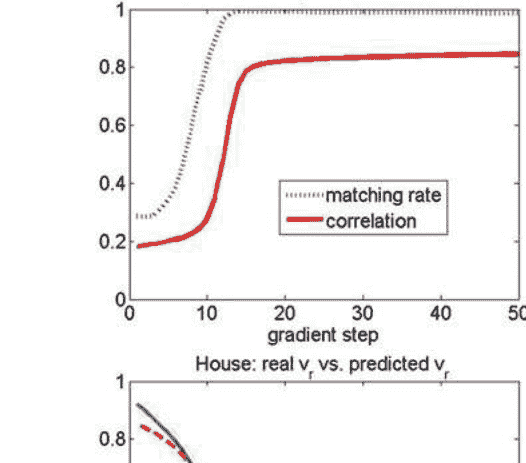

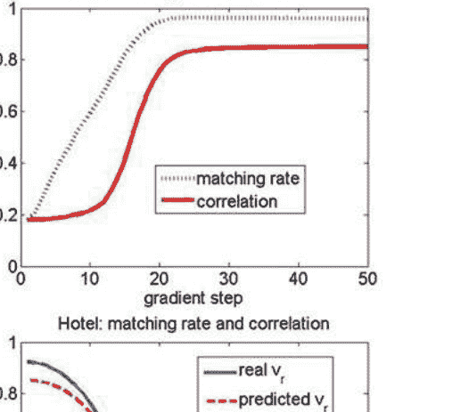

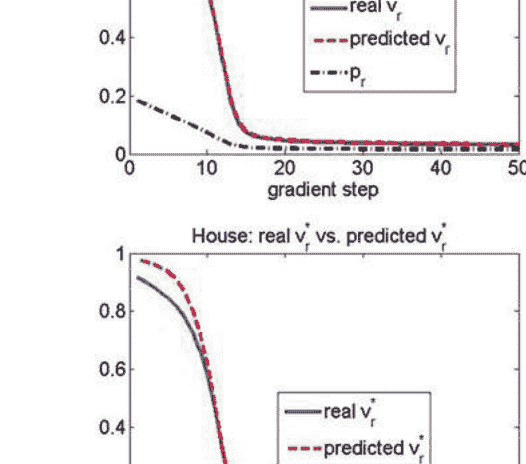

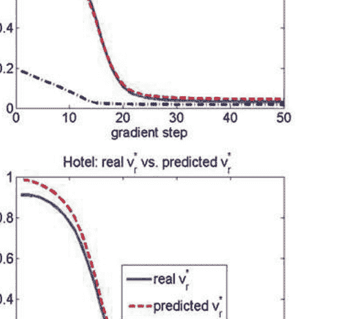

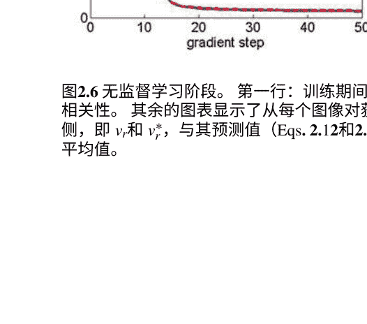

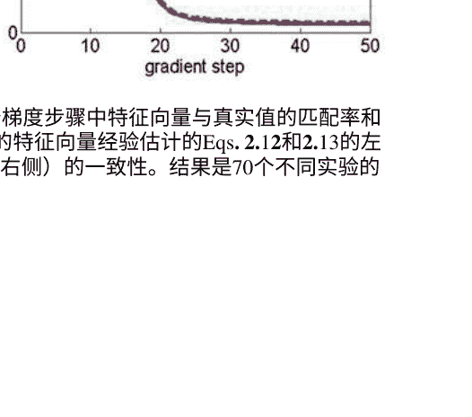

图2.6 无监督学习阶段。第一行：训练期间每个梯度步骤中特征向量与真实值的匹配率和相关性。其余的图表显示了从每个图像对获得的特征向量经验估计的`Eqs. 2.12`和`2.13`的左侧，即 `$v_r$` 和 `$v_r^*$`，与其预测值（`Eqs. 2.12`和`2.13`的右侧）的一致性。结果是70个不同实验的平均值。

### (a) Correlation and Matching Rate


### (b) Matching rate for different outliers/inliers ratios


### (c) `$v_r$`: real vs. predicted


### (d) Eigenvector after 1 step vs. ground truth


### (e) Eigenvector after 9 steps vs. ground truth


### (f) Eigenvector after 120 steps vs. ground truth


图2.7 面部结果：特征向量与真实值之间的相关性和训练期间的匹配率（左上），学习和测试时间不同异常值/内点比率的匹配率（右上），验证`Eq. 2.12`（左中），不同学习步骤的示例特征向量。前三个图的结果是30个不同实验的平均值。

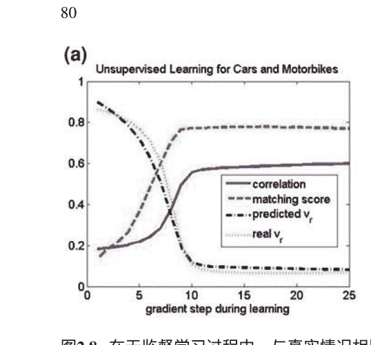

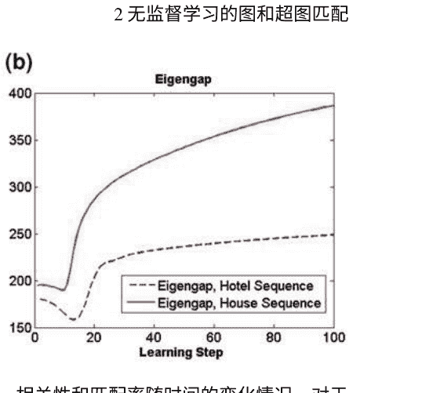

图2.8 a在无监督学习过程中，与真实情况相比，相关性和匹配率随时间的变化情况，对于来自Pascal 2007挑战赛的汽车和摩托车。实际值和预测值 `$v_r$` 随着模型的预测而减少。结果是在30个不同的实验中取平均值。b在无监督学习过程中，归一化特征值间隙（特征值间隙除以 `$\mathbf{M}$` 中的均值）在几次迭代后开始增加，表明主特征向量变得越来越稳定。结果是在House和Hotel数据集上进行了70次随机实验的平均值。

## 2.9.1 使用无标签对应进行学习

### 2.9.1.1 在透视变换下匹配刚性物体

我们首先进行了两个任务的实验，这两个任务与Caetano等人[17]和我们之前的工作[18]相同。我们使用完全相同的图像序列（House：110张图像和Hotel：100张图像）进行训练和测试，以及由Caetano等人手动选择的相同特征。对于测试，我们使用剩余图像之间的所有配对。成对得分 `$M_{ia;jb}$` 与我们之前在Leordeanu和Hebert [18]中使用的成对得分相同，使用形状上下文描述符[88]进行局部外观，使用成对距离和角度进行二阶关系。它们衡量了特征 `$(i, j)$` 从一个图像与其候选对应物 `$(a, b)$` 在几何和外观上的一致性。更明确地说，成对得分的形式为 `$M_{ia;jb} = exp(-w^T g_{ia;jb})$`，其中 `$g_{ia;jb}= [\| s_i - s_a \|, \| s_j - s_b \|, \| d_{ij} - d_{ab} \|, \| \alpha_{ij} - \alpha_{ab} \|]$`。在这里，`$s$` 表示特征的形状上下文；`$d_{ij}$` 是特征 `$(i, j)$` 之间的距离；而 `$\alpha_{ij}$` 是水平轴与向量 `$\overrightarrow{ij}$` 之间的角度。学习的目标是找到能够在训练序列上最大化匹配性能的参数向量 `$w$`。

与Caetano等人[17]和Leordeanu和Hebert[18]一样，我们首先获得一个Delaunay三角剖分，并且只有当 `$(i, j)$` 和 `$(a, b)$` 在对应的三角剖分中相连时，才允许非零的成对得分 `$M_{ia;jb}$`。我们之前的方法[18]是有监督的，并基于全局优化方案，比本章提出的无监督梯度下降方法更有可能找到真正的全局最优解。因此，值得注意的是，所提出的方法无监督学习方法与我们之前的结果相匹配，同时在性能上明显优于Caetano等人的方法[17]（表2.1）。

表2.1 在测试时间上，酒店和房屋数据集的匹配性能。在我们的实验中，我们只使用了“House”序列中的5个训练图像，而对于Caetano等人的方法[17]，我们报告了他们使用5个和106个训练图像的上限结果。符号：“S”和“U”分别表示“有监督”和“无监督”

| 数据集 | 我们的方法: S(5)(%) | 我们的方法: U(5)(%) | Caetano等人[17]的方法: S(5)(%) | Caetano等人[17]的方法: S(106)(%) |
| :--- | :--- | :--- | :--- | :--- |
| 房屋 | 99.8 | 99.8 | <84 | <96 |
| 酒店 | 94.8 | 94.8 | <87 | <90 |

我们指出，我们和Caetano等人[17]之间性能差异的主要原因在于[17]对于成对分数 `$M_{ia;jb}$` 的二阶几何关系的重视程度较低，仅使用了0-1 Delaunay三角剖分的信息，没有使用成对距离和角度的信息。相反，我们强调二阶关系的重要性，因为在我们的实验中，即使完全排除形状上下文描述符，仅使用成对几何信息，我们的方法的性能也不会下降。当然，值得强调的是，虽然Caetano等人[17]的方法以有监督的方式学习参数，但我们的方法是第一个以无监督方式学习参数的方法。

接下来，我们将研究无监督学习方法在学习和测试阶段的性能，与其有监督的变体（当已知真实分配时）进行比较。我们使用两个数据集进行了70个不同的实验，随机选择10个训练图像（并使用训练集中的所有图像对），并将其余图像对用于测试。正如预期的那样，我们观察到无监督方法的学习速度平均较慢，但它们学习的参数几乎相同。在图2.9中，我们绘制了每个梯度步骤的平均相关性（与真实值的特征向量）和匹配率，对于所有训练对和所有实验，与每个梯度步骤，对于有监督和无监督情况。有趣的是，尽管无监督版本收敛较慢，经过几次迭代后它们的性能（以及参数）收敛到相同的值。在测试过程中，这两种方法在匹配性能方面表现相同（在所有70个实验中正确匹配特征的平均百分比）。与没有学习参数的相同匹配算法相比，这两种算法的性能明显更好（表2.2）。没有学习时，默认参数（w的元素）被选择为全部相等。

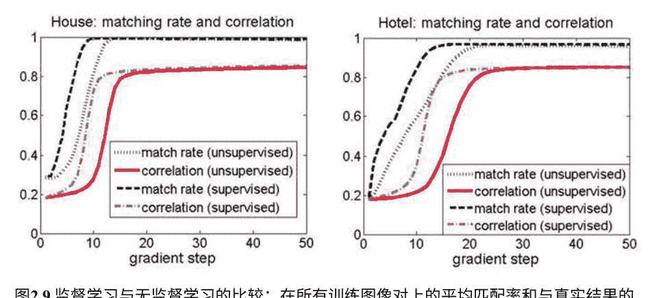

表2.2 在House和Hotel数据集上进行测试时的平均匹配性能比较，使用70个不同实验（10个训练图像，其余用于测试）。我们比较了无监督学习与无学习的情况。第一列：无监督学习；第二列：无学习，等权重w

| 数据集 | 无监督学习 | 无学习 |
| :--- | :--- | :--- |
| House + Hotel (%) | 99.14 | 93.24 |

### 2.9.1.2 匹配带有异常值的可变形2D形状

用于评估的第三个数据集由从Caltech-4 Faces数据集中随机选择的30对图像组成。¹与之前的实验不同，这个数据集中的图像不仅包含人脸，还包含背景杂乱。此外，这些人脸属于不同的人，包括女性和男性，面部表情也不同，因此需要匹配的人脸之间存在显著的非刚性变形。我们使用的特征是在图像中提取的轮廓上采样的定向点，类似于我们之前的工作[50]（图2.10）。每个点的方向是该点处轮廓的法向量。必须匹配的人脸上的点（内点）是手动选择的，而背景中的异常值（特征）是随机选择的，同时确保每个异常值与其他点之间的距离不太近（15个像素）。对于每对人脸，我们仅手动选择了内点的真实匹配。成对分数仅包含有关成对距离和角度的几何信息：

$$ M_{ia;jb} = e^{-w^T g_{ia;jb}} $$

(2.30)

¹http://www.vision.caltech.edu/archive.html

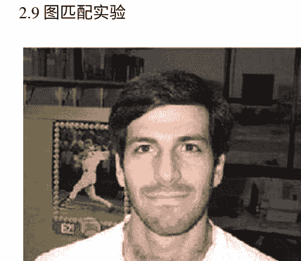

特征选择

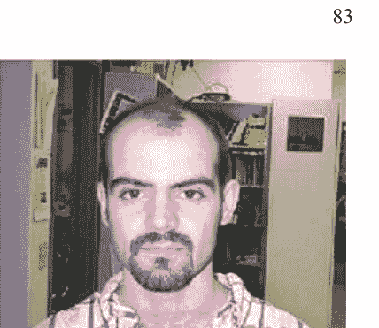

特征选择

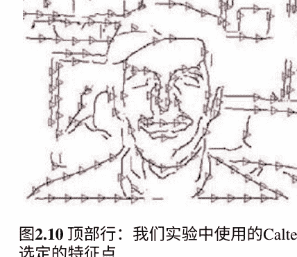

特征选择

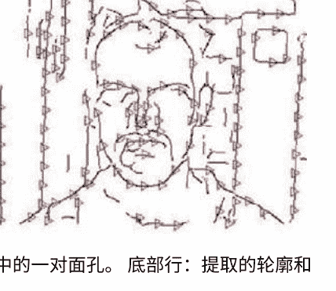

特征选择

图2.10 顶部行：我们实验中使用的Caltech-4数据集中的一对面孔。底部行：提取的轮廓和选定的特征点

## 2.9 图匹配实验

### 2.9.1 不同图匹配算法的学习

我们对来自Pascal'07挑战赛的Cars和Motorbikes数据（图2.11）上的五种最先进的图匹配算法进行了无监督学习，与[19]中使用的相同。我们使用与之前描述的相同的特征（从轮廓片段中选择的定向点）。这些算法是谱匹配[16]（SM），带仿射约束的谱匹配[3]（SMAC），逐步分配[1]（GA），概率图匹配[24]（PM）和我们的整数投影固定点[6]（IPFP）算法。

对于每个算法，我们对每个类别进行30个不同的学习和测试实验，并对结果进行平均。对于每个实验，我们随机选择10对图像进行学习（包括离群值），并将剩下的20对用于测试（包括有和没有离群值的情况）。在训练过程中，我们在每对图像中的一个图像中添加离群值，使得离群值与内点的比例为0.5。另一幅图像不包含离群值。我们在训练过程中引入了适量的离群值，以测试无监督学习方法在真实世界实验中的鲁棒性，特别是在无监督情况下，在每对图像中强制保持相等数量的特征是耗时的。在测试过程中，我们有两种情况：第一种情况下，两幅图像都没有离群值；第二种情况下，只有一幅图像允许有所有可能的离群值。引入的离群值数量很大，对于Cars类别，离群值与内点的比例范围从1.4到8.2（平均为3.7）；对于Motorbikes类别，离群值与内点的比例范围从1.8到10.5（平均为5.3）。与我们所有其他测试一样，内点是指根据基准真值在另一幅图像中存在对应关系的特征，而离群值则没有这样的正确对应关系。内点是手动选择的，方式与之前的实验中使用的方式相同，而离群值是随机选择的轮廓片段上的点，以使得没有离群值比任何其他选择的特征更接近15个像素。

在图2.12中，我们展示了每个算法在学习过程中的行为：每个学习步骤中的平均匹配率和特征向量与真实值的平均相关性。有几个重要的方面需要注意：对于所有算法来说，特征向量与真实值之间的相关性随着每个梯度步骤的增加而增加，SMAC的收敛速度比其他算法快得多。这也反映在匹配率上，SMAC的增长速度要快得多。所有算法在学习过程中都受益，因为经过几次迭代后，所有匹配率都有显著改善。参数向量 `w` 的初始值设为零，并且所有算法学到的最终 `w` 的值都相似。GA和SMAC在前10个步骤中有快速改进，然后有小幅下降，并在剩余的迭代中保持稳定。这可能表明对于GA和SMAC，学习只需要进行几次迭代。对于其他三种算法，在训练过程中学习不断提高匹配率。

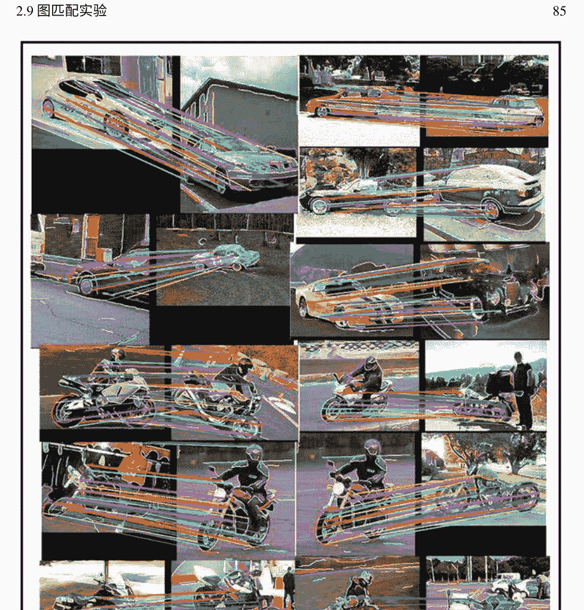

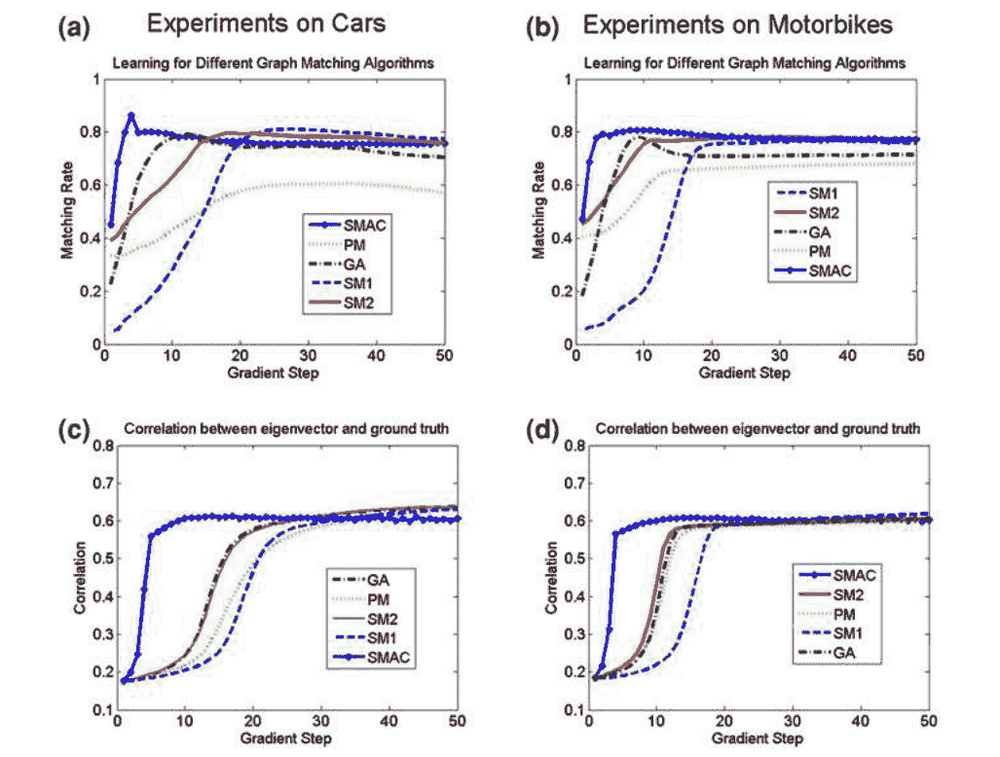

在表2.3中，我们展示了在引入异常值时，所有算法在两个数据集上进行测试的结果，包括有学习和无学习的情况。在没有学习的情况下，所有算法在两个数据集上使用参数向量 `w= [0.2, 0.2, 0.2, 0.2, 0.2]`。在我们的实验中，引入更多的异常值在测试过程中对学习更有益处。这也与我们在人脸上的实验结果一致（图2.7）。表2.3显示了在存在大量异常值的情况下，有学习和无学习的结果（一个图像中没有异常值，另一个图像中有所有可能的异常值，如前面所述）。显然，学习显著提高了所有算法的性能。本节中展示的结果强烈表明，我们的无监督学习方案可以在存在大量异常值的困难数据（如Pascal'07中的汽车和摩托车）中显著提高其他算法的性能。

**表2.3：不同图匹配算法在测试时间的匹配率比较。在Pascal'07数据库的汽车和摩托车上进行无监督学习之前（NL）和之后（WL）的情况下，有异常值：右图允许所有异常值，左图没有异常值。在测试过程中使用的算法与学习过程中使用的算法相同。结果是30个不同实验的平均值。对于没有学习的情况，所有算法使用相同的参数，有无异常值都一样：所有 `w` 的元素都相等。**

| 数据集   | IPFP (%) | SM (%) | SMAC (%) | GA (%) | PM (%) |
| :------- | :------- | :----- | :------- | :----- | :----- |
| 汽车 (NL) | 50.9     | 26.3   | 39.1     | 31.9   | 20.9   |
| 汽车 (WL) | 73.1     | 61.6   | 64.8     | 46.6   | 33.6   |
| 摩托车 (NL)| 32.9     | 29.7   | 39.2     | 34.2   | 26.1   |
| 摩托车 (WL)| 55.7     | 54.8   | 52.4     | 46.8   | 42.2   |

### 2.9.2 条件随机场实验

为了将我们的方法与之前在CRF上的工作进行比较，我们完全按照Kumar在图像去噪方面的实验进行，遵循实现细节。我们使用Kumar [89]中提供的训练和测试数据。任务是从损坏的二进制64 ×64图像中获取去噪图像。我们使用相同的四个图像和相同的噪声模型。对于更简单的任务，噪声模型是均值为 μ =0，标准差为 σ = 0.3的高斯噪声添加到0-1的二进制图像中。对于更困难的任务，我们使用与Kumar [89]相同的方法，对于每个类别，使用两个高斯分布的混合模型，混合权重相等，产生双峰噪声。两个高斯分布的模型参数（均值，标准差）分别为前景类别[(0.08, 0.03), (0.46, 0.03)]和背景类别[(0.55, 0.02), (0.42, 0.10)]。原始图像以及其噪声版本的示例如图2.13所示。

与Kumar的方法[89]不同，该方法使用了50个随机生成的噪声版本的第一张图像进行训练，而我们只使用了5个这样的图像。对于更简单的任务，我们还进行了完全无监督的学习，得到了几乎相同的结果（表2.4）。我们的结果在更简单的噪声模型下明显更好，而在更困难的噪声模型下与Kumar [89]的结果相匹配。此外，请注意我们的学习方法更容易实现，并且改进了IPFP的性能（图2.14），而不仅仅是L2QP（我们从Leordeanu和Hebert [37]中设计的谱MAP推理算法）。我们使用的成对势函数是
$$ M_{ia;jb} = \sigma(\mathbf{w}^T[t_a; t_aI_i; t_b; t_bI_j; t_at_b|I_i - I_j|]) $$
其中 `I_i` 是图像中像素 `i` 的值，而 `|I_i - I_j|` 是连接的站点 `i` 和 `j` 之间图像像素值的绝对差。根据Kumar [89]的研究，我们使用了四连通网络。我们还尝试了八连通邻域，但性能没有显著差异。

## 2.10 超图匹配实验

我们对合成点集和真实图像进行了实验。我们将我们的匹配方法与当前最先进的方法进行了比较：概率方法[24]（PM），高阶幂方法[22]（HOPM）以及最近提出的算法[23]（FAM2）。我们还通过实验证明，我们的学习方法改善了所有经过测试的超图匹配算法的性能。

与之前关于图匹配学习的工作类似[90]，我们发现监督程度不影响学习的质量（更多细节请参见第2.10.4节）。我们还通过实验证明，我们的新型超图匹配算法（算法2.2）在单独使用或与其他方法结合使用时，优于现有技术水平。

在所有实验中，我们使用将每个点与其七个最近邻连接形成的所有三角形进行三角剖分。除此之外，我们还添加了一个Delaunay三角剖分。这个设置用于模型和测试图像。对于无学习的测试，我们使用参数向量$\mathbf{w}$的均匀向量，其中$w_i = 0.1$，对于所有实验和所有方法。用于学习的梯度上升方法从一个均匀的参数向量$\mathbf{w}$开始，用于所有实验。

### 2.10.1 合成数据

我们的合成实验遵循了与Chertok和Keller [23]以及Zass和Shashua [24]类似的设置。模型集合$I_m$包含20个点，其2D位置均匀生成在区间$[0, 1]^2$内。测试集$I_t$是通过随机扰动模型点的位置生成的，扰动采用了均值为$\sigma_p$的高斯噪声，范围在区间$[0.01, 0.1]$内。异常值仅添加到测试集中，其位置为$(x, y)$，来自于相同均匀分布在区间$[0, 1]^2$内。异常值是测试集中没有正确对应的额外点。异常值比例$o_r$，即异常值与内点的比例，范围从0到1（当异常值的数量等于内点的数量时）。然后，测试集按比例因子$s$缩放，并按角度$\alpha$从高斯分布中抽取，范围在区间$[0, 45^\circ]$内。

与Chertok和Keller [23]相反，我们允许模型图像中的每个点与测试图像中的任何其他点匹配。在Chertok和Keller [23]中，作者仅为模型图像中的每个点选择了少数几个候选点，并确保始终选择正确的匹配。与他们的设置相反，我们的设置对尺度和旋转的变化是不变的。我们考虑了两种类型的三阶得分：尺度和旋转不变以及尺度不变但对旋转敏感。

对于每个三角形 $(i, j, k)$，我们定义了以下几何描述符（详见图2.2）：$\mathbf{b}_{ijk} = [\beta_i, \beta_j, \beta_k]$，$\mathbf{t}_{ijk} = [\theta_{ij}, \theta_{jk}, \theta_{ki}]$和$\mathbf{d}_{ijk} = [d_{ij}, d_{jk}, d_{ki}]/p_{ijk}$，其中$p_{ijk}$是三角形的周长。请注意，$\mathbf{b}_{ijk}$和$\mathbf{d}_{ijk}$对相似变换是不变的，而$\mathbf{t}_{ijk}$对旋转是敏感的。对于旋转不变匹配，第三阶得分（公式2.5）使用的变形向量为：

`$$\mathbf{g}_{ia;jb;kc} = \left[ |\mathbf{b}_{ijk} - \mathbf{b}_{abc}|, \max |\mathbf{b}_{ijk} - \mathbf{b}_{abc}|, |\mathbf{d}_{ijk} - \mathbf{d}_{abc}|, \max |\mathbf{d}_{ijk} - \mathbf{d}_{abc}| \right].$$`

对于旋转敏感的分数，我们将向量$\mathbf{g}_{ia;jb;kc}$扩展两个条目：

`$$\left[ \sum |\mathbf{t}_{ijk} - \mathbf{t}_{abc}|, \max |\mathbf{t}_{ijk} - \mathbf{t}_{abc}| \right],$$`

总共六个维度。

对于训练，我们使用了两种不同的学习设置，通过引入（或不引入）全局旋转角度$\alpha$到我们的三阶分数中。我们使用了五个训练点集对pairs $(I_m, I_t)$，对于$\sigma_p = 0.03$，$o_r = 0$和$\sigma_r = 5^\circ$。在图2.15中，注意到对于旋转敏感匹配（右图）学习速度更快，匹配率通常比旋转不变情况下更高。所有算法的匹配准确性都有所提高。请注意，我们的方法的收敛性优于其他测试方法的收敛性（使用非信息性均匀解$\mathbf{x}_0$进行初始化）。

图2.15 在合成数据上的学习。请注意，在训练过程中，特征向量与真实值之间的相关性被最大化。同时，在学习过程中，所有算法在训练数据上的匹配准确率都在增加。这些图表显示了60个不同学习实验的平均值。在训练过程中没有产生异常值；位置噪声 $\sigma_p = 0.03$；旋转角度噪声 $\sigma_r = 5^\circ$

表2.5 客观评分比较。这些结果是在412种不同类型的合成匹配实验中的平均值，通过均匀变化 $\sigma_p \in [0.01, 0.1]$, $\sigma_r \in [0, 45^\circ]$ 和 $o_r \in [0, 1]$。对于每种类型，随机生成了100个实验，总共有41,200个实验。第一行：其他算法的客观分数 $S$ 与我们方法从平坦解开始获得的分数 $S$ 的平均比率。第二行：我们算法初始化其他方法获得的分数 $S$ 与 Ours-flat 的客观分数的平均比率。最后一行：Ours-flat 的分数大于其他算法的分数 $S$ 的频率。请注意，我们的方法在所有类型的实验中，无论是单独使用还是与其他算法结合使用，都能获得显著更好的分数。

| 算法 | FAM2 | HOPM | PM |
| :--- | :--- | :--- | :--- |
| S(Alg)/S(Ours-flat) | 0.83 | 0.49 | 0.37 |
| S(Alg + Ours)/S(Ours-flat) | 0.99 | 0.96 | 0.97 |
| 频率 S(Ours-flat) > S(Alg) | 100% | 100% | 100% |

为了测试，我们通过均匀变化 $\sigma_p \in [0.01, 0.1]$, $\sigma_r \in [0, 45^\circ]$ 和 $o_r \in [0, 1]$ 生成了点集对 $(I_m, I_t)$。有关结果，请参见表2.5和2.6以及图2.17。图2.16说明了当全局旋转角度 $\alpha$ 很小时，旋转敏感匹配是如何有用的。在学习过程中，旋转参数适应了小的旋转，这导致了在旋转依赖匹配中 $\alpha$ 很小时的卓越性能。相比之下，旋转无关匹配即使 $\alpha$ 很大也能保持高准确性。

表2.6 124种不同类型的合成匹配实验的平均性能，包括学习和旋转敏感性的情况下，以及没有学习和旋转敏感性的情况。模型和测试集 $(I_m, I_t)$ 通过均匀抽取 $\sigma_p \in [0.01, 0.1]$, $\sigma_r \in [0, 45^{\circ}]$ 和 $o_r \in [0, 1]$ 生成。对于每种类型，随机生成了100个实验，总共12400个实验。

| 算法 | 我们的-平均 (%) | FAM2 (%) | HOPM (%) | PM (%) |
| :--- | :--- | :--- | :--- | :--- |
| 无学习 | **66.7** | 51.1 | 34.8 | 35.4 |
| + 学习 | 69.9 | **70.8** | 61.5 | 53.2 |
| + 我们的 | 69.9 | **71.6** | 66.3 | 67.6 |

图2.16 学习的效果。左上：使用旋转相关分数进行匹配。右上：使用旋转无关分数进行匹配。左下：无学习的相似性不变匹配（所有参数设置为 $w_i = 0.1$）。右下：学习后的相似性不变匹配。对于底部一行， $\sigma_p = 0.03$。所有的图表都显示了100次实验的平均值

图2.17 随着位置噪声的增加，不同算法的性能比较，相对于我们方法的性能。注意到我们的方法作为最后的离散化步骤，显著提高了所有方法的准确性。

### 2.10.2 实验结果

对于第一组真实图像实验，我们使用了Leordeanu等人的50对汽车和摩托车图像（20辆摩托车和30辆汽车）。为了说明超图匹配处理尺度变化的能力，对于每一对模型-测试图像，我们将测试图像缩小了2倍。三阶分数是尺度不变的，因此尺度的变化不会改变匹配的准确性。

所使用的实际分数与我们在合成实验中使用的旋转相关分数具有相同的形式，但在这些特定图像上学习了一组不同的参数（图2.19）。特征由2D点及其法线组成，如Leordeanu等人[6]中所述，在轮廓上进行采样。

我们进行了30个不同的学习和测试实验。对于每个实验，我们随机选择了同一类别的五对图像进行训练，并使用属于同一类别的其余图像进行测试。表2.7中的结果是所有30个实验中两个类别的平均值。这个匹配任务很困难（见图2.18中的一些例子），匹配率相对较低，但结果明确证实了我们学习和匹配方法的有用性，以及它们改进了当前最先进方法的性能。

表2.7 汽车和摩托车图像对的平均性能。结果是测试图像对的平均值。最后一行显示了客观评分的平均比例

| 算法 | 我们的 (%) | FAM2 (%) | HOPM (%) | PM (%) |
| :--- | :---: | :---: | :---: | :---: |
| 基准 | **27.5** | 21.4 | 6.3 | 7.6 |
| +学习 | **54.9** | 41.1 | 51.8 | 29.0 |
| +我们的 | 54.9 | 54.7 | **56.3** | 50.3 |
| 算法/我们的 | 1 | 0.49 | 0.85 | 0.26 |

### 2.10.3 人物匹配

人物是需要高质量匹配的可变形物体的良好示例，包括快速运动的识别和跟踪，以及具有大的帧间位移。我们在最近发布的`PrimeSense RGB-深度相机`捕获的视频图像对中测试了我们的算法。对于每一帧，我们首先通过使用一次从手动对应和ICP算法在单个彩色-深度帧上计算的线性变换来将深度与彩色图像对齐。对于所有深度大于1000的点，我们将它们的深度设为1000。在这种方式下预处理深度图像后，我们在深度图像上应用了`Canny边缘检测器`，并提取了相对稳定和准确的遮挡边界。

为了训练（见图2.19）和评估，我们选择了30对帧，这些帧包含了同一个人在不同姿势下相隔约半秒的时间。我们手动选择了两个帧之间的真实对应关系，基于获取的深度边界。对于测试帧，我们从深度边界中均匀采样添加了异常值。与之前的实验一样，我们将测试图像缩小了2倍。

我们使用了两种三阶分数：（i）来自先前实验的旋转相关分数，其中`$\mathbf{w}$`是从RGB-d图像对中学习得到的；（ii）仅凭几何信息的分数，增加了外观信息（在`HSV颜色空间`中计算的40维直方图之间的卡方距离），计算在由特征三元组定义的三角形内部。我们进行了30个不同的实验，使用5对图像进行训练，其余图像进行测试（见表2.8）。请参见图2.20和2.1以获取测试示例。

我们进一步在数百对没有地面真实对应关系的RGB-d帧上测试了我们的几何和外观超图模型（图2.21）。我们使用`C++`实现了我们的方法，并且优化后的代码能够在不到一秒的时间内以尺度不变的方式匹配2个帧 - 这个总时间包括特征提取、构建张量`H`和匹配。

表2.8 包含人物的30对图像的匹配准确率

| 算法 | 我们的 (%) | FAM2 (%) | HOPM (%) | PM (%) |
| :--- | :--- | :--- | :--- | :--- |
| 无学习 | 73.4 | `73.9` | 23.2 | 24.6 |
| + 学习 | `84.2` | 83.5 | 81.5 | 65.4 |
| + 外观 | `91.0` | 86.3 | 89.7 | 84.7 |
| + 我们的 | `91.0` | 90.1 | 89.9 | 89.0 |

### 2.10.4 监督学习与无监督学习

在我们的实验中，监督程度不会影响学习的质量。基本上，学习算法在没有正确的地面真实匹配的情况下，以非常相似的收敛速度估计几乎相同的参数`$\mathbf{w}$`（见图2.22）。这些结果与图匹配[90]上得到的结果类似。在图2.22中，我们展示了匹配率和`$v$`与地面真实值之间的相关性在不同监督程度下的学习过程中的增加情况，从无监督（训练过程中没有正确匹配）到完全监督。绘制的值是10次学习实验的平均值。在每个实验中，随机选择七对人物图像用于训练。在这些图中，我们仅使用三个值来表示三角形的三阶分数：灰度外观的变形、梯度外观和几何形状，通过一些常数进行归一化（在所有实验中保持不变），使它们的平均值接近1（用于数值稳定性）。初始参数`$\mathbf{w}$`都等于`[0.1, 0.1, 0.1]`，并且学到的参数在所有监督程度上都非常相似，例如无监督情况下的平均学到的`$\mathbf{w}$` = `[3.0, 2.2, 1.6]`，40%监督情况下的`$\mathbf{w}$` = `[3.0, 2.2, 1.8]`，完全监督情况下的`$\mathbf{w}$` = `[2.9, 2.1, 1.7]`。

### 2.11 结论和未来工作

在本章中，我们提出了基于二次整数规划公式的图/超图匹配和MAP推理问题的高效学习和优化方法。我们通过大量的实验证明，我们的算法有潜力显著提高匹配和推理准确性。我们为图和超图匹配领域带来了宝贵的见解和方法，希望能够为进一步的探索开辟新的道路，特别是在高效匹配和无监督学习方向上。我们处理了匹配的两个主要方面：（1）在连续域中找到放松问题的最优解，（2）获得具有重要理论性质的高质量离散解，与传统的贪婪算法或经典的匈牙利方法获取最终硬分配的方法不同。

图2.20 不同尺度和姿势的人物匹配示例。注意尺度的显著变化和身体部位的相对较大位移。

在与第二或更高阶约束匹配的未来工作中有许多途径。它们在匹配性能方面带来了显著提升，因为它们对尺度变化、旋转、透视或仿射变换以及多样化的外观变化和非刚性变形更加鲁棒。例如，请参见图2.23中的超图匹配如何在匹配准确性方面轻松超越使用`SIFT`特征进行全局仿射变换匹配的众所周知的流行方法。

我们希望进一步探索的一些问题和方向如下列举。

#### 2.11.1 高效优化

我们的`光谱匹配`算法的引入促进了基于图匹配的计算机视觉应用的增长，包括医学成像、2D和3D注册与重建、目标跟踪、建模、发现和学习。图匹配的应用扩展到了更高层次的解释，涉及动作识别和视频理解领域。我们预见到在未来的应用中，使用第二或更高阶几何和分类关系将具有重要的兴趣。沿着这一思路，解决的主要技术问题之一将是效率和计算成本的问题。

尽管`光谱匹配`很快，作为一种优化方法，构建分配矩阵或张量（对于高阶情况）的计算速度较慢。我们相信，在这个方向上，需要进一步取得实质性的进展。我们的未来计划包括更深入地研究这个计算方面，研究如何尽快地构建/设置问题，而不会失去准确性。深度学习在神经网络方面的成功影响了许多其他领域，目前有许多深度方法被提出。我们对看到深度学习和`卷积神经网络`被应用于图匹配的增长趋势不感到意外[21, 91–97]。

事实上，最近的光流估计方法，`DeepFlow`[98]以及我们的循环图神经网络模型和更一般的目标识别系统在匹配使用图形的模型中也有深厚的根基。

随着当前深度卷积网络模型的能力开始变得更加清晰和深入理解，经典的图形模型在机器学习和计算机视觉中的流行度也不足为奇。标准的深度学习方法只有一个前向传递的过程，没有返回和纠正错误以确保达到平衡的可能性。

在不同处理阶段之间找到平衡解通常涉及使用迭代的消息传递过程，应该自然地收敛到一个极限解。这些迭代方法是传统概率图模型和图匹配方法中学习和推理的核心。

因此，可以预期在不久的将来，我们将开始看到越来越多的方法将前向深度网络的优势与传统的迭代图方法相结合，这有利于达成共识的解决方案。

#### 2.11.2 高阶关系

高阶项比二阶项更强大，正如我们对三阶匹配的实验所示。然而，这种好处是以巨大的代价为代价的：具有良好匹配精度的快速近似优化算法非常难以找到，并且设置问题、构建张量甚至更加计算和内存密集。这就是为什么高阶匹配尽管在理论上具有吸引力，但在图匹配方面并没有取得与之相当的成功的主要原因之一。在`Leordeanu`等人的[81]中，我们提出了一种基于优雅的闭式解的局部仿射模型的运动和遮挡估计的强大方法，将高阶几何项减少到一个更容易计算和优化的二次能量。我们相信，在未来几年中，我们将见证对高阶匹配、检测和推理的研究取得巨大的增长，重点放在高效近似和高阶计算模型上。

智能学习或手动设计这些能量应考虑外观、几何、分割和遮挡线索，以及更高级别的分类信息，以在真实世界图像中实现强大的性能。

在接下来的时期，图匹配还有许多其他方向可以探索，包括建模、理论和最优性质，以及实际效率和应用。想法很多，应用它们的方式更多。随着计算机视觉领域的快速发展和从研究到工业的快速转变，计算机视觉和机器人学的研究人员将有机会开发许多有趣和有用的算法，为这个相对年轻和令人兴奋的领域做出贡献。

### 参考文献

- 1. Gold S, Rangarajan A (1996) 用于图匹配的逐渐分配算法。 PAMI 18(4):377–388
- 2. Berg A, Berg T, Malik J (2005) 使用低畸变对应的形状匹配和物体识别。 在： CVPR
- 3. Cour T, Srinivasan P, Shi J (2006) 平衡图匹配. 在： NIPS
- 4. Schellewald C, Schnorr C (2005) 基于凸松弛的概率子图匹配。 In: 国际会议 on energy minimization methods in computer vision and pattern recognition
- 5. Torr P (2003) 使用半定规划解决马尔可夫随机场. 在： 国际会议 on artificial intelligence and statistics
- 6. Leordeanu M, Hebert M, Sukthankar R (2009) 用于图匹配和地图推理的整数投影固定点方法. 在： NIPS
- 7. Cho M, Lee J, Lee KM (2010) 用于图匹配的加权随机游走. 在： ECCV
- 8. Egozi A, Keller Y, Guterman H (2013) 光谱图匹配的概率方法. 模式分析与机器智能 35(1)
- 9. Zhou F, la Torre FD (2012) 因子化图匹配。 在： 计算机视觉和模式识别
- 10. Cho M, Lee K (2012) 渐进图匹配：通过概率投票移动图形。 在： 计算机视觉和模式识别
- 11. Tolias G, Avrthis Y (2011) 加速、放松的空间匹配。 在： ICCV

- 12. Escolano F, Hancock E, Lozano M (2011) 通过熵流形对齐进行图匹配。 在： 计算机视觉和模式识别

- 13. Torresani L, Kolmogorov V, Rother C (2013) 一种特征对应的双重分解方法。 模式分析与机器智能 35(2)

- 14. Liu Z, Qiao H, Yang X, Hoi S (2014) 简化的凸凹松弛过程进行图匹配。国际计算机视觉杂志 1–18

- 15. Zhou F, la Torre FD (2013) 可变形图匹配。 在： 计算机视觉和模式识别, 第2922-2929页

- 16. Leordeanu M, Hebert M (2005) 一种用于对应问题的谱技术，使用成对约束。 在： ICCV

- 17. Caetano T, Cheng L, Le Q, Smola AJ (2007) 学习图匹配。 在： ICCV

- 18. Leordeanu M, Hebert M (2008) 基于平滑的优化。 在： CVPR

- 19. Leordeanu M, Sukthankar R, Hebert M (2009) 无监督学习图匹配。 IJCV 96(1)

- 20. Cho M, Alahari K, Ponce J (2013) 学习图形匹配。 在： 国际计算机视觉会议, 第25-32页

- 21. Zanfir A, Sminchisescu C (2018) 图匹配的深度学习。 在：IEEE计算机视觉和模式识别会议论文集，第2684-2693页

- 22. Duchenne O, Bach F, Kweon I, Ponce J (2009) 一种基于张量的高阶图匹配算法。 在：CVPR

- 23. Chertok M, Keller Y (2010) 高效的高阶匹配。 IEEE Trans Pattern Anal Mach Intell 32:2205–2215

- 24. Zass R, Shashua A (2008) 概率图和超图匹配。 在：CVPR

- 25. Elikutcan O, Wolf C, Sankur B, Lombardi E (2014) 快速精确的时空数据动态规划超图匹配。 J Math Imaging Vis 1–21

- 26. Wang J, Chen S, Fuh C (2014) 在Riemann流形上的属性超图匹配。 Mach Vis Appl 25(4)

- 27. Yan J, Zhang C, Zha H, Liu W, Yang X, Chu SM (2015) 离散超图匹配。 在：计算机视觉和模式识别IEEE会议论文集，pp 1520–1528

- 28. Nie WZ, Liu AA, Gao Z, Su YT (2015) 保持全局和局部结构的团簇图匹配。 在：计算机视觉和模式识别IEEE会议论文集，pp 4503–4510

- 29. Liu AA, Nie WZ, Gao Y, Su YT (2016) 多模态团簇图匹配用于基于视图的三维模型检索。IEEE图像处理期刊 25(5)：2103-2116

- 30. Adamczewski K, Suh Y, Mu Lee K (2015) 离散禁忌搜索用于图匹配。 在：计算机视觉国际会议论文集，第109-117页

- 31. Jiang B, Tang J, Ding C, Luo B (2017) 保持二进制约束的图匹配。 在：IEEE计算机视觉和模式识别会议论文集，第4402-4409页

- 32. Shi X, Ling H, Hu W, Xing J, Zhang Y (2016) 用于多图匹配的张量幂迭代。 在：IEEE计算机视觉和模式识别会议论文集，第5062-5070页

- 33. Yan J, Cho M, Zha H, Yang X, Chu SM (2015) 通过渐进一致性正则化进行多图匹配的亲和力优化。IEEE模式分析与机器智能期刊 38(6)：1228-1242

- 34. Leordeanu MD (2010) 计算机视觉的光谱图匹配、学习和推理。博士论文，卡内基梅隆大学

- 35. Leordeanu M, Zanfir A, Sminchisescu C (2011) 半监督学习和优化用于超图匹配。 在：IEEE国际计算机视觉会议

- 36. Leordeanu M, Zanfir A, Sminchisescu C (2011) 半监督学习和优化用于超图匹配。 在：ICCV

- 37. Leordeanu M, Hebert M (2006) 用于密集能量函数的高效地图近似。 在：国际机器学习会议

- 38. Cour T, Shi J (2007) 用光谱松弛解决马尔可夫随机场。 在：国际人工智能和统计会议

- 39. Ravikumar P, Lafferty J (2006) 用于度量标签和马尔可夫随机场地图估计的二次规划松弛。 在：国际机器学习会议

- 40. Yan P, Khan SM, Shah M (2008) 学习任意视角动作的4D动作特征模型识别。 在：CVPR

- 41. Gaur U, Zhu Y, Song B, Roy-Chowdhury A (2011) 一种用于识别自然视频中复杂活动的特征图模型。 在：国际计算机视觉会议上，第2595-2602页

- 42. Liu J, Luo J, Shah M (2009) 从“野外”视频中识别真实动作。 在：CVPR

- 43. Nayak N, Sethi R, Song B, Roy-Chowdhury A (2011) 运动模式分析用于建模和识别复杂的人类活动。 在：人类视频分析指南：观察人类

- 44. Zhu Y, Nayak N, Gaur U, Song B, Roy-Chowdhury A (2013) 使用特征图串建模多对象交互。 计算机视觉与图像理解 117(10)

- 46. Kim G, Faloutsos C, Hebert M (2008) 通过视觉内容和几何相似性链接的无监督建模和识别对象类别。 在：多媒体信息检索的ACM国际会议

- 47. Leordeanu M, Collins R, Hebert M (2005) 从视频序列中无监督学习对象特征。 在：CVPR

- 48. Parikh D, Chen T (2007) 无监督学习对象的层次语义（hSOs）。 在：CVPR

- 49. Parikh D, Chen T (2007) 从多个图像中无监督识别多个感兴趣的的对象：发现。 在：亚洲计算机视觉会议

- 50. Leordeanu M, Hebert M, Sukthankar R (2007) 超越局部外观：通过简单特征的成对交互进行类别识别。 在：CVPR

- 51. de Aguiar E, Stoll C, Theobalt C, Ahmed N, Seidel HP, Thrun S (2008) 从稀疏多视图视频中捕捉性能。 在：SIGGRAPH

- 52. Huhle B, Jenke P, Straer W (2008) 用便携式多传感器系统进行即时场景获取。 Int J Intel Syst Technol Appl 5(3–4):255–263

- 53. Ren X (2007) 学习和匹配关节对象的线条特征。 在：CVPR

- 54. Chertok M, Keller Y (2010) 光谱对称性分析。 PAMI 32(7):1227–1238

- 55. Hays J, Leordeanu M, Efros A, Liu Y (2006) 将纹理规律性发现为高阶对应问题。 在：ECV

- 56. Yi L, Kim VG, Ceylan D, Shen I, Yan M, Su H, Lu C, Huang Q, Sheffer A, Guibas L等 (2016) 用于三维形状集合中区域注释的可扩展主动框架。 ACM Trans Graph (TOG) 35(6):210

- 57. Im K, Raschle NM, Smith SA, Ellen Grant P, Gaab N (2015) 发展性阅读障碍儿童和有风险的幼儿的非典型沟回模式。 Cereb Cortex 26(3):1138–1148

- 58. Im K, Pienaar R, Lee J M, Seong JK, Choi YY, Lee KH, Grant PE (2011) 使用沟回图匹配进行沟回模式的定量比较和分析：一项双生子研究。 神经影像 57(3):1077–1086

- 59. Im K, Guimaraes A, Kim Y, Cottrill E, Gagoski B, Rollins C, Ortinau C, Yang E, Grant PE (2017) 人类胎儿早期主要沟回的定量折叠模式分析与脑部异常。 Am J Neuroradiol 38(7):1449–1455

- 60. Sotiras A, Davatzikos C, Paragios N (2013) 可变形医学图像配准：一项调查。 IEEE Trans Med Imaging 32(7):1153

- 61. Singh R, Xu J, Berger B (2008) 全局对齐多个蛋白质相互作用网络，并应用于功能同源检测。 Proc Natl Acad Sci 105(35):12,763–12,768

- 62. Jiang ZP, Xi W, Li X, Tang S, Zhao JZ, Han JS, Zhao K, Wang Z, Xiao B (2014) 通信是众包：基于CSI的速度估计的Wi-Fi室内定位。 J Comput Sci Technol 29(4):589–604

- 63. Hu Y, Liao S, Lei Z, Yi D, Li S (2013) 探索结构信息并融合多个特征进行人员再识别。 在：IEEE计算机视觉和模式识别会议论文集，第794-799页

- 64. Zhang S, Zhu Y, Roy-Chowdhury AK (2016) 上下文感知的监控视频摘要。 IEEE图像处理期刊 25(11):5469–5478

- 65. Mirzaalian H, Lee TK, Hamameh G (2016) 使用结构化图模型进行皮肤病变跟踪。 医学图像分析 27:84–92

- 66. Kang U, Hebert M, Park S (2013) 快速可扩展的近似谱图匹配用于对应问题。 信息科学 220:306–318

- 67. Park S, Park SK, Hebert M (2013) 快速可扩展的近似谱匹配用于高阶图匹配。 IEEE模式分析与机器智能期刊 36(3):479–492

- 68. Yang X, Liu CK, Liu ZY, Qiao H, Wang BF, Wang ZD (2014) 一种概率谱图匹配算法用于月球表面图像的稳健对应。 在: 第11届世界智能控制与自动化大会论文集。 IEEE, pp 385–390

- 69. Brendel W, Todorovic S (2010) 分割作为最大权重独立集。 在: NIPS

- 70. Jain A, Gupta A, Rodriguez M, Davis L (2013) 使用中层判别补丁表示视频。 在：计算机视觉和模式识别，第2571-2578页

- 71. Semenovich D (2010) 张量幂方法用于高阶MRF中的高效地图推断。 在：ICPR

- 72. Monroy A, Bell P, Ommer B (2014) 用于研究艺术图像的形态分析。 图像视觉计算 32(6)

- 73. He L, Yang X, Liu ZY (2018) 为异常值问题推广整数投影图匹配算法。 在：2018年IEEE第三届国际图像视觉和计算会议(ICIVC)。IEEE，第50-54页

- 74. Lu Y, Huang K, Liu CL (2016) 用于大规模图匹配的快速投影固定点算法。 模式识别 60:971-982

- 75. Zaslavskiy M, Bach F, Vert JP (2008) 一种用于图匹配的路径跟踪算法。 在：ICSP

- 76. Zaslavskiy M (2010) 图匹配及其在计算机视觉和生物信息学中的应用。 博士论文，巴黎高等矿业学院

- 77. Besag J (1986) 关于脏图片的统计分析。 J R Stat Soc 48(5):259–302

- 78. Frank M, Wolfe P (1956) 二次规划的算法。 Nav Res Logist Q 3(1-2):95–110

- 79. LeBlanc LJ, Helgason RV, Boyce DE (1985) 改进的Frank-Wolfe算法用于凸网络程序。 Transp Sci 19(4):445–462

- 80. Mirzaalian H, Lee T, Hamameh G (2012) 基于不确定性的特征学习，用于皮肤病变匹配的高阶MRF优化框架。 在：医学图像计算和计算机辅助干预，第98–105页

- 81. Leordeanu M, Zanfir A, Sminchisescu C (2013) 用于运动和遮挡估计的局部仿射稀疏到稠密匹配。 在：ICCV

- 82. Semenovich D, Sowmya A (2010) 高阶MRF中高效地进行地图推断的张量幂方法。 在：ICPR

- 83. Neudecker Magnus (1999) 具有统计和计量应用的矩阵微分计算。 Wiley

- 84. Cour T, Shi J, Gogin N (2005) 学习谱图分割。 在：人工智能和统计国际会议上

- 85. Bach F, Jordan M (2003) 学习谱聚类。 在：NIPS

- 86. Baratchart L, Berthod M, Pottier L (1998) 在lp约束下正广义多项式的优化。 J Convex Anal 5(2):133

- 87. Kofidis E, Regalia PA (2002) 关于高阶超对称张量的最佳秩-1逼近。 SIAM J Matrix Anal Appl 23(3)

- 88. Belongie S, Malik J, Puzicha J (2002) 使用形状上下文进行形状匹配和物体识别。 PAMI 24(4):509–522

- 89. Kumar S (2005) 用于基于上下文的分类的自然图像中学习空间相互作用的模型。 博士论文，机器人学研究所，卡内基梅隆大学

- 90. Leordeanu M, Hebert M (2009) 用于图匹配的无监督学习。 在：CVPR

- 91. Guo M, Chou E, Huang DA, Song S, Yeung S, Fei-Fei L (2018) 用于Fewshot 3D动作识别的神经图匹配网络。 在：欧洲计算机视觉会议(ECCV)论文集, pp 653–669

- 92. Li Y, Gu C, Dullien T, Vinyals O, Kohli P (2019) 用于学习图结构对象相似性的图匹配网络。 arXiv:190412787

- 93. Martineau M, Raveaux R, Conte D, Venturini G (2018) 用多类神经网络学习纠错图匹配。 Pattern Recognit Lett

- 94. Wang R, Yan J, Yang X (2019) 神经图匹配网络：学习Lawler的二次分配问题，扩展到超图和多图匹配。 arXiv:191111308

- 95. Xu K, Wang L, Yu M, Feng Y, Song Y, Wang Z, Yu D (2019) 通过图匹配神经网络进行跨语言知识图对齐。 arXiv:190511605

- 96. Nowak A, Villar S, Bandeira AS, Bruna J (2018) 有关使用图神经网络学习二次分配的修订说明。 在：2018年IEEE数据科学研讨会(DSW)。IEEE，第1-5页

- 97. 王W，宋H，赵S，沈J，赵S，Hoi SC，Ling H (2019) 通过视觉注意力学习无监督的视频对象分割。 在：IEEE计算机视觉和模式识别会议论文集，第3064-3074页

- 98. Weinzaepfel P，Revaud J，Harchaoui Z，Schmid C (2013) DeepFlow：具有深度匹配的大位移光流。 在：ICCV

## 第3章

### 图和超图聚类的无监督学习

#### 3.1 引言

聚类是数据挖掘，机器学习和计算机视觉中的一个基本问题[1]。聚类问题没有明确的表述。然而，通常认为属于同一簇的对象应该在彼此之间具有一致的关系，而不属于簇的对象不应该具有这样的关系。许多流行的聚类方法是基于分区的[2-6]。它们假设每个数据点都属于一个簇。虽然它们在这些假设成立的问题上表现良好，但在大多数实际应用中，存在大量不属于任何簇的异常值。判断一个点是否是异常值是一项具有挑战性的任务，这也是为什么大多数基于分区的方法在异常值存在时性能较差的原因，正如其他作者Liu等人[7]，Bulo和Pellilo [8]所指出的。大多数经典数据聚类方法的另一个局限性是它们只处理数据点之间的成对关系，由关联图的权重给出。由于在某些应用中，成对关系是不足够的，因此重要的是开发能够处理数据点之间更高阶关系的算法。由于随着阶数的增加，问题变得越来越困难，因此效率是一个关键因素。

当前超图聚类的研究有几个方向。其中一个是通过将高阶关联映射为成对关系来将超图转换为图[9-11]。另一个方向是将成对聚类的方法推广到超图和它们对应的张量[12, 13]。我们的公式与最近的超图聚类方法[7, 8]有关。在[8]中，作者提出了一个基于博弈论的公式，并使用Baum-Eagon增长变换的结果来优化目标函数[14]。他们的算法与我们的算法类似，都是并行迭代更新所有节点的聚类成员资格，并且收敛相对较快。

### 3.1 引言

我们通过朝最大值迈出更大的步伐，在实验中展示了我们的方法。收敛速度明显更快，准确性稍微更好。相比之下，Liu等人的算法[7]进行节点更新并且收敛速度较慢，在我们的实验中至少比我们提出的方法慢一个数量级。

尽管研究超图处理和解释的论文数量有限，但在计算机视觉和机器学习中使用高阶聚类存在许多问题。其中，我们列举了一些代表性的问题，例如使用高阶模型和谱聚类建模运动[15]，使用超图割进行视频对象分割[16]，使用超图进行对象匹配[17-20]（在第2章中介绍），基于超图学习的自动音乐和新闻推荐，通过结合社交媒体信息、用户行为、新闻和音乐内容等不同信息源[21, 22]，使用超图排名进行图像检索[23]，使用超图分割进行图像分类[24]，以及使用视觉和文本模型的超图学习进行社交图像搜索[25]。由于可以整合多个信息源和特征到统一的高阶潜力中，超图学习和建模具有强大的能力。它的应用领域多样，因此在设计能够在实际场景中运行的高效算法非常重要。大多数基于超图的问题都是聚类的特殊情况，这激发了我们在这个领域的研究。

正如我们将在本章后面看到的那样，超图匹配与超图聚类密切相关，并且可以看作是更一般的聚类问题的一个特例。

在本章中，我们提出了一种高效的聚类方法[26]，它不是基于分区的，并且可以处理数据集之间的二阶或更高阶关系。我们的算法具有重要的理论性质，如收敛性和满足一阶必要最优条件。在我们的实验中，它在计算速度方面明显优于当前最先进的方法，同时至少具有相同的准确性。

> 本章所介绍的材料在很大程度上基于以下论文：Leordeanu, Marius和Cristian Sminchisescu。《高效超图聚类》。在人工智能和统计学（AISTATS）中，2012年。

### 3.2 问题形式化

在第1章中，我们提出了一个数学形式化，用于更经典的图聚类问题，其中亲和力具有二阶。在这里，我们给出了一个一般的形式化，其中我们定义了在超图上具有`k`阶关系的聚类，也称为`k`图，其形式化类似于Bulo和Pellilo[8]，Liu等人[7]。一个`k`图`G=（V, E, w)`由一组顶点`V={1,...,n}`，一组超边`E⊆V^k`和一个`k`阶实值亲和函数`w:W→R`组成。亲和函数捕捉了超边上的关系强度，即与超边`{v1,...,vk}`相关联的亲和力越强，函数值`w({v1,...,vk})`越大。我们如下定义了与`k`图相关联的超对称张量`W`：`W(v1,...,vk)=w({v1,...,vk})`，如果超边`{v1,...,vk}`在`E`中，否则为0。张量`W`是超对称的，因为给定超边内的顶点可以以任何顺序考虑而不改变对应的相似度值，每个超边 `{v_1, ..., v_k}` 在张量 `W` 中有 `k!` 个重复的条目。

强聚类 `C ⊆ V` 是具有高超边相似度的顶点集合。与Liu等人[7]类似，我们将聚类得分描述为该聚类中超边相似度的平均值。因此，如果一个集合 `C` 有 `m` 个顶点，聚类得分可以表示为

$$S_C = \frac{1}{m^k} \sum_{v_1, ..., v_k \in C} W(v_1, ..., v_k). \quad (3.1)$$

我们定义向量 `x`，它作为指示函数，使得当顶点 `i` 在聚类 `C` 中时，`x_i = 1/m`，否则 `x_i = 0`。聚类得分可以重新表示为

$$S(\mathbf{x}) = \sum_{v_1, ..., v_k \in V} W(v_1, ..., v_k) \prod_{i=1}^{k} x_{v_i}. \quad (3.2)$$

找到一个好的聚类意味着找到一个具有高聚类得分的特征子集 `S_C`。即使我们知道聚类中元素的数量，最大化 `S_C` optimally 仍然是一个昂贵的组合问题。对于实际应用，我们希望能够高效地找到一个解决方案，因此我们依赖于近似方法。我们通过允许 `x` 在连续域 `[0, ε]` 内取值来放松问题；`ε` 作为聚类成员概率的上界。

$$\mathbf{x}^{*} = \arg \max S(\mathbf{x}) \text{ s.t. } \sum x_i = 1, \quad \mathbf{x} \in [0, \varepsilon]^n. \quad (3.3)$$

当 `ε = 1` 时，这个超图聚类形式化等价于Bulo和Pellilo [8]的形式化。在 `ε = 1` 且 `{0,1}` 中的成对亲和力（对应于无权图）的情况下，该问题与计算最大团 [27, 28] 的经典计算相同。

问题3.3中的L1范数约束在实践中偏向于稀疏解，并且偏向于成员分配的分类值。这使得离散化和寻找实际聚类更容易。可以通过不同的方式找到多个聚类，例如Bulo和Pellilo [8]、Liu等人 [7] 提出的方法。一种想法 [8] 是删除属于已找到的聚类的点，并在剩余的点上重新开始解决问题。另一种方法 [7] 是从接近不同聚类的不同初始解开始，并在局部最大化得分（方程3.3）。

### 3.3 算法：超图聚类的IPFP

我们提出的方法（算法3.2）直接源于Chaps. 1和2中介绍的整数投影定点方法（`IPFP`）。超图聚类的`IPFP`是一个迭代过程，在每次迭代`t`时，近似高阶通过当前解`x_t`的一阶泰勒展开，对分数 `S`进行评分. 这将高阶优化问题转化为一系列线性规划问题，在每个时间步骤`_t`的解 `x_t`的邻域内定义每个线性规划问题. 请注意，一阶近似可以在连续域 `∑ x_i = 1, x∈[0, ε]^n`上高效地进行全局优化. 我们成功地采用了类似的优化方法来解决MAP推断问题，以及图和超图匹配问题[29, 30].

在介绍我们的方法之前，我们首先介绍一些符号表示. 给定连续域中的一个可能解 `x`，令向量 `d(x)`为 `x`的函数，通过对张量 `W`进行边缘化得到.

$$d_i(\mathbf{x}) = \sum_{\nu_1,\dots,\nu_{k-1}} W(\nu_1, \dots, \nu_{k-1}, i) \prod_{j=1}^{k-1} x_j. \quad (3.4)$$

现在我们可以将聚类分数的一阶泰勒近似围绕解 `x_t`(Eq. 3.2)写成以下形式:

$$S(\mathbf{x}) \approx (1 - k)S(\mathbf{x}_t) + k\mathbf{d}(\mathbf{x}_t)^\top \mathbf{x}. \quad (3.5)$$

在连续域中最大化一阶近似 (Eq. 3.3)得到以下线性规划，使用当前解 `x_t`定义:

$$\mathbf{y}^* = \arg \max \mathbf{d}(\mathbf{x}_t)^\top \mathbf{y} \quad \text{s.t.} \quad \sum y_i = 1, \quad \mathbf{y} \in [0, \varepsilon]^n. \quad (3.6)$$

可以使用以下算法来最优地解决这个线性规划问题:

```
算法 3.1 优化问题 3.6

d ← d(x_t)
c ← 1/ε
将 d 按降序排序: d_{i_1} ≥ ... ≥ d_{i_c} ≥ ... ≥ d_{i_n}
y_{i_l} ← ε, 对于所有 l ≤ c
y_{i_{c+1}} ← 1 - cε
y_{i_l} ← 0, 对于所有 l > c + 1
返回 y
```

相对容易证明上述方法返回全局最优解Eq. (3.6)。一旦我们获得 `y*`，我们继续在当前解 `x_t`和 `y*`之间的线段上搜索全局最优解原始聚类得分，这是一种与经典的Frank-Wolfe方法[31]相关的方法。 如果超图的阶数， `k`，小于或等于3，则可以通过闭式计算得到线段上的全局最优解因为得分变成了一个二次 (或三次) 一维函数。 对于更高阶的得分，可以应用高效的线性搜索算法。

请注意，由于 `x_t` 和 `y*` 都满足约束条件 `∑ x_i = 1, x ∈ [0, ε]^n`，所以两者之间的线上的每个样本也满足约束条件，因此最大化值也将在该域中。我们的算法在伪代码中总结为算法3.2。

#### 算法3.2 IPFP用于高效超图聚类

```
初始化 x0, t ← 0
重复
    如果 d(x_t)^T (y - x_t) =0, 则停止。
    步骤2: α* ← arg max S((1 - α)x_t + α y*), α∈[0,1].
    步骤3: x_{t+1} ← (1 - α*)x_t + α* y, t ← t + 1
直到收敛
返回 x_t
```

### 3.4 理论分析

**命题3.1** 算法3.2的每一步`t`中得分`S(x_t)`都增加，并且序列 `x_t`收敛。

**证明** 如果存在一个与 `x_t`不同的 `y`，使得 `d(x_t)^T (y - x_t) >0`，则算法在步骤2不会停止。由于 `d(x_t)`与当前 `x_t`处原始聚类得分 `S`的梯度成正比，因此存在一点在 `x_t`和 `y`之间的线段上，其得分大于 `S(x_t)`。在步骤3的线性搜索（最大化器）中找到这样的点。因此，得分在每一步都增加。

由于 `S`也被上界限制，算法将收敛到一个极限分数。这必须在步骤2的极限中发生，当 `d(x_t)^T (y - x_t) =0`，并且解 `x_t`被返回。

**命题3.2** 对于一个收敛点 `x`，如果 `x_i < x_j`，则 `d_i(x) ≤ d_j(x)`。

证明 我们将使用反证法证明。假设存在 `i, j` 使得 `x_i < x_j` 且 `d_i(x) > d_j(x)`。令 `r = (x_j - x_i)/2 >0`，并且 `y` 是一个与 `x` 大小相同的向量，除了第 `i` 个和第 `j` 个元素外，其余元素都等于 `x`，其中 `y_i = x_i + r` 且 `y_j = x_j - r`。很容易验证 `y` 在有效的连续域内，因为 `x` 也在该域内。还可以验证 `d(x)^T y - d(x)^T x = d(x)^T (y - x) = r(d_i(x) - d_j(x)) >0`，这与 `x` 是收敛点的假设相矛盾，因为至少存在一个 `y` 在算法的步骤2中给出了更好的结果。因此，在步骤2中， `x` 不能是一个最大化器。

## 命题3.3
算法3.2的收敛点满足问题3.3的Karush-Kuhn-Tucker（KKT）必要最优条件。

证明（3.3）的Lagrangian函数是

$$L(\mathbf{x}, \lambda, \boldsymbol{\mu}, \boldsymbol{\beta}) = S(\mathbf{x}) - \lambda \left( \sum x_i - 1 \right) + \sum \mu_i x_i + \sum \beta_i (\epsilon - x_i), \quad (3.7)$$

其中 $\beta_i \ge 0$，$\mu_i \ge 0$ 和 $\lambda$ 是拉格朗日乘子。由于 $kd_i (\mathbf{x})$ 是 $S (\mathbf{x})$ 相对于 $x_i$ 的偏导数，点 $\mathbf{x}$ 的KKT条件为

$$\begin{aligned}

kd_i (\mathbf{x}) - \lambda + \mu_i - \beta_i &= 0。\\

\sum_{i=1}^n \mu_i x_i &= 0.\\

\sum_{i=1}^n \beta_i (\epsilon - x_i) &= 0.

\end{aligned}$$

由于 $\mathbf{x}$ 和拉格朗日乘子的元素都是非负的，所以如果 $x_i > 0 \Rightarrow \mu_i = 0$ 和 $x_i < \epsilon \Rightarrow \beta_i = 0$。那么存在一个常数 $\delta = \lambda / k$ 使得KKT条件可以重写为

$$d_i (\mathbf{x}) \begin{cases}

\le \delta, & x_i = 0, \\

= \delta, & x_i \in (0, \epsilon), \\

\ge \delta, & x_i = \epsilon.

\end{cases}$$

如果这些KKT条件不满足，则命题3.2的结论不成立，这意味着 $\mathbf{x}$ 不是一个收敛点，这导致了矛盾。因此，命题3.3必须是真的。 $\square$

#### 3.4.1 计算复杂度

在一般情况下，当超边的数量为 $O(N^k)$（$N$—数据点的数量，$k$—超边的阶数）时，我们算法的每次迭代的总复杂度也是 $O(N^k)$（与超边的数量成线性关系）。重要的是要注意，[7, 8] 的每步 $O(N^k)$ 复杂度是相同的。

在图3.1和3.2中，我们展示了三种方法在具有二阶超边（$k=2$）的合成问题上的计算成本评估。结果是对100个不同的具有不同数据点数量的合成问题的平均值。在图3.1的左图中，我们展示了每种方法每次迭代的平均计算时间（在Matlab中）与数据点数量的平方的关系。注意，每种方法的每步计算时间几乎与数据点数量的平方成线性关系，验证了理论上的 $O(N^k)$ 复杂度（对于 $k=2$）。正如预期的那样，每步最便宜的方法是Liu等人[7]，它执行顺序更新，而我们的方法和Bulo和Pellilo [8]则基于并行更新。Liu等人[7]的缺点（右图）是需要大量的迭代才能收敛。有趣的是，Liu等人[7]需要的迭代次数大约与问题的维度（数据点数量）相同。另一方面，我们的方法和Bulo和Pellilo [8]相对较对于点数而言，我们的方法相对稳定。我们的方法收敛最快，平均不到10次迭代。就整体计算时间而言，Liu等人的方法[7]收敛所需的时间比我们长1-2个数量级，对于200-1200个点（图3.2）。

图3.2 平均总收敛时间在100个实验中。我们让我们的方法运行50次迭代，但通常在大约10次迭代后收敛。

### 3.5 学习图和超图聚类

数学上，聚类和匹配（在第1章和第2章中介绍）之间的主要区别是对指示解的映射约束。在为图和超图匹配提出的监督学习方案中（第2章），在梯度上升优化过程中不使用这些约束。学习过程中最大化的目标是给定的真实解与矩阵或张量的主特征向量之间的期望点积，该矩阵或张量包含二阶或更高阶项。让我们记住，主特征向量的元素对于找到正确分配的簇是重要的；它们与这些分配的一个主要强簇的元素确实相关。主特征向量在聚类中通常被广泛使用，因此这样的学习方案也应该比匹配更适用于聚类。在这里，我们提出了一种类似的方法，用于学习图和超图聚类，包括监督、半监督和无监督情况，使用梯度上升和对二阶或更高阶得分的参数计算导数的高效方法。

$$ \mathbf{w}^* = \arg \max_{\mathbf{w}} \sum_{i} \mathbf{b}_i^T \mathbf{v}_i(\mathbf{w}) $$

如前所述，在图匹配的情况下（第1章和第2章），学习过程中最大化的目标函数是在训练图像对集合上每个 \(\mathbf{v}\)和相应 \(\mathbf{b}\)之间的点积之和：

$$ w_j \leftarrow w_j + \eta \sum_{i=1}^{N} \mathbf{b}_i(\mathbf{w})^T \frac{\partial \mathbf{v}_i(\mathbf{w})}{\partial w_j} \qquad (3.8) $$

图和超图聚类的学习与图和超图匹配的学习密切相关，因为后者只是聚类的一个特例。在这种情况下，聚类由表示候选分配的节点组成，并通过强一致性边缘或超边连接和分组。下面我们重申从上面（方程3.8）计算梯度上升更新所需的两个主要算法。

### 算法3.3 对称高阶幂法 (S-HOPM)

```
v ← 1
重复
  v_ia ← ∑_{ia,jb,kc} H_{ia;jb;kc} v_{jb} v_{kc}
  v ← v/||v||
直到收敛
返回 v
```

在算法3.3中，我们介绍了对称高阶幂法（S-HOPM）的过程，用于计算第三阶张量的特征向量的等效值 `v(w)`。这种方法是使用S-HOPM计算得到的特征向量 `v(w)` 的梯度估计的基础。计算这个梯度的算法在算法3.4中介绍。请注意，这个算法在所有迄今为止解决的学习问题中（第1章和第2章）几乎是相同的（由于矩阵/张量的顺序而产生的最小差异）：图和超图匹配，马尔可夫随机场中的MAP推断，以及图和超图匹配（本章介绍）。

由于S-HOPM的每次迭代计算更新 `v ← v/||v||`，因此可以得出以下结论：在第 `k +1` 次迭代时，估计的 `v` 的梯度可以表示为前一步的梯度的函数。因此，梯度可以递归地计算，同时计算 `v` 的过程中。算法3.4将这些计算递归应用。

### 算法3.4 计算 v 的梯度 dv

```
v ← 1
dv ← 0
dH ← ∂H/∂w_j
重复
  h_ia ← ∑_{j_b; k_c} d H_{ia; j_b; k_c} v_{j_b} v_{k_c} + 2 H_{ia; j_b; k_c} v_{j_b} dv_{k_c}
  v_ia ← ∑_{j_b; k_c} H_{ia; j_b; k_c} v_{j_b} v_{k_c}
  h ← h/||v||
  v ← v/||v||
  dv ← h - (v^T h)v
直到收敛
返回 dv
```

### 3.6 对三阶超图聚类的实验

我们展示了两种与数据聚类相关的实验，并将我们的算法与当前最先进的方法进行比较。第一个实验是二维线拟合，类似于Liu等人[7]和Bulo和Pellilo [8]的实验。我们展示的第二类实验是高阶匹配，我们将聚类方法和两种最先进的超图匹配算法[17, 18]进行比较。这个实验揭示了超图聚类和超图匹配之间的有趣联系。

#### 3.6.1 线聚类

这个实验的目的是找到2D点的线聚类。由于任意两个点都在一条直线上，所以需要三阶亲和度测量。与Liu等人[7]和Bulo和Pelillo [8]类似，对于任意三个点 `{i, j, k}`，我们使用到最佳拟合线 `d(i, j, k)` 的平均距离作为不相似度测量。我们使用高斯核函数 `w({i, j, k}) = exp(−d(i, j, k)²/σ_d²)` 来定义相似性函数 `w({i, j, k})`，其中 `σ_d` 是一个控制对拟合误差敏感度的参数。

我们在范围 [−0.5, 0.5]²内随机生成属于三条线的点，每条线上有30个点，受高斯噪声 N(0, `σ`)的干扰，并在二维空间的同一区域添加了一些离群点。在图3.3中，我们展示了两个生成的点集的示例，其中红色、蓝色和绿色表示三条线，品红色表示离群点。右侧的图显示了有60个离群点和相对较大噪声 `σ = 0.04` 的情况。请注意恢复正确聚类的困难程度。

# 3.6.2 仿射不变匹配

我们关注两个重要方面：准确性和收敛速度，在不同噪声水平和离群点数量下进行研究。对于每个噪声水平和离群点数量，我们在50次随机试验中测试所有方法并对结果进行平均（图3.4）。对于每个聚类问题，所有算法都使用相同的均匀初始解进行初始化，并使用`F-measure`评估性能。我们的方法和[7]使用相同的 `ε = 1/30`。在我们的实验中，所有方法的性能相对稳定，与 `σ_d` 无关，因此我们固定 `σ_d = 0.02`。在图3.4的图表 b和 d中，我们展示了三种算法在收敛时的平均`F-measure`，我们的方法略优于其他方法。在实践中，一个重要的方面是方法能够多快达到一个好的解。这个问题在具有组合复杂性的图和超图聚类问题中尤为重要。我们的算法比刘等人[7]和Bulo和Pelillo [8]更快地获得准确的解。如果我们的方法平均需要5到10步为了得到一个好的解，刘等人的算法[7]需要超过150步（≈数据点的数量）。由于每步的计算时间在所有算法中可以显示为可比较的（我们的每步比其他算法慢大约1.4倍），我们在图3.4中呈现了所有算法的性能，当我们的方法在5次迭代后停止，而其他两种方法在10步后停止。经验上，我们发现我们提出的方法收敛速度约快一个数量级。

在图3.5中，我们进一步研究了所有三种算法的收敛性质。图 a，b和c显示了在5次和50次迭代以及收敛后的所有方法的实验结果。所示案例是方法的一般行为的很好的例子。我们的方法在仅经过5次迭代后就已经接近最优解，达到了稀疏解。请注意，前30个元素对应于第一行的点，因此我们的方法已经接近完美解。该方法由于其逐点更新，`Liu等人[7]`的方法仍然非常接近初始解。`Bulo和Pelillo [8]`基于`Baum-Eagon [14]`的方法每步进行并行更新，但它的步长比我们的小。我们的方法使用与`Liu等人[7]`相同的问题表述，因此我们直接比较每次迭代得到的目标分数，这些分数是在300次实验中平均得到的（图3.5，图d：平均分数归一化为最大平均分数）。我们的算法收敛非常快（<10次迭代），而`Liu等人[7]`需要近200步才能收敛到平均目标分数略低于我们的分数。

图3.3 从三条带有异常值的线生成的3D点。注意右侧示例中找到正确聚类的困难，当噪声方差和异常值数量相对较大时。最佳以彩色查看。

图3.4 不同方法在2D线拟合上的性能比较。左图：当所有算法被允许运行相同的有限计算时间时，我们的方法具有远远优越的性能：我们的方法运行5次迭代（更短时间），竞争对手运行10次迭代。与右图比较：注意我们的方法仅在5次迭代中几乎收敛。最佳以彩色查看。

图3.5 所有算法在相同问题上经过不同次数迭代后达到的解。对于图 a-c，x轴索引解向量的元素。图 d：我们方法与[7]每次迭代的平均目标分数对比。请注意我们方法的快速收敛。最好以彩色查看。

仿射不变点匹配是计算机视觉中的一个重要问题，应用于物体匹配和识别。远距离或平面物体的观察从不同的视角观察会经历可以很好地近似为仿射或分段仿射变换的变换。我们对仿射不变点匹配进行实验，并将我们的方法与超图聚类以及超图匹配方法[18]（`TM`），[17]（`PM`）进行比较。由于超图聚类和超图匹配之间的联系尚未建立起来，我们认为这样的实验是相关的。

超图匹配与超图聚类具有类似的张量表示（方程3.3），主要区别在于解的约束条件。通常，分配问题对解 `x` 施加一对一匹配的约束条件，其中每个元素 `x_i` 对应一个候选匹配（`u_i`，`v_i`）。在这里，`u` 是来自一幅图像的特征的索引，`v` 是来自另一幅图像的特征的索引。可接受的解决方案是指示向量，使得当 `u` 与 `v` 匹配时，`x_i` 为1，否则为0。类似于 `W` 的张量被构造出来，其元素类型为`(i_1, ..., i_k)`表示来自一个图像的 `k` 元组特征`(u_1, ..., u_k)`与来自另一个图像的相应 `k` 元组`(v_1, ..., v_k)`之间的匹配相似性，其中`i_q = (u_q, v_q)`。

尽管超图匹配的约束条件不同，但重要的是要注意，两种最先进的超图匹配方法[17,18]在优化过程中忽略了一对一的约束，并仅在最后的后处理步骤中施加这些约束。这使得它们在实践中非常高效。Duchenne等人的方法[18]基于计算应用于张量 `W` 的高阶幂方法的稳定点，即矩阵的高阶扩展的主特征向量，这在聚类中以其有用性而闻名。因此，我们期望其他聚类方法在匹配中也能发挥作用。

由于仿射变换无法从点对中恢复出来，我们使用第三阶聚类。给定一幅图像中的三个点`(u_1, u_2, u_3)`及其在另一幅图像中的对应匹配`(v_1, v_2, v_3)`，经过仿射变换 `T` 后，对应三角形的面积`A_u` `|T| = A_v`相关第三阶匹配分数：

```
W(i_1, ..., i_k) = exp(-( |det T| A_{u_1, u_2, u_3} / A_{v_1, v_2, v_3})^2 / σ^2 )
```

我们从包含7个不同人物的420张真实图像中生成了2D点集，这些图像是使用RGB-depth Kinect相机收集的。对于每个图像，我们首先获得了人物的遮挡边界，并从边界上均匀间隔提取了大约40-50个点。使用这组点，我们通过基于随机生成的仿射变换 `T = [1 + N(0, 0.2), N(0, 0.2); N(0, 0.2), 1 + N(0, 0.2)]` 来获得第二组点，并通过高斯噪声`N(0, σ)`扰动它们的位置。我们还向第二组点添加了异常值（图3.6）。由于在测试时不知道`|det T|`的值，我们估计了它的分布（从 `T` 的分布中），对于每个匹配的示例，我们采样了几个值，并选择了给出最佳目标分数的值。

在聚类中，稀疏解始终是首选。在匹配的情况下，为了获得稀疏解，最好使用一对一匹配约束。如果聚类已经提供了稀疏解，那么在最终的后处理步骤中如何使用一对一约束还不清楚。前面实验中的三种聚类方法倾向于给出稀疏解。反过来，超图匹配算法[17, 18]几乎总是给出连续解。它们可以通过匈牙利算法进行离散化，以施加一对一约束。因此，我们预计匹配算法比聚类算法更受匈牙利方法的益处。出于这个原因，我们以两种方式评估算法。首先，我们通过将匈牙利方法应用于每个算法的原始输出 `x`，即解决问题 `y* = arg max x^T y`，给定一对一匹配约束，来测量匹配率。其次，我们通过计算原始输出与稀疏真值之间的归一化相关性来衡量原始输出与稀疏真值的接近程度。注意，第二个度量应该有利于给出稀疏聚类解的方法，这些解接近匹配真值而不需要一对一约束的知识。我们在图3.7中呈现结果。请注意，我们的方法在匹配和归一化相关性得分方面平均优于其他所有方法。事实上，我们的方法在不使用一对一匹配约束的情况下给出接近真值的稀疏解，这在不满足一对一约束的匹配应用中可能很有用。例如，在尺度发生较大变化或将对象的子部分与完整部分进行匹配时，精确的多对一或多对多匹配约束是未知的。在这些情况下，强大的聚类方法可以在不使用任何匹配约束的情况下恢复正确的匹配。

图3.6 （图注缺失）

图3.7 仿射不变匹配结果。 请注意，我们的方法在不使用一对一匹配约束的情况下已经给出了接近稀疏真值的解。最好以彩色查看。

# 3.7 结论和未来工作

我们提出了一种具有重要理论性质和最先进性能的原始超图聚类方法，适用于任意阶超边，包括经典图聚类中使用的二阶边的常见情况。我们的算法基于一个高效的迭代过程，直接从图匹配的初始整数投影固定点算法中导出，收敛速度明显优于现有的竞争方法，而且没有任何精度损失。

我们还在匹配问题上测试了我们的方法，并展示了出色的性能。在第4章和第5章中，我们将将这种方法应用于不同的任务，如无监督特征选择、分类器和描述符学习。聚类在许多与无监督学习相关的问题上的适用性再次证明了在无监督情况下聚类是学习的基础。毕竟，聚类是在许多实体、分类器或HPP特征之间找到相互协议的核心，这也是我们在第1章中提出的无监督学习原则的核心。

超边考虑更高级别的约束和关系，通过在特征组之间累积信息，比图聚类中的成对情况更强大。这种高阶得分可以计算几何不变量，对于仿射或透视变换更有力，或者对于光照变化、变形或类内变化具有鲁棒性的外观基于函数。底线如下：数据点越多一起处理，就越容易决定它们是否属于同一簇。超图聚类的主要瓶颈是计算和存储成本。超边的度越高，成本就越高，成本的增加与度数的指数函数成正比。我们认为克服这个限制的一种可能的方法是转向基于采样的概率形式，其中特征组，即超边，可以随机采样。在每次迭代中，取决于可用的存储和计算能力以及速度要求。这将需要放弃确定性收敛和爬升理论属性，并寻求在数据足够大时可能具有高概率的随机属性。随机聚类的想法在视觉领域并不新颖[32]，但我们提出将当前的超图聚类方法适应和扩展到随机情况是新颖的。下面，我们介绍一种可能的高阶聚类的随机方法的草图，需要进一步开发和研究：

```
1. 步骤1：在每次迭代 t 中，根据可用的内存和计算能力，对超边的子集进行采样 S_t。
2. 步骤2：计算它们的潜在函数，并根据采样的超边和当前解决方案的潜在函数得到总体目标聚类分数 C_t。
3. 步骤3：找到下一个产生更好的聚类分数 C_{t+1} > C_t 的软聚类解决方案 x_t，对迄今为止采样的超边。重复步骤1-3，直到 x_t 收敛，对于足够大的 t。
```

请注意，上述算法通常没有对所有可能的超边具有确定性理论保证，但我们可以希望设计一种具有概率特性和在实践中表现出色的方法。在大规模数据的情况下，我们不应该回避概率解决方案，它们可能是实现效率和对视觉中真实世界噪声的鲁棒性的唯一实用方法。毕竟，神经科学中的众多研究揭示了大脑的嘈杂、随机的神经功能[33]。

高效的超图学习和聚类算法设计、理论研究和实现，以及聚类、匹配、发现和识别之间的联系，可以进一步加强图论与计算机视觉和机器学习领域之间的桥梁。特别是，值得更深入地探索第一章中介绍的迭代投影固定点方法与特征匹配任务之间的联系，以及本章介绍的相关聚类方法。这些问题和方法应在未来的工作中进一步整合成一个统一的、高效的基于图的建模、学习和优化方法，用于计算机视觉。

## 参考文献

1.  Jain A, Murty M, Flynn P (1999) 数据聚类：一项综述。ACM计算机调查
2.  Kanungo T, Mount D, Netanyahu N, Piatko C, Silverman R, Wu A (2002) 一种不等式及其在马尔可夫过程的概率函数统计估计和生态模型中的应用。PAMI
3.  Shi J, Malik J (2000) 归一化割和图像分割。PAMI 22(8)。http://www.citeseer.ist.psu.edu/shi97normalized.html
4.  Dhillon I, Guan Y, Kulis B (2004) 核k均值：谱聚类和归一化割。在：ACM国际知识发现与数据挖掘会议
5.  Ng A, Jordan M, Weiss Y (2002) 谱聚类的分析和算法。在：NIPS
6.  Frey B, Dueck D (2007) 通过数据点之间传递消息进行聚类。Science
7.  Liu H, Latecki L, Yan S (2010) 健壮聚类作为亲和关系的集合。在：NIPS
8.  Bulo S, Pelillo M (2009) 一种博弈论方法用于超图聚类。在：NIPS
9.  Zien J, Schlag M, Chan P (1999) 多级谱超图分割与任意顶点大小。IEEE Trans Comput-Aided Des Integr Circuits Syst
10. Agarwal S, Lim J, Zelnik-Manor L, Perona P, Kriegman D, Belongie S (2005) 超越成对聚类。在：CVPR
11. Rodriguez J (2003) 关于拉普拉斯谱和行正则超图。线性多-线性代数
12. Zhou D, Huang J, Scholkopf B (2007) 学习超图：聚类，分类和嵌入。在：NIPS
13. Shashua A, Zass R, Hazan T (2003) 使用超对称非负张量分解的多路聚类。在：ECCV
14. Baum L, Eagon J (1967) 不等式及其在统计估计中的应用，用于马尔科夫过程的概率函数数和生态学模型。美国数学学会通报
15. Ochs P, Brox T (2012) 高阶运动模型和谐聚类。计算机视觉模式识别
16. Huang Y, Liu Q, Metaxas D (2009) 超图割视频目标分割。计算机视觉模式识别
17. Zass R, Shashua A (2008) 概率图和超图匹配。CVPR
18. Duchenne O, Bach F, Kweon I, Ponce J (2009) 基于张量的高阶图匹配算法。CVPR
19. Leordeanu M, Zanfir A, Sminchisescu C (2011) 半监督学习和优化超图匹配。ICCV
20. Chertok M, Keller Y (2010) 高效的高阶匹配。IEEE Trans Pattern Anal Mach Intell 32:2205–2215
21. Bu J, Tan S, Chen C, Wang C, Wu H, Zhang L, He X (2010) 通过统一的超图进行音乐推荐：结合社交媒体信息和音乐内容。在：多媒体国际会议论文集
22. Li L, Li T (2013) 通过超图学习进行新闻推荐：用户行为和新闻内容的封装。在：第六届ACM国际网络搜索和数据挖掘会议论文集
23. Huang Y, Liu Q, Zhang S, Metaxas D (2010) 通过概率超图排名进行图像检索。计算机视觉模式识别
24. Huang Y, Liu Q, Lv F, Gong Y, Metaxas D (2011) 通过超图分割进行无监督图像分类。Pattern Anal Mach Intell 33(6)
25. 高洋，王明，栾华，沈健，严思，陶迪 (2011年) 基于标签的社交图像搜索与视觉-文本联合超图学习。在：第19届ACM国际会议多媒体
26. Leordeanu M, Sminchisescu C (2012年) 高效超图聚类。在：人工智能和统计国际会议
27. 丁C，李T，乔丹M (2008年) 组合优化的非负矩阵分解：谱聚类，图匹配和团查找。在：IEEE国际数据挖掘会议
28. Motzkin T，Straus E (1965年) 图的极大值和Turan定理的新证明。加拿大学数学杂志
29. Leordeanu M, Hebert M, Sukthankar R (2009年) 图匹配和地图推理的整数投影固定点方法。在：NIPS
30. Leordeanu M, Zanfir A, Sminchisescu C (2011) 半监督学习和优化用于超图匹配。在：IEEE国际计算机视觉会议
31. Frank M, Wolfe P (1956) 二次规划的算法。 Nav Res Logist Q 3(1–2):95–110
32. Gdalyahu Y, Weinshall D, Werman M (2001) 视觉中的自组织：用于图像分割、感知分组和图像数据库组织的随机聚类。 Pattern Anal Mach Intell 23(10)
33. Rolls E, Deco G (2010) 嘈杂的大脑：随机动力学作为大脑功能的原则，第34卷。 牛津大学出版社，牛津

## 第4章 特征选择与无监督学习相遇

### 4.1 引言

特征选择问题自然与学习个别分类器或分类器集合相关联，因为它能够回答机器学习研究中的一个基本问题：在下一级抽象和语义中学习新概念时，海量信号中的哪些线索是相关的。为此，特征选择在过去三十年中得到了广泛研究，有许多论文标志着机器学习和计算机视觉的发展路线图[1, 1–7]。特征选择技术的应用在计算机视觉和机器学习的各个领域都很常见，从检测特定类别[8]到更一般的识别任务。每年都会发现或自动学习新的视觉特征和分类器，并存储并经常公开使用。随着强大的特征池不断增长，必须设计高效的特征选择机制。

通常，类别仅由少数关键输入特征触发，如图4.1所示，这是我们在第4.4节中详细介绍的实验中揭示出的一个案例。由于特征选择是`NP难问题`[9, 10]，大多数先前的工作都集中在贪婪方法上，例如顺序搜索[11]和提升[5]，带有`$l^1$`-或`$l^2$`-范数正则化的放松形式，例如`岭回归`[12]和`套索`[13, 14]，或启发式遗传算法[15]。我们将特征选择问题定义为判别线性分类问题[16]，并对解决方案和特征施加新的仿射约束。我们对解决方案权重设定了上限，并要求其是`软-分类特征`的仿射组合，这些特征在正类别上的输出平均较强，而在负类别上较弱。我们将其称为`有符号特征`。我们提出了一种有监督和几乎无监督的方法。我们将其称为几乎无监督的情况，因为我们仍然需要知识或良好的猜测一个特定特征的符号。有监督方法是一个`凸约束最小化问题`，

> 本章所介绍的材料在很大程度上基于以下论文：

> Leordeanu, Marius, Alexandra Radu, Shumeet Baluja, and Rahul Sukthankar. “Labeling the features not the samples: Efficient video classification with minimal supervision.” In Thirtieth AAAI conference on artificial intelligence (AAAI). 2016.

我们将其扩展到几乎无监督学习的情况，采用`凹最小化形式`，其中，正如前面提到的，所需的唯一有监督信息是特征符号。然而，在无监督的情况下，训练样本完全没有标签。我们还提出并测试了一种结合半监督的形式，其中使用少量标记示例和大量未标记数据。一个有趣的观察是，无监督情况被形式化为一个`凹最小化问题`（NP难问题），而有监督情况具有`凸最小化形式`（可以高效地进行全局优化）。

这两种形式具有所需的稀疏性和最优性质，以及在实践中具有强大的泛化能力。所提出的方案还可以作为特征选择机制，大多数权重为零的特征可以安全地忽略，而剩下的特征形成一个强大的分类器集合。

可以安全地忽略具有零权重的大多数特征，而剩下的特征形成一个强大的分类器集合。

考虑图4.1：在这里，我们使用在ImageNet上预训练的图像级CNN分类器[17]来识别来自YouTube-Objects数据集[18]的视频帧中的火车。我们的方法从6000个分类器的大型池中快速发现相关特征组。由于每个分类器对应一个ImageNet概念，我们展示了在30个实验中我们的方法一直选择的一些分类器。

本章节中介绍的材料基于我们的原始论文[19]。在这里，我们提供了更深入的实验分析，以更好地了解我们的方法的特性、它在有限训练数据中的学习能力，以及在这种情况下与支持向量机等成熟强大算法的比较。

## 本章节的主要贡献如下：

-   1. 我们描述了一种有效的联合线性分类器学习和特征选择方法，直接与整数投影固定点方法（`IPFP`）相关，该方法在图匹配和聚类的上下文中之前已经被提出（第1、2和3章）。请注意，更近期的研究[20]还揭示了特征选择和聚类之间的有趣联系。在这里，我们展示了在理论和实践中，我们解决分类器学习问题的解是稀疏的，因此任务变得等价于特征选择。

所选择的特征数量可以设置为`k`，非零权重等于`1/k`。简单的解决方案在几乎无监督的环境中实现了良好的泛化和学习，只需最少的监督，下面将进行解释。这与经典的正则化方法（如Lasso）非常不同。

-   2. 我们的公式需要最少的监督，具体如下所述。需要知道或能够估计特征相对于目标类别的符号（在第4.2节中定义）。如果一个特征在正类别上的平均值高于负类别，则该特征具有正符号。因此，如果已知其初始符号，特征总是可以被翻转为正数。

这些符号可以从一小小组标记样本中估计得到，一旦确定，我们的方法可以处理大量的未标记数据，并在实践中具有出色的准确性和泛化能力。所提出的算法也对特征符号估计中的大误差具有鲁棒性。

-   3. 我们的聚类特征选择方法在学习时间和准确性方面表现出优越的性能，与`AdaBoost`、`Lasso`、弹性网络和`SVM`等已建立的算法相比，尤其是在有限监督的情况下。除了能够高效地处理具有最小监督的视频数据的实际问题外，比较实验还在经典机器学习方法的背景下提供了我们方法的更广泛视角，这些方法在过去几十年中得到了广泛研究。

#### 4.1.1 与无监督学习原理的关系

通过使用专门用于其他概念的分类器的共同激活作为监督信号，以无监督方式学习新概念的想法，主要与无监督学习的以下原理相关（在第1章中介绍）。

> 原则6

> 当几个弱独立的分类器一直一起触发时，它们会发出一个信号，表明存在一个更高级别的类别，可以学习一个更强的分类器。

在本章的背景下，这个通用原理得到了以下事实的支持：许多独立分类器的输出的协方差矩阵通常至少包含一个强簇（对应于协方差矩阵的一个子块），该簇由一个未知的分类器子集（有待发现）形成，这些分类器在当前无监督（未标记）输入数据给定的情况下强相关。然而，这些分类器通常是独立的，只有在给定特定数据时才会变得相关。这种不太可能的相关性变得强烈，成为HPP监督信号，表明存在一个隐藏的未知类别。我们还可以看到与无监督学习的其他原理（第1章中的原理2和原理3）的关系，这些原理构成了本书采用的通用无监督学习方法的基础。

因此，当未知类别出现在数据中时，一些特定的独立分类器子集会变得强相关。所有分类器或特征中捕获的相关性可以在整体协方差矩阵中检测到。

然后，可以通过聚类过程发现一组强相关特征，如本章所示。虽然对于发现新类别（它们所依赖的类别）而言，不同分类器共同触发的直觉是很清楚的，但我们仍然需要讨论“特征符号”的原始概念。

在我们解释引入这个概念之前，我们在这里重申特征符号的含义：如果特征（或分类器输出）与感兴趣的（隐藏的）类别呈正相关，它具有正符号；否则具有负符号。更具体地说，正特征是指当感兴趣的类别存在时（真正例情况），其平均值较大，而当感兴趣的类别不存在时（真负例情况），其平均值较小。如果我们事先知道特征的真实符号，那么我们可以通过简单的翻转操作使它们全部变为正数。然后，与该特定类别存在相关的分类器输出的聚类（子集）将变得更强，因为更相关的特征将变得强烈正相关。

因此，它们将更容易被发现，无监督学习过程将更加高效和稳健。

在第4.2节中，我们对此事提供了更深入的数学证明。现在，首先重要的是理解其背后的直观思想。接下来，我们继续稍微深入一点，激发使用特征符号而不是数据样本的真实标签的想法，以实现（几乎）无监督学习。

#### 4.1.2 为什么标记特征而不是样本

特征是数据样本的函数。然后，我们可以想象使用这些函数的输出间接推断样本的类别。如果正确翻转，当一个特征具有强烈的正值（相对于其在时间上的整体均值）时，我们可以期望触发它的数据样本也是正的。相反，如果正翻转的特征具有较低的值，那么我们也可以期望触发它的特定样本是负样本。

因此，特征可以扮演弱分类器的角色：当它们被正确翻转时，它们的高输出值表示（平均而言）正样本，而低输出值表示（平均而言）负样本。一方面，特征代表了数据的转换，因此它们也是数据。另一方面，当特征被正确翻转时，它们可以代表弱分类器：从某种意义上说，有符号的特征既是数据又是分类器。然后，正如之前解释的那样，如果我有许多这样的弱分类器（特征），并且我也知道它们的正确符号，我可以在不知道数据样本的真实标签的情况下使用它们进行无监督学习，即训练一个强分类器。在下一节（第4.2节）中，我们还提供了自然地导致这些结论的数学证明。

有人可能争辩说，这样做只是把学习问题推到了特征的翻转上，而不是标记样本。我们认为，正确地翻转特征要容易得多，并且可以通过使用该书中提出的无监督学习原则来完成。例如，HPP监督信号可以用于正确推断特征的正确翻转及其转化为分类器。此外，许多特征从一开始就被正确而自然地翻转：例如，光源的存在通常与任何类型的物体的存在正相关，而不是与不存在正相关。因此，光是一个几乎总是对大多数类别学习有益的正特征。

现在让我们综合阐述一下主要观点，这些观点说明为什么标记特征可能比标记样本更好。

-   1. 我们拥有有限数量的特征（例如大脑中的神经元），而我们几乎有无限数量的数据样本。一旦我知道了我有限数量的每个特征的正确符号，我就可以完成了。

    2. 对个体特征进行标记可能比从大量数据样本中学习非常复杂的类别要简单，并且可能需要更少的数据。让我们以光的例子来思考：弄清楚光源对许多未知类别是一个正面特征可能比学习这些类别的正确分类器要容易得多。光是一个简单的特征，但那些未知的类别可能相当复杂且非常不同的概念。

    3. 当我们意识到实际上我们可能根本不需要翻转特征时，情况会变得更好。我们可以直接使用它们。正如我们在我们的数学中所展示的那样推导，没有要求我们所有的特征都正确翻转。我们只发现了一部分已经正确翻转的特征。我们真的不需要事先知道哪些特征以及有多少特征已经正确翻转。让我们想象一下，我们有一些弱分类器的输出特征，这些特征已经经过训练，能够对某些已知类别的存在做出响应。我们可以简单地认为它们已经相对于某个尚未发现的类别正确翻转了。然后，我们可以使用这些现有的弱分类器（假设我们已经有很多），而不对它们进行翻转，以了解与它们自然正相关的类别。因此，我们将能够了解那些已经有足够多正确翻转特征的未知类别。有趣的是，同样可以说，对于我们没有足够支持的类别，我们将对它们视而不见。

上述讨论的思想立即提出了现实生活中的例子，在这些例子中，我们可以通过使用我们预训练特征和新的未知类之间的现有相关性来以无监督的方式学习：例如，通过使用这些预训练特征，我们可以从旧类型汽车的特征中学习有关新类型汽车的知识；或者，另一个例子，我们可以从旧活动（网球）的特征（模式）中学习检测新类型活动（壁球）的知识。原则上，我们可以学习任何与旧类别强烈且积极相关的类别的新变体、类别的演化或新类别。其他例子包括从已经获得的关于房屋的知识（正相关特征/分类器）中学习关于摩天大楼的知识；从关于鸟类的知识（正相关特征/分类器）中学习关于飞机的知识，等等。同时，如果我们的先验正相关猜测是错误的，我们可能无法在没有强烈监督的情况下学习关于正相关和负相关特征的组合类别。但是，当对于一个新颖而不寻常的概念没有关于先前知识的共识时，混淆和无法学习是可以预料的。

这些思想和例子也与通用的无监督学习机的概念相关，在最后一章（第8章）中进行了讨论。接下来，我们将更仔细地研究支撑特征标记和无监督学习方法的数学。在需要时，我们将在本章中回顾直觉，以更好地理解数学和实验结果。

## 4.2 数学公式

我们讨论了二元分类的情况，并将一对多策略应用于多类别场景。我们有一个包含`N`个样本的集合，每个第`i`个样本表示为具有值在[0, 1]范围内的特征向量`f_i`；这些特征本身可以是分类器的输出。我们希望找到一个元素在[0, 1/k]范围内且具有单位`l^1`-范数的向量`w`，使得当第`i`个样本来自正类时，`w^T f_i ≈ μ_{Po}`。

`w^T f_i ≈ μ_N` otherwise, with `0 ≤ μ_N < μ_P ≤ 1`. 对于一个标记的训练样本 `i`, 我们固定地真实目标 `t_i = μ_P = 1`, 如果是正样本, 否则 `t_i = μ_N = 0`。 我们对 `w` 的新约束限制了每个个体特征 `f_j` 的影响, 鼓励选择在组合中强大的特征, 而没有一个特征单独占主导地位。 这样产生的解具有良好的泛化能力。 在第4.3节中, 我们展示 `k` 等于所选特征的数量, 所有特征权重都为 `= 1/k`。

我们寻找的解是加权特征平均值，其集合响应在正样本上比负样本更强。为此，我们希望任何特征`f_j`在正样本上的期望值`E_P(f_j)`大于在负样本上的期望值`E_N(f_j)`。我们从标记样本中估计其符号`sign(f_j) = E_P(f_j) - E_N(f_j)`，如果为负，则简单地翻转特征：`f_j ← 1 - f_j`。

### 4.2.1 监督学习

我们从监督学习任务开始，将其定义为最小二乘约束最小化问题。给定特征矩阵`F`的`N × n`维度，其中`f_i^T`对于第`i`行和地面真实向量`t`，我们寻找最小化`||Fw - t||^2 = w^T (F^T F) w - 2 (F^T t)^T w + t^T t`的`w*`，并满足所需的约束条件。我们去掉最后一个常数项`t^T t`，并得到以下凸最小化问题：

$$ w^* = \arg\min_w J(w) = \arg\min_w \mathbf{w}^\top (\mathbf{F}^\top \mathbf{F}) \mathbf{w} - 2 (\mathbf{F}^\top \mathbf{t})^\top \mathbf{w} \quad \text{s.t.} \quad \sum_j w_j = 1, \quad w_j \in [0, 1/k]. $$

最小二乘法的公式与`Lasso`、`Elastic Net`和其他正则化方法相关，不同之处在于我们的情况下，`w`的各个元素受限于`[0, 1/k]`。这导致了与稀疏性相关的重要属性，并直接影响了泛化能力（第4.3节）。

### 4.2.2 无监督情况：对特征进行标记而不是样本

考虑一个正确翻转其符号的有符号特征池，这些符号可以事先知道，也可以从一小部分标记数据中估计得到。我们做出简化假设，即正样本和负样本的有符号特征的期望值分别接近于真实目标值 (`μ_P`, `μ_N`)。

这个假设可以通过适当的归一化来实现，从小的监督集中估计得到。

然后，对于给定的样本`i`和满足约束条件的任何`w`，加权平均`w^\top f_i`的期望值也接近于真实目标`t_i`: `E(w^\top f_i) = ∑_j w_j E(f_i(j)) ≈ (∑_j w_j) t_i = t_i`。因此，对于所有样本，我们有期望`E(Fw) ≈ t`，这样任何可行的解决方案都会产生平均而言近似正确的答案。因此，我们可以将监督学习方案视为试图减少特征集合输出的方差，因为它们的期望值接近于真实目标。如果我们将`E(Fw) ≈ t`近似为目标`J(w)`，我们得到一个新的无需真实目标的目标`J_u(w)`，其学习方案如下，一旦特征符号已知，就是无监督的。这里`M = F^\top F`：

$$
\begin{aligned}
w^* &= \arg\min_w J_u(w) \quad (4.2) \\
&= \arg\min_w w^\top (F^\top F) w - 2 (F^\top (F w))^\top w \\
&= \arg\min_w (-w^\top (F^\top F w)) = \arg\max_w w^\top M w \\
&\text{s.t.} \sum_j w_j = 1, \quad w_j \in [0, 1/k].
\end{aligned}
$$

有趣的是，尽管有监督的情况是一个凸优化问题，无监督学习方案是一个凹优化问题，这是NP难的。这是由于矩阵`M`符号的变化。由于几乎无监督情况下的`M`可以由更多的无标签数据创建，`J_u(w)`实际上可能比`J(w)`更少噪音，并产生显著更好的局部最优解-这是实验证实的事实。

我们应该注意我们的公式与其他更昂贵的半监督或传导学习方法之间的区别，这些方法基于标签传播和二次准则[21]（其中二次项非常大，是从数据样本对而不是特征计算得出的）或者基于传导支持向量机[22]。还有一些无监督特征选择的方法，例如[23]的正则化方案，但它们不能同时学习一个有区分性的分类器，而这里的情况是可以的。

### 4.2.3 直觉

让我们考虑我们目标中涉及的两个术语，二次项：`w^\top M w = w^\top (F^\top F) w`和一次项：`(F^\top t)^\top w`。假设特征输出具有相似的期望值，然后在监督情况下最小化一次项将更加重视与基本事实强相关且对分类有好处的特征。当观察二次项在两种学习情况下所起的作用时，事情变得更加有趣。积极的

定义矩阵`$\mathbf{F}^T\mathbf{F}$`包含样本之间特征响应对的点积。在有监督的情况下，最小化`$\mathbf{w}^T (\mathbf{F}^T\mathbf{F}) \mathbf{w}$`应该找到尽可能不相关的特征组。因此，它们应该是个别相关的，因为有线性项，但彼此之间不应该是冗余的，因为有二次项。在给定类别的情况下，它们应该是条件独立的观察结果，这与早期研究一致（例如，Dietterich [3]，Rolls andDeco [24]）。这个想法也与最近关于发现有区分性的HOG滤波器组的工作有关[25]。

在（几乎）无监督的情况下，任务似乎被颠倒了：最大化相同的二次项`$\mathbf{w}^T\mathbf{M}\mathbf{w}$`，没有涉及线性项。我们可以将这种表面上相反的方法解释为将学习问题转化为具有成对约束的聚类的特殊情况，与谱聚类方法（如具有`$\ell^2$`-范数约束的谱聚类[26]和具有`$\ell^1$`-范数约束的鲁棒超图聚类[27, 28]）相关。将判别学习任务转化为聚类问题正是将这种方法与第3章中介绍的聚类公式相关联的地方。而且，正如我们将在本章后面看到的那样，整数投影固定点（`IPFP`）算法将被有效地应用于优化。

因此，无监督学习案例通过找到具有最强簇内得分的特征组来解决，即最大协方差量。在没有地面真实标签的情况下，如果我们假设池中的特征通常是正确签名且不冗余的，则最大协方差由那些随着隐藏类标签的变化而集体平均变化最大的特征达到。因此，我们希望（几乎）无监督的变体寻找以统一、综合的方式响应的特征，这对于两个类别的分布的自然变化是敏感的。换句话说，好的特征响应的总二阶信号的变化（由协方差矩阵捕获）由于两个类别之间的自然差异而最强，与更或多或少独立并且经常相互抵消的噪声变化相比。

## 4.3 特征选择和聚类学习

### IPFP

我们首先需要确定每个特征的符号，如之前所定义的。一旦估计出来，我们可以建立优化问题来找到`$\mathbf{w}$`。在算法4.1中，我们提出了无监督方法，有监督变体通过适当修改目标来构建。有监督情况是一个凸问题，可以在多项式时间内进行高效的全局优化。无监督方案是一个凹最小化问题，是NP难的。有许多可能的快速近似优化方法。在这里，我们采用了整数投影固定点（`IPFP`）方法[29, 30]，在第2章中详细描述。`IPFP`在我们测试过的所有任务中都证明了其高效性，包括图匹配。

并且聚类到特征选择、描述符学习和对象分割在视频中（图4.2c）。请注意，`IPFP`立即适用于有监督和无监督的情况。该方法收敛到一个稳定点-在有监督的情况下是全局最优解。我们提醒读者，在每次迭代中，`IPFP`用线性、一阶泰勒近似逼近原始目标，可以立即在可行域内进行优化。然后进行一次线搜索，快速求解闭合形式，并重复该过程直到收敛。

在实践中，进行10-20次迭代可以使我们接近稳定点；然而，为了彻底，我们在所有测试中使用100次迭代。例如，在图4.2中，我们将凸性监督学习案例与`Matlab`的`quadprog`运行时进行了比较，并在图4.5中将其与其他学习方法进行了比较。我们在这里提出的特征选择的二次形式具有一个优点，即一旦线性和二次项设置好，学习问题就与样本数量无关，只与考虑的特征数量有关，因为`M`是`n×n`的，而`F`是`n×1`的。

```
算法4.1通过IPFP进行聚类的特征选择和分类器学习
从一小组有标签样本中学习特征符号。
从无标签数据中创建具有翻转特征的F。
设 M ← F^T F,
找到 w* = arg max_w w^T Mw
s.t. ∑_j w_j = 1, w_j ∈ [0, 1/k]。
返回 w*
```

### 4.3.1 理论分析

首先，我们展示了解的稀疏性，具有相等的非零权重（命题4.5），这也在实践中观察到（图4.2b）。这个特性使得通过聚类进行的分类器学习也成为一个优秀的特征选择机制。接下来，我们展示了简单的相等权重解很可能最小化给定类别样本的输出方差（命题4.6）并最小化错误率。这解释了我们方法的良好泛化能力。然后，我们展示了当考虑的非冗余特征数量增加时，错误率有望趋近于零（命题4.7），这解释了为什么一个大而多样的特征池是有益的。让`J（w）`为我们的目标，无论是在监督还是半监督情况下：

> > 命题4.5让`d（w）`为`J（w）`的梯度。对应于具有非稀疏、实数值的静止点的那些元素`w_i^*`的偏导数`d(w)_i`必须相等。

### 4.3.2 特征选择和聚类学习与IPFP

图4.2 优化和敏感性分析：a 对`k`的敏感性。随着特征的增加，性能提高，达到峰值`k=60`，并在`k>100`时下降，因为有用的特征已经耗尽。b 特征按权重排序，对于`k=50`，证实我们的方法选择了相等的权重直到选择的`k`。c 该方法在10-20次迭代中几乎收敛。d 内点法在`Matlab`中的运行时间与我们的运行时间相比，都是在100次最大迭代中计算的。所有结果都是100次随机运行的平均值。

证明Lagrangian的驻点满足Karush-Kuhn-Tucker（KKT）必要最优条件。Lagrangian是$L(\mathbf{w}, \lambda, \mu, \beta) = J(\mathbf{w}) - \lambda(\sum w_i - 1) + \sum \mu_i w_i + \sum \beta_i (1/k - w_i)$。我们有

$$
\begin{align}
&\nabla J(\mathbf{w}^*)_i - \lambda + \mu_i - \beta_i = 0, \\
&\sum_{i=1}^n \mu_i w_i^* = 0, \\
&\sum_{i=1}^n \beta_i (1/k - w_i^*) = 0.
\end{align}
$$

在这里，$\mathbf{w}^*$ 和拉格朗日乘数具有非负元素，所以如果 $w_i^* > 0 \Rightarrow \mu_i = 0$，且 $w_i^* < 1/k \Rightarrow \beta_i = 0$。那么，必然存在一个常数 $\lambda$ 使得

$$
\nabla J(\mathbf{w}^*)_i = \begin{cases}
\leq \lambda, & w_i^* = 0, \\
= \lambda, & w_i^* \in (0, 1/k), \\
\geq \lambda, & w_i^* = 1/k.
\end{cases}
$$

这意味着所有与0或 $1/k$ 不同的 $w_i^*$ 对应于某个常数 $\lambda$ 的偏导数 $\nabla J(\mathbf{w}^*)_i$ 相等；因此，这些 $\nabla J(\mathbf{w}^*)_i$ 必须相互相等，从而得出我们的证明。 $\square$

根据命题4.5，当目标误差函数在拉格朗日稳定点的偏导数是唯一的时候，解 $\mathbf{w}^*$ 的元素要么是0，要么是 $1/k$。由于 $\sum_i w_i^* = 1$，因此在一般情况下，非零权重的数量恰好是 $k$。因此，我们的解决方案不仅仅是一个简单的线性分离器（超平面），而且还是一种稀疏表示和特征选择过程，有效地平均选择的 $k$（或接近 $k$）个特征。该算法对于 $k$ 的选择是鲁棒的（图4.2a），并且似乎对于所选择的特征数量不太敏感，而Lasso则相反（参见图4.3）。在内存成本方面，与Lasso解决方案相比，后者通常具有不同的实际权重，其存储需要32位浮点表示中的 $n$ 位，我们对 $k$ 个选择的特征进行平均只需要 $k \log_2 n$ 位——从可能的 $n$ 个特征中选择 $k$ 个，并自动将它们的权重设置为 $1/k$。这里介绍的算法在实践中展示出对非常有限的训练数据的良好泛化能力，似乎遵循奥卡姆剃刀原则[31]。所学习的分类器的形式最简单，所有非零值都等于预定义值。因此，它同时成为正负案例之间的线性分离器和特征选择器。

接下来，为了更好地进行统计解释，我们假设在正（P）和负（N）训练集上，所有特征的均值（$\mu_P$, $\mu_N$）和标准差（$\sigma_P$, $\sigma_N$）相等，这在某种程度上是理想化的情况。这有效地导致了特征的平均响应的双峰分布。

**命题4.6** 如果我们假设输入的软分类器是独立的且优于随机机会，则错误率在它们的数量 $n$ 趋于无穷大时收敛于0。

**证明** 给定分类阈值 $\theta$ 用于 $\mathbf{w}^T \mathbf{f}_i$，使得 $\mu_N < \theta < \mu_P$，那么随着 $n$ 趋于无穷大，负样本的平均响应大于 $\theta$（误报）的概率趋于0。这是根据切比雪夫不等式得出的结论。通过类似的论证，当 $n$ 趋向于无穷大时，误判为负的概率也趋近于0。 $\square$

**命题4.7** 具有最小方差的加权平均 $\mathbf{w}^T \mathbf{f}_i$ 在正例（和负例）上具有相等的权重。

图4.3 Lasso的敏感性分析：左图：对于解中非零权重特征的数量的敏感性，请注意与我们的比较时的较高敏感性。Lasso在特征较少时表现最佳，但准确性不如我们的情况。右图：对于控制L1正则化惩罚的lambda $\lambda$ 的敏感性。

证明 我们考虑正样本的情况，负样本也是如此。然后，$\text{Var}(\frac{\sum_j w_j f_i(j)}{\sum_j w_j}) = \frac{\sum w_j^2}{(\sum w_j)^2} \sigma_p^2$。我们通过将其偏导数设为零来最小化 $\frac{\sum w_j^2}{(\sum w_j)^2}$，并得到 $w_q (\sum w_j) = \sum w_j$，然后 $w_q = w_j, \forall q, j$。

### 4.4 实验分析

我们评估了我们的方法在有限数据下的泛化能力和快速学习能力，在有监督和几乎无监督的情况下，只有特征标志是已知的。我们还探索了从包含视频或低分辨率和中分辨率图像的不同数据集中转移和组合知识的可能性，这些图像可能属于许多潜在无关的类别。我们专注于视频分类，并与选择和分类的已建立方法进行比较，并报告每帧的分类准确性。我们在大规模的YouTube-Objects V1视频数据集[18]上进行测试，其中包含来自十个类别（飞机、鸟、船、汽车、猫、牛、狗、马、摩托车、火车）的困难序列，野外拍摄。训练集包含约4200个视频镜头，共436,970帧，测试集包含1284个视频镜头，共134,119帧。这些视频具有显著的杂乱，物体进入和离开前景焦点，经历遮挡，尺度和视角的广泛变化。这个数据集很难，因为视频镜头之间的类内变化很大且突然。由于帧数非常多且镜头种类繁多，外观复杂，长度变化大，背景杂乱且有许多干扰物体，尺度、视角和类内变化剧烈，仅从几帧中学习主要类别的任务具有重大挑战。我们使用了[18]中描述的相同的训练/测试分割。

## 通过在输入空间的不同子部分（聚类）上学习分类器来使特征多样化

图4.4 我们通过使用在三个数据集上训练的分类器，并观察输入空间的不同部分（类型I）或图像中的不同位置（类型II和III），来鼓励特征多样性。

在所有的测试中，我们对每种方法进行了30-100次随机试验，并对结果进行了平均。我们生成了一个包含6000多个不同特征的大型池子（见图4.4），这些特征是从三个不同的数据集（CIFAR10 [32]，ImageNet [33]和YouTube-Objects训练集的一部分）计算和学习得到的。

- **CIFAR10特征（类型I）**：CIFAR10数据集包含10个类别（飞机、汽车、鸟、猫、鹿、狗、青蛙、马、船、卡车）的60,000张 $32 \times 32$ 彩色图像，每个类别有6000张图像。训练集和测试集分别包含50,000张和10,000张图像。我们随机选择了每个类别2500张图像来创建特征。它们是HOG + SVM。

通过将每个类别的图像聚类成五个组，并应用k-means算法对其HOG描述符进行训练的分类器。每个分类器都被训练成将其自己的聚类与其他聚类分开。我们希望为每个类别获得多样且相对独立的分类器，以响应输入空间中不同的、自然聚类的部分。这50个分类器中的每一个都成为一个不同的特征，我们在YouTube-Objects的所有训练和测试图像上计算它们。重要的是要注意，CIFAR10图像在统计上与YouTube图像有所不同。具体来说，CIFAR10类别只与YouTube-Objects类别部分重叠（10个中的7个），并且通常涵盖了更多种类的场景背景。此外，CIFAR10图像在统计上与YouTube图像非常不同，尤其是由于其非常小的分辨率为 $32 \times 32$。在许多情况下，即使对于人类观察者来说，也很难确定给定图像的正确类别。

- **YouTube-部分特征（类型II）**：我们从YouTube-Objects训练视频的一个子集中随机选择了25,000个图像，形成了一个单独的数据集，这些图像在后续的识别实验中没有使用。特征是每个图像的不同部分应用HOG后线性SVM分类器的输出。每个分类器都在自己专用的子窗口上进行训练和应用，如图4.4所示。为了加快训练速度并去除噪声，我们还对结果HOG应用了PCA，并获得了46维的描述符，然后将它们传递给SVM。通过使用各种SVM核函数和设置进行实验，发现默认参数下的线性SVM在libsvm中效果最好，我们在所有实验中都保持了这个设置。对于每个10个类别，我们有11个分类器，每个子窗口一个，总共获得了110个类型II特征。

- **ImageNet特征（类型III）**：我们考虑了使用Caffe [17]预训练的ImageNet CNN特征的软特征输出（在softmax之前），每个特征输出都有六个不同的子窗口：整个窗口，中心窗口，左上窗口，右上窗口，左下窗口和右下窗口，如图4.4所示。总共有1000个这样的输出，每个ImageNet类别对应一个子窗口，总共有6000个特征。在我们的一些实验中，当指定时，我们只使用了2000个ImageNet特征，限制在整个窗口和中心窗口。

### 关于特征选择的简短讨论
我们实验中选择的特征类型各不相同，包括来自不同类型图像（低分辨率、视频帧、ImageNet图像）的多样特征。这些分类器特征所训练的类别在YouTube特征的情况下具有很强的相关性，但在CIFAR10和ImageNet特征的情况下相关性较小。值得注意的是，所有这些类型的特征在完全监督的情况下都存在一些限制，当分类器可以访问属于我们感兴趣的类别的完整图像时。在CIFAR10特征的情况下，分类器（在我们的实验中作为特征）被训练为预测匿名聚类，将其划分为更大的班级群体。他们也只能看到低分辨率的图像，并且具有相对简单的HOG描述符。在YouTube-Objects特征的情况下，它们是在一个单独的图像集上进行训练的，该集合不包括用于训练最终分类器的实际训练集中的图像。此外，它们中的大多数只能访问图像的子部分。第三组特征是在`ImageNet`上预训练的，`ImageNet`是一个具有完全不同的视觉特征和非常不同的图像类别范围的数据集。虽然有人可能会认为我们的预训练特征分类器集非常强大，但下面呈现的实验结果实际上表明它们仍然很弱，所有测试的线性分类器在区分图像类别方面都很困难。正如我们将在下一节中看到的那样，这些结果表明以下情况：（1）从提取单个帧的视频中确定类别的问题非常困难，目标类别的对象可能丢失，上下文并不总是足够强大。在某种意义上，我们通过尽可能间接地利用上下文来推动分类的极限，在给定的模型和测试下。（2）不同数据集的统计视觉特征存在着隐藏但强烈的差异。由于数据集偏差的严重情况，例如，`ImageNet`的高级特征并不总能准确预测正确的类别。（3）正如我们在实验部分的最后部分所讨论的那样，接下来，看看实际选择哪些特征来形成最终的分类器将是很有趣的。仔细观察这些特征将揭示一些有趣的发现，这些发现与外观、上下文和语义有关。

### 4.4.1 比较实验
我们评估了七种方法：我们的方法、基于所有输入特征的`SVM`、`Lasso`、基于所有输入特征的`AdaBoost`、我们的方法与`SVM`（仅将`SVM`应用于我们方法选择的特征，与[34-36]相关的思想）、前向-后向选择（`FoBa`）[37]以及所有符号特征的简单平均，其值在[0,1]之间，并按照之前讨论的方式进行翻转。虽然大多数方法直接使用提供的符号特征，但`AdaBoost`通过在每次迭代中选择最小化期望指数损失的阈值，将每个特征转换为弱二元分类器（这解释了为什么`AdaBoost`速度较慢）。对于`SVM`，我们使用了最新的`LIBSVM`[38]实现，对于每种类型的实验，分别验证了核函数和参数 `$C$`。对于`Lasso`，我们使用了最新的`Matlab`库，并对每个实验验证了L1正则化参数 `$\lambda$`。此外，我们还与弹性网（L1 +L2正则化）[39]进行了比较。我们的有监督变体在从大型特征池中学习时优于弹性网超过10%（图4.5，最后两行）。结果（图4.5）显示，我们的方法具有恒定的优化时间（在创建 `$\mathbf{F}$` 之后，计算 `$\mathbf{F}^T\mathbf{F}$`）。与`SVM`、`AdaBoost`（时间太长无法在图中显示）、`FoBa`甚至最新的`Matlab`的`Lasso`相比，我们的方法使用起来要便宜得多。我们在大多数其他方法中表现优异，特别是在有限标记训练数据的情况下，我们选择的特征平均值甚至比与`SVM`或单独使用`SVM`相结合时更强大，因为具有更优越的泛化能力。

图4.5 在`YouTube-Objects`上的准确率和训练时间，使用不同的训练视频镜头（每镜头10帧，并在30次运行中取平均结果）。输入特征池，第1行：`CIFAR10`上的50个I型特征；第2行：`YouTube-Parts`上的110个II型特征 +`CIFAR10`上的50个特征；第3行：`ImageNet`上的2000个III型特征；第4行：所有特征的2160个。我们的方法优于`SVM`、`Lasso`、`AdaBoost`和`FoBa`。

图4.5（续）

图4.6 我们几乎无监督方法与不同方法的有监督情况进行比较。在我们的情况下，`unsup1` 仅使用所有有监督方法使用的镜头中的训练数据；`unsup2`还包括来自测试镜头的帧，带有未知的测试标签；其中一个镜头是`unsup2`，仅用于特征符号估计的每类单标记图像。这真正展示了我们的方法在最小监督下高效学习的能力。

表4.1 通过仅使用来自与监督情况相同的未标记训练数据特征符号学习的改进，提高了识别率。（1，3，8，16）第一列显示了一次性学习情况，几乎无监督方法使用每个镜头和每个类别的单标记图像来估计特征符号。结果是30次随机运行的平均值。

| 训练次数 | 3       | 8       | 16      |

|----------|---------|---------|---------|

| 特征Ⅰ (%) | +16.85  | +13.92  | +13.98  |

| 特征Ⅰ + Ⅱ (%) | +10.15  | +6.2    | +6.12   |

| 特征Ⅲ (%) | +11.21  | +4.9    | +3.33   |

| 特征Ⅰ + Ⅱ + Ⅲ (%) | +13.43  | +6.73   | +5.36   |

表4.2 无监督学习的每个类别的平均准确率，使用16个标记的训练镜头进行30次随机运行。

| 类别名称 | 飞机  | 鸟    | 船    | 汽车  | 猫    | 牛    | 狗    | 马    | 摩托车 | 火车  |

|----------|-------|-------|-------|-------|-------|-------|-------|-------|--------|-------|

| 准确率 (%) | 91.53 | 91.61 | 99.11 | 86.67 | 70.02 | 78.13 | 61.63 | 53.65 | 72.66  | 83.37 |

在使用特征符号的未标记学习情况下，我们在性能上超过了所有其他方法，超过20%（图4.6和表4.1）。特别值得注意的是，仅使用每个类别的单标记图像来估计特征符号，其他所有数据都是未标记的（图4.6）。

接下来，我们展示了`YouTube-Objects`中每个类别的一些代表性的正确和错误的帧分类结果（表4.2）。对于每个类别，我们展示了无监督学习的30次随机运行中每帧类别识别准确率的平均值，这些运行使用了16个标记的训练样本。我们还展示了每个类别的十个被分类的帧的列表（图4.7、4.8和4.9），其中正确样本与错误样本的比例与类别准确率相匹配。请注意，我们将视频镜头中的所有帧都视为属于同一类别，即使有时候有相当数量的帧不包含上述任何类别。因此，我们的结果在定性上看起来比定量评估要好。

### 4.4.2 使用SVM进行额外比较
在我们的实验中，我们的有监督方法在平均情况下比`SVM`或与`SVM`结合在非常有限的训练数据上表现得更好。我们相信这是由于特征平均值的强大，这也得到了我们的理论结果的证实。我们的方法预计能够发现独立且强大的特征组，而不一定是单个特征。这就是为什么我们更倾向于给予所有被选择的特征相等的权重，而不是过分依赖单个强大的特征，特别是在有限的训练数据情况下。如图4.10所示，我们的方法比`SVM`或与`SVM`结合在性能上表现得更好。

图4.7 每个类别的十个分类帧列表，其中正确与不正确样本的比例与平均类别识别准确率相匹配。 请注意，我们将视频镜头中的所有帧都视为属于同一类别，即使有时候有相当数量的帧不包含上述类别之一。 因此，我们的结果在定量评估上通常看起来更好。 请还要参见下面的两个图。

测试和训练案例之间的性能差异。 请注意，我们已经使用了最新的`SVM`库，对于每种类型的实验分别进行了核函数和参数 `$C$` 的验证。在我们的实验中，线性核函数表现最好。 我们还可以看到，我们的方法通常从每个视频镜头中的一个帧进行泛化，每个类别在图4.11的实验中总共有八个正训练帧。

### 4.5 有限训练数据的影响
我们几乎无监督学习方法的准确性主要取决于几个关键因素： （1） 估计特征符号的能力， （2） 访问大量无监督数据的能力，以及 （3） 可用的预训练特征。 在这里，我们进行了几个实验来评估估计符号的准确性与可用标记数据的关系，以及我们的方法对符号估计误差的鲁棒性。 我们的实验表明，我们的方法对符号估计中的噪声是鲁棒的，其准确性可以低至60-65%。 接下来，我们还进行了一些实验，以衡量准确性与训练时可用的无监督数据量之间的关系。 我们的实验表明，性能随着可用的无标签数据量的增加而增加，这是预期的，但当训练时只有有限数量的无标签帧可用时，性能几乎达到了一个平台。 我们还研究了我们方法的泛化能力，在学习有限数据时，它比`SVM`更不容易过拟合。 我们还对我们的方法提供了更多的直觉，并通过实际视频展示了一些定性结果，以展示任务的困难程度。

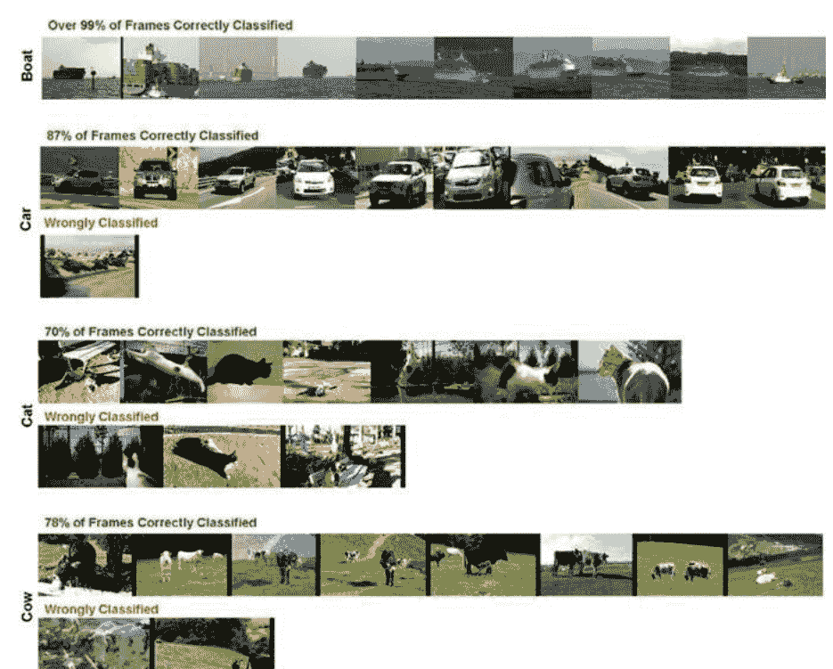

图4.8 每个类别的十个分类帧，其中正确样本与错误样本的比例与平均类别识别准确率相匹配

#### 4.5.1 从有限数据中估计特征符号

对于我们实验中使用的每种特征类型，我们改变了用于估计特征符号的标记训练样本的数量。我们将估计的特征符号与整个未标记测试集中估计的特征符号进行了比较，并呈现了估计准确性，其中从测试集中估计的符号被视为经验真实值。考虑到测试集的规模远大于有限的标记训练数据，评估从非常有限的数据中猜测正确符号的能力非常重要。结果显示在`图4.12`和`表4.3`中。表中的前两行和图中的值对应于使用单个标记视频镜头进行符号估计的情况：每个类别的1个标记训练帧的情况（与单次拍摄情况相同）和每个类别每个镜头的10个帧的情况，之前的情况下，每个标记训练镜头中取出10个均匀分布的帧。

未来工作的一个有趣方向是探索从语义、形状或上下文相关的类别中借用特征符号的可能性。我们进行了一些实验，并比较了类别之间估计的特征符号（见`图4.13`）。飞机与鸟类还是与火车共享更多的特征符号？另一个人造类别，比如火车，是否有可能共享或借用其他类别的特征符号？共享或借用其他类别的特征符号的可能性可能为更无监督类型的学习铺平道路，这样我们就不需要从特定类别的标记数据中估计符号。`图4.13`中的结果表明，确实，语义上更接近的类别共享的符号比语义上非常不同的类别更多。例如，飞机类别与船、摩托车、鸟、火车共享最多的符号，鸟类与猫、狗、摩托车、飞机、牛共享符号，船与火车、汽车、飞机共享符号，汽车与火车、船、摩托车共享符号。我们还有猫：狗、鸟、牛、马，牛：马、狗、猫、鸟，狗：牛、马、猫、鸟，马：牛、狗、猫，摩托车：飞机、鸟、汽车，火车：汽车、船、飞机，对于剩下的类别。我们注意到，确实语义、外观或上下文相似的类别，如动物或人造类别，彼此之间共享的符号比非常不同的类别更多。

这个实验证实了这些符号可能是一个很好的类别指标的直觉，并且它们在相似的类别之间也是相似的。

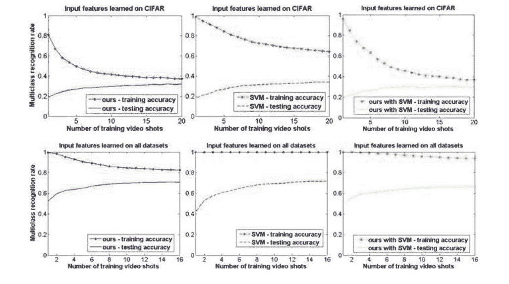

`图4.10` 监督学习：我们的方法在泛化上更好（训练和测试误差更接近），与SVM或与SVM在有限的训练数据上结合相比。

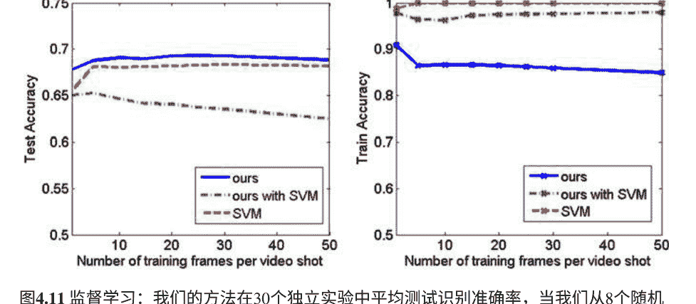

`图4.11` 监督学习：我们的方法在30个独立实验中平均测试识别准确率，当我们从8个随机训练视频中均匀采样的训练帧数量变化时。注意我们的方法从每个视频镜头中仅仅1帧进行泛化，每个类别总共有8个正样本训练帧。

### 4.5.2 改变无监督数据的数量

我们还评估了使用不同数量的无监督（未标记）数据进行无监督学习对性能的影响。我们提出以下实验设置：首先，我们将未标记的测试数据随机分成两个相等的帧集合，`$S_A$`和`$S_B$`。我们使用一组未标记的帧`$S_A$`进行无监督学习，另一组帧`$S_B$`进行测试。在保持测试帧集合`$S_B$`不变的同时，

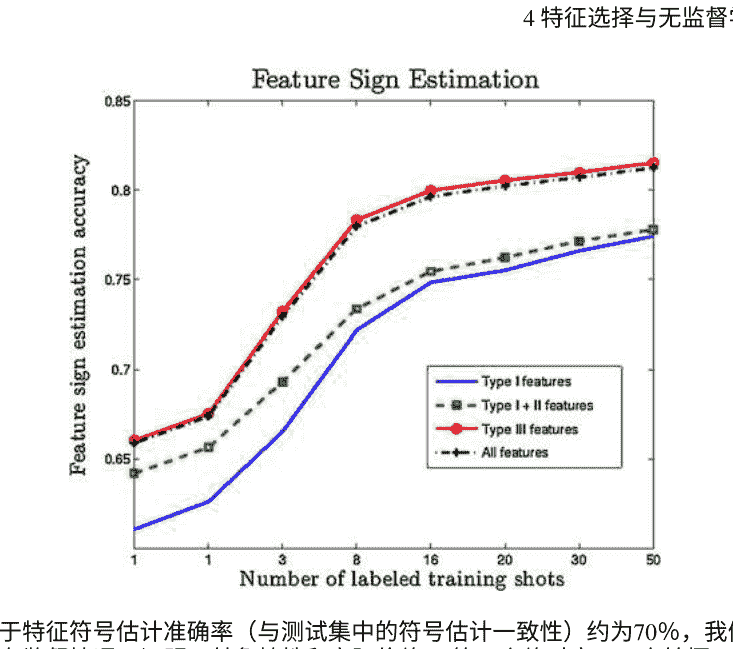

`图4.12` 对于特征符号估计准确率（与测试集中的符号估计一致性）约为70%，我们的方法明显优于有监督情况，证明了其鲁棒性和实际价值。第一个值对应于一次拍摄一帧的情况（请参见`表4.3`）

`表4.3` 不同标记拍摄次数的特征符号估计准确率：请注意，在有限数据情况下，符号估计不准确，证明了我们的方法对这些符号估计中的噪声非常鲁棒。这使我们的方法更接近完全无监督的方法。在一次拍摄学习的情况下，符号只有65%的时间被正确估计，机会为50%

| 拍摄次数 | 特征 I (%) | 特征 I + II (%) | 特征 III (%) | 特征 I + II + III (%) |
| :--- | :--- | :--- | :--- | :--- |
| 1 (1帧) | 61.06 | 64.19 | 66.03 | 65.89 |
| 1 (10帧) | 62.61 | 65.64 | 67.53 | 67.39 |
| 3 (10帧) | 66.53 | 69.31 | 73.21 | 72.92 |
| 8 (10帧) | 72.17 | 73.36 | 78.33 | 77.97 |
| 16 (10帧) | 74.83 | 75.44 | 79.97 | 79.63 |
| 20 (10帧) | 75.51 | 76.23 | 80.54 | 80.22 |
| 30 (10帧) | 76.60 | 77.15 | 80.98 | 80.70 |
| 50 (10帧) | 77.41 | 77.79 | 81.52 | 81.24 |

对于特征符号估计，我们从训练集中选择了每个类别8个标记的视频镜头（每个镜头有10个均匀间隔的帧），我们通过改变无标签数据的数量来进行无监督学习，即改变使用的无标签帧的百分比从 `$S_A$`。我们在`图4.14`和`表4.4`和`4.5`中展示了30次随机运行的结果。

#### Youtube-Objects Classes Similarity by Feats. I + II + III Signs

| | aeroplane | bird | boat | car | cat | cow | dog | horse | motorbike | train |
|---|---|---|---|---|---|---|---|---|---|---|
| aeroplane | 1.00 | 0.54 | 0.62 | 0.49 | 0.39 | 0.38 | 0.33 | 0.34 | 0.57 | 0.54 |
| bird | 0.54 | 1.00 | 0.37 | 0.36 | 0.64 | 0.51 | 0.60 | 0.46 | 0.57 | 0.30 |
| boat | 0.62 | 0.37 | 1.00 | 0.73 | 0.34 | 0.31 | 0.25 | 0.31 | 0.49 | 0.74 |
| car | 0.49 | 0.36 | 0.73 | 1.00 | 0.40 | 0.31 | 0.33 | 0.39 | 0.54 | 0.75 |
| cat | 0.39 | 0.64 | 0.34 | 0.40 | 1.00 | 0.56 | 0.67 | 0.52 | 0.46 | 0.34 |
| cow | 0.38 | 0.51 | 0.31 | 0.31 | 0.56 | 1.00 | 0.74 | 0.75 | 0.44 | 0.35 |
| dog | 0.33 | 0.60 | 0.25 | 0.33 | 0.67 | 0.74 | 1.00 | 0.72 | 0.45 | 0.26 |
| horse | 0.34 | 0.46 | 0.31 | 0.39 | 0.52 | 0.75 | 0.72 | 1.00 | 0.46 | 0.41 |
| motorbike | 0.57 | 0.57 | 0.49 | 0.54 | 0.46 | 0.44 | 0.45 | 0.46 | 1.00 | 0.46 |
| train | 0.54 | 0.30 | 0.74 | 0.75 | 0.34 | 0.35 | 0.26 | 0.41 | 0.46 | 1.00 |

`图4.13` 基于特征符号估计的YouTube-Objects类别相似性。对于每对特征，我们展示了符号相符的特征的百分比。请注意，在语义、形状或上下文上更相似的类别平均而言，符号相符的特征更多。这些符号是从所有训练数据中估计得出的。

`图4.14` 测试准确率与未标记数据量用于无监督学习的关系。请注意，在添加了相对较少的未标记帧之后，性能几乎达到了一个平台。

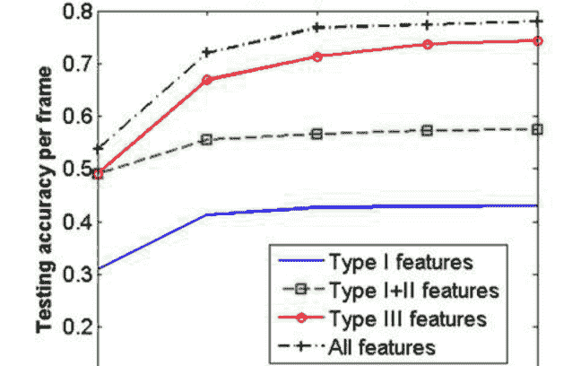

`表4.4` 无监督数据量与特征符号估计准确率的关系

| 无监督数据 | 特征Ⅰ (%) | 特征Ⅰ + Ⅱ (%) | 特征Ⅲ (%) | 特征Ⅰ + Ⅱ + Ⅲ (%) |
| :--- | :--- | :--- | :--- | :--- |
| 训练 +0% 测试 `$S_A$` | 30.86 | 48.96 | 49.03 | 53.71 |
| 训练 +25% 测试 `$S_A$` | 41.26 | 55.50 | 66.90 | 72.01 |
| 训练 +50% 测试 `$S_A$` | 42.72 | 56.66 | 71.31 | 76.78 |
| 训练 +75% 测试 `$S_A$` | 42.88 | 57.24 | 73.65 | 77.39 |
| 训练 +100% 测试 `$S_A$` | 43.00 | 57.44 | 74.30 | 78.05 |

### 4.6 对所选特征的直觉

另一个有趣的发现（见`图4.15`）是一致选择与目标类别相关但以令人惊讶的方式相关的多样化输入特征（分类器）：相似于全局视觉外观但不具有语义意义的特征（栏杆::火车，虎鲨::飞机，拍立得相机::汽车，蝎子::摩托车，遥控器::猫脸，电暖器::猫头）；在共现和上下文中相关但在全局外观上不相关的特征（头盔与摩托车）；通过部分到整体的关系连接的特征（{格栅，镜子和车轮}::汽车）；或者以上述特征的组合连接的特征（码头::船，钢桥::火车，信天翁::飞机）。目标类别与所选特征之间的关系也可能隐藏许多其他因素的组合。

有意义的关系最终可以将许多维度上的相关性连接在一起，从外观到几何、时间和交互式关系。

由于类别共享形状、部件和设计，因此或许不足为奇的是，在视觉上相似的语义上相距较远的类别上训练的分类器可以帮助改善从有限数据中的学习和泛化。另一个有趣的方面是，找到的类别不一定是主要类别的中心，而往往是边缘的，起到将主要类别与其他类别分开的守护者的作用。这就是特征多样性发挥重要作用的地方，确保与附近类别的分离以及对缺失值的鲁棒性。

另一个可能的好处是能够立即学习新概念，通过结合现有的高级概念来识别新类别。在某些情况下，对于特定新类别的数据不足的情况下，可靠分类器的稀疏平均值可以是结合先前知识的绝佳方式。考虑图4.15中的类别`牛`。虽然“牛”不在1000个标签集中，但我们的方法能够通过结合现有的分类器来学习这个概念。此外，注意到由于类别之间借用形状、部件甚至设计，因此使用从远距离类别（在语义上）但在外观上接近的输入线索可能会改善从有限数据中的学习和泛化。

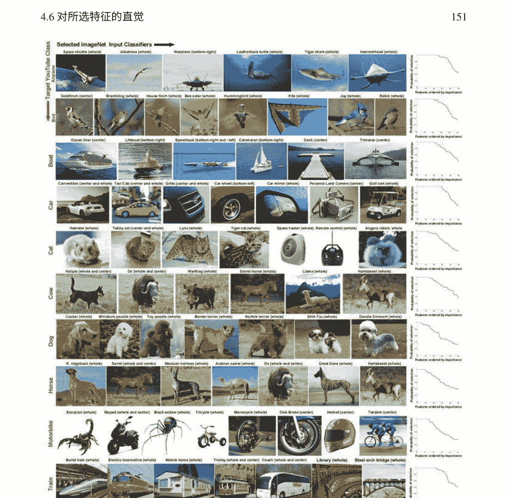

图4.15 对于来自`YouTube-Objects`视频的每个训练目标类（左侧标签），我们展示了在30个独立实验中最常选择的`ImageNet`分类器（输入特征），每个镜头有10帧，训练时随机选择10个镜头。我们展示了我们的方法在`k =50`时始终选择的类别。右侧显示了最重要的50个特征的选择概率。请注意选择过程的稳定性。还请注意所选类别与目标类别在外观、上下文或几何部分-整体关系方面的联系。我们发现两个有趣的方面：（1）即使对于小的随机训练集，仍然一致选择相同的类别；（2）根据形状和外观的相似性，与语义上无关的类别也可以用于分类。

### 4.6.1 选择特征的位置分布

表4.6总结了我们的方法选择的`ImageNet`特征在`YouTube-Objects`中每个类别的位置分布。我们得出了几个观察结果。首先，所有类别的大多数特征都考虑了整个图像（`W`），这表明图像背景是相关的。其次，对于几个类别（例如汽车、摩托车、飞机），中心（`C`）是重要的。第三，一些类别（例如船）可能位于非中心位置或受益于专注于非中心区域的分类器。最后，我们发现，表面上看起来相似的物体类别（猫与狗）展示出相当不同的分布：狗似乎受益于整个图像，而猫受益于子窗口；这可能是因为猫更小，在`YouTube`视频中出现在更多不同的上下文和位置中。

表4.5 我们方法在`YouTube-Objects`数据集上的识别准确率，使用10个训练样本（第一行）和20个训练样本（第二行），我们结合了来自几个数据集的特征。随着特征池的增长和多样性的增加，准确性显著提高（增加一倍）。特征类型为`I`: `CIFAR`; 类型`I +II`: `CIFAR` +`YouTube-Parts`; 类型`I + II +III`: `CIFAR` +`YouTube-Parts` +`ImageNet (6000)`

| 准确性 | `I (50)` | `I + II (160)` | `I + II + III (6160)` |
| :--- | :---: | :---: | :---: |
| 10个训练样本 (%) | 29.69 | 51.57 | 69.99 |
| 20个训练样本 (%) | 31.97 | 52.37 | 71.31 |

表4.6 输入分类器所选子窗口的分布。最常选择的是整个图像，表明整个图像的信息是相关的，包括背景。对于某些类别，对象本身也很重要，如中心分类器的高百分比所示。其他位置的分类器的存在表明感兴趣的对象或与之共现的对象可能出现在不同的位置。请注意，例如，猫和狗之间的分布差异。结果表明，更仔细地观察位置并朝向检测可能有助于整体分类。

| 位置 | `W` | `C` | `TL` | `TR` | `BL` | `BR` |
| :--- | :---: | :---: | :---: | :---: | :---: | :---: |
| 飞机 | 65.6 | 30.2 | 0 | 0 | 2.1 | 2.1 |
| 鸟 | 78.1 | 21.9 | 0 | 0 | 0 | 0 |
| 船 | 45.8 | 21.6 | 0 | 0 | 12.3 | 20.2 |
| 汽车 | 54.1 | 40.2 | 2.0 | 0 | 3.7 | 0 |
| 猫 | 76.4 | 17.3 | 5.0 | 0 | 1.3 | 0 |
| 牛 | 70.8 | 22.2 | 1.8 | 2.4 | 0 | 2.8 |
| 狗 | 92.8 | 6.2 | 1.0 | 0 | 0 | 0 |
| 马 | 75.9 | 14.7 | 0 | 0 | 8.3 | 1.2 |
| 摩托车 | 65.3 | 33.7 | 0 | 0 | 0 | 1.0 |
| 火车 | 56.5 | 20.0 | 0 | 2.4 | 12.8 | 8.4 |

讨论：额外的测试进一步确认了我们方法的实际价值，它对有限标记数据具有鲁棒性，并能够从无监督样本中进行良好的泛化。在我们对几乎无监督的情况下进行的测试中，有限的监督仅用于估计特征的符号，这些符号经常被错误分类，如图所示。误分类特征符号的影响得到了缓解，因为我们的方法对符号估计中的噪声具有足够的鲁棒性，并且仍然选择可能具有正确估计符号的良好特征组。

我们还测试了使用不同数量的无监督数据，结果显示在添加了25-30%的无标签帧后，性能趋于稳定。还值得注意的是，我们的方法可以处理大量的无标签数据，并且随着新的无标签数据的添加而改进，因此它是一种高效且鲁棒的特征选择方法，有望在许多大数据、实际应用中发挥作用。

### 4.7 结论和未来工作

我们提出了一种快速的特征选择和学习方法，只需最少的监督，并将其应用于视频分类。它在理论上具有强大的性质，在实践中具有出色的泛化能力和准确性。我们方法的关键是在特征符号确定后，能够从大量无标签数据中学习，并且对特征符号估计误差非常鲁棒。我们的特征符号与`AdaBoost`等提升方法使用的弱特征之间的一个关键区别在于，在我们的情况下，符号估计只需要最少的标记，并且该符号是唯一需要的监督。`AdaBoost`需要大量的训练数据来精选和加权新特征。这一方面揭示了一个关键的洞察力：能够近似标记特征而不是数据对于学习是足够的。

例如，当学习将橙子与黄瓜分开时，如果我们知道可能与“橙子”类别正相关的特征（圆度、红度、甜度、温度、图像拍摄的纬度）在潜在线索的海洋中，我们可以利用大量无标签的橙子和黄瓜图像，找到最佳的相对较小的特征组合。我们的方法允许非常快速的优化和有效地从大型异构特征池中学习，为许多其他识别任务提供了一个有用的工具，并且适用于实时、动态环境。因此，它可能为机器学习中的新的激动人心的研究打开大门，具有实际和理论上的影响。

我们未来希望追求的一个有趣方向之一是将这种方法扩展到不同抽象层次上的多层分类器，就像深度神经网络的情况一样。我们在这里呈现的只是一个线性分类器的第一层，几乎是无监督地从预训练特征中学习得到的。使用这个想法，是否有可能用最少的训练数据来学习深层次的分类器的深层次结构？一个想法是采用预训练的深度神经网络，在每个深度层次上具有许多滤波器（特征），并应用我们的特征学习方法。修剪网络的方案。我们将通过自动选择每个网络层中最相关且在特征协方差矩阵中形成最强块的特征来实现这一目标。我们甚至可以进一步利用所选特征的联合共现信号作为监督信号，以微调网络中的初始特征，通过反向传播梯度下降更新。将群体的组合输出作为深度无监督学习策略的监督信号的这一想法，与下一章节中介绍的内容立即相关，特别是书的最后部分介绍的视觉故事网络概念。

### 参考文献

1. Hansen L, Salamon P (1990) 神经网络集成. `PAMI 12(10)`
2. Vasconcelos N (2003) 最大边际多样性特征选择: 对视觉识别的最优性和影响的理解. 在: `CVPR`
3. Dietterich T (2000) 机器学习中的集成方法. `Springer`
4. Breiman L (1996) Bagging预测器. 机器学习 `24(2)`
5. Freund Y, Schapire R (1995) 决策理论的在线学习推广及其应用于提升. 计算学习理论
6. Kwok S, Carter C (1990) 多个决策树. 在: 人工智能中的不确定性
7. Criminisi A, Shotton J, Konukoglu E (2012) 决策森林: 分类、回归、密度估计、流形学习和半监督学习的统一框架. `FoundTrends Comput Graph Vis 7(2-3)`
8. Viola P, Jones M (2004) 强大的实时人脸检测. `IJCV 57(2)`
9. Guyon I, Elisseeff A (2003) 变量和特征选择的介绍. `J Mach Learn Res 3:1157-1182`
10. Ng A (1998) 特征选择: 学习具有指数多个无关特征的训练样本. 在: `ICML`
11. Pudil P, Novovicová J, Kittler J (1994) 浮动搜索方法在特征选择中的应用. `Pattern Recognit Lett 15(11)`
12. Vogel CR (2002) 逆问题的计算方法. 工业和应用数学学会, 第23卷

13. Tibshirani R (1996) 通过套索进行回归收缩和选择. J R Stat Soc 267-288
14. 赵P, 于B (2006) 关于套索模型选择一致性的研究. J Mach Learn Res 7:2541-2563
15. Siedlecki W, Sklansky J (1989) 关于大规模特征选择的遗传算法的注释. Pattern Recognit Lett 10(5)
16. Duda R, Hart P (1973) 模式分类和场景分析. Wiley
17. 贾Y, Shelhamer E, Donahue J, Karayev S, Long J, Girshick R, Guadarrama S, Darrel T (2014) Caffe: 用于快速特征嵌入的卷积架构. 在: ACM多媒体
18. Prest A, Leistner C, Civera J, Schmid C, Ferrari V (2012) 从弱注释视频中学习对象类别检测器。 在: CVPR
19. Leordeanu M, Radu A, Baluja S, Sukthankar R (2015) 不是对样本进行标记, 而是对特征进行标记: 最小监督下的高效视频分类. arXiv:151200517
20. Li Z, Cheong LF, Yang S, Toh KC (2018) 同时聚类和模型选择: 算法、理论和应用. IEEE Trans Pattern Anal Mach Intell 40(8):1964-1978
21. Bengio Y, Delalleau O, Roux NL (2006) 标签传播和二次准则. 半监督学习
22. Joachims T (1999) 使用支持向量机进行文本分类的转导推理. 在: ICML
23. Yang Y, Shen HT, Ma Z, Huang Z, Zhou X (2011) L2,1-范数正则化的无监督学习特征选择。 在: IJCAI
24. Rolls E, Deco G (2010) 嘈杂的大脑：随机动力学作为大脑功能的原则，卷34. 牛津大学出版社，牛津。
25. Ahmed E, Shakhnovich G, Maji S (2014) 当你看到一个好的HOG滤波器时：高效选择用于检测的滤波器。 在: ECCV
26. Sarkar S, Boyer K (1998) 基于特征组织的定量变化度量：特征值和特征向量。 CVIU 71(1):110-136
27. Bulo S, Pellilo M (2009) 一种博弈论方法用于超图聚类。 在: NIPS
28. Liu H, Latecki L, Yan S (2010) 健壮聚类作为关联关系的集合。 在: NIPS
29. Leordeanu M, Sminchisescu C (2012) 高效的超图聚类。 在: 人工智能和统计学国际会议
30. Leordeanu M, Hebert M, Sukthankar R (2009) 一种整数投影定点方法用于图匹配和地图推理。 在: NIPS
31. Blumer A, Ehrenfeucht A, Haussler D, Warmuth M (1987) 奥卡姆剃刀。 信息处理信件 24(6)
32. Krizhevsky A, Hinton G (2009) 从小图像中学习多层特征。 多伦多大学计算机科学系，技术报告
33. Deng J, Dong W, Socher R, Li L, Li K, Fei-Fei L (2009) ImageNet：一个大规模的分层图像数据库。 在: CVPR
34. Nguyen M, De la Torre F (2010) 支持向量机的最优特征选择。 模式识别 43(3)
35. Weston J, Mukherjee S, Chapelle O, Pontil M, Poggio T, Vapnik V (2000) SVM的特征选择。 在: NIPS，卷12
36. Kira K, Rendell L (1992) 特征选择问题：传统方法和一种新的算法。 在: AAAI
37. Zhang T (2009) 自适应前向-后向贪婪算法用于线性模型的稀疏学习。 在: NIPS
38. Chang CC, Lin CJ (2011) LIBSVM：支持向量机库。 ACM Trans Intel Syst Technol (TIST) 2(3):27
39. Zou H, Hastie T (2005) 正则化和变量选择通过弹性网络。 J R Stat Soc: Ser B (Stat Methodol) 67(2)

## 第5章 在视频中无监督学习物体分割与高度可能的正特征

### 5.1 从简单特征到视频中的无监督分割

到目前为止，我们应该相信视频中的无监督学习是一项非常具有挑战性的任务。完全解决这个问题将从科学的角度为我们对智能的理解带来新的启示。它还将在许多实际应用中产生强大的影响，因为可以以相对较低的成本收集到大量未标记的视频数据集。

我们从一个简单的想法开始，它揭示了一个强大的概念：通常可以通过利用现实世界的自然分组特性以无监督的方式高精度地检测到正样本数据。然后，这些正样本可以可靠地用于学习强大的分类器，无需人工监督。

接下来，这些分类器的集合可以应用于新数据，并且输出可以成为下一次迭代的HPP特征。从一次迭代到下一次迭代，学习到的分类器变得越来越强大，具有更好的泛化性能。这种思路完全遵循无监督学习的原则，我们在引言章节中进行了简要介绍和动机解释。我们在这里重申它们，一一列举如下。在本书的这一部分，我们开始开发一个完整的视频对象发现系统，将所有这些原则结合在一起，依次进行。这些原则将在接下来的章节中共同被进一步利用，以创建一个通用且完全无监督的学习系统。

> 本章所介绍的材料在很大程度上基于以下论文：

> Stretcu, Otilia和Marius Leordeanu。“视频中的目标发现的多帧匹配。”英国机器视觉会议（BMVC）2015年。

> Haller, Emanuela和Marius Leordeanu。“通过高概率正样本特征的高效选择，在视频中进行无监督目标分割。”IEEE国际计算机视觉会议（ICCV）2017年。

## 无监督学习的前七个原则:

### 原则1

对象在全局场景中是局部异常值，尺寸较小，外观和运动与其较大的背景不同。

### 原则2

通常可以选择高精度（不一定高召回率）的数据样本，这些样本属于单个对象或类别。

### 原则3

物体在空间和时间上显示对称、连贯和一致的特性。基于外观、运动和行为的分组线索可以用来收集高精度的正样本物体。这些线索很可能属于单个物体或类别，被称为高概率正（HPP）特征。

### 原则4

物体在其时空邻域中形成强烈的运动轨迹和外观模式的聚类。

### 原则5

偶然的对齐是罕见的。当它们发生时，通常表示模型和图像之间的正确对齐。对齐，可以是几何的或外观的，虽然它们很少见，但当它们发生时，会形成一个在多个方面相互加强的强大集群。

### 原则6

当几个弱独立的分类器一直一起触发时，它们会发出一个信号，表明存在一个更高级别的类别，可以学习一个更强的分类器。

### 原则7

为了改进或学习新的类别，我们需要增加训练数据的数量和难度，以及分类器的能力和多样性。通过使用现有分类器之间的一致性作为新分类器的教师监督信号，我们可以在多个世代中以无监督的方式学习。

在本章中，我们关注以下方法，一个方法引导着下一个方法:

- 1. 我们首先提出了一种简单而有效的算法，通过对比前景与背景的简单颜色特性，在图像中分割前景对象。我们提出了一个有趣的理论结果，它将构成从高概率正特征中学习的基础。

- 2. 接下来，我们展示了最初用于图像前景分割的简单颜色思想如何通过使用主成分分析在时空域中区分前景和背景来扩展到视频中。

- 3. 在本章的剩余部分，我们将更深入地探讨并发展从高概率正特征中学习的思想，以构建一个完整且高效的无监督前景对象分割系统。

关于视频中显著对象的无监督学习和发现，已经有几种不同的发表方法[1-4]，但大多数方法计算成本较高。一般来说，无监督挖掘和聚类的算法由于问题的固有组合性质而被认为是计算上昂贵的[5]。

在这里，我们解决了计算成本的挑战，并提出了一种既准确又快速的算法。我们实现了我们的目标，基于一个关键的洞察：我们专注于选择和学习与感兴趣的的对象的存在高度相关的特征，并且可以快速选择和计算。注意：在本书中，当提到高度可能的正（HPP）特征时，我们使用“特征”来表示一个特征向量样本（即，一个数据样本），而不是一个特征类型。虽然我们不要求这些特征覆盖所有感兴趣的的对象的实例和部分（我们可能期望召回率低），但我们证明在无监督的情况下，可以找到高精度的正特征（选择的大部分确实是真正的正例）。然后，我们在理论上证明，只要被认为是正的特征集具有高精度，而不管召回率如何，我们就可以可靠地训练一个无监督选择的正负样本集的对象分类器，如果满足某些条件（在实践中通常满足）。我们提出了一种可以在实践中有效且快速地完成这个任务的无监督算法，其在困难实验中具有最先进的结果，同时至少比竞争对手快10倍。所提出的方法输出感兴趣对象的软分割和边界框。图5.1中显示了两个示例。

虽然我们对视频中存在的对象类型没有任何假设，但我们期望序列包含一个显著的对象，因为我们的方法执行前景软分割，并且不期望没有显著对象的视频对象或多个感兴趣的对象。导致我们的公式和算法的关键见解如下：

1. 首先，前景和背景是互补的，与彼此对比—它们具有不同的大小、外观和运动。我们观察到，我们越能利用这些对比性质，实践中的结果就越好。虽然背景占据了图像的大部分，前景通常很小，并且具有明显的颜色和运动模式—它在背景场景中显眼。
2. 我们方法的第二个主要思想是，我们应该利用这种前景-背景互补性，以便自动选择具有高精度的前景特征，即使期望的召回率很低。然后，我们可以可靠地将这些样本用作正样本，将其余样本用作负样本，以训练一个用于检测感兴趣的主要对象的分类器。我们在第5.4.1节中正式介绍了这一点。

这些洞察力导致了我们在本章中的两个主要贡献：首先，我们理论上证明了通过选择具有高概率正值的特征，可以学习到一个鲁棒的前景区域分类器。其次，我们提出了一种基于这一洞察力的高效方法，在实践中优于许多不同的物体类别，并且比大多数其他方法快一个数量级。

多年来，视频中的物体发现任务一直受到关注，早期的方法是基于局部特征匹配的[1, 2]。当前的文献提供了各种解决方案，具有不同程度的监督，从完全无监督的方法[3, 4]到部分有监督的方法[6-10]，这些方法从由在监督方式下训练的系统估计的区域、物体或分割提议开始[11-13]。一些方法还需要用户对视频的第一帧进行输入[14]。大多数物体发现方法还利用现成的形状分割方法来产生精细的形状分割结果[15-19]。

这里所呈现的材料基于我们之前在Leordeanu [20]、Stretcu和Leordeanu [10]以及Haller和Leordeanu [21]发表的工作。我们从介绍在图像中使用简单颜色分布进行对象分割的初始方法开始。然后，我们扩展这个想法，开发了`VideoPCA`，一种使用主成分分析进行视频背景减除的方法。第三，对于本书的主要和剩余部分，我们从前两种方法的思想和见解出发，开发了我们的完整竞争系统，用于无监督的视频前景对象分割。

## 5.2 无监督图像分割的简单方法

在本节中，我们介绍了一种简单但有效的使用颜色统计将前景对象与背景分离的方法。我们展示了仅仅使用颜色直方图通常已经足够强大，可以进行分割。

在不使用任何局部强度信息或边缘的情况下，从背景中分离前景。其他使用颜色直方图来分离前景和背景的工作，只需最少的用户输入，包括`GrabCut` [22]和`Lazy Snapping` [23]。那项工作需要更多的用户输入，例如在对象上和对象外的标记。在我们的情况下，我们希望以柔和的方式发现相对于前景上的给定点的对象掩码，而不提供任何其他信息。

我们希望能够在不知道前景的真实掩码（或边界框）的情况下利用颜色直方图的能力。但这似乎几乎是不可能的。如果我们对前景的大小和大致形状一无所知，我们如何计算前景的颜色直方图？

暂时假设我们在图像中有一个对象的边界框。颜色分组应该根据给定的边界框在某些全局统计上将前景与背景分离。在这种情况下，我们使用从对象的边界框计算出的颜色似然：前景对象的直方图是从对象的边界框计算出的，背景的直方图是从图像的其余部分计算出的，类似于我们之前在对象跟踪中使用的思想。如果我们有一个正确的边界框，这应该是合理的。在这里，我们展示了即使是完全错误的边界框，只要满足某些假设，也能得到一个相当好的结果。然后，在任何给定的像素点上，如果我们选择满足这些假设的边界框，我们有可能找到图像中其他可能与该特定点属于同一对象的点。

正如我们将在后面展示的那样，可以基于对象中心的边界框上的颜色分布获得一个相当好的前景掩码，但形状、大小和位置完全错误。如果我们做出一些假设，这可以在理论上解释。在图5.2中，前景显示为蓝色，边界框显示为红色。边界框的中心在前景上，但其大小和位置显然是错误的。我们做出以下假设，在实践中很容易满足，即使没有关于前景形状和大小的任何先验知识。我们还在图5.3中对所做的假设给出了一个视觉解释。

1. 前景的面积小于背景的面积：这对图像中的大多数对象来说是正确的。
2. 边界框内的大多数像素属于真正的前景：这在实践中也很容易满足，因为边界框的中心被认为是前景对象。
3. 真正的背景和前景的颜色分布与位置无关：这个假设在实践中是合理的，但比前两个假设更难满足，因为颜色有时取决于位置（例如，一个人的头与他的衣服有不同的分布）。

尽管上述三个假设在实践中并不一定始终成立，但大多数情况下它们不需要完全成立，以下结果仍然成立（它们只代表宽松的充分条件）：设 `p(c|obj)` 和 `p(c|bg)` 是给定颜色 `c` 的真实前景和背景颜色概率，`p(c|box)` 和 `p(c|¬box)` 是使用（错误的）边界框计算得到的满足上述假设的概率。我们想要证明对于任何颜色 `c`，使得 `p(c|obj) > p(c|bg)` 我们也必须有 `p(c|box) > p(c|¬box)` 反之亦然。这个结果基本上表明，无论何时一个颜色 `c` 在真实对象上出现的频率比在背景中高，它在边界框内出现的可能性也比在边界框外高，因此使用边界框而不是真实对象掩码的似然比检验（>1）将得到相同的结果。这个结果使我们能够在满足上述假设的任何边界框上使用颜色直方图，就好像我们知道真实对象掩码一样。证明很简单，它基于这些假设：

```
p(c|box) = p(c|obj, box)p(obj|box) + p(c|bg, box)p/bg|box),          (5.1)
```

和

```
p(c|¬box) = p(c|obj, ¬box)p(obj|¬box) + p(c|bg, ¬box)p(bg|¬box)  (5.2)
```

假设颜色分布与位置无关（第三个假设），我们有 `p(c|obj, box) = p(c|obj)` 和 `p(c|bg, box) = p(c|bg)`。然后我们有 `p(c|box) = p(c|obj)p(obj|box) + p(c|bg)p(bg|box)` 以及类似地 `p(c|¬box) = p(c|obj)p(obj|¬box) + p(c|bg)p(bg|¬box)`。

由于物体比背景小（第一个假设），但是边界框的主要部分被物体覆盖（第二个假设），我们有 `p(obj|box) > 0.5 > p(bg|box)` 和 `p(obj|¬box) < 0.5 < p(bg|¬box)`。通过还使用 `p(c|obj) > p(c|bg)`， `p(bg|box) = 1 - p(obj|box)` 和 `p(bg|¬box) = 1 - p(obj|¬box)`，我们最终得到我们的结果 `p(c|box) = p(obj|box)(p(c|obj) - p(c|bg)) + p(c|bg) > p(obj|¬box)(p(c|obj) - p(c|bg)) + p(c|bg) = p(c|¬box)` (因为 `p(obj|box) > p(obj|¬box)`)。通过注意到为了使前面的结果成立，我们必须有 `p(c|obj) - p(c|bg) > 0`，因为 `p(obj|box) > p(obj|¬box)`。

### 5.2.1 一种快速的颜色分割算法

接下来，我们根据之前提出的思想，提出了一种计算前景对象软掩模的简单算法。在图5.4中，我们展示了通过在对象上的特定位置（红点）上计算前景的后验概率，从而得到的一些软掩模的结果。重要的是，所得到的掩模相对稳定，对于所选择的对象上的点的位置不太敏感。这表明，通过将从对象上的不同潜在位置获得的几个这样的软分割结果组合起来，或者使用不同尺度上的不同边界框，我们可以获得更稳健、更高质量的掩模。

计算软物体掩模：软掩模的计算如下：图像中的每个颜色像素 `c` 被赋予后验值 `p(c|box)/(p(c|box) + p(c|¬box))` 在掩模中。根据之前得到的结果，我们知道当真实后验概率大于0.5时，这个后验概率大于0.5。因此，我们期望得到的软掩模与使用真实掩模而不是边界框计算颜色分布时得到的掩模相似。我们在四个不同大小的边界框上计算这样的掩模（大小固定，在所有实验中都相同）。在每个尺度上，我们将小于0.5的所有像素值清零，并保留与边界框内部相连的最大连通分量。这就是给定尺度的软掩模。然后，作为最终结果，我们对所有四个尺度的软掩模进行平均。我们将这个过程称为前景-背景颜色分割。

从类特定对象检测到分割：类特定或语义分割是计算机视觉中一个重要的问题，受到越来越多的关注，并具有广泛的实际应用。在这里，我们展示了另一种简单高效的方法，通过使用现成的对象类检测器进行FG-BG分割方法。该过程的步骤如下：

1. 使用任何特定类别的检测器来获取感兴趣类别的近似边界框。
2. 将检测器返回的边界框的宽度和长度减半，同时保持相同的中心点。这一步将确保减小的边界框中的大多数像素属于感兴趣的对象。

## 5.3 视频主成分分析：无监督背景减除在视频中

# 基于PCA的前景对象发现与分割

我们提出了一种基于主成分分析（`PCA`）的方法，用于快速估计更有可能属于前景对象的帧像素[10]。¹我们观察到，通常感兴趣的对象比背景场景具有更复杂和多样化的运动，它经常引起遮挡，具有独特的外观，并且通常占据较小的空间。所有这些差异使得前景比背景更难以用简单的基于 `PCA` 的方案建模。由于背景包含视频中的大部分信息，并且变化比前景小，我们预计它可以更好地由给定视频镜头的较低维子空间捕捉到。还有几种竞争性的方法用于在图像中检测潜在有趣的前景对象作为显著区域，这些方法也基于一个普遍的观点，即对象与其背景不同，并且通过计算输入测试图像上的全局图像统计信息或学习背景先验来最好地估计前景-背景对比度[26, 27]。例如，成功的光谱残差方法[28]是一种通过查看图像的平均傅里叶谱与实际原始谱之间的差异来找到图像中有趣区域的高效方法，该方法使用滤波来估计平均傅里叶谱。最近的判别区域特征集成（`DRFI`）方法[29]通过学习背景先验并使用回归找到与全局背景有所区别的对象。

与当前文献不同，我们的方法利用视频镜头中自然存在的时空一致性，并使用主成分分析（`PCA`）在无监督的方式下学习背景的线性子空间。它利用了整个视频序列中的冗余和丰富信息。

相对于主要的变化子空间，对象预计是一个异常值，一个噪声元素，更难以重建。请注意，从一个帧到下一个帧的每一个外观变化和每一个快速移动都很难通过对整个帧盲目使用 `PCA` 来捕捉。我们利用这种直觉通过与背景减除相关的方法找到属于潜在前景对象及其遮挡区域的像素。在我们的情况下，实际上背景是在降维子空间中重建的图像。设主成分为 `u_i`，`i∈[0…n_u]`（我们使用了 `n_u = 8`），重建的帧 `f` 为

```
f_r ≈ f_0 + ∑_{i=1}^{n_u} ((f - f_0)^T u_i) u_i
```

我们得到了误差图像 `f_diff = |f - f_r|`。我们注意到差异图像增强了属于前景对象或由于该对象的移动而引起的遮挡物的像素（图5.8）。通过对这些区域进行足够大的高斯平滑，然后进行阈值处理，我们可以得到像素更倾向于属于对象而不是背景的掩码。然后，通过对得到的掩码应用另一个大而居中的高斯，我们得到一个更有可能属于感兴趣对象的精细掩码。接下来，通过在整个视频镜头上累积这样的掩码，我们可以构建一个相对稳定、鲁棒的前景-背景颜色模型。

图5.8 第一行：原始图像。第二行：使用 `PCA` 和前8个主成分进行重建的图像。第三行：原始图像与重建图像之间的误差图像。第四行：使用从前景区域估计的颜色模型计算得出的最终前景分割的 `SoftSeg` 方法。

为了估计软分割，使用下面介绍的 `SoftSeg` 方法。虽然该掩码不是最优的，但计算速度很快（`50-100 fps`），在我们广泛的实验中，它始终对获取高质量的候选边界框和初始前景软分割很有用（见图5.8）。

### 5.3.1 使用VideoPCA进行软前景分割

前景-背景分割应该根据对象与其周围的统计差异很好地将感兴趣的对象与背景分开。在这里，我们提出了一种简单有效的方法（称为 `SoftSeg`），通过捕捉全局对象和背景颜色属性来生成软对象掩码，与 `Leordeanu` 和 `Hebert` [30]中介绍的静态图像软前景分割方法相关。对于对象（表示为边界框）和背景（被视为包围边界框的边界，边界厚度为边界框大小的一半），我们估计经验颜色分布，使得对于给定的颜色 `c`，前景颜色的可能性被估计为

同样，我们计算背景颜色的可能性 `p(c|B)`。给定这两个分布，我们使用贝叶斯规则和相等的先验概率来估计每个像素颜色 `c` 在图像中的前景概率：`p(F|c) = p(c|F)/(p(c|F) + p(c|B))`。

为了获得软前景分割掩码，我们只需使用上述公式估计每个像素的前景概率。在多帧的情况下，当估计高阶项 `H_i(x, θ)` 时，这两个分布是从考虑的所有帧累积的像素计算得出的。使用从多个帧估计的概率得到的分割结果具有更高的质量，更不容易出现意外的框框错位和其他噪声。

这里产生的初始软分割并不是最优的，但计算速度快（`20 fps`），且质量足够好，以确保后续阶段的良好性能。该方法的前两个步骤遵循了 `Stretcu` 和 `Leordeanu` [10]首次提出的 `VideoPCA` 算法。

在第5.4.1节中，我们提出并证明了我们的主要理论结果（命题5.1），这在很大程度上解释了为什么我们的方法能够以无监督的方式产生准确的对象分割。

## 5.4 基于HPP特征的视频无监督分割

我们的方法接收一个视频序列作为输入，其中包含一个主要的感兴趣对象，并输出其软分割掩码和相关的边界框。所提出的方法以视频帧的主成分分析为起点，提供了对象的初始软分割，类似于 `Stretcu` 和 `Leordeanu` [10]的对象发现方法中引入的最新 `VideoPCA` 算法。这种软分割通常具有较高的精度，但可能具有较低的召回率。从这个独立基于像素颜色的初始阶段开始，我们学习一个更高级的描述符，它考虑像素颜色组合，并能够捕捉关于对象属性的高阶统计信息，如不同的颜色模式和纹理。在最后阶段，我们将基于外观的软分割与从主对象与场景的对比运动计算得到的前景线索相结合。得到的方法准确且快速（在 `Matlab` 中约为 `3 fps`，`2.60 GHz CPU`，详见第5.5.3节）。我们的代码可以在线获取。²下面我们总结了我们的方法的步骤（也可参见图5.9），与算法5.1（我们方法的伪代码）相关。

> ²https://goo.gl/2aYt4s.

图5.9 算法概述。a原始图像，b基于初始目标线索的第一个像素级外观模型（步骤1和2），c从软分割的投影构建的精细像素级外观模型（步骤3和4），d补丁级外观模型（步骤5），e运动估计掩码（步骤6的一部分），f最终软分割掩码（步骤6）

- 步骤1：根据原始帧与其在主成分分析子空间上投影的帧之间的差异选择高概率前景像素（第5.3节，算法5.1 - 行[2, 5]）。
- 步骤2：根据步骤1中计算的像素掩码估计前景和背景的经验颜色分布。使用这些分布独立地估计每个像素的前景概率，基于其颜色（第5.3.1节，算法5.1 - 第6行）。
- 步骤3：通过在软分割的子空间上进行投影来改进步骤2中的软分割（第5.4.1.1节，算法5.1 - 第[7, 9]行）。
- 步骤4：根据在步骤3中更新的像素掩码重新估计前景和背景的经验颜色分布。使用这些分布根据像素的颜色独立地估计每个像素的前景概率（第5.3.1节，算法5.1 - 第10行）。
- 步骤5：使用正则化最小二乘回归在软分割的实际输出 `∈[0, 1]` 上学习前景区域的判别分类器。使用考虑在较大的补丁中共现的颜色组的特征向量。在视频的每个像素位置运行分类器，并生成改进的逐帧前景软分割（第5.4.2节，算法5.1 - 第[11, 15]行）。
- 第6步：使用外观（第5步）和通过建模背景运动高效计算的前景运动线索，结合软分割。获取最终的软分割（第5.4.3节，算法5.1 - 行[16, 23]）。
- 第7步：可选：使用 `GrabCut` [15]进行分割的细化，考虑来自第6步软分割的像素作为潜在的前景和背景样本（第5.4.3.1节）。

在视频中选择初始高概率的物体区域：我们在步骤1和2中发现了初始前景物体区域，这代表了使用 `VideoPCA` [10]进行视频物体分割的技术，详见第5.3节。请注意，这里还可以应用其他软前景发现方法。

正如 `Zitnick` 和 `Dollár` [31]，`Hou` 和 `Zhang` [28]，`Jiang` 等人 [29]所述，但我们发现使用 `VideoPCA` 的方向既快速又可靠，并且与我们方法的后续阶段完美契合。如前所述，`VideoPCA` 背后的主要思想是主成分将表示背景的线性子空间，因为预期对象是一个异常值，不遵循视频中观察到的主要变化，因此更难重构。在这一步骤中，我们将帧投影到结果子空间上，并计算重构误差图像，即原始帧与它们的 `PCA` 重构对应帧之间的差异。我们方法的前两个步骤代表了学习的第一阶段，其中高概率的正特征在一系列按顺序应用相同策略的步骤中出现。因此，在算法的每个阶段，下面将更详细地讨论，我们重复学习从 `HPP` 特征中学习的原则，从而从具有高精度但低召回率的分类器开始，并在每个阶段继续提高召回率，同时保持高精度。因此，整个系统的 `F1` 得分（这是评估对象分割的适当指标）从一次迭代到下一次迭代逐渐增加。

关键思想：我们的算法的核心有两个主要思想，直接来自我们在第一章提出的原则。第一个关键思想是对象和背景在大小、外观和运动方面具有对比性的特性。这个洞察力使我们能够可靠地选择视频中可能属于对象的几个区域。接下来的第二个思想，带来了一定的形式保证，即如果我们能够以无监督的方式选择甚至是一小部分前景对象，但具有很高的精度，那么在一些合理的假设下，我们可以训练一个用于自动发现对象的强大的前景-背景分类器。在表5.1中，我们展示了我们算法在精确度、召回率和 `F-measure` 方面的改进。请注意，箭头从最初被认为是正样本的精确度和召回率指向最终被分类为正样本的像素的精确度和召回率。`F-measure` 的显著改进可以通过我们的理论结果（在命题5.1中陈述）来解释，该结果表明在某些条件下，即使召回率受到损坏的情况下，仍将学习到可靠的分类器。

表5.1 特征样本在我们方法的不同阶段（`SegTrack` 数据集）中被视为正样本（前景）的精确度、召回率和 `F-measure` 的演变。我们从一个具有高精确度和低召回率的损坏的正样本集开始，并通过我们方法的各个阶段改善精确度和召回率。因此，软掩模从一个阶段到下一个阶段变得越来越准确。

|  | 步骤1和2 | 步骤3和4 | 步骤5 |
| :--- | :--- | :--- | :--- |
| 精确度 | 66 → 70 | 62 → 60 | 64 → 74 |
| 召回率 | 17 → 51 | 45 → 60 | 58 → 68 |
| F-measure | 27 → 59 | 53 → 60 | 61 → 72 |

## 5.4 使用HPP特征的无监督视频分割

|  | 步骤1和2 | 步骤3和4 | 步骤5 | 步骤6 |
| :--- | :--- | :--- | :--- | :--- |
| F-meas. (SegTrack) | 59.0 | 60.0 | 72.0 | 74.6 |
| F-meas. (YTO) | 53.6 | 54.5 | 58.8 | 63.4 |
| 运行时间 (每帧) | 0.05 | 0.03 | 0.25 | 0.02 |

正样本数量较低，只要精确度相对较高。在表5.2中，我们介绍了我们方法的不同阶段的定量结果，以及相关的执行时间。

## 算法5.1 视频目标分割

```
1: 获取输入帧  $F^i$
2: 主成分分析($A_1$) => $V_1$ 特征向量；$A_1(i,:) = F^i(:)$
3: $R_1 = A_1 + (A_1 - A_1) * V_1 * V_1^T$ - 重构
4: $P_1^i = d(A_1(i,:), R_1(i,:))$
5: $P_1^i = P_1^i \otimes G_{\sigma_1}$
6: $P_1^i$ => 像素级外观模型 => $S_1^i$
7: 主成分分析($A_2$) => $V_2$ 特征向量；$A_2(i,:) = S_1^i(:)$
8: $R_2 = A_2 + (A_2 - A_2) * V_2 * V_2^T$ - 重建
9: $P_2^i = R_2^i \otimes G_{\sigma_2}$
10: $P_2^i$ => 像素级外观模型 => $S_2^i$
11: $D$- 包含补丁级描述符的数据矩阵
12: 从$S_2^i$中提取的补丁标签
13: 从$D$中选择$k$个特征 => $D_s$
14: $w = (\lambda I + D_s^T D_s)^{-1} D_s^T s$
15: 评估 => 补丁级外观模型 => $S_3^i$
16: 对于每个帧$i$执行以下操作
17: 计算 $I_x, I_y$ 和 $I_t$
18: 构建运动矩阵 $D_m$
19: $w_m = (D_m^T D_m)^{-1} D_m^T I_t$
20: 计算运动模型 $M^i$
21: $M^i = M^i \otimes G_{\sigma^i}$
22: 组合 $S_3^i$ 和 $M^i$ => $S_4^i$
23: 结束循环
```

### 5.4.1 使用高概率正特征进行学习

在命题5.1中，我们展示了一个在正样本和负样本集合上训练的分类器可以学到正确的东西，就好像真正的正样本和负样本被用于训练一样，只要满足以下条件：损坏的正样本集合应该包含比整个训练集中真正的正样本比例更高的正样本。这个命题是两个阶段的基础。

图5.10 使用HPP特征向量进行学习。基本上，命题5.1表明，如果损坏的正样本集合主要包含好的特征，使得损坏的正样本集合中真正的正样本比例大于整体真正正样本比例，我们可以从一小部分损坏的正样本中学到一个可靠的判别分类器，其余部分被视为负样本。

这个假设在实践中经常能够满足，并且可以有效地用于无监督学习。

在我们的方法中，第一种是根据像素的颜色独立分类的方法，第二种是考虑像素组之间的高阶颜色统计。

让我们从图5.10的例子开始，我们选择了一组样本`$S$` (在方框内) 作为正样本。集合`$S$`具有很高的精确度 (大多数样本确实是正样本)，但召回率较低 (大多数真正的正样本被错误标记)。接下来，我们将展示集合`$S$`和`$\neg S$`可以可靠地用于训练二元分类器 (根据命题5.1的定义)。

设`$p(E_+)$`和`$p(E_-)$`分别为正元素和负元素的真实分布，`$p(x|S)$`和`$p(x|\neg S)$`分别为在考虑的正集合`$S$`和负集合`$\neg S$`内外观察到样本的概率。

**命题5.1 (从高概率正面(HPP)特征学习) 考虑以下假设`$\mathbf{H_1}: p(E_+) < q < p(E_-)$`，`$\mathbf{H_2}: p(E_+|S) > q > p(E_-|S)$`，其中`$q \in (0, 1)$`，且`$\mathbf{H_3}: p(x|E_+)$`和`$p(x|E_-)$`与`$S$`无关，那么，对于任何样本`$x$`我们有`$p(x|S) > p(x|\neg S) <=> p(x|E_+) > p(x|E_-)$`。换句话说，基于像素相似度对像素进行分类的分类器，无论是基于`$S$`还是`$\neg S$`训练，都会做出相同的决策，我们称之为可靠分类器。**

证明：我们将`$p(E_-)$`表示为`$\frac{p(E_-) - p(E_-|S)}{(1-p(S))}$` (方程1)，利用假设和概率的求和规则。考虑到(方程1)，假设`$\mathbf{H_1}, \mathbf{H_2}$`，以及事实`$p(S) > 0$`，我们得到`$p(E_-|\neg S) > q$` (方程2)。以类似的方式，`$p(E_+|\neg S) < q$` (方程3)。先前推断的关系(方程2和3)产生了`$p(E_-|\neg S) > q > p(E_+|\neg S)$` (方程4)，这与假设`$\mathbf{H_2}$`有助于我们得出结论。使用总和规则和假设`$\mathbf{H_3}$`，我们得到`$p(x|S) = p(E_+|S) \cdot (p(x|E_+) - p(x|E_-)) + p(x|E_-)$` (方程7)。以类似的方式，可以得到`$p(x|\neg S) = p(E_+|\neg S) \cdot (p(x|E_+) - p(x|E_-)) + p(x|E_-)$` (方程8)。

`$p(\mathbf{x}|S) > p(\mathbf{x}|\neg S) \Rightarrow p(\mathbf{x}|E_{+}) > p(\mathbf{x}|E_{-})$`：使用假设和先前推断的结果（方程5、7和8），得出`$p(\mathbf{x}|E_{+}) > p(\mathbf{x}|E_{-})$`。

`$p(\mathbf{x}|E_{+}) > p(\mathbf{x}|E_{-}) \Rightarrow p(\mathbf{x}|S) > p(\mathbf{x}|\neg S)$`：根据假设，我们可以推断出`$p(\mathbf{x}|E_{+}) - p(\mathbf{x}|E_{-}) > 0$`，并使用（方程5）得到`$p(\mathbf{x}|S) > p(\mathbf{x}|\neg S)$`。$\square$

#### 5.4.1.1 目标提议的改进

在这个阶段，通过在它们的PCA子空间上进行投影来改进迄今为止获得的软分割。与VideoPCA相比，现在我们选择可能的对象区域作为在先前步骤中计算的软分割的PCA投影版本。对于投影，我们考虑前八个主成分，目的是减少可能从先前步骤中遗留的噪声量。此外，重新估计颜色概率以获得软分割掩码。

## 5.4.2 使用IPFP进行描述符学习

迄今为止获得的前景掩码是通过独立处理每个像素来计算的，这导致掩码不总是正确，因为一阶统计量（例如单个像素的颜色）无法捕捉到关于对象纹理和形状的更全局特征。在这一步中，我们通过考虑局部补丁中存在的颜色组来移动到下一个抽象级别，这些颜色组足够大以捕捉对象纹理和局部形状。我们基于局部颜色出现定义了一个补丁描述符，作为给定补丁窗口`$w$`上的指示向量`$\mathbf{d}_{W}$`，如果颜色`$c$`在窗口`$w$`中存在，则`$\mathbf{d}_{W}(c)=1$`，否则为0（图5.11）。颜色根据它们在HSV空间中的值进行索引，其中通道H、S和V在范围`$[1,15]$`，`$[1,11]$`和`$[1,7]$`中离散化，总共生成1155种可能的颜色。该描述符不考虑补丁中给定颜色的精确空间位置，也不考虑其频率。它只考虑颜色`$c$`在补丁中的存在。这导致对大多数刚性或非刚性变换具有不变性，同时保留对象的局部外观特征。然后，我们采用分类方法，并学习一个分类器（使用正则化最小二乘回归，由于其较快的速度和效率）来区分高度可能的正（HPP）描述符和其余部分，根据先前步骤中计算的软掩码从整个视频中收集。该分类器通常对视点、尺度、光照和其他噪声的变化具有鲁棒性，同时保持辨别力（图5.9）。

并非所有的1155种颜色都与我们的分类问题相关。大多数物体纹理由只有几种重要的颜色组成，这些颜色可以将它们与背景区分开来。有效地减少描述符中的颜色数量并仅选择相关的颜色可以提高速度和性能。我们使用Leordeanu等人提出的高效选择算法[32]。该方法

## 5.4.3 结合外观和运动

前景和背景在许多层面上具有互补的特性，不仅仅是外观。在这里，我们认为感兴趣的对象必须在运动模式方面与场景的其余部分区分开来。在图像中不移动的前景对象相对于其背景来说，仅仅使用当前视频的信息无法发现。我们通过以下高效的方法利用这个想法。

设 `$\mathbf{I}_t$` 为图像随时间的时间导数，估计为相邻帧之间的差值 `$\mathbf{I}_{t+1} - \mathbf{I}_t$`。还设 `$\mathbf{I}_x$` 和 `$\mathbf{I}_y$` 为图像相对于 `$x$` 和 `$y$` 的偏导数。考虑 `$\mathbf{D}_m$` 为运动数据矩阵，每个像素 `$p$` 在当前帧中对应于 `$[\mathbf{I}_x, \mathbf{I}_y, x\mathbf{I}_x, x\mathbf{I}_y, y\mathbf{I}_x, y\mathbf{I}_y]$` 在前景分割估计的背景位置估计的情况下。给定时间 `$t$` 的这样一个矩阵，我们对 `$\mathbf{D}_m$` 进行线性回归 `$\mathbf{I}_t$`。解决方案将是使用图像相对于时间的一阶泰勒展开的最小二乘估计的背景的仿射运动模型：`$\mathbf{w}_m = (\mathbf{D}_m^T \mathbf{D}_m)^{-1} \mathbf{D}_m^T \mathbf{I}_t$`。在这里，`$\mathbf{w}_m$` 包含定义二维仿射运动（包括平移）的六个参数。

然后，我们将考虑与该模型的偏差作为潜在的良好候选对象，这些对象预计与背景场景的移动方式不同。这个想法基于一个近似，当然，它非常快速计算，并且可以可靠地与软掩模的外观结合使用。因此，在每个位置 `$p$` 上评估模型并计算错误 `$|\mathbf{D}_m(p)\mathbf{w}_m - \mathbf{I}_t(p)|$`。

我们将错误图像归一化并映射到 `[0, 1]`。这将产生一个软掩模（仅使用运动），用于标记不符合运动模型的位置，它们通常与物体位置相关。然后，将该映射与高斯函数平滑（`$\sigma$` 与估计的物体区域的 `$x$` 和 `$y$` 的分布成比例）。此时，我们已经从外观单独计算出了一个软物体分割，并且基于运动线索独立计算出了另一个软物体分割。两个软结果相乘以获得最终的分割。

### 5.4.3.1 可选的视频对象分割细化

可选地，我们可以通过应用现成的分割算法（如 GrabCut [15]）对软掩码进行进一步细化，并将其用于我们的软前景分割。注意：在我们的实验中，我们仅在 SegTrack 上使用 GrabCut 进行评估，因为我们对对象形状的细节非常感兴趣。所有其他实验都是在没有这一步骤的情况下进行的。

### 5.5 实验分析

我们的实验是在两个数据集上进行的：YouTube-Objects 数据集和 SegTrack v2 数据集。我们首先介绍了我们方法在考虑的数据集上的一些定性结果（图 5.13）。请注意，对于 YouTube-Objects 数据集的最终评估，我们还提取了对象边界框，这些边界框是使用具有高概率属于前景的像素的分布计算得出的。这些边界框的位置和大小都是使用均值漂移方法计算得出的。对于 SegTrack 数据集的最终评估，我们使用 GrabCut 算法[15]对软分割掩码进行了细化。在表 5.2 中，我们呈现了我们算法不同阶段的评估结果，以及每个阶段的执行时间。随着我们算法的每个阶段，F-measure 都有所提高。

### 5.5.1 在 YouTube-Objects 数据集上的测试

**数据集：** YouTube-Objects 数据集[33]包含大量从 YouTube 收集的野外拍摄视频。它包含了十个物体类别（飞机、鸟、船、汽车、猫、牛、狗、马、摩托车、火车）的具有挑战性的、无约束的序列。这些序列被认为具有挑战性，因为它们是完全无约束的，显示了物体进行快速运动，具有困难的动态背景、光照变化、相机运动、尺度和视角变化，甚至还有飞行标志或不同镜头的拼接等编辑效果。对于少数帧提供了真实标注，包含物体实例的边界框。通常，一帧只包含一个所考虑类别的主要物体，但也有一些帧包含同一类别物体的多个实例。数据集有两个版本，第一个版本（YouTube-Objects v1.0）包含来自总共约 570,000 帧的 1407 个标注对象，而第二个版本（YouTube-Objects v2.2）包含来自总共约 720,000 帧的 6975 个标注对象。

**度量：** 对于 YouTube-Objects 数据集的评估，我们采用了 CorLoc 度量标准，计算正确定位的物体边界框的百分比。我们使用 PASCAL 标准（交并比 ≥ 0.5）来评估框的正确性。

**结果：** 我们将我们的方法与 [3, 6, 7, 10, 33] 进行了比较。我们考虑了他们在相应论文中最初报告的结果。比较结果显示在表 5.3 中。据我们所知，其他方法都是在 YouTube-Objects v1.0 上进行评估的，使用的是训练样本（唯一的例外是 [10]，他们考虑了完整的 v1.0 数据集）。考虑到这一点，以及两个版本之间的差异，包括注释数量方面的差异，我们报告了我们在两个版本上的性能，以便进行公平比较，并且还报告了最新版本 YouTube-Objects v2.2 上的结果（不用于比较）。我们仅考虑训练样本，报告了在 v1.0 上的评估结果，以便与其他方法进行公平比较。我们的无监督方法与有监督和无监督方法进行了比较。在表中，我们标记了无监督方法的最新成果（粗体）和整体最新成果（下划线）。我们还提到了所考虑方法的执行时间，以证明我们的方法比其他方法快一个数量级（详见第 5.5.3 节）。

表 5.3 我们的方法和其他五种最先进的方法在 YouTube-Objects 数据集上的 CorLoc 得分（请注意，不考虑数据集 v2.2 的结果进行比较）

| 方法 \ 无监督的？ | Jun Koh等人[6] Y | Zhang等人[7] Y | Prest等人[33] N | Stretcu和Leordeanu[10] N | Papazoglou和Ferrari[3] N | 我们的 v1.0 N | 我们的 v2.2 N |
| :--- | :--- | :--- | :--- | :--- | :--- | :--- | :--- |
| 飞机 | 64.3 | 75.8 | 51.7 | 38.3 | 65.4 | **76.3** | 76.3 |
| 鸟 | 63.2 | 60.8 | 17.5 | 62.5 | 67.3 | **71.4** | 68.5 |
| 船 | 73.3 | 43.7 | 34.4 | 51.1 | 38.9 | **65.0** | 54.5 |
| 汽车 | 68.9 | **71.1** | 34.7 | 54.9 | 65.2 | 58.9 | 50.4 |
| 猫 | 44.4 | 46.5 | 22.3 | 64.3 | 46.3 | **68.0** | 59.8 |
| 牛 | 62.5 | 54.6 | 17.9 | 52.9 | 40.2 | **55.9** | 42.4 |
| 狗 | 71.4 | 55.5 | 13.5 | 44.3 | 65.3 | **70.6** | 53.5 |
| 马 | 52.3 | 54.9 | **48.4** | 43.8 | **48.4** | 33.3 | 30.0 |
| 摩托车 | 78.6 | 42.4 | 39.0 | 41.9 | 39.0 | **69.7** | 53.5 |
| 火车 | 23.1 | 35.8 | 25.0 | **45.8** | 25.0 | 42.4 | 60.7 |
| 平均 | 60.2 | 54.1 | 30.4 | 49.9 | 50.1 | **61.1** | 54.9 |
| 时间（每帧秒） | 无 | 无 | 无 | 6.9 | 4 | 0.35 | |

我们的方法的性能竞争力强，对于三个类别，与有监督和无监督方法都取得了最先进的结果。与无监督方法相比，我们在七个类别中取得了最先进的结果。平均而言，我们的方法在所有其他方法中表现更好，而且在执行时间方面也更好（还请参阅第 5.5.3 节）。我们的算法平均而言优于其他方法，证明它对于不同类别的对象和不同类型的视频具有更好的泛化能力。我们的解决方案在“马”类上表现不佳，因为许多序列中包含多匹马，而我们的方法无法正确分离实例。

另一个性能较低的类别是“牛”类别，在这个类别中，我们面临着与“马”类别相同的问题，对象通常是静止的，在我们的系统中很难进行分割。

### 5.5.2 SegTrack V2 数据集上的测试

**数据集：** SegTrack 数据集最初由 Tsai 等人[34]引入，用于评估跟踪算法。此外，它还被适应用于视频对象分割任务[4]。我们使用数据集的第二个版本（SegTrack v2），其中包含 14 个视频（≈1000 帧），每帧都有感兴趣对象的像素级地面真值注释。该数据集很难，因为包含的对象可能很容易与背景混淆，大小不同，并显示复杂的变形。有八个视频只有一个主要对象，还有六个视频有多个对象，来自八个不同的类别（鸟、猎豹、人类、蠕虫、猴子、狗、青蛙、降落伞）。

**度量：** 对于 SegTrack 的评估，我们采用了平均交叉-并集度量。我们明确指出，为了评估的目的，我们使用 GrabCut 对软分割掩模进行了改进。

结果：我们将我们的方法与[3, 4, 8, 9, 35]进行了比较。 我们考虑了他们的结果，正如Wang等人[35]最初报告的那样。 比较结果显示在表5.4中。 再次，我们将我们的方法与有监督和无监督方法进行了比较，在表中，我们标记了无监督方法的最新成果（加粗），以及整体最新成果（下划线）。 还介绍了执行时间，以突出我们的方法在速度方面优于其他方法（见第5.5.3节）。

我们的方法在无监督方法中具有竞争力的性能。 此外，我们证明了我们的方法比之前的最新成果[3]快一个数量级（见第5.5.3节）。

| 方法 | 李等人 [9] | 张等人 [8] | 王等人 [35] | Papazoglou和Ferrari [3] | 李等人 [4] | 我们的 |
| :--- | :--- | :--- | :--- | :--- | :--- | :--- |
| 有监督吗？ | 是 | 是 | 是 | 否 | 否 | 否 |
| 天堂鸟 | 92 | - | **95** | 66 | **94** | 93 |
| 鸟跌落 | 49 | **71** | 70 | 59 | **63** | 58 |
| 青蛙 | 75 | 74 | **83** | **77** | 72 | 58 |
| 女孩 | 88 | 82 | **91** | 73 | **89** | 69 |
| 猴子 | 79 | 62 | **90** | 65 | **85** | 69 |
| 降落伞 | **96** | 94 | 92 | 91 | 93 | **94** |
| 士兵 | 67 | 60 | 85 | 69 | **84** | 60 |
| 蠕虫 | **84** | 60 | 80 | 74 | 83 | **84** |
| 平均 | 79 | 72 | **86** | 72 | **83** | 73 |
| 时间 (每帧秒) | >120 | >120 | 无 | 4 | 242 | **0.73** |

### 5.5.3 计算时间

我们方法的主要优势之一是减少了计算时间。请注意，所有像素级分类都可以通过线性滤波例程高效实现，因为我们的所有分类器都是线性的。生成软分割掩码仅需0.35秒/帧（初始对象线索：0.05秒/帧，对象提议细化：0.03秒/帧，基于补丁的回归模型：0.25秒/帧，运动估计：0.02秒/帧（表5.2））。该方法在`Matlab`中实现，没有进行特殊优化。所有计时测量都是在一台配有`Intel Core i7 2.60 GHz CPU`的计算机上进行的。Papazoglou和Ferrari的方法[3]报告了初始光流计算的时间为3.5秒/帧，他们的方法需要0.5秒/帧，总共需要4秒/帧。

Stretcu和Leordeanu [10]介绍的方法每帧总共需要6.9秒。对于其他方法，比如Zhang等人[8]和Lee等人[9]介绍的方法，仅仅使用Endres和Hoiem [13]的方法生成初始目标建议，每帧需要高达120秒。我们对其他考虑的方法没有关于计算时间的信息，但由于它们的复杂性，我们预计它们的速度比我们的慢几个数量级。

### 5.6 结论和未来工作

我们提出了一种高效的完全无监督的视频目标发现方法，既快速又准确。它在具有挑战性的边界框目标发现基准测试中取得了最先进的结果，并在视频目标分割数据集上具有非常有竞争力的性能。 与此同时，我们的方法速度很快，至少比竞争对手快一个数量级。 通过利用对象和场景之间的对比性质，无论是外观还是运动，我们实现了速度和性能的出色结合，从而可以选择具有非常高精度的正特征样本。 我们在理论上和实践上都表明，高精度足以进行可靠的无监督学习（因为正样本通常比负样本少），我们在单个像素和像素组的更高级别上执行无监督学习，从而捕捉到关于对象外观、纹理和形状的高阶统计信息。 我们的方法具有最高的速度和准确性，结合在实践中具有保证的理论条件，使我们的方法在解决视频无监督学习问题的过程中独特而有价值。

在本章中，我们迈出了解决无监督学习的重要一步。我们引入了使用`HPP`特征进行学习的概念，这一概念推广了我们迄今讨论的思想，并与第1章中给出的总体概述和原则相关。 在未来的章节中，我们将展示如何进一步利用这一概念，并以无监督的方式训练多代分类器，采用一种新颖的范式，即使用上一代作为下一代学生的教师（第7章）。 高概率的正特征是可以可靠地用作正标记信号的特征。在进行真正的无监督学习时，我们需要某种先验知识，并且正如本章所示，`HPP`特征非常适合扮演这个角色。 我们还证明，在一些温和的假设下，使用`HPP`特征进行学习提供了一些理论保证。 因此，我们可以期望这一概念在无监督学习的总体思想中发挥更深入的作用，并且我们也怀疑没有比空间和时间邻域中分类器响应的共现和一致性更好的`HPP`信号，否则这种共现和一致性将是非常不太可能的。 这就是本书的主题，再次在这里展示出来，就像在前后章节中一样。

### 参考文献

1.  Sivic J, Russell BC, Efros AA, Zisserman A, Freeman WT (2005) 在图像中发现对象及其位置。在：第十届IEEE国际计算机视觉会议，ICCV 2005年，卷1。IEEE，pp 370-377
2.  Leordeanu M, Collins R, Hebert M (2005) 从视频序列中无监督学习对象特征。在：IEEE计算机视觉和模式识别会议。IEEE计算机学会，卷1，第1142页
3.  Papazoglou A, Ferrari V (2013) 在无约束视频中快速对象分割。在：IEEE国际计算机视觉会议论文集，pp 1777-1784
4.  Li F, Kim T, Humayun A, Tsai D, Rehg J (2013) 通过跟踪多个前景-背景片段进行视频分割。在：国际计算机视觉会议
5.  Jain AK, Murty MN, Flynn PJ (1999) 数据聚类：一项综述。 ACM Comput Surv (CSUR) 31(3):264–323
6.  Jun Koh Y, Jang WD, Kim CS (2016) POD: 基于对象重复性、背景和主要对象模型的视频中的主要对象发现。在：计算机视觉和模式识别IEEE会议论文集, 第1068-107页
7.  Zhang Y, Chen X, Li J, Wang C, Xia C (2015) 通过弱标记视频中的检测进行语义对象分割。在：计算机视觉和模式识别IEEE会议论文集, 第3641-3649页
8.  Zhang D, Javed O, Shah M (2013) 通过空间准确和时间密集提取主要对象区域进行视频对象分割。在：计算机视觉和模式识别IEEE会议论文集, 第628-635页
9.  Lee YJ, Kim J, Grauman K (2011) 视频对象分割的关键片段。在：2011年IEEE国际计算机视觉会议 (ICCV). IEEE, pp 1995–2002
10. Stretcu O, Leordeanu M (2015) 用于视频中对象发现的多帧匹配。在：BMVC, pp 186.1–186.12
11. Alexe B, Deselaers T, Ferrari V (2012) 测量图像窗口的物体性。 IEEE 模式分析与机器智能 34 (11) : 2189–2202
12. Felzenszwalb PF, Girshick RB, McAllester D, Ramanan D (2010) 具有差异性训练的基于部分模型的对象检测。 IEEE模式分析与机器智能 32 (9) : 1627–1645
13. Endres I, Hoiem D (2010) 类别独立的对象提议。 计算机视觉-ECCV2010: 575–588
14. Jain SD, Grauman K (2014) 视频中的超像素一致的前景传播。在：欧洲计算机视觉会议. 斯普林格, 第656-671页
15. Rother C, Kolmogorov V, Blake A (2004) Grabcut: 使用迭代图割进行交互式前景提取。在：ACM图形交易 (TOG), 第23卷, ACM, 第309-314页
16. Fulkerson B, Vedaldi A, Soatto S (2009) 使用超像素邻域进行类别分割和对象定位。在：2009年IEEE第12届国际计算机视觉会议. IEEE, 第670-677页
17. Levinshtein A, Stere A, Kutulakos KN, Fleet DJ, Dickinson SJ, Siddiqi K (2009) Turbopixels: 使用几何流的快速超像素。 IEEE Trans Pattern Anal Mach Intell 31 (12) : 2290-2297
18. Carreira J, Sminchisescu C (2012) CPMC: 使用约束参数最小割的自动对象分割。 IEEE Trans Pattern Anal Mach Intell 34 (7) : 1312-1328

19. Li F, Carreira J, Lebanon G, Sminchisescu C (2013) 用于语义分割的复合统计推断。在：IEEE计算机视觉和模式识别会议论文集, 第3302-3309页
20. Leordeanu MD (2010年) 计算机视觉的光谱图匹配、学习和推理。 博士论文, 卡内基梅隆大学
21. Haller E, Leordeanu M (2017年) 通过高度可能的正特征的有效选择在视频中进行无监督目标分割。在：计算机视觉国际会议 (ICCV)
22. Rother C, Kolmogorov V, Blake A (2004年) Grabcut: 使用迭代图割进行交互式前景提取。在：SIGGRAPH
23. Li Y, Sun J, Shum CTH (2004年) 懒惰的捕捉。在：SIGGRAPH
24. Collins R, Liu Y, Leordeanu M (2005年) 在线选择有区分性的跟踪特征。 PAMI 27 (10) : 1631-1643
25. Felzenszwalb P, McAllester D, Ramanan D (2008年) 经过区分训练的多尺度可变形部件模型。在：CVPR
26. Borji A, Sihite D, Itti L (2012) 显著目标检测：一个基准。在：ECCV
27. Cheng M, Mitra N, Huang X, Torr P, Hu S (2015) 基于全局对比度的显著区域检测。 PAMI 37(3)
28. Hou X, Zhang L (2007) 显著性检测：一种光谱残差方法。在：2007年IEEE计算机视觉和模式识别会议, CVPR'07, IEEE, 第1-8页
29. Jiang H, Wang J, Yuan Z, Wu Y, Zheng N, Li S (2013) 显著目标检测：一种判别性区域特征集成方法。 在：IEEE计算机视觉和模式识别会议论文集，第2083-2090页
30. Leordeanu M, Hebert M (2008) 基于平滑的优化。在：CVPR
31. Zitnick CL, Dollár P (2014) 边缘框：从边缘定位物体提案。在：欧洲计算机视觉会议。 Springer，pp 391–405
32. Leordeanu M, Radu A, Baluja S, Sukthankar R (2015) 标记特征而不是样本：最小监督下的高效视频分类。 arXiv:151200517
33. Prest A, Leistner C, Civera J, Schmid C, Ferrari V (2012) 从弱注释视频中学习物体类别检测器。在：CVPR
34. Tsai D, Flagg M, Nakazawa A, Rehg JM (2012) 使用多标签MRF优化的运动一致跟踪。 In t J Comput Vis 100(2):190–202
35. Wang L, Hua G, Sukthankar R, Xue J, Niu Z, Zheng N (2016) 以极弱监督进行视频对象发现和共分割。 IEEE Trans Pattern Anal Mach Intell

# 第6章 通过时空的无监督聚类来耦合外观和运动：物体分割

## 6.1 引言

在空间和时间上，发现视频中的物体而无需人工监督，是人工智能领域中最有趣且仍未解决的问题之一。这项任务可能对我们了解物体的方式以及我们处理大量低成本视频数据的方式产生重大影响。我们的主要目标之一是了解从视频中无需任何人工监督就可以学到多少关于主要感兴趣物体的知识。我们对物体在空间和时间上的属性如何相关以及如何利用这些一致性来快速准确地发现物体感兴趣。更一般地说，在当前章节中，我们如何将第1章提出的无监督学习原则应用于这个问题。

尽管给定视频的人类分割注释并不总是一致，人们通常会就视频序列中的主要对象达成一致。这里有很多问题需要回答：是什么特定的特征使一组像素在给定的视频镜头中突出显示为一个单一的主要对象？它是与周围背景的运动模式不同吗？是外观上的对比度、对称性还是物体的良好形态使其与背景区分开来？还是这些因素和线索的组合，也许还有其他待发现的因素？我们知道的是，人类可以轻松地发现和分割主要的前景对象，这个事实自从二十世纪初心理学的格式塔学派建立以来就被认可和研究了[2]。

我们有两个核心假设，构成了我们解决视频中前景对象发现问题的基础：
1. 属于同一对象的像素很可能通过长程光流链相连（第6.2.1节）。
2. 同一对象的像素在空间和时间上通常具有相似的运动和独特的外观模式。换句话说，外观相似且一起移动的物体很可能属于同一对象。这些想法并不新鲜，但接下来我们将展示它们可以有一个精确而优雅的数学表达。我们首先定义了一个特定的特征-运动矩阵（第6.3.2节），该矩阵捕捉到使主要对象形成强子图（聚类）的运动和外观特性。通过计算特征-运动矩阵的主特征向量，可以有效地找到这个强簇的最优谱聚类解。

本章介绍的关键结果是：我们在空间和时间上提出了一种独特的图结构，其中每个像素都与其他像素通过短距离和中距离光流链相连，试图对同一物体点在空间和时间上的轨迹进行建模。该图将运动模式与外观信息结合在一个单一的时空图中，该图由特征-运动矩阵（第6.3.2节）定义。我们将分割问题形式化为一个谱聚类问题（第6.2.2节），并提出了一种高效的算法，通过计算特征-运动矩阵的主特征向量（第6.2.3节）来计算全局最优解。我们的一个主要实现技巧是，矩阵从未被显式地构建，但该算法保证收敛到其主特征向量。通过实验证明，我们在文献中的三个具有挑战性的基准测试中取得了最佳结果。

### 6.1.1 与无监督学习原理的关系

接下来讨论的思想和算法与第一章介绍的几个无监督学习原理相关。这是可以预料的，因为大多数原理彼此相关，并且逻辑上相互衍生。

然而，与本章最相关的思想来自第4原理（第1章），其陈述如下：

> 原则4：物体在其时空邻域中形成强烈的运动轨迹和外观模式的聚类。

这正是本章的主要思想：在空间和时间中发现对象作为聚类。这些聚类是由空间-时间点之间基于外观和运动模式的强连接形成的，使得对象在其空间-时间邻域内成为强结构。

直观上，如果我们在空间中添加第四个时间维度，那么物体的物理部分将在3D（空间）+ 1D（时间）世界中紧密相互连接。由于物理定律和力的作用，在2D（图像空间）+ 1D（时间）世界中，物体的各个部分之间也应该有紧密的连接。

### 6.1.2 科学背景

时间上对齐的视频帧序列。这是因为每个帧都是三维世界中的投影。相同的自然物理定律在空间和时间上起作用，使物体的部分保持连接，一起移动，并在图像中看起来相似，就像它们在世界中的行为一样。

请注意上述思想与前三个原则之间的直接关系：相似的外观和运动模式使得物体在背景中突出（原则1），成为强大的HPP特征（原则3），可以可靠地用于选择属于主要感兴趣对象的数据样本（原则2）。这些思想具有直观的意义。我们能否在一个美丽的数学公式中捕捉到它们？我们能否用精确而优雅的数学语言定义空间和时间中的聚类对象，然后提出高效的算法来找到它？这个目标是本章的精确重点。在接下来的几节中，我们将从这些最初的直观思想过渡到所需的数学公式和算法。我们将通过一个特殊的特征-运动矩阵的主特征向量来找到视频中的对象。

在视频中，区分不同前景对象分割方法之间的一个重要方面是在训练过程中人工注释的程度。这可以从完全没有注释[3-7]到使用大量使用人工注释的预训练模型[8-19]的情况不同。我们提出了一种能够适应有监督和无监督情况的方法。在本书中，我们主要关注无监督方法，在训练过程中没有使用人工监督，但我们也利用了有监督的场景，如第6.4.2节所示。为了在密集像素级别上定义时空图的结构，我们使用光流。基于光流或图表示的视频对象分割（VOS）问题有几个重要的工作。其中一种方法[20]引入了一种同时估计光流和对象分割掩码的运动聚类方法。它在图像对上操作，并最小化一个目标能量函数，该函数包括经典光流约束和描述符匹配项。然而，它没有选择主要对象的机制。还有其他类似的算法采取了相同的方向[21]。

另一种方法[22]创建显著的运动掩码，然后将其与“物体性”分割相结合，以生成最终的掩码。其他作品[23, 24]介绍了基于光流定义的连接上的显著性掩码平均方法。另一种基于运动分割的方法[5]使用形成运动模式簇的场景元素。再次强调，没有特别关注主要对象。他们在由运动轨迹定义的节点上引入了最小成本多切割形式。与我们的方法不同，这些方法都没有在空间和时间上使用图形表示，其中每个视频像素都有一个节点。

我们引入的稠密像素级的时空图考虑了所有视频像素之间的直接连接。这与超像素级节点或轨迹节点形成对比。与以前的方法[5, 20]不同，我们通过考虑长程运动链接和局部特征模式（从运动和外观计算得出）来发现时空中最强的簇。另一个新颖的元素是我们提供了一个谱聚类的公式，通过幂迭代（作为视频中像素总数为 `$n \times n$` 的非常大的特征-运动矩阵的主特征向量）可以快速找到全局最优解，该矩阵非常稀疏，从不显式计算。因此，我们确保了整个视频序列在空间和时间上的像素级一致性，这与先前发表的方法非常不同。

## 6.2 我们的光谱分割方法

### 6.2 视频对象分割

从一系列 `$m$` 连续的视频帧中，我们的目标是提取一组 `$m$` 软对象掩码，每帧一个，应该突出显示视频序列的前景，主要对象。我们将整个视频表示为一个图，每个像素一个节点，由光流链定义的边结构（第6.2.1节）。在第6.2.2节中，我们将分割定义为在时空图中的聚类。然后，与给定帧相关的掩码不过是相应时间步骤处的3D时空聚类的2D切片。然后，通过一种高效的优化算法（第6.2.3节），我们将聚类计算为最优掩码，而无需同时访问整个图。通过将边实现为邻接指针的高效实现，我们避免了构建完整的邻接矩阵。

### 6.2.1 创建时空图

**空间和时间的像素图**：我们定义了`时空图` `$G = (V, E)$`：每个节点 `$i \in V$` 对应于视频序列的一个像素（`$|V| = n; n = m \cdot h \cdot w$`；`$m$`是帧数；而 `$(h, w)$`是帧大小）。

**沿光流的链条**：我们从给定的像素开始，沿着`光流`位移向前和向后跟随（每个时间方向上的K帧）。`光流`向量形成一条路径，每个方向一个，从给定的像素开始。我们将这些路径称为`光流链条`。多个`光流链条`可以通过给定的像素，至少有一个向前移动，另一个向后移动。对于某个输入方向，一个像素可以没有、一个或多个输入流链条，但它始终只有一个输出链条。然后，`流链条`定义了图的结构：如果节点 `$i$` 和 `$j$` 通过至少一条链条连接，则它们之间存在一个无向边。

**图6.1** 空时图的可视化表示。**a** `$i_0$`到`$i_{10}$`是图节点，对应于不同帧的像素。彩色线条是`光流链`，通过按照时间顺序从一个帧到下一个帧（或者上一个帧）顺序地跟随`光流`（向前或向后）形成。因此，如果存在一系列`光流向量`通过中间帧将它们连接起来，那么两个节点就会相连。从给定的节点，总会有两个流向外流动，一个向前一个向后。请注意，可能没有或者有多个链进入（例如，节点`$i_7$`）。黑色线条表示至少有一条流链连接的节点之间的图边。**b** `光流链`也用于创建节点特征。对于给定的节点`$i_0$`，节点特征表示为特征向量`$f_{i_0}$`沿着出`流链`（时间上的前进和后退）收集。它们代表沿着链条的运动和外观模式。
一个方向。在图6.1a中，我们展示了这样的长程边是如何通过`光流链条`形成的。

**图邻接矩阵**: `$M \in \mathbb{R}^{n\times n}$`，其中 `$M_{i,j} = l(i,j) \cdot k(i,j)$`，`$k(i,j)$`是一个高斯核函数，是节点`$i$`和`$j$`之间的时间差的，`$l(i,j)=1$`表示节点`$i$`和`$j$`之间存在边，`$l(i,j)=0$`表示没有边。因此，如果`$i$`和`$j$`相连，则`$M_{i,j} = k(i,j)$`，否则为零。由此可知，`$M$`是对称的、半正定的，具有非负元素，并且预计非常稀疏。事实上，`$M$`是一个`Mercer`核，因为成对项`$M_{i,j}$`满足`Mercer`条件。

**节点的外观特征**: 每个节点 `$i$`由节点级特征向量 `$f_i \in \mathbb{R}^{1\times d}$`描述，沿着从`$i$`开始的出链的每个出时序方向收集一次 (图6.1b)。然后，我们将所有特征堆叠在特征矩阵 `$F \in \mathbb{R}^{n\times d}$`中。在实践中，我们可以考虑任何类型的特征，无论是以监督方式预训练还是不预训练 (如我们在第6.4.2节中所介绍的)。

**节点分割标签**: 每个节点 `$i$`都有一个相关的 (软) 分割标签 `$x_i \in [0, 1]$`，它表示我们对节点是否属于感兴趣对象的置信度。因此，我们可以将整个视频的空间和时间上的分割解表示为一个向量 `$x \in \mathbb{R}^{n\times 1}$`，其中每个视频像素 (图节点) 都有一个特定的标签 `$x_i$`。

### 6.2.2 将分割作为谱聚类

我们认为主要感兴趣的对象是在空间和时间上都具有最强聚类的对象。一方面，属于主要对象的对象节点通过长距离运动进行强连接。另一方面，从对象的外观特征也可以预测哪些节点属于对象。（视频分割）3D聚类在2D图像空间和1D时间上由标签指示向量 `$\mathbf{x}$` 定义，其中 `$x_i =1$` 表示节点 `$i$` 属于聚类，`$x_i =0$` 表示不属于。

然后我们定义聚类内得分为 `$S_C = \mathbf{x}^T \mathbf{M} \mathbf{x}$`，其中约束条件是标签 `$\mathbf{x}$` 存在于特征子空间中，稍后会解释。我们将 `$\mathbf{x}$` 放松为连续值，并强制其为单位L2范数，因为只有其相对节点值对分割真正重要。解决分割问题就变成了在约束 `$\|\mathbf{x}\|_2 =1$` 和 `$\mathbf{x}$` 是特征矩阵 `$\mathbf{F}$` 的列的线性组合的情况下，最大化聚类间得分 `$\mathbf{x}^T \mathbf{M} \mathbf{x}$`。因此，节点标签是节点特征的线性组合，换句话说，标签 `$\mathbf{x}$` 可以通过线性回归从特征值中预测出来。问题和标签约束的设置方式直接暗示了对象像素在空间和时间上形成了一个强运动聚类，同时也基于外观特征形成了一个强聚类。

接下来我们看到，解决最优分割的问题 `$\mathbf{x}$` 可以简化为寻找`特征-运动矩阵`的主要聚类，该矩阵将运动 `$\mathbf{M}$` 与特征 `$\mathbf{F}$` 耦合在一起。然后，`$\mathbf{x}$` 是特征矩阵 `$\mathbf{F}$` 的列的线性组合的约束可以通过要求 `$\mathbf{x} = \mathbf{P} \mathbf{x}$` 来实现，其中 `$\mathbf{P}$` 是`特征投影矩阵`，`$\mathbf{P} = \mathbf{P}^T = \mathbf{F} (\mathbf{F}^T \mathbf{F})^{-1} \mathbf{F}^T$`。矩阵 `$\mathbf{P}$` 将任意向量投影到由特征矩阵 `$\mathbf{F}$` 的列张成的子空间上。我们立即得到以下结果。

> **命题 6.1**: 在约束条件 `$\mathbf{x} = \mathbf{P} \mathbf{x}$` 和 `$\| \mathbf{x} \|_2 = 1$` 下，最大化 `$\mathbf{x}^T \mathbf{M} \mathbf{x}$` 的解 `$\mathbf{x}^*$`，也最大化了约束条件 `$\|\mathbf{x}\|_2$` 下的 `$\mathbf{x}^T \mathbf{P} \mathbf{M} \mathbf{P} \mathbf{x}$`。

证明：由于在约束条件 `$\mathbf{x} = \mathbf{P} \mathbf{x}$` 和 `$\| \mathbf{x} \|_2 =1$` 下，`$\mathbf{x}^*$` 最大化了 `$\mathbf{x}^T \mathbf{M} \mathbf{x}$`，根据 `$\mathbf{P} = \mathbf{P}^T$`，它也最大化了在相同约束条件下的 `$\mathbf{x}^T \mathbf{P} \mathbf{M} \mathbf{P} \mathbf{x}$`。此外，由于 `$\mathbf{P}$` 是 `$\mathbf{F}$` 的列空间上的投影，具有固定单位范数的最优解 `$\mathbf{x}^*$` 必须位于该列空间中。因此，`$\mathbf{x}^* = \mathbf{P} \mathbf{x}^*$`，结论得证。`$\square$`

$$\mathbf{x}^* = \arg \max_{\mathbf{x}} \mathbf{x}^T \mathbf{P} \mathbf{M} \mathbf{P} \mathbf{x} \quad \text{s.t.} \quad \|\mathbf{x}\|_2 = 1. \qquad (6.1)$$

**特征-运动矩阵**：在本章中，我们将 `$\mathbf{A} = \mathbf{P} \mathbf{M} \mathbf{P}$` 称为`特征-运动矩阵`，它将对象聚类的时空运动与其特征 `$\mathbf{F}$` 在列空间上的投影 `$\mathbf{P}$` 耦合在一起。这个矩阵是我们要解决的分割问题的核心元素（问题6.1）。

### 6.2.3 幂迭代法优化

通过`特征-运动矩阵` `$\mathbf{PMP}$` 的主特征向量 `$\mathbf{x}^*$` 来最优地解决问题（方程6.1）。这是经典`谱聚类`的一个案例[25]，也与我们的图匹配谱方法[26]第2章直接相关。注意，根据 `Perron-Frobenius` 定理，`$\mathbf{x}^*$` 必须具有非负值，因为 `$\mathbf{PMP}$` 具有非负元素。

我们在（算法6.1）中提出的高效算法通过`幂迭代`收敛到 `$\mathbf{x}^*$`，巧妙地利用了时空视频图，而无需显式计算 `$\mathbf{PMP}$`。`GO-VOS` 的步骤在于根据它们的运动链（由 `$\mathbf{M}$` 中的`光流链`定义）传播标签 `$\mathbf{x}$`，并通过在 `$\mathbf{F}$` 的特征列空间上投影 `$\mathbf{x}$`，同时归一化 `$\|\mathbf{x}\|_2 =1$`。

#### 算法 6.1 GO-VOS：通过对`特征-运动矩阵`进行幂迭代在视频中发现对象

算法步骤使用它们的等价数学公式表示，但我们强调我们的实现避免了显式计算邻接矩阵 `$\mathbf{M}$`。`$\mathbf{x}^{(it)}$`（第 `$it$` 次迭代）是节点标签。

### 6.3 理论性质

接下来（第6.3.1节），我们将展示我们的算法保证收敛到特征-运动矩阵 $\mathbf{A} = \mathbf{PMP}$ 的主特征向量，并且这个解也是我们在`Eq. 6.1`中定义的优化问题的全局最优解。之后（第6.3.2节），我们讨论特征-运动矩阵 $\mathbf{A}$ 的核心性质。

#### 6.3.1 收敛分析

我们刚刚介绍了一个迭代算法（算法6.1），它有效地解决了空间和时间上的分割问题（`Eq. 6.1`）。我们的方法避免了显式计算 $\mathbf{M}$ 和 $\mathbf{A} = \mathbf{PMP}$。它快速解决问题，并且计算成本最小。我们在理论上证明了GO-VOS算法保证收敛到特征-运动矩阵的主特征向量，这是带有单位范数约束的放松聚类问题的全局最优解。

> 命题 6.2 算法6.1收敛于特征-运动矩阵 $\mathbf{A} = \mathbf{PMP}$ 的主特征向量，这是优化问题 `Eq. 6.1` 的全局最优解。

证明 我们的算法的三个主要步骤可以总结为一个单独的更新步骤，即 $\mathbf{x}^{(it+1)} = \frac{\mathbf{PM}\mathbf{x}^{(it)}}{\|\mathbf{PM}\mathbf{x}^{(it)}\|_2}$。这是描述空间和时间上的无监督学习的递归关系，由此可知我们的方法收敛到最优解 $\mathbf{x}^*$，即矩阵 $\mathbf{PM}$ 的主特征向量。由此可知 $\mathbf{x}^*$ 最小化了瑞利商 $R(\mathbf{PM}, \mathbf{x}) = \frac{\mathbf{x}^T\mathbf{PM}\mathbf{x}}{\mathbf{x}^T\mathbf{x}}$。根据算法6.1的投影和归一化步骤，$\|\mathbf{x}^*\|_2 = 1$，并且 $\mathbf{x}^*$ 已经投影到特征空间中，所以 $\mathbf{x}^* = \mathbf{P}\mathbf{x}^*$。由此立即得出结论，$\mathbf{x}^*$ 也最大化了我们的目标 $\mathbf{x}^T\mathbf{PMP}\mathbf{x}$，在约束条件 $\|\mathbf{x}\|_2 = 1$ 下。因此，我们算法的收敛点也是所定义的优化问题（`Eq. 6.1`）的全局最优解，即特征-运动矩阵 $\mathbf{A} = \mathbf{PMP}$ 的主特征向量。

我们提供了理论保证，GO-VOS算法始终收敛到我们聚类问题 `Eq. 6.1` 的全局最优解。我们的算法将始终在定义的时空图中找到视频序列中最强的聚类作为前景对象。直观地说，这个3D时空聚类应该对应于最显著的、与周围背景不同且在运动和外观模式方面强相关的物体。

视频级投影与帧级投影：实际上，将每个帧的分割 $\mathbf{x}_t \in \mathbb{R}^{hw \times 1}$ 投影到其自己的帧级特征空间上更简单、更准确，该特征空间由特征矩阵 $\mathbf{F}_t \in \mathbb{R}^{hw \times d}$ 定义，仅限于时间步长 $t$ 的帧中的节点。这种逐帧投影在无监督场景中尤其具有更丰富的表示能力，因为我们处理的是低级、不太强大的特征。在这种情况下，与节点相关联的特征向量 $\mathbf{f}_i$ 仍然是通过沿着出射光流链收集特征来形成的，这利用了时空一致性。相对容易证明，当考虑帧级投影时，算法 6.1 仍然保证收敛，但是收敛到稍微修改的特征-运动矩阵 $\mathbf{A}^f = \mathbf{P}^f \mathbf{M} \mathbf{P}^f$，其中 $\mathbf{P}^f$ 是对应于块对角线的投影矩阵。

特征矩阵 $\mathbf{F}^f$ 的形式为：

```
$$
\mathbf{F}^f = \begin{pmatrix} \mathbf{F}_0 & \mathbf{0} & \dots & \mathbf{0} \\ \mathbf{0} & \mathbf{F}_1 & \dots & \mathbf{0} \\ \vdots & \vdots & \ddots & \vdots \\ \mathbf{0} & \mathbf{0} & \dots & \mathbf{F}_m \end{pmatrix} \in \mathbb{R}^{n \times d m}.
$$
```

1: 传播：$\mathbf{x}^{(it+1)} \leftarrow \mathbf{M}\mathbf{x}^{(it)}$

2: 投影：$\mathbf{x}^{(it+1)} \leftarrow \mathbf{P}\mathbf{x}^{(it+1)}$

3: 归一化：$\mathbf{x}^{(it+1)} \leftarrow \mathbf{x}^{(it+1)}/\|\mathbf{x}^{(it+1)}\|_2$

传播：对于节点 $i$，可以表示为 $x_i^{(it+1)} = \sum_j M_{i,j} x_j^{(it)}$，s.t. 节点的标签是其他节点标签的更新函数。因此，每个节点 $i$ 通过 $\mathbf{M}$ 中的成对项加权传输其当前标签到图中的所有邻居节点。这可以高效地实现为一个传播步骤，从一个节点 $i$ 开始，我们沿着光流链在时间轴上前后移动，并根据 $M_{i,j}$ 的加权投票将节点 $i$ 的信息传递给沿途遇到的所有节点 $j$：$x_j \leftarrow x_j + M_{i,j} x_i$。由于所有的边都是无向的，节点 $i$ 的分割值也会相应地改变：$x_i \leftarrow x_i + M_{i,j} x_j$。在进行传播步骤时，我们将同时从一个帧中的所有节点向相邻的帧进行前向和后向传播。由于 $M_{i,j} = k(i, j)$ 随着节点 $(i, j)$ 之间的时间距离迅速趋近于零，我们只在距离不超过 $K$ 个时间步的帧之间进行加权投票。

投影：它强制解决方案 $\mathbf{x}$ 在特征矩阵 $\mathbf{F}$ 的列空间中。在每次迭代中，我们以最小二乘的方式估计最优权重集合，$\mathbf{w}^* = (\mathbf{F}^T \mathbf{F})^{-1} \mathbf{F}^T \mathbf{x}^{(it+1)}$，最好地近似当前分割值 $\mathbf{x}^{(it+1)}$，这是由当前迭代中前一次传播步骤产生的。本质上，$\mathbf{w}^*$ 成为基于视频节点特征值的线性回归预测器的分割标签。然后我们设置 $\mathbf{x}^{(it+1)} \leftarrow \mathbf{F}\mathbf{w}^* = \mathbf{P} \mathbf{x}^{(it+1)}$，这对列特征空间进行所需的投影。

归一化：它对分割解决方案 $\mathbf{x}$ 施加 L2 范数约束。在实践中，只有标签的相对分割值对于最终的二值分割问题是重要的。因此，只要我们不改变 $\mathbf{x}$ 的方向，我们可以施加单位归一化。

#### 6.3.2 特征-运动矩阵

特征-运动矩阵 $\mathbf{A} = \mathbf{PMP}$ 是我们方法的关键要素之一，由邻接矩阵 $\mathbf{M}$ 和特征投影矩阵 $\mathbf{P} = \mathbf{F}(\mathbf{F}^T \mathbf{F})^{-1}\mathbf{F}^T$ 定义。我们刚刚提供了算法收敛到特定矩阵 $\mathbf{A} = \mathbf{PMP}$ 的主特征向量的理论保证。在收敛时，我们可以将最终分割视为空间-时间运动结构与特征一致性之间的平衡状态。

我们将分割问题建模为基于假设的谱聚类问题，假设属于主要前景对象的像素在定义的空间-时间图中形成一个强簇。为了实验证明我们的空间-时间图中存在一个强簇，我们分析了特征-运动矩阵 $\mathbf{PMP}$，只考虑无监督特征（第6.4.2节）。分析仅针对五个连续帧进行，以保持可管理的维度。

在图6.2a中，我们根据相应特征向量元素的降序重新排列其行和列，表示特征-运动矩阵。正如可以观察到的那样，在时空图中存在一个强簇，预计对应于视频序列的主要对象。在图6.2b中，我们展示了特征-运动矩阵的前六个特征值，突出了第一个特征值与其余特征值之间的较大谱间隔，这表明谱解的稳定性。特征间隔越大，主簇越具有代表性，我们可以期望主要解越接近正确解。

`图6.2a 重新排序的特征-运动矩阵`

`图6.2b 特征-运动矩阵的特征值`

![图6.2a 特征-运动矩阵 PMP 根据主导特征向量重新排序。图6.2b 特征-运动矩阵 PMP 的前六个特征值，在范围[0,1]内进行归一化。为了保持可管理的大小，所有计算仅针对视频序列的五个连续帧进行（“car-roundabout” - DAVIS数据集）](img/290f44957fff5f798e2e52c93baa38e7_214_0.png)

![图6.2a 特征-运动矩阵 PMP 根据主导特征向量重新排序。图6.2b 特征-运动矩阵 PMP 的前六个特征值，在范围[0,1]内进行归一化。为了保持可管理的大小，所有计算仅针对视频序列的五个连续帧进行（“car-roundabout” - DAVIS数据集）](img/290f44957fff5f798e2e52c93baa38e7_214_1.png)

特征向量是什么。对于这个特定的例子，谱特征间隙是1521.1，谱半径是1811.45。

基于扰动理论[27, 28]，这个事实表明我们的主导特征向量是稳定的，小的扰动不会影响它的方向。假设特征-运动矩阵 $\mathbf{A}$ 是理想矩阵 $\mathbf{A}^* = \mathbf{A} - \mathbf{E}$ 的一个轻微扰动版本（其中 $\mathbf{E}$ 是噪声矩阵，包含每个元素的小噪声），则主导特征向量的任何改变的上界为[29]

$$
\varepsilon \approx 8 \frac{ \| \mathbf{E} \|_F }{ \| \mathbf{A}^* \|_F } \qquad (6.2)
$$

其中 $\| \mathbf{E} \|_F$ 是扰动矩阵 $\mathbf{E}$ 的 Frobenius 范数。方程6.2量化了特征向量的稳定性与扰动量的关系。因此，对于相对较小的扰动，我们的解是稳定的，时空图包含一个强簇，这在主要特征向量上得到很好的反映，并且在实践中预计对应于视频序列的主要对象。

## 6.4 实验分析

接下来，我们从实验的角度对我们的算法进行深入分析（第6.4.1-6.4.3节），涉及不同的方面，如分割解决方案的初始化点，使用的节点特征集以及光流的影响。在第6.4.4节中，我们分析了我们算法的复杂性，而在第6.4.5节中我们将提出的算法与其他最先进的解决方案进行比较，以解决主要视频对象分割问题，在三个具有挑战性的数据集上。

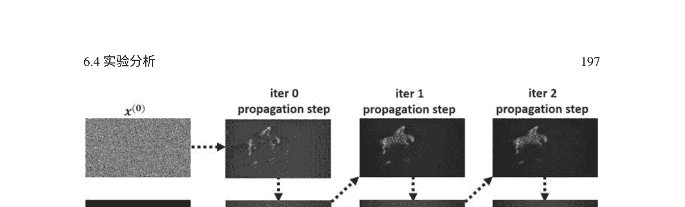

### 6.4.1 分割初始化的作用

在算法6.1中定义的迭代过程中，我们需要建立与图节点相关的初始分割标签 $\mathbf{x}^{(0)}$。正如在第6.3.1节中证明的那样，该算法等价于幂迭代方法，并计算特征-运动矩阵 $\mathbf{A}$ 的主特征向量。因此，无论节点标签的初始值如何，该方法应始终收敛到相同的解，完全由特征-运动矩阵定义。在图6.3中，我们展示了一个例子，展示了我们的算法从随机掩模开始，在三次迭代中软分割掩模（即特征-运动矩阵的主特征向量）的演变。我们观察到，感兴趣的主要对象从这个初始随机掩模中出现，每次迭代后，其软分割掩模都明显改善。

在图6.7和6.4中，我们展示了关于我们软分割掩模在几次迭代中的演化的更多示例。

实践中，我们还观察到该方法无论初始化如何，都会接近相同的收敛点，从而验证了理论。我们考虑了不同选择的 $\mathbf{x}^{(0)}$，从无信息的掩模（如各个帧中心的各向同性高斯软掩模，具有不同的标准差），随机初始化的掩模或均匀的全白掩模，到由最先进的方法（如ELM [3]和PDB [17]）给出的掩模。在图6.5中，我们呈现了定量结果，这些结果验证了理论结果。性能以 Jaccard 指数—J Mean 的形式随着我们算法的11次迭代而演化，朝向相同的常见分割。请注意，如预期的那样，当我们从接近收敛点开始时，收敛速度更快。

![图6.5 我们方法的性能演化，经过多次迭代，在考虑不同的x^(0)的情况下，但使用相同的无监督特征（颜色和沿着流链的运动—第6.4.2节）。对于每个实验，图例显示了考虑的初始化样本：软分割中心高斯，具有不同的标准差，随机初始软掩模，均匀白色掩模，以及两种监督的最先进解决方案PDB [17]和ELM [3]。请注意，无论初始化如何，最终度量都会收敛到相同的值，这在第6.3.1节中理论上已经证明。测试是在完整的DAVIS验证集上进行的。](img/290f44957fff5f798e2e52c93baa38e7_216_0.png)

总之，不论初始化如何，GO-VOS都会收敛到相同的唯一解，即仅取决于特征-运动矩阵 $\mathbf{A}$ 的解 $\mathbf{x}^*$。我们现在已经在理论上和实验上证明了这个事实。

### 6.4.2 节点特征的作用

我们的大部分实验都是使用无监督特征进行的，这些特征是在不需要人工注释的情况下生成的，即颜色和运动信息。对于颜色特征，我们收集RGB像素值，而对于运动特征，我们考虑连续帧之间的光流位移。所有特征都沿着出流链收集，如前面讨论的并在图6.1b中说明。我们的解决方案证明了其有效性，在无监督场景中具有最先进的结果（表6.2、6.3和6.4）。

我们还考虑将有监督特征添加到无监督特征集合中，这些特征沿着相同的出流链收集。我们测试了两种情况：

(i) 在静态图像中进行主要对象分割的训练骨干：U-Net [30] 类似的架构，具有ResNet34 [31] 编码器；编码器在ImageNet [32] 上进行了预训练，而完整网络在DAVIS [33] 的训练集上进行了训练。

(ii) 用于语义分割的训练骨干：DeepLabv3 [34] 模型，使用ResNet101，在COCO 数据集 [35] 上进行了预训练。

正如预期的那样，加入更强的特征显著提高了性能（表6.2和6.3），这是我们算法的一个重要特性，在无监督场景中具有最先进的结果，同时能够整合有信息的高级特征并相应地提高性能。我们强调，骨干信息仅用于构建特征矩阵 $\mathbf{F}$，而我们的算法仍然使用非信息性的掩码进行初始化。

在图6.6中，我们展示了分割的性能演变（在DAVIS验证视频数据集上的平均值）在七次迭代中，取决于两种类型的特征：无监督与有监督。注意节点的强度 $\mathbf{F}$ 中使用的特征是影响最终分割质量的重要因素。

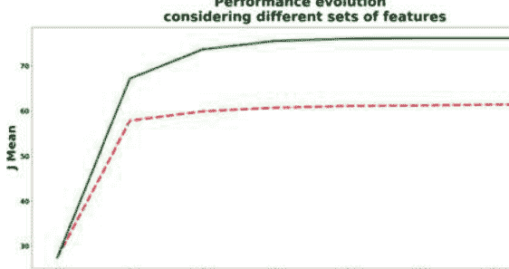

GO-VOS算法可以在其他视频对象分割方法之上使用，将它们的最终掩码作为特征图并将它们连接到我们的无监督特征中。这些特征也将沿着外向光流链收集，如图6.1b所述。我们的解决方案将这些特征结合起来，改变了特征-运动矩阵的结构，其中最强的聚类出现。由于所考虑方法预测的掩码预计更接近全局最优解，我们还使用它们来初始化我们的标签 $\mathbf{x}^{(0)}$，以加快收敛速度。我们测试了这种情况，将GO-VOS应用于几种最先进的方法，并通过实验证明，在仅两次迭代中，我们的解决方案能够显著改善结果（表6.2）。

### 6.4.3 光流的作用

特征-运动矩阵受图结构的强烈影响（通过矩阵 $\mathbf{M}$）。在迄今为止的实验中，我们只考虑了初始化和节点特征的改变，现在我们研究所选择的光流解决方案的影响。邻接矩阵 $\mathbf{M}$ 是使用FlowNet2.0 [36] 提供的光流构建的，FlowNet2.0是在合成数据（FlyingThings3D—[37]和FlyingChairs—[38]）上预训练的，不需要人工注释。

在这里，我们考虑用更经典的方法替换它，比如EpicFlow [39]，它不基于深度学习。在表6.1中，我们比较了考虑两种光流解决方案时我们方法的结果。由于EpicFlow比FlowNet2.0精度低，所以它的影响是轻微降低最终的分割结果。通过对算法使用两种不同的光流模块进行评估，这一事实得到了反映。然而，在两种情况下，我们都获得了竞争力的结果。

#### 表 6.1 我们方法在两种不同的光流解决方案上的定量结果。实验是在DAVIS 2016验证集上进行的

| 方法 | J均值 |
| :--- | :---: |
| GO-VOS与EpicFlow | 61.0 |
| GO-VOS与FlowNet2.0 | 65.0 |

### 6.4.4 复杂度分析和计算成本

考虑到我们的公式，将其视为一个以每个视频像素为节点的图，并具有长程连接，人们会期望它的内存消耗大且速度慢。然而，由于我们的算法步骤具有高效的实现，无需显式构建邻接矩阵，计算复杂度仅为 $O(n)$，其中 $n$ 是视频像素的数量。

特别地，计算光流需要0.04秒/帧，计算与矩阵 $\mathbf{M}$ 和 $\mathbf{F}$ 相关的信息需要0.17秒/帧。此外，幂迭代方法需要0.4秒/帧，从而使完整算法的总时间为0.61秒/帧。GO-VOS是用PyTorch实现的，并在上面进行了运行时分析。

计算机的规格如下：Intel(R) Xeon(R) CPU E5-2697A v4 @ 2.60 GHz，GPU GeForce GTX 1080。我们进一步提供了算法的更详细的复杂性分析。

传播步骤的复杂性：算法1.1的第一步，`x^{(it+1)} = Mx^{(it)}`，可以表示为节点 `i` 的 `x_i \gets \sum_j t_{ij}`，有效地实现了第一步 `M_{ij}` 的计算，到与图中连接的其他帧的所有节点。我们只考虑与节点 `i` 关联的帧的窗口 `k`，因为 `M_{ij}` 随着 `i` 和 `j` 之间的时间距离迅速减小。因此，传播步骤的复杂性为 `O(nk)`（在我们的实验中 `k=11`）。

投影步骤的复杂性：算法（算法1.1）的第3步计算 `x^{(it+1)} = F(F^T F)^{-1} F^T x^{(it+1)}`。计算 `F^T F` 的复杂性为 `O(d^2 n)`，计算 `F^T x^{(it+1)}` 的复杂性为 `O(dn)`，计算逆矩阵 `(F^T F)^{-1}` 的复杂性为 `O(d^3)`，计算 `Fy` 其中 `y \in \mathbb{R}^{n}` 的复杂性为 `O(dn)`。由于 `d` 是视频像素的数量，`O(d^2 n)` 在渐近意义上支配 `O(dn)` 和 `O(d^3)`。因此，第3步的总体复杂性为 `O(d^2 n)`。

我们强调，在所有无监督实验中，`d \leq 56`，并且计算逆 `(F^T F)^{-1}` 的时间仅为 0.009 秒/帧。在监督场景中，我们有大约 100 个特征，这增加了微不足道的计算时间。如果我们将 `d` 提高到考虑数千个特征（例如 2048），则每帧仅需要 0.1 秒。另一个重要的方面是 `P = F(F^T F)^{-1} F^T` 只需计算一次，并在 `GO-VOS` 的每次迭代中进一步使用。

## 6.4.5 结果

我们将我们提出的方法 `GO-VOS` 与 DAVIS 2016、SegTrackv2 和 YouTube-Objects 三个具有挑战性的数据集上的最先进解决方案进行比较。我们在图 6.7 中呈现了一些定性结果，与 DAVIS 2016 数据集上的其他方法进行了比较。

### 6.4.5.1 DAVIS 2016 数据集上的测试

DAVIS 2016 数据集[33]由 50 个视频组成，每个视频都附带了对主要目标的准确的像素级注释。对于这个数据集的版本，主要目标可以由多个强连接对象组成，被视为一个单一的对象。DAVIS 是一个具有挑战性的数据集，因为它包含许多困难的情况，如外观变化、遮挡和运动模糊。

度量：我们使用 J Mean（交并比）和 F Mean（边界 F-Measure），以及它们的平均值（Avg）。

结果：在表6.2中，我们将我们的算法与有监督和无监督方法在DAVIS验证集（20个视频）上的无监督单目标分割问题进行了比较。我们考虑了 `GO-VOS` 的无监督和有监督两种形式，其中初始分割是非信息性的，并且采用了第6.4.2节中描述的细化场景。`GO-VOS` 的无监督版本在性能上优于无监督方法，同时速度更快（`GO-VOS` 每帧0.61秒，`ELM` 每帧20秒，`FST` 每帧4秒，`CUT` 每帧1.7秒，`NLC` 每帧12秒）。当使用有监督特征时，`GO-VOS` 的性能随着考虑的节点外观特征的强度而提高。在细化场景中，`GO-VOS` 对现有的VOS解决方案带来了显著的改进，J Mean提高了5%。

### 6.4.5.2 SegTrackv2数据集上的测试

SegTrackv2 [46]包含14个视频，对于主要的感兴趣对象进行了像素级注释，该对象可能由多个强连接对象组成。SegTrack包含可变形和动态对象，视频分辨率相对较低，使其成为视频对象分割的一个非常具有挑战性的数据集。在图6.8中，我们展示了一些视觉示例结果，这些结果代表了SegTrack数据集。虽然这个数据集相对较小，但它包含非常困难的情况，这解释了当前顶级方法在SegTrackv2上表现相对较低的原因。

度量：为了评估，我们使用了平均交并比分数。

结果：在表6.3中，我们以有监督和无监督场景（第6.4.2节）中的非信息初始化的方式呈现了我们方法的定量结果。

在无监督场景中，我们的解决方案仅被 `NLC` 超越，`NLC` 最初在SegTrack上发布了结果。请注意，我们在DAVIS数据集上明显优于 `NLC`。如预期所料，添加有监督特征会提升性能。我们观察到对于这个特定的数据集，`DeepLabv3` 骨干网络的性能较差，无法识别像蠕虫或鸟类掉落等对象。尽管如此，`GO-VOS` 有效地利用了时空图，它是无监督的。

表6.2 我们方法的定量结果，与DAVIS 2016数据集上的最先进解决方案进行比较。对于每种方法，我们报告它是否使用了预训练的视频对象分割特征，是否需要人工注释（有监督）。（黑体—最佳有监督；蓝体—最佳无监督）

| 方法 | 有监督 | J均值 | F均值 | 平均 |
| :--- | :--- | :--- | :--- | :--- |
| `COSNet` [41] | ✓ | 80.5 | 79.5 | 80.0 |
| `AGS` [42] | ✓ | 79.7 | 77.4 | 78.6 |
| `MotAdapt` [43] | ✓ | 77.2 | 77.4 | 77.3 |
| `LSMO` [44] | ✓ | 78.2 | 75.9 | 77.1 |
| `PDB` [17] | ✓ | 77.2 | 74.5 | 75.9 |
| `ARP` [40] | ✓ | 76.2 | 70.6 | 73.4 |
| `LVO` [18] | ✓ | 75.9 | 72.1 | 74.0 |
| `FSEG` [19] | ✓ | 70.7 | 65.3 | 68.0 |
| `LMP` [45] | ✓ | 70.0 | 65.9 | 68.0 |
| `U-Net`骨干网络 | ✓ | 64.1 | 59.2 | 61.7 |
| `DeepLabv3`骨干网络 | ✓ | 65.9 | 65.6 | 65.8 |
| `GO-VOS`使用`U-Net`特征 | ✓ | 70.8 (+6.7) | 66.3 (+7.1) | 68.6 (+6.9) |
| `GO-VOS`使用`DeepLabv3`特征 | ✓ | 74.7 (+8.8) | 71.1 (+5.5) | 73.0 (+7.2) |
| `GO-VOS`使用`COSNet`特征 | ✓ | **82.4** (+1.9) | 80.9 (+1.4) | 81.7 (+1.7) |
| `GO-VOS`使用`AGS`特征 | ✓ | 81.9 (+2.2) | 79.3 (+1.9) | 80.6 (+2.0) |
| `GO-VOS`使用`MotAdapt`特征 | ✓ | 82.5 (+5.3) | **81.0** (+3.6) | **81.8** (+4.5) |
| `GO-VOS`使用`LSMO`特征 | ✓ | 79.5 (+1.3) | 76.6 (+0.7) | 78.1 (+1.0) |
| `GO-VOS`使用`PDB`特征 | ✓ | 79.9 (+2.7) | 78.1 (+3.6) | 79.0 (+3.1) |
| `GO-VOS`使用`ARP`特征 | ✓ | 78.7 (+2.5) | 73.1 (+2.5) | 76.0 (+2.6) |
| `GO-VOS`与`LVO`特征 | ✓ | 77.0 (+1.1) | 73.7 (+1.6) | 75.4 (+1.4) |
| `GO-VOS`与`FSEG`特征 | ✓ | 74.1 (+3.4) | 69.9 (+4.6) | 72.0 (+4.0) |
| `GO-VOS`与`LMP`特征 | ✓ | 73.7 (+3.7) | 69.2 (+3.3) | 71.5 (+3.5) |
| `ELM` [3] | X | 61.8 | **61.2** | 61.5 |
| `FST` [4] | X | 55.8 | 51.1 | 53.5 |
| `CUT` [5] | X | 55.2 | 55.2 | 55.2 |
| `NLC` [6] | X | 55.1 | 52.3 | 53.7 |
| `GO-VOS` | X | **65.0** | 61.1 | **63.1** |

特征以及从 `DeepLabv3` 骨干网络中提取的任何其他有用信息，实现了19%的显著性能提升。

### 6.4.5.3 YouTube-Objects数据集上的测试

YouTube-Objects (YTO) [49]是一个非常具有挑战性的数据集，包含2511个视频镜头（约720k帧）。提供了物体边界框的注释。尽管

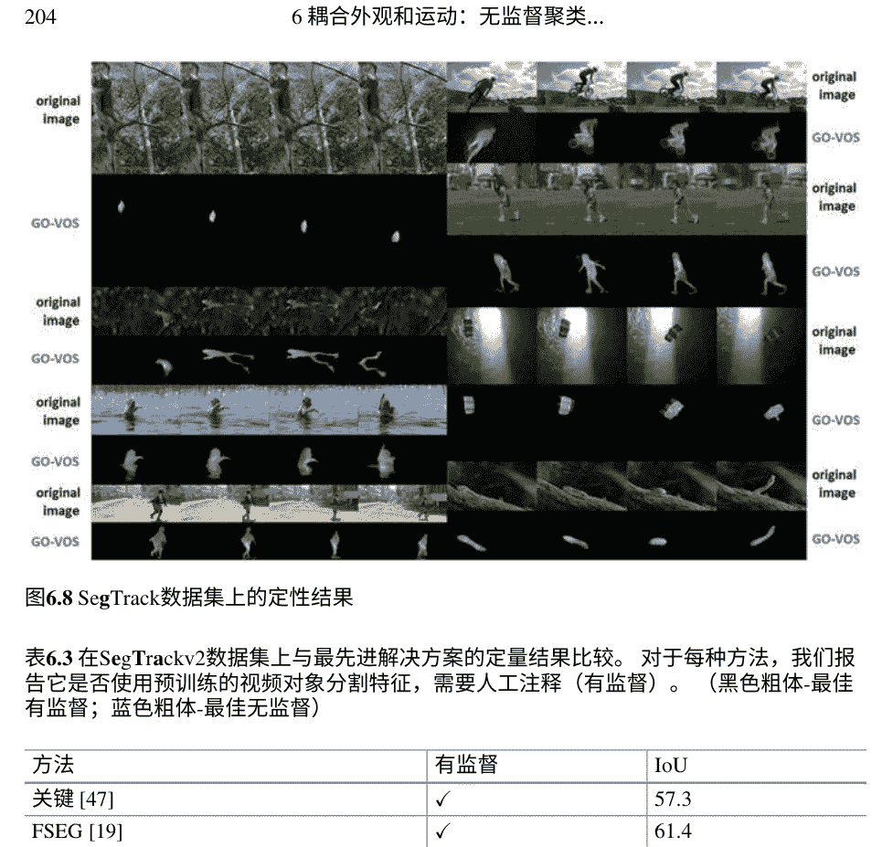

## 图6.8 SegTrack数据集上的定性结果

## 表6.3 在SegTrackv2数据集上与最先进解决方案的定量结果比较。对于每种方法，我们报告它是否使用预训练的视频对象分割特征，需要人工注释（有监督）。（黑色粗体-最佳有监督；蓝色粗体-最佳无监督）

| 方法 | 有监督 | IoU |
| :--- | :--- | :--- |
| `关键` [47] | ✓ | 57.3 |
| `FSEG` [19] | ✓ | 61.4 |
| `LVO` [18] | ✓ | 57.3 |

## 表6.4 我们方法的定量结果（`CorLoc`度量），与`YTO v1.0`和`v2.2`上的最先进解决方案进行比较。（蓝色粗体- v2.2的最佳解决方案，黑色粗体- v1.0的最佳解决方案）

| 方法 | 航空 | 鸟 | 船 | 汽车 | 猫 | 牛 | 狗 | 马车 | 火车 | 平均 | Ver |
| :--- | :--- | :--- | :--- | :--- | :--- | :--- | :--- | :--- | :--- | :--- | :--- |
| `Li等人 [48]` | ✓ | 59.3 | | | | | | | | | |
| `U-Net骨干网络` | ✓ | 67.1 | | | | | | | | | |
| `DeepLabv3骨干网络` | ✓ | 48.4 | | | | | | | | | |
| `GO-VOS使用U-Net特征` | ✓ | `70.2 (+3.1)` | | | | | | | | | |
| `GO-VOS使用DeepLabv3特征` | ✓ | 67.5 (+19.1) | | | | | | | | | |
| `NLC [6]` | X | `67.2` | | | | | | | | | |
| `FST [4]` | X | 54.3 | | | | | | | | | |
| `CUT [5]` | X | 47.8 | | | | | | | | | |
| `HPP [7]` | X | 50.1 | | | | | | | | | |
| `GO-VOS` | X | 62.2 | | | | | | | | | |

| 方法 | 航空 | 鸟 | 船 | 汽车 | 猫 | 牛 | 狗 | 马车 | 火车 | 平均 | Ver |
| :--- | :--- | :--- | :--- | :--- | :--- | :--- | :--- | :--- | :--- | :--- | :--- |
| `Croitoru等人 [50]` | 75.7 | 56.0 | 52.7 | 57.3 | 46.9 | **57.0** | 48.9 | 44.0 | 27.2 | 56.2 | 52.2 | v2.2 |
| `Haller和 Leordeanu [7]` | 76.3 | 68.5 | **54.5** | 50.4 | **59.8** | 42.4 | 53.5 | 30.0 | **53.5** | **60.7** | 54.9 | v2.2 |
| `GO-VOS` | **79.8** | **73.5** | 38.9 | **69.6** | 54.9 | 53.6 | **56.6** | **45.6** | 52.2 | 56.2 | **58.1** | v2.2 |
| `Prest等人 [49]` | 51.7 | 17.5 | 34.4 | 34.7 | 22.3 | 17.9 | 13.5 | 26.7 | 41.2 | 25.0 | 28.5 | v1.0 |
| `Papazoglou和 Ferrari [4]` | 65.4 | 67.3 | 38.9 | 65.2 | 46.3 | 40.2 | 65.3 | 48.4 | 39.0 | 25.0 | 50.1 | v1.0 |
| `Zhang等人 [51]` | 75.8 | 60.8 | 43.7 | 71.1 | 46.5 | 54.6 | 55.5 | 54.9 | 42.4 | 35.8 | 54.1 | v1.0 |
| `Jun Koh等人 [52]` | 64.3 | 63.2 | 73.3 | 68.9 | 44.4 | 62.5 | 71.4 | 52.3 | 78.6 | 23.1 | 60.2 | v1.0 |
| `Haller和 Leordeanu [7]` | 76.3 | 71.4 | 65.0 | 58.9 | 68.0 | 55.9 | 70.6 | 33.3 | 69.7 | 42.4 | 61.1 | v1.0 |
| `Croitoru等人 [50]` | 77.0 | 67.5 | **77.2** | 68.4 | 54.5 | **68.3** | 72.0 | **56.7** | 44.1 | 34.9 | 62.1 | v1.0 |
| `GO-VOS` | **88.2** | **82.5** | 62.7 | **76.7** | **70.9** | 50.0 | **81.9** | 51.8 | **86.2** | **55.8** | **70.7** | v1.0 |

由于没有像素级分割注释，`YTO`测试在考虑到大量视频和广泛的测试案例的情况下是相关的。 按照已发表作品的方法，我们在只包含一个注释对象的训练集上测试我们的解决方案。

度量：我们使用`CorLoc`度量，根据`PASCAL`准则（`IoU ≥ 0.5`）计算正确定位的物体边界框的百分比。

结果：在表6.4中，我们展示了仅考虑我们的无监督公式的数据集`v1.0`和`v2.2`的结果。 对于`v1.0`，我们获得了最高平均分，并在10个物体类别中的7个类别上表现优异。对于数据集`v2.2`的版本，我们也获得了最佳平均分，并在10个物体类别中的5个类别上表现优异。在图6.9中，我们展示了`GO-VOS`在各种`YouTube-Objects`视频中的一些代表性视觉结果。

### 6.5 结论

我们提出了一种新颖的图像表示方法，用于前景物体分割问题。 我们提供了一种谱聚类的公式，通过幂迭代快速计算最优解，作为一种新颖的特征-运动矩阵的主特征向量。 该矩阵通过光流链将像素级的局部信息与像素之间的长程连接相结合。 从这个角度来看，物体成为运动的强大主要聚类。

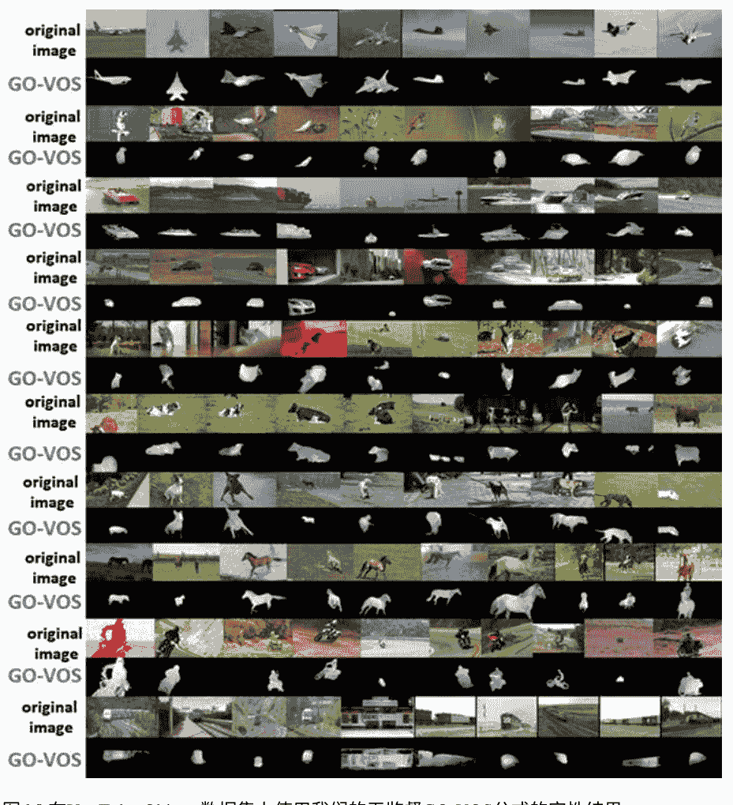

图6.9 在`YouTube-Objects`数据集上使用我们的无监督`GO-VOS`公式的定性结果

以及它们在其即时时空邻域中的外观模式。因此，通过运动和外观表达的时空中的两个“力量”被合并到一个单一的功率迭代公式中，在几个步骤中达到全局最优解。在广泛的实验中，我们展示了所提出的算法`GO-VOS`在当前文献中使用的三个具有挑战性的基准测试中快速且获得了最先进的结果。

我们的方法遵循了本书中一直以来的无监督学习原则。不同像素运动模式的一致性以及它们在外观层面上的一致性提供了可以触发无监督发现过程的`HPP`信号。空间和时间上的这些特征实际上比简单的颜色共现或基于块的特征更强大。

这些分类器在`第5章`中使用过。正如我们的实验所证明的那样，它们足够强大，通常能够以高精度和召回率完整地描述对象。然而，所使用的外观特征和运动特征仍然不够强大。例如，在特征方面，我们可以根据更高级别甚至是预训练的深度特征，在运动矩阵中加入不同节点之间的成对关系。这将使聚类更加强大，通过更强大和更具辨别性的连接在`M`中。这些高级特征也可以加入到`F`中，从而进一步提高聚类的质量。另一个方面是单个对象与多个对象的区别：无论初始化如何，主特征向量始终相同，因此返回的解决方案将始终显示最强的聚类。那么我们如何发现多个对象呢？一个简单的想法是在找到主要对象后将其移除并重复该过程。然而，这种贪婪的方法在计算机视觉实践中效果不太好。我们更愿意设计一种能够找到局部强聚类的方法，这应该是未来研究的重要课题。

我们方法的另一个重要特性，不是立即可见的，是外观和运动相互提供监督信号。通过通过运动流传播对象信息来限制基于特征的预测，而该预测成为下一次迭代中由运动传播的新对象信息。运动和外观轮流成为彼此的教师和学生，这与`第7章`中提出的方法以及本书最后一章中提出的视觉故事模型的更一般的思想有直接关系。

### 参考文献

1. Nicoliciou A, Duta I, Leordeanu M (2019) 时空图神经网络的循环。 在: 神经信息处理系统
2. Koffka K (2013) 格式塔心理学原理。 Routledge
3. Lao D, Sundaramoorthi G (2018) 将分层模型扩展到3D运动。 在: 计算机视觉欧洲会议论文集（ECCV），第435-451页
4. Papazoglou A, Ferrari V (2013) 在无约束视频中快速对象分割。 在: IEEE国际计算机视觉会议论文集，第1777-1784页
5. Keuper M, Andres B, Brox T (2015) 通过最小成本多切割来进行运动轨迹分割。 在: IEEE国际计算机视觉会议论文集，第3271-3279页
6. Faktor A, Irani M (2014) 通过非局部一致性投票进行视频分割。 在: BMVC，第2卷，第8页
7. Haller E, Leordeanu M (2017) 通过高度可能的正特征的有效选择在视频中进行无监督对象分割。 在: IEEE国际计算机视觉会议论文集，第5085-5093页
8. Luiten J, Voigtlaender P, Leibe B (2018) `PReMVOS`： 提案生成、细化和合并用于2018年`DAVIS`挑战赛的视频对象分割。 在: 2018年`DAVIS`挑战赛视频对象分割-`CVPR`研讨会
9. Maninis KK, Caelles S, Chen Y, Pont-Tuset J, Leal-Taixé L, Cremers D, Van Gool L (2017) 没有时间信息的视频对象分割。 `arXiv:170906031`
10. Voigtlaender P, Leibe B (2017) 在线调整卷积神经网络 2017年`DAVIS`挑战赛的视频对象分割。 在： 2017年`DAVIS`视频 对象分割-`CVPR`研讨会，第5卷
11. Bao L, Wu B, Liu W (2018) `MRF`中的`CNN`： 通过`CNN`进行推理的视频对象分割- 基于高阶时空`MRF`。在： IEEE计算机 视觉和模式识别会议论文集，第5977-5986页

### 参考文献

12\. Wug Oh S, Lee JY, Sunkavalli K, Joo Kim S (2018) 参考引导的快速视频对象分割。在：IEEE计算机视觉和模式识别会议论文集，第7376-7385页

13\. Cheng J, Tsai YH, Hung WC, Wang S, Yang MH (2018) 通过跟踪部分快速准确地进行在线视频对象分割。在：计算机视觉和模式识别IEEE会议论文集，第7415-7424页

14\. Caelles S, Maninis KK, Pont-Tuset J, Leal-Taixé L, Cremers D, Van Gool L (2017) 一次性视频对象分割。在：计算机视觉和模式识别IEEE会议论文集，第221-230页

15\. Perazzi F, Khoreva A, Benenson R, Schiele B, Sorkine-Hornung A (2017) 从静态图像学习视频对象分割。在：计算机视觉和模式识别IEEE会议论文集，第2663-2672页

16\. Chen Y, Pont-Tuset J, Montes A, Van Gool L (2018) 基于像素度量学习的快速视频对象分割。在：计算机视觉和模式识别IEEE会议论文集，第1189-1198页

17\. Song H, Wang W, Zhao S, Shen J, Lam KM (2018) 金字塔扩张更深的ConvLSTM用于视频显著目标检测。在：欧洲计算机视觉会议论文集(ECCV)，第715-731页

18\. Tokmakov P, Alahari K, Schmid C (2017) 学习视频对象分割与视觉记忆。arXiv:170405737

19\. Jain SD, Xiong B, Grauman K (2017) FusionSeg: 学习结合运动和外观的全自动通用对象分割。arXiv:170105384

20\. 2(3):620. Brox T, Malik J (2010) 长期分析点轨迹的对象分割。在：欧洲计算机视觉会议。Springer，第282-295页

21\. Tsai YH, Yang MH, Black MJ (2016) 通过对象流进行视频分割。在：IEEE计算机视觉和模式识别会议论文集，第3899–3908页

22\. Zhuo T, Cheng Z, Zhang P, Wong Y, Kankanhalli M (2018) 无监督在线视频对象分割与运动属性理解。arXiv:181003783

23\. Li J, Zheng A, Chen X, Zhou B (2017) 通过互补的CNN和邻域可逆流进行主视频对象分割。在：IEEE国际会议论文集计算机视觉，第1417-1425页

24\. Wang W, Shen J, Porikli F (2015) 基于显著性感知的测地线视频对象分割。在：IEEE计算机视觉和模式识别会议论文集，第3395-3402页

25\. Meila M, Shi J (2001) 光谱分割的随机游走视角。在：AISTATS

26\. Leordeanu M, Sukthankar R, Hebert M (2012) 用于图匹配的无监督学习。计算机视觉国际期刊96:28–45

27\. Stewart GW (1990) 矩阵扰动理论

28\. Ng AY, Zheng AX, Jordan MI (2001) 链接分析，特征向量和稳定性。在：国际人工智能联合会议，第17卷。劳伦斯埃尔巴姆有限公司，第903-910页

29\. Leordeanu M, Hebert M (2005) 使用成对约束的对应问题的光谱技术。在：第十届IEEE国际计算机视觉会议（ICCV'05），第1卷和第2卷。IEEE，第1482-1489页。

30\. Ronneberger O, Fischer P, Brox T (2015) U-net：用于生物医学图像分割的卷积网络。在：国际医学图像计算与计算机辅助干预会议。Springer，第234-241页。

31\. He K, Zhang X, Ren S, Sun J (2016) 深度残差学习用于图像识别。在：2016年IEEE计算机视觉与模式识别会议（CVPR），第770-778页。

32\. Deng J, Dong W, Socher R, Li LJ, Li K, Fei-Fei L (2009) ImageNet：一个大规模的分层图像数据库。在：2009年IEEE计算机视觉与模式识别会议。IEEE，第248-255页。

33\. Perazzi F, Pont-Tuset J, McWilliams B, Van Gool L, Gross M, Sorkine-Hornung A (2016) 一个用于视频对象分割的基准数据集和评估方法。在：计算机视觉和模式识别

34\. Chen LC, Papandreou G, Schroff F, Adam H (2017) 重新思考用于语义图像分割的空洞卷积。arXiv:170605587

35\. Lin TY, Maire M, Belongie S, Hays J, Perona P, Ramanan D, Dollár P, Zitnick L (2014) Microsoft coco：上下文中的常见对象。arXiv:14050312

36\. Ilg E, Mayer N, Saikia T, Keuper M, Dosovitskiy A, Brox T (2017) Flownet 2.0：使用深度网络的光流估计的演进。在：IEEE计算机视觉和模式识别会议论文集，第2462-2470页

37\. Mayer N, Ilg E, Hausser P, Fischer P, Cremers D, Dosovitskiy A, Brox T (2016) 用于视差、光流和场景流估计的卷积网络训练的大型数据集。在：IEEE计算机视觉和模式识别会议论文集，第4040-4048页

38\. Dosovitskiy A, Fischer P, Ilg E, Hausser P, Hazirbas C, Golkov V, Van Der Smagt P, Cremers D, Brox T (2015) Flownet：使用卷积网络学习光流。在：IEEE国际计算机视觉会议论文集，第2758-2766页

39\. Revaud J, Weinzaepfel P, Harchaoui Z, Schmid C (2015) Epicflow：用于光流的保边插值的对应关系。在：IEEE计算机视觉和模式识别会议论文集，第1164-1172页

40\. Koh YJ, Kim CS (2017) 基于区域增强和减少的视频主要对象分割。在：IEEE计算机视觉和模式识别会议论文集，卷1，第6页

41\. Lu X, Wang W, Ma C, Shen J, Shao L, Porikli F (2019) 看得更多，知道得更多：无监督视频对象分割与共同关注的孪生网络。在：IEEE计算机视觉和模式识别会议论文集，第3623-3632页

42\. Wang W, Song H, Zhao S, Shen J, Zhao S, Hoi SC, Ling H (2019) 通过视觉注意力学习无监督的视频对象分割。在：IEEE计算机视觉和模式识别会议论文集，第3064-3074页

43\. Siam M, Jiang C, Lu S, Petrich L, Gamal M, Elhoseiny M, Jagersand M (2019) 在人机交互（HRI）环境中使用教师-学生适应进行视频对象分割。在：2019年国际机器人与自动化会议（ICRA）。IEEE，第50-56页

44\. Tokmakov P, Schmid C, Alahari K (2019) 学习分割移动对象。Int J ComputVis 127 (3) : 282-301

45\. Tokmakov P, Alahari K, Schmid C (2017) 在视频中学习运动模式。在：2017年IEEE计算机视觉和模式识别会议（CVPR）。IEEE，第531-539页

46\. Li F, Kim T, Humayun A, Tsai D, Rehg J (2013) 通过跟踪许多图像-背景片段进行视频分割。在：国际计算机视觉会议

47\. Lee YJ, Kim J, Grauman K (2011) 视频对象分割的关键片段。在：2011年IEEE国际计算机视觉会议（ICCV）。IEEE，第1995-2002页

48\. Li S, Seybold B, Vorobyov A, Fathi A, Huang Q, Jay Kuo CC (2018) 实例嵌入到无监督视频对象分割。在：IEEE计算机视觉和模式识别会议论文集，第6526-6535页

49\. Prest A, Leistner C, Civera J, Schmid C, Ferrari V (2012) 从弱标注的视频中学习物体类别检测器。在：CVPR

# 第7章 空间和时间上的无监督学习在几代教师和学生网络中

### 7.1 引言

无监督学习是计算机视觉和机器学习中最困难和有趣的问题之一。许多研究人员认为，从大量未标记的视频中学习可以帮助解码关于智能和学习本质的难题。此外，由于未标记的图像和视频相对容易收集且成本较低，无监督学习在许多计算机视觉和机器人应用中可能具有实际价值。在本文中，我们提出了一种新颖的无监督学习方法，成功解决了与此问题相关的许多挑战。

我们提出了一个系统，由两个主要路径组成，一个在视频或大型图像集合中进行无监督对象发现的教师分支，另一个是学生分支，从教师那里学习在单个图像中分割前景对象。无监督学习过程可以在几代学生和教师之间持续进行。在`算法7.1`中，我们提供了我们方法的高级描述。在整个章节中，我们将使用“代”和“迭代”这两个术语来交替使用`算法7.1`。

我们方法的关键方面，确保了从一代到下一代的性能改进，包括：（1）存在一个无监督选择模块，能够选择教师生成的高质量掩码并将其传递给下一代学生进行训练；（2）使用具有不同架构的多个学生进行训练，通过它们的多样性有助于训练下一次迭代的更好选择模块，并与选择模块一起形成更强大的教师路径；（3）可以访问更大量且可能更复杂的未标记数据，随着代数的增加，这些数据变得更加有用。

我们的方法在学生或教师路径上是通用的，不依赖于特定的神经网络架构或实现。通过许多实验和与最先进方法的比较，我们还展示了它在计算机视觉中适用于不同的问题，如目标发现、视频、无监督图像分割、显著性检测和迁移学习。与此处介绍的方法相同，可以应用于任何具有初始教师的视觉学习任务，因为算法的主要步骤基于非常普遍的思想，不依赖于特定的问题，比如前景对象分割问题。

在图7.1中，我们展示了我们完整系统的图形概述。在无监督训练阶段，学生网络（模块`A`）逐帧从无监督教师路径（模块`B`和`C`）中学习，以在单个图像中生成类似的对象掩码。模块`B`在图像或视频中发现对象，而模块`C`选择由模块`B`生成的足够好的掩码传递给模块`A`进行训练。因此，学生分支试图模仿模块`B`对模块`C`选择的帧的输出，只有一个单独的图像作为输入-当前帧，而教师可以访问整个视频序列。


*Multiple students create the teacher in the next generation*

训练学生（模块`A`）的强度取决于模块`B`的表现。然而，正如我们在实验中所看到的，选择模块`C`的能力有助于新学生超越其初始教师模块`B`。因此，在本章中，我们将`B`称为初始的“教师”，将`B`和`C`一起称为完整的“教师路径”。 `算法7.1`中提出的方法遵循系统从一次迭代（生成）到下一次迭代的主要步骤。这些步骤在第7.3节中进行了更详细的讨论。

在`算法7.1`的第一次迭代中，无监督的教师（模块`B`）可以随时间访问信息-视频。 相比之下，学生在结构上更深，但只能访问单个图像-当前视频帧。因此，教师在时间上发现的信息通过学生在添加的深度中被捕获，通过神经层次的抽象。

在第一次迭代中训练了几个具有不同架构的学生网络。为了仅使用好质量的掩码作为监督信号，在第一次迭代中应用了一个无监督的掩码选择过程（在第7.4节中解释），由模块`C`执行。一旦训练了几个学生网络，它们可以以各种方式（如第7.4.1节和第7.5.1节中所解释的）形成下一次迭代的教师路径，以及一个更强大的无监督选择模块`C`，由一个名为`EvalSeg-Net`的深度神经网络表示，详细说明见第7.4.3节。

简而言之，`EvalSeg-Net`学习预测通常在掩码质量良好时发生的多样化学生之间的输出掩码一致性。因此，`EvalSeg-Net`可以用作无监督的掩码评估过程和强大的选择模块。然后，在下一代中，我们在更大的未标记视频或图像集合上运行新形成的教师路径（模块`B`和`C`），以为下一代学生生成监督信号。在实验中，我们展示了下一次迭代中模块`B`和`C`的改进，以及数据量的增加，对于提高准确性都是重要的，尽管不是全部必要的。

请注意，虽然在第一次迭代中，教师路径需要接收视频序列作为输入，但从第二代开始，它也可以接收大型图像集合作为输入。由于训练时需要非常高的计算和存储成本，我们将实验限制在两代学习上，但我们的算法是通用的，可以运行多次迭代。我们在大量实验中表明，即使只有两代，也足以在视频和图像中优于当前的目标发现技术。我们还实验证明，每个组件（模块`A`中的个体学生，模块`B`中的教师以及选择模块`C`）在每一代中都有实质性的改进。

现在，我们列举以下本章节中所呈现的工作的主要结果，原始发表在Croitoru等人的论文[1, 2]中：

1.  我们提出了一种原创且高效的无监督学习方法，用于在图像中分割前景对象。我们的系统和算法的概述如图7.1和`算法7.1`所示。系统有两个主要路径，一个作为教师（模块`B`）在视频或大型图像集合中发现对象，然后由无监督选择模块`C`进行过滤。一个用于去除低质量掩码的网络，另一个作为学生并从教师路径中学习以检测单个输入图像中的前景对象。我们提供了一个通用的无监督学习算法，可以在多代学生和教师之间进行学习。我们还展示了如何学习一个无监督的掩码选择深度网络（`EvalSeg-Net`，见第7.4.3节），这对于改进下一次迭代中的教师路径非常重要，经过所有测试案例的结果都得到了改善：当教师（模块`B`）由单个学生网络、所有学生组合成一个集合或所有学生分别参与时。第二代的整个无监督训练是会议工作中的一个创新，实验结果显著改善（见第7.5节）。

2.  在更高的层面上，我们提出的算法足够通用，可以适应不同的实现方式、各种神经网络架构和多个视觉学习任务。在这里，我们提供了一个具体的实现，详细描述了它。我们在三个相关的无监督学习问题上展示了它的性能，即在YouTube-Objects上测试的视频对象发现问题[3]，在Internet Images上测试的图像无监督前景分割问题[4]，以及在Pascal-S上测试的显著性检测问题[5]，在这些问题上我们获得了最先进的结果。我们进一步将我们的方法应用于一个众所周知的迁移学习设置，并与该领域的顶级迁移学习方法进行了竞争性结果比较。我们还在前景分割和迁移学习问题上进行了与与我们最相关的工作[6]的实验比较，并展示了我们的方法在前景对象分割方面取得了更好的结果，而他们的方法在迁移学习方面更有效。据我们所知，在最初发表时[1]，我们的方法以及Pathak等人提出的方法[6]是第一个以无监督方式学习检测和分割图像中前景对象的系统，无需预训练特征或手动标记，仅在测试时需要一张图像。

### 7.1.1 与无监督学习原则的关系

> **原则6**
>
> 当几个弱独立的分类器一直一起触发时，它们会发出一个信号，表明存在一个更高级别的类别，可以学习一个更强的分类器。

本章的工作与第一章提出的无监督学习的第六个原则直接相关。除非它们同时对同一物体（可能是未知类别的物体）发射，否则许多独立的分类器很难同时发射。这在更高层次的语义上是不太可能的。在本章中，我们提出了一个师生系统，它以无监督和自我监督的方式进行训练，这样在下一次迭代中，一代学生在迭代\(k\)一起训练形成下一次迭代\(k+1\)的老师。他们的集体共识变得非常强大，成为了HPP监督信号（与第三原则直接相关），使得他们集体能够“看到”任何一个单独的分类器无法看到的东西。学生们现在可以共同信号出现了一个“更高级别”的类别，这样从他们的一致性得到的分割结果比每个学生单独得到的分割结果具有更高的质量、精细度或更高的种类。例如，每个学生在某个迭代中都能够产生一个与主要目标的位置、大小和形状大致相关的斑块。然而，在经过几代之后，学生（即前几代学生的训练产物）能够产生质量不同且基本上更好的目标掩模，从而可以观察到对象的细节形状。

在第7.3节中，我们介绍了我们方法的不同组成部分，从整体系统的概述到每个模块的更详细描述。重要的是要注意整个`教师路径`（参见`图7.1`）实际上是基于第6原则所表达的思想。我们很快意识到需要在几代人之间进行学习——如果我们希望系统能够超越学习基本上新的类别或更好的识别和分割水平。这个事实将我们的方法与下一个提出的无监督学习原则联系起来。

> **原则7**
>
> 为了改进或学习新的类别，我们需要增加训练数据的数量和难度，以及分类器的能力和多样性。通过使用现有分类器之间的一致性作为新分类器的`教师监督信号`，我们可以在多个世代中以无监督的方式学习。

请注意，这样的新课程可能由学生尚不了解的不同类别组成。它们也可能由以前见过的课程组成，但在分割质量上有根本性的不同，比以前的好得多（例如，新的精细化、专业化或对细节的关注水平）。然而，为了学会在更高质量的水平上分割这样的“新课程”，我们只能使用我们已经拥有的分类器。因此，我们需要依靠它们一致（但罕见）的共同激活，以便发现可能捕捉到新类别、对象或对象部分（或细节）存在的时空区域，这些区域直到现在都是未知的。学习“看到”一个新的类别需要现有分类器沿着`教师路径`的共同激活（如与原则6相关的讨论所述），但还需要访问包含足够证据的正确数量的数据来证明这个新类别的存在。然后，无监督学习目标分割必须分阶段进行，逐步增加难度，通过逐步增加数据量和训练多代分类器来完成。这个想法与`课程学习`的概念[7]直接相关，通过在训练过程中从简单到复杂的案例进行。

### 7.2 科学背景

无监督学习的文献遵循两个主要方向：（1）一种是以无监督的方式学习强大的特征，然后在监督方案中与不同的分类器（如`SVM`或`CNN`）结合使用，用于`迁移学习`[8-10]。（2）第二个方向是在测试时发现无标签数据中的常见模式，使用`聚类`、`特征匹配`或`数据挖掘公式`[11-13]。

属于第一类并与我们的工作密切相关的方法，在Pathak等人的[6]中提出了一个系统，其中`深度神经网络`通过使用视频中的光流线索的无监督模块来学习生成软对象掩码。以这种方式学习的深度特征然后应用于几个`迁移学习`问题。他们的工作与我们的工作一起，可能是第一个展示以无监督的方式学习单个图像中分割对象的两个方法。虽然这两种方法在技术和算法层面上显然不同，但我们在`第7.5.3节`的实验中还提供了一些有趣的比较，涉及`迁移学习`和前景对象分割的两个任务。我们的结果表明，虽然他们的方法在`迁移学习`任务上更好，但我们的方法在多个数据集上对无监督分割的效果更好。

最近，研究人员开始在无监督学习方法中使用图像和视频中的自然、空间和时间结构作为监督信号，这被认为是遵循`自我监督学习`范式的方法[14-16]。属于这一类别的方法包括学习估计图像中相对补丁位置[17]，预测颜色通道[18]，解决拼图难题[19]和修复图像[20]。

一种趋势是使用从原始单个图像中收集的监督信号、空间和外观信息。在这种单图像情况下，可以学习的信息量仅限于某一时刻，而不是从视频序列中学习的情况。使用未标记的视频作为输入与我们的工作密切相关，包括学习预测帧的时间顺序[15]，生成未来的帧[21-23]，或从光流中学习[24]。

对于这些论文中的大多数，无监督学习方案只是训练特征的中间步骤，最终用于经典的监督学习任务，如`对象分类`、`对象检测`或`动作识别`。这种预训练的特征比随机初始化的特征效果更好，因为它们包含在作为监督信号的世界的自然结构中隐含的有价值的信息。虽然无监督特征可能不包含语义的、类别特定的信息[25]，但它们明显捕捉到了一般的物体性质，对于诸如场景中主要对象的分割或特定监督分类问题的迁移学习非常有用。在我们的工作中，我们主要关注特定的无监督任务，我们在其上进行了广泛的评估，但我们还展示了一些`转移学习`实验的结果。

无监督学习的第二种主要方法包括`图像共分割`方法[4, 26–32]和`弱监督定位`方法[33–35]。早期的方法是基于局部特征的匹配和检测它们的共现模式[1 3, 36–39]，而较新的方法[3, 40, 41]通过在帧之间链接候选边界框来发现`对象管道`，无论是否重新调整它们的位置。传统上，从图像序列中进行无监督学习的任务被定义为`特征匹配`或`数据聚类优化`问题，由于其组合性质，计算上非常昂贵。

还有其他一些论文[42–45]处理无监督学习任务，但并非完全无监督，使用在大型数据集上以监督方式预训练的强大特征，例如`ImageNet`[46]或`VOC 2012`[47]。这些工作利用了从其他数据集中学习的丰富的监督信息通过训练对数十个或数百个对象类别的一般对象属性做出响应的特征。在另一篇论文中，一定程度的监督是必要的，就像Tokmakov等人的工作[48]中提出的系统，该系统具有一个学习从弱注释视频和光流线索中分割视频帧中对象的`运动-CNN`。与我们的工作的一个关键区别是他们的方法需要训练视频帧的类标签。

就最终目标而言，我们的工作与第二个研究方向更相关，即在视频中进行无监督发现。然而，与该研究不同的是，我们不是在测试时发现对象，而是在无监督训练过程中，当`学生路径`学习检测前景对象时发现对象。因此，从学习的角度来看，我们的工作更与基于`自监督训练`的第一个研究方向相关。虽然已经有一些利用视频中的时空信息的方法，但我们的方法在第二次迭代中甚至能够从无关的图像集合中学习。与我们改进分割的想法相关的是`Khor eva`等人提出的方法[49]，该方法不是无监督的，因为它需要地面真实边界框信息来改进分割，同时结合了改进版的`GrabCut`[50]。

### 7.3 在多个师生代际中的学习

我们提出了一种真正的无监督学习算法（参见`算法7.1`），用于前景目标分割，可以在多次迭代中改进。我们的方法以互补的方式结合了多个模块，非常适合解决这个问题。

它从一个`教师`（`模块B`，`图7.1`）开始，在未标记的视频中发现对象，并在每个帧中生成前景对象的软掩码。在文献中有几种可用的视频发现方法，性能良好[51-53]。我们选择了作为一部分引入的`VideoPCA算法`

### 算法7.1 无监督学习前景对象分割

- 步骤1: 在未标记的视频（或图像集合，在后续迭代中）中执行无监督对象发现，沿着`教师路径`（`图7.1`中的`模块B`）。
- 步骤2: 自动过滤掉在上一步骤中产生的低质量软掩模（`图7.1`中的`模块C`）。
- 步骤3: 使用剩余的掩模作为训练一个或多个`学生网络`的监督信号，沿着`学生路径`（`图7.1`中的`模块A`）。
- 步骤4: 使用当前生成的一个或多个`学生网络`作为新的`教师`（一个新的`模块B`），并学习一个更强大的软掩模选择器（一个新的`模块C`），用于下一次迭代。
- 步骤5: 扩展未标记的视频或图像数据集，并返回到步骤1以训练下一代（注意：从第一次迭代开始，训练数据集也可以扩展为未标记图像的集合，而不仅仅是视频）。

## 7.4 我们的师生系统架构

我们详细介绍了我们系统的架构和训练过程，模块与模块之间的关系如`图7.1`所示。我们首先介绍`学生路径`（`图7.1`中的`模块A`），它以一个单独的图像（例如视频中的当前帧）作为输入，并学习预测。

#### 7.4.1 学生路径：单图像分割

`学生路径`（`图7.1`中的`模块A`）由一个`深度卷积网络`组成。我们测试了不同的网络架构，其中一些是在最近关于语义图像分割的文献中常用的。我们创建了一个相对多样化的小型网络架构池，接下来将进行介绍。

我们测试的第一个用于语义分割的卷积网络架构基于更传统的`CNN`设计。我们将其称为`LowRes-Net`（见`图7.2`），因为它的低分辨率软掩模输出。它有十层（七个卷积层，两个池化层和一个全连接层），并且有`跳跃连接`。`跳跃连接`已经被证明可以提高性能，如文献[54, 55]所示。我们在实验中也观察到使用`跳跃连接`时类似的改进。`LowRes-Net`以一个128 × 128的RGB图像（以及其色调、饱和度和对x和y的导数）作为输入，并生成图像中主要对象的一个32 × 32的软分割。因为`LowRes-Net`在最后有一个`全连接层`，为了限制内存成本，我们将软分割掩码的输出分辨率降低。虽然原则上不需要x和y的导数（因为它们可以通过适当的滤波器在训练过程中学习），但在我们的测试中，通过显式提供`HSV`的导数和使用`跳跃连接`，准确性提高了1%以上。`LowRes-Net`总共有7800万个参数，其中大部分在最后的`全连接层`。

第二个`CNN`架构被称为`FConv-Net`，是完全卷积的[56]，如`图7.2`所示。它具有更高分辨率的输出，为128 × 128，输入尺寸为256 × 256。它的主要结构源自基本的`LowRes-Net`模型。与`LowRes-Net`不同的是，它在末尾没有`全连接层`，并且在卷积层中具有更多的参数，总共有13M个参数。

我们还测试了基于`U-Net` [57]架构的三种不同网络，在语义分割文献中证明非常有效。我们的`U-Net`网络包括(1) `BasicU-Net`，(2) `DilateU-Net`——类似于`BasicU-Net`，但在中心模块中使用`扩张卷积`[58]，以及(3) `DenseU-Net`——在下采样和上采样模块中使用`密集连接`[59]。

# 神经网络架构与训练细节

## 7.4.1 学生网络架构

BasicU-Net具有五个下采样模块，每个模块都有两个卷积层，分别具有32、64、128、256和512个特征图。在中心模块中，BasicU-Net具有两个卷积层，每个卷积层都有1024个特征图。上采样模块和相应的下采样模块具有相同数量的特征图，并且都有三个卷积层。BasicU-Net和DilateU-Net之间唯一的区别在于前者具有一个不同的中心模块，其中包含六个空洞卷积和512个特征图。然后，DenseU-Net具有四个下采样模块和四个相应的上采样模块。每个下采样和上采样模块都有四个卷积层，并具有跳跃连接（如图7.2所示）。这些模块分别具有12、24、48和64个特征图。过渡表示卷积操作，其作用是减少每个模块的输出特征图数量。BasicU-Net具有34M个参数，而Dilate U-Net具有18M个参数。DenseU-Net只有3M参数，但在上和下块内使用跳跃连接来弥补参数数量的差异。所有三个U-Net都具有256 × 256的输入和相同分辨率的输出。所有网络都使用`ReLU`激活函数。有关不同模型的体系结构的更具体细节，请参见图7.2。

在当前设置下，学生网络不会学习识别特定的物体类别。它们将学会对主要的前景物体进行软分割，而不考虑它们的特定类别。它们性能上的主要区别在于它们能否产生精细的物体分割。尽管LowRes-Net倾向于通过其较简单的输出为估计物体的边界框提供良好的支持，但其他`ConvNets`（尤其是`U-Net`）由于具有更高的分辨率，在细分物体方面表现更好。不同的学生架构为它们的输出带来了多样性。由于特定模型犯错误的方式不同，它们在形成集合时更强大，并且还可以用于训练用于分割评估的网络，用作新的选择模块`C`。如后面所解释的，`EvalSeg-Net`将学习预测学生之间的输出掩码一致性，这在掩码质量良好时统计上发生。

通过实验，我们还展示了学生网络优于他们的教师，并且能够检测在训练过程中未见过的物体类别。

### 结合多个学生网络
具有不同架构的学生网络产生具有差异的结果，从质量上有所不同。虽然从软掩模计算出的边界框具有相似的准确性，但实际的软分割输出看起来不同。它们具有不同的优势，同时也会犯不同类型的错误。它们的多样性将成为下一代教师路径的基础（第7.4.2节和第7.4.3节）。

我们尝试了使用多个学生网络的想法，通过将它们组合成一个集合或让它们为每个图像产生独立的分割结果。在我们的最终系统中，我们更倾向于后一种方法，这种方法更实际、更容易实现，并且可以让学生独立运行，无需同步它们的输出。如第7.4.2节和第7.4.3节所示，与用于选择的`EvalSeg-Net`一起，来自第一次迭代的独立个体学生将形成下一代教师路径。然而，需要注意的是，即使是单个学生网络加上新的`EvalSeg-Net`选择器也可以有效地用作下一代教师路径（见实验第7.5.1节、表7.6和图7.7）。

在形成实际集合时，我们称之为`Multi-Net`，最终输出是通过逐像素相乘每个个体学生网络产生的软掩模得到的。因此，只有所有网络都一致的正像素才能在最终分割中存活下来。正如预期的那样，`Multi-Net`提供了比每个单独网络更精确的稳健掩模。然而，它可能会在具有较低召回率的对象边界周围丢失细节（见图7.5）。我们仅提供`Multi-Net`集合的结果供比较目的。请注意，然而，在我们的最终系统中，集合的输出并未用于训练下一代的学生。第二次迭代的学生直接根据第一次迭代的各个学生的输出进行训练，使用`EvalSeg-Net`进行过滤。如本节稍后详细解释的那样，`Multi-Net`仅用于训练无监督选择网络`EvalSeg-Net`。

### 技术细节：训练学生
我们将前景对象分割视为多维回归问题，其中由无监督视频分割系统给出的软掩码充当期望输出。设`$\mathbf{I}$`为输入的`RGB`图像（视频帧），`$\mathbf{Y}$`为对应的0-255值的软分割，由无监督教师给出该特定帧的分割。我们网络的目标是预测一个宽度为`$W$`和高度为`$H$`（对于基本架构，`$W = H =32$`；对于完全卷积架构，`$W = H =128$`；对于`U-Net`架构，`$W = H =256$`）的软分割掩码`$\hat{\mathbf{Y}}$`，尽可能地逼近掩码`$\mathbf{Y}$`。对于输出图像中的每个像素，我们预测一个0-255的值，以使`$\mathbf{Y}$`和`$\hat{\mathbf{Y}}$`之间的总差异最小化。因此，给定一组`$N$`个训练示例，设`$\mathbf{I}^{(n)}$`为输入图像（视频帧），`$\hat{\mathbf{Y}}^{(n)}$`为`$\mathbf{I}^{(n)}$`的预测输出掩码，`$\mathbf{Y}^{(n)}$`为软分割掩码（对应于`$\mathbf{I}^{(n)}$`），`$\mathbf{w}$`为网络参数。`$\mathbf{Y}^{(n)}$`是由视频发现者在处理`$\mathbf{I}^{(n)}$`所属的视频后产生的。因此，我们的损失函数为：

```
L(\mathbf{w}) = \frac{1}{N} \sum_{n=1}^{N} \sum_{p=1}^{W \times H} \left( Y_p^{(n)} - \hat{Y}_p^{(n)}(\mathbf{w}, \mathbf{I}^{(n)}) \right)^2, \quad (7.1)
```

其中`$Y_p^{(n)}$`和`$\hat{Y}_p^{(n)}$`分别表示`$Y^{(n)}$`的第`$p$`个像素和估计值`$\hat{Y}^{(n)}$`。我们观察到在我们的测试中，`L2`损失表现优于交叉熵损失，因为用作标签的软掩码具有实际值，而不是离散值。此外，它们并不完美，所以将它们阈值化进行训练并不像直接预测它们的实际值那样好。我们使用`Tensorflow [60]`框架和`Adam`优化器 `[61]`来训练我们的网络。所有模型都使用固定的学习率0.001进行端到端训练，共进行10个`epochs`。对于任何给定的模型，第一次迭代的训练时间约为3-5天，使用`Nvidia GeForce GTX 1080` `GPU`，第二次迭代的训练时间约为2周。

### 后处理
学生`CNN`输出一个`$W \times H$`软掩模。为了公平地比较我们的模型与其他方法，我们有两个不同的后处理步骤：（1）边界框拟合和（2）分割细化。为了在软掩模周围拟合一个框，我们首先将`$W \times H$`输出上采样到原始图像的大小，然后对掩模进行阈值处理（在一个小的子集上验证），确定连通分量，并在每个分量周围拟合一个紧密的框。我们在单个案例中进行分割细化（第2点），在互联网图像中的对象发现数据集上，也在实验部分中指定。为此，我们使用`OpenCV`的`GrabCut [50]`实现来细化我们的软掩模，上采样到原始大小。在所有其他测试中，我们使用网络的原始输出。

## 7.4.2 教师途径：无监督目标发现

有几种方法可用于在图像和视频中发现对象和显著区域[51–53, 62–64]，并且具有相当好的性能。最近的前景对象发现方法，如`Papazoglou`和`Ferrari [65]`，既快速又准确，每帧运行时间约为4秒。然而，这个运行时间对于需要数百万张图像进行训练的学生`CNN`来说仍然很长且难以接受。因此，在图7.1的B模块的第一代（算法7.1的迭代1）中，我们使用了`VideoPCA`算法，它是`Stretcu`和`Leordeanu [36]`中介绍的整个系统的一部分。它的准确性比整个系统低，但速度更快，每秒运行50-100帧。以这个速度，我们可以在合理的时间内生成一百万个无监督的软分割，大约需要5-6小时。

### VideoPCA
`VideoPCA`的主要思想（也在第5章中介绍）是用主成分分析模型建模视频帧中的背景。它通过找到不能很好地用`PCA`模型重建的帧的部分作为初始前景区域。前景对象比背景小，外观对比度高，移动更加复杂。它们可以被视为较大背景场景中的异常值。这使得它们不太可能被很好地捕捉到。请注意，在这个第一阶段中，要在无关图像的集合中发现物体会更加困难，因为在形状、外观和位置上没有平滑的变化。只有在算法的第二次迭代中，简单的`VideoPCA`才会被更强大的教师替代，后者能够在图像集合中发现物体。

然后，使用一个非常简单的自动过程，自动地过滤掉质量较低的软蒙版（模块`C`，图7.1），从而得到过滤后的结果。

接下来，剩下的蒙版被传递给一个学生`ConvNet`，该网络学习在单个图像中预测物体蒙版。当学习了多种不同架构的学生网络时，它们提供了学习更强大的选择网络（模块`C`，图7.1）和形成更强大的教师路径（模块`B`和`C`，图7.1）的可能性，以供下一代使用。然后，整个过程重复进行。如第7.1节所讨论的，改进第二次迭代的三个关键方面是：学习更强大的教师（模块`B`），可以由单个学生模型或整个集合形成；学习更强大的选择模块`C`（由`EvalSegNet`模型化，第7.4.3节）；以及增加未标记数据的数量。正如在第7.5.1节的实验中所示，只有在教师和选择模块都得到改进的第二代时，引入更多数据才有帮助。

## 7.4.3 无监督软蒙版选择

# 无监督学习算法7.1 详解

学生网络的性能受到教师分支提供的软蒙版作为标签的质量的影响。蒙版越清晰，学生学习图像中物体分割的机会就越多。如果视频中的物体在运动和外观上与背景场景有明显差异，`VideoPCA`往往会产生良好的结果。然而，如果物体在某一点被遮挡，与场景相比没有移动，或者与背景具有相似的外观，则生成的软蒙版可能较差。在第一代中，我们使用了一个简单的蒙版质量度量来仅选择好的软蒙版来训练学生路径，基于以下观察：当`VideoPCA`蒙版接近真实值时，它们的非零值的平均通常很高。因此，当发现者有信心时，它更有可能是正确的。软蒙版中非零像素的平均值然后被用作每个分割帧的分数指标。

根据这个指标，只选择和使用特定质量的掩码来训练学生网络。这在图7.1中表示模块C的第一代算法7.1的一部分。虽然在第一次迭代时有效，但是对于整体形状的高级分割质量无法捕捉。在接下来的迭代中，我们因此探索了改进的新方法。

### 训练`EvalSeg-Net`

在接下来的迭代中，我们提出了一种无监督的方法来学习`EvalSeg-Net`以估计分割质量。如前所述，`Multi-Net`提供了更高质量的掩码，因为它消除了个别学生网络的错误。因此，我们使用给定个体分割与集合`Multi-Net`掩码之间的余弦相似度作为分割的“好坏”成本。

通过训练`EvalSeg-Net`深度神经网络来预测无监督分割成本。如前所述，该网络充当自动掩码评估过程，在后续迭代中成为图7.1中的模块C，取代了迭代1中使用的简单掩码平均值。只有通过一定阈值的掩码才用于训练学生路径。实验证明，无论使用哪个教师模块B，`EvalSeg-Net`都成为一种有效的选择过程（模块C），可以改善教师路径。

`EvalSeg-Net`的架构类似于`LowRes-Net`（图7.2），不同之处在于包含图像导数的输入通道被实际的软分割所取代，并且没有跳跃连接。在最后一个全连接层（大小为512）之后，我们添加一个最后的单神经元层来预测分割质量得分，这是一个实值数。

让我成为一个输入的RGB图像，S一个输入的软掩码，$\hat{\mathbf{Y}} = \prod_{i=1}^{5} \hat{\mathbf{Y}}_{N_i}$成为我们的多网络的输出，其中$\hat{\mathbf{Y}}_{N_i}$表示网络$N_i$的输出。我们将分割“好坏”评估任务视为一个回归问题，我们希望预测$\mathbf{S}$和$\hat{\mathbf{Y}}$之间的余弦相似度。因此，我们对`EvalSeg-Net`的损失定义如下：

$$L(\mathbf{w}) = \frac{1}{K} \sum_{k=1}^{K} \left( \hat{o}^{(k)}(\mathbf{w}, \mathbf{I}^{(k)}, \mathbf{S}^{(k)}) - \frac{\mathbf{S}^{(k)} \cdot \mathbf{Y}^{(k)}}{\mathbf{S}^{(k)} \hat{\mathbf{Y}}^{(k)}} \right)^2,$$

其中$K$表示训练样本的数量，$\hat{o}^{(k)}(\mathbf{w}, \mathbf{I}^{(k)}, \mathbf{S}^{(k)})$表示图像$\mathbf{I}^{(k)}$和软掩码$\mathbf{S}^{(k)}$的`EvalSeg-Net`输出。

给定一定的分割评估度量（取决于学习迭代），我们仅保留每个数据集（例如，`VID[46]`，`YTO[3]`，`YouTube边界框[66]`）上阈值以上的软掩码。在第一次迭代中，通过对`VideoPCA`软掩码按分数进行排序并仅保留前10个百分位数来获得此阈值，而在第二次迭代中，我们在小数据集上验证了一个阈值（= 0.8），并通过使用此阈值在`EvalSeg-Net`的单值输出上独立选择每个掩码。

### 掩码选择评估

在图7.3中，我们展示了每一代自动选择后保留的掩码的分位数pof与基准真实对象框（仅用于评估）的分割性能之间的依赖关系。我们注意到保留帧的百分比与分割质量之间存在强烈的相关性。显然，`EvalSeg-Net`远远优于在迭代I中使用更简单的过程。`EvalSeg-Net`能够正确评估软分割，即使在更复杂的情况下（见图7.4）。

尽管我们可以通过大幅剪枝来改善无监督掩码的质量（例如，保留较小的百分比），但我们剩下的越少，我们获得的训练数据就越少，增加了过拟合的机会。我们通过增加训练掩码集合和扩大实际无标签训练集的第二代来弥补训练数据的损失。选择性和训练数据大小之间存在权衡：我们对接受训练的掩码越具有选择性，我们就需要收集和处理更多的视频通过教师路径，以获得足够的训练数据大小。

`数据增强：` 第一次学习迭代中教师的一个缺点（`VideoPCA`）是它只能检测到靠近图像中心的主要对象。前景靠近中心的假设通常是正确的并且确实有助于该方法，该方法没有深度学习的知识，可以产生相对高精度的软掩码。毫不奇怪，当对象不在中心时，它经常失败，因此其召回率相对较低。我们的数据增强过程解决了这个限制，并可以简要描述如下：随机裁剪输入图像的补丁，覆盖原始图像的80%并将补丁缩放到预期的输入尺寸。这会在整个图像区域而不仅仅是中心位置产生略大的对象。正如实验所示，学生网络能够在图像的不同位置看到对象，而不像其原始教师（第1次迭代的`VideoPCA`），它对图像中心有很强的偏见。

图7.4 无监督`EvalSeg-Net`的定性结果，用于测量分割“好坏”和过滤不良掩码（模块C，迭代2）。对于每个输入图像，我们按照`EvalSeg-Net`给出的“好坏”分数，以降序的方式呈现五个软掩码候选（来自第一次迭代的学生）。请注意`EvalSeg-Net`在对软分割进行排名方面的有效性。

在第二代中，教师分支在图像中检测对象的位置和尺度上更为优越。因此，虽然人工数据增强仍然有用（通常在深度学习中是这样），但在学习的第二次迭代中，它的重要性减弱（算法7.1）。增加更多的无标签数据有助于在两个代中都有一定的帮助。如果添加更困难的训练样例，它们只会在第二代中改善学习，如实验部分所讨论的（表7.5）。

## 7.4.4 实现流程

现在，我们已经详细介绍了系统的所有主要组件，我们简洁地介绍了我们在实验中采取的实际步骤，按顺序展示了它们与我们的无监督学习算法7.1检测图像中前景对象的关系。

- 1. 对来自`VID`和`YouTube-Objects`数据集的输入图像运行`VideoPCA`（算法7.1，迭代1，步骤1）。
- 2. 使用第一代选择过程选择`VideoPCA`掩码（算法7.1，迭代1，步骤2）。
- 3. 在所选掩码上训练第一代学生`ConvNets`，即`LowRes-Net`，`FConv-Net`，`BasicU-Net`，`DilateU-Net`和`DenseU-Net`（算法7.1，迭代1，步骤3）。
- 4. 通过将所有学生的输出相乘创建第一代学生集合`Multi-Net`，并训练`EvalSeg-Net`来预测特定掩码与`Multi-Net`掩码之间的相似度（算法7.1，迭代1，步骤4）。
- 5. 从`YouTube边界框`添加新数据。（算法7.1，迭代1，步骤5）。
- 6. 返回到步骤1，教师路径：在扩大的未标记视频集上使用迭代1的学生网络，为每个输入图像预测多个软掩码，然后使用`EvalSeg-Net`在模块C中选择。（算法7.1，迭代2，步骤1）。
- 7. 仅选择使用`EvalSeg-Net`评估为良好的掩码（算法7.1，迭代2，步骤2）。
- 8. 对新选择的掩码进行第二代学生的训练。我们使用与迭代1相同的架构（算法7.1，迭代2，步骤3）。

介绍部分中提出的方法（算法7.1）是一种从视频中无监督学习以检测单个图像中的对象的通用算法。它呈现了一系列高级步骤，后面跟着不同的模块，用于无监督学习系统。这些模块相互补充，共同完成无监督学习过程的特定方面。

因此，我们有一个用于生成数据的模块，产生软掩码。有一个模块选择高质量的掩码。然后，我们有一个用于训练下一代分类器的模块。虽然我们的概念首先以高级术语呈现，但我们还提供了一个具体的实现，代表算法的前两次迭代。虽然我们的实现在训练过程中成本高昂，无论是存储还是计算时间，但在测试时间上非常快。

计算和存储成本：在训练过程中，通过算法7.1的第一次迭代通过教师路径的计算时间约为2-3天：它需要处理来自`VID`和`YTO`数据集的数据，包括运行`VideoPCA`模块。然后，训练第一次迭代的学生，使用六个GPU，大约需要5天：训练五种不同的学生架构需要六个GPU，因为训练`FConv-Net`需要两个并行的GPU。接下来，使用一个GPU对`EvalSeg-Net`进行额外的四天训练。在第二次迭代中，通过教师路径处理数据需要大约一周的时间，在六个并行的GPU上进行——由于训练集更大，只有一小部分（约10%）在使用`EvalSeg-Net`进行选择后保留，以便最终获得100万个用于训练的数据。最后，训练第二代学生需要额外的两周时间。总之，当一切都被优化时，使用六个GPU进行训练所需的总计算时间约为5周。总存储成本约为4TB。在测试时间上，学生网络很快，每张图像大约需要0.02秒，而集合网络需要大约0.15秒。

## 7.5 实验分析

### 实验设置与评估

在第一组实验中，我们评估了我们系统的不同组成部分的影响。我们通过实验证实，在每次迭代中，学生的表现都比老师好。然后，我们测试系统从一代到下一代的改进能力。我们还测试了数据选择和增加训练数据量的效果。然后，我们比较了每个单独网络和它们的组合集合的性能。

在第7.5.2节中，我们将我们的算法与最先进的方法在视频和图像的目标发现上进行了比较。我们在三个数据集上进行了测试：`YouTube-Objects` [3], `Internet图像中的目标发现` [4]和`Pascal-S` [5]。在第7.5.3节中，我们验证了我们的无监督深度特征在`Pascal VOC 2012`数据集上进行目标检测的传递学习中也是有用的。

数据集：无监督学习需要大量未标记的视频数据。我们选择了三个大型数据集的视频作为训练数据：`ImageNetVID`数据集[46], `YouTube-Objects` (YTO) [3]和`YouTube Bounding Boxes` (`YouTubeBB`) [66]。`VID`是公开可用的最大视频数据集之一，完全注释了真实边界框。该数据集包含约4000个视频，总共约120万帧。这些视频包含属于30个不同类别的对象。每个帧可能有零个、一个或多个对象进行注释。

与该数据集相关的基准挑战集中在监督的对象检测和识别问题上，这与我们在这里处理的问题不同。我们的系统没有经过训练来识别不同的对象类别，因此我们不会在该数据集上报告与目标类别识别和检测的最新技术结果进行比较。

`YouTube-Objects`（YTO）是一个具有挑战性的视频数据集，其中的对象在外观、尺度和形状上发生强烈变化，并在不断变化的、常常杂乱的背景中发生遮挡。YTO现在已经是第二个版本，包含约2500个视频，总共约70万帧。它专门用于无监督的对象发现，因此我们对该数据集进行了与最新技术的比较。

`YouTube边界框`（YTBB或`YouTubeBB`）是一个大规模的视频数据集，大约有240k个带有单个对象边界框注释的视频。我们使用大量视频的子集来增强我们现有的视频数据库。在这个数据集中，有23种对象类别经常在外观、尺度和形状上发生强烈变化，使其成为我们在前景对象分割设置中使用的最困难的数据集。

对于我们系统的无监督训练，我们从每个数据集选择的视频中使用了大约200k帧（经过选择），其中`VID`选择了120k帧，YTO选择了80k帧，这些帧是在`EvalSeg-Net`数据选择模块之后幸存下来的。在第二次学习迭代中，除了改进分类器之外，重要的是能够访问更多的新的未标记数据。因此，为了训练第二代分类器，我们将训练数据集扩大到100万个软掩码，具体如下：从`VID + YTO`选择了60万帧，从`YouTubeBB`数据集选择了40万帧，这些帧是在`EvalSeg-Net`数据选择模块筛选后幸存下来的。对于没有选择的实验结果，帧是从每个集合（`VID`、YTO或`YouTubeBB`）随机选择的，直到达到总数1M为止。由于计算和存储的限制，我们没有添加更多的帧。

评估指标：我们在实验中使用不同类型的指标，这取决于需要进行边界框拟合或细分的具体问题：

-   `CorLoc`- 用于评估边界框检测的最常用指标是`CorLoc`。它定义为根据PASCAL标准正确定位的图像的百分比： $\frac{B_p \cap B_{GT}}{B_p \cup B_{GT}} \geq 0.5$，其中 $B_p$ 是预测的边界框， $B_{GT}$ 是真实的边界框。
-   `F-β` = $\frac{(1+\beta^2) \cdot \text{精确率} \cdot \text{召回率}}{\beta^2 \cdot \text{精确率} + \text{召回率}}$ 用于评估`Pascal-S`数据集上的分割得分。在报告结果时，我们使用官方评估代码。与以前的所有工作一样，我们将 $\beta^2$ 设置为 0.3。
-   `P-J`度量—$P$ 指的是每个像素的精确度，而 $J$ 是 $Jaccard$ 相似度（输出掩码和真实分割之间的交集与并集）。我们仅在互联网图像的对象发现中使用此度量。为了计算报告的结果，我们使用官方评估代码。
-   `MAE`—平均绝对误差定义为预测掩码与真实值之间的平均像素差异。与其他度量不同，对于此度量，较低的值表示更好的结果。
-   平均 `IoU` 得分定义为 $\frac{|G \cap Y|}{|G \cup Y|}$ 其中 $G$ 表示真实值， $Y$ 表示预测掩码。
-   `mAP`表示平均平均精度。在报告`Pascal VOC 2012`数据集上的迁移学习实验结果时使用。

### 7.5.1 消融研究

学生与教师：在图7.8中，我们将`VID`数据集的定性结果与`VideoPCA`和迭代之间进行比较。我们可以看到，`VideoPCA`生成的掩码质量较低，经常有空洞、非平滑边界和奇怪的形状。相反，学生（两次迭代）学习了图像中对象的更一般的形状和外观特征，这让人想起Gestalt心理学家[68]研究的视觉感知基础原则和关于“物体性”的更近期的工作[69]。学生生成的对象掩码更简单，几乎没有空洞，形状更好，很好地捕捉到前景-背景对比和组织。另一个有趣的观察是，学生有时能够检测到多个对象，而教师很少能够实现这一点。

我们在两代学习实验中的一个关键事实是，每个单独的模块在每次迭代中都变得更好：所有的个体模型和选择器（模块C）都有所改进，并且每个模块都以一种互补的方式做出贡献，加上额外的无标签数据，对下一次迭代的整体改进起到作用。结果表明，我们可以在多次迭代中重复这个过程并持续改进。令人鼓舞的是，单独的神经网络能够从单个图像中进行泛化并且比初始的`VideoPCA`教师在视频中发现的对象更好地检测对象。

如表7.1、7.2和7.3以及图7.5所示，在第二代中，我们在所有实验和数据集上都取得了明显的进展。在图7.3中，左图显示了在第2次迭代中无监督选择网络（`EvalSeg-Net`）相对于第1次迭代中使用的简单选择过程（基于白色掩码像素的平均值）的显著改进。

我们提出的算法从完全无监督的视频对象发现器（`VideoPCA`）开始，并能够训练神经网络进行前景对象分割，同时提高它们的准确性经过两代的改进。它在第一次迭代中使用第一代学生作为第二次迭代的教师。在第二次迭代中，它还使用更多的未标记训练数据，并且在自动过滤出质量较差的分割方面更加出色。

训练数据大小与学习迭代次数：接下来，我们考虑增加数据大小对从一次迭代到下一次迭代的影响与从更强大的教师路径学习的影响。为了更好地理解每个因素的重要性，我们在每次迭代中使用两个训练数据集对我们的模型进行测试：一个较小的数据集（仅来自`VID + YTO`数据集的200k图像）和一个较大的数据集（通过从`VID`、YTO和`YouTubeBB`添加帧将数据集大小增加到1M帧）。每一代学生网络都是使用教师和选择方法与特定迭代相对应。我们在表7.4中呈现结果（五个学生的平均`CorLoc`和标准差）。结果很有趣：在第2次迭代中，当添加更多数据时，我们如预期地获得更高的准确性（增加了1.1%）。然而，在第1次迭代中，添加更多数据最初有助于性能（如在使用`LowRes-Net`模型时在表7.5中所见），但随着数据变得更加困难，它可能会损害性能。我们在`Object Discovery`数据集上进行的图像分割测试中也观察到类似的性能变化，使用相同的三个模型。

表格 7.1 我们的网络和集成在`YouTube-Objects` v1 [3]数据集上的结果（`CorLoc`度量）在两个迭代（代）中。我们展示了YTO数据集中所有10个类别的`CorLoc`度量的平均值，以及单个模型和集成的平均值。正如可以看到的，第二代的所有模型性能明显提高。请注意，在第二代中，单个模型能够胜过第一代的所有方法（单个或集成）。此外，我们要强调的是第二代的学生没有接受`Multi-Net`的输出训练，而是接受了第一代的个体学生（模块B）的输出训练，这些学生是通过无监督的`EvalSeg-Net`（模块C）选择的。

| | 低分辨率网络 | FConv网络 | DenseU网络 | BasicU网络 | DilateU网络 | 平均 | 多网络 |
|:---|:---|:---|:---|:---|:---|:---|:---|
| 迭代1 | 62.1 | 57.6 | 54.6 | 59.1 | 61.8 | 59.0 | 65.3 |
| 迭代2 | 65.7 | 64.9 | 59.5 | 65.5 | 66.4 | 64.4 | 67.1 |
| 增益 | 3.6 ↑ | 7.3 ↑ | 4.9 ↑ | 6.4 ↑ | 4.6 ↑ | 5.4 ↑ | 1.8 ↑ |

表7.2 我们的网络和集成在`互联网图像中的对象发现`数据集[4]上的结果（`CorLoc`指标），在两次迭代中。我们提供了单个模型和集成每个类别的`CorLoc`指标，以及整体平均值。请注意，在第二代中，所有方法的性能明显提高。第二代学生并没有接受`Multi-Net`集成的输出训练，而是接受了第一代学生的输出训练（模块B），这些学生是通过无监督的`EvalSeg-Net`（模块C）选择的。

| | 低分辨率网络 | FConv网络 | DenseU网络 | BasicU网络 | DilateU网络 | 平均 | 多网络 |
|:---|:---|:---|:---|:---|:---|:---|:---|

表7.3 我们的网络和集成在Pascal-S [5]数据集上的结果（F-β指标），对于我们所有的方法，包括第一代和第二代，以及它们的平均性能。请注意，在这种情况下，由于我们评估的是实际分割而不是边界框拟合，具有更高分辨率输出的网络效果更好（`DenseU-Net`，`BasicU-Net`和`DilateU-Net`）。我们提到，第二代学生并没有接受`Multi-Net`的输出训练，而是接受了第一代学生的输出训练（模块B），这些学生是通过无监督的`EvalSeg-Net`（模块C）选择的。同样，集成模型优于单个模型，并且第二次迭代在每种情况下都带来了明显的增益。

| | 低分辨率网络 | FConv网络 | DenseU网络 | BasicU网络 | DilateU网络 | 平均 | 多网络 |
|:---|:---|:---|:---|:---|:---|:---|:---|
| 迭代1 | 85.8 | 79.8 | 83.3 | 86.8 | 85.6 | 84.3 | 85.8 |
| 迭代2 | 87.5 | 84.2 | 87.9 | 87.9 | 88.3 | 87.2 | 89.1 |
| 增益 | 1.7 ↑ | 4.4 ↑ | 4.6 ↑ | 1.1 ↑ | 2.7 ↑ | 2.9 ↑ | 3.3 ↑ |

图7.5 每次迭代（生成）中模型的视觉比较。用于比较的`Multi-Net`表示五个模型之间的逐像素乘法。请注意第二代学生的优越掩膜，具有更好的形状、更少的空洞和更锐利的边缘。还请注意集合`Multi-Net`的相对较差的召回率，它产生较小、侵蚀的掩膜。

表7.4 添加更多未标记数据对YTO数据集的影响。结果代表了每次迭代训练中所有五个学生的平均值，这些学生是在选择后获得的指定帧数。可以看出，当教师和选择模块更好时，添加更多数据会提高第2次迭代的性能。

|      | 训练数据 | 无帧 | 平均CorLoc |
|------|----------|------|------------|
| 迭代1 | `VID + YTO` | 200k | 59.0 ± 3.1 |
| 迭代1 | `VID + YTO + YTBB` | 1M | 58.6 ± 1.2 |
| 迭代2 | `VID + YTO` | 200k | 63.3 ± 2.6 |
| 迭代2 | `VID + YTO + YTBB` | 1M | 64.4 ± 2.7 |

如表7.5所示，在第1次迭代中使用训练集，`LowRes-Net`模型最初改善了结果（`meanP`从87.7提高到88.4%，`meanJ`从61.2提高到62.3%），然后随着数据从200k增加到1M帧，准确性开始下降（`meanP`降至86.8%，`meanJ`降至60.7%）。

这种现象与Tokmakov等人的观察有关。[48]在处理更困难的图像时，这可能是由于迭代1时较弱的教师路径所致。YouTubeBB中的图像比初始的200k帧集更具挑战性。`VideoPCA`和教师路径上使用的非常简单的选择方法，迭代1时都无法处理这些图像并产生良好的训练掩码。因此，尽管我们有更多的掩码进行训练，但它们的质量较差，整体结果下降。

另一方面，第二次迭代使用更强大的教师，能够在YouTubeBB数据集中处理更困难的帧并选择良好的掩码，从而能够利用额外大量的无标签数据。增加下一代的数据量非常重要，以避免简单地模仿上一代的教师。增加数据量的想法和从较少的简单情况到更多和更复杂的情况，复杂性也与课程学习的洞察力有关[7]。

表7.5 在第1次迭代和第2次迭代中添加更多无标签训练数据对`LowRes-Net`学生网络在YTO上使用CorLoc指标进行评估的影响。帧数表示经过选择后剩余的实际训练帧数。请注意，随着数据的增加，两次迭代的性能都会初始增加。当数据变得更加困难时，只有第二次迭代的`LowRes-Net`学生网络受益。

| 迭代 | 训练数据 | 无帧 | CorLoc |
|---|---|---|---|
| `LowRes-Net`第1次迭代 | `VID` | 120k | 56.1 |
| `LowRes-Net`第1次迭代 | `VID + YTO` | 200k | 62.2 |
| `LowRes-Net`第1次迭代 | `VID + YTO + YTBB` | 1M | 58.8 |
| `LowRes-Net`第2次迭代 | `VID + YTO` | 200k | 63.7 |
| `LowRes-Net`第2次迭代 | `VID + YTO + YTBB` | 1M | 65.7 |

数据选择与教师：数据选择很重要（参见图7.6、7.3和7.7以及表7.6）。当我们接受或拒绝用于训练的软蒙版时，我们越具有选择性，最终结果就越好。还要注意，更具选择性意味着减少训练集。选择性和训练数据量之间存在权衡。

我们研究了数据选择（模块C）对教师路径上教师（模块B）生成的蒙版的影响，这些蒙版可以是一组学生或上一次迭代中学习的单个学生网络。我们希望更好地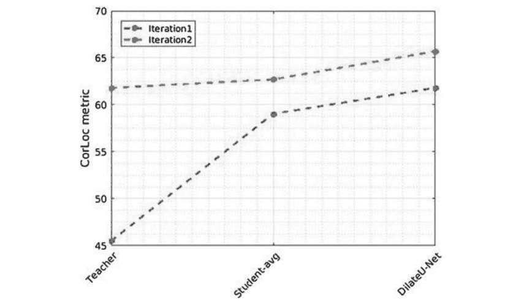

图7.7在第二代中进行比较（蓝线-第一次迭代；红线-第二次迭代），当第一次迭代训练的个体模型`DilateU-Net`成为第二代的教师时。`DilateU-Net`在第二次迭代中通过`EvalSeg-Net`选择模块在教师路径上得到帮助，这解释了从一次迭代到下一次迭代的改进。请注意，在这种情况下，`DilateU-Net`在训练过程中改进，从头开始，只允许通过`EvalSeg-Net`的好掩码。还要注意，个体学生（我们报告平均值）在两次迭代中都优于教师。这些结果是使用CorLoc指标（百分比）计算的YouTube-Objects数据集的结果。

了解学习中两个模块的角色以及它们如何最好地结合使用。我们进行了以下实验：（1）我们在第二次迭代中使用从多网络中提取的软分割来训练所有的学生模型（活动模块B），但没有应用数据选择（无模块C）；（2）然后我们进行了与上述实验相同的实验，但使用了`EvalSeg-Net`进行数据选择（活动模块C），只有通过选择的掩模用于训练；（3）我们使用从单个学生模型`DilateU-Net`（活动模块B）获得的软分割掩模，并使用`EvalSeg-Net`进行选择（活动模块C）来训练所有的模型；（4）我们将所有的学生模型作为独立的教师，使用`EvalSeg-Net`进行活动，这样对于每个输入图像，我们可以得到多个掩模，形成一个唯一的（图像，掩模）对。如前所述，这个设置是我们在最终系统中的选择。

对于这些实验，我们使用了一个小规模的200k图像集。我们报告了在YTO数据集上所有五个在第二次迭代中训练的学生的平均CorLoc（表7.6）。结果表明了数据选择的能力，它可以克服集成带来的优势。集成通常比每个个体更强大，因为它输出代表每个学生软分割的乘积的掩码。虽然它的输出对噪声更加稳健，但不能保证学生模型之间的一致性和质量。实际上，在乘法过程中，通过乘法得到的最终掩码可能会被破坏。例如，当学生中存在一个好的掩码时，通过乘法会丢失它。

### 7.5 实验分析

表7.6 不同结果，对所有经过第二次迭代训练的学生网络进行平均，使用`EvalSeg-Net`进行数据选择或不进行数据选择。在使用数据选择时，我们提供了三个结果，分别应用于`Multi-Net`集成的输出（第二行），单个模型的输出（第三行）和我们提出的方法的输出（第四行），我们对所有学生的所有掩码应用选择，而不像`Multi-Net`那样将它们相乘（因此我们从单个模型中获得了五倍的掩码）。我们将这些“有选择”的情况与没有数据选择的集成学习情况进行了比较（第一行）。

请注意，数据选择明显带来了改进。即使只使用一个模型作为教师进行数据选择，我们也能够超越没有选择的集合学习情况。

| 教师 | 平均CorLoc |
| :--- | :--- |
| 无选择的多网络 | 62.49 |
| 有选择的多网络 | 63.32 |
| 一个模型（`DilateU-Net`）带有选择 | 62.69 |
| 所有模型都带有选择 | 63.34 |

乘法。这是集合的一个限制，我们的方法可以克服这个限制，所有学生都可以独立和分别发言。`EvalSeg-Net`是一个训练有素的掩码选择网络，用于预测学生模型之间的一致性，它提供了新的、互补的信息，其输出与分割的好坏强相关（图7.6和7.3）。这样的网络可以用来选择好的掩码。因此，任何教师，无论是单个模型还是集合，结合选择模块都比没有更强大。

当使用`Multi-Net`作为教师时，每个训练过的学生的性能通过选择过程平均提升了0.8%。选择的相关性也可以从以下事实中看出，即使是一个更简单的教师，只有一个模型而没有集合（第三行），也可以比集合本身更有效（提高了0.2%）。当我们将迭代1时由迭代1的单个模型（`DilateU-Net`）带有选择进行训练的模型的平均结果与迭代2时的结果进行比较时，选择的作用再次显现，增加了3.7%（请参见表7.7和7.6中的结果比较）。

也许最具有决定性的选择结果是当学生模型（`DilateU-Net`）在自己的输出上进行训练（从头开始），并将其用作教师时，自身的性能得到改善，通过选择（表7.6中的第三行），`CorLoc`在`YTO`上增加了3.89%，从第一次迭代的61.8%增加到第二次迭代的65.7%。这种改进也可以在图7.7中看到，其中我们展示了`DilateU-Net`作为第二次迭代的教师的结果。

第四行介绍了当我们不使用多网络集合（作为教师），并且让所有模型的所有分割通过选择，如第7.4.3节所述。正如我们所看到的，这种方法的性能几乎与使用带有选择的集合相同（在表7.6中比较第2行和第4行）。如前所述，这种方法更有效：对于多网络，我们需要等待所有五个模型产生输出，直到我们考虑选择的掩码。

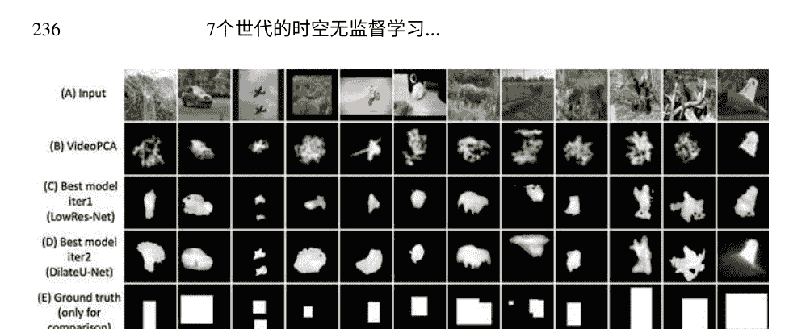

图7.8 `VID`数据集上的定性结果[46]。对于每次迭代，我们展示了以`CorLoc`度量为标准的最佳个体模型的结果。请注意，与`VideoPCA`（第1次迭代的教师）相比，我们的模型质量更高。我们还展示了真实边界框。更多定性结果，请访问我们的项目页面 https://sites.google.com/view/unsupervisedlearningfromvideo

在这种“所有模型”情况下，我们可以将掩码通过选择过程，同时生成，而无需同步所有五个掩码。因此，正如之前讨论的，这是我们的首选，通常被称为“我们的提议方法”，并在以下部分进行测试。

### 不同网络架构的分析

如表7.1、7.2和7.3所示，不同的网络架构产生不同的结果，而集成模型始终优于单个模型。我们的实验表明，不同的架构在不同的任务上表现更好。例如，`LowRes-Net`在盒子拟合任务上表现良好，因为它不需要精细的锐利物体掩码。另一方面，在评估精确分割时，具有更高分辨率输出的网络，如基于`U-Net`设计的网络，在这个任务上更专业，表现更好。在这些网络中，从定性上看，我们观察到`DenseU-Net`生成的掩码比`DilateU-Net`更少“空洞”，而`DilateU-Net`则是分割的顶级模型。架构之间的定量差异显示在表7.1、7.2和7.3中，而定性差异可以在图7.5和7.8中看到。

### 7.5.2 前景分割测试

#### 视频中的物体发现

我们首先与专门用于视频中物体发现的方法进行比较。为此，我们选择了`YouTube-Objects`数据集，并将其与文献中该数据集上最好的方法进行比较（表7.7）。评估是在`YouTube-Objects`数据集的两个版本，`YTOv1` [3]和`YTOv2.2` [72]上进行的。在`YTOv1`上，我们按照Jun Koh等人[70]、Prest等人[3]的相同实验设置，在所有标注帧上运行实验。

训练集中的结果未包含在表7.7中。我们没有包括Stretcu和Leordeanu[36]报告的结果，因为他们使用了不同的设置，在`YTOv1`的所有视频上进行测试。需要再次强调的是，尽管这里用于比较的方法可以访问整个视频镜头，但我们的方法在测试时只需要一张单独的图像。尽管存在这个限制，我们的方法在10个类别中有7个的表现优于其他方法，并且具有最佳的整体平均性能。请注意，即使是我们的基准模型`LowRes-Net`在第一次迭代中也能达到最佳性能。前馈CNN处理每个图像的时间为0.02秒，至少比所有其他方法快一到两个数量级（见表7.7）。我们还提到，在所有比较中，虽然我们的系统在测试时更快，但在训练阶段需要更长的时间，并且需要大量的无监督训练数据。

#### 图像中的物体发现

我们将我们的系统与其他在图像中执行物体发现的方法进行比较。我们使用两个不同的数据集进行比较：互联网图像中的物体发现和`Pascal-S`数据集。我们使用在实验部分开头介绍的常用指标来报告结果。

互联网图像中的物体发现是单个图像中前景物体检测的代表性基准。该数据集包含互联网图像，并带有高精度分割掩模的注释。为了与先前的方法进行比较，我们使用每个类别提供的100个图像子集：飞机、汽车和马。文献中评估该数据集的方法旨在发现给定图像中主要物体的边界框或其细分割掩模。我们对我们的系统进行了评估。请注意，与其他作品不同，我们在测试时不需要图像集合，因为我们的系统可以独立处理每个图像。因此，与其他方法不同，我们的性能不受图像集合的结构或集合中感兴趣类别的数量的影响。

在表7.8中，我们展示了我们的方法在`Object Discovery`数据集上的`CorLoc`性能与其他无监督对象发现方法相比的结果。我们将我们预测的框与Cho等人[12]、Tang等人[73]中围绕真实分割的紧框进行比较。我们的系统可以被归类为混合类别：它不依赖于图像集合的结构。它将每个图像独立对待。其他算法的性能在主要类别数量增加时会下降（有些甚至没有在混合类别情况下进行测试），而我们的方法不会出现这种情况。

我们在所有类别上获得了最先进的结果，相比Cho等人[12]的方法提高了6%。当Cho等人[12]的方法被允许看到仅限于单个主要类别的图像集合时，其性能会提高，并且在一个类别上与我们的方法相等。然而，在测试时，我们的方法除了输入图像之外没有其他必要的信息。

我们还在`Object Discovery`数据集的表7.9中将我们的方法与文献中最好的表现者进行了细粒度前景目标分割的测试，并应用了`GrabCut`方法来改进我们的软掩码，它在`OpenCV`中可用。我们根据Rubinstein等人[4]描述的相同的P、J评估指标进行评估——P和J越高，效果越好。在图7.9和7.10中，我们为每个类别呈现了一些定性结果。如前所述，这些在互联网图像对象发现上的分割实验是我们唯一将`GrabCut`作为后处理步骤应用的实验，也是表7.9中所有其他方法所使用的。

用于评估相关问题的另一个重要数据集是`Pascal-S`数据集，包含850张带有分割掩模的图像。从表7.10可以看出，我们在所有三个指标上都取得了优秀的结果，而这些方法都没有使用任何有监督的预训练特征。作为前景对象检测方法，我们的方法通常偏向于图像中的主要对象，尽管它也可以检测多个对象。`Pascal-S`中的图像通常具有更多的对象，因此我们认为我们的结果非常令人鼓舞，接近使用有监督方式预训练特征的方法。还要注意的是，我们在这些实验中没有使用`GrabCut`。

在单图像实验中，我们的系统是根据之前讨论的在其他视频数据集（`VID`、`YTO`和`YTBB`）上进行训练的。在训练过程中，它之前没有看到过`Pascal-S`或`Object Discovery`数据集中的任何图像。

### 7.5.3 迁移学习测试

虽然我们的主要关注点是无监督学习的前景对象分割，但我们还想测试我们的特征在迁移学习设置中的有用性。

#### 表7.7 YouTube-Objects数据集的结果
请注意，基准模型`Low-Res-Net`在v1.1上已经取得最佳结果，在v2.2[72]上我们在两个版本上都取得了最佳结果。我们展示了顶级个体模型和合成模型的结果，并在两个迭代中保留了基准模型`Low-Res-Net`作为参考。对于每一列，我们用粗体突出显示最佳模型，并用蓝色斜体表示集成模型更好或相等的情况。

```
| 方法                        | 航空   | 鸟    | 船    | 汽车   | 猫    | 狗    | 马    | MBike | 火车   | 平均   | 时间    | 版本 |
| :-------------------------- | :----- | :---- | :---- | :----- | :---- | :---- | :---- | :---- | :----- | :----- | :------ | :--- |
| Prest等人[3]                | 51.7   | 17.5  | 34.4  | 34.7   | 22.3  | 13.5  | 26.7  | 41.2  | 25.0   | 28.5   | 无      | v1   |
| Papazoglou和Ferrari[65]    | 65.4   | 67.3  | 38.9  | 65.2   | 46.3  | 65.3  | 48.4  | 39.0  | 25.0   | 50.1   | 4秒     | v1   |
| Jun Koh等人[70]            | 64.3   | 63.2  | 73.3  | 68.9   | 44.4  | 71.4  | 52.3  | 78.6  | 23.1   | 60.2   | 无      | v1   |
| Haller和Leordeanu[71]      | 76.3   | 71.4  | 65.0  | 58.9   | 68.0  | 70.6  | 33.3  | 69.7  | 42.4   | 61.1   | 0.35秒  | v1   |
| Low-Res-Net_hier1          | 77.0   | 67.5  | 77.2  | 68.4   | 54.5  | 72.0  | 56.7  | 44.1  | 34.9   | 62.1   | 0.02秒  | v1   |
| Low-Res-Net_hier2          | 83.3   | 71.4  | 74.3  | 69.6   | 57.4  | 77.3  | 56.7  | 50.0  | 37.2   | 65.7   | 0.02秒  | v1   |
| DilateU-Net_hier2          | 83.3   | 66.2  | 77.2  | 70.9   | 63.4  | 80.0  | 53.3  | 50.0  | 44.2   | 66.4   | 0.02秒  | v1   |
```

表7.8 在互联网图像中的对象发现[4]数据集上的结果（`CorLoc`指标）。在第一次迭代中获得的结果在第二次迭代中进一步改进。我们展示了最佳的单个模型和集合，以及两次迭代中的基准`LowRes-Net`。在单个模型中，`DilateU-Net`在评估框拟合时通常是最好的。对于每一列，我们用粗体突出显示最佳模型，并用蓝色斜体表示集合更好或相等的情况。

| Multi-Net_hier2 (ensemble) | 87.4 | 72.7 | 77.2 | 64.6 | 62.4 | 82.7 | 56.7 | 52.9 | 39.5 | 67.1 | 0.15秒 | v1 |
| :--- | :--- | :--- | :--- | :--- | :--- | :--- | :--- | :--- | :--- | :--- | :--- | :--- |
| Haller和Leordeanu[71] | 76.3 | 68.5 | 54.5 | 50.4 | 59.8 | 53.5 | 30.0 | 53.5 | 60.7 | 54.9 | 0.35秒 | v2.2 |
| Low-Res-Net_hier1 | 75.7 | 56.0 | 52.7 | 57.3 | 46.9 | 48.9 | 44.0 | 27.2 | 56.2 | 52.2 | 0.02秒 | v2.2 |
| Low-Res-Net_hier2 | 79.0 | 48.2 | 51.0 | 62.1 | 46.9 | 55.3 | 50.6 | 36.1 | 52.4 | 54.7 | 0.02秒 | v2.2 |
| DilateU-Net_hier2 | 84.3 | 49.9 | 52.7 | 61.4 | 50.3 | 56.4 | 47.1 | 36.1 | 56.7 | 56.4 | 0.02秒 | v2.2 |
| Multi-Net_hier2 (ensemble) | 83.1 | 53.2 | 54.3 | 63.7 | 50.6 | 61.0 | 51.1 | 37.2 | 48.7 | 57.2 | 0.15秒 | v2.2 |

表7.9 在`Object Discovery in Internet images` [4]数据集上使用（`P`，`J`度量）进行分割评估的结果。我们展示了顶级单模型和集成模型的结果，以及两次迭代中的`LowRes-Net`。在细粒度对象分割问题上，最好的单个模型往往是`DenseU-Net`，正如文本中也提到的那样。请注意，我们仅在这些实验中应用`GrabCut`作为后处理步骤，因为表中报告的所有方法也都使用了它。对于每一列，我们用粗体突出显示最佳模型，并用蓝色斜体显示集成模型更好的情况。

| 方法 | 飞机 | 汽车 | 马 | 平均 |
| :--- | :--- | :--- | :--- | :--- |
| Kim等人[27] | 21.95 | 0.00 | 16.13 | 12.69 |
| Joulin等人[26] | 32.93 | 66.29 | 54.84 | 51.35 |
| Joulin等人[28] | 57.32 | 64.04 | 52.69 | 58.02 |
| Rubinstein等人[4] | 74.39 | 87.64 | 63.44 | 75.16 |
| 唐等人[73] | 71.95 | 93.26 | 64.52 | 76.58 |
| Cho等人[12] | 82.93 | 94.38 | 75.27 | 84.19 |
| Cho等人[12]混合 | 81.71 | 94.38 | 70.97 | 82.35 |
| `LowRes-Net<sub>iter1</sub>` | 87.80 | 95.51 | 74.19 | 85.83 |
| `LowRes-Net<sub>iter2</sub>` | 93.90 | 93.25 | 75.27 | 87.47 |
| `DilateU-Net<sub>iter2</sub>` | 95.12 | 95.51 | 74.19 | 88.27 |
| 多网络迭代（集成） | 97.56 | 95.51 | 74.19 | 89.09 |

表7.10 在`PASCAL-S`数据集上与其他无监督方法进行比较的结果。对于`MAE`得分越低越好，而对于 `F<sub>β</sub>`和平均`IoU`得分越高越好。我们报告了每种方法的最大 `F<sub>β</sub>`，最小`MAE`和最大平均`IoU`。在粗体中，我们展示了在单个模型中未使用有监督预训练特征时的最佳结果，在蓝色斜体中展示了集成效果更好的情况。

| 方法 | `F<sub>β</sub>` | `MAE` | 平均`IoU` | 预训练的有监督特征? |
| :--- | :--- | :--- | :--- | :--- |
| Wei等人[75] | 56.2 | 22.6 | 41.6 | 否 |
| Li等人[76] | 56.8 | 19.2 | 42.4 | 否 |
| Zhu等人[77] | 60.0 | 19.7 | 43.9 | 否 |
| Yang等人[78] | 60.7 | 21.7 | 43.8 | 否 |
| Zhang等人[79] | 60.8 | 20.2 | 44.3 | 否 |
| Tu等人[80] | 60.9 | 19.4 | 45.3 | 否 |
| Zhang等人[81] | 68.0 | *14.1* | *54.9* | 初始化`VGG` |
| `LowRes-Net<sub>iter1</sub>` | 64.6 | 19.6 | 48.7 | 否 |
| `LowRes-Net<sub>iter2</sub>` | 66.8 | 18.2 | **51.7** | 否 |
| `DenseU-Net<sub>迭代</sub>` | **69.1** | **17.6** | 50.9 | 否 |
| `Multi-Net`迭代（集成） | *69.6* | 19.5 | *52.3* | 否 |

### 7.5 实验分析

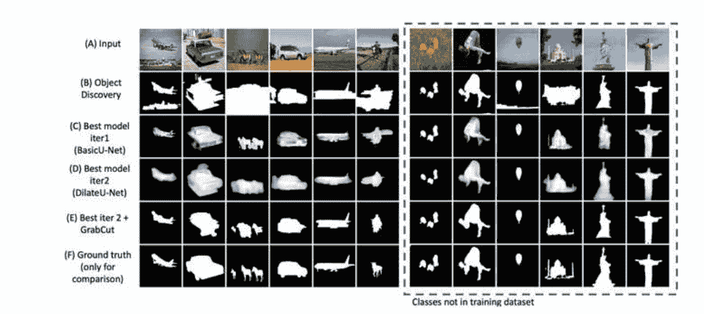

图7.9 与(B)[4]相比在`Object Discovery`数据集上的定性结果。 对于两次迭代，我们展示了顶级模型(C，D)在不使用`GrabCut`的情况下的结果。 我们还展示了使用顶级模型和`GrabCut`的结果(E)。 请注意，我们的模型能够从训练集中不存在的类别中分割出对象（右侧的示例）。 此外，请注意初始的`VideoPCA`教师无法应用于单个图像。

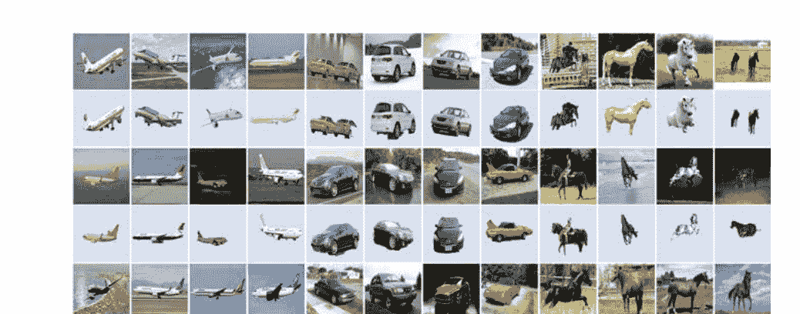

图7.10 在互联网图像[4]数据集中对对象发现的定性结果。 对于每个示例，我们展示输入的`RGB`图像，并在下方立即展示我们的分割结果，使用`GrabCut`进行后处理以获得硬分割。 请注意，我们的方法即使在背景混乱的图像中也能产生良好的分割结果。

即多目标检测问题。 为此，我们遵循最近的迁移学习文献中使用的众所周知的实验设置，在`Fast R-CNN`框架[83]中对以无监督方式初始化的类似`AlexNet`的[82]网络进行微调的监督对象检测中。 我们密切关注`Pathak`等人的工作[6]，包括代码、文档和训练在线提供的数据，正如相关工作部分所提到的，也是从视频中学习以无监督方式在单个图像中分割对象的。

在这些实验中，我们以相同的方式调整了`AlexNet`的最后部分，以产生图像的软分割（而不是输出类别）。我们使用了与我们进行比较的方法相同的基本架构，以确保结果来自学习到的特征，而不是我们使用的架构。

## 目标分割的初始无监督训练

我们在迭代2中将本节中描述的适应的AlexNet模型（我们称之为`AlexNet-Seg`）作为我们无监督学习框架中的学生使用。因此，`AlexNet-Seg`将在我们的迭代2中由无监督教师路径进行训练-在这种情况下，教师将是单个网络，即模块B中的`DialtedU-Net`，与模块C中的`EvalSeg-Net`掩码选择器相结合。为了看到实际训练数据如何影响最终的迁移学习结果，我们尝试了我们自己的数据和Pathak等人使用的数据[6]，该数据来自`YFCC100m` [84]数据集，共有160万帧。结果呈现在表7.13中。目前，我们的无监督学习系统更喜欢对图像中的主要前景对象进行分割，对包含多个对象的复杂图像的分割能力较弱。由于Pascal VOC 2012中的图像包含复杂的场景和多个对象，最终的迁移学习问题是多对象检测，因此我们还测试了当我们调整我们的系统以更好地处理多个对象时的情况。为此，我们将每个训练图像分成五个大的补丁（一个网格，每个角落和中间各有一张图像，每个裁剪图像的尺寸约为原始尺寸的60%），然后将其通过迭代2的教师路径。结果被合并成一张图像，通过叠加软掩码并在原始图像的每个位置上取最大值。

因此，我们获得了更好地捕捉输入图像中多个对象的软分割。请注意，通过没有五点网格划分的教师路径传递的原始图像在表7.12和7.13以及图7.11中被称为单一对象（`SO`）教师，而刚刚描述的五网格版本在相同的表格和图中被称为多对象（`MO`）教师。我们在这些多对象软分割上训练`AlexNet-Seg`学生。因此，我们将知识从无监督的学生模型转移到`AlexNet-Seg`，并为下一个监督对象检测任务做好准备。

## 转移到对象检测

与我们进行比较的其他方法类似，我们在`Pascal VOC 2012` [67]数据集上进行了迁移学习实验。我们在VOC 2012的训练集上进行训练，并在验证集上报告我们的结果。我们还使用多尺度训练和测试，并在训练过程中删除困难的对象。我们在表7.11中报告了比较结果。我们可以看到，我们的方法学习到的无监督知识确实对迁移学习有用，因为我们的结果在目前已发表的方法中排名前三。这很有趣，因为我们的无监督学习算法主要用于前景对象分割，而不是分类。

## 前景分割与多目标检测

我们在转移学习问题上测试了我们的方法，这个问题既涉及定位（检测）又涉及分类。在这个背景下，正如在引言部分已经讨论的那样，Pathak等人的工作[6]与我们的工作最相关，因为他们也通过学习视频来以无监督的方式对单幅图像中的对象进行分割。他们通过使用一个从视频中的光流生成软掩码的教师来实现这一点。除了两个工作之间的理论联系之外，我们还希望更好地理解这两种方法在实际前景分割实验中的关系。他们的方法通常产生的掩码覆盖图像中更大的区域，更适合于迁移学习实验，结果显示出更好的效果。

另一方面，在前景分割任务上进行测试时，我们的方法似乎产生了更好的结果（见表7.12）。我们得到的结果是与作者在对其方法进行单帧主要对象检测与人工注释的测试时所观察到的结果一致（例如，精确度：29.9，召回率：59.3，平均IoU：24.8）。他们的高召回率和较低精确度与我们的观察结果一致，即他们的分割覆盖了图像的较大部分，而我们的分割提供了更清晰和更小的掩码。这一观察结果引导我们在一个五点网格上提取大的裁剪区域并组合结果（称为`AlexNet-Seg` MO）。如实验所示，通过在网格上获取多个输出最终带来了相对较小的0.6%的改进（见表7.13）。在图7.11中，我们展示了我们的`DilatedU-Net`教师模型对于训练了单个前景对象检测的`AlexNet-Seg`学生模型（称为`SO`教师）和我们的五格多对象分割结果（称为`MO`教师）的定性结果。我们还展示了我们的`AlexNet-Seg`学生在两种情况下的结果以及Pathak等人的输出[6]进行比较。虽然我们的方法在分割任务上有更好的结果，但他们的方法更适合迁移学习实验。我们怀疑他们的更大的掩模（图7.11），精度较低但相对较高的召回率和高置信度值，可能在整个图像上需要检测多个对象的最终迁移学习阶段更具灵活性和保守性较低。同时，我们的方法专注于获得更锐利和更高质量的前景分割掩模。总体而言，迁移学习实验表明我们的方法适用于这样的任务，因为我们在相同的实验设置下获得了排名前三的性能。

表7.11 使用不同方法初始化的`Fast R-CNN`在VOC 2012 [67]上与现有技术的比较。这些数字代表了VOC 2012验证集的mAP。每一列代表网络被微调的程度，例如，>c1表示第一个卷积层之后的所有层都被微调，而“All”表示所有层都被微调。

| 方法 | 全部 | >c1 | >c2 | >c3 | >c4 | >c5 |
|------|------|-----|-----|-----|-----|-----|
| Agrawal等人[85] | 37.4 | 36.9 | 34.4 | 28.9 | 24.1 | 17.1 |
| Pathak等人[20] | 39.1 | 36.4 | 34.1 | 29.4 | 24.8 | 13.4 |
| Krähenbühl等人[86] | 42.8 | 42.2 | 40.3 | 37.1 | 32.4 | 26.0 |
| Owens等人[87] | 42.9 | 42.3 | 40.6 | 37.1 | 32.0 | 26.5 |
| Wang和Gupta[16] | 43.5 | 44.6 | 44.6 | 44.2 | 41.5 | 35.7 |
| Zhang等人[88] | 43.8 | 45.6 | 45.6 | 46.1 | 44.1 | 37.6 |
| Zhang等人[89] | 44.5 | 44.9 | 44.7 | 44.4 | 42.6 | 38.0 |
| Donahue等人[90] | 44.9 | 44.6 | 44.7 | 42.4 | 38.4 | 29.4 |
| Pathak等人[6] | 48.6 | 48.2 | 48.3 | 47.0 | 45.8 | 40.3 |
| Doersch等人[17] | 49.9 | 48.8 | 44.4 | 44.3 | 42.1 | 33.2 |
| 我们的 - `AlexNet-Seg` (`MO`) | 46.8 | 46.2 | 43.9 | 41.0 | 36.5 | 29.9 |

表7.12 与[6]在无监督目标发现上的比较。对于`YTO`和`Obj-Disc`数据集，我们报告CorLoc指标，对于`Pascal-S`数据集，我们报告Fβ指标。使用`SO`，我们表示我们从单个对象（`SO`）教师训练的`AlexNet-Seg`学生，而使用`MO`，我们表示我们从多个对象（`MO`）教师训练的学生 - 如文本中所解释的。正如可以看到的，我们提出的多对象方案对前景对象分割的结果产生了负面影响。这是因为这些数据集主要只有一个单一对象。

| 方法 | `YTO` | `Obj-Disc` | `Pascal-S` | 训练数据 |
|------|-------|------------|------------|----------|
| Pathak等人[6] | 39.4 | 82.1 | 64.7 | `YFCC100m` |
| `AlexNet-Seg` (`SO`) | 62.7 | 86.4 | 67.4 | 我们的数据 |
| `AlexNet-Seg` (`SO`) | 56.6 | 83.6 | 65.5 | `YFCC100m` |
| `AlexNet-Seg` (`MO`) | 54.7 | 86.0 | 65.9 | 我们的数据 |
| `AlexNet-Seg` (`MO`) | 58.3 | 84.4 | 65.2 | `YFCC100m` |
| `AlexNet-Seg` (`MO`) | 58.1 | 85.2 | 66.1 | 两者 |

表7.13 我们使用的不同类型的训练图像和训练数据与`AlexNet-Seg`学生的比较。使用`SO`表示我们从单个对象（`SO`）教师训练的`AlexNet-Seg`学生，而使用`MO`表示我们从多个对象（`MO`）教师训练的学生-如文中所解释的。我们展示了训练数据如何影响迁移学习结果。这些数字表示在微调整个网络时，`Pascal VOC 2012`验证集的mAP指标。请注意，提出的多对象方法只带来了很小的改进。此外，在这些迁移学习测试中，较大的训练数据集-`YFCC100m`-往往带来了稍微改善的结果。

| 模型 | VOC 2012 (mAP) | 训练数据 |
| :--- | :--- | :--- |
| `AlexNet-Seg` (`SO`) | 46.2 | 我们的数据 |
| `AlexNet-Seg` (`SO`) | 45.7 | `YFCC100m` |
| `AlexNet-Seg` (`MO`) | 46.1 | 我们的数据 |
| `AlexNet-Seg` (`MO`) | 46.8 | `YFCC100m` |
| `AlexNet-Seg` (`MO`) | 46.8 | 两者 |

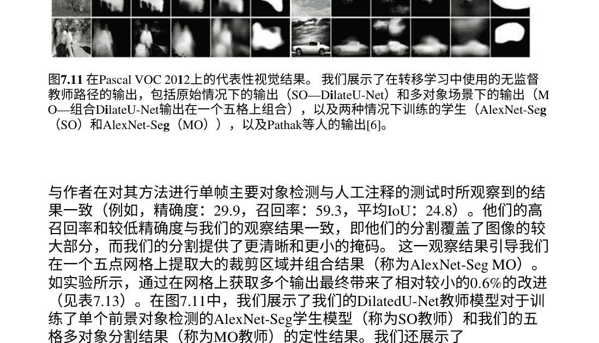

### 7.5.4 实验的总结

我们在实验分析中得出的一个有趣结论是系统能够从第一次迭代到第二次迭代改善其性能。这个结果涉及到几个因素，我们认为它们通过以下关系相关：（1）多个具有不同结构的学生确保多样性和相对独立的错误；（2）反过来，点（1）使得可能对一个学习预测一致性的掩模选择模块进行无监督训练；（3）因此，选择模块（来自2）成为一个良好的掩模评估网络；（4）一旦有了来自3的评估网络，我们可以添加更大且可能更复杂的数据，以选择下一次迭代中具有良好对象掩模的更有趣案例的更大集合；（5）最后，（4）确保下一次迭代的改进，现在我们可以回到点（1）。

### 7.6 无监督学习的总结讨论

无监督学习的最终目标可能不是匹配监督情况下的性能，而是超越经典监督场景的能力。一个无监督系统应该能够学习和识别不同的物体类别，如动物、植物和人造物品，随着时间的推移而不断演变和变化，从过去到未知的未来。它还应该能够学习关于可能形成的新类别，与其他已知类别相关，也许是已知的类别。我们认为这种情况与监督学习不同，在监督学习中，分类器被迫从一个固定和限定于特定时间段的样本分布中学习，即人类标注完成的时间。因此，在监督学习范式中，未来的汽车不应该被分类为汽车，因为根据目前训练时间收集的人类注释，它不是一辆汽车。另一方面，一个自学习的系统应该能够追踪汽车的发展历程随着时间的变化，识别诸如“汽车”之类的对象，无需逐步人工干预。

当前的无监督学习方法可能仍然无法学习深刻的语义信息[25]，但能够以无监督的方式学习分割前景对象的能力表明我们正在朝着正确的方向前进。

为了理解和学习语义类别，系统需要自己学习这些对象如何相互作用以及它们在更大的时空故事中扮演的角色。虽然我们的无监督方法还远未达到这种解释水平，但学习和检测构成局部空间背景中的前景对象的能力可能构成一个重要的基石。这是一个可以进一步学习空间和时间中更复杂的相互作用和行为的要素。

从更大的时空视角来看，无监督学习是关于对不断变化的大量数据进行连续学习和适应。在海量数据中，人类注释非常有限，无法连续提供所谓的“地面真实”信息。因此，无监督学习，尤其是其较弱版本——从大量数据中进行学习，减少人为干预——将很快成为人工智能未来的核心部分，比监督学习更重要。

## 7.7 总结与未来工作

在本章中，我们提出了一种新颖有效的方法，以无监督的方式从大量图像和视频集合中学习，对单个图像中的前景对象进行分割。我们提出了一个相对通用的算法来完成这个任务，可以学习多代学生和教师。

我们在实践中证明，该系统在两代人的过程中提高了性能。我们还测试了不同系统组件对性能的影响，并在三个不同的数据集上展示了最先进的结果，同时在具有挑战性的迁移学习实验中展示了最佳性能。我们的系统是文献中最早学习以无监督方式检测和分割图像中前景对象的系统之一，无需预训练特征或手动标注，仅在测试时需要一张图像。

沿着学生路径训练的卷积网络能够学习到一般的“物体性”特征，包括良好的形状、闭合性、平滑的轮廓以及与背景的对比。简单的初始VideoPCA教师随着时间的推移发现的东西，深层复杂的学生能够跨越不同抽象层次的图像特征进行学习。我们在迁移学习实验中的结果也是令人鼓舞的，并展示了这样一个系统可能有用的其他情况。在未来的工作中，随着计算和存储能力的扩展，展示我们的无监督学习算法在许多代学生和教师网络中的能力将是有趣的。在广泛的实验中测试的这种方法可能为计算机视觉研究带来宝贵的贡献。

通过在教师-学生范式中实现持续的无监督学习，这种方法在计算机视觉研究中可能会有重要的贡献，其中教师实际上是整个先前一代学生。这立即引出了下一个概念，在下一章中将进行概念上的介绍。

### 7.7.1 迈向通用视觉学习机

让我们想象一下，我们使用一个整个神经网络的群体来处理所有已知的视觉识别方面，并通过其他连接网络将它们连接起来，这些网络接收一个网络的输出并尝试预测另一个网络的输出。

对于任何给定的视觉学习问题和任何给定的学生网络，难道不可能在无监督的环境中将其他所有网络集体作为教师使用吗？

这个想法的局限性是什么，我们需要多少预训练，以及在考虑的视觉任务集合和使用的未标记数据的数量和类型方面，我们会有什么限制？这些是我们下一章的问题和最后一章。

### 参考文献

1. Croitoru I, Bogolin SV, Leordeanu M (2017) 从视频中无监督学习以检测单幅图像中的前景对象。在：2017年IEEE国际计算机视觉会议（ICCV）。IEEE，第4345-4353页
2. Croitoru I, Bogolin SV, Leordeanu M (2019) 无监督学习前景对象分割。计算机视觉国际期刊 1-24
3. Prest A, Leistner C, Civera J, Schmid C, Ferrari V (2012) 从弱标注视频中学习对象类别检测器。CVPR会议
4. Rubinstein M, Joulin A, Kopf J, Liu C (2013) 无监督联合对象发现和分割互联网图像。CVPR会议
5. Li Y, Hou X, Koch C, Rehg JM, Yuille AL (2014) 显著对象分割的秘密。佐治亚理工学院
6. Pathak D, Girshick R, Dollar P, Darrell T, Hariharan B (2017) 通过观察物体运动学习特征。CVPR会议
7. Bengio Y, Louradour J, Collobert R, Weston J (2009) 课程学习。在第26届国际机器学习年会上的论文集。ACM出版社，第41-48页
8. Radenovi´c F, Tolias G, Chum O (2016) CNN图像检索从bow学习：无监督的硬样本微调。ECCV会议
9. Misra I, Zitnick CL, Hebert M (2016) 使用时间顺序验证的无监督学习：洗牌和学习。在：ECCV
10. Li D, Hung WC, Huang JB, Wang S, Ahuja N, Yang MH (2016) 基于图形一致性约束的无监督视觉表示学习。在：ECCV
11. Jain AK, Murty MN, Flynn PJ (1999) 数据聚类：一项综述。ACM Comput Surv (CSUR) 31(3):264–323
12. Cho M, Kwak S, Schmid C, Ponce J (2015) 野外的无监督对象发现和定位：基于部分匹配和自底向上的区域提议。在：IEEE计算机视觉和模式识别会议论文集，页码1201–1210
13. Sivic J, Russell B, Efros A, Zisserman A, Freeman W (2005) 在图像中发现对象及其位置。在：ICCV
14. Raina R, Battle A, Lee H, Packer B, Ng AY (2007) 自学习：从未标记的数据中进行迁移学习。在：第24届国际机器学习大会论文集。ACM, 页759–766
15. Lee HY, Huang JB, Singh M, Yang MH (2017) 通过排序序列进行无监督表示学习。在：2017年IEEE国际计算机视觉大会 (ICCV)。IEEE, 页667–676
16. Wang X, Gupta A (2015) 使用视频进行无监督学习的视觉表示学习。arXiv:150500687
17. Doersch C, Gupta A, Efros AA (2015) 通过上下文预测进行无监督的视觉表示学习。在：IEEE国际计算机视觉大会论文集, 页1422–1430
18. Larsson G, Maire M, Shakhnarovich G (2016) 用于自动上色的学习表示。在：欧洲计算机视觉大会。Springer, 页577–593
19. Noroozi M, Favaro P (2016) 通过解决拼图问题来进行视觉表示的无监督学习。在：计算机视觉欧洲会议。Springer, 第69-84页
20. Pathak D, Krahenbuhl P, Donahue J, Darrell T, Efros AA (2016) 上下文编码器：通过修复学习特征。在：IEEE计算机视觉和模式识别会议论文集, 第2536-2544页
21. Finn C, Goodfellow I, Levine S (2016) 通过视频预测进行物理交互的无监督学习。在：神经信息处理系统的进展, 第64-72页
22. Xue T, Wu J, Bouman K, Freeman B (2016) 视觉动力学：通过交叉卷积网络进行概率未来帧合成。在：神经信息处理系统的进展, 第91-99页
23. Goroshin R, Mathieu MF, LeCun Y (2015) 学习在不确定性下进行线性化。在：神经信息处理系统的进展, 第1234-1242页
24. Wang X, Gupta A (2015) 使用视频进行无监督学习的视觉表示。在：计算机视觉国际会议 (ICCV)

25. Bau D, Zhou B, Khosla A, Oliva A, Torralba A (2017) 网络解剖学：量化深度视觉表示的可解释性。在：计算机视觉和模式识别国际会议 (CVPR)

26. Joulin A, Bach F, Ponce J (2010) 图像共分割的判别聚类。在：CVPR

27. Kim G, Xing E, Fei-Fei L, Kanade T (2011) 基于各向异性扩散的分布式共分割的子模优化。在：ICCV

28. Joulin A, Bach F, Ponce J (2012) 多类共分割。在：CVPR

29. Kuettel D, Guillaumin M, Ferrari V (2012) 图像网中的分割传播。在：ECCV

30. Vicente S, Rother C, Kolmogorov V (2011) 对象共分割。在：CVPR

31. Rubio J, Serrat J, López A (2012) 视频共分割。在：ACCV

32. Leordeanu M, Sukthankar R, Hebert M (2012) 无监督学习用于图匹配。Int J Comput Vis 96:28–45

33. Deselaers T, Alexe B, Ferrari V (2012) 弱监督定位和学习与通用知识。IJCV 100(3)

34. Nguyen M, Torresani L, la Torre FD, Rother C (2009) 弱监督判别定位和分类：联合学习过程。在：CVPR

35. Siva P, Russell C, Xiang T, Agapito L (2013) 超越图像：无监督学习用于目标显著性和检测。在：CVPR

36. Stretcu O, Leordeanu M (2015) 多帧匹配用于视频中的目标发现。在：BMVC, pp 186.1–186.12

37. Leordeanu M, Collins R, Hebert M (2005) 无监督学习从视频序列中提取目标特征。在：CVPR

38. Parikh D, Chen T (2007) 无监督识别多个感兴趣的对象从多个图像中：发现。在：亚洲计算机视觉会议

`2 https://github.com/rbgirshick/py-faster-rcnn`。

39. Liu D, Chen T (2007) 用于无监督视频目标发现的主题-运动模型。 在：CVPR

40. Joulin A, Tang K, Fei-Fei L (2014) 高效的图像和视频共定位与Frank-Wolfe 算法。 在：ECCV

41. Rochan M, Wang Y (2014) 弱标记视频中的高效目标定位和分割。 在：视觉计算的进展。 Springer，第172-181页

42. Lee YJ, Kim J, Grauman K (2011) 视频对象分割的关键片段。 在：2011年IEEE国际计算机视觉会议（ICCV）。 IEEE，第1995-2002页

43. Cheng J, Tsai YH, Wang S, Yang MH (2017) Segflow：视频对象分割和光流的联合学习。 在：IEEE国际计算机视觉会议（ICCV）

44. Dutt Jain S, Xiong B, Grauman K (2017) Fusionseg：学习将运动和外观结合起来，实现对视频中通用对象的完全自动分割。 在：IEEE计算机视觉和模式识别会议（CVPR）

45. Tokmakov P, Alahari K, Schmid C (2017) 在视频中学习运动模式。 在：计算机视觉和模式识别（CVPR）的IEEE 会议

46. Russakovsky O, Deng J, Su H, Krause J, Satheesh S, Ma S, Huang Z, Karpathy A, Khosla A, Bernstein M等（2015） Imagenet大规模视觉识别挑战。 IJCV 115（3）

47. Everingham M, Eslami SMA, Van Gool L, Williams CKI, Winn J, Zisserman A（2015） 帕斯卡视觉对象类别挑战：回顾。 Int J Comput Vis 111（1）： 98–136

48. Tokmakov P, Alahari K, Schmid C（2016） 学习弱注释视频的语义分割。 在：ECCV，卷1，第6页

49. Khoreva A, Benenson R, Hosang JH, Hein M, Schiele B (2017) 简单就是了：弱监督实例和语义分割。 在：CVPR，卷1，第3页

50. Rother C, Kolmogorov V, Blake A (2004) Grabcut：使用迭代图割的交互式前景提取。 在：ACM图形交易（TOG），卷23. ACM，pp 309–314

51. Borji A, Sihite D, Itti L（2012） 显著目标检测：基准。 在：ECCV

52. Cheng M, Mitra N, Huang X, Torr P, Hu S (2015) 基于全局对比度的显著区域检测。 PAMI 37(3)

53. Barnich O, Van Droogenbroeck M (2011) Vibe：一种适用于视频序列的通用背景减除算法。 IEEE图像处理20（6）：1709–1724

54. Raiko T, Valpola H, LeCun Y (2012) 通过感知器中的线性变换使深度学习更容易。 AIST ATS 22:924–932

55. Pinheiro PO, Lin TY, Collobert R, Dollár P (2016) 学习细化物体分割。 在：ECCV

56. Long J, Shelhamer E, Darrell T (2015) 用于语义分割的全卷积网络。 在：计算机视觉和模式识别IEEE会议论文集，pp 3431–3440

57. Ronneberger O, Fischer P, Brox T (2015) U-net：用于生物医学图像分割的卷积网络。 在：医学图像计算和计算机辅助干预国际会议。 Springer，pp 234–241

58. Yu F, Koltun V (2015) 通过扩张卷积进行多尺度上下文聚合。 arXiv:151107122

59. Jégou S, Drozdzal M, Vazquez D, Romero A, Bengio Y (2017) The one hundred layers tiramisu: fully convolutional densenets for semantic segmentation. 在：2017年IEEE计算机视觉和模式识别研讨会（CVPRW）上。 IEEE，第1175-1183页

60. Abadi M, Agarwal A, Barham P, Brevdo E, Chen Z, Citro C, Corrado GS, Davis A, Dean J, Devin M, Ghemawat S, Goodfellow I, Harp A, Irving G, Isard M, Jia Y, Jozefowicz R, Kaiser L, Kudlur M, Levenberg J, Man D, Monga R, Moore S, Murray D, Olah C, Schuster M, Shlens J, Steiner B, Sutskever I, Talwar K, Tucker P, Vanhoucke V, Vasudevan V, Viégas F, Vinyals O, Warden P, Wattenberg M, Wicke M, Yu Y, Zheng X (2015) TensorFlow：异构系统上的大规模机器学习。 软件可从`http://www.tensorflow.org`获得

61. Kingma D, Ba J (2014) Adam：一种随机优化方法。 arXiv:14126980

62. 侯X，张L（2007年） 显著性检测：一种光谱残差方法。 在：2007年IEEE计算机视觉和模式识别CVPR'07会议。 IEEE，第1-8页

63. 姜H，王J，袁Z，吴Y，郑N，李S（2013年）显著目标检测：一种有区别的区域特征集成方法。在：IEEE计算机视觉和模式识别会议论文集，第2083-2090页

64. Cucchiara R, Grana C, Piccardi M, Prati A（2003年）在视频流中检测移动物体，幽灵和阴影。PAMI 25（10）

65. Papazoglou A, Ferrari V（2013年）在无约束视频中快速对象分割。在：IEEE国际计算机视觉会议论文集，第1777-1784页

## 第8章 无监督学习走向未来

### 8.1 引言

空间和时间中的视觉数据随处可见。虽然图像级别的识别已经得到了更好的理解，但是在空间和时间中的视觉学习远未解决。仍然存在的主要挑战之一是如何在大的时空背景下对低级实体（如像素、深度或运动）与对象和更高级概念之间的丰富而复杂的相互作用进行建模。此时，我们希望将所有内容整合到一个统一的结构中。我们希望利用本书中介绍的所有关键思想、模型和方法，并开始研究空间和时间世界中无监督学习的一般模型。在开始之前，我们应该问自己是否存在这样的一般模型。我们相信可能存在，因为生物大脑在自然界中通过自学来观察和理解环境[1]。在本章中，我们不仅论证了这一点的可能性，还将展示在不久的将来，本工作中的起始思想和路径可能会趋于这样一个统一的模型，我们将其称为视觉故事图神经网络，简称视觉故事网络。在介绍一般概念之前，我们首先介绍一个更简单但非常通用和雄心勃勃的模型，即循环图神经网络，我们已经构建并在识别复杂活动的更高级任务上取得了最先进的结果。循环图神经网络是通用的，可以应用于涉及时空数据处理的任何任务。它还将当今视觉领域的两个主要计算模型之一，即具有预定义节点和边的图模型及其迭代消息传递方案的优化，与直接从数据中学习特征并在推理时进行单向传递的神经网络结合到一个单一模型中。

### 8.2 时空中的循环图神经网络

在机器学习和计算机视觉中，时空领域的学习仍然是一个非常具有挑战性的问题。目前用于理解时空视觉数据的计算模型在很大程度上基于经典的基于单幅图像的范式[2, 3]。如何将时空信息整合到一个单一的通用模型中尚不清楚。我们提出了一个神经图模型，它在时空中是循环的，适用于捕捉不同实体和对象在不断变化的世界场景中的局部外观和复杂的高层次相互作用。我们图中的节点和边都有专门的神经网络来处理信息。节点在时空中的局部部分和先前的记忆状态上进行特征提取。边在不同位置和空间尺度之间或过去和现在之间处理连接节点之间的消息。消息通过迭代传递，以便在全局范围内传递信息并建立长距离相互作用。我们的模型是通用的，可以学习识别各种高层次的时空概念，并应用于不同的学习任务。通过大量的实验证明和消融研究，我们的模型在视频中识别复杂活动方面优于强基线模型和顶级发表方法。此外，我们在具有挑战性的Something-Something人物-物体交互数据集上获得了最先进的性能。

通常，对于不同的学习任务，会优先选择不同的模型，以捕捉问题的特定领域先验知识和偏差[4]。`CNN`在涉及数据的强局部和静态假设的任务中更受青睐。当学习受限且测试时需要搜索和优化时，更倾向于使用传统的图模型。当数据具有时间性或序列性时，会选择循环模型。当数据中没有已知结构时，也可以优先选择全连接模型。我们的循环神经图在空间和时间上高效处理信息，并可应用于不同的视频学习任务。

我们提出了循环时空图（`RSTG`）神经网络，其中每个节点通过使用骨干深度神经网络从特定的时空区域提取特征。通过在空间和时间上进行迭代的消息传递实现全局处理。时空处理被分解为空间处理阶段和时间处理阶段，在每次迭代中交替进行。我们的目标是在概念上将数据与处理数据的计算机解耦。因此，我们的节点是处理单元，从多个来源接收输入：当前时间的空间局部区域、相邻的空间节点以及过去的记忆状态（图8.1）。

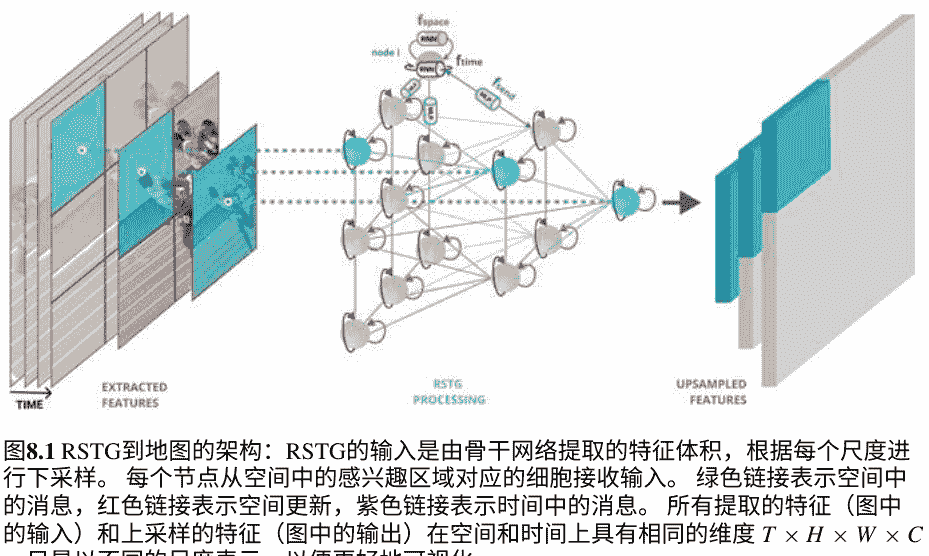

图8.1 `RSTG`到地图的架构：`RSTG`的输入是由骨干网络提取的特征体积，根据每个尺度进行下采样。每个节点从空间中的感兴趣区域对应的细胞接收输入。绿色链接表示空间中的消息，红色链接表示空间更新，紫色链接表示时间中的消息。所有提取的特征（图中的输入）和上采样的特征（图中的输出）在空间和时间上具有相同的维度 `T × H × W × C`，只是以不同的尺度表示，以便更好地可视化。

### 8.2.1 科学背景

66. Real E, Shlens J, Mazzocchi S, Pan X, Vanhoucke V（2017年）Youtube-boundingboxes：用于视频中对象检测的大型高精度人工注释数据集。在：2017年IEEE计算机视觉和模式识别（CVPR）会议。IEEE，第7464-7473页
67. Everingham M, Van Gool L, Williams CK, Winn J, Zisserman A（2010年）帕斯卡视觉对象类别（VOC）挑战。Int J Comput Vis 88（2）：303-338
68. Rock I, Palmer S（1990年）格式塔心理学。Sci Am 263：84-90
69. Alexe B, Deselaers T, Ferrari V（2010）什么是一个对象？在：计算机视觉和模式识别
70. Jun Koh Y, Jang WD, Kim CS（2016）`POD`：基于对象重复性、背景和主要对象模型的进化精化发现主要对象的视频。在：IEEE计算机视觉和模式识别会议论文集，第1068-1076页
71. Haller E, Leordeanu M（2017）通过高度可能的正特征的高效选择在视频中进行无监督的对象分割。在：IEEE国际计算机视觉会议（ICCV）
72. Kalogeiton V, Ferrari V, Schmid C（2016）分析视频和图像之间的领域转移因素以进行对象检测。PAMI 38(11)
73. Tang K, Joulin A, Li LJ, Fei-Fei L（2014）在真实世界图像中的共定位。在：CVPR
74. Chen X, Shrivastava A, Gupta A（2014）通过对象发现和分割丰富视觉知识库。在：CVPR
75. Wei Y, Wen F, Zhu W, Sun J（2012）使用背景先验的测地线显著性。在：欧洲计算机视觉会议。Springer，pp 29-42
76. Li N, Sun B, Yu J（2015）用于显著性检测的加权稀疏编码框架。在：IEEE计算机视觉和模式识别会议论文集，pp 5216-5223
77. Zhu W, Liang S, Wei Y, Sun J（2014）通过稳健的背景检测进行显著性优化。在：IEEE计算机视觉和模式识别会议论文集，pp 2814-2821
78. Yang C, Zhang L, Lu H, Ruan X, Yang MH（2013）基于图的流形排名的显著性检测。在：2013年IEEE计算机视觉和模式识别会议（CVPR）。IEEE，pp 3166-3173
79. Zhang J, Sclaroff S, Lin Z, Shen X, Price B, Mech R（2015）80 fps下的最小障碍显著物体检测。在：IEEE国际计算机视觉会议论文集，pp 1404-1412
80. Tu WC, He S, Yang Q, Chien SY（2016）带有最小生成树的实时显著物体检测。在：IEEE计算机视觉和模式识别会议论文集，pp 2334-2342
81. 张D，韩J，张Y（2017年）融合监督：走向无监督学习的深度显著目标检测器。在：计算机视觉和模式识别IEEE会议论文集，第4048-4056页
82. Krizhevsky A，Sutskever I，Hinton GE（2012年）使用深度卷积神经网络的Imagenet分类。在：神经信息处理系统的进展，第1097-1105页
83. Girshick R（2015年）快速R-CNN。在：IEEE国际计算机视觉会议论文集，第1440-1448页
84. Thomee B, Shamma DA, Friedland G, Elizalde B, Ni K, Poland D, Borth D, Li LJ（2015）`Yfcc100m`：多媒体研究中的新数据。arXiv:150301817
85. Agrawal P, Carreira J, Malik J（2015）通过移动学习视觉。在：IEEE国际计算机视觉会议论文集, 第37-45页
86. Krähenbühl P, Doersch C, Donahue J, Darrell T (2015) 数据相关的卷积神经网络初始化。arXiv:151106856
87. Owens A, Wu J, McDermott JH, Freeman WT, Torralba A (2016) 环境声音为视觉学习提供监督。在: 欧洲计算机视觉会议. Springer出版社, 第801-816页
88. Zhang R, Isola P, Efros AA (2017) `Split-brain`自编码器: 通过跨通道预测进行无监督学习。在: CVPR, 第1卷, 第5页
89. Zhang R, Isola P, Efros AA (2016) 彩色图像上色。在: 欧洲计算机视觉会议. Springer, pp 649–666
90. Donahue J, Krähenbühl P, Darrell T (2016) 对抗性特征学习。arXiv:160509782

迭代的基于图的方法在机器学习中有着悠久的历史，并且目前正受到快速增长的关注[4, 5]。它们的主要范式如下：在每次迭代中，节点之间传递消息，每个节点更新信息，并且该过程持续进行，直到收敛或满足停止准则。这些思想可以追溯到图像去噪、恢复和标记的工作[6–9]，随着时间的推移，针对各种任务提出了许多推理方法、图模型和数学公式[10–16]。

当前的方法将图模型中的消息传递思想与卷积操作相结合。因此，图卷积的概念应运而生。最初的方法将卷积神经网络推广到图结构化数据的情况下，在图的频谱域中进行学习。它们通过基于线性操作[21]或 MLPs [22]的消息传递来进行近似[20]。消息的聚合需要诸如最大值或求和这样的排列不变算子，其中最后一种在 Xu 等人的研究中被证明优于其他算子，而注意机制[24]则是一种替代方法。

图模型中的循环已被提出用于顺序任务[25, 26]或迭代处理输入[27, 28]。循环在图神经网络[25]中被用于处理具有单个输入和顺序语言输出的符号任务。与它们不同的是，我们有两种类型的循环阶段，具有不同的功能，一个在空间上，另一个在时间上。

通过空间重复性，对复杂、高阶和长程空间关系进行建模的想法与使用图像结构[29]对物体部分及其关系进行建模和通过迭代进行推理的更经典的工作相关。在不同尺度上结合信息的想法也与目标识别中的经典方法相关，例如著名的空间金字塔模型[30, 31]。

Vaswani 等人在[32]中捕捉了顺序语言中的长程依赖关系，使用了自注意力模型。它具有一堆具有不同参数的注意力层。Dehghani 等人在[27]中通过递归执行操作对其进行了改进。这与我们的重复空间处理阶段类似。如前所述，我们的模型通过添加另一个补充维度——时间维度而不同。在 Santoro 等人的[28]中，通过自注意力使用临时新节点将新信息合并到现有记忆中。然后，每个节点通过 LSTM [33]进行更新。他们的方法适用于程序评估、强化学习中使用的模拟环境和语言建模，其中没有空间维度。他们的节点充当一组记忆。与他们不同，我们为每个节点接收新信息，并在我们的两个阶段的多个交错迭代中处理它们。

初始节点信息可以来自卷积特征图中的每个局部时空点[34, 35]，也可以来自对应于检测到的对象的特征[36]。与该工作不同，我们的节点不附加在特定的时空体积上。此外，我们不需要预训练的高级对象检测器。

虽然上述方法在测试时需要访问整个视频，但我们的方法是递归的，并且可以在时间上以在线、连续的方式运行。此外，Baradel 等人的方法[37]是从随机选择的时间步骤对中提取对象并形成对象之间的关系。相比之下，我们以不同的方式处理空间和时间，并通过实验证明了我们的选择的有效性。因此，我们不像 Wang 等人[35]、Wang 和 Gupta[36]、Chen 等人[38]那样将输入体积中的所有时空位置连接起来。我们可以将我们对时间和空间的不同处理视为将其分解为一起沿不同维度共同运行的更简单的机制。Szegedy 等人的工作[39]、Chollet[40]证实了我们的假设，即通过将特征分解为更简单的操作可以更高效地处理特征。Sun 等人[41]、Xie 等人[42]、Tran 等人[43]的模型将3D卷积分解为2D空间卷积和1D时间卷积，但我们是神经图处理领域首次使用类似的分解。

对于时空处理，一些方法不使用显式图形建模，而是使用二维卷积对每个帧进行编码，并以不同的方式进行聚合[2, 3, 44]；其他方法将关系形成为帧集合上的函数（MLPs）[45]，或者使用从现有二维卷积网络膨胀而来的三维卷积[46]。光流可以作为二维卷积神经网络的一个独立分支的输入[47]，也可以作为模型的一部分来指导三维卷积的核[48]。为了同时涵盖空间和时间维度，可以使用卷积 LSTM [49]，并通过额外的记忆[50]或自注意力来更新 LSTM 隐藏状态[51]。

## 8.2.2 时空循环图模型

时空循环图（RSTG）模型旨在同时处理空间和时间数据，捕捉局部和远程时空交互（`图8.1`）。`RSTG`通过在每个时间点上计算从特定位置和尺度提取的特征来考虑局部信息。然后，它通过在连接节点之间进行迭代消息传递来整合远程空间和时间信息，并通过时间上的循环来实现。

空间和时间的信息传递与两个连续的阶段相结合。

我们的模型接收视频并使用骨干函数将其处理成特征体积 `$F \in \mathbb{R}^{T \times H \times W \times C}$`，其中 `$T$` 是时间维度，`$H$`，`$W$` 是空间维度，而 `$C$` 是特征通道的数量。骨干函数可以由任何在单帧或时空体积上操作的深度神经网络建模。

因此，我们从视频体积中提取局部时空信息，并按顺序使用我们的图进行处理，逐个时间步骤。这种方法使得我们的图也能够处理连续的时空数据流，并以在线方式运行。

我们通过循环和互补的空间和时间处理阶段建立长程交互，而不是完全连接所有时间和空间位置，这是昂贵的。因此，在时间处理阶段，每个节点从上一个时间步骤接收一条消息。然后，在空间阶段，图节点现在具有来自当前和过去的信息，开始通过消息传递交换信息。空间和时间是耦合的，并且交替进行：在每个空间迭代 `$iter$` 之后，跟随另一个时间迭代，其中包含来自与相同空间迭代 `$iter$` 相关联的过去记忆的消息。我们算法的处理阶段在`算法 8.1`和`图8.2`中简洁地呈现。下面对它们进行详细说明。

### 8.2.2.1 图形创建

我们创建 `$N$` 个节点，以图形结构连接它们，并使用它们来处理特征体积 `$F \in \mathbb{R}^{T \times H \times W \times C}$`。每个节点在每个时间步骤 `$t$`（`图8.1`）从特征体积的特定区域（由位置和尺度定义的窗口）接收输入。在每个尺度上，我们将 `$H \times W$` 特征图下采样为 `$h \times w$` 网格，每个单元格对应一个节点。如果两个节点在空间上是相邻的，或者它们在不同尺度上的区域相交，则它们相连。

### 8.2.2.2 空间处理

通过节点之间的消息交换建立空间交互作用。该过程包括三个步骤：在所有连接的节点之间发送消息，收集从接收到的消息中获取节点级别的信息，并更新内部节点的表示。每个步骤都有自己专用的`MLP`。消息传递在每次迭代中重复`$K$`次，每次迭代都有时间处理步骤和空间处理步骤。

两个节点之间的给定消息应该表示有关它们的成对交互的相关信息。因此，消息是源节点和目标节点 `$j$` 和 `$i$` 的函数。消息发送函数，`$f_{send}(\mathbf{v}_j, \mathbf{v}_i)$`，被建模为应用于两个节点特征的串联的多层感知器（`MLP`）：

```
f_{send}(\mathbf{v}_j, \mathbf{v}_i) = \text{MLP}_s([\mathbf{v}_j | \mathbf{v}_i]) \in \mathbb{R}^D. \tag{8.1}
```

```
\text{MLP}_a(\mathbf{x}) = \sigma \left( W_{a_2} \sigma \left( W_{a_1}(\mathbf{x}) + b_{a_1} \right) + b_{a_2} \right). \tag{8.2}
```

节点之间的成对交互应具有位置感知性-每个节点应该知道发送特定消息的邻居的位置。因此，我们将位置信息作为（线性化的）低分辨率 `$6 \times 6$` 地图包含在与发送的位置感知消息体一起发送的消息中，通过将地图连接到其余消息。实际地图是通过将发送节点的感兴趣区域对应的单元格设为1，其余单元格设为0，并使用高斯核进行滤波而形成的。

`图8.2`两个空间处理阶段（`$K =2$`）从上到下，每个阶段之前都有一个时间处理阶段

每个节点从其邻居接收消息并使用消息聚合函数 `$f_{gather}$` 进行聚合，该函数可以是所有消息的简单求和或根据其重要性给出不同的权重的注意机制。这样，节点可以选择接收哪些信息。在我们的实现中，注意力权重函数 `$\alpha$` 计算为两个节点之间特征的点积，衡量它们的相似性。

```
f_{\text{gather}} (v_i) = \sum_{j \in \mathcal{N}(i)} \alpha(v_j, v_i) f_{\text{send}} (v_j, v_i) \in \mathbb{R}^D \tag{8.3}
```

```
\alpha(v_j, v_i) = (W_{\alpha_1} v_j)^T (W_{\alpha_2} v_i) \in \mathbb{R} \tag{8.4}
```

我们使用从邻居节点收集到的信息来更新每个节点的表示，使用节点更新函数 `$f_{\text{space}}$` 建模为多层感知机（`MLP`）。我们希望每个节点能够考虑全局信息，同时保持其本地特征。`MLP`能够高效地将从邻居节点接收到的新信息与节点的本地信息相结合。

```
f_{\text{space}} (v_i) = \text{MLP}_u([v_i | f_{\text{gather}} (v_i)]) \in \mathbb{R}^D \tag{8.5}
```

一般来说，参数 `$W_u, b_u$` 可以在所有节点的所有尺度上共享或者每个集合可以是特定于实际尺度的。

### 8.2.2.3 时间处理

# 8.2 时空中的循环图神经网络

每个节点通过使用一个循环函数，将当前的空间表示 $f_{space}(\mathbf{v}_i)$ 与上一步的时间表示相结合，来更新其状态。为了建模更具表现力的时空交互，并使其能够推理场景中的所有信息，包括过去的状态，我们在每个迭代的每个空间处理阶段之前放置一个时间处理阶段，并在消息传递结束后的每个时间步骤之后放置另一个时间处理阶段。因此，消息在空间和时间上交替传递迭代。

第 $k$ 次迭代的时间处理阶段更新每个节点的内部状态 $v_i^{t,k}$，使用其相应的状态 $v_i^{t-1,k}$ 的信息。在先前的时间 $t-1$ 的迭代k中，导致特征同时考虑了空间交互和历史（图8.2）。

$$\mathbf{h}_{i, time}^{t,k} = f_{time}(\mathbf{v}_{i, space}^k, \mathbf{h}_{i, time}^{t-1, k}) \tag{8.6}$$

### 8.2.2.4 信息聚合

聚合 $f$ 聚合函数可以产生两种类型的最终表示，一个是1D向量，另一个是3D地图。在第一种情况下，表示为 `RSTG-to-vec`，我们通过对最后一个时间步的所有节点的表示求和来获得向量编码。在第二种情况下，表示为 `RSTG-to-map`，我们创建了节点创建的逆操作，通过将每个节点中包含的处理信息发送回空间时间体积中的原始区域，如图8.1所示。对于每个尺度，我们有 $C$ 通道特征的 $h \times w$ 个节点，我们将它们排列在一个 $h \times w$ 的网格中，得到一个大小为 $h \times w \times C$ 的体积。我们将每个尺度的网格地图上采样为 $H \times W \times C$ 的地图，并将所有尺度的地图求和得到最终的3D $H \times W \times C$ 表示。

### 8.2.2.5 计算复杂度

我们分析了`RSTG`模型的计算复杂度。如果 $N$ 是一个帧中节点的数量，而 $E$ 是边的数量，那么每个空间处理阶段有 $O(2E)$ 个消息，因为每个边方向上有两个不同的空间消息。总共有 $T$ 个时间步骤和 $K (=3)$ 个时空消息传递迭代，每个时空消息传递迭代之前都有一个时间迭代，总复杂度为 $O(T \times (2E) \times K + T \times N \times (K + 1))$。请注意，$E$ 的上界是 $N(N-1)/2$。如果没有因子分解，

### 算法8.1 `RSTG`模型中的时空处理

```
输入:时空特征 F ∈ ℝ^{T×H×W×C}
重复
  v_i ← 提取特征 (F_t, i)                       ∀i
  对于 k = 0到 K - 1执行
    v_i = h_i^{t,k} = f_{time}(v_i, h_i^{t-1,k})          ∀i
    m_{j,i} = f_{send}(v_j, v_i)                  ∀i, ∀j ∈ 𝒩(i)
    g_i = f_{gather}(v_i, {m_{j,i}}_{j∈𝒩(i)})        ∀i
    v_i = f_{space}(v_i, g_i)                    ∀i
  结束循环
  h_i^{t,K} = f_{time}(v_i, h_i^{t-1,K})              ∀i
  t = t + 1
直到视频结束
v_{final} = f_{aggregate}({h_i^{1:T,K}}_{∀i})
```

计算机视觉/模式识别/人工智能领域中的无监督学习在空间和时间上的进展

### 8.2.3 实验：学习运动和形状的模式

我们在两个视频分类任务上进行实验，涉及复杂的物体交互。我们在一个由我们合成的视频数据集上进行实验，其中包含复杂的运动和形状模式，并在具有人类和其他物体之间交互的具有挑战性的`Something-Something`数据集上进行实验[52]。

没有太多可用的视频数据集需要对困难的物体交互进行建模。通常通过在空间和时间上对最终预测进行平均来进行改进[38]。复杂的交互和时空世界的结构似乎仍然超出了建模能力。出于这个原因，并且为了更好地理解我们模型的每个组成部分与一些非常强大的基线之间的关系，我们引入了一个名为`SyncMNIST`的新数据集。我们使几个`MNIST`数字以复杂的方式移动。我们设计了这个数据集，使得其中涉及的关系在空间和时间上都具有挑战性。数据集包含600K个视频，显示多个数字，其中所有数字都随机移动，除了一对数字是同步移动的-这对数字决定了活动模式的类别，总共有45个唯一的数字对（类别）加上一个额外的类别（没有数字是同步的）。为了识别模式，给定的模型必须推理出每个数字在空间中的位置，并在整个时间上跟踪它们，以学习类别标签与同步移动的数字对相关联。数据在黑色的64 × 64背景上有18 × 18大小的数字，在10帧中移动。在图8.3中，我们展示了我们实验中使用的三个不同视频的帧。我们首先在一个更简单的三个数字（`3Sync MNIST`）数据集上训练和评估我们的模型，然后只有最好的模型才会在更难的五个数字（`5SyncMNIST`）数据集上进行训练和测试。

我们与四个常用于视频理解任务的强基准模型进行了比较。对于所有测试的模型，我们使用卷积网络作为更大模型的骨干。这是一个具有三层的小型卷积神经网络，经过预训练用于分类视频帧中随机放置的数字。重要的是，已发布模型（如`MeanPooling+LSTM`、`Conv+LSTM`、`I3D`和`Non-Local`）在`SyncMNIST`上的排名与其在其他数据集（如`UCF-101` [53]、`HMDB-51` [54]、`Kinetics` [46]和`Something-Something` [36]）上的排名相关。不同模型的性能似乎与其能力有很好的相关性。

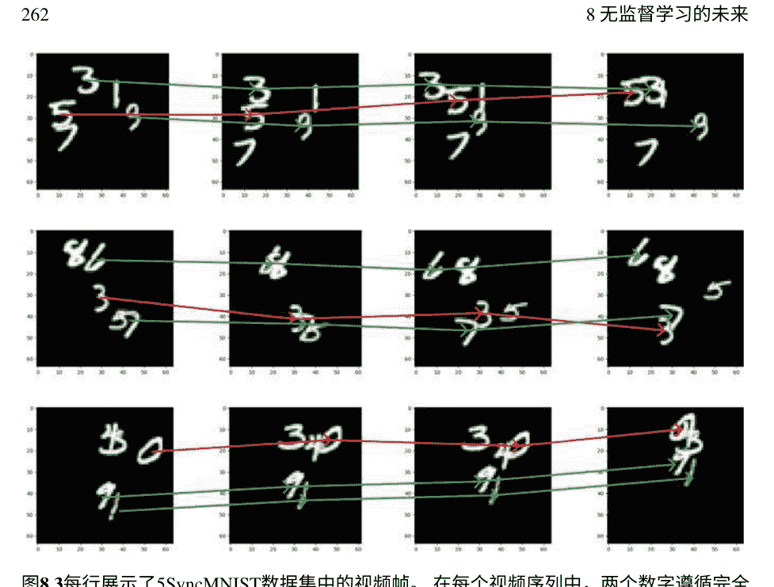

图8.3每行展示了`5SyncMNIST`数据集中的视频帧。在每个视频序列中，两个数字遵循完全相同的运动模式。正确的类别：“3-9”、“6-7”和“9-1”。

计算一种特定模型在时间上的计算。这一方面，结合了事实通过设计在`SyncMNIST`上，时间维度很重要，使得对`SyncMNIST`的测试具有相关性。

- **均值池化 + LSTM**：使用骨干网络进行特征提取，空间均值池化，并使用`LSTM`在时间上进行聚合。该模型能够处理来自不同时间步骤的信息，但对空间信息的理解较差。

- **ConvNet + LSTM**：用卷积层替换均值池化，这些卷积层能够捕捉场景不同部分之间的细微空间关系。因此，它完全能够分析整个视频，无论是在空间上还是在时间上。

- **I3D**：我们改进了`I3D`模型[46]，使用较小的`ResNet` [55]骨干网络以保持参数数量与我们的模型相当。3D卷积能够在空间和时间上捕捉一些较长距离的关系。

- **非局部**：我们使用之前的`I3D`架构作为非局部[35]模型的骨干。我们在第二个残差块中使用一个非局部块获得最佳结果。

表8.1 `SyncMNIST`数据集上的准确率，展示了我们模型不同部分的能力。

| 模型 | 3 SyncMNIST | 5 SyncMNIST |
| :--- | :--- | :--- |
| 均值 + LSTM | 77.0 | – |
| 卷积 + LSTM | 95.0 | 39.7 |
| I3D | – | 90.6 |
| 非局部 | – | 93.5 |
| RSTG: 仅空间 | 61.3 | – |
| RSTG: 仅时间 | 89.7 | – |
| RSTG: 同质 | 95.7 | 58.3 |
| RSTG: 1-temp-stage | 97.0 | 74.1 |
| RSTG: 所有-temp-stages | **98.9** | 94.5 |
| RSTG: 定位所有-temp | – | **97.2** |

### 8.2.3.1 `RSTG`的实现细节

我们的循环神经图模型（`RSTG`）使用初始的三层`CNN`作为骨干，一个具有512个隐藏状态大小的`LSTM`用于时间，以及`RSTG-to-vec`作为聚合。我们使用1×1、2×2和3×3的三个尺度的网格，节点维度为512。我们在`Tensorflow`框架[56]中实现了我们的模型。我们使用交叉熵作为损失函数，并使用`SGD`进行端到端的训练，`Nesterov`动量的值为0.9，学习率从0.0001开始，在性能饱和时按10的倍数递减。

在表8.1中，结果显示`RSTG`比竞争对手更强大。请注意，图模型在基于单个图像的特征上运行，没有在骨干层进行任何时间处理。唯一的时间信息是在更高级别的图节点之间传递的。

### 8.2.3.2 消融研究

## 8.2.3 模型变体与消融研究

解决移动数字任务需要一个能够捕捉空间和时间上的成对相互作用的模型。`RSTG`通过节点之间的空间连接和其状态的时间更新来实现这一点。为了证明每个元素的好处，我们进行了实验证明了每个元素的贡献，并在表8.1中呈现。我们观察到我们的模型在两个版本的`SyncMNIST`数据集之间具有高效的转移能力。当在`3SyncMNIST`上进行预训练时，我们的最佳模型`RSTG-all-temp-stages`在一定步数内达到了其最大性能的90%，而未初始化的模型只能达到其最大性能的17%。

### 仅空间RSTG

我们创建了这个模型以证明具有强大的时间建模的必要性。它在每个帧上执行空间处理阶段，但忽略了时间序列，用平均池替代了循环。时间维度应用于每个节点。正如预期的那样，这个模型获得了最差的结果，因为任务是基于每个数字的移动，这是一种仅通过空间探索无法推断出的信息。

### 仅时间RSTG

该模型仅执行时间处理阶段，节点之间没有任何消息传递。在循环步骤中使用的特征是从骨干神经网络提取的初始特征，该网络以单帧作为输入。

### 同质空时RSTG

该模型允许图在空间和时间上进行交互，但学习在时间和空间中计算消息的`MLP`的相同参数集。因此，时间和空间的计算方式相同。

### 异构时空RSTG

我们为空间和时间阶段开发了不同的调度器。在第一个调度器中，用于`1-temp RSTG`模型，对于每个时间步骤，我们执行三次连续的空间迭代，然后进行一次单独的最终时间更新。第二个调度器，即`all-temp RSTG`模型，在空间和时间阶段之间交替进行（如算法8.1所示）。我们在每个三个空间处理阶段之前使用一个时间处理阶段，并在最后一个时间处理阶段获得最终节点的表示。

### 位置全时空RSTG

这是之前的全时空`RSTG`模型，但在`f_send`函数中使用了位置嵌入，如第8.2.2节所述。这个模型是我们最好和最终的模型，也能够推断实体的全局位置。

## 8.2.4 实验：学习复杂的人-物互动

为了在涉及复杂互动和活动的实际场景中评估我们的方法，我们使用了`Something-Something-v1`数据集[52]。它包含108499个视频，其中86017个用于训练，11522个用于验证，10960个用于测试。它有174个细粒度的人与物体之间的交互类别。它的设计不是通过一些全局上下文或背景来区分类别，而是通过实际的具体交互来区分。

对于这个任务，我们研究了我们的图模型与两个主干网络的性能，一个是基于`ResNet-50`架构的2D卷积网络（`C2D`），另一个是从`ResNet-50`扩展的`I3D`[46]模型。我们首先使用Wang等人提供的在`Kinetics-400`[46]数据集上预训练的主干网络，然后端到端地训练整个模型。

我们分析了我们在第8.2.2.4节中描述的两种聚合类型。对于`RSTG-to-vec`，我们使用`I3D`骨干网络提供的最后一个卷积特征作为输入，得到一个向量表示。为了方便优化过程，我们在`RSTG`中使用残差连接，将图处理的结果添加到骨干网络的池化特征中。对于第二种情况，我们使用将`I3D`的中间特征作为图形的输入，并通过残差连接将它们添加到图形输出中，并继续使用`I3D`模型。为此，我们需要使图形的输入和输出具有相同的维度。因此，我们使用`RSTG-to-map`在每个时间步骤获得一个3D地图。

### 训练和评估

对于训练，我们从每个视频中均匀采样32帧，调整大小使高度为256，保持纵横比，并随机裁剪为224 × 224的剪辑。对于推理，我们在256 × 256的裁剪上应用骨干完全卷积，并从更大的激活图中获取特征。我们在帧的宽度上均匀采样11个正方形剪辑，以覆盖视频的整个空间尺寸，并在时间维度上进行2次采样。我们对剪辑输出进行平均池化以得到最终的预测。

### 结果

我们分析了如何使用我们的图模型来改进`I3D`，通过在骨干网络的不同层应用`RSTG-to-map`，并在最后一个卷积层后应用`RSTG-to-vec`。在所有情况下，该模型都取得了竞争性的结果，最佳性能是在`I3D`的`res3`和`res4`块中使用图表所示的结果。我们在`Something-Something-v1`数据集上与最近的方法进行比较，并在表8.3中展示了结果。在使用2D ConvNet骨干网络的模型中，我们的结果最好（对于Top-1设置，相对于所有使用2D骨干网络的方法，有超过8%的显著改进）。当使用`I3D`骨干网络时，`RSTG`取得了最先进的结果，在所有方法中（Top-1情况下）相对于所有方法有1%的改进，并且相对于相同的3D-`ResNet-50`骨干网络有3.1%的改进（Top-1情况下）。

**表8.2 消融研究显示了将图形放置在`I3D`骨干网络内的位置**

| 模型 | Top-1 | Top-5 |
| :--- | :--- | :--- |
| `RSTG-to-vec` | 47.7 | 77.9 |
| `RSTG-to-map res2` | 46.9 | 76.8 |
| `RSTG-to-map res3` | 47.7 | 77.8 |
| `RSTG-to-map res4` | 48.4 | 78.1 |
| `RSTG-to-map res3-4` | `49.2` | `78.8` |

### 8.2.4.1 结论

在本节中，我们介绍了递归时空图（`RSTG`）神经网络模型，该模型旨在在空间和时间上高效学习。图在每个时间点开始时，从某个骨干网络生成的特征中接收局部时空信息。然后，它通过在不同位置和尺度之间传递空间上的消息以及在时间上进行循环，为每个时空迭代保留不同的过去记忆，逐渐实现全局理解。

我们的模型在处理空间和时间方面在文献中是独特的。

**表8.3 `Something-Something-v1`的Top-1和Top-5准确率**

| 模型 | 骨干网络 | 验证集Top-1 | 验证集Top-5 |
| :--- | :--- | :--- | :--- |
| `C2D` | 2D `ResNet-50` | 31.7 | 64.7 |
| `TRN` [45] | 2D Inception | 34.4 | -- |
| 我们的`C2D + RSTG` | 2D `ResNet-50` | 42.8 | 73.6 |
| `MFNet-C50` [57] | 3D `ResNet-50` | 40.3 | 70.9 |
| `I3D` [36] | 3D `ResNet-50` | 41.6 | 72.2 |
| `NL I3D` [36] | 3D `ResNet-50` | 44.4 | 76.0 |
| `NL I3D + Joint GCN` [36] | 3D `ResNet-50` | 46.1 | 76.8 |
| `ECO Lite-16F` [58] | 2D Inc+3D Res-18 | 42.2 | -- |
| `MFNet-C101` [57] | 3D `ResNet-101` | 43.9 | 73.1 |
| `I3D` [42] | 3D Inception | 45.8 | 76.5 |
| `S3D-G` [42] | 3D Inception | 48.2 | 78.7 |
| 我们的`I3D + RSTG` | 3D `ResNet-50` | `49.2` | `78.8` |

几个主要贡献：（1）它对待空间和时间的方式不同；（2）它将它们分解并在统一的图模型中使用循环连接，计算复杂度相对较低；（3）它灵活且通用，相对容易适应空时域中的各种学习任务；（4）我们的消融研究证明了我们模型的结构和不同组件，该模型在具有挑战性的`Something-Something`数据集上获得了最先进的结果。对于未来的工作，我们计划进一步研究并扩展我们的模型，以处理空时数据中的其他更高级别任务，如语义分割和视觉到语言的翻译。

我们还将研究如何使用和整合`RSTG`图模型，作为视觉故事网络概念的构建块，在我们的书的最后部分呈现。

## 8.3 将事物放在一起

本书所介绍的材料围绕着几个关键思想展开，通过各种实验和计算模型的论证，证明了在现实世界中可以进行无监督学习，只要我们利用多种不同线索、特征和分类器之间的罕见的对齐、共现和一致性。

这样的一致性在随机情况下极不可能发生，当它们发生时，是因为在时空邻近处存在某种视觉类别。在每一章中，我们展示了这个思想如何应用于无监督学习，例如使用更高阶几何约束匹配特征，选择具有辨别力的特征组（它们自身可能很弱，但在组合中更加强大），识别视觉对象类别以及发现和分割图像和视频中的对象。虽然每个解决方案当应用于特定问题时，已经证明是有效的，但我们还没有讨论过在空间和时间中进行无监督学习的统一模型的可能性。我们知道这样的系统是可能的并且已经存在，因为生物大脑可以在几乎完全无监督的方式下轻松学习，以视觉上识别和理解自然界。

在这个最后的部分，我们提出了一个新颖的模型，即视觉故事图神经网络（简称视觉故事网络），灵感来自于早期的概念[59]，该概念基于本书提出的核心思想和模型。视觉故事网络可以从一个总体的角度处理无监督学习。所提出的视觉故事系统旨在通过自我监督的方案利用其多个节点和神经通路之间的共识，在无监督的方式下对视觉场景进行全面的视觉理解。

我们超越概念层面，讨论在实践中使用本书中提出的思想、原则和工具创建“视觉故事网络”的可能性。从前一节介绍的递归图神经网络出发，结合前几章详细介绍的必要计算模型和实验结果，我们现在可以开始想象如何在纯概念和实现层面上创建“视觉故事网络”。在深入细节之前，我们应该首先综合和关联本书中提出的关键思想和结果，这将有助于我们更好地理解这种通用的无监督学习方法可能如何实现。

稍后，在本节中，我们将基于本书中提出的思想，提出一个统一的“视觉故事图神经网络”的观点。在我们进入那一点之前，我们展示了前几章的材料与后续的总体模型之间的关系。

### 8.3.1 几何层面上的协议

在专门解决和学习图形匹配和聚类的前两章中，介绍的方法基于无监督学习中偶然对齐的统计显著性，涉及几何、形状和相对简单的局部外观的较低层次。主要思想是偶然对齐是罕见的。当这种对齐发生时，通常不是偶然的。

存在一个潜在的原因：对象的存在将这样的外观和几何对称性以及对齐组合在一起。因此，形式和外观上的这种一致成为分组的强有力线索，并且可以可靠地用于查找不同图像和相同对象的视图之间的对应关系。在第1、2和3章中，我们提出了用于匹配、聚类和学习的高效算法，如`谱匹配`和`整数投影固定点`方法，充分利用了现实世界数据中对齐的统计信息，并将聚类和匹配的指数级复杂问题转化为可以在实践中高效解决的问题。然后，在第4、5和6章中，我们展示了这些方法如何立即应用于其他形式和任务，如特征选择、分类器学习和视频序列中的物体发现。

### 8.3.2 语义层面上的一致性

在第4章中，我们转向对象类别级别分类器之间更高的一致性。这些一致性不是基于精细的几何对齐，而是基于分类器正向触发的共现。这些分类器被训练为对图像中不同的对象类别的存在做出积极反应。我们展示了在语义层面上无关的分类器与给定类别之间存在正相关性，尽管它们在语义上与训练响应的类别完全不同。例如，在第4章中，图4.1中的预训练分类器对于“火车”类别被一致选择为相关，因为它们与“火车”类别共享共同的外观或上下文特征，即使它们可能完全不同。

然后，在图4.15（第4章）中，我们展示了几个其他有趣的例子。这样的共同激活分类器组可以通过无监督的方式发现，并且通常表示存在一个新的、以前未见过的类别。它们的共同激活通常足够强大和精确，以至于它们的组合可以构成一种基于它们正输出的共现关系的无监督学习的基础，用于学习新的分类器。这种新的分类器实际上是该组的平均输出，我们证明了这个平均值实际上是与第2章和第3章相关的学习任务的最优解。我们展示了无监督学习任务与无监督聚类（第3章）和特征选择的关系，并将`整数投影固定点`方法（`IPFP`）从第2章和第3章调整到这个新任务。

尽管分类器学习的任务与特征匹配的问题（`IPFP`首次引入的问题）明显不同，但它们在第2、3和4章中以非常强大和有趣的方式相互关联。正如第3章中讨论的那样，从数学公式和优化的角度来看，第二章中介绍的方法，即`谱匹配`（`SM`）和`整数投影固定点`（`IPFP`）算法，与第3章中的聚类公式立即相关，其中`IPFP`方法被应用于新的聚类任务。

该任务的公式化非常有趣，因为它在最优解处产生离散解，正好符合聚类问题的需求。`IPFP`的一个强大特性是，虽然它在连续域内进行优化，但它返回所需的离散域中的最优解。然后，第4章中的分类器学习也可以被形式化为一个聚类问题，具有相同的离散解，这将将分类器学习转化为特征选择和分类器集合的学习。

在更高的层面上，特征匹配和分类器学习的共同之处不仅仅是数学公式和方法，还有相互协议的原则：几何对齐（在匹配的情况下）或正类别输出的共现（在分类的情况下）。然后，当这样的协议发生时，它们是强烈的正面特征指示，可以用作无监督系统的后代组件的监督信号。这种在现实世界中发生的不太可能的共现强烈表明了正类的存在，因此我们的无监督学习系统必须捕捉它们并选择它们对应的特征，以便开始学习关于这个新类别的知识。

### 8.3.3 高概率正面 (HPP) 特征

在第5章中，我们推广了从不太可能的一致性中学习的概念，并引入了`高概率正面 (HPP) 特征`的概念。我们展示了这种一致性是`高概率正面 (HPP) 特征`的一种情况，并提出了一种使用这种学习策略在视频序列的时空域中发现对象的方法，通过几个阶段从简单到更强大的分类器逐步增长。第5章还标志着在时空域中利用一致性和连贯性的重要一步。我们还从在视频中决定给定类别的存在或不存在的简单任务（第4章）转向了为视频中的每个帧生成实际对象分割的更细的任务。

我们首先观察到物体在空间中占据相对较小的区域，并显示出独特的颜色分布。换句话说，当非常简单的像素在空间的同一区域中共同出现，并且表示高度可能的正 (HPP) 信号时，通常表示物体的存在。然后，我们可以可靠地使用这些`HPP`模式来发现图像中物体的完整范围并开始学习它。在第5章的第一部分中，我们展示了从简单颜色学习像素级别的能力，当这些颜色表示`HPP`信号时。我们提出了一种简单的算法来发现物体掩模，并为使用`HPP`特征进行学习奠定了直观基础。

在第5章的第二部分中，我们展示了如何通过多次迭代使用`HPP`特征来发现视频序列中前景物体的高质量掩模。我们将我们的方法与文献中的其他方法进行比较，并展示了最先进的结果。通过几次迭代从`HPP`特征中学习的方法如下：首先，我们从一些只能“看到”像素颜色以高精度检测物体区域的非常简单的分类器开始，尽管召回率可能非常低。这与第5章的第一部分中的思想相同。

例如，最初我们只能检测到对象区域的15%，而将其余部分留在背景中。然而，如果初始的15%区域被高精度地检测到（即假阳性率非常低：很少有正标记的像素属于背景），那么我们可以将其用于学习简单的对象和背景颜色分布，将这个小区域视为正样本区域，而将其余部分视为负样本区域。然后，可以利用这些简单的分布来发现对象的更大部分，显著地更好的召回率，同时保持高精度。在下一次迭代中，基于更准确标记为正面或负面的区域，我们可以训练更强大的基于补丁的分类器（而不是基于单个像素），这些分类器输入更多信息（补丁与像素）并且具有更少的训练集错误。第二次迭代模型的输出预计会更准确，因此在第三次迭代中，可以将其用作地面真实值，以训练更强大的分类器：在我们的实验中，我们使用了在分割任务上表现良好的`U-Net`神经网络模型。请注意，每一步我们都应用监督学习技术来实际训练分类器。使该过程成为无监督的不是训练技术（例如，使用梯度下降和反向传播来优化考虑某些标签的分类成本，这些标签实际上是嘈杂的地面真实值）。使该过程成为无监督的是核心监督信号由`HPP`信号而不是人工注释者提供。除了在第一章中介绍的无监督学习中广义使用不太可能的一致性之外，在第5章中，当我们使用`IPFP`以无监督的方式学习基于颜色共现模式的紧凑补丁描述符，以最佳地将前景对象与背景分离时，我们与先前的材料建立了另一个联系。有趣的是看到这些基于图优化的技术（例如，`谱匹配`和`IPFP`），最初是为图匹配（第2章）开发的，如何成功应用于无监督学习中的许多不同任务。另一个这样的案例在第6章中讨论，当使用相同的谱方法通过空间和时间发现以运动和外观模式为簇的对象时。事实是，这些技术通过在图中发现簇来进行优化：簇的含义因任务而异，但是聚类的核心思想（即发现许多实体之间的一致性）在无监督学习的世界中一再出现。

我们进一步发展了在第5章中介绍的学习的基本思想，在第7章中介绍了多个师生代际的学习。在那里，我们详细讨论了这个过程能够自我学习的条件，我们在这里总结如下：

-   (1) 几个分类器的输出必须在空间和时间的局部区域内保持一致；这是分类器共现和几何对齐背后的主要思想；
-   (2) 我们需要有可能以高精度选择几个分类器一致的好质量答案；这些是用作监督信号的`HPP`特征；
-   (3) 然后我们需要在下一代引入更强大的分类器模型，这些模型将在这些选择的`HPP`输出上进行训练；因此，在几代师生的过程中，我们可以从简单到更复杂和更强大的分类器，并且可以不断进化；
-   (4) 在每一代中，我们必须能够访问新的、更大的、潜在更具挑战性的无标签或迭代自标记的训练数据集。这可以足够确保在训练更强大的分类器时避免过拟合的多样性。

分类器进化的本质不仅包括分类器复杂性和泛化能力的进化，还包括能够匹配该复杂性的训练数据的获取。

### 8.3.4 运动模式作为HPP特征

在第6章中，我们开始更多地利用运动的方面，通过考虑视频中像素之间的流动从一个帧到下一个帧。因此，对象可以被看作是像素级别上的运动聚类，也可以通过视频的时空域中的低级或高级特征来看作是外观的聚类。运动被视为外观维度的补充维度：这两个维度捕捉到了世界的独立视角。它们可以达成一致并相互加强，在无监督学习方案中，基于运动模式的预测与基于外观特征的预测一致。在第6章中，我们介绍了一种在空间和时间中发现视频中对象的方法，该方法基于找到与视频相关的特定特征-运动矩阵的特征向量。矩阵中有一个（列，行）元素对应于视频中的一对像素，它对应于空间和时间之间的潜在连接。该矩阵是对称的、半正定的，并表示了一个图的邻接矩阵，其中每个节点对应于视频中的一个像素。它的主特征向量反映了前景对象作为其主要的时空聚类，并完全定义了每个帧中的对象掩码。理论上，矩阵可能很大，但在实践中非常稀疏。它仅在纯概念上、数学上使用，并且从未明确构建。该方法直接访问矩阵的邻接列表（非零元素），而不创建完整的矩阵。最终结果确实是其精确的主特征向量。因此，该算法与谱匹配直接相关，因为它基于相同的幂迭代来计算特征向量。只是矩阵的实际含义不同。

### 8.3.5 多代师生学习

在第2-6章中，我们讨论了基于不太可能的一致性的无监督学习，这些一致性来自不同层次的语义信息（几何匹配与对象类别识别与前景对象分割），并使用不同的线索、特征或分类器。第7章的内容主要关注如何在多代中进行学习，以便学习永远不会真正停止。

如果我们想要开发一个能够自主学习的工作实际系统，那么我们应该有一个能够实现连续学习的解决方案。在第7章中，我们提出了师生范式，它可以在多代中进行学习。在每一代中，我们都有一个由前一代的几个学生组成的教师，这些学生的结构各不相同，并且往往会犯下独立的错误。它们作为一个整体发挥作用，它们的联合输出预计比每个单独的输出更强大。再次看到了从不太可能的一致性中学习的原则，现在是在用于语义对象分割的强大分类器的层面上进行训练。它们的一致性也被用来以无监督的方式训练一个自动选择机制从形成教师的学生集合中过滤出较低质量的输出。因此，只有通过选择器的良好质量分割才成为下一代的监督信号。这些被选择的良好质量分割起到高度可能正样本（`HPP`）样本的作用，因此与第5章的材料有直接联系。贯穿整本书发展的相同思想在工作中得以体现，并使得在多代教师和学生之间实现连续学习的更有雄心的情况成为可能，他们在下一次迭代中成为自己的教师。每一代带来更多多样化和强大的学生，相应地，它接收到更多多样化和具有挑战性的自动教师标记的训练数据。这确保了获取新的更复杂知识并在以前的代际上取得优势和更好的泛化能力的可能性。因此，通过在下一代训练更强大的学生，我们也确保了在之后的一代中拥有更强大的教师，这种循环能够确保持久的师生学习。

#### 8.3.6 视觉故事网络的构建模块

到目前为止介绍的元素，不同的模型和方法的发展，都以相同的关键思想为核心，可以实现更通用的视觉故事模型的创建。我们现在不仅具备理论概念、原则和直觉，还具备实际算法和更实用的解决方案，这些可以为`VSGNN`奠定基础。本章开始时介绍的循环时空图神经网络模型是一个真实的例子，它能够在空间和时间上以最小的人工监督学习识别高级概念。在下一节中，我们将介绍创建统一故事模型的构建模块，这些模块综合了到目前为止讨论的基本思想。

### 8.4 视觉故事图神经网络的黎明

本书中的思想、模型、算法和实验都强烈暗示许多分类器可以相互提供上下文，并共同创建一个更高级别的统一系统，能够自主地从无标签数据中学习 。

这样一个由许多分类器组成的社会，提供上下文并相互加强，可以确保在推理时具有更稳固和强大的性能，因为可以通过多个路径达成共识的可能性 。

多个处理路径也可以在自我监督学习场景中使用，在这种情况下，为了训练单个分类器，监督信号可以来自其余的分类器，这些分类器可以形成其上下文。

正如我们接下来讨论的，它们通过多个路径在一个共同的分类器图中连接得越好，分类器组就越紧凑和和谐，每个分类器都在空间-时间故事的更大背景中具有明确定义的角色。连接性差会带来较少的约束，因为在给定的类别、情况或达到某个结论时，可选择的路径较少。较少的约束会导致更大和更频繁的错误，增加了脆弱性，并降低了自主学习的能力。

### 8.4.1 分类器应高度相互连接

视觉故事网络中的分类器应通过多个处理路径相互连接，以便彼此提供强大的上下文。分类器组应形成一致、连贯和稳健的整体，以便对于每个分类器，其余的分类器提供互补的上下文。

用于解释和解读世界场景的类之间连接越多，相互上下文就越强。这有助于推理和训练。我们希望能够根据其余分类器的输出来预测给定分类器的输出。我们做得越好，分类器之间的一致性就越强。

在推理过程中，我们将拥有一个强大的集合，并在训练时拥有强大而稳健的监督信号。通过这种相互上下文，`VSN`可以为每个分类器提供自我监督标签，对于从上下文分类器到路径上存在强烈一致性的情况。在下一节中，我们将提供具体的细节和示例，讨论潜在的实现方法。

现在我们准备提出我们关于无监督学习的第八个原则，它捕捉到了视觉故事网络的两个关键洞察力之一。虽然这个原则在实践中尚未得到证明，但我们在这里将其陈述出来，因为它构成了我们提出的通用无监督学习概念的基础：

> **第八原则**
>
> 一个通用的无监督学习机需要许多相互补充的场景解释层，这些层应该高度相互连接，以便彼此提供强大的上下文。对于达到给定输出层的任何处理路径，达到相同层的其余路径应该提供足够的`HPP`协议，以获得可接受的稳健监督信号。

### 8.4.2 自适应共振理论的关系

我们提出的无监督学习原则是指系统为了自己学习世界，需要多个处理路径之间的强烈协议，与神经科学中Grossberg经典的自适应共振理论[60-66]相关，该理论将这些协议称为“共振”。关于存在多个处理相同类型的视觉输入和概念的路径的想法（在我们的情况下意味着通过许多神经路径预测世界的同一解释层）也与上世纪50年代Lashley的经典工作[67]相关，他得出结论，记忆和学习分布在大脑中，并且没有一个局部的大脑部分代表与特定记忆相关的处理的痕迹。我们自己的结论，虽然是在七十年后的工程领域中得出的，我们在这个领域创造人工事物而不是研究大脑，似乎与经典神经科学的工作相吻合：视觉概念应该与“大脑”的许多部分相连接，并且它们涉及许多神经网络来预测相同的抽象解释层或概念。此外，Grossberg [66] 还指出，要有意识地看到某物，底层视图（在我们的情况下是局部处理路径）生成的特征和顶层视图（在我们的情况下是来自整体上下文的多个路径）生成的特征之间需要达成一致或共振。Grossberg认为，所有的意识状态都是共振的，换句话说，当看到的时候，这些顶层和底层的视图是和谐的。这些想法也与我们的视觉故事图概念的初始版本[59]相关，当时的计算解决方案较少，实验证据也较少，说明构建这样一个系统是可行的。

如今，有一些工程解决方案实验证明，无监督学习和发现在最大化多个假设或分类器输出的共识或共振方面有很大的好处。然而，这些解决方案专门针对有限的问题领域设计，例如：3D计算机视觉问题[68]、特征选择[69]或视觉到语言的翻译[70]。本书的目标是提出一个相对简单和通用的无监督学习的计算原型，足够完整和现实。我们利用共识，并将其作为自我监督信号，通过多个神经途径相互连接的生态系统中的多个解释层来组合感知、行动和预测的一切。我们的观点是，系统越圆满和全球化，解释层之间的相互连接越多，共识的质量就越高：虽然难以实现，但一旦实现就更强大和更稳健。

### 8.4.3 多层次的解释：深度、运动和含义

世界场景以不同的方式进行解释。我们可以为我们看世界的每一种方式设置一层解释。一层可以在深度和3D几何层面上解释世界。另一层可以在运动层面上解释：相机或物体在场景中的移动方式。其他层可以处理不同层次的解释。例如，这样一层可以将时空场景分割成对象。另一层可以考虑更长时间段，将其分割成不同的区域，不同的活动在其中发生。

我们提出的主要思想（图8.4），与最近的自监督方法一致，是在一个解释层中，可以是低层次（深度或运动）或高层次（语义分割），通过神经网络连接，从预测层输入并输出到第二个预测层。然后，我们可以将这些层视为图中的节点，将连接它们的网络视为边。如果图是强连通的，那么不同层之间将有多条路径。我们还将有多条到达同一层的路径，该层本身将作为输入来预测一个或多个其他层。图连接得越多，我们就可以找到更多的路径以不同的方式连接不同的节点。

例如，我们可以有一条路径，从低级`RGB`层到深度层，然后可以预测运动。深度和运动可以预测分割。另一条路径可以直接从`RGB`到分割。

然后，另一条路径可以从完整图像的语义分割层到仅分割场景中移动物体的层。该层也可以从深度或`RGB`预测。其中任何一个层都可以为更高级别的解释层提供更大范围和时间的输入，例如用于动作或复杂活动的层。通常，我们可以从不同类型的解释层（节点）输入多个层。

然而，每当目标处有一个单独的节点时，就足以实现相互监督学习方案（对于`VSN`本身而言是自我监督的，但对于外部世界而言是无监督的）。空间和时间中的特定片段可能对应于该区域发生的特定活动，例如在该特定空间和时间区域内的每个帧上分割的“两个人一起走路”等特定解释层。

预测性路径也可以从空间和时间的更大背景中向后传播到较低层次的解释。因此，我们可以根据物体的局部外观信息（RGB）来预测物体是什么，这在语义分割中是常见的情况，也可以根据物体在更大的上下文故事（动作或活动）中所扮演的角色来预测物体是什么。几个预测性路径也可以来自物体交互、活动以及声音、语言和抽象思维的领域，以预测特定物体类别在时间和空间中的存在。

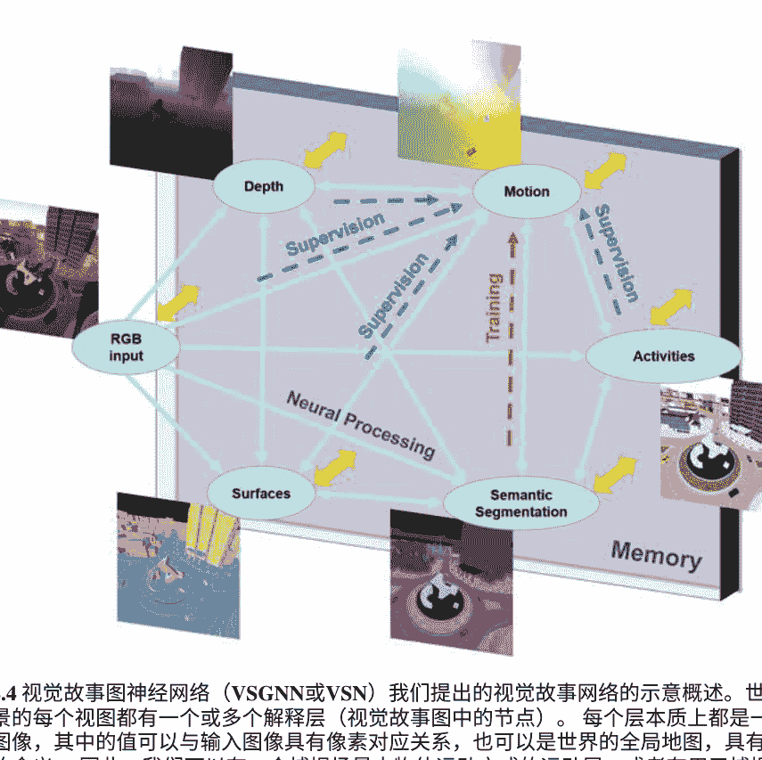

**图8.4** 视觉故事图神经网络（VSGNN或VSN）我们提出的视觉故事网络的示意概述。世界场景的每个视图都有一个或多个解释层（视觉故事图中的节点）。每个层本质上都是一张图像，其中的值可以与输入图像具有像素对应关系，也可以是世界的全局地图，具有特定的含义。因此，我们可以有一个捕捉场景中物体运动方式的运动层，或者有用于捕捉不同物体或类别的更高级语义分割的层。

我们还可以有一些层来捕捉空间和时间上的相互作用和活动，使得图像中的每个像素都被赋予复杂的活动或简单的动作标签。我们的想法是，这些层应该在可能的情况下学会相互预测，通过由边表示的深度神经通路。因此，许多来自不同来源的通路总是到达一个单一的节点。然后，通过一种相互监督的方法，无监督学习将变得可能，其中每个定向边（可以由深度神经网络建模——这里用红色虚线箭头表示的是一个示例）在终节点接收来自其他到达相同节点的通路的预测作为监督信号（用绿色虚线箭头表示）——但仅当这些预测高度可能是正确的时候（HPP情况）。这种学习方式将鼓励共识，减少噪音波动，并且总体上提高泛化能力和鲁棒性。它还将使得无监督学习（或者在最小监督下）成为可能。请注意，图中只显示了很少的可能的解释层（节点）。例如，一个生物“大脑”可能有成千上万个这样的层，并且可能包括更抽象的处理和自然语言描述。还要注意，每个节点都可以访问内存，因此内存状态也可以参与提供监督信号。如果需要的话，内存状态也可以通过类似的过程进行重新训练和更新。

例如，在外观的较低层次上，我知道路上有一辆车因为有一个看起来完全像一辆车的物体。同时，在语义解释的较高层次上，我也知道路上有一辆车因为我知道我正在观看一场赛车。而且，我还知道那里一定有一辆车因为坐在我旁边的朋友刚刚告诉我看“那辆车有多快。”然后，我也知道在路上的那个特定位置上有一辆车，因为我知道在那个邻居的地方，不到一秒钟之前有一辆车，并且根据它的预测运动，它现在应该在那个新位置上。

正如我们所看到的，在空间和时间的不同尺度上存在着几个层次的解释以及不同层次的语义，对于给定的图像，它们可以同时存在。此外，如果我们想要获得一致的场景理解，它们应该是一致的。如前所述，每个层次可以被看作是图中的一个节点在任意两个节点之间可以有多个活动路径。因此，包含静态语义区域、深度、运动层、移动物体层或包含特定活动发生的区域的层次可以相互连接以便每条路径上都有预测处理和信息传递。

我们可以想象如何对所有这些进行建模和实现。例如，解释层可以是二进制图像表示或软特征图，具有不同的含义和与输入图像相同的大小。它们将表示图的节点。然后，两个节点之间的有向边可以被建模为一个神经网络，该网络以源层（节点）作为输入并预测其他目标层。我们还可以有记忆节点，通过学习保留先前状态，这些状态也可以作为源或目标（如果我们希望基于当前解释重新解释过去）。

让我们考虑这样一种情况，我们有运动层（描述物体在接下来的几秒内如何移动的轨迹），语义分割层（每个分割对象属于哪个类别），深度层（捕捉场景的三维结构），相机运动层，活动的语义层（场景中物体的行为），当然还有RGB输入。我们可以立即想象如何在这组层之间形成边缘（或超边缘），使得一个或多个层可以预测另一个层。注意，一个层包含了空间和时间信息，这可以通过具有循环连接的记忆状态（节点）来捕捉。例如，从RGB层，我们可以通过直接连接原则预测所有其他层。我们还可以形成从深度预测运动的链接，反之亦然，从过去的深度和运动预测当前的深度。我们还可以从RGB通道返回并从深度、运动和过去的RGB预测它。活动层也可以直接从RGB预测，或者从考虑物理属性（如深度和运动）或语义信息（如分割层）的其他层预测。活动层本身也可以作为源来预测分割甚至深度和运动。

请注意，这些路径都没有完美的信心或准确性。然而，这些路径在预测能力方面形成了一个非常强大的图形。当几条这样的路径在一个节点上相遇并达成一致时，它们很可能是正确的。它们一起完整地描述了世界的所有视角，无论是在局部（`RGB`和局部对象）还是在更全局的空间和时间上（复杂活动），都使其能够产生一致的预测沿着多个路径。

## 8.4.4 局部对象及其在故事中的全局角色

这种一致性使得图形能够代表我们所称的完整的视觉故事，不同的角色在局部具有特定的外观，并在空间和时间上扮演更全局的角色。然后，基于外观的局部路径应该与考虑了更复杂的时空相互作用的全局路径达成一致，以确定角色的身份。角色将在许多不同的解释层次上出现，从考虑外观的局部层次到捕捉动作和局部行为的中层次，再到根据故事中的角色解释角色的高层次。这些层次之间应该有很强的相关性，以便系统能够从许多不同的其他层次的子群中预测任何层次。

下一代分类器应该在局部预测上下文全局预测：我们的初始`VSN`模型基于不同的解释层，这些层被实现为激活图，或者是表示输入图像本身的语义分割，或者是表示世界地图相对于全局或局部坐标系的语义分割。我们认为语义分割范式可以应用于大多数视觉识别问题，并且可以表示几乎任何涉及“什么”（语义类别）和“在哪里”（在某个空间中的位置值，不一定与输入图像本身相关）的任务的输出。`VSN`将包含许多这样的解释层，并且将有许多不同的网络和分析系统能够从许多不同的输入源预测一个层。在我们看来，上下文的概念是相对于给定的分类器（处理路径）的，并且指的是所有其他能够（在一定的误差范围内）预测我们给定分类器的输出解释层的路径。因此，如果一个特定的分类器在空间和时间上更局部（它只能访问局部或有限的信息 - 大多数分类器都属于这种类型，因为它们在空间和时间上本质上具有有限的感受野），它的上下文就是全局的，因为它包括使用全局信息来产生相同输出层的所有其他内容。如前所述，在我们的`VSN`中，所有的分类器都是相互连接的，并且旨在能够识别世界模型中的所有内容。

如上所述，这个上下文在空间和时间上是一个强大的资源。在那个层次上，上下文提供了故事和与物体相关的局部分类器在这个故事中扮演的角色。我们想要的是能够从空间和时间上的局部外观和行为中预测一个特定对象在整体故事中扮演的角色，例如，它是一辆送孩子上学的公交车吗？还是一个放映电影的建筑物，或者是一个邮递员？我们对局部分类器要求很高，我们希望下一代分类器能够从有限的时空信息中找出最适合整体故事背景的类别。

## 8.4.5 视觉故事网络中的无监督学习

`VSN`中的初始节点（层）可以从一开始就定义。也可以进行最少量的监督训练，以初始化构成`VSN`边缘的网络。在预训练的开始阶段需要决定所需的监督程度，需要进行足够的实验和验证。然而，现在的第一个问题是如何以无监督的方式继续学习过程。我们认为这可以通过自我训练的方式来完成，从网络作为一群相互提供监督上下文的分类器的角度来看。然而，从外部来看，这是一种无监督学习的情况，其中时空数据通过网络传递，并由每一层依次解释。大多数层应该有从输入`RGB`到输出的直接路径。直接路径也可以具有记忆，并且可以使用各种架构来实现，类似或相同于本章前面介绍的循环图神经网络。我们希望一个适用于层与层之间转换（例如，`RGB`到语义分割）的神经网络，对此`U-Net`非常有效。我们还想添加记忆节点和循环链接，以利用空间和时间的连续性。

一旦激活解释层，它们开始通过不同的路径发送预测性信息，以便每个路径都可以预测相应的输出层，即路径末端的层。很明显，当网络尚未完全训练时，会有很多次这样的预测会相互矛盾。然后，我们可以通过从输出到输入的路径传递梯度，并冻结其他所有内容，并使用其他上下文路径中的信息流作为监督信号来训练每个路径。

此时，我们应该清楚，实际上我们正在使用本书中展示的所有主要思想，例如使用第5章的`HPP`信号进行学习（仅使用强烈一致的上下文输出作为监督信号），使用学生路径的集合作为教师（由几个学生路径形成的上下文教师）及其一致性作为选择（第7章），以及使用明显非常不同和不相关的类作为其他类的上下文（参见第4章）。第6章的材料可以用来提供构建运动层的方法，其中对象以无监督的方式作为其时空邻域中的强簇被发现。本章开始介绍的循环时空图神经网络（`RSGT`）还可以提供关于如何将神经网络与图处理相结合以及如何在空间和时间上的不同尺度之间以及当前节点和记忆节点之间传递消息的思路。循环时空图神经网络可以成为连接不同解释层的构建模块，也可以直接将`RGB`与特定的解释层相关联。

## 8.4.6 学习多代演化

# 视觉故事网络的演化与学习

## 8.4.7 学习新类别

视觉故事网络可以通过为每个现有类别添加新的和更强大的路径（神经网络）来随着时间的推移迭代演化，以更好地预测和概括其余路径的共识。例如，就像第7章中的情况一样，更强大的网络可以随着时间的推移从更少的数据中预测出空间和时间中更大数据块的图形输出。最终结果将是增加的预测准确性以及更平滑和一致的图形行为，减少噪音波动。可以证明，通过使用多个路径作为视觉故事图中单个边缘的监督信号，将导致输出方差的减少。这是因为整个图形中朝特定层的路径的预期输出被用作单个单边路径的基本事实。因此，任何边缘的单个输出与预期输出之间的差异（用其余上下文的输出近似）将减少，这意味着（几乎是定义上的）方差预计会减少。

预计这个事实将导致学习更强大、波动更小、整体更智能的神经故事图。

每当存在不太可能的对齐和共现，而这些对齐和共现不立即与已知类别或类别相关联时，新类别和新层将作为潜在候选选项添加到图中。例如，如果几个层在时间和空间上的给定区域产生正输出（激活），并且没有与该激活相关联的类别（与现有解释层相关联），我们将为该激活添加一个新的候选层和一个关联的“匿名”候选类别。

给予类别的名称并不重要，重要的是该类别将为自己接收一个候选层，该层与其他层之间有新的路径，并且与`RGB`输入之间有直接链接。因此，该层将与其他层一起参与上下文预测的游戏：它将尝试预测其他层，并且也会被其他层预测和从其他层的共识中学习。

然而，“新类别”只会被视为候选类别。它的“真实存在”和“有用性”将会被一段时间监测。一个新的类别（或者旧类别）的性能应该是它帮助预测和被其他类别预测的能力。通过这种方式，它可以参与改善图表的一致性和平滑行为。如果一个类别从它的局部和全局路径中得到了很好的预测（如果多个路径之间有很大的一致性来预测它），那么那些一致的路径将提高`VSN`中的整体一致性。这自动降低了由噪声引起的整体预测的方差。整体输出的方差减少也将减少与这些错误相关的成本（例如能源、时间、安全等方面的成本）。理想情况下，我们希望不同路径之间的分歧出现在正确的时间，当需要学习新知识时。这种分歧和惊喜对于学习新事物并朝着不同的平衡点前进是健康和绝对必要的。

共识本身成为一种奖励，因为它在实践中带来了许多真正的好处，使得强大的推理和无监督学习成为可能。它是视觉故事世界中的一种普遍奖励，因为它适用于整个视觉故事图的功能和学习，而不仅仅适用于特定的类别或情况。共识并不容易获得，特别是当不同的路径使用彼此非常不同的信息类型时，例如颜色外观、深度、运动，以及最终连接语义含义的许多可能复杂的方式。虽然语义层可能更加主观，并属于图的更深层次，但颜色外观、运动和深度的较低层次更加“物理”，可以直接来自外部世界。在这些较低层次的错误可能非常昂贵，这些错误可以并且应该进行定量测量和评估。

## 8.5 视觉故事走向语言和更多

时空世界的实体可以以双重方式看待：每个实体可以使用其自身的局部时空信息进行预测和解释，这些信息主要属于其物理存在、运动和即时行动。例如，汽车可以仅基于来自其像素的颜色（外观）信息来识别。同时，语义实体可以基于其在更大故事中扮演的角色来识别。对于汽车而言，其角色可能包括将人们从一个地点运送到另一个地点，驾驶在可识别的道路上，遵循特定的交通规则，经过几个地标性的地方，并且通常由一个人驾驶。有趣的是，需要注意的是，当我们在字典中寻找“单词”或“实体”的定义时，通常会找到它在更大背景中所扮演的角色。这个角色比对象的外观或实体的物理形态更具有意义。然而，所有的信息，无论是来自外观的局部层面，还是来自在更大故事中所扮演的角色以及其在空间和时间中的路径，都定义了那辆汽车并赋予了它意义。这些完整的信息告诉我们汽车的功能、目的、使用者、何时何地以及如何使用、它是如何产生的、它的外观、谁设计并制造它、迄今为止谁拥有它、它来自哪里以及它去哪里。需要注意的是，对于这些问题的答案只是视觉故事网络中不同处理路径上的目的地，它们相互输入以达成共识并构建一个连贯的关于那辆汽车的故事。

“那辆车”只是一个非常简单的例子。视觉故事图中的实体可能属于更高级别的类别，并在整个故事中扮演更复杂的角色。但让我们看看“故事”是什么，以及在视觉故事图中“角色”是什么？

实体在其关联的解释层上的角色是由来自更高或更低层次的解释在空间和时间上的多个路径所定义，并就该实体达成共识。它还包括从该实体开始并就其他解释层上的其他实体达成共识的路径。实体连同其所有的传入和传出路径，这些路径达成一致，完全描述了实体在视觉故事网络中的外观、运动、物理属性、互动和更高级别的复杂活动中所扮演的连贯角色。然后，整个故事是在视觉故事网络中达成共识的这些角色的总体。换句话说，如果角色是一个在空间和时间上与其他连接和节点达成共识的节点，那么故事就是在其中所有节点和连接都达成一致的最大子图。

例如，如果一个层次说今天早上约翰要去工作通过一条路径，它也应该通过另一条路径说同样的事情。一个可能更加局部，并完全由约翰在那天早上所走的路径来描述。另一个可以由更大的上下文定义，其中可能包括约翰的日常习惯和当天安排的具体任务，或者他在那天早上说的话，或者他收到的短信。无论在图中采取的路径是什么，他去上班的事实都应该是清楚的，并且该知识在空间和时间上的整体故事中与所有传入和传出的路径达成共识，这是该知识在整体故事中的作用。我们可以立即看到，一旦这个陈述今天早上约翰去上班（它本身可以在专门用于此类活动的解释层上表示）被接受为真实，它立即成为更低级别分类器的上下文，这些分类器应该识别实体，如“人”，“约翰”，“走”，“去上班”，“工作”。与此同时，这些更原子的分类器反过来又在决定“约翰确实去上班”在更大的画面中的重要性。

现在这些信息可以通过其他更复杂的路径传递，以便于更大范围的网络，甚至超越视觉，对世界进行全面的理解和更抽象的推理。例如，它可以用来弄清楚约翰不在家，因为他去上班。我们还可以用它来推断约翰很快就要上班了，所以如果我们想和他说话，我们应该去那里找他。同时，如果约翰在早上没有到达上班地点，这应该是令人惊讶的，即使他确实朝着上班的方向前进。从这个令人惊讶的发现中，实际上代表了一些路径之间的分歧，我们可以学到以前不知道的新东西。例如，我们可以了解到约翰在上班的路上遇到了一个他不认识的老朋友，多年来我们都没有见面，今天休假打高尔夫球。这可能是我们第一次知道约翰喜欢打高尔夫球。我们看到，几乎察觉不到，我们从视觉到逻辑推理和语言的转变，通过许多不同的渠道试图将碎片拼凑在一起。

再次强调，共识将一切整合在一起，创造出一个稳定、坚实且统一的世界观或故事。在这个故事中，所有的角色、行动和地点都尽可能地相互连接，以形成一个整体。这个统一的视角是绘制在一个单一的圆顶上的，在这个圆顶上，所有的实体都能在空间和时间中找到自己的位置。当一个人移动、改变或做某事时，其他人就会注意并可能受到影响。当一个新的实体进入时，会腾出更多的空间，圆顶变得更大，并添加更多的连接，这可能增加复杂性，但也可能通过加强协议和消除噪音来简化。

同样可以肯定的是，沿着已建立的路径产生的分歧带来了学习新事物和适应不断变化的世界的可能性，通过相应地改变沿着这些路径的权重以达到期望的协议。未来基本上是未知的，因此在更复杂的路径和上下文中预测的结果与局部时空层面上所看到的结果之间总会存在一些不一致性。

空间和时间中的视觉故事网络也揭示了语言的需求，这是超越此处和此刻所见的故事表达方式。故事更多地关乎上下文，将局部的碎片组合在一起，而不是关乎空间和时间中的单个特定碎片。它更多地关乎演员扮演的角色，而不是他们的外貌。许多人工智能研究人员都在思考“什么是上下文？”。在视觉故事网络中，与给定演员相关的上下文是指与该演员有关的外部因素——预测其外观和行为的一切，以及受其影响并可被其预测的一切。

语言可以以连贯的形式表达这样一个视觉故事图的内容，以特定的问题或目标为条件。语言不需要说出一切，整个故事，但它所说的应该是有意义且连贯的。它应该在空间和时间中“穿越”至少一些路径，以在图中达成共识。

重要的方面是语言并不一定谈论我们现在和这里所看到的，而更多地关于我们现在和这里所看到的东西如何在整体故事中有意义，并且如何与其他解释层次相连接——这些层次可能在更高层次的语义和抽象上，并且与当前的物理世界联系较少。因此，从这个角度来看，我们可以期望语言描述的世界并不总是真实的，或者并不一定准确。毫不奇怪，每个人对于一个情境或一系列事件可能有不同的故事。故事更多地涉及到更深层次的图层，而不是来自传感器的较低层次的图层。然而，只有通过在更深层次之间达成协议，考虑到更大的空间和时间块，并以更语义化和有意义的方式解释世界，我们才能预测并在我们在这里看到、现在测量的层面上找到协议。

### 8.5.1 从语言中学习

视觉和语言之间显然存在着非常紧密的联系。这两者密切相关，但是它们的交叉研究仍处于初级阶段。正如我们迄今所讨论的，很明显视觉不仅仅是关于场景中可见的物体。视觉在空间和时间上创造了一个连贯的关于世界的故事，其中包括不仅是物体本身，还有它们的相互作用，以及它们在较短或较长时间内的活动。知觉和抽象思维之间的联系非常微妙，事实上，它们可能是同一事物的两个方面，因为每一个有意识的思想都是在与其他感知相联系的情况下被感知和理解的。

在公园里，我看到一群人在谈论梅西几乎神奇地过掉了三个对手并打进了一个壮丽的进球，我们看到那些人的那一刻实际上会想象梅西如何打进了那个进球。这将是不同层次的感知，涉及到物体、相互作用和事件，一个完整的故事，不仅仅是由实时视觉和声音输入构成，事实上，更多地是由我们复活的记忆和过去的经验构成。它们将被整合成一个连贯的视觉和感知故事，然后我们会用语言向他人描述。在这里非常有趣和最重要的是，几乎没有真正的障碍将我们当时看到的（人们）和我们的解释（谈论一场比赛）以及故事构建（事件发生了什么）分开。从心理学的角度来看，物理对象和语义思维之间的过渡是如此渐进和微妙，以至于它们可能只是同一类型的事物。当我们仔细听别人说话或者我们自己说话时，我们很快就会意识到，在我们的语言中，描述物理世界和解释世界以及其他人的思想之间没有明确的界限。语言和视觉之间有着非常深刻的联系，它们似乎被组合在一起，以创造一个关于世界的连贯故事，旨在讲述真相，但往往由于缺乏强有力的证据，它在连贯性方面比准确性更好。

在图8.5a中，我们展示了一个室外场景中的人物图像，包括三个孩子和一个成年人。看起来很容易看出图像中有哪些物体，它们在哪里，以及它们可能在做什么。至少在物体的物理层面上，事情应该是非常清楚的。然而，仔细观察（图8.6），我们注意到实际上，如果我们只能从它们的边界框内部获取信息，我们无法看到较小的物体。这应该让人感到惊讶，因为它们在图像中明显可见。这个例子再次证明了我们的观点，即上下文在视觉中起着核心作用，局部和全局处理必须共同达成共识，我们才能真正“看到”。基本上，场景中的每个物体都在通过其在虚拟空间和时间中的相互作用和活动来传达信息。所有这些场景的视图，所有的物体、动作和相互作用都试图预测彼此，以获得一个连贯的故事。只有在我们的思维在足够多的路径之间达成共识之后，我们才会下意识地决定看到。

## What does it mean to “see” in this image?

- Tell what and where things are in the image

- Know what objects do and how they interact

- Infer what happened in the near past and predict the immediate future. What is going to happen next?

- Describe in a short story about what happens in the image


图8.5 “看到”意味着什么？当我们看一张图片时，我们想知道所有物体的位置和内容，他们在做什么，推断出过去发生了什么，并预测未来会发生什么。我们在脑海中构建一个连贯的故事，描述事物的发生方式，以使所有思维路径达成一致。

思维的语言进一步尝试将在空间和时间中看到的物理世界组合起来，构建一个关于事件的连贯故事（其中大部分只是想象），以提供对空间和时间中发生的事情的合理和可能的解释。然后，书面或口头语言只是反映了思维的语言，以不同层次的语义抽象结合感知、逻辑连接、识别和想象，作为简明、准确和连贯的表达。

为了证明这一点，我们向布加勒斯特理工大学的人工智能硕士学生展示了图8.5中的图片，并要求他们描述它。我们给他们五分钟的时间来写出他们在图像中看到的内容，没有给他们任何其他的指示。描述如下，在灰色框中显示。我们立即注意到，虽然所有的描述在高层次上都是合理的并且一致，但在涉及不同具体方面时，如关于成年人（红色显示）的问题、儿童的活动（蓝色显示）或一天的时间（绿色显示），它们也存在显著差异。

此外，描述通常包含有关演员说话甚至思考的细节（以粉色显示）。

### A. Many objects cannot be recognized by their local appearance alone

### B. Often, to “see” objects we need their context


图8.6 A我们展示了包含场景中不同对象周围边界框的补丁。请注意，它们不仅仅是通过其边界框内的视觉信息来识别的，即使当它们放在图像的上下文中时，它们也能很好地被看到（B）。这再次证明了我们的观点，即本地和全局信息和处理沿着多个路径相结合，达成共识并形成一个在语义层面上既能看到又能理解的世界场景图像。由于看的行为很大程度上取决于先前学到的经验，如果不同的人在他们的思维中创造出不同的连贯故事，那就不足为奇了。

视觉与语言之间：在这里，我们展示了八位人工智能专业的硕士学生给出的图像描述，用自然语言表达，他们的年龄和背景相似：

学生A：一位女士教一些孩子如何准备第二天的食物。他们都准备在帐篷里过夜。看起来孩子们在一个营地里，他们在那里学习如何在大自然中生存。

学生B：一组4个人在森林中，湖岸边。我相信这是一家人在度假或旅行。父亲向其他人展示如何在烧烤架上烹饪，他们看着并对他的做法发表意见。

学生C：一家人在野营。这个家庭有3个孩子和一个母亲。他们在湖边的森林里。由于日落时的阳光，森林看起来发红。母亲在准备吃的东西时，孩子们看着她。他们旁边有一个帐篷。

学生D：这幅图像代表了森林的自然风景。一个成年的金发高加索女性为3个不同年龄和种族的孩子准备烧烤。他们在湖边露营，在下午的阳光下。天气似乎很温暖，可能是夏天。

学生E：这幅图像描绘了一个没有云的天空中黎明时分的宁静氛围。

学生F：照片是夏天中间的湖边营地场景。根据太阳的位置判断，现在是下午，人物很可能在准备饭菜。

学生G：一个家庭正在露营。这个家庭有3个孩子和一个母亲。他们在一个靠近湖泊的森林里。由于夕阳的缘故，森林看起来有点红色。

学生H：一个有3个孩子的家庭，或者只是一个母亲和三个孩子，在湖/河边的大自然中过了一夜，带着帐篷。现在，他们已经醒了一段时间，正在烧烤架上烹饪一些东西。母亲教孩子们如何照顾烧烤。同时，她教他们欣赏一切发生的事情…燃烧的木头的香味，围绕着他们的美丽光芒。我们有4个人，一个帐篷，一个烧烤架，杉树，水，食物，烧烤用具。

## 8.5.2 惊喜的无监督学习

在一个和往常一样的日子里，各种演员和物体都在场景中，并且做着他们应该做的事情。场景看起来和往常一样：阳光明媚的繁忙街道上，人来人往，汽车在交通中找到自己的道路。每个人似乎都在走他们平常的路线。但是在一个不太引人注意的地方，发生了一些新的事情。实际上，如果我们足够仔细地观察，到处都会有一些新的事情发生。场景并不完全符合预期，人们的行为也不是那么可预测。到处都有一些意外的事情。每个角落后面都有一个小小的惊喜，世界再次展示出它真实的面貌，再次变得新奇而且不完全可预测。

然而，通过其多个活动路径，视觉故事图并不容易被欺骗。通过其多层次的解释和针对利用共识进行优化的强大设计，它能够在出现新类型的对象或动作时找到它们。因此，非常强大的上下文，由于其多个处理路径，提供了正确的监督信号。如果在街上出现了一种新的未见过的汽车型号，全局上下文毫不含糊地将其识别为一辆汽车，并将新的并且最初未被识别的局部外观视为新的训练案例。这可能是一个非常有趣的训练案例，一个难以处理的案例，需要分配新的学习资源。紧接着，在公园的中间，一群人表演了一种特定的动作模式，这种模式根本没有被识别出来，甚至连它的上下文也没有。它只被识别为一群人在做某事，但不是一种具体的活动、仪式、舞蹈或运动。有很多分类器同时触发，很不可能什么新的事情都没有发生。HPP特征检测器正正常运行，并将捕捉到这种模式，为其分配一个新的潜在候选类别。目前还不完全清楚，人们以某种方式移动和行为的模式是否确实是一个将再次出现的新类别。它可能只是一种随机的动作模式或者是那些人刚刚在现场设计并玩的一种特别游戏。然而，这个模式现在有了它分配的新类别和解释层，与最初触发它的所有当前局部或全局上下文分类器相关联。现在看到的几个实例被用来学习它与其上下文之间的初始路径。然而，没有人知道这个模式以后是否会被识别，是否会再次出现。

类似于思维的视觉故事（VSN）系统甚至可能不会过多关注一个新类别的诞生，直到再次看到它。许多这样的新候选类别可能会诞生，然后随着再次看不到而消失。从类似于思维的VSN的角度来看，学习过程始终是一种有监督的形式，一种自我监督的形式，其中多个路径的上下文是学习的教师。从外部世界的角度来看，系统始终是无监督的，因为它无法预测数据的到来方式和新类别的诞生时间。只有通过对分组和罕见对齐和共现的观察，系统才能捕捉到可能存在的新的未知实体。而这些信息完全来自外部，完全取决于大自然。从这个角度来看，系统及其世界应该处于

如果系统想要有任何生存的机会，它需要足够擅长自我监督，以应对真正不可预测的、全新的类别和情况的出现。它需要利用所有潜在资源来检测分组和对齐，以在新颖的情况下保持平衡。为此，它需要尽快学习许多潜在的新类别，其中大部分将被简单地视为噪音而被丢弃。然而，其他一些类别对于保持被识别并加强对世界的理解以及改善平衡至关重要。

我们现在陈述无监督学习的第九个原则，它涉及系统从不同观点中学习的能力。

> > 第九原则

> 通过在不同路径上的分歧，视觉故事网络将获得根本性的新知识，但只有在其他路径上仍然存在足够的一致性，以维持其在空间和时间上的平衡状态时才能实现。

平衡状态是指系统仍然在足够多的解释层上达成一致，以便将新类别（层）与处于平衡（一致）状态的类别连接起来。如果没有在其他层上的一致性，新类别就无法与旧类别相连，并且无法根据我们的上下文监督方案在时间上进行学习和维持。

## 8.5.3 发现自身

随着系统发现新类别，它很快会发现存在一种完全不同类型的独特新类别。当机器人系统观察但也能够在世界中移动和行动时，它很快会了解到自己存在的可能性，这将像之前学习的其他新类别一样，作为一个新类别出现。由于它可以自行移动和行动，观察将直接与它自己的行动和移动相关联。这些观察、解释和行动之间的一致性将立即触发一致性和共现，并标记为HPP信号，并触发一个新的候选类别的创建，即自身的类别。请注意，在下面的段落中，“自我”和“我”这些词是以符号形式使用的，仅用于表示那个特殊的、学习到的新类别，它对应于系统自身的存在。

现在它已经发现并学习了自己的存在，并且在其不同的路径之间倾向于保持一致，系统自然会倾向于看到、理解、规划和行动，以保持“自我”类别的强大和与其他类别的一致。很快就会清楚地看到，这个“类别”在系统中起着核心作用，对于维持整个视觉故事的一致性和协调功能至关重要。没有类别，没有实体，世界上没有解释层，没有行动或语义理解不依赖于“自我”类别。保护和保护这个类别将保护所有其他类别，并再次改善共识，这是系统设计的目标（根据无监督学习原则）。如果系统最终学会了最佳的生存方式，以保护“自我”类别，从而在空间和时间上维护视觉故事网络中的一般共识，这将是完全意料之外的。

在这个观点中，生存成为优化结构内共识的一种高效方式，在这个结构中，“自我”类成为核心，其他所有类都依赖于它。这个类的主要作用是参与预测其他所有类，并被它们预测：我采取这个行动，因此世界将以预期的方式发生变化，因此我将继续存在。或者，如果我采取另一个行动，世界将以另一种方式发生变化，那么我可能不再存在。保持“我”类的存在成为首要任务，因为很快就会清楚，保持“我存在”的共识在尽可能多的路径上达成强烈一致是维持共识的最佳方式。如果空间和时间上的共识是首要任务，那么“我存在”也是同样重要的。然而，最终系统将需要其他所有类和世界来预测自己的存在。它还需要自己的存在来预测世界。很快就会清楚，这与“我”以及世界中其他可见类别一样重要。对于共识的同样普遍需求将驱使它朝着进化最智能的方式发展，通过解释和行动的层次来实现和维持更好的共识，以实现更加平稳和持久的存在。

有时，为了达到与当前对世界的理解相关的临时共识，系统可能会损害一个尚未被理解的更全局的共识。随着知识的扩展，系统可以对过去的行动进行自我反思，以提高对长期共识和平衡的预期，即对“我”和外部世界的最佳预测。它还会通过试错来学习。然而，它的试验并不是随机的，而是从代表其与外部世界关系的当前最佳理解的分布中抽取的。

我们现在准备提出我们的无监督学习的最终原则：

> > **原则10**

> 只有当允许改变世界的行动时，视觉故事网络才能变得自我意识（学习一个新的等同于“我存在”的类）。因此，它自己的决策将导致观察到的外部世界的变化，并构成通向最终达到“我存在”层的路径的输入，在这个层中，可以赋予新的“我存在”类与世界相关的不同语义属性（例如姿势）。这个类在维持随时间的共识方面起着核心作用，它连接了行动和它们的后果（观察）。

## 8.5.4 明天的梦想

我们在第一章中开始了本书的故事，提出了几个我们认为是创建工作的、真实世界的无监督学习系统的关键思想。然后，在接下来的章节中，我们展示了这些思想的运作方式。我们将它们应用于各种任务，并提出了不同的解决方案。我们为每个问题和每个算法提供了广泛的实验验证，并展示了它们在更高层次上的关系，以及如何将它们用于想象一个统一的无监督学习模型。

在最后一章中，我们展示了本书中讨论的两种主要计算方法，即图模型和神经网络如何有效地结合成一个递归图神经网络，以在空间和时间上学习理解高语义级别的数据。

然后，在最后一部分中，我们冒险进入未知的未来世界，并在我们的想象中创造了一个雄心勃勃的视觉故事网络，同时深深扎根于迄今为止呈现的关键原则和模型，如果我们能使VSN系统成为可能，那么它将迅速超越视觉的范畴，在获得对周围世界的全面和连贯理解方面具有重要意义。如果我们进一步为VSN配备感知、移动和行动的机器人能力，它很快就会发现新的“自我”类，并自然地发展出对生存的需求（例如，始终预测“我存在”类），以保持所有其他类的整体共识，自我起着核心作用。然而，“自我”类的重要性将由其他类很好地平衡，因为“自我”的存在将取决于来自其他类的共识。因此，它们最终都依赖于与外部世界的互动。

虽然系统是自我训练和自我中心的，从自己的观点来看，但它仍然是无监督的，并且强烈依赖来自外部更大背景的时空数据。

虽然我们越过科学的边界，进入没有明确实验证明视觉故事网络可行性的虚构领域，但我们认为只有通过虚构和想象，我们才能最终从梦想开始，然后实现它。随着人工智能领域的快速发展，虚构和科学之间的界限将越来越频繁地被跨越，因为虚构变成科学，然后科学成为虚构的下一个起点。

作为研究人员、科学家和工程师，我们应该做好准备，准备好梦想和行动。现在，比历史上任何时候都更加适合拥有一个愿景：想象这些碎片，以一种连贯的方式将它们组合起来，然后使之成为现实。就我们自己的知识而言，我们也是自我监督的，但对外部世界而言，我们基本上是无监督的。因此，我们也应该通过尽可能多的途径寻求共识，以便成功实现我们的梦想。

## 参考文献

1. Maurer D, Lewis TL (2018) 视觉系统。 在：大脑和行为发展的神经生物学。爱思唯尔，第213-233页
2. Yue-Hei Ng J, Hausknecht M, Vijayanarasimhan S, Vinyals O, Monga R, Toderici G (2015) 超越短片段：用于视频分类的深度网络。 在：IEEE计算机视觉和模式识别会议论文集，第4694-4702页
3. Karpathy A, Toderici G, Shetty S, Leung T, Sukthankar R, Fei-Fei L (2014) 基于卷积神经网络的大规模视频分类。 在：IEEE计算机视觉和模式识别会议论文集，第1725-1732页
4. Battaglia PW, Hamrick JB, Bast V, Sanchez-Gonzalez A, Zambaldi V, Malinowski M, Tacchetti A, Raposo D, Santoro A, Faulkner R, et al (2018) 关系归纳偏见，深度学习和图网络。arXiv:180601261
5. Gilmer J, Schoenholz SS, Riley PF, Vinyals O, Dahl GE (2017) 量子化学的神经消息传递。 在：Precup D, Teh YW (eds) 第34届国际会议机器学习，机器学习研究的论文集，第70卷，第1263-1272页
6. Besag J (1986) 关于脏图片的统计分析。J R Stat Soc Ser B (方法论) 259-302
7. Hummel RA， Zucker SW (1983) 关于松弛标记过程的基础。IEEE Trans Pattern Anal Mach Intell 3：267-287
8. Geman S, Geman D (1984) 随机松弛，吉布斯分布和贝叶斯恢复-图像。IEEE Trans Pattern Anal Mach Intell 6：721-741
9. Geman S, Graffigne C (1986) 马尔可夫随机场图像模型及其在计算机视觉中的应用。 在：国际数学家大会论文集，伯克利，CA，第1卷，第2页
10. Lafferty J, McCallum A, Pereira FC (2001) 条件随机场：用于分割和标记序列数据的概率模型
11. Kumar S, Hebert M (2006) 判别随机场。Int J Comput Vis 68(2):179–201
12. Pearl J (2014) 智能系统中的概率推理：合理推断的网络。Elsevier
13. Ravikumar P, Lafferty J (2006) 用于度量标记和马尔可夫随机场地图估计的二次规划松弛。 在：第23届国际机器学习大会论文集。ACM，pp 737–744
14. Schaeffer SE (2007) 图聚类。Comput Sci Rev 1(1):27–64
15. Leordeanu M, Sukthankar R, Hebert M (2012) 用于图匹配的无监督学习。Int J Comput Vis 96:28–45
16. Ng AY, Jordan MI, Weiss Y (2002) 关于谱聚类的分析和算法。 在：神经信息处理系统的进展，第849-856页
17. Bruna J, Zaremba W, Szlam A, LeCun Y (2013) 谱网络和基于图的局部连接网络。arXiv:1312.6203

18. Henaff M, Bruna J, LeCun Y (2015) 基于图结构数据的深度卷积网络。arXiv:1506.05163

19. Defferrard M, Bresson X, Vandergheynst P (2016) 具有快速局部化谱滤波的图卷积神经网络。 在: 神经信息处理系统的进展, 第3844-3852页

20. Kipf TN, Welling M (2017) 带有图卷积网络的半监督分类。 在: 国际学习表示会议 (ICLR)

21. Duvenaud DK, Maclaurin D, Iparraguirre J, Bombarell R, Hirzel T, Aspuru-Guzik A, Adams RP (2015) 用于学习分子指纹的图卷积网络。 在: 神经信息处理系统的进展, 第2224-2232页

22. Battaglia P, Pascanu R, Lai M, Rezende DJ等 (2016) 用于学习对象、关系和物理的交互网络。 在: 神经信息处理系统的进展, 第4502-4510页

23. Xu K, Hu W, Leskovec J, Jegelka S (2019) 图神经网络有多强大? 在: 国际学习表示会议。 https://openreview.net/forum?id=ryGs6iA5Km

24. Velikovic P, Cucurull G, Casanova A, Romero A, Li P, Bengio Y (2018) 图注意力网络。 在: 国际学习表示会议。 https://openreview.net/forum?id=rJXMpikCZ

25. Li Y, Tarlow D, Brockschmidt M, Zemel R (2016) 门控图序列神经网络。 在: 国际学习表示会议 (ICLR)

26. Jain A, Zamir AR, Savarese S, Saxena A (2016) 结构RNN: 时空图上的深度学习。 在: IEEE计算机视觉和模式识别会议论文集, 第5308-5317页

27. Dehghani M, Gouws S, Vinyals O, Uszkoreit J, Kaiser L (2019) 通用变换器。 在: 国际学习表示会议。 https://openreview.net/forum?id=HyzdRiR9Y7

28. Santoro A, Faulkner R, Raposo D, Rae J, Chrzanowski M, Weber T, Wierstra D, Vinyals O, Pascanu R, Lillicrap T (2018) 关系循环神经网络。 在: Bengio S, Wallach H, Larochelle H, Grauman K, Cesa-Bianchi N, Garnett R (eds) 神经信息处理系统的进展, 第31卷。 Curran Associates, Inc., 第7310-7321页

29. Felzenszwalb PF, Huttenlocher DP (2005) 用于目标识别的图像结构。 Int J Comput Vis 61(1):55-79

30. Lazebnik S, Schmid C, Ponce J (2006) 超越特征包: 用于识别自然场景类别的空间金字塔匹配。 在: CVPR

31. He K, Zhang X, Ren S, Sun J (2015) 深度卷积网络中的空间金字塔池化用于视觉识别。 IEEE Trans Pattern Anal Mach Intel 37 (9) : 1904–1916

32. Vaswani A, Shazeer N, Parmar N, Uszkoreit J, Jones L, Gomez AN, Kaiser Ł, Polosukhin I (2017) 注意力就是你所需要的。 在: 神经信息处理系统进展, pp5998–6008

33. Hochreiter S, Schmidhuber J (1997) 长短期记忆。 Neural Comput 9 (8) : 1735–1780

34. Santoro A, Raposo D, Barrett DG, Malinowski M, Pascanu R, Battaglia P, Lillicrap T (2017) 一个用于关系推理的简单神经网络模块。 在: Guyon I, Luxburg UV, Bengio S, Wallach H, Fergus R, Vishwanathan S, Garnett R (eds) 神经信息处理系统的进展, 第30卷。 Curran Associates, Inc., pp 4967–4976

35. Wang X, Girshick R, Gupta A, He K (2018) 非局部神经网络。 在: IEEE计算机视觉和模式识别 (CVPR) 会议, 第1卷, 第4页

36. Wang X, Gupta A (2018) 视频作为时空区域图。 在: 欧洲计算机视觉会议 (ECCV) 论文集, 第399–417页

37. Baradel F, Neverova N, Wolf C, Mille J, Mori G (2018) 视频中的对象级视觉推理。 在: ECCV

38. Chen Y, Kalantidis Y, Li J, Yan S, Feng J (2018) A2-nets: 双重注意力网络。 在: 神经信息处理系统的进展, 第350-359页

39. Szegedy C, Vanhoucke V, Ioffe S, Shlens J, Wojna Z (2016) 重新思考计算机视觉中的初始架构。 在: IEEE计算机视觉和模式识别会议论文集, 第2818-2826页

40. Chollet F (2017) Xception: 使用深度可分离卷积的深度学习，第1610-02,357页

41. Sun L, Jia K, Yeung DY, Shi BE (2015) 使用分解的时空卷积网络进行人体动作识别。 在：IEEE国际计算机视觉会议论文集，第4597-4605页

42. Xie S, Sun C, Huang J, Tu Z, Murphy K (2018) 重新思考时空特征学习：视频分类中的速度-准确性权衡。 在：欧洲计算机视觉会议（ECCV）论文集，第305-321页

43. Tran D, Wang H, Torresani L, Ray J, LeCun Y, Paluri M (2018) 对动作识别中的时空卷积进行更详细的研究。 在：IEEE计算机视觉与模式识别会议论文集，第6450-6459页

44. Donahue J, Anne Hendricks L, Guadarrama S, Rohrbach M, Venugopalan S, Saenko K, Darrell T (2015) 用于视觉识别和描述的长期循环卷积网络。 在：IEEE计算机视觉与模式识别会议论文集，第2625-2634页

45. Zhou B, Andonian A, Oliva A, Torralba A (2018) 视频中的时间关系推理。 在：欧洲计算机视觉会议（ECCV）论文集，第803-818页

46. Carreira J, Zisserman A (2017) Quo vadis, 动作识别？ 一个新模型和动力学数据集。 在：2017年IEEE计算机视觉与模式识别会议（CVPR）。IEEE，第724-733页

47. Simonyan K, Zisserman A (2014) 用于视频动作识别的双流卷积网络。 在：神经信息处理系统的进展，第568-576页

48. Zhao Y, Xiong Y, Lin D (2018) 用于动作识别的轨迹卷积。 在：Bengio S, Wallach H, Larochelle H, Grauman K, Cesa-Bianchi N, Garnett R (eds) 神经信息处理系统的进展，第31卷。 Curran Associates, Inc.，第2204-2215页。http://papers.nips.cc/paper/7489-trajectory-convolution-for-action-recognition.pdf

49. Shi X, Chen Z, Wang H, Yeung DY, Wong WK, Chun Woo W (2015) 卷积LSTM网络：一种用于降水预测的机器学习方法。 在：NIPS

50. Wang Y, Long M, Wang J, Gao Z, Yu PS (2017) Predrnn：用于时空LSTM的循环神经网络进行预测学习。 在：NIPS

51. Wang Y, Jiang L, Yang MH, Li LJ, Long M, Fei-Fei L (2019) Eidetic 3d LSTM：一种用于视频预测和更多的模型。 在：国际学习表示会议。 https://openreview.net/forum?id=B1lKS2AqtX

52. Goyal R, Kahou SE, Michalski V, Materzynska J, Westphal S, Kim H, Haenel V, Fruend I, Yianilos P, Mueller-Freitag M等 (2017) 用于学习和评估视觉常识的“某事某事”视频数据库。在：ICCV，卷1，第3页

53. Soomro K, Zamir AR, Shah M (2012) UCF101：来自野外视频的101个人类动作类别数据集。arXiv:1212.0402

54. Kuehne H, Jhuang H, Garrote E, Poggio T, Serre T (2011) HMDB：一个用于人体动作识别的大型视频数据库。在：2011年国际计算机视觉会议。IEEE，pp 2556-2563

55. He K, Zhang X, Ren S, Sun J (2016) 深度残差学习用于图像识别。在：2016年IEEE计算机视觉和模式识别会议（CVPR），第770-778页

56. Abadi M, Agarwal A, Barham P, Brevdo E, Chen Z, Citro C, Corrado GS, Davis A, Dean J, Devin M, Ghemawat S, Goodfellow I, Harp A, Irving G, Isard M, Jia Y, Jozefowicz R, Kaiser L, Kudlur M, Levenberg J, Mané D, Monga R, Moore S, Murray D, Olah C, Schuster M, Shlens J, Steiner B, Sutskever I, Talwar K, Tucker P, Vanhoucke V, Vasudevan V, Viégas F, Vinyals O, Warden P, Wattenberg M, Wicke M, Yu Y, Zheng X (2015) TensorFlow：异构系统上的大规模机器学习。https://www.tensorflow.org/，软件可从tensorflow.org获取。

57. Li M, Li S, Sun S, Piao G, Guo N (2018) 动作特征网络：用于动作识别的固定动作滤波器。在：ECCV

58. Zolfaghari M, Singh K, Brox T (2018) Eco：用于在线视频理解的高效卷积网络。在：欧洲计算机视觉会议（ECCV）论文集，pp695-712

59. Leordeanu M, Sukthankar R (2017) 利用多视角的视觉故事网络在不同的时空上下文中进行对象识别。在：心智和脑疾病的物理学。Springer，pp 573-610

60. Carpenter GA, Grossberg S (1987) 用于自适应共振理论的大规模并行架构。计算机视觉与图像处理37（1）：54-115

61. Chang HC, Grossberg S, Cao Y (2014) 沃尔多在哪里？感知、认知和情感脑过程在学习中如何协作，以在杂乱的场景中对类别进行分类和寻找所需对象。Front Integr Neurosci 8:43

62. Fazl A, Grossberg S, Mingolla E (2009) 视角不变的物体类别学习、识别和搜索：如何使用基于表面的注意力罩协调空间和物体注意力。认知心理学58(1):1–48

63. Grossberg S (1976) 自适应模式分类和通用编码：I. 并行发展和编码神经特征检测器。生物控制论23(3):121–134

64. Grossberg S (2000) 互补的大脑：统一大脑动力学和模块化。趋势认知科学4(6):233–246

65. Grossberg S (2013) 自适应共振理论：大脑如何学会有意识地关注、学习和识别一个不断变化的世界。神经网络37:1–47

66. Grossberg S (2015) 从大脑突触到学习和记忆系统：物体识别、空间导航、定时条件反射和运动控制。脑研究1621:270–293

67. Lashley K (1950) 寻找记忆痕迹。在：论文集。实验生物学学会, vol4, pp 454–482

68. Probst T, Paudel DP, Chhatkuli A, Gool LV (2019) 无监督学习的共识最大化用于3D视觉问题。在：计算机视觉和模式识别（CVPR）的IEEE会议上

69. Tang C, Chen J, Liu X, Li M, Wang P, Wang M, Lu P (2018) 共识学习引导的多视图无监督特征选择。知识基础系统160: 49-60

70. Duta I, Liviu Nicolicioiu A, Bogolin SV, Leordeanu M (2018) 从视觉到语言的多网络共识挖掘。在：英国机器视觉会议

71. Betts Gordon J等（2014）解剖学和生理学

### 索引

A

意外分配，68

C

分类器集合，125，127，268

卷积神经网络，100，254

D

深度学习，6，100，200，226

特征向量的导数，72，114

F

特征-运动矩阵，40–42，188–190，192–198，200，205，271

特征符号，30，37，38，125–129，132，134，137，142，143，145，146，148，153

G

图聚类，25，26，30–33，36，108，121，177

图匹配，20，21，23–26，30–32，40–42，48，53–59，61–63，65–68，73，74，76，77，84，87，89，96，98，100，101，110，114，115，121，127，133，193，267，270

候选分配图，22–24，29，56，61

H

高度可能的正面（HPP）特征，10，11，14，15，17，18，48，121，157–159，170，172–174，183，189，269–271，288

超图聚类，24，30，107–109，111，113–116，119，121，122，133

超图匹配，53–60，65–67，75，76，89，93，96，97，99，108，110，114，115，119，120

I

整数投影固定点（IPFP）方法，24，25，27，30，32，48，53，55，57，109，127，176，177，267，268

J

联合特征选择和聚类，38，127

L

特征标记，125，129–131

学习图匹配，20，27，28，68，71，73，74

M

消息传递，100，253–255，257，258，260，264

O

目标识别，9，100，256

光流，9，40，42，43，100，182，187–191，193，195，196，198–200，205，216，217，243，256

P

幂迭代法，26，42，62，193，194，197，200

预训练特征，6，130

主特征向量，20，23，27，28，42，61，71，86，114，119，188–190，193–197，205，271

无监督学习原理，9，13，15，34，55，128，129，157，158，187，188，206，214，215，274，289，290

R

时空图神经网络，253

递归计算，28，72，76，115

S

显著性检测，44，212，214

时空优化，40，187，190，192

谱图匹配，21，24，56，57，60，68

T

师生无监督学习系统，43，48，214，216，217，247，270，271

迁移学习，44，212，214，216，217，228，230，239，241–246

U

通用无监督学习机，7，130，273

无监督图像分割，44，160，212

无监督学习，2–9，11–13，15，16，18–21，28，29，35，37–39，43–45，47，48，53，55，56，68，73，74，77，78，80–82，84，86–89，96，121，126，128–130，132，133，143，144，147–150，154，157，159，174，177，183，211–218，227，228，239，242，245，246，253，266–271，273，274，276，279，281，288，291

无监督学习多代，48，213，271

无监督目标发现，44，47，211，218，222，229，230，237，243

无监督视频分割，221

V

视频分类，125，137，153，261

VideoPCA，13，18，160，168–172，175，217，218，222–225，227，228，230，232，236，241，246

视觉故事图神经网络，253，267，272，276

视觉故事网络 (VSN)，3，7，12，48，154，266，267，272，273，275，276，278，279，281–283，288–291

W

弱分类器，32，35，129，130